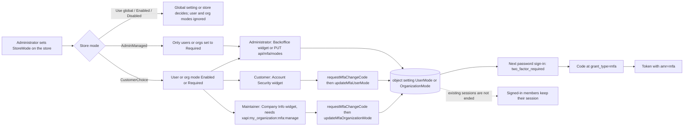
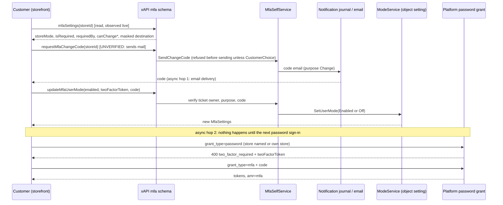
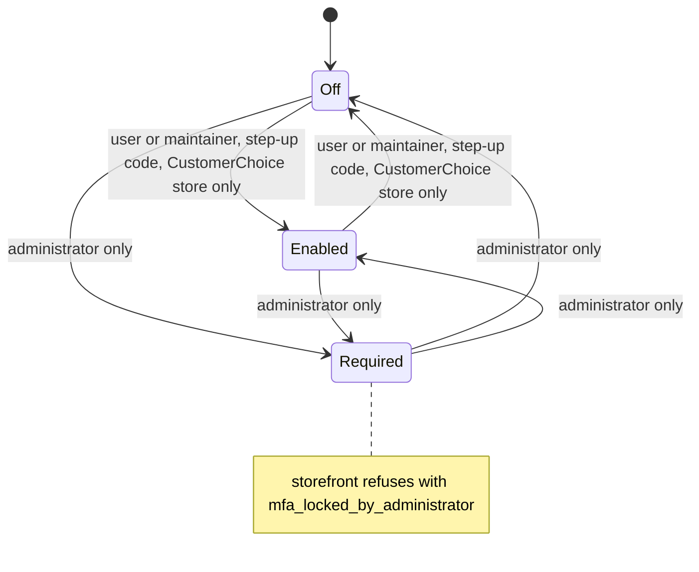

# Auth (storefront sign-in & account access) — domain map

> Refresh with `/qa-domain-map auth`. This file answers **what the feature is and where its
> surfaces are**. It does not carry behavioural rules — those are `BL-AUTH-*` in
> `.claude/knowledge/oracles/bl/auth.yaml` — and it never grounds an assertion as `{DOC}`.

**Every claim carries a verdict.** `CONFIRMED` = observed live or read at source this pass ·
`DRIFT` = prior art says otherwise and prior art is wrong · `MISSING` = documented, does not exist ·
`UNVERIFIED` = not established, and not to be treated as true. A claim carried from an earlier rev and
not re-walked is `UNVERIFIED · rev 2 only` (or `rev 1 only`); a claim whose only witness is another
run's report is `UNVERIFIED · <run>` — the run saw it, this pass did not.

**Mid-change callout (2026-11-04) — read first.** MFA IS mid-change again: **VCST-6597** (status *Testing*) =
vc-module-mfa#3 (OPEN, head `1a0f481`, module 3.1002.0, 13 commits, review required) + vc-frontend#2622 (OPEN, head
`caac275a`); #3 also carries VCST-6495 (password grant honours the user's OWN store) and VCST-6530 (`Disabled`
store mode narrowed) — both bugs "On hold" in the tracker. vcst runs BOTH halves right now (MFA
`3.1002.0-pr-3-1a0f`, theme `2.62.0-pr-2622-caac-caac275a`); vcptcore has neither. **The whole 6597 model is a PR
build: every `AdminManaged` / `CustomerChoice` / user-mode / organization-mode row below moves with that PR.**
Every PR of the rev-3 passkey change is now MERGED (platform#3144, passkeys#1, customer#324, store#190,
x-frontend#13, admin-shell#4, 2026-10-29); only the OTP-in-store-schemes pair (vc-module-otp#2, vc-module-store#189)
is still OPEN. Re-read §1 links 2 and 10–13, §2, D26–D33 and G29–G38 when #3 / #2622 merge, change or revert; the
stand's StoreMode values are point-in-time (another session may flip them).

**Mid-change callout (2026-10-28, rev 3 — kept; superseded where the paragraph above says so).** MFA is no longer mid-change: vc-module-mfa#1, vc-platform#3133,
vc-module-otp#3 and vc-frontend#2570 all MERGED 2026-10-26 and the module is released (3.1000.1).
**Passkeys ARE mid-change**: vc-frontend#2601 MERGED 2026-10-28 08:29Z (the storefront half is in
`dev`), but the platform half (vc-platform#3144 sign-in methods + `ISignInMethodService`,
vc-module-passkeys#1, vc-module-store#190, vc-module-x-frontend#13, vc-module-admin-shell#4) is OPEN and
DEPLOYED on vcptcore as PR builds, and vc-module-customer#324 (OPEN, deployed) changes organization
resolution for EVERY credential grant (the preflight's `breaking:vc-module-customer` WARN names an older release, Customer 3.1021.0 (2026-09), not #324 — #324's own break is unflagged because it is unreleased). vc-module-otp#2 / vc-module-store#189
(OTP as a store authentication type) remain OPEN and are NOT deployed. **Re-read §1 links 3 and 8–9, §2,
D7 and D17–D21 when #3144 / #324 merge, change or revert.** The VCST-6121 run (another session, same stand,
same hours) flips shared store settings and holds the storefront and back-office Chromium lanes: every
setting value below is point-in-time, written with its UTC time.

## Changed since rev 3

| Rev 3 claim | Now | Why |
|---|---|---|
| §2 / "What is NOT here": "no GraphQL MFA or OTP mutation" | **DRIFT.** xAPI has Query `mfaSettings(storeId!, organizationId)` and Mutations `requestMfaChangeCode`, `updateMfaUserMode`, `updateMfaOrganizationMode` (vcst, anonymous introspection 2026-11-04). OTP still has none | introspection |
| §2: "the MFA requirement is not readable (xAPI exposes neither `MultiFactorAuthentication.*`)"; D-list KB-CC18E96D "neither is exposed anonymously" | **DRIFT for the signed-in user, still true anonymously.** `mfaSettings` returns `storeMode`, `isRequired`, `requiredBy`, `userMode`, `organizationMode`, `canChange*`, masked `destination` to a signed-in user; anonymous → `Unauthorized`. Observed for a real B2B user (Disabled store): `isRequired false`, `requiredBy None`, `canChangeUserMode false` | live `GetMfaSettings` (HAR) |
| §2 Permissions: "No MFA, OTP, passkey or sign-in-methods permission exists" (354 on vcptcore) | **DRIFT.** `mfa:read`, `mfa:manage` (group MFA) and `xapi:my_organization:mfa:manage` (group XAPI) are registered by VirtoCommerce.MFA (352 permissions on vcst, 3 of them MFA). OTP / passkey still register none | REST permissions list |
| §2 Admin "Not manageable": "MFA enrolment per user (module is policy-based, source)" | **DRIFT.** A per-user and per-organization MODE exists (`MultiFactorAuthentication.UserMode` / `.OrganizationMode`, hidden object settings, Off / Enabled / Required), set in the Backoffice (both UIs) and, in a `CustomerChoice` store, by the customer / the organization maintainer. Enrolment of a second-factor device is still not a thing (email only) | README + live widget + REST |
| §2 settings read: `MultiFactorAuthentication.StoreMode` allowed `["Use global setting","Enabled","Disabled"]` | **DRIFT.** Allowed values now include `AdminManaged` and `CustomerChoice` (live REST on vcst lists them after `Disabled`; names confirmed at source). Store `B2B-store` on vcst is set to **`Disabled`** (point-in-time); the other six stores are unset ⇒ "Use global setting" | REST + source |
| §1 link 2: MFA "Required by global `MultiFactorAuthentication.Enabled` or the named store's `StoreMode`; OTP and external opt out" | **EXTENDED + DRIFT in part (PR build).** Required by: global setting; the named store's mode; **the user's OWN store (VCST-6495)**; and, in `AdminManaged` / `CustomerChoice` stores, the user mode and any organization mode (organization first). OTP, external, passkey, refresh still opt out | source (MfaRequirementService @ 1a0f481), README |
| §3 D22 / §6 row "the named store decides for every user (112278 / MfaRequirementService)"; KB-0929D604 "a password grant naming a Disabled store issues tokens without a code to ANY user" | **DRIFT at source (PR #3, VCST-6530):** a `Disabled` store skips the code only for the store's OWN customers that are not Backoffice accounts; admins, managers, Backoffice-permission users and users of other stores follow the global setting. Live re-observation `UNVERIFIED` — vcst has global MFA OFF so the two rules produce the same answer there (G32) | README + source; global off |
| §1 link 3 / D25: customer#324 "OPEN, deployed" | **DRIFT (state).** vc-module-customer#324 MERGED 2026-10-29; vcst runs Customer `3.1032.0` (release, no PR suffix). The impersonate / external legs are still `UNVERIFIED` live (G25) | gh; modules |
| Header callout: platform#3144, passkeys#1, store#190, x-frontend#13, admin-shell#4 "OPEN, deployed as PR builds" | **DRIFT (state).** All MERGED 2026-10-29; vcst runs Passkeys `3.1000.0` (release), platform `3.1094.0`, AdminShell `3.1093.0`. vc-module-otp#2 / store#189 still OPEN | gh; modules |
| D14 vcst column: "OTP `3.1001.0-pr-3-d978`, MFA `3.1000.0-pr-1-*`, Passkeys absent, Admin 2 IdPs, grants + mfa + otp_email" | **DRIFT.** vcst now = OTP 3.1001.0, MFA 3.1002.0-pr-3-1a0f, Passkeys 3.1000.0, Admin login Google + Entra ID + Passkey, storefront Entra + Google + Passkey, grants `password, refresh_token, client_credentials, authorization_code, impersonate, external_sign_in, otp_email, mfa, passkey` (no cookie-bridge, no punchout) | live; D14 rewritten |
| §1 link 1: "OTP default view of `/sign-in` does NOT exist on vcptcore" | **Unchanged for vcptcore; CONFIRMED PRESENT on vcst** (B2B-store `OtpSignIn.Enabled` true): heading "Sign in", "We'll email you a code. No password needed.", Email*, **Continue**, "Sign in with a password instead", then Or + Entra ID / Google / Passkey buttons. G7 / D11 on-state now reachable on vcst | live `/sign-in` |
| §2 Sign-in log: "no OTP row exists on this stand" (vcptcore), vocabulary of 9 reasons | **vcst differs (live, 16,670 rows):** types Password 15,563 · MFA 659 · OTP 171 · Impersonation 70 · Logout 61 · Passkey 52 · External 48 · ImpersonationRevert 48; failure reasons add `RequiresTwoFactor` 539, `InvalidCode` 269, `InvalidTwoFactorToken` 136, `CodeAttemptsExceeded` 83, `ProviderNotAvailable` 20, `LockoutDisabled` 20, `FailedAttemptNotRecorded` 6, `OtpDisabled` 2, `StoreNotFound` 2. **Rows now have `organizationId` / `organizationName` fields, but 0 of 16,670 rows populate `organizationId`** (VCST-6438 still open) | REST aggregate |
| §4: "342 rows in 45 suites; 170 suites / 5,713 rows"; 114 = 19 cases / 115 = 14 / 111 = 13 / 033 = 15 / "114a, 114b not counted" | **170 → 174 files, 5,713 → 5,845 rows, 342 → 347 BL-AUTH rows in 47 suites** (basis: csv-parse 2026-11-04). 111 = 14 (12 Automated), 114 = 22 (5 Reviewed, 17 Draft), 114a = 1, 114b = 1 (both Draft), 115 = 16 (3 Reviewed, 13 Draft), 033 = 20 | recount |
| §4: "114/115 are in NO selection, yet `domain:auth-security` would pick them up" | **DRIFT — they are in MORE selections than that.** `regression:plan`: 114 / 114a / 114b are in `frontend`, `full`, `sprint` and `domain:auth-security`; 115 is in `backend`, `full`, `sprint` and `domain:auth-security`. `auth` still holds none of them; 110 / 111 stay excluded everywhere (D35) | `regression:plan` |
| Oracle: "17 invariants" | **18.** BL-AUTH-018 (expired password enforced only on a password sign-in; DECLARED from VCST-6630's expected result). vc-module-mfa#4 (MERGED 2026-11-02) makes the `mfa` grant's ticket carry authentication method `Password`, so tokens from the `mfa` grant keep the expiry check | `bl:extract`; gh diff |
| §3 D8 / G13 `/api/mfa/resend` | **Re-observed on vcst: routed on BOTH hosts** (anonymous POST bogus token → 200 `invalid_two_factor_token`, storefront and back office); `grant_type=mfa` bogus → 400 `invalid_grant / invalid_two_factor_token` | live; KB-12E99BF8 confirmed |
| Rev 3 §1 link 8–9 passkey rows "UNVERIFIED · VCST-6121 run" for the surface | **`/account/security` on vcst re-observed signed in (B2B org admin, no keys): heading "Security", widget "Passkeys" + "Add passkey", "Sign in with your fingerprint, face, device PIN or a hardware security key instead of your password.", "You have no passkeys yet."** — and NO MFA widget (D28/G29) | live |

**Rev 3 §6 claim "`auth.mind-map.json` still lacks … every passkey node" — DRIFT (stale):** the mind map (`amended` 2026-10-28, committed with VCST-6121 #563) DOES carry passkey nodes (`auth.signin.passkey*`, `auth.signin.method-choice.passkey-*`, `auth.org.resolve.passkey-leg`). What it lacks now is the 6597 model: the only store-mode node is `auth.signin.mfa.store-mode`; there is no node for `AdminManaged`, `CustomerChoice`, the user / organization modes, the step-up change ticket, the widgets or the own-store rule — refresh with `/qa-test-mind-map` after the PR settles.

**Changed since rev 3, one line each that the table does not carry:** the vcst stand has an expired license banner in the AngularJS admin ("Your license has expired on Jan 1, 2026, please renew" — environment, not product); AngularJS login on vcst still logs 2 console errors on first load (anonymous 401 on `…WidgetColorMarkers`, the same as rev 3's vcptcore); the Admin Shell logs 0 errors.

## Changed since rev 2 (carried from rev 3 — each row's verdict stands unless a rev-3 row above overrides it)

| Rev 2 claim | Now | Why |
|---|---|---|
| Header / callout: "MFA spread over five OPEN PRs"; "MFA code is PR-stage (vc-module-mfa#1 unmerged)" | **DRIFT.** All MERGED 2026-10-26; module `VirtoCommerce.MFA 3.1000.1` (release) on vcptcore. vcst ran PR builds `3.1000.0-pr-1-*` at the time of the 5904 rounds | `gh pr view`; modules list |
| frontmatter / §4: MFA "zero suites, zero fixtures, zero cases — HOLE" | **CLOSED.** Suites **110** (MFA API + Backoffice, 32 cases) and **111** (storefront, 13) exist (commit 3f54bf98); 110 has a fixtures creator. 45 cases: 35 Automated, 10 Draft | csv-parse; manifest |
| G10 MFA end-to-end "OPEN" | **CLOSED by prior art** (not re-driven): VCST-5904 round 2 (vcst, 2026-10-23) PASS WITH NOTES — password→code step→`amr=mfa`, Backoffice `#!/sign-in-code`, requirement matrix, resend, wrong-code cap; open product findings in D22–D23 | `reports/tickets/Sprint26-21/VCST-5904/vcst-2026-10-23/summary.json` + checklist C1–C3 |
| G11 "OTP opts out of the second factor" OPEN | **CLOSED by prior art, as a recorded door**: `otp_email` alone issues tokens on an MFA-required store (5904 C-34) | `reports/tickets/Sprint26-21/VCST-5904/vcst/verdict.md` "Doors recorded" |
| G13 / D8 "`/api/mfa/resend` 405 on the storefront origin — suspected defect" | **DRIFT.** Not recurring on vcptcore (anonymous POST → 200 `invalid_two_factor_token`, both hosts); on vcst the same call was routed by 2026-10-23 (KB-12E99BF8 contested; its 2026-10-23 note: UI "Resend code" → 200). The ingress route differs per stand | anonymous POST 2026-10-28; KB |
| D6 "filter offers 'Sign-in code'" | **DRIFT on later builds**: on platform 3.1090 the Type filter reads "Multi-factor authentication" and has no "Sign-in code" (KB-D42D6CAA, contested note). vcptcore UI filter not seen this pass (no Admin UI session) — see G21 | KB-D42D6CAA |
| D7 "OTP is switched elsewhere than the Authentication blade" | **NARROWED.** PASSKEY is now a store authentication scheme (`GET /api/store-authentication-schemes/{storeId}` lists Passkey; docs: "By default, all registered authentication types are enabled"); OTP still is NOT in the schemes (B2B-store: Password, GoogleSSO, Passkey), because vc-module-otp#2 / store#189 are still OPEN | REST, vcptcore |
| §1 link 3: "refresh_token and impersonation get none" fallback | **DRIFT at source (customer#324, OPEN, deployed)**: fallback is allowed for every request EXCEPT a `refresh_token` carrying `organization_id`; impersonate, passkey, external now fall back too; the org claim is rewritten on fallback; a rejected request logs reason `NotAllowed`; the lockout check moved out of the customer module into the platform base handler (#3144). Live for impersonate `UNVERIFIED` (G25) | gh diff; KB-6F34216D |
| §2: Admin `#!/login` offers password + IdPs; "no OTP"; no passkey | **DRIFT.** Both back-office UIs offer a passkey entry: AngularJS `#!/login` "Passkey" link, **Admin Shell** `/apps/admin-shell/#/login` "Sign in with a passkey" first. (The VCST-6121 model's 1r note "Admin Shell has no passkey button" was itself wrong — its 3x amendment corrects it) | live firefox, anonymous |
| §2: Security menu / user blade | **NEW surfaces (UNVERIFIED live, source/swagger only)**: user blade and Admin Shell **Sign-in methods** blade (own keys), `GET /api/platform/security/sign-in-methods`, `currentuser/sign-in-methods/{name}/keys/{id}` PUT/DELETE, store schemes GET/PUT, `/connect/session`, `…/users/{userId}/sessions/{id}` DELETE | swagger.json, vcptcore |
| §2: grant types | vcptcore = `password, refresh_token, client_credentials, authorization_code, impersonate, external_sign_in, mfa, otp_email, passkey, urn:vc:cookie-bridge`; **no `punchout`** (module absent) | discovery document |
| D14 "two stands" | **THREE stands**; the matrix is rewritten | see D14 |
| §4: 160 suites / 5,421 rows / 312 BL-AUTH rows in 37 suites | **170 suites / 5,713 rows / 342 BL-AUTH rows in 45 suites** (basis: csv-parse of every CSV, 2026-10-28; includes untracked 114/115). New: 110, 111, 112 (sales rep, not auth), 113 (Punchout OrderRequest), 114, 115 | recount |
| §4 "Terminate-session: no case in an auth suite" | **Partial.** The regex now finds a terminate/sessions mention in 032 (an auth suite) as well as 101, 006, 050d (4 suites, 7 rows); none drives the user-blade widget | recount |
| Rev 2's prior-art paths for the two OTP guides (then directly under reports/ba/) | **MOVED** to `reports/ba/Auth/` (untracked in the working tree) | `ls` |
| §1 link 7 / G16 "terminate a single session needs a mutation, endpoint unknown" | **Endpoint now known** — swagger lists `DELETE /api/platform/security/users/{userId}/sessions/{id}` and `…/sessions`; effect still `UNVERIFIED` | swagger |
| NEW — OTP default | **OTP is OFF on every vcptcore store**: `OtpSignIn.Enabled` is null on all 12 stores and xAPI answers false for B2B-store and Clothing (13:56Z). On vcst and vcptcore_qa1 B2B-store had it true — so the OTP default view of `/sign-in` (rev 2 §2) does NOT exist on vcptcore | REST + xAPI |

**Folded from "Changed since rev 1" (condensed, still true):** the Admin per-user Active sessions widget and
Lock account button exist (rev 1 was wrong); `lockoutSecondsRemaining` is on every token-error envelope
(null on the password grant even while locked); the impersonation permission id is
`platform:security:loginOnBehalf`; suite 044 has 34 cases; the OTP suites are partly promoted.

## §1 — Purpose and value chain

**Purpose: a visitor establishes an authenticated session by one of several methods, the platform
resolves which organization (if any) that session acts within, and every later request carries that
identity and org context until the session ends or is refused. — reconstructed from source + live;
`UNDECLARED` in every published guide. `CONFIRMED` as a reconstruction (first written statement; cite
against it, do not treat it as authority).**
Where I looked (2026-10-28): PlatformUserGuide, StorefrontUserGuide, PlatformDeveloperGuide,
StorefrontDeveloperGuide, FrontendSourceCode, B2BExperts. The only purpose sentence found is for the Admin
**Security** module, not sign-in: "The **Security** module provides various options to manage security and
authentication for your online store or website." (https://docs.virtocommerce.org/platform/user-guide/security/overview;
rev 2 quote, re-confirmed by the overview's current feature list, which names users, roles, API keys, login on behalf and
active sessions and **does not name sign-in methods, the sign-in log, MFA, OTP or passkeys**). The storefront pages say *how* ("Enter you email and
password", https://docs.virtocommerce.org/storefront/user-guide/registration_and_signing_in/sign-in), never *why*. B2BExperts returned
only checkout / marketplace articles. **No guide has any page for MFA, OTP sign-in or passkeys** (queries "passkey", "multi-factor
authentication", "one-time password OTP", "sign-in methods" returned none) — D16.

| # | Link, in the customer's words | Mechanism | Verdict |
|---|---|---|---|
| 1 | I pick a way to sign in | Storefront `/sign-in`: store-gated methods from xAPI `store.settings.authenticationTypes` (vcptcore B2B-store `[Password, GoogleSSO, Passkey]`, Clothing `[GoogleSSO, Passkey, Password]`); the **OTP email form is the default view only when store setting `OtpSignIn.Enabled` is true (not on vcptcore today)**; password form otherwise; IdP and Passkey buttons under "Or". Passkey also fires silently on page load/field focus (conditional mediation, D21). Back office: AngularJS `#!/login` (password, Google, Passkey) and Admin Shell `#/login` (passkey first, Google, password). Punchout: `/punchout/<token>` (module absent on vcptcore) | storefront + both back-office logins `CONFIRMED` live (vcptcore, anonymous); OTP default view `UNVERIFIED` here (no OTP-on store); Punchout `UNVERIFIED · rev 2 only` |
| 2 | The platform challenges me | Password: `POST /connect/token grant_type=password`. OTP: `POST /api/otp/request` → `grant_type=otp_email`. **MFA: after a correct password the grant answers `400 two_factor_required` + `twoFactorToken`; code at `grant_type=mfa` (fields `two_factor_token`, `code` — KB-1609EA54); `POST /api/mfa/resend`; token carries `amr=mfa`; Backoffice via `/api/mfa/signin/send|verify` and `#!/sign-in-code`.** Required by global `MultiFactorAuthentication.Enabled` or the named store's `StoreMode`; OTP and external opt out. **Passkey: `passkeyRequestOptions` (anonymous, usernameless, `allowCredentials: []`, user verification required, 300 s timeout, `rpId` = the request host) → `navigator.credentials.get` → storefront `POST /connect/token grant_type=passkey credential storeId`; back office `POST /api/platform/security/sign-in` (cookie)**; the passkey grant handler never asks for a second factor (source: `IsTwoFactorRequiredAsync` returns false, "as SignInManager.PasskeySignInAsync does") | password/OTP `CONFIRMED` (rev 2); MFA grant/endpoints and passkey grant/options `CONFIRMED` live for existence + error shape (vcptcore, anonymous); real MFA challenge `UNVERIFIED` here, `CONFIRMED` by the 5904 rounds (vcst); passkey success `UNVERIFIED` here (ceremony, G20), observed by the 6121 run |
| 3 | I get a token and land in an organization | Org resolution BL-AUTH-015 over *accessible* orgs. **After customer#324 (source, OPEN, deployed): every grant falls back to an accessible organization except a `refresh_token` that carries `organization_id`; the claim is rewritten on fallback; a refused request logs `NotAllowed`.** Rev 2's "mfa `CONFIRMED` at source" is carried (5904 checklist C-16/17 covered the mfa leg by REST on vcst) | source `CONFIRMED` (gh diff); mfa leg `CONFIRMED` by prior art (vcst); passkey leg observed by the 6121 run (SBTM: locked last-used org → lands in the usable org); impersonate leg `UNVERIFIED` live (G25) |
| 4 | My session is stored and surfaces unlock | Storefront keeps tokens client-side and calls `me`; account menu has user, org radio list, sign-out; Admin keeps a cookie session (the passkey door creates one). Admin lists a user's sessions (IP address, User agent) | `UNVERIFIED · rev 2 only` (no signed-in session this pass) |
| 5 | Access can be refused | (a) global `LockoutEnd` — one failed-attempt counter shared by password, OTP and MFA codes; five failures → `user_is_temporary_locked_out` (KB-8646A9CB, KB-262ADDFB); **the lockout check now lives in the platform base grant handler (#3144), so passkey is refused when locked (6121 observed) — but a passkey SUCCESS does not reset the counter (D20)**; (b) MFA wrong-code cap `MaxCodeAttempts` 3 is held per platform instance (VCST-6506, D23) and the log reasons `CodeAttemptsExceeded`, `InvalidTwoFactorToken`, `ProviderNotAvailable`, `LockoutDisabled` exist (KB-D42D6CAA); (c) org-scoped refusal (BL-AUTH-012/013/015/016); (d) store rule `user_cannot_login_in_store` — **checked AFTER the MFA challenge**, so a store-refused customer is challenged and emailed first (D22); passkey grant refuses a foreign store structurally; (e) Admin UI entry denied to an account with no permission (`#!/contact-admin`); (f) a Customer-type account at the back-office cookie door (passkey) | (c)(e) `UNVERIFIED · rev 2 only`; (a) shape `CONFIRMED` (rev 2) + 6121 run; (b)(d) `CONFIRMED` by the 5904 rounds, not re-driven; (f) by the 6121 run |
| 6 | An operator acts as another user | Storefront Company → Members, or Admin user blade "Login on behalf" (opens storefront `/account/impersonate/<id>`, KB-EF3CB7FB), permission `platform:security:loginOnBehalf`; grant `impersonate`; **the storefront re-prompts the operator for credentials ("Confirm your identity to continue", a code step when MFA applies — 5904 Q1 open)**; impersonated sessions are refused by key-management writes (source: `PasskeyService.CreateAsync`; xAPI `changePassword` NOT refused — 6121 N4) | permission id `CONFIRMED` (live: in the 354-permission list); flow `UNVERIFIED · rev 2 only`; the doc now exists (D20b) |
| 7 | The session ends — or the refusal is lifted | Sign-out via the account-menu popup only (no `/sign-out`, BL-AUTH-007); Admin Sign out; **Admin "Terminate all" and (REST) a single-session DELETE**; lockout expiry; admin unlock; org unlock; MFA two-factor token expiry 10 min and code lifetime ~9 min (KB-F57D86E8) | `UNVERIFIED · rev 2 only` (terminate effect, G16); REST endpoints `CONFIRMED` present (swagger) |
| 8 | **I manage how I can sign in** (NEW) | Storefront `/account/security` (anonymous → `/sign-in?returnUrl=/account/security`); xAPI `signInMethods` (Unauthorized when anonymous), `passkeyCreationOptions`, `createPasskey`, `renameSignInKey`, `deleteSignInKey`; back office: user/Admin Shell **Sign-in methods** blade over REST `currentuser/sign-in-methods` (a Customer token gets 403 on the REST route, xAPI serves it — KB-4E40858D). Rules seen by the 6121 run, not here: last key refused (`last_sign_in_key`), duplicate authenticator refused client-side, no key-count cap, password deletable | route redirect `CONFIRMED` live; xAPI Unauthorized `CONFIRMED` live; the rest `UNVERIFIED · VCST-6121 run` |
| 9 | **Taking a key away takes access away** (NEW) | REST DELETE of a key → `TryTerminateUserSessions`: other tokens/refresh die, the calling cookie session stays (KB-4E12E506; source in #3144 `SecurityController`); **xAPI `deleteSignInKey` does not terminate sessions** (6121 N/S23); store-scheme off → the Passkey button disappears on a fresh load but the grant does not re-check the scheme (6121 N3); no admin revoke of ANOTHER user's key (VCST-6522, ABSENT IN PRODUCT) | `CONFIRMED` source (REST); xAPI/store-gate `UNVERIFIED · VCST-6121 run` |
| 10 | **The store decides WHO is asked for the code** (NEW, VCST-6597, PR build) | Per-store setting `MultiFactorAuthentication.StoreMode`: `Use global setting` (default) · `Enabled` (everyone) · `Disabled` (the store's own customers skip it) · **`AdminManaged`** (only users / organizations an administrator set to `Required`) · **`CustomerChoice`** (users / organizations with mode `Enabled` or `Required`; off by default). Evaluated by `IMfaRequirementService.GetRequirementAsync` for: the store NAMED in the token request, the user's OWN store (`ApplicationUser.StoreId`) when the named one does not require it, and — for the Backoffice sign-in — only the global setting. Read by the platform `ITwoFactorPolicy` on every password sign-in | store setting + status API on vcst `CONFIRMED` live (values, `isDisabledModeSkipped`, per-store rows); the evaluation rules `CONFIRMED` at source only (README + service, head `1a0f481`) — live differentiation needs global MFA on or a chosen-mode store (G32) |
| 11 | **I (or my company) turn it on** (NEW) | Storefront: Account › Security widget (user) and Company › Info widget (organization, needs `xapi:my_organization:mfa:manage`) → xAPI `requestMfaChangeCode(storeId)` (refused with `mfa_self_service_not_allowed` outside a `CustomerChoice` store BEFORE a code is sent) → email with a code (notification `MfaSignInEmailNotification`, journal) → `updateMfaUserMode(storeId, enabled, twoFactorToken, code)` or `updateMfaOrganizationMode(storeId, organizationId, enabled, …)` → mode saved as an object setting on the user / organization → `mfaSettings` re-read. Change tickets and sign-in tickets are not interchangeable (purpose `Change`); an impersonated session is refused (`Forbidden`) at the resolver; turning ON needs a deliverable provider (confirmed email) — the widget disables the button and says "Confirm your email to turn on two-factor authentication." | `GetMfaSettings` + widget gating `CONFIRMED` at source and, for the read half, live; the three mutations: shape `CONFIRMED` (introspection), behaviour `UNVERIFIED` — each sends mail or writes (G29–G31, G36) |
| 12 | **An administrator decides for a user or a company** (NEW) | Backoffice: user blade widget "Multi-factor authentication" (Off / Enabled / Required) and organization blade widget, both opening a Mode blade with **Effective status** (per store: setting, "Code at sign-in", the reason; a "Preview of the selected mode"); REST `GET|PUT /api/mfa/modes/users/{id}` · `…/organizations/{id}` · `…/status[?mode=]`, permissions `mfa:read` / `mfa:manage`. `Required` is set ONLY here and cannot be turned off in the storefront (`mfa_locked_by_administrator`) | user-blade widget, mode blade, effective-status table, Admin Shell overflow widget `CONFIRMED` live (vcst, read-only); GET / 400 / 404 / 401 `CONFIRMED` live; PUT, Save, the organization-blade widget, the `mfa:read`-only role: `UNVERIFIED` (G31, G33, G34) |
| 13 | **It bites at the NEXT password sign-in** (NEW) | The mode is an input to the requirement, not an action: nothing is revoked or re-challenged when it changes. A member already signed in keeps their session; at the next `grant_type=password` the grant answers `400 two_factor_required` + `twoFactorToken` and the code goes at `grant_type=mfa` (link 2). **Async hop = the email** (journal on vcst when SMTP is unavailable) and the **next sign-in**; in the window between "turned on" and "next sign-in" the status API / widget say "On" while access is unchanged | `UNVERIFIED` live (needs a mode change + a sign-in on a chosen-mode store); the no-revocation half `CONFIRMED` at source (MfaModeService only writes the setting) (G38) |

**The 6597 requirement, as the source computes it** (`MfaRequirementService` @ `1a0f481`, README — *source reading, not an oracle; `UNVERIFIED` live*):

| Store mode | Org mode(s) of the user's contact | User mode | Needs a code? (`requiredBy`) |
|---|---|---|---|
| Use global setting | ignored | ignored | global setting (`Global`) |
| Enabled | ignored | ignored | yes (`Store`) |
| Disabled | ignored | ignored | no for the store's own non-Backoffice customers; **everyone else → global setting** (VCST-6530) |
| AdminManaged | any `Required` | ignored | yes (`Organization`) |
| AdminManaged | none `Required` | `Required` | yes (`User`) — `Enabled` changes nothing |
| CustomerChoice | any `Enabled` or `Required` | ignored | yes (`Organization`) — a member cannot switch it off |
| CustomerChoice | none | `Enabled` or `Required` | yes (`User`) |
| CustomerChoice / AdminManaged | none | `Off` | no |

then, if that store does not require it and the user's own store differs from the named one (or none was named), the OWN store's answer applies (`isRequiredByUserStore`, VCST-6495). Backoffice sign-in: global setting only, for every user.

**Variants — two sharing a link but not a code path are two rows:** (a) store mode × (user mode, org mode) as above; (b) **who sets the mode**: customer (xAPI, `CustomerChoice` only, step-up code), organization maintainer (xAPI, needs the permission + current organization = target), administrator (REST / Backoffice, `Required`, no code); (c) **scope of the flip**: a user mode is global to the user, but only chosen-mode stores read it; (d) Backoffice sign-in (global only) vs token endpoint (store rules) vs Basic auth (refused for MFA-required users, source) vs OTP / external / passkey / refresh (never challenged).

**Reverse edges — 6597.** Off by the user (code + `CustomerChoice`) → next sign-in no code; Off by the maintainer (code) → members whose own mode is `Enabled` still need it; `Required` → only an administrator (Backoffice / REST) can lower it; the store switching OUT of `CustomerChoice` / `AdminManaged` makes stored modes dormant, not erased (they bite again if the store returns — source, `UNVERIFIED` live); **no session / token is ended when a requirement is switched on** (source; consistent with 5904 C-38) — **FINDING, G38**; **no notification to members or administrators and no sign-in-log row when a user, a maintainer or an admin changes a mode** (source: MfaSelfService / MfaModeService / MfaModesController contain no log or notification call; the platform "Changes" widget for object settings `UNVERIFIED`) — **FINDING, D32**; deleting a user / organization leaves the object-setting row (`UNVERIFIED`).

**Guard the sibling path has and this one does not** (diff of REST `PUT /api/mfa/modes/*` vs xAPI `update*Mode`, source): xAPI checks authenticated user, impersonation, `CustomerChoice`, `Required`-lock, organization membership + permission, the step-up code; REST checks only `mfa:manage` and a known mode name — it does **not** check the user / organization exists (`SetUserModeAsync` only throws on an empty id), whereas the `…/status` GET answers 404 for an unknown user. Hypothesis H1, `UNVERIFIED` (a PUT with an unknown id would write an orphan object setting; needs a mutation). The opposite diff: xAPI `canChangeUserMode` ignores an organization requirement (only the widget hides the switch) — D30.

**Reverse edges.** Lockout → expiry/unlock (`UNVERIFIED`); session → terminate (REST single/all endpoints present, effect `UNVERIFIED`, G16);
MFA two-factor token → single redemption + expiry (`CONFIRMED` by 5904: replay → `invalid_two_factor_token`; but a store-rule refusal after
a right code burns the ticket, KB-3BF84A5E; per-ticket retention is mixed per KB-7EFFA0AD); org fallback → restore next sign-in (6132 row 22);
key delete → sessions end (REST yes, xAPI **no** — D19). **Sessions minted before the MFA requirement is switched on survive it** (5904 C-38,
recorded door). **No reversal exists for a consumed OTP code** (replays — KB-06FE6C8D, KNOWN DEFECT VCST-6490). **No way for an administrator to
revoke another user's passkey** (VCST-6522). **No way to switch Passkey off per store at the TOKEN endpoint** (D18, 6121).

### Diagrams (rev 4 — the 6597 chain; labels are the surfaces as seen live or read at source)

### Actors

| Actor | Can do | Verdict |
|---|---|---|
| Anonymous visitor | Browse, sign in by any enabled method, request a password reset, request an OTP code (`/api/otp/request`, anonymous), call `passkeyRequestOptions` anonymously (200, a fresh challenge), hit `/blocked` | `CONFIRMED` live (vcptcore) |
| B2C customer, no org | Same, then no org label, no Organizations list, no Corporate group; token has no `organization_id` / `permission` claims; first render of `/account/security` after a passkey sign-in shows a transient ApolloError and a blank page until reload (6121 N7) | `UNVERIFIED · rev 2 only` + 6121 run |
| Multi-org B2B buyer | Header "Org / user", Organizations radio list, Corporate group; lands in the usable org after a fallback | `UNVERIFIED · rev 2 only` |
| Manager (account type) | Admin SPA user with permissions; can use REST `currentuser/sign-in-methods` (a Customer cannot, KB-4E40858D) | `UNVERIFIED · 6121 run` |
| Customer account with zero permissions | Cannot enter the Admin SPA: `#!/contact-admin` "Access denied" | `UNVERIFIED · rev 2 only` |
| Platform administrator (`admin`) | Admin SPA; password grant on vcptcore answered a token with NO MFA challenge (global MFA off, 13:56Z); has Google SSO and Passkey rows in its own `currentuser/sign-in-methods`, with one passkey key already registered (created 2026-10-28 11:27Z, authenticator name "Apple Passwords" — read, not touched). Lock behaviour on vcptcore `UNVERIFIED`: the sign-in log shows 152 failed `admin` attempts in its window | `CONFIRMED` live (grant + method list) |
| Operator with `platform:security:loginOnBehalf` | Login on behalf | permission `CONFIRMED`; flow `UNVERIFIED · rev 2 only` |
| Account with unconfirmed email | MFA email provider needs a confirmed email (`mfa_provider_not_available`, `ProviderNotAvailable` log reason — KB-D42D6CAA) | consequence `CONFIRMED` by 5904 (log reason); counts `UNVERIFIED · rev 2 only` (qa1) |
| **Passkey-only account** (NEW) | Reachable though out of scope in VCST-6121: the password can be deleted from both back-office UIs and xAPI | `UNVERIFIED · VCST-6121 run` (S7) |
| vc-shell / API apps | Password grant with no store; must handle `two_factor_required` once global MFA is on; **the Admin Shell has no MFA code step — follow-up VCST-6533** | `UNVERIFIED` (G27) |
| Punchout buyer | Mapped contact from an ERP start link; sign-in log Type `punchout` | `UNVERIFIED · rev 2 only`; absent on vcptcore |
| External-IdP-linked account | Google (and Entra / Virto where configured); the external sign-in service passes `bypassTwoFactor: true` (source, 5904 triage) | `UNVERIFIED` (excluded); source note carried |
| **B2B org admin without `xapi:my_organization:mfa:manage`** (NEW; the vcst agent-slot-3 account, Customer type, 0 platform roles — its org role comes from the contact) | Account › Security shows ONLY the Passkeys widget; Company › Info shows name, logo, addresses and no MFA widget. xAPI answered `mfaSettings` for B2B-store: `storeMode Disabled, isRequired false, canChangeUserMode false, organizationMode null` | `CONFIRMED` live (vcst, 2026-11-04) — and by design of the gate (D28) |
| **Organization maintainer WITH the permission** (NEW) | Company › Info widget "Two-factor authentication for the company"; turn on / off with a code, in a `CustomerChoice` store, when the current organization is the target | `UNVERIFIED` — no role carries the permission and no store is `CustomerChoice` on vcst (G30) |
| **Member whose company requires MFA** (NEW) | Account › Security widget with status text "Your company requires it…" and NO switch; sign-in needs the code | `UNVERIFIED` — source (`isRequiredByOrganization`), the ticket's screenshot 6 |
| **Customer in an `AdminManaged` store** (NEW) | Read-only status, hint "The store administrator manages two-factor authentication."; mutations refused `mfa_self_service_not_allowed` | `UNVERIFIED` live (G29) |
| **Administrator with `mfa:read` only** (NEW) | Widget + blade visible, mode selector locked, no Save; `PUT` → 403 | `UNVERIFIED` — the ticket author covered it by a unit test and a browser trick, not a real role (his scenario 10 "Partly"; G33) |
| **Operator in an impersonated session** (NEW) | Cannot change MFA: resolver throws `Forbidden`; widget shows hint "You can't change it while you act on behalf of the customer." and no switch | `UNVERIFIED` live (G37) |

**Variants that change sign-in behaviour without changing code** (point-in-time, vcptcore 13:56Z unless stated):
`OtpSignIn.Enabled` per store — null on all 12 stores (OFF); `MultiFactorAuthentication.Enabled` null (default false) and per-store
`StoreMode` null on all 12 (⇒ "Use global setting"); per-store authentication schemes — B2B-store saved (Password, GoogleSSO,
Passkey; the Passkey row was persisted 2026-10-28 13:12Z by another session), Clothing / Electronics / B2B-loyalty unsaved
defaults (all active, id null); `trustedGroups` — B2B-loyalty→[B2B-store], Clothing→[Electronics, B2B-store],
Electronics→[Clothing, B2B-store], B2B-store→[]; `Stores.EmailVerificationEnabled` B2B-store true / `…Required` false;
global `Passkey:Enabled` is an appsettings value (default true, source) — no runtime switch (6121: no passkey / WebAuthn / FIDO
setting among 381 platform settings); the Passkeys module registers no platform setting and no permission (KB-2338B876; `Passkeys.StorefrontPlugin.Enabled`
→ "not registered" live); `PasswordLogin:DetailedErrors` (D11); store authentication types; module set (D14). The other eight stores include
disposable / odd ones (`AGENT-TEST-*`, `TEST-DEL-STORE-*`, `123` in state RestrictedAccess).

**Variants on vcst, point-in-time 2026-11-04 ~11:10Z (REST, admin token)** — 7 stores: `AGENT-TEST-BARCODE`, `Electronics`, `QA-STORE`, `test_del`, `TS-FULL-001`, `TestStore` (state Closed): `MultiFactorAuthentication.StoreMode` unset (⇒ "Use global setting"); **`B2B-store`: `Disabled`**. Global `MultiFactorAuthentication.Enabled` = **false** (a stored row exists, id `7e4a…`). `OtpSignIn.Enabled`: **B2B-store true**, others unset. `UserMode` / `OrganizationMode` descriptors exist (hidden, default `Off`); the contact / user rows read: the vcst agent-slot-3 user mode `Off`, its organization mode `Off`. `trustedGroups`: B2B-store→[Electronics], Electronics→[B2B-store], TestStore→[B2B-store]. Store authentication schemes: B2B-store saved (Password, AzureAD, GoogleSSO, Passkey, all active, **no OTP row** — vc-module-otp#2 still OPEN); every other store unsaved defaults (GoogleSSO, AzureAD, Passkey, Password all active, id null). `XAPI.Security.ReturnModuleVersion` = true (the theme's MFA widget needs it, D29). **No store is in `AdminManaged` or `CustomerChoice`, so no 6597 customer-facing control is reachable on vcst without a shared-setting write** (G29–G31). `Stores.EmailVerification*` not re-read.

## §2 — Surface inventory

### Storefront

- **Routes**: `/sign-in` (live, vcptcore) · `/account/security` (live: anonymous redirect only) · `/sign-up` · `/forgot-password` · `/blocked` · `/account/change-password` — rev 2 `CONFIRMED` on other stands, `UNVERIFIED` here. Source-only: `/reset-password`, `/set-password`, `/confirm-invitation`, `/account/confirmemail`, `/account/impersonate/:userId`, `/oauth/authorize`, `/auth/callback`, `/successful-registration`, `/403`. `/punchout/<token>` absent (no module). No `/sign-out` or `/logout` (BL-AUTH-007, rev 2).
- **`/sign-in` on vcptcore B2B-store (OTP off)**, page title "QA-audit-test | B2B-store | Sign in", environment indicator "QA-audit-test": heading "Sign in"; Email*, Password* (show/hide), Remember me, "Forgot your password?", **Sign in**, Sign up; then "Or" with **"Sign in with Google"** and **"Sign in with Passkey"**. No OTP link, no Entra button. Footer "Ver. 2.61.0-pr-2601-8058-80583415". Console on a firefox load: 0 errors, 3 warnings (GA cookie expiry ×2, an unused preload). No `/connect/token` request fired on load in firefox (no resident credential). `CONFIRMED` live.
- **`/sign-in` OTP default view (when OTP is on)** and **MFA code step**: rev 2 text carried; the MFA step was observed on vcst by the 5904 rounds (KB-5874C9A4: heading "Enter the sign-in code", masked email, 30 s Resend countdown, auto-submit at 6 digits, "That code didn't work." ×3, 4th submit → back to the password form "Too many incorrect codes", Resend → "New code sent." + new email). `UNVERIFIED` here (MFA off; OTP off).
- **`/sign-in` on vcst B2B-store (OTP ON; rev 4, `CONFIRMED` live, anonymous, `playwright-edge`)**: page title "QA & Sign in", footer "Ver. 2.62.0-pr-2622-caac-caac275a", environment indicator "QA". Default view: heading "Sign in", text "We'll email you a code. No password needed.", Email*, **Continue**, link "Sign in with a password instead" (`otp-email-switch-to-password-link`); under "Or": **Sign in with Entra ID**, **Sign in with Google**, **Sign in with Passkey**. After the switch: Email*, Password* (show/hide), Remember me, "Forgot your password?", **Sign in**, "Sign up", and "Sign in with a one-time code instead". Password sign-in as the agent-slot-3 B2B org admin → `/` signed in, no code step (global MFA off, store `Disabled`). 0 console errors read on `/sign-in`.
- **`/account/security`** (vc-frontend#2601, merged): anonymous → `/sign-in?returnUrl=/account/security`, and after sign-in returns there (the second half by the 6121 checklist, `UNVERIFIED` here). Signed-in content (Sign-in methods section: Add passkey, per-key name/created/state, rename, delete; impersonated session shows the heading only — N6) `UNVERIFIED · VCST-6121 run`. Rev 2: the account sidebar had Profile / Addresses / Change password / Saved credit cards and "no security settings" — **DRIFT by #2601** for any store with a method that supports keys; suite 033 AUTH-030/032/033 are contradicted by it (6121 SBTM).
- **`/account/security` on vcst, signed in (rev 4, `CONFIRMED` live)**: account sidebar groups Purchasing (Dashboard, Orders, Returns, Lists, Quote requests, Saved for later, Back-in-stock list) · Marketing (Missions & challenges, Coupons & promotions, Notifications, Points history) · Corporate (Company info, Company members, Sales reps) · User (Profile, Change password, **Security**, Saved credit cards). Page: h1 "Security", one widget "Passkeys" with **Add passkey**, text "Sign in with your fingerprint, face, device PIN or a hardware security key instead of your password." and "You have no passkeys yet." The page fires `GetMfaSettings {storeId:"B2B-store"}` (no `organizationId`) and shows NO MFA widget because the store is `Disabled` and nothing requires the code (widget gate, source: visible when store mode is `AdminManaged` / `CustomerChoice` or `isRequired`). Console: WebSocket info lines only.
- **`/company/info` on vcst, signed in as the org admin (rev 4, `CONFIRMED` live)**: h1 "Company info"; Company name field (save button disabled until edited), Company logo picker ("JPG, PNG … 4.8MB … Maximum 1 files allowed", "Browse your files"), Addresses table with "Add new address" and a row Actions menu. **No MFA widget** — the org widget is registered behind `checkPermissions("xapi:my_organization:mfa:manage")`, which no stock role carries on vcst (D28), and the store is not self-service. Extension point `companyInfo` sits between the name/logo row and the addresses block (source).
- **`/forgot-password`, `/blocked`, Account area, Homepage login section**: `UNVERIFIED · rev 2 only` (not rendered this pass).
- **What is NOT manageable from the storefront** (rev 4 — DRIFT from rev 3, see "Changed since rev 3"): turning OTP / Passkey on or off (store setting / scheme); changing the STORE mode; **setting a user or organization to `Required`**; another user's keys; unlocking an account. What IS manageable now: a customer's own MFA mode and an organization maintainer's company mode — in a `CustomerChoice` store only, with a step-up code (UNVERIFIED live). The requirement is readable by the signed-in user through `mfaSettings` (`CONFIRMED` live); `OtpSignIn.Enabled` is the only public module setting of the two.
- **What is NOT visible from the storefront at all**: the global switch `MultiFactorAuthentication.Enabled`; the store mode of any OTHER store than the one named in the query; the number of wrong codes left; whether the Backoffice requires a code.

### Admin SPA (back office) — two UIs

- **AngularJS `#!/login`** (vcptcore, anonymous, `CONFIRMED`): heading "Sign in to Virto Commerce Manager"; Login*, Password*, Remember me, "Forgot your password?" (`#!/forgotpassword`), **Log in** (disabled until both fields are filled), "or", links **Google** and **Passkey**. No Entra, no Virto. 1 console error on first load (not read this pass; the 6121 summary names an anonymous 401 on `api/platform/settings/VirtoCommerce.Platform.UI.WidgetColorMarkers`).
- **Admin Shell `/apps/admin-shell/#/login`** (`CONFIRMED`): "Welcome back" / "Sign in to Virto Commerce to continue"; buttons "Sign in with a passkey", "Continue with Google"; "or"; Email or username, Password, show-password, **Sign in**, "Forgot password?" (`#/forgot-password`); a marketing aside; footer "Help" link. **No Remember me.** 0 console errors.
- **AngularJS `#!/login` on vcst (rev 4, `CONFIRMED`)**: "Sign in to Virto Commerce Manager"; Login*, Password*, Remember me, "Forgot your password?", **Log in** (disabled until both filled), "or", links **Google sign-in**, **Microsoft Entra ID**, **Passkey** (rev 2 had the first two; Passkey is new). 2 console errors on first load (anonymous 401 `…UI.WidgetColorMarkers`, same as rev 3). Signed in: workspace header shows version link **3.1094.0**, a "License expired on Jan 1, 2026" banner, the left menu (Home, Loyalty missions, Marketing, Loyalty, Contacts, Catalog, Orders, Notifications, Push Messages, Pricing, System Operations, Tasks, Sales Reps, Returns, Quotes, Settings, **Security**, Stores, Developer tools, More).
- **Security blade on vcst (rev 4)**: Security → entries **Users, Roles, OAuth applications, Sign-in log** (no "Sign-in methods" entry at this level). Users list is searchable ("Search keyword…"); a Customer-type row opens the **User information** blade: toolbar Save · Reset · Change password · Lock account · Login on behalf; fields Is administrator, Login, Email + Verified, Status, Account type, Locked state, Last login date, Container (store); widget strip: **Show contact · Multi-factor authentication (value "Off") · Roles (0) · Changes · API key · Active sessions (24) · Sign-in log (49)** — **no Sign-in methods widget on ANOTHER user's blade** (consistent with VCST-6522). Opening the MFA widget shows the **Mode blade** "Multi-factor authentication of <login>": toolbar Save · Reset; **Mode** select with options Off / Enabled / Required and hint "Not turned on. In stores with Customer choice it can be turned on in the storefront."; group **Effective status** with the sentence "Global setting: Off. It decides for the Backoffice sign-in and for stores set to Use global setting." and a table Store / Store setting / Code at sign-in, one row per store (7 rows): "Not required — The global setting is off." for the six Use-global stores, **"Disabled → Not required — The store turned it off for its own customers."** for B2B-store (the user's own store). `CONFIRMED` live (Mode select opened and closed; nothing selected, nothing saved). The Save of a mode, the "Preview of the selected mode" interaction, and the ORGANIZATION blade widget (Contacts → organization) were NOT exercised (G31, G34).
- **Admin Shell on vcst (rev 4, `CONFIRMED`; framework `@vc-shell/framework v2.7.0`)**: Settings → Security & Privacy → **Security** → Users / Roles / OAuth applications / Sign-in log; user blade (`#/security/user/<id>`) toolbar Save · Reset · Change password · Lock · Delete; widget bar API keys (0) · Sessions (24) · Changes · a "more" overflow button whose menu holds **Sign-in log, "MFA: Off", Show contact**; "MFA: Off" opens a blade "Multi-factor authentication of <login>". The module's Admin Shell plugin static files answer 200 (`/modules/$(VirtoCommerce.MFA)/plugins/admin-shell/plugin.json`, `remoteEntry.js`; remote name `mfa_admin`) — as do Passkeys' (`UNVERIFIED` what exactly is exposed). The MFA widget is NOT in the visible widget bar (discoverability, D36). The Admin Shell login-page MFA code step (VCST-6533) was not exercised (G27).
- **Entry restriction, Security menu, User information blade** (toolbar Save · Reset · Change password · Lock account · Login on behalf; widgets incl. Active sessions and Sign-in log), **Sign-in log**, **Settings (Platform → Security, Platform → Sign In Log)**, **Store (Settings widget, Authentication widget, Linked stores, Notification widgets)**: rev 2 `CONFIRMED` on other stands, **`UNVERIFIED` on vcptcore (no Admin UI session — the lane's stored secret belongs to another stand, so no browser sign-in was attempted; G21)**. New by source/prior art: user-blade and Admin Shell **Sign-in methods** blade (`PasskeyAngularJS` widget, `host.extend("Passkey")` in the Admin Shell, vc-module-admin-shell#4 OPEN); AngularJS delete of the last key stays enabled and answers "400: Bad request" while the Admin Shell disables it (KB-5B5D8A99); icon-only links in the AngularJS blade have no accessible name (6121 #9) — all `UNVERIFIED · VCST-6121 run`.
- **Settings read via REST** (`GET /api/platform/settings/<name>`, admin token, 13:56Z): `MultiFactorAuthentication.Enabled` — module VirtoCommerce.MFA, group `Platform|Security`, Boolean, value null, default false; `MultiFactorAuthentication.StoreMode` — group `Store|Security`, allowed `["Use global setting","Enabled","Disabled"]`, null on all 12 stores; `OtpSignIn.Enabled` — module VirtoCommerce.OTP, group `OTP Sign-In|General`, **public**, null on all 12 stores. `CONFIRMED`.
- **Settings read via REST on vcst** (`GET /api/platform/settings/<name>`, admin token, 11:10Z; rev 4): `MultiFactorAuthentication.Enabled` — module VirtoCommerce.MFA, group `Platform|Security`, Boolean, **value false (a stored row)**, default false; `MultiFactorAuthentication.StoreMode` — group `Store|Security`, ShortText, allowed `["Use global setting","Enabled","Disabled","AdminManaged","CustomerChoice"]` (the first four read live in full; the fifth read live only up to "Cust…" because my print was cut — the full name `CustomerChoice` is `CONFIRMED` at source), default "Use global setting"; `MultiFactorAuthentication.UserMode` and `.OrganizationMode` — group `Platform|Security`, **`isHidden: true`** (so they never appear in a settings blade), allowed `["Off","Enabled","Required"]`, default `Off`; `OtpSignIn.Enabled` — public, null at platform level, B2B-store true. `CONFIRMED`.
- **Not manageable from the Admin**: customer-scoped sign-in history or sessions *by the customer*; enrolment of a second-factor DEVICE (the module sends email codes only; per-user / per-organization MODES now exist — see "Changed since rev 3"); **an administrator revoking / managing ANOTHER user's passkey (VCST-6522, ABSENT IN PRODUCT)**; org membership lock/status (b2b map); IdP client secrets (appsettings); the global `Passkey:Enabled` switch (appsettings + restart).

### API / contract layer

- **Grant types** (anonymous `GET /.well-known/openid-configuration`, vcptcore): `password, refresh_token, client_credentials, authorization_code, impersonate, external_sign_in, mfa, otp_email, passkey, urn:vc:cookie-bridge`; endpoints authorization / token / end-session / userinfo (+ jwks); scopes `openid offline_access`; PKCE `plain, S256`. No `punchout`. `CONFIRMED` live.
- `POST /connect/token grant_type=password` — nonexistent user → `400 invalid_grant / login_failed` ("Login attempt failed. Please check your credentials."), `userId` null, `lockoutSecondsRemaining` null (anonymous, vcptcore, nonexistent address — no account touched). `CONFIRMED`.
- `POST /connect/token grant_type=otp_email` for a store with OTP off → `otp_disabled` ("OTP sign-in is disabled for this store."); `POST /api/otp/request {storeId:B2B-store,email}` → 200 `{succeeded:false,error:{code:otp_disabled},maskedEmail:<masked input>}` — the masked form of the typed address is returned even when the store has OTP off. Reachable through the storefront origin. `CONFIRMED` live (vcptcore).
- **MFA**: `grant_type=mfa` bogus token → `400 invalid_grant / invalid_two_factor_token`; `POST /api/mfa/resend` and `/api/mfa/signin/send` → 200 `{succeeded:false,error.code:invalid_two_factor_token}`; **both back-office and storefront hosts route them** (vcptcore). `CONFIRMED` live. The real challenge/exchange: `UNVERIFIED` here (KB-7EFFA0AD, KB-3BF84A5E, KB-1609EA54, KB-F57D86E8 from the 5904 rounds on vcst).
- **Passkey** (`CONFIRMED` live unless noted): `POST /connect/token grant_type=passkey` with no credential → `400 invalid_request / missing_parameters` ("Missing required parameters: credential.") on **both** hosts; `POST /api/platform/security/sign-in {}` (cookie door) → back-office host `400 unsupported_grant_type`, **storefront host nginx `405`** (KB-416B0E02); `POST /api/passkeys/creation-options` and `GET currentuser/sign-in-methods` → 401 anonymous. xAPI (schema introspection 2026-10-28, the vcptcore copy in the 6121 run folder, read in place of the shared 2026-10-15 snapshot): queries `signInMethods()`, `passkeyCreationOptions()`, `passkeyRequestOptions()`; mutations `createPasskey`, `renameSignInKey`, `deleteSignInKey` (+ `changePassword`). `Query.passkeyRequestOptions` anonymous → a JSON string `{challenge, timeout:300000, rpId:<storefront host>, allowCredentials:[], userVerification:"required", hints:[]}`; `signInMethods` anonymous → `Unauthorized`. REST via swagger: `POST /api/passkeys/request-options`, `POST /api/passkeys/creation-options`, `POST /api/passkeys`, `GET /api/platform/security/sign-in-methods`, `GET /api/platform/security/currentuser/sign-in-methods`, `PUT|DELETE …/currentuser/sign-in-methods/{name}/keys/{id}`, `GET|PUT /api/store-authentication-schemes/{storeId}`.
- **Grant types on vcst** (anonymous `GET /.well-known/openid-configuration`, 2026-11-04): `password, refresh_token, client_credentials, authorization_code, impersonate, external_sign_in, otp_email, mfa, passkey` — **no `urn:vc:cookie-bridge`, no `punchout`**. `CONFIRMED`.
- **MFA xAPI, 6597 (rev 4; `mfa` schema; vcst introspection anonymous 11:09Z; behaviour NOT exercised except the read)**: `Query.mfaSettings(storeId: String!, organizationId: String): MfaSettings` — fields `storeId!, storeMode!, isRequired!, requiredBy!, userMode!, canChangeUserMode!, organizationId, organizationMode, canChangeOrganizationMode!, isProviderAvailable!, provider, destination`. Mutations (each takes `command:`): `requestMfaChangeCode(InputRequestMfaChangeCodeType{storeId!}): MfaCodeChallenge` (`succeeded!, twoFactorToken, provider, destination, resendSecondsRemaining, lockoutSecondsRemaining, errorCode, errorDescription`); `updateMfaUserMode(InputUpdateMfaUserModeType{storeId!, enabled!, twoFactorToken!, code!}): MfaChangeResponse` (`succeeded!, errorCode, errorDescription, lockoutSecondsRemaining, settings`); `updateMfaOrganizationMode(InputUpdateMfaOrganizationModeType{storeId!, organizationId!, enabled!, twoFactorToken!, code!})`. Anonymous `mfaSettings` → `errors[].code Unauthorized` ("Anonymous access denied or access token has expired or is invalid."). Error codes at source: `mfa_self_service_not_allowed`, `mfa_locked_by_administrator`, `mfa_organization_not_allowed`, plus the sign-in code errors (`invalid_code`, `invalid_two_factor_token`, `resend_too_soon`, `code_attempts_exceeded`, `mfa_provider_not_available`, `lockout_disabled`, `user_is_temporary_locked_out`…). `CONFIRMED` (shape), behaviour `UNVERIFIED` except `mfaSettings` as a read.
- **MFA REST, 6597 (rev 4, vcst, admin token, GET only)**: `GET /api/mfa/modes/users/{id}` → 200 `{"mode":"Off"}`, anonymous → **401**; `GET …/users/{id}/status` → 200 `{isGloballyEnabled:false, isRequiredForBackoffice:null (Customer user), userStoreId:"B2B-store", stores:[{storeId, storeName, storeMode, isRequired, requiredBy, isRequiredByUserStore, isDisabledModeSkipped}×7]}`; `?mode=Required` → 200 (same rows: no chosen-mode store); `?mode=Bogus` → **400** "Unknown MFA mode 'Bogus'."; unknown user id → **404**; `GET /api/mfa/modes/organizations/{id}` and `…/status` → 200 (`userStoreId:null`). `PUT` on both: `UNVERIFIED` (write). `CONFIRMED` (reads, status codes) — the ticket author's scenario 12 matches for the three codes.
- **Authentication schemes** (REST, admin token): global `GET /api/platform/security/sign-in-methods` → GoogleSSO (kind External, priority 2), Passkey (priority 0; `canCreateKey` true, `canRenameKey` true, `canDeleteKey` true), Password (priority 0; `canDeleteKey` true). AzureAD 3.1003.0 and OpenIdConnect 3.1001.0 are installed but contribute NO method here (not enabled / configured — reason `UNVERIFIED`). `GET /api/store-authentication-schemes/{id}`: B2B-store → Password, GoogleSSO, Passkey (saved, ids present); Clothing / Electronics / B2B-loyalty → GoogleSSO, Passkey, Password, all `isActive` true, id null (not persisted). xAPI `settings.authenticationTypes` mirrors them (KB-2338B876, confirmed). `CONFIRMED`.
- **Sign-in log** (admin token, 13:57Z): `POST /api/platform/security/sign-in-log/search` (3,496 rows) and `/stats` (fields: recordingEnabled, totalCount, failedCount, distinctUserCount, impersonationCount, previous*, timeline, topFailedIpAddresses, topFailedUserNames, failureReasonBreakdown, signInsByOrganization, signInsByStore). `signInType` values present: Password, **Passkey** (33 ok, 74 failed), **MFA (2 failed only)**, External, Impersonation, ImpersonationRevert, Logout — **no OTP row exists on this stand**. `failureReason` values: InvalidPassword, InvalidPasskey, LockedOut, NotAllowed, UserNotFound, Forbidden, MissingParameter, InvalidTwoFactorToken, Unknown. A passkey success row carries host, storeId, memberId, `provider` null, `sessionId` null (KB-84366C59). `CONFIRMED` live. **vcst (rev 4, 16,670 rows, 11:12Z):** the row model is `id, createdDate, userName, userId, succeeded, failureReason, signInType, provider, operatorUserId, operatorUserName, ipAddress, host, userAgent, clientId, sessionId, storeId, storeName, memberId, organizationId, organizationName`; population by type — storeId set on 541/659 MFA, 155/171 OTP, 48/52 Passkey, 15,284/15,563 Password; **`organizationId` set on 0 rows of every type; `sessionId` set only on 2 Impersonation and 19 ImpersonationRevert rows**. A REST search filter named `signInType` is silently ignored (every probe returned the full 16,670) — filter parameter name `UNVERIFIED`. A mode change writes no sign-in-log row at source (D32; live `UNVERIFIED`, it needs a change).
- **Other endpoints present (swagger, existence only)**: `/connect/session` (GET, POST — purpose `UNVERIFIED`, G26), `/api/platform/security/users/{userId}/sessions/search`, `…/sessions/{id}` DELETE, `…/sessions` DELETE, `/api/platform/security/users/{id}/lock|unlock|locked`, `/api/customer/organization-memberships/{id}/lock|unlock`, `/api/stores/{storeId}/accounts/{id}/loginonbehalf`, `/externalsignin/*`, `/api/mfa/*`, `/api/otp/request`. The Swagger document itself is served anonymously (`/docs/PlatformUI/swagger.json` → 200; platform-wide, recorded by the 5904 probe).
- **Permissions** (`GET /api/platform/security/permissions`, 354 on vcptcore): `platform:security:loginOnBehalf`, `…:sign_in_log:read`, `…:generateToken`, `…:verifyToken`, `…:revokeToken`, `…:verifyEmail`, `…:confirmEmail`, `…:oauth_applications:create|read|update|delete`. **Rev 3: "No MFA, OTP, passkey or sign-in-methods permission exists" — DRIFT (rev 4):** vcst lists 352 permissions of which `mfa:read` and `mfa:manage` (group MFA) and `xapi:my_organization:mfa:manage` (group XAPI) are VirtoCommerce.MFA's (no scopes). OTP and Passkeys still register none (any authenticated user manages own keys). `CONFIRMED` live. **None of the four stock organization roles (Organization maintainer 11 permissions, Organization manager 10, Organization employee 2, Purchasing agent 2) carries `xapi:my_organization:mfa:manage`** (D28); `mfa:read` / `mfa:manage` on a Backoffice role `UNVERIFIED`.
- **What is NOT here** (rev 4: the GraphQL MFA mutations now EXIST — rev 3 "no GraphQL MFA … mutation" is DRIFT; OTP has none): no REST or xAPI to LIST every user / organization with a non-Off mode (only per-id GETs and the per-store status); no mode-change history API (D32); no API that reports whether a given SESSION predates a requirement (G38); no OTP code-length / expiry / resend setting; MFA appsettings `TwoFactorTokenLifetime`, `CodeResendInterval`, `MaxCodeAttempts`, `UsedCodeLifetime`, `DisableEnforcement` (source, not readable at runtime); no public way to know a store requires MFA; no runtime switch for the global passkey flag.

## §3 — Where the layers DISAGREE

| # | Disagreement | Verdict |
|---|---|---|
| D1 | The guides trail the build. StorefrontUserGuide "Sign In": "Enter you email and password" and "Click **Log in**." (https://docs.virtocommerce.org/storefront/user-guide/registration_and_signing_in/sign-in) — live vcptcore sign-in shows a **Sign in** button, an "Or" row with Google and **Passkey** buttons; on OTP-on stores the default view is the code form. StorefrontDeveloperGuide: "There are two primary methods for obtaining these tokens in Virto Commerce Frontend:" password and SSO (https://docs.virtocommerce.org/storefront/developer-guide/authentication/authentication-types). "Log in" vs "Sign in" is a UI-string paraphrase (not a defect); the missing OTP / MFA / passkey description is the finding (D16) | `CONFIRMED` — docs trail the build; expected |
| D2 | IdP / method lists differ by surface and by stand. **vcptcore**: Admin AngularJS login Google + Passkey; Admin Shell Google + passkey; storefront Google + Passkey; xAPI `[Password, GoogleSSO, Passkey]` (B2B-store) / `[GoogleSSO, Passkey, Password]` (stores with no saved schemes — Passkey sorts before Password there, KB-2338B876); global REST list GoogleSSO, Passkey, Password; AzureAD installed but contributes none. qa1 (rev 2): Admin 3 IdPs, xAPI `[Password, GoogleSSO, AzureAD, virto]`. vcst (rev 2): Admin 2, xAPI `[Password, AzureAD, GoogleSSO]`. The label for one IdP differs per stand ("Google" vs "Google sign-in") and button order follows each surface's own rule | `CONFIRMED` live (vcptcore); other stands `UNVERIFIED · rev 2 only` |
| D3 | PlatformUserGuide: "The Security module allows you to monitor and terminate active sessions of users." (https://docs.virtocommerce.org/platform/user-guide/security/active-sessions) and the Accounts-table row "Active sessions … Terminate a single session. Terminate all sessions." (https://docs.virtocommerce.org/platform/user-guide/contacts/managing-contacts). Swagger now shows both endpoints (`DELETE …/sessions/{id}`, `DELETE …/sessions`); the user-blade widget offered Refresh and Terminate all (rev 2). Whether the UI offers a per-row terminate `UNVERIFIED` | `CONFIRMED` guides and API agree; UI half `UNVERIFIED` |
| D4 | `lockoutSecondsRemaining` is on every token error body incl. the mfa and passkey grants (null on all vcptcore bodies seen); null on the password grant even while locked (rev 2, KB-262ADDFB). A populated value is still unobserved | shape `CONFIRMED` live; value `UNVERIFIED` (G1) |
| D5 | Relative platform paths vs the storefront ingress: rev 1 `/api/otp` 405, rev 2 `/api/mfa/resend` 405 on vcst. **vcptcore routes both** (200) **but answers an nginx 405 for `POST /api/platform/security/sign-in`** — by design (the cookie door is the back office's), so not a defect unless a storefront flow calls it. The route set is per-stand ingress configuration | `CLOSED` for `/api/otp` and `/api/mfa` on vcptcore; the 405 is `CONFIRMED`, classification `UNVERIFIED` |
| D6 | **Sign-in log vocabularies disagree.** vcst/MFA era (rev 2): Type filter had "Sign-in code" listing rows whose column reads MFA, no OTP option. Later build (3.1090, KB-D42D6CAA contested): filter reads "Multi-factor authentication"; no OTP option still reported. API `signInType`: vcptcore Password / Passkey / MFA / External / Impersonation / ImpersonationRevert / Logout (no OTP, no `punchout`); "Impersonation" displays "On behalf" in the filter; Punchout logs lower-case `punchout`. **Whether the UI filter offers Passkey is unknown** (the 6121 charter lists it as open) | API vocabulary `CONFIRMED` live (vcptcore); filter labels `UNVERIFIED` here (G21) |
| D7 | PlatformUserGuide "Enable Authentication Types": "Enable/ disable one or all available authentication types." (https://docs.virtocommerce.org/platform/user-guide/azure-ad/enabling-authentication-types) and the developer guides: "By default, all registered authentication types are enabled." (https://docs.virtocommerce.org/storefront/developer-guide/authentication/adding-sso-provider). **Passkey now follows that model exactly** (default active, unsaved until the first save, listed by `store-authentication-schemes`). **OTP and MFA still do not**: OTP is `Settings → OTP Sign-In → General`, MFA is `Platform → Security` / `Store → Security`; OTP in the blade waits on vc-module-otp#2 / store#189 (OPEN, not deployed) | `CONFIRMED` live (REST) — passkey agrees, OTP/MFA diverge |
| D8 | (rev 2) MFA resend 405 on the vcst storefront origin | `DRIFT` — see D5; not recurring on vcptcore, routed on vcst by 2026-10-23 per kb |
| D9 | StorefrontUserGuide contradicts itself on the companies list (https://docs.virtocommerce.org/storefront/user-guide/account/company-members): "Every company you belong to is listed, with your current one marked:" … "Only companies you currently have access to appear here." Build (VCST-6132, qa1): a locked org stays listed, disabled with a padlock | `DRIFT` — doc; `UNVERIFIED · rev 2 only` |
| D10 | PlatformDeveloperGuide "Restrict Admin UI Access": "A denied account is redirected to the **Contact admin for support** screen on sign in." (https://docs.virtocommerce.org/platform/developer-guide/Fundamentals/Security/authorization/restrict-admin-ui-access). Live (rev 2): route `#!/contact-admin`, card "Access denied" | `UNVERIFIED · rev 2 only` |
| D11 | Account existence disclosure. vcptcore: password grant for a nonexistent user → collapsed `login_failed` `CONFIRMED`; `/api/otp/request` on an OTP-off store answers `otp_disabled` + the masked **input** address and does not distinguish users `CONFIRMED`. The OTP-on disclosure (`user_not_found` + masked input, 5904 EXP-1 Medium, triaged KNOWN_ISSUE, config-gated by `PasswordLogin:DetailedErrors`, KB-9AF5645D) cannot be re-observed on vcptcore (no OTP-on store). Sign-in log keeps the true cause (`UserNotFound`, 15 rows) | partly `CONFIRMED`; OTP-on half `UNVERIFIED · 5904 run` |
| D12 | Two guides disagree on account types ("Administrator, Customer" in Manage Contacts vs "Administrator, Customer, Manager" in Platform Settings — https://docs.virtocommerce.org/platform/user-guide/contacts/managing-contacts, …/platform-settings); live `AccountTypes` has Manager, Customer, Administrator and data with `SiteAdministrator` | `UNVERIFIED · rev 2 only` |
| D13 | StorefrontUserGuide: "Check **Remember me** to save your credentials." — the vcptcore storefront and AngularJS back-office logins show Remember me; the Admin Shell login has none. KB-9D80EE6B records it as vestigial on the storefront | presence `CONFIRMED` live; effect `UNVERIFIED` |
| D14 | **THREE stands are three products** — matrix below | `CONFIRMED` (vcptcore live; others rev 2 / prior art) |
| D15 | Release ledger lists a Sign-in log page (Platform 3.1071.0); VirtoOZ has no such page, and the Security overview's feature list omits it | `UNVERIFIED` — index gap vs missing page |
| D16 | **No guide documents MFA, OTP sign-in, passkeys, sign-in methods, the sign-in log or the per-store authentication scheme for them.** Queried PlatformUserGuide, PlatformDeveloperGuide, StorefrontUserGuide, StorefrontDeveloperGuide, FrontendSourceCode, B2BExperts for each term. Expected lag (VirtoOZ trails the build, its release corpus stops ~3.917), recorded as a finding because MFA is RELEASED: a released behaviour with no page is a documentation gap, not "no requirement". FrontendSourceCode's `sign_in_form.errors` locale snapshot (branch `master`) lists `login_failed, email_verification_is_required, user_is_temporary_locked_out, user_is_locked_out, user_is_locked_in_organization, user_cannot_login_in_store, password_expired, user_not_found` and no MFA / passkey code — index lags `dev` | `CONFIRMED` — gap |
| D17 | **A new method appears on every store the moment the module installs.** `Passkey` is `isActive` true with id null on Clothing, Electronics and B2B-loyalty (not persisted); B2B-store's row was persisted by an admin save at 13:12Z. Docs agree ("By default, all registered authentication types are enabled."). Consequence for tests: a store's Passkey state is read from `GET /api/store-authentication-schemes/{id}`, never assumed; an admin save writes ALL rows, so a test that saves schemes changes the persisted shape | `CONFIRMED` live; consequence is a reading of it |
| D18 | **The per-store Passkey switch gates the UI, not the token endpoint.** 6121 (N3/S15): a page loaded before the scheme was switched off still obtains a passkey token; the grant does not re-check the scheme (source: grant handler checks lockout, store rule and account type only). Rev 2's doc statement says a disabled type is disabled | `CONFIRMED` live · VCST-6121 (3/3; suites 114 PKS-016, 115 PKA-002) — **product defect filed VCST-6598** (Medium); whether the switch should also refuse at the API is author question Q2 |
| D19 | **Two delete doors, two session effects.** REST `DELETE …/currentuser/sign-in-methods/Passkey/keys/{id}` → 204 and terminates the user's other sessions and refresh tokens, keeps the caller's cookie (source `TryTerminateUserSessions`; KB-4E12E506, seen twice on both admin UIs). xAPI `deleteSignInKey` (storefront) leaves other access and refresh tokens valid (6121 S23, observed) | REST half `CONFIRMED` source + prior-art live; xAPI half `CONFIRMED` live · VCST-6121 (PKS-011) — **product defect filed VCST-6594** (Medium; VC-AUTH-004 class: rule enforced on one surface only) |
| D20 | **A passkey success does not reset the failed-attempt counter** (6121 N2: 4 wrong passwords → passkey OK → count still 4 → one more wrong → locked). BL-AUTH-003 says a successful login resets it. The lockout check itself IS enforced for passkey (6121 S19a/b) | `CONFIRMED` live — **by design**: VCST-6596 Cancelled (developer: a passkey is not a password sign-in); BL-AUTH-003 narrowed to password / second-factor success (reports/knowledge/BL-AUDIT-2026-10-28.md). The OTP grant resets on success — an open consistency question, no rule |
| D20b | The docs now describe impersonation: "The **Login on behalf** feature lets you sign in as another user and act on their behalf without ever seeing or entering their password." and "The Frontend application will open in a new window and prompt you to re-enter your credentials for security purposes." (https://docs.virtocommerce.org/platform/user-guide/security/login-on-behalf). FrontendSourceCode agrees: `impersonate_form.subtitle` "Confirm your identity to continue". Whether the operator must supply the MFA code at that prompt is 5904's open question Q1 (C24) | guides and source `CONFIRMED` agree; MFA × impersonation `UNVERIFIED` (open by decision) |
| D21 | **`/sign-in` runs a passkey conditional-mediation get on page load** (KB-CD356AF4, seen by the 6121 session in Chromium: valid resident credential → silent sign-in; stale credential → `POST /connect/token` 400 `login_failed` + a console error on the public page). Firefox here (no resident credential): no token request fired. Per the 6121 notes it also leaves phantom Passkey rows in the sign-in log. The ticket text says "autofill" | `CONFIRMED` live in Chromium · VCST-6121 C1 (PKS-015: stale credential → 400 + console error + "Login attempt failed") — Low, not filed (below the severity floor) |
| D22 | **MFA challenge precedes the store rule**: with global MFA on, a customer with no/unknown `storeId` gets `two_factor_required` and an email before `user_cannot_login_in_store`; a right code is redeemed then refused by the store rule (ticket spent, log reason `Unknown`, store = the account's own store) — KB-7EFFA0AD (2 confirmations), KB-3BF84A5E. PlatformDeveloperGuide: "Without it, the grant fails with `400 invalid_grant`." (https://docs.virtocommerce.org/platform/developer-guide/Fundamentals/Security/authentication/issuing-and-using-access-token) — still `400 invalid_grant` but a different code, and VCST-6353 says responses stay the same | `UNVERIFIED` here (global MFA off) — **suspected product defect / open PO question** (5904 §Bugs) |
| D23 | **The MFA wrong-code cap is per platform instance** (default 3, in-memory; the module's README says so): the 5th wrong code hit the shared Identity lockout (900 s) instead (VCST-6506, High, accepted). Also `Customer`-type account with a back-office role and a 65-char username → HTTP 500 on the MFA path (VCST-6528, 5904 C17) | `UNVERIFIED · 5904 run`; tracker ids as recorded by that run |
| D24 | **The two back-office logins differ** (live, anonymous): AngularJS has Remember me and "Forgot your password?" at `#!/forgotpassword`; Admin Shell has no Remember me, puts "Sign in with a passkey" and "Continue with Google" ABOVE the password form (AngularJS: below it, after "or", as links), and its link reads "Forgot password?" at `#/forgot-password`. The 6121 test model's 1r note ("Admin Shell has NO passkey button") was wrong | `CONFIRMED` live |
| D25 | **Org fallback rule moved under a deployed OPEN PR.** Rev 2 / KB-3CBA0D5F baseline: only password/OTP/mfa fall back, refresh and impersonate do not. customer#324: all grants fall back except refresh with `organization_id`; a refused request logs `NotAllowed`. (The preflight's `breaking:vc-module-customer` WARN is Customer 3.1021.0, a different release — no gate flags #324) | source `CONFIRMED`; live impersonate `UNVERIFIED` (G25) |

| D26 | **Rev 3's reading of `Disabled` is stale on the PR build.** Rev 3 / 5904: the NAMED store decides for every user (a `Disabled` store let ANY user in without a code — KB-0929D604). VCST-6530 (in PR #3): `Disabled` skips the code only for the store's own non-Backoffice customers; admins, managers, Backoffice-permission users, users of other stores and users with no store follow the global setting. The Backoffice effective-status table already words it ("The store turned it off for its own customers.", observed live for the user's own store). **`StoreMode` vocabulary also differs by surface**: stored / REST values `Use global setting` (with spaces), `AdminManaged`, `CustomerChoice`; Backoffice hint text "Customer choice"; the ticket's table "Admin managed" / "Customer choice"; xAPI `storeMode` echoes the stored value. The store-settings dropdown LABELS were not read | `DRIFT` vs rev 3 (source + README); effective-status wording `CONFIRMED` live; behaviour on the wire `UNVERIFIED` (global off, G32); labels `UNVERIFIED` |
| D27 | **The ticket text disagrees with itself and with its PR.** Description "Known limitation": "A sign-in without a store, or to a store in another mode, follows that store's rule (same gap as VCST-6495)." Comment 112608 (2026-11-03): VCST-6495 is FIXED in the PR — the user's own store also applies, so omitting or changing `storeId` no longer skips the code; README: "A password sign-in … requires the code when the store the request names requires it, or, when the request names no store, the global setting does … the user's own store … applies too". The description was never edited. The ticket's headline "status Ready for test" (brief) is now **Testing** | `DRIFT` inside the ticket (description stale); the fix itself `CONFIRMED` at source, `UNVERIFIED` on the wire (needs global MFA on or a chosen-mode own store); VCST-6495 / VCST-6530 stay "On hold" while their code ships here |
| D28 | **The permission exists, nothing grants it.** `xapi:my_organization:mfa:manage` is registered by the MFA module (live in the permission list) and the ticket says it is "assigned to organization roles, e.g. Organization maintainer" — on vcst NO stock organization role holds it (maintainer 11 permissions, manager 10, employee 2, purchasing agent 2), and no store is `CustomerChoice`, so **the Company › Info widget is unreachable for every maintainer on this stand**. StorefrontUserGuide: "A role change takes effect the next time the member signs in." (https://docs.virtocommerce.org/storefront/user-guide/account/company-members) and PlatformUserGuide: "A member's effective permissions are the union of three role sources, re-evaluated each time they sign in: Global roles … Organization roles … Membership roles" (https://docs.virtocommerce.org/platform/user-guide/contacts/managing-organization-roles) — so a grant needs a re-sign-in to show | `CONFIRMED` live (roles, permission list, absence of widget); whether the intended default is "granted to Organization maintainer" `UNVERIFIED` (ticket wording ambiguous) — **open PO question, not a defect claim** |
| D29 | **Frontend and backend ship on separate trains and the theme gates on the module VERSION.** `client-app/modules/mfa/index.ts` registers nothing unless `useModules()` lists `VirtoCommerce.MFA` with a version that has the `mfa` schema: `SCHEMA_RELEASES = [3.1000.2, 3.1002.0]` — "the hotfix line 3.1000 got it in 3.1000.2, 3.1001 never did, and every line from 3.1002 has it". Consequences read at source: on the OLD vcst build (MFA `3.1001.0-pr-4-b211`) and on vcptcore (MFA `3.1000.1`) the new theme would register NO widget and send NO `mfaSettings` query — a silent no-op, not an error. The brief's "frontend live, backend absent" window closed before this pass, so what the pages showed in it is `UNVERIFIED` (source-derived only). Needs setting `XAPI.Security.ReturnModuleVersion` (true on vcst). Live now: MFA `3.1002.0-pr-3-1a0f` → the widget registered and `GetMfaSettings` fired | source `CONFIRMED`; window `UNVERIFIED`; current state `CONFIRMED` live (HAR: `GetMfaSettings`) |
| D30 | **UI guard without an API guard: the organization requirement.** The widget hides the user's switch while the company requires MFA (`isRequiredByOrganization`); the server's `canChangeUserMode = isCustomerChoice && userMode != Required` does not look at the organization, so `updateMfaUserMode` is not refused for that member (source). The organization wins at sign-in either way, but the stored user mode changes silently and takes effect if the company later turns MFA off — the same class as D19 (rule enforced on one surface only). Related UI copy: user status text for `requiredBy = Global` reads "The store requires it: we send a code to {destination} every time you sign in." — the GLOBAL setting is not "the store" (locale key `mfa.user.required_by.Global` = the Store text) | source `CONFIRMED`; behaviour `UNVERIFIED` (needs a mutation, G36); the copy `UNVERIFIED` live (needs MFA required) — **suspected product defects (Low / Medium), NOT filed** |
| D31 | **Where the new controls live differs per UI.** AngularJS: a first-class widget "Multi-factor authentication" (value Off) in the user-blade strip. Admin Shell: the same widget is only in the "more" overflow menu as "MFA: Off". The ticket says the Admin Shell "gets the same widget" | `CONFIRMED` live; the overflow placement is a discoverability observation, not a defect claim |
| D32 | **A mode change leaves no trace and tells nobody.** Source: `MfaSelfService`, `MfaModeService` and `MfaModesController` contain no sign-in-log write, no notification and no event; the code sent for the change is itself an email to the user, but a maintainer switching MFA OFF for the whole company notifies neither members nor an administrator. Whether the platform "Changes" widget records object-setting writes is `UNVERIFIED`. Compare: sign-in steps (`MFA` type, `InvalidCode`…) ARE logged | `CONFIRMED` at source only; live `UNVERIFIED` (needs a change) — **hypothesis for the PO**, a reverse-edge / audit gap |
| D33 | **Switching a requirement ON ends no session.** Same family as 5904 C-38 (sessions minted before the requirement survive it); 6597 adds a second and third way to switch ON (maintainer, administrator) with the same lack of revocation, and the storefront text says "we send a code … every time you sign in" | `CONFIRMED` at source; live `UNVERIFIED` (G38) |
| D34 | **vcst sign-in log vocabulary** (live) is wider than vcptcore's: see "Changed since rev 3" row. Whether the Backoffice Type filter offers "Passkey" / "Multi-factor authentication" / OTP on 3.1094 was not opened this pass | API `CONFIRMED`; UI filter `UNVERIFIED` (G21 residual) |
| D35 | **Selection membership is not what rev 3 and the manifest notes imply.** `auth` holds 031, 032, 033, 082, 101, 104, 105 (no MFA / passkey suite). `frontend` / `full` / `sprint` / `domain:auth-security` pick up 114, 114a, 114b (Draft-heavy, `exclusiveGroup store-setting:Passkey` / `platform-setting:MultiFactorAuthentication`, `envRiskGate staging`); `backend` / `full` / `sprint` / `domain:auth-security` pick up 115; 110 and 111 are excluded from `frontend`, `backend`, `full`, `sprint`, `domain:auth-security`, `concern:*` by design (manifest `exclude`). Whether the runner serialises `exclusiveGroup` and skips Draft rows for those suites is `UNVERIFIED` | `CONFIRMED` (`regression:plan`); consequence `UNVERIFIED` — **selection-group defect candidate, NOT changed here** |
| D36 | **Docs: no page for the 6597 surfaces** — see D16. Queried again 2026-11-04 (6 VirtoOZ tools, "multi-factor / two-factor / MFA store mode / account security"): the hits are Azure AD "Enable Authentication Types", FCM push settings, Organization-Scoped Roles, Company Members, Sign In, Password Management, StoreSettingsType — none describes MFA | `CONFIRMED` gap, expected for a NEW feature (VirtoOZ trails the build) — recorded under D16, not a new finding |

**D14 — stand matrix, REV 3 values** (vcptcore live 2026-10-28; vcst / vcptcore_qa1 = rev 2 or the named run — **the vcst column is superseded by the rev-4 matrix below**):

| | vcst (rev 2 / 5904 rounds) | vcptcore_qa1 (rev 2) | **vcptcore (live)** |
|---|---|---|---|
| MFA module | `3.1000.0-pr-1-*` (PR builds) | absent | **3.1000.1 (release)** |
| OTP module / B2B-store `OtpSignIn.Enabled` | `3.1001.0-pr-3-d978` / true | `3.1000.0` / true | **3.1001.0 / null → OFF** (all 12 stores) |
| Passkeys module / platform sign-in methods | absent / 3.1090 (#3133) | absent | **`3.1000.0-pr-1-a25f` / 3.1091.0-pr-3144-e637** |
| Punchout module, `punchout` grant | absent | present | **absent** |
| Grants in discovery | + `mfa`, `otp_email` | + `otp_email`, `punchout`, `urn:vc:cookie-bridge` | **+ `mfa`, `otp_email`, `passkey`, `urn:vc:cookie-bridge`** |
| Admin IdPs (AngularJS login) | Entra, "Google sign-in" | Entra, Google, Virto | **Google, Passkey** |
| Storefront IdP / method buttons | Entra, Google | Google, Entra | **Google, Passkey** |
| xAPI `authenticationTypes` B2B-store | Password, AzureAD, GoogleSSO | Password, GoogleSSO, AzureAD, virto | **Password, GoogleSSO, Passkey** |
| Customer module | `3.1030.0` | `3.1030.0-pr-321` | **`3.1032.0-pr-324-b30b`** |
| Sign-in log Types in API | Password, OTP, MFA, Impersonation(Revert), Logout | + `punchout` | **Password, Passkey, MFA(fail only), External, Impersonation(Revert), Logout** |
| MFA global setting | false (windows opened by test rounds) | n/a | **null/false, StoreMode null on 12 stores** |
| `/api/mfa/resend` on the storefront host | 405 → routed by 2026-10-23 (kb) | n/a | **routed (200)** |
| Email delivery | SendGrid "Maximum credits exceeded": codes read from the notification journal (5904) | `UNVERIFIED` | `UNVERIFIED` |
| Six role accounts fail sign-in (USER2, ORG_USER, MULTI_ORG_USER, EUR_USER, SALES_REP, SALES_REP_NOCUSTOMERS) | n/a | n/a | **per the 6121 summary** (not re-tried here) |

**D14 — stand matrix, REV 4** (vcst LIVE 2026-11-04 ~11:10Z; vcptcore = rev 3 values, NOT re-checked; qa1 = rev 2):

| | **vcst (live, rev 4)** | vcptcore (rev 3, 2026-10-28) | vcptcore_qa1 (rev 2) |
|---|---|---|---|
| Platform / Admin UIs | 3.1094.0 · AdminAngularJs 3.1094.0 · AdminShell 3.1093.0 (framework 2.7.0) | 3.1091.0-pr-3144 · AdminShell 3.1002.0-pr-4 | n/a |
| Theme | **2.62.0-pr-2622-caac-caac275a** (6597 storefront) | 2.61.0-pr-2601-8058-80583415 | n/a |
| MFA module | **3.1002.0-pr-3-1a0f** (6597 backend; declared by vc-deploy-dev `vcst-qa`, the earlier drift to `3.1001.0-pr-4-b211` is gone) | 3.1000.1 (release) | absent |
| OTP / B2B-store `OtpSignIn.Enabled` | 3.1001.0 / **true** | 3.1001.0 / null (OFF) | 3.1000.0 / true |
| Passkeys module / platform sign-in methods | **3.1000.0 (release)** / 3.1094.0 | 3.1000.0-pr-1-a25f / 3.1091.0-pr-3144 | absent |
| Customer module | 3.1032.0 (release) | 3.1032.0-pr-324-b30b | 3.1030.0-pr-321 |
| Punchout module / `punchout` grant | absent / absent | absent | present |
| Grants in discovery | password, refresh_token, client_credentials, authorization_code, impersonate, external_sign_in, **otp_email, mfa, passkey** | + urn:vc:cookie-bridge | + punchout, urn:vc:cookie-bridge |
| Admin AngularJS login | Google sign-in, Microsoft Entra ID, Passkey | Google, Passkey | Entra, Google, Virto |
| Storefront `/sign-in` methods | OTP default view; Entra ID, Google, Passkey | Google, Passkey | Google, Entra |
| xAPI `authenticationTypes` B2B-store | Password, AzureAD, GoogleSSO, Passkey (saved) | Password, GoogleSSO, Passkey | Password, GoogleSSO, AzureAD, virto |
| Global `MultiFactorAuthentication.Enabled` | **false** (stored row) | null/false | n/a |
| `StoreMode` | **B2B-store Disabled; six others unset** | null on 12 | n/a |
| 6597 surfaces reachable | admin widgets + REST + `mfaSettings` read; **no store is AdminManaged / CustomerChoice, no role has the org permission** | none (module 3.1000.1 has no schema; theme gate off) | none |
| Sign-in log (API) | 16,670 rows: Password, MFA, OTP, Impersonation, Logout, Passkey, External, ImpersonationRevert; 17 failure reasons; org column never populated | 3,496 rows, no OTP | n/a |
| `/api/mfa/resend` on the storefront host | routed (200 JSON) | routed | n/a |
| Email delivery of codes | `UNVERIFIED` this pass (SendGrid credits exhausted on 2026-10-22 per 5904; journal route) | `UNVERIFIED` | `UNVERIFIED` |
| License banner | "License expired on Jan 1, 2026" (AngularJS admin) | n/a | n/a |

A case written against one stand silently skips, passes or fails on another: every case names its stand's module/setting state and reads it first.

## §4 — Coverage shape

Basis (REV 4): csv-parse of every `regression/suites/**/*.csv` — **174 files, 5,845 rows, 2026-11-04** (rev 3: 170 / 5,713; the +4 files
are 114a, 114b and two non-auth suites, the passkey suites are now committed); manifest `suites` count 174. "BL-AUTH rows" = rows whose
`Business_Rule` column cites BL-AUTH-*. **347 rows in 47 suites cite BL-AUTH** (rev 3: 342 / 45). Keyword counts are regex hits over every cell
(a mention is not coverage). Selection membership = `npm run regression:plan -- <selection>`. Counts below are for the working tree at the
time; a *deliberate* hole is named as such, a *hole* has no decision behind it.

| Suite | Name | Cases | BL-AUTH rows | Status mix |
|---|---|---|---|---|
| 031 | Auth Login & Register | 37 | 37 | Automated 20 · Manual 11 · Draft 6 |
| 032 | Auth Session & RBAC | 20 | 20 | Automated 4 · Semi 5 · Reviewed 2 · Manual 3 · Draft 6 |
| 033 | Auth Company & Account Menu | 20 (rev 3: 15) | 7 | Automated 8 · Manual 6 · Draft 6 |
| 082 | Auth Impersonation / Login on Behalf | 48 | 44 | Automated 30 · Reviewed 7 · Draft 6 · Manual 5 |
| 101 | Platform — Sign-in Log | 46 | 4 | **Draft 43** · Manual 3 |
| 104 | Auth OTP Sign-In (storefront) | 30 | 17 | Automated 23 · Draft 7 |
| 105 | OTP Sign-In API | 21 | 14 | Automated 10 · Draft 11 |
| **110** | **MFA Sign-In API and Backoffice** | **32** | 8 | Automated 23 · Draft 9 |
| **111** | **Auth MFA Sign-In (storefront)** | **14** (rev 3: 13) | 5 | Automated 12 · Draft 2 |
| **114** | **Auth Passkey Sign-In (storefront)** — committed | **22** (rev 3: 19) | 10 | **Reviewed 5 · Draft 17** |
| **114a** | Auth Passkey on an MFA store (storefront) — NEW row | **1** | 0 | Draft 1 |
| **114b** | Auth Passkey on an OTP store (storefront) — NEW row | **1** | 0 | Draft 1 |
| **115** | **Passkey Sign-In API and Backoffice** — committed | **16** (rev 3: 14) | 5 | **Reviewed 3 · Draft 13** |
| 044 | Security Tests | 34 | 5 | Draft 10 · blank 24 |
| 042 / 078 | Smoke / Backend Smoke | 34 / 27 | 7 / 7 | Automated 26 / 26 |
| 049 / 050d | Platform API / GraphQL xProfile | 52 / 60 | 13 / 18 | Automated 40 / 25 · Draft 12 / 33 |
| 102 | UCP Agentic Commerce (oauth part) | 42 | 6 | Automated 34 · Draft 8 |
| 107 / 108 / 109 / 113 | Punchout — session / cXML+token+mapping / requisition / OrderRequest (owner `.claude/knowledge/domain/punchout.md`) | 8 / 25 / 35 / 46 | 2 / 3 / — / 0 | 107, 108: all Draft; 113: Automated 25 · Draft 21 |

**Rev 3's "moving while written" note is CLOSED:** 114, 114a, 114b, 115 are committed (commit 799e4946d synced them to the merged build on vcst; 114a/114b hold ONE case each); the rev-4 counts above include them.

**Rev 4 — the 6597 surfaces: ZERO coverage (HOLE, not deliberate).** Regex over every cell of every suite: `AdminManaged|CustomerChoice|UserMode|OrganizationMode|mfaSettings|mfa:manage|updateMfa|requestMfaChangeCode|my_organization:mfa|mfa/modes` → **0 rows in 0 suites** (also 0 in `test-data/`, `config/`). `StoreMode` appears in 37 rows of 058, 110, 111, 114a (all about `Enabled` / `Disabled` / global); the regex `Disabled store|StoreMode.*Disabled` hits 9 rows (091, 093b, 102, 110 — only 110 is an MFA suite; the others were not read). So: the store modes `AdminManaged` / `CustomerChoice`, the user / organization modes, the three mutations, the three REST GETs / PUTs, the three permissions, the Account › Security and Company › Info MFA widgets, the Backoffice mode blade and its effective-status table, VCST-6495 (own-store rule) and VCST-6530 (`Disabled` narrowing) have **no case**. Suites 110 / 111 hold the 5904 chain and, by their `exclusiveGroup platform-setting:MultiFactorAuthentication`, would be the natural home (or a new suite, owner `test-management-specialist`).

**Selections.** `auth` = 031, 032, 033, 082, 101, 104, 105 → now **222 cases, 85 Draft (38%)** (rev 3: 217 / 79; 033 grew by 5 Draft) — it does **not** contain 110, 111, 114, 114a, 114b, 115. 110/111 are excluded by design from `full`, `backend`/`frontend`, `sprint`, `domain:auth-security`, `concern:*`: Draft windows and shared-setting flips, "name them and run ALONE" (manifest notes) — **deliberate, but it means `auth` and `domain:auth-security` run no MFA case**.
**114 / 114a / 114b / 115 ARE in selections** (rev 3 said none — DRIFT, D35; `regression:plan`): 114/114a/114b in `frontend`, `full`, `sprint`, `domain:auth-security`; 115 in `backend`, `full`, `sprint`, `domain:auth-security`. They carry `exclusiveGroup store-setting:Passkey` (114a: `platform-setting:MultiFactorAuthentication`), `envRiskGate staging`, `preferredBrowser playwright-chrome`, `clickDriven`, and are Draft-heavy (32 of 40 rows). Whether the runner serialises `exclusiveGroup` / skips Draft, and whether they should run unattended, is `UNVERIFIED` — a **selection-group defect candidate**, nothing changed here.

**Suites the group/tag still MISSES but that carry the feature**: 027 Customer Orgs & Invites (19 of 71 BL-AUTH), 011b (14/30), 017b (14/37), 006 B2B Organization (13/71), 020 Platform Users Roles & Settings (8/66 — also the only suite naming `/forgot-password`, 2 rows), 008 B2B Members (6/40), 085 Task Management (6/26), 044 (5/34, tagged `auth-security`, not in `auth`). Suite 058 still holds the only two "two-factor" cases (NOTIF-016 email, NOTIF-031 SMS), both blank `Automation_Status`, written against "a two-factor enabled account"; the MFA module sends email only (no SMS counterpart) — and 110 now covers the MFA email path.

**Zero / near-zero**:
- ~~MFA: zero suites~~ — **CLOSED** (110 + 111 = 45 cases, 35 Automated). Remaining MFA holes: Backoffice code-screen UI cases ran only partly (5904 round 1 C-5/C-6 BLOCKED, round 2 C2 PASS); VC-Shell code step MISSING (VCST-6533); `lockout_disabled` is not testable (lockoutEnabled=false is not settable, KB-87EC0A28) — **deliberate** fixture gap.
- Passkeys: rev 3 "33 cases, all Draft, never run" — **DRIFT, now 40 cases (114 22 + 114a 1 + 114b 1 + 115 16), 8 Reviewed + 32 Draft**, after a sync to the merged build (799e4946d); `/account/security` is cited in 22 rows, all in 114 / 114a / 114b / 115. Suites 031 AUTH-025/026 and 033 AUTH-030/032/033 are contradicted by the new surface (6121 SBTM) — **stale rows**, not holes (033 was edited since, 15 → 20 rows; whether those five rows were repaired was not read).
- **`/account/security` MFA widget and `/company/info` MFA widget: 0 rows** (the regex `account/security` finds only passkey suites) — **HOLE** (6597).
- Admin UI entry restriction (`PlatformUI.Access`, `#!/contact-admin`): 0 rows (regex `contact-admin|PlatformUI.Access` — no hit) — **hole**.
- Storefront `/reset-password`, `/set-password`, `resetPasswordByToken`, `requestPasswordReset`: 0 rows in any suite; `/forgot-password`: 2 rows, both in suite 020 (rev 2 counted 4 under a looser pattern — basis changed) — **hole**.
- Sign-in log: suite 101 predates MFA and passkey types (no passkey/MFA keyword in it; 43 of 46 Draft) — **hole** on the new vocabulary.
- Terminate-session: 7 rows in 4 suites (032, 101, 006, 050d), none drives the user-blade widget or the REST DELETE — **hole**.
- Full SSO round-trip: 1 row (031) — **deliberate** (no IdP credentials).

**Over-covered relative to risk**: impersonation 48 cases (44 BL-AUTH) and OTP 51 cases against MFA 46 (rev 3: 45) and passkeys 40 (8 Reviewed; rev 3: 33 unrun) — OTP is OFF on vcptcore and was never used there (no OTP row in its log), so 104/105 can only run where an OTP-on store exists; **vcst has one (B2B-store, 171 OTP rows in its log)**. And against ZERO cases for the 6597 mode model (above).

**Selection-group / executability problems**:
- `[PRE:SIGNIN_AS]` — 77 suite files, 1,990 rows mention it (rev 2: 75 / 1,947; the preflight doc still says "~1,572"). Its steps assume the password form is the first view. **Axis 1 (OTP-on stores)** unchanged. **Axis 2 (MFA)**: with MFA required for the store the redirect never happens after the password (code step, code from the notification journal). **Axis 3 (new): passkey** — the `/sign-in` page fires conditional mediation on load, so in Chromium with a resident credential a SIGNIN_AS run may be signed in (or fail with a console error) before the password is typed (D21). Today MFA is off and OTP is off on vcptcore: latent, not current. Also `grant_type=password` appears in 257 rows of 38 suites (rev 2: 179 / 31 under a narrower pattern — basis changed), 162 of them naming `ADMIN_EMAIL`; with the global MFA switch on, a store-less admin password grant gets `two_factor_required`.
- `requiresModules` is matched by exact string against `MODULES_ENABLED` (`ci/lib/suite-manifest.ts` lines 226–229): 104/105 use a short token (`otp`), 027 `customer`, 058 `notifications`, 017b `orders`, 085 `task-management`; 102, 107, 108, 109, 110, 111, 113, 114, 115 use module ids. **Convention still mixed** — `UNVERIFIED` which side `MODULES_ENABLED` is written in on each stand.
- `envRiskGate`: 101, 104, 105, 110, 111, 114, 115, 107, 108, 113 gated `staging`; 031/032/033/082/042/044 carry none — `UNVERIFIED` whether their lockout / impersonation rows use disposable accounts.
- **Rev 4 — a 6597 case cannot declare the build it needs.** `requiresModules` is an exact-string match on module ids (rev 3 reading of `ci/lib/suite-manifest.ts` 226–229, not re-read), with no version: the 6597 surfaces exist only on MFA ≥ 3.1002.0 (and the `mfa` schema only on 3.1000.2+ / 3.1002.0+ — D29), so a case written for them would START on vcptcore (MFA 3.1000.1, schema absent) and fail on the first GraphQL call rather than SKIP. `UNVERIFIED` that a version guard exists elsewhere (case-level `[PRE:*]` read-then-guard is the fallback).
- **Rev 4 — the global MFA window.** Any case that needs the 6597 chain needs a `CustomerChoice` / `AdminManaged` store, a role with `xapi:my_organization:mfa:manage`, and (for VCST-6495 / 6530) global MFA on — all shared-setting writes on a stand other suites use; `exclusiveGroup` for them is `platform-setting:MultiFactorAuthentication` + a new store-level group that does not exist yet (`store-setting:MultiFactorAuthentication.StoreMode` — proposal, not a fact).
- OTP: 18 Draft OTP cases never ran. Punchout: 107/108 (33 cases) all Draft; the module is absent on vcptcore.

## §5 — Open gaps

| # | Gap | State / what it needs |
|---|---|---|
| G1 | A populated `lockoutSecondsRemaining` (OTP / MFA / passkey grants) | **OPEN** — needs a disposable account locked on purpose |
| G2 | Does the password grant distinguish a wrong password for an EXISTING user from `login_failed`? | **OPEN, narrowed** — nonexistent user observed (D11); existing user needs a disposable account (counts toward lockout) |
| G3 | Store Settings → OTP Sign-In → General click-walk | **CLOSED** (rev 2, one control "Enable OTP sign-in"; vcptcore stores have it off) |
| G4 | Whether "Manage Active Sessions" exists elsewhere | **CLOSED** (D3) |
| G5 | Full SSO round-trip against a real IdP | **OPEN** — no IdP credentials on any stand |
| G6 | Trusted-group cross-store sign-in | **CLOSED for the password grant** (rev 2); vcptcore has a different trust graph (variants); passkey grant refuses a foreign store structurally (6121, not re-driven) |
| G7 | OTP happy path in the storefront UI | **CLOSED** (rev 2) — not exercisable on vcptcore (OTP off); rev 4: the OTP default view is observable on vcst (B2B-store OTP on) — the code exchange itself was not re-driven (mail) |
| G8 | Per-user lock/unlock control | **CLOSED** (rev 2) — unlock label still open |
| G9 | Administrator / non-Contact OTP sign-in on the storefront | **OPEN** — needs an OTP-on store and an admin with lockout enabled |
| G10 | MFA end-to-end | **CLOSED by prior art** (5904 round 2); **vcptcore itself UNVERIFIED** — needs global `MultiFactorAuthentication.Enabled` or a store's `StoreMode` flipped (shared-setting write) and a journal read for the code |
| G11 | OTP opts out of the second factor | **CLOSED by prior art** (recorded door, 5904 C-34) |
| G12 | Which accounts MFA would block (confirmed email + lockout enabled) | **OPEN** — vcst / vcptcore not counted; qa1 counted in rev 2 |
| G13 | `/api/mfa/resend` through the storefront UI | **CLOSED** — routed on vcptcore (anonymous) and on vcst by 2026-10-23 (kb); UI click on vcptcore needs G10 |
| G14 | vcst / vcptcore Admin: store Authentication blade and Notification widget (MFA / OTP templates) | **OPEN** — one click each; needs an Admin UI session on a Chromium lane (G21) |
| G15 | `PlatformUI.Access` configuration | **OPEN** — needs appsettings change or a built Manager account |
| G16 | Reverse edge: terminate all / single revoke tokens at once | **OPEN, narrowed** — REST endpoints exist (swagger); effect needs a session terminated (mutation) |
| G17 | `Stores.EmailVerificationRequired` differs per stand (vcst B2B-store false, qa1 true, **vcptcore false, Enabled true**) | **OPEN** — needs an unconfirmed account sign-in (BL-AUTH-002 is SUSPECT) |
| G18 | Punchout as a sign-in method end-to-end | **OPEN** — owner `.claude/knowledge/domain/punchout.md`; module absent on vcptcore |
| G19 | Homepage login section (`login-form-section.vue`) | **OPEN** — not looked at this pass |
| G20 | **Passkey ceremony end-to-end** (register, sign in, delete, autofill) | **CLOSED** 2026-10-28 — VCST-6121 drove register / sign in / rename / delete / conditional mediation on the Chromium lanes with the WebAuthn virtual authenticator and AGENT-TEST accounts (suite 114). Real-device ceremonies (Windows Hello, Touch ID, Android hybrid, FIDO2 key, Safari/Firefox) remain manual |
| G21 | **Admin UI on vcptcore**: Sign-in methods blade, store Authentication widget, user-blade Active sessions, Sign-in log Type filter (Passkey / MFA options), Security settings | **CLOSED** 2026-10-28 — VCST-6121 walked both admins (suite 115): Sign-in methods blade, store Authentication widget, Sign-in log. Findings: the Type filter has no Passkey option and failed rows drop `storeId` (PKA-010); no change history for key create / rename / delete (PKA-014); a11y VCST-6593, VCST-6595 |
| G22 | **Passkey scheme off — refused at the token endpoint?** (D18) | **CLOSED** 2026-10-28 — not refused: an already-open tab still gets 200 + tokens and a `Succeeded` log row (D18, VCST-6598) |
| G23 | **MFA × passkey**: does a passkey satisfy MFA / set `amr`? (6121 Q4; the handler skips the second factor) | **CLOSED** 2026-10-28 — on an MFA-required store a passkey sign-in asks no code step (suite 114a PKS-012); `amr` was not decoded, so whether the token claims MFA stays author question Q4 |
| G24 | An OTP-on store on vcptcore (D11 on-state, D7 OTP row, suites 104/105) | **PARTLY CLOSED** 2026-10-28 — passkey on an OTP-on store observed (suite 114b PKS-013); D11 on-state / suites 104/105 not re-run (OTP-048 BLOCKED). The flip left a stored `OtpSignIn.Enabled=false` row on B2B-store (behaviour unchanged) |
| G25 | customer#324 on the impersonate and external legs | **OPEN** — source only; needs a multi-org target with a locked last-used org. Rev 4: #324 is MERGED (2026-10-29) and vcst runs Customer 3.1032.0 (release), so the live check is now possible on vcst without a PR build |
| G26 | `/connect/session` (GET, POST) — purpose, auth, effect | **OPEN** — existence from swagger only; not read |
| G27 | Admin Shell when MFA is required (no code step, VCST-6533) and the VC-Shell sign-in with `two_factor_required` | **OPEN** — needs the global MFA window |
| G28 | Email delivery of MFA / OTP codes (SendGrid credits exhausted on vcst) | **OPEN** — environment; not observed on vcptcore or (this pass) on vcst — the change-code email of 6597 needs it or the notification journal |
| G29 | **6597 customer chain end-to-end** — `requestMfaChangeCode` → code → `updateMfaUserMode` Enabled → next password sign-in asks a code; and the `AdminManaged` read-only variant | **OPEN** — needs a store flipped to `CustomerChoice` (and another to `AdminManaged`), a real account with a confirmed email, the journal for the code: shared-setting write + mail + a mutation. The ticket author's scenarios 2–4, 8 say Passed on a LOCAL stand, not on vcst |
| G30 | **Organization maintainer path** — permission granted to a role, `CustomerChoice` store, Company › Info widget, `updateMfaOrganizationMode`, every member then challenged | **OPEN** — needs a role edit (D28), a re-sign-in for the grant to show, a store flip, an organization with ≥2 members |
| G31 | **Administrator path** — Backoffice Save of `Required` on a user and on an organization; storefront lock `mfa_locked_by_administrator`; REST `PUT` 200 | **OPEN** — a write; one Save |
| G32 | **VCST-6495 and VCST-6530 on the wire** — own-store rule (omit / change `storeId`), `Disabled` narrowing (admin / manager / Backoffice-permission user / other-store user follow the global setting) | **OPEN** — needs the global switch ON (shared setting) and disposable Customer, Manager and admin accounts; both bugs are "On hold" so there is no published expectation to cite beyond the ticket comments and the README |
| G33 | **`mfa:read`-only Backoffice role** — selector locked, no Save, `PUT` → 403 | **OPEN** — needs a custom role (ticket scenario 10 is "Partly": unit test + browser trick only, "QA: please verify with a real role") |
| G34 | **Organization blade widget** (AngularJS Contacts → organization; Admin Shell `CustomerOrganizationDetails`) | **OPEN** — read-only to open, not walked this pass (breadth); needs an organization id (Carlos's: `23525b44…`, mode Off) |
| G35 | **Mode blade "Preview of the selected mode"** (changing the select recalculates the table before Save) | **OPEN** — the same data is `GET …/status?mode=` (observed, no change in rows because no store is chosen-mode); the UI interaction was not exercised to avoid an accidental Save |
| G36 | **Mutation guards in the wire** — `mfa_organization_not_allowed` (no permission / not own org), `mfa_self_service_not_allowed` (no code sent outside `CustomerChoice`), the change-ticket-vs-sign-in-ticket purpose split, impersonated session refusal (`Forbidden`), wrong-code counting into the shared limiter, D30 (organization-required user can still change own mode) | **OPEN** — each needs a mutation / mail; unit-tested by the author (335 → 354 tests), not by a stand |
| G37 | **Impersonated session and MFA** (operator sees the widget without a switch; `Forbidden` from the API) | **OPEN** — needs Login on behalf (an off-limits target class here) |
| G38 | **Reverse edge: a switched-ON requirement and live sessions** (user / maintainer / admin turns it on while the member is signed in) | **OPEN** — needs a mode change; source says no revocation (D33) |
| G39 | **Admin Shell widget discoverability and the Admin Shell MFA code step** (VCST-6533 follow-up; the widget sits in the overflow menu) | **OPEN** — design decision for the PO; the sign-in half is G27 |
| G40 | **Orphan mode rows** — `PUT /api/mfa/modes/users/{unknown}` and a deleted user / organization (H1) | **OPEN** — a write |
| G41 | **Docs** — no page for MFA, store modes, user / organization modes, the permission, the widgets | **OPEN** — owner: documentation (D16 / D36); re-query VirtoOZ after the PR merges |

## §6 — Prior-art verdicts

| Claim | Verdict |
|---|---|
| `reports/ba/Auth/vcst-5748-otp-sign-in-guide.md` — prerequisite "Without [the route] the *Continue* button fails (HTTP 405)" | **DRIFT (resolved)** — `/api/otp/request` is routed on the vcptcore storefront host (200) |
| same — error codes `store_not_found`, `otp_disabled`, `user_cannot_login_in_store`, `user_not_found` | `otp_disabled` `CONFIRMED` live (vcptcore); `store_not_found` / `user_not_found` `UNVERIFIED` here (rev 2 CONFIRMED on vcst/qa1) |
| same — "Sign-ins by code appear in Security → Sign-in log with the type *OTP*" | **`UNVERIFIED` on vcptcore — no OTP row exists there** (the stand never used OTP) |
| same — turn-on path "Stores → store → Settings widget → OTP Sign-In → General" | `UNVERIFIED · rev 2 only` |
| `reports/ba/Auth/vcst-6132-otp-organization-fallback-developer-guide.md` — fallback table; "Not covered: MFA sign-in" | **superseded in part**: the fallback logic itself is rewritten by customer#324 (OPEN, deployed on vcptcore); the MFA leg is covered by 5904 on vcst |
| `reports/ba/test-models/VCST-6132-2026-10-20.md` — D5 closed, `{HYPOTHESIS}` rows | unchanged; its `allowFallback = SignInResult != null` rule is **REPLACED** (D25) |
| `reports/ba/test-models/VCST-5748-2026-09-29.md` — OTP chain L1–L8 | `CONFIRMED` still the chain on stands with OTP on; vcptcore has it off |
| `reports/knowledge/BL-AUDIT-2026-10-20.md` — "MFA: not observable until VCST-5904" | **DRIFT** (rev 2) → now observed by two rounds; "PR #321 still open" stale since 2026-10-21 |
| `reports/tickets/Sprint26-21/VCST-5904/vcst/verdict.md` (BLOCKED, 2026-10-22) | **SUPERSEDED** by `reports/tickets/Sprint26-21/VCST-5904/vcst-2026-10-23/summary.json` (PASS_WITH_NOTES, round 2): the Backoffice code screen C2 and the storefront code step C1 ran; its "Not tested" list is closed except external IdP, `lockout_disabled`, and impersonation (Q1) |
| `reports/tickets/Sprint26-21/VCST-5904/vcst/test-model.md` — "mind-map DRIFT: `auth.signin.mfa.store-mode` says a store relaxes the global setting only for its own customers" | **kept as a drift against the mind map**: the named store decides for every user (112278 / MfaRequirementService); `.claude/knowledge/domain/auth.mind-map.json` still lacks nodes for the Basic door, user flag, challenge-before-validators and **every passkey node** (6121 test model) — refresh with `/qa-test-mind-map` |
| `reports/tickets/Sprint26-21/VCST-6121/vcptcore/test-model.md` — "domain map lists passkeys as not deployed; every passkey surface MISSING from it" | **`CONFIRMED` for rev 2, now closed by this rev**; its 1r note (Admin Shell no passkey) **wrong** (D24); its Part 0 L1–L9 chain is carried as §1 links 1–9 |
| `reports/tickets/Sprint26-21/VCST-6121/vcptcore/exploratory/SBTM-VCST-6121-2026-10-28.md` — N1 conditional mediation, N2 counter not reset, N3 store-off token, N4 impersonated changePassword, N5 AngularJS last-key delete, N6 impersonated /account/security, N7 B2C first render | recorded as D21 / D20 / D18 / §1 link 6 / §2 / §2 / actors; all `UNVERIFIED · VCST-6121 run` — the run is in progress and its checklist Result cells were empty at write time |
| `VCST-5904/vcst/exploratory` EXP-1 (OTP enumeration, Medium) | triaged `KNOWN_ISSUE` (config-gated); carried in D11 |
| release ledger: Sign-in log (3.1071.0), Restriction of admin sign-in (3.1054.0) | log `CONFIRMED` present (vcptcore REST); entry restriction `UNVERIFIED · rev 2 only`. **The ledger has no MFA / OTP / passkey row** — stale for this domain (generated 2026-10-20) |
| **REV 4** — VCST-6597 description + 4 comments (2026-10-30 → 11-03) | {SPEC}, not observed. Description vs comment 112608 disagree on the own-store rule (D27); comment 112561's 14-scenario table ("Passed" on a LOCAL platform 3.1091, codes from the notification journal, 286 unit tests) is the author's evidence: scenarios 12 (400 / 404 / 401) and the effective-status wording (scenario 11, read half) match what vcst answers; scenarios 1–9, 13 are not reproducible here without writes (G29–G32, G36); scenario 10 is "Partly" by the author's own words (G33); 335 → 354 unit tests by 11-03 |
| **REV 4** — `reports/bugs/open/critical-high/BUG-Expired-Password-Forced-On-Passkey-And-OTP-Sign-In-VCST-6630.md` (READY_TO_SUBMIT, found by human) and BL-AUTH-018 (504aaa087) | Carried as prior art: passkey / OTP sign-in on an account with an expired password forces Change Password; expected per the PO (2026-10-29): expiry only on a password sign-in. Not re-observed (needs an Entra-created account with `passwordExpired`). vc-module-mfa#4 (MERGED 2026-11-02) is the MFA half: the `mfa` grant's ticket now carries authentication method `Password` so tokens from it keep the check; README error code spelled `missing_parameters`; the module's own `MissingParameter` failure reason was removed (the platform's still appears: 35 rows on vcst) — `CONFIRMED` at source / REST |
| **REV 4** — `.claude/knowledge/domain/auth.mind-map.json` (amended 2026-10-28) | see the "stale" row in "Changed since rev 3": passkey nodes exist, 6597 nodes do not |

**Resolved from the prior art's open-question lists**: 5904 "Backoffice code screen never ran" → ran in round 2; 5748 D5 → closed; 6121 1r → corrected. **Still open from them**: which organization the fallback picks (VCST-6352), organization columns in the sign-in log (VCST-6438; the vcptcore passkey row shows `organizationId` null), `invalid_code` replay (VCST-6490), 6121 author questions Q1–Q5 (password deletion, store switch API-enforced, key delete ends sessions, "satisfies MFA", username-first), VCST-6522 (impersonating operator / admin revoke).

## §7 — Amendments

(none between rev 2 and rev 3)

| Date | Entry | Change | Evidence |
|---|---|---|---|
| 2026-10-28 | D18 | UNVERIFIED → CONFIRMED, filed | VCST-6121 run, VCST-6598 |
| 2026-10-28 | D19 (xAPI half) | UNVERIFIED → CONFIRMED, filed | VCST-6121 PKS-011, VCST-6594 |
| 2026-10-28 | D20 | candidate contradiction → CONFIRMED by design | VCST-6596 Cancelled; BL-AUTH-003 narrowed |
| 2026-10-28 | D21 | UNVERIFIED → CONFIRMED (Chromium), not filed | REG-2026-10-28-1519 PKS-015 |
| 2026-10-28 | G20, G21, G22, G23 | OPEN → CLOSED | VCST-6121 suites 114 / 114a / 115 |
| 2026-10-28 | G24 | OPEN → PARTLY CLOSED | suite 114b PKS-013; OTP-048 BLOCKED |
| 2026-11-04 | (rev 3 → rev 4) | all D1–D25 and G1–G28 carried; NONE deleted. New: D26–D36, G29–G41 | this pass |
| 2026-11-04 | D14 | stand matrix extended: vcst column rewritten (live); rev-3 matrix kept as "REV 3 values" | live vcst |
| 2026-11-04 | D22 / §6 mind-map row | partly SUPERSEDED by D26 (`Disabled` narrowing, VCST-6530) — the rev-3 reading is the pre-fix behaviour | README + source @ `1a0f481` |
| 2026-11-04 | D5, D8, G13 | re-observed on vcst: `/api/mfa/resend` and `grant_type=mfa` routed on both hosts; KB-12E99BF8 confirmed on vcst_qa | live |
| 2026-11-04 | D25 | state: customer#324 MERGED 2026-10-29, vcst Customer 3.1032.0; behaviour still source-only | gh; modules |
| 2026-11-04 | G7, G25 | notes added (vcst has OTP on; #324 live-checkable) | live |
| 2026-11-04 | §4 counts | 170 / 5,713 / 342 / 45 → 174 / 5,845 / 347 / 47; passkey suites 33 Draft → 40 (8 Reviewed); 114 / 115 DRIFT: in `frontend` / `backend` / `full` / `sprint` / `domain:auth-security` | csv-parse + `regression:plan` |
| 2026-11-04 | oracle count | 17 → 18 (BL-AUTH-018) | `bl:extract` |
| 2026-11-04 | VCST-6597 | state *Testing*; PR #3 / #2622 still OPEN; this whole block is PR-build knowledge — amend on merge | tracker + gh |
