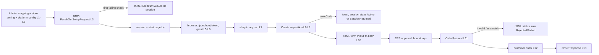
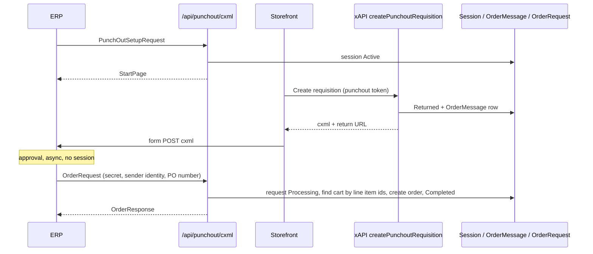
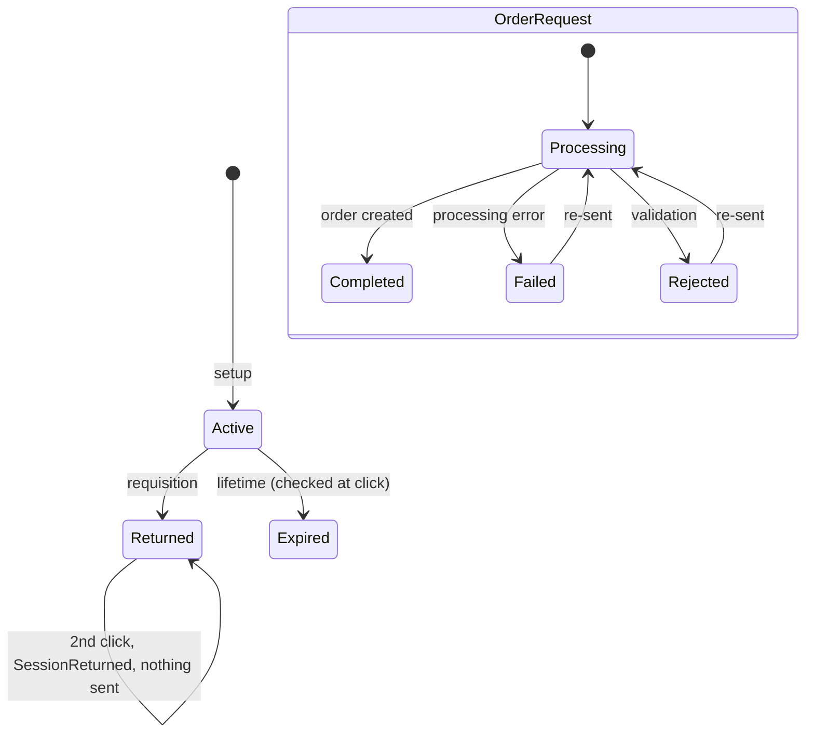

# Punchout — domain map

> Refresh with `/qa-domain-map punchout --refresh`. This file answers **what the feature is and where its surfaces
> are**. It carries no behavioural rules — those are `BL-*` (`npm run bl:extract -- --domain punchout`) — and it can
> **never ground an assertion as `{DOC}`**.

**Every claim carries a verdict.** `CONFIRMED` = observed live or read at source this pass · `DRIFT` = prior art says
otherwise and prior art is wrong · `MISSING` = documented, does not exist · `UNVERIFIED` = not established.
`CONFIRMED (source)` = read in the PR #6 checkout, not yet seen running.

**Deployed build described (vcptcore_qa1, live `/api/platform/modules`, 2026-10-27) — `CONFIRMED`:** Punchout
`3.1000.0-pr-6-d2e3` (PR #6 head d2e3683, OPEN) · Cart `3.1013.0-alpha.818-vcst-5888-punchoutorderrequest` · XCart
`3.1043.0-alpha.300-vcst-5888-punchoutorderrequest` · Xapi 3.1028.0 · ProfileExperienceApi 3.1021.0 · Orders 3.1019.0 ·
XOrder 3.1017.0 · Return 3.1006.0. Platform 3.1090.0-alpha.13438 (as handed in; not re-read here). Storefront theme
build not re-read this pass (`UNVERIFIED`; last recorded `2.61.0-pr-2564-e8b3`). Everything in §1–§3 about
OrderRequest is on a **not-yet-released PR**; re-read after merge.

## §1 — Purpose and value chain

**Purpose (from the module README, a developer document — not a published guide):** buyers start shopping inside
their procurement system, land in the storefront signed in and scoped to their organization, send the cart back as a
requisition, and the procurement system's approved purchase order comes back as a platform order. `CONFIRMED`
(README read; the PunchOutOrderMessage/OrderRequest lines in that README still say "comming soon" — see D1).

**Docs searched:** VirtoOZ `PlatformUserGuide` and `StorefrontUserGuide`, queries on punchout / cXML / procurement /
create requisition — results were quote requests, purchase requests, bulk orders, checkout; **no punchout page**
(`CONFIRMED` absent from both guides; `PlatformDeveloperGuide` not queried). So the customer-facing docs describe
none of it, and the checkout's final button changing to "Create requisition" in punchout mode is undocumented.
This chain is the **first written statement**, reconstructed from README + source + live; cite against it, not as
authority.

| # | Link, in the customer's words | Mechanism |
|---|---|---|
| L1 | Admin links a contact's account to an external ERP identity and marks it Active | `PunchoutUserMapping` (ExternalId unique → UserId/MemberId, IsActive); contact-blade widget or `POST /api/punchout-user-mappings` |
| L2 | Platform owner enables punchout for a store and declares the ERP integration | store setting `Punchout.Enabled` (public, default false) **plus** a `Punchout:Configurations[]` entry in platform config (Id, StoreId, SharedSecret, SenderDomain, AllowedReturnUrls, lifetimes, DefaultShipment/PaymentMethodCode, HandlerTypeName); validated at start |
| L3 | ERP posts a PunchOutSetupRequest | anonymous `POST /api/punchout/cxml`; checks in fixed order; always HTTP 200, outcome in cXML `Status` (KB-62D97984) |
| L4 | Platform returns a one-time start page | `PunchoutSession` Active + token hash; `StartPage = <store url>/punchout/<token>` |
| L5 | Buyer's browser opens the start page; storefront redeems it | storefront route registered only when `Punchout.Enabled`; `/connect/token` `grant_type=punchout`; token has `channelId=punchout`, `channelSessionId`, no refresh token |
| L6 | Buyer is signed in as the mapped user, in one organization, with a "Punchout mode" label | `PunchoutContactOrganizationsMiddleware` narrows organizations to the current one |
| L7 | Buyer fills the org cart and selects lines | ordinary cart; selected-for-checkout set |
| L8 | At checkout "Create requisition" replaces "Place order" | storefront `checkout.placeOrder` extension point, punchout mode only |
| L9 | Click → platform builds the cXML PunchOutOrderMessage; session becomes `Returned`; one message row stored | xAPI `createPunchoutRequisition` → `PunchoutOrderMessageProcessor` → `DefaultPunchoutHandler` (cart resolved like `Query.cart`) → atomic `ReturnSessionAsync` → `PunchoutOrderMessage` |
| L10 | Browser posts the cXML to the ERP's return URL | hidden form POST, field `cxml-urlencoded`; each line carries the cart **line item id** as `SupplierPartAuxiliaryID` (KB-8C1467B8 / source) |
| L11 | ERP (after its own approval) posts an OrderRequest | same anonymous `POST /api/punchout/cxml`; `CxmlPunchoutOrderRequestHandler` → `PunchoutOrderRequestProcessor` (**async hop: the ERP's approval, hours or days after L10; no session involved**) `CONFIRMED (source)` |
| L12 | Platform validates it against the cart and creates the customer order | validate (secret → config → store enabled → sender identity mapping → type New only → order content → currency) · find existing request by payload id / PO number (Completed→replay stored result, Processing→`OrderInProgress`) · `DefaultPunchoutHandler.HandleOrderRequestAsync`: find the mapped user's cart by line item ids (must match exactly 1), reconcile SKU/qty/unit price/currency, select only PO lines, set PO number, ShipTo/BillTo addresses, default shipment + payment, save, `CreateOrderFromCartCommand` `CONFIRMED (source)` |
| L13 | ERP receives an OrderResponse | cXML Status from `PunchoutOrderStatus` (Success, InvalidCredentials, InvalidRequest, UnsupportedOrderType, CurrencyNotSupported, UserNotFound, StoreNotConfigured, OrderInProgress, OrderError, ConfigurationError); the request row is stored Completed/Failed/Rejected `CONFIRMED (source)` |
| L14 | The order is visible to the buyer/admin as a normal customer order | `CustomerOrder` carrying the PO number; whether and how the storefront/admin mark it as punchout-originated `UNVERIFIED` |
| L15 | Effects reverse | **No reverse edge exists for L9**: no cancel/re-open of a requisition, no recovery if the post never reaches the ERP, cart not cleared after return, session Returned is terminal (`CONFIRMED`, 5887 model reverse-edge table + 1c observation). L4/L5: mapping deactivated or setting turned off after issue does not revoke a live session (`CONFIRMED`, 5886 SBTM, pr-1 build). L12: a created order has no punchout-side cancel (`UNVERIFIED`); a Failed/Rejected request may be re-sent and is processed again `CONFIRMED (source)` |

### Actors

| Actor | Can do | Verdict |
|---|---|---|
| ERP / procurement system | sends setup + OrderRequest anonymously with the shared secret; receives cXML; hosts the return URL | `CONFIRMED` (setup, live) · OrderRequest `CONFIRMED (source)` |
| Buyer (mapped contact) | signs in via start link only; shops one org; Create requisition; password sign-in is a normal non-punchout session | `CONFIRMED` live (5886/5887) |
| Back-office admin with `punchout:*` | create/read/update/delete user mappings; four roles tested: full, read-only, none | `CONFIRMED` (5886 suite 108); a read-only fixture existed as `AGENT-TEST-Punchout-Reader`/`-None` in the seeder `UNVERIFIED` live this pass |
| Platform config owner (ops/deploy) | `Punchout:Configurations` in appsettings / vc-deploy-dev; the only place secret, return-URL allow-list, lifetimes, default shipping/payment live | `CONFIRMED` (live configs 0/1/2 known from prior runs; not re-read here — not exposed by REST) |
| Store admin | toggles `Punchout.Enabled` (store setting; PUT replaces the whole store — see MEMORY note on write paths) | `CONFIRMED` live: both stores read `true` 2026-10-27 |

## §2 — Surface inventory

### §2a Back office (Admin)

| Surface | Detail | Verdict |
|---|---|---|
| Contact blade → Punchout user-mapping widget → `user-mapping-detail` blade | Active checkbox, External identity; "Not linked" state; Save disabled on empty identity | `CONFIRMED` (5886 live; AngularJS blades `Scripts/blades`, `Scripts/widgets`) |
| Store settings → `Punchout.Enabled` (group Punchout\|General) | boolean, public, default false | `CONFIRMED` live (REST) |
| Permissions `punchout:access/read/create/update/delete` | gate the mapping REST and widget | `CONFIRMED` (README, source) |
| Orders list/detail | where an OrderRequest's order appears; no punchout column or filter known | `UNVERIFIED` — needs an OrderRequest run |
| Admin Shell (vue) variant of the widget + mapping page | branch pr3 (VCST-6327): `vue/src/modules/{pages/user-mapping.vue,widgets/UserMappingWidget.vue}`; not on the deployed build | `UNVERIFIED` — existence note only |

**Not manageable from here:** the integration configuration (secret, allow-list, store binding, lifetimes, default
shipment/payment) — platform config only, no UI/REST; sessions, order messages and order requests — **no admin list,
no REST, no UI** (data-only tables `PunchoutSession`, `PunchoutOrderMessage`, `PunchoutOrderRequest`) `CONFIRMED`
(controllers: only `PunchoutController` + `PunchoutUserMappingController`; live swagger path probe returned 404 so
the REST list is from source). Seeing why an OrderRequest failed needs the platform log or DB.

### §2b Storefront (vc-frontend `modules/punchout`)

| Surface | Detail | Verdict |
|---|---|---|
| `/punchout/:sessionToken` | route registered at boot only when `Punchout.Enabled`; invalid/used/expired link redirects silently to `/` | `CONFIRMED` (5886) |
| Header "Punchout mode" label | top header only (mobile label absent, known gap VCST-6227) | `CONFIRMED` (5886) |
| Auto sign-out at session expiry | storefront timer | `CONFIRMED` (5886) |
| Checkout: "Create requisition" replaces "Place order" in punchout mode; shipping / payment / comment hidden; quote widget hidden | `place-order.vue`/`proceed-to.vue`, button `data-test-id="place-order-button"` | `CONFIRMED` (5887 round 2/4; theme PR #2564) |
| Per-`errorCode` toasts (13 locales) | SessionNotFound, SessionExpired, SessionReturned ("Requisition already sent."), ConfigurationError, StoreNotConfigured, CartNotFound/CartIsEmpty, MessageError | `CONFIRMED` (5887) |
| Anything for the OrderRequest half | none expected — the ERP, not the buyer, drives it | `UNVERIFIED` |

**Not manageable from here:** nothing writes mappings, configuration or the store setting; the buyer cannot see
requisition history or whether the ERP ordered; no storefront page lists punchout orders as such `UNVERIFIED`.

### §2c API / contract

| Surface | Detail | Verdict |
|---|---|---|
| `POST /api/punchout/cxml` | anonymous, text/xml, always HTTP 200; setup (PunchOutSetupRequest) `CONFIRMED` live; **OrderRequest** dispatched by `CxmlPunchoutOrderRequestHandler`; other types → 450 | setup `CONFIRMED` · OrderRequest `CONFIRMED (source)` (not posted: it would create an order) |
| `POST /connect/token` `grant_type=punchout`, `session_token`, `storeId` | single redemption; lifetime = remaining session; no refresh token | `CONFIRMED` (5886) |
| `/api/punchout-user-mappings` search/get/new/create/update/delete | perms `punchout:*`; search live returned 3 mappings (`AGENT-TEST-PO-100`, `-200`, `-300`, all active) | `CONFIRMED` live |
| xAPI `createPunchoutRequisition(command:{storeId!, currencyCode, cultureName}) → {url formField cxml errorCode}` | requires a punchout token (`channelId=punchout`) | `CONFIRMED` live introspection 2026-10-27 (field present); shape from 5887 introspection |
| xAPI `punchoutMockQuery` | present live; a mock/test helper | `CONFIRMED` present; purpose `UNVERIFIED` |
| xAPI `punchoutCheckout` query | declared in generated FE `types.ts` but absent from the live schema | `UNVERIFIED` this pass (5887 observation; schema doc not refreshed — introspection above is the only fresh read) |

## §3 — Where the layers DISAGREE

| # | Disagreement | Verdict |
|---|---|---|
| D1 | The module README says PunchOutOrderMessage and "OrderRequest and OrderResponse support: comming soon" (the OrderMessage line twice) while dev already ships the order message and PR #6 / the deployed build ships OrderRequest; README config table already documents `DefaultShipmentMethodCode`/`DefaultPaymentMethodCode` for OrderRequest. Reader of the README is told the feature does not exist. | `CONFIRMED` (README vs source vs live modules) |
| D2 | **Three different ways of finding "the cart".** Storefront: `Query.cart` (no name). Requisition builder (since PR #2): same lookup, unnamed. OrderRequest: `SearchCartQuery` by the line item ids the ERP sends back + the mapped user id, which must return exactly 1 cart. A cart changed, split or emptied between the requisition and the order, or a line id that exists in two carts, gives `InvalidRequest` with no user-visible trace. | `CONFIRMED (source)` — behaviour on the stand `UNVERIFIED` |
| D3 | OrderRequest is authenticated by shared secret + **sender identity → mapping**, not by session. A session that is Returned/Expired — or whose mapping was since deactivated — still goes through (or not) by independent rules: mapping inactive → `UserNotFound`, store disabled → `StoreNotConfigured`, session state never consulted. The requisition's reverse-edge story (session terminal) and the order's (mapping live) are different predicates. | `CONFIRMED (source)`; live `UNVERIFIED` |
| D4 | Unit price check: the order message prints prices with 2 decimals (`0.00`) while the cart `PlacedPrice` can have 3 (observed `79.992`, Total 695.98 vs Σ 695.97, 5887). OrderRequest reconciles with `RoundPrice` on both sides. The cXML Total the ERP approved can differ from the order total by a cent; the module tolerates the rounding only on the unit-price comparison. | `CONFIRMED` (message side, live 5887) · reconcile side `CONFIRMED (source)` |
| D5 | **Configuration (platform config) says one store, storefront host serves another.** Config 1 → store `New-super`; both `New-super` and `B2B-store` read `Punchout.Enabled=true` and share one storefront host, so a config-1 start page signs into B2B-store and the requisition fails `SessionNotFound`. Cases for config 1 are environment-blocked. | `CONFIRMED` (5887 SBTM) · setting values `CONFIRMED` live 2026-10-27 |
| D6 | Prior art says PO-3X-C1 (a mapping whose `userId` is an administrator yields an admin access token via the punchout grant) is an **open Critical**; PR #6 source rejects `IsAdministrator` / non-`Customer` users in `PunchoutUserMappingValidator` (line ~64) **and** in `PunchoutGrantTypeHandler` (line ~73). | `DRIFT` in source (fixed on PR #6 head); **live re-verification needs a mutation (create a mapping)** → `UNVERIFIED` |
| D7 | The same `Punchout.Enabled` setting is a **store** setting (per store, writes via a full-store PUT) but the integration it gates lives in **platform config** (per deployment); turning the store setting off hides the storefront route only on a fresh context and blocks setup/requisition/OrderRequest, yet does not revoke live sessions (5886). Two owners, two vocabularies, no single screen. | `CONFIRMED` (5886/5887) |
| D8 | No published guide mentions punchout: neither `PlatformUserGuide` nor `StorefrontUserGuide` documents setup, the mapping widget, the store setting or "Create requisition". Customer/admin-facing docs contradict nothing and describe nothing. | `CONFIRMED` (queries 2026-10-27) |
| D9 | The 5887 test model (round 2) and QA guide case 2 describe a **replay** of the stored cXML on a second click; the shipped behaviour (PR #2 head c49023f) is **refusal** `SessionReturned`. The BL oracle and suites 109 were re-based; the model's round-2 rows 14/16/29/38–42 are stale. | `CONFIRMED` (5887 summary round 4, BL-PUNCHOUT-003, suite 109 notes) |
| D10 | Admin UI exists twice: AngularJS blades inside the module (deployed) and a vue Admin Shell plugin on branch pr3 (VCST-6327). | source-only, `UNVERIFIED` which is current on the stand |

> **Mid-change.** D1, D2, D3, D4 (reconcile half) and D6 describe PR #6 (OPEN, head d2e3683, deployed on qa1
> 2026-10-27) and the two `vcst-5888` alpha builds of Cart / XCart. Re-read these rows after PR #6 merges or is
> revised; the deployed build is a PR head, not a release.

## §4 — Coverage shape

**Basis:** rows of each suite CSV parsed with csv-parse (not line counts — the CSVs hold multi-line cells; a
naive `grep -c` returned 25/8/80 for 25/8/35 cases) plus `config/test-suites.json`. Counts below are cases; every
case in every suite is `Draft` (68 of 68) — none has been run by the regression runner; the verdicts so far come
from `/qa-test` checklists.

| Suite | Layer | Cases | By area |
|---|---|---|---|
| 108 Punchout — cXML setup, token exchange and Admin user mapping | Backend | **25** | pre-flight 1 · cXML setup + token 19 · admin user mapping 5 |
| 107 Punchout — storefront session | Frontend | **8** | [JOURNEY] 1 · session behaviours 7 |
| 109 Punchout — Create requisition (PunchOutOrderMessage) | Frontend | **35** | requisition 35 |

Total **68** across 3 suites; selection group `punchout` = {108, 107, 109}.

- **Zero coverage, a HOLE (not deliberate):** OrderRequest / OrderResponse — **0** cases, 0 mentions of "OrderRequest" in any punchout suite (VCST-5888 is the ticket that adds them). No `BL-*` covers OrderRequest: the 9 BL-PUNCHOUT rules are about the requisition (001–009) and the cXML message. Candidates the tickets already hint at: reconcile against the cart (D2), idempotence by payload id / PO number, mapping-as-identity (D3), currency, default shipping/payment, address mapping.
- **Zero coverage, deliberate:** cXML edit/inspect/delete operations (not built, ticket says so); mobile "Punchout mode" label (VCST-6227); org selection via API (VCST-6222) — noted in the suite manifest, not asserted.
- **Thin:** reverse-edge / recovery cases (delivery failure after Returned, mapping deactivated after issue) — recorded as ABSENT IN PRODUCT, so they are guards not tests; the 5886 SBTM re-check of PO-3X-C1 is carried in suite 108's admin-mapping cases (5 cases) but not re-verified on this build (D6).
- **Executability:** `requiresModules` filters only when `MODULES_ENABLED` is set; with it empty the suites are selected anyway — select by `punchout`, never via `backend`/`full`. All three suites share `exclusiveGroup store-setting:Punchout.Enabled` (they flip the store-wide setting). 109 needs a dedicated buyer (`AGENT-TEST-PO-300`) and resets its carts in Setup/Cleanup; config-1 cases in 107/109 are BLOCKED (environment) on qa1 (D5). 108 token rows need the agent lane (XML body not capturable by the REST runner).
- **Manifest gate:** `suites:lint` currently reports two unregistered suite CSVs (Backend/platform/099, Backend/subscription/093) — **not punchout**; the 5887 summary noted the same.
- **Data:** seeder `scripts/seed-data/punchout/punchout-specs.mjs` (`npm run seed:punchout`, `td:validate:punchout`); aliases `PUNCHOUT_MAPPING_DEFAULT`, `_MULTI_ORG`, `_REQUISITION`, `PUNCHOUT_CONFIG_*`, pricelists, `PUNCHOUT_PRODUCT_PLAIN/UOM`. No fixtures for OrderRequest (an ERP-side cXML OrderRequest builder, a cart + requisition pair carrying matching line item ids, default shipment/payment codes on config 0) → G1.
- **Over-covered:** none (the suite with most cases, 109, has the most mechanisms).

## §5 — Open gaps

| # | Gap | State |
|---|---|---|
| G1 | OrderRequest end-to-end never run: needs an ERP-side cXML builder (POST with config-0 secret, mapped sender identity, line item ids from a real requisition, PO number, ShipTo/BillTo, currency) and a requisition to take ids from; each probe **creates an order** and a `PunchoutOrderRequest` row, so it is a mutation to be named in the brief | **OPEN** — needs a fixture author (`test-data-engineer`) and consent for order creation on qa1 |
| G2 | Does the deployed build refuse an administrator mapping and an admin grant (D6)? | **OPEN** — needs `POST /api/punchout-user-mappings` with an admin `userId` (mutation) and cleanup |
| G3 | Which configuration owns default shipment / payment on qa1 (`DefaultShipmentMethodCode`, `DefaultPaymentMethodCode`) and are those methods available for B2B-store carts? | **OPEN** — config not exposed by REST; needs vc-deploy-dev read or platform log |
| G4 | Where does a punchout-created order show (Admin Orders, storefront Orders), and is it marked as punchout-originated (L14)? | **OPEN** — needs G1 |
| G5 | Does the deployed theme still equal `2.61.0-pr-2564-e8b3`? Version-mismatch banner and xAPI search outages seen in 5887 | **OPEN** — needs a storefront footer read (browser lane) |
| G6 | Live schema doc `.claude/knowledge/api/graphql-schema.md` not refreshed this pass; `punchoutCheckout` query drift unresolved | **OPEN** — needs `npm run schema:refresh` |
| G7 | Is the Admin UI on the stand the AngularJS blade or the Admin Shell plugin (D10)? | **OPEN** — needs a browser walk of a contact blade |
| G8 | Platform log: does a requisition or OrderRequest ever write the shared secret, token or session id (5887 row 32 covered the posted document only) | **OPEN** — needs log access |
| G9 | Sessions / order messages / order requests have no read surface; failures of OrderRequest are visible only in the ERP's cXML Status and the platform log | **OPEN** — product question (admin visibility), for the author |

## §6 — Prior-art verdicts

| Claim | Verdict |
|---|---|
| 5886 model: Returned/Expired statuses exist but nothing sets them | **DRIFT** — `Returned` is set by `createPunchoutRequisition` (5887); `Expired` is derived at check time (5887 model state diagram), still never persisted as a status. |
| 5886 model config 3 (no StoreId) row 15 / V4 | **DRIFT** — startup validation refuses it (vc-deploy-dev#6926); config 3 cannot exist (5887 model). |
| 5886 SBTM: PO-3X-C1 admin privilege escalation, open Critical | **DRIFT (source)** — fixed in PR #6 source (D6); live `UNVERIFIED`. Not re-verified on the 5887 build either. |
| 5887 model round 2: replay of stored cXML on a returned session; rows 14/16/29/38–42 | **DRIFT** — shipped behaviour is refusal `SessionReturned` (D9). |
| 5887 model: "Domain map: ABSENT — slug is not a declared bl:extract domain" | **DRIFT** — `punchout` is declared now (`bl:extract --has-domain punchout` exit 0, 9 rules). |
| 5887 model: cart named `default` is sent (Bug A) | **DRIFT** — fixed in PR #2 (handler no longer sets `CartName`), regression guards PNCR-002/003/027. |
| 5887: cart-level % promotion allocated into PlacedPrice | **DRIFT** — the 20% was a line reward; cart-level % and fixed discounts are excluded from Total (SBTM round 1 amendment). |
| 5887 model: OrderRequest "(VCST-5888)" out of slice | **CONFIRMED** — and now deployed; it is the open half of §4/§5. |
| 5886 model: config 0 domain+return-URL checks; config 1 none | **CONFIRMED** (5887 SBTM row 31: config 0 refused 7 host/scheme variants; config 1 setup accepts any host). |

Resolves the prior art's open questions: "which domain does punchout belong to" (declared `punchout`) and "Classification codes" is **not** resolved (still the author's).

## §7 — Amendments

| Date | By | What moved |
|---|---|---|
| — | — | (none yet) |
