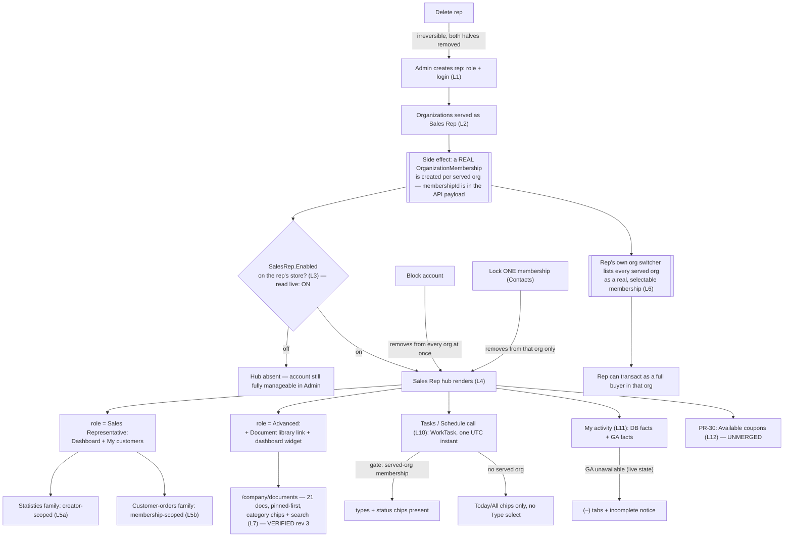

# Sales Rep — domain map

> Refresh with `/qa-domain-map sr`. This file answers **what the feature is and where its surfaces
> are**. It does **not** carry behavioural rules — those are `BL-SR-*` in the BL oracle
> (`npm run bl:extract -- --domain sr`; cited by id below, never restated) — and it can **never ground an assertion as
> `{DOC}`**. It is a pointer index plus a surface inventory: it tells you *where to look* and *what
> exists*, never *what correct looks like*.

**Every claim carries a verdict.** `CONFIRMED` = observed live or read at source this pass ·
`DRIFT` = prior art/docs say otherwise and are wrong · `MISSING` = documented, does not exist ·
`UNVERIFIED` = not established, and **not** to be treated as true.

**Read-only pass.** No create/edit/complete/delete/schedule/share/upload/save/pin/block/lock/settings change was
performed in rev 4 (nor in rev 3). Menus, dialogs (New task, Schedule call) and blades (Analytics diagnostics) were
OPENED; nothing inside them was submitted. Sign-in is the only write the environment saw. Every
capability confirmable only by mutating is `UNVERIFIED` **with the mutation named**, in §2's "not
manageable from here" rows and in §8.

> **⚠ MID-CHANGE (2026-11-03) — the deployed stand is a build of THREE OPEN PRs, and this map's rows say which.**
> `GET /api/platform/modules`: **`SalesRep 3.1017.0-pr-30-1e10`** = **open PR vc-module-sales-rep #30**
> ("feat(VCST-6158): promotion coupons on the customer profile", head `1e103a45`, state OPEN, updated 2026-11-03);
> the latest SalesRep **release** is `3.1016.0` (2026-10-27) and #30 is one patch ahead of it.
> **Theme `2.62.0-pr-2596-e749-e749b47f`** = **open PR vc-frontend #2596** ("expose the coupon card to plugins with a compact
> layout"). Also non-release on the stand and **not this domain's**: `XCart 3.1045.0-pr-153-ec03`,
> `ElasticSearch8 3.1012.0-pr-47-d205`, `MFA 3.1001.0-pr-4-b211`; Platform is `3.1093.0-pr-3154-4607`. Preflight also
> raised `breaking:vc-module-customer` — Customer **3.1021.0** was a BREAKING release; deployed is `3.1032.0`, past it.
> **Every surface that exists only because of PR #30 / #2596 is marked `PR-30` on its row** (the coupons widget and page,
> the `salesRepCoupons` query, the `…/coupons` route, the 30th scoped query, and the host coupon card). Those rows describe an
> **unmerged state**: re-read them after #30 and #2596 merge or revert. Everything NOT marked `PR-30` was in a release or
> in merged PRs (vc-module-sales-rep #26 merged 2026-10-27; vc-frontend #2536 merged 2026-10-08) when observed.
>
> *Retired (rev 3):* the rev-2 call-out about `Customer`/`ProfileExperienceApi` PR builds stays resolved — both are releases.

---

## §0 — Changed since rev 3 (2026-09-18 → 2026-11-03)

Rev 3 is contradicted **out loud** below; unlabelled rev-3 rows were re-taken only where this section or a row says so.
**Env-A = this stand (`vcst`, 2026-11-03).** Env-B is not revisited: its rows keep their 2026-09-10 date.

| Rev 3 said | Rev 4 says |
|---|---|
| §3a/§3i: `/company/calendar` is the Calendar page (live on `SalesRep 3.1009.0`); `/company/tasks` is a PR #2536 prerelease only, **NOT deployed** (A10 deliberately left §3i, the route row and G15 unchanged *until the PR merges*) | **RESOLVED.** vc-frontend #2536 merged 2026-10-08. On the deployed theme **`/company/calendar` renders the host 404** (`QA & 404 Page not found`, no redirect) and **`/company/tasks` is the page** (§3k). The rail item is **Tasks**; there is no Calendar entry. §3i is kept as history. The map's `CONFIRMED` for the calendar route is withdrawn and replaced with the 404 |
| §3b: the rep hub rail has 2 items (basic) or 3 (Advanced) — Dashboard, My customers, [Document library]; a **Calendar** item appeared only after tasks were seeded (G15) | **Basic rep: 4 items — Dashboard · My customers · Tasks · My activity. Advanced: 5 — + Document library, placed between Tasks and My activity.** A rep with **0 tasks** (`SR_REP_DOCS`) and a rep with **0 customers** (`SR_REP_NOCUSTOMERS`) both see **Tasks** — so **G15 is `CLOSED`**: the item is not task-data-gated |
| §2a: Sales Reps list **"1–19 of 19"**, `totalCount` 19 | **25** (UI `1–20 of 25`, two pages; `POST /api/sales-rep/search` `totalCount` 25). The 6 new reps are fixtures/demo seeds, not a product change |
| §2a: in-app navigation lists **7** entries | **8** — a new **Analytics diagnostics** entry (§2a, §5b). Admin REST also gained `POST /api/sales-rep/analytics-diagnostics` and the permission **`sales-rep:diagnostics`** |
| §5a: scoped schema **21 queries / 2 mutations** | **30 queries / 6 mutations** (live introspection, anonymous). +3 activity (`salesRepActivities`, `salesRepCustomerActivitySummary`, `salesRepCustomerInsights`) · +5 task (`salesRepTasks`, `salesRepTask`, `salesRepTaskFilterRules`, `salesRepTaskSortRules`, `salesRepTaskTypes`) · **+1 `PR-30` (`salesRepCoupons`)**; mutations +4 task (`createSalesRepTask`, `updateSalesRepTask`, `changeSalesRepTaskStatus`, `deleteSalesRepTask`). The **main `/graphql` schema exposes the same 30 + 6** (introspected) |
| §3d: My customers money for `SR_REP_PRIMARY` "byte-identical to rev 2": AcmeCorp $5,488.40/9 · TechFlow $3,212.00/11 · BuildRight $535.00/3 · AcmeWest $123.00/2 | **Moved — fixture data, not a product change:** AcmeCorp **$875.00 / 7 orders** · TechFlow **$2,948.00 / 3** · AcmeWest **$90.00 / 1** · BuildRight **$70.00 / 1** · RepOnly-Primary $0.00 / 0 / "—". The **5 rows and the 5 org names HOLD**; money is environment state and must never be asserted from a map |
| §3c: dashboard stats row, My recent orders, Top sellers, Document library (Advanced), Tasks & due dates (G15-gated) | Same stats row (tile values moved: Active carts now `11 items · 10 not for checkout · 0 items this week`; YTD `$3,983.00`). **My activity** widget is **new** (§3m). The Tasks & due dates widget **always renders** and now has a header link to `/company/tasks` (+ `?filter=overdue` footer link). **Document library widget: `CONFIRMED` again for the Advanced rep, absent for basic** |
| §7: 9 suites / 480 cases; selection `sales-rep` = those | **13 suites / 595 cases** carry `requiresModules: sales-rep`; the `sales-rep` selection resolved **10** suites and **omitted three** (`050m3`, `106`, `112`); fixed the same day: it is now tag-derived and resolves all 13 (§7). Rev 3's own selection bullet listed 10 names while its table said 9; it counted 9 |
| §7: 11 `089` rows carry the invalid `Automation_Status` `verified` (S-006) | **DRIFT — closed by someone else:** re-parsed, `089` now holds only `Automated 32 · Draft 12 · Reviewed 10 · Deprecated 1`; no `verified` |
| §7: `007` carries 16 Sales-Rep-subject cases (`B2C-LIST-040…055`) | **42** (`B2C-LIST-040…081`, sections *Sales Rep sharing* and *B2B Lists & Shared › Sales Rep sharing › VCST-5707*) — the VCST-5707 block (056–081) postdates rev 3's count |
| §1 L3: store toggle read ON | Re-read through the **plugin manifest**: the Module Federation delivery gates **every contribution** on `{setting SalesRep.Enabled, module VirtoCommerce.SalesRep}` (§3a, D28). The store settings blade itself was **not re-browsed** this pass |
| §2c / D15 / G11: the four Statistics cache settings "are absent" and where they are editable is unknown | **Answered for the where:** they exist at **module scope** — `GET /api/platform/settings/modules/VirtoCommerce.SalesRep` returns **9** settings (General: `SalesRep.Enabled` ·  Statistics: 4 × `…CacheExpirationMinutes` and 4 × `…InvalidateOnChange`). Current values on this stand: the four cache settings = **1** minute (declared default 5). The store blade's absence of them was **not re-taken** |
| §3a/§1 L7: the Documents route needs `sales-rep:access` AND `sales-rep-documents:read` | **Held live** (basic → redirected to `/account/dashboard`; Advanced → page). New: the plugin manifest declares the **`documents` route with no `when` at all**, while 10 of its sibling hub routes carry `when: can sales-rep:access` (D28) |
| §3 hub delivery: not described | The hub ships as a **Module Federation plugin** served by the module on the **platform origin and the storefront origin** — `GET /modules/$(VirtoCommerce.SalesRep)/plugins/vc-frontend/{mf-manifest.json,plugin.json,remoteEntry.js}` → **200** on both (§3o) |
| §5a: schema file `graphql-schema.md` refreshed 2026-09-17 | Refreshed **2026-10-29**; it names the task/activity operations (2 matching names counted); it **does not carry `salesRepCoupons`** (PR #30 is newer) |
| §3b: the sign-in form takes an email and a password | **The default sign-in is now one-time-code:** *"We'll email you a code. No password needed."* — a **"Sign in with a password instead"** button reveals the password form; **Entra ID / Google / Passkey** buttons sit under it. Every rep-facing case now begins one click earlier (D29) |

**Not re-taken this pass (rev-3 observations carried, dated):** D4's 19-row Blocked-icon pairing (column set re-confirmed, icon pairing not),
D10's `storeId`-omission pairs, D13 (Env-B), D14, D16 (intermittent labels — **not reproduced**, but inspected only on `SR_REP_PRIMARY`, G12), D17 hero-vs-filter,
D19 byte/Bytes, D20 (filed as VCST-6083), D22 (filed as VCST-6115), §3f, §3j, G7–G9, G12–G14.

**Gap movement:** **G11 CLOSED** (where — module scope; UI placement `UNVERIFIED`) · **G15 CLOSED** · **G16 narrowed** · G12, G13, G14 stay OPEN · G7/G8/G9 stay OPEN ·
**new G17–G23**. **New rows: D23–D31.** No `D*` or `G*` row was renumbered or deleted; D1, D3, D6, D8, D12, D15, D21 were updated in place.

---

## §0b — Changed since rev 2 (2026-09-10/11 → 2026-09-18) — carried from rev 3, unchanged

*(Kept because rev-3 readers cite it. Rev-3 date: 2026-09-10/11 → 2026-09-18.)*

**This map does not name environments, and that is deliberate.** A hostname dates a claim the moment a
deployment moves, and it invites a reader to treat "it worked on *that* box" as the explanation when the
real variable is almost always a version. The two deployments are labelled by the only property that
distinguishes them:

| Label | The deployment running | Relevant state |
|---|---|---|
| **Env-A** — enumerated **2026-09-18** (this pass) | `SalesRep 3.1008.0`, `Customer 3.1025.0`, `ProfileExperienceApi 3.1018.0`, `XOrder 3.1011.0` — **all release** | Document library **healthy**; **21** documents, 1 pinned; **19** reps; Advanced-role **and** Documents-Manager fixtures now both present |
| **Env-B** — enumerated **2026-09-10 only; NOT revisited** | `SalesRep 3.1007.0`, every in-scope module release | Document library **hard-broken** (D13). **Every Env-B row below is a dated rev-2 observation, not a current one** |

Both ran `XOrder 3.1011.0` — which is precisely why **the SalesRep version, not the environment, is the
discriminator** in D13. **Unless a row names Env-B, it was established on Env-A.**

**Rev 2's claims contradicted out loud.** A refresh that silently drops a claim leaves anyone who cited
it with no signal:

| Rev 2 said | Rev 3 says |
|---|---|
| *"MID-CHANGE — re-read §6 after these PRs merge or revert"* (`Customer` + `ProfileExperienceApi` on PR builds) | **RESOLVED.** Both shipped as releases (`3.1025.0`, `3.1018.0`). Call-out retired; D8/D9 now describe a released state |
| §5a: *"`graphql-schema.md` documents only the main schema and does not cover this scope"* | **STALE.** That file was refreshed **2026-09-17** and now documents `salesRepDocuments`, `salesRepCustomerOrders`, `salesRepOrderSortRules`, `salesRepCustomerSortRules`, `salesRepDocumentCategories`, `salesRepDocument`, `salesRepLayout` (filed under its Cart/CMS/Orders sections). It is a usable second source for field NAMES — still not for arguments or auth posture |
| §7: *"Document library — **0** cases across all 9 suites — a hole"* | **CLOSED. 52 cases**, authored between 2026-09-10 and today: `050m` **26** (`SR-GQL-131`…`SR-GQL-156`), `092b` **9**, `093` **17**. The hole was real when measured and has been filled |
| §7: *"092 and 092b have zero Automated cases between them (40 cases, 0 automated)"* | **DRIFT.** `092b` now holds **12 Automated** of 43. `092` is still **0** of 18 — the claim survives for one suite, not two |
| §7 total: **405** cases | **480**, re-derived by `csv-parse` this pass |
| D12: *"`sales-rep-documents:write` grants no read on the storefront contract"* | **Refuted as a generalization.** On Env-A the two-role fixture `agent-test-sr-docs-writer@` carries `read` **and** `write` and gets `200`. The two observations are reconciled by `§10 A2`, not overwritten — see D12 |
| D10: no-`storeId` returns a superset (5 vs 4) | **Still present but narrower, and absent entirely for one caller.** `agent-test-sr-docs@`: 6 → 7 (delta 1). `agent-test-sr-primary@`: 1 → 1 (**delta 0**) — the delta only appears when a cross-store rep serves the caller's active org |
| D8: an ACME/B2B-store caller sees **4** reps | **6** — and the org must be named. `agent-test-sr-docs@`'s token resolves `organization_id` = **AcmeCorp**; the 4 of rev 2 plus the two new document fixtures, both seeded into AcmeCorp |
| §3b/§3d: `SR_REP_PRIMARY` serves **5** orgs, org switcher pre-selects **AcmeCorp** | **5 HOLDS** (Admin `organizationsCount` 5, sidebar badge 5, My-customers 5 rows, switcher 5 radios). What moved is the **active org**: PRIMARY's token now resolves **AcmeWest**, which is why `customerSalesReps` returns 1. `/company/sales-reps` in AcmeWest context returns exactly **1** row — the same number, independently |
| §2a: Documents library is *"the 7th dashboard tile"* | **DRIFT.** The seven entries are a **secondary navigation list** down the app's left rail, not tiles. The Dashboard pane itself is an empty-state card |
| §2b: the Category field's input shape is `UNVERIFIED` (free-text vs managed dictionary) | **Both.** The detail blade carries a clearable **Category** select over existing values **and** a separate free-text **New category** box, with the helper *"New category has priority over selection"* |
| §2c: two setting groups (General + Statistics), *"not browsed live"* | **Browsed live. Only `Sales Rep > General` exists at store level** — one toggle, `Sales Rep Enabled`, **on**. The four Statistics cache settings are absent from this surface (new **D15**) |
| §9: the b2b map is **rev 1**; its Sales-Rep pointers are at lines 69/213/415/502 and its menu inventory at line 78 | **All six wrong.** The b2b map is **rev 2 (2026-09-16)** and every line citation now lands on unrelated content. Re-anchored throughout to `§` anchors |

**Gap movement:** **G1 CLOSED** · **G2 CLOSED** · **G4 CLOSED** · **G5 CLOSED** · **G6 CLOSED** ·
**G10 CLOSED (and the answer is a finding)**. **G3 stays CLOSED**, **G7/G8/G9 stay OPEN**.
New rows: **D15–D19**, **G11–G14**. No `D*` or `G*` row was renumbered or deleted.

---

## §1 — Purpose and value chain

**Purpose** (`PlatformUserGuide` §Sales Rep overview — [docs.virtocommerce.org/platform/user-guide/sales-rep/overview](https://docs.virtocommerce.org/platform/user-guide/sales-rep/overview), verbatim,
fetched first-hand): *"The **Sales Rep** module turns selected users into sales representatives who serve
a defined set of customer organizations. It provides a back-office application for administrators to
create, assign, and manage reps."* `CONFIRMED` as the declared purpose — unlike the b2b domain this one
is not `UNDECLARED`. **Re-fetched first-hand 2026-11-03 (all five guides queried; same text).** The overview's key-features list
(verbatim: *"Manage sales representatives… Assign customers to a rep… Assign a rep role… Upload sales materials… Show reps to buyers… Show customers to reps… Show a customer card… List and filter orders… Contact a customer… Toggle the Frontend UI"*)
names **twelve** capabilities and **none of Tasks, Schedule call, My activity / customer activity, or promotion coupons** — that is `MISSING`-in-docs, not a miss to retry (§6 **D23**).

The chain below is reconstructed from source (`SalesRepController.cs`, `SalesRepDocumentsController.cs`,
`ModuleConstants.cs`) + live observation, and is the first written statement of it in this repo. Cite it
as a hypothesis to contradict, not as authority.

| # | Link, in the rep-program owner's words | Mechanism |
|---|---|---|
| 1 | **A user becomes a rep** | Admin `Add`/edit on the rep's blade sets **Sales Rep role** (single-select: *Sales Representative* or *Advanced Sales Representative*) on a Contact+login pair. `POST`/`PUT /api/sales-rep`, gated `customer:{create,update}` **AND** `platform:security:{create,update}` (`BL-SR-014`). The role is applied **both** globally and per membership created in step 2. `CONFIRMED` source + live |
| 2 | **The rep is linked to customers — and this is not read-only** | The blade's **Organizations served as Sales Rep** chip field populates the served-org list every scoped query reads **and** creates a real `OrganizationMembership` (with the rep's role) in each selected org. **Confirmed live 2026-09-18**: `GET /api/sales-rep/{id}` returns an `organizations[]` array carrying an `organizationId` + `organizationName` + **`membershipId`** per entry — the membership id is in the payload, so "served" and "member of" are the same act in the contract, not only in the UI (§6 D9) |
| 3 | **The store turns the feature on** | `Stores → {store} → Settings → Sales Rep → General → Sales Rep Enabled` (`SalesRep.Enabled`). **Read live this pass: the toggle is ON**, and it is the **only** setting under `Sales Rep` at store level (§2c, D15). Gates the **storefront UI only** — it touches no permission (`BL-SR-011`, and `§10 A5`) |
| 4 | **The rep signs in and sees the hub** | `sales-rep:access` (held via the role) **AND** `SalesRep.Enabled` ⇒ a **Sales Rep hub** sidebar section above Purchasing. **Confirmed live, and its SIZE is role-dependent**: a plain *Sales Representative* gets exactly **Dashboard + My customers**; an *Advanced Sales Representative* gets **Dashboard + My customers + Document library** (§3b) |
| 5 | **The rep reads the served portfolio** | Two scoped families answer different questions: the **statistics/rankings family** (`salesRepCustomerOrderStatistics`, `…CartStatistics`, `…Counts`, `salesRepTopSellers`, `salesRepOrders`) is **creator-scoped** — only the rep's **own** orders/carts (`BL-SR-002` half b); the **index-backed customer-orders family** (`salesRepCustomerOrders`, `salesRepCustomerOrder`) is **membership-scoped** — every order in a served org, whoever placed it (`BL-SR-002` half a, deliberately the opposite). `CONFIRMED` live both halves |
| 6 | **The rep can act as a buyer, not just view** | Because step 2 is a real membership, the rep's own storefront org switcher lets them switch **into** any served org and transact with **full buyer rights**. Doc-declared design intent (`VCST-5733` retired finding #21, *"inherited from the LEO client project"*) and **re-observed live 2026-09-18** (§3e, §6 D9) — the single highest-impact link in the chain |
| 7 | **Sales materials reach the rep (a parallel, secondary chain)** | Admin uploads a file (two-step: `POST /api/files/sales-rep-documents` then `POST /api/sales-rep/documents` to register it with a Category + display metadata — the register step sets the file's `Owner`, per `SalesRepDocumentAuthorizationHandler`). **This chain is now VERIFIED END TO END on Env-A** (rev 2 had it `UNVERIFIED` past step 1): 21 documents exist in the Admin blade, the Advanced-role token carries `sales-rep-documents:read`, `salesRepDocuments` answers `200`/21, the storefront `/company/documents` page renders all 21 as a filterable card grid, and the hub dashboard carries a 5-item Document library widget. **Pinning is the ordering key on both layers** (§2b, §3h) |
| 8 | **Access is taken away — three independent axes** | **(a) Block the account** (`POST …/block`, `platform:security:update` only) removes the rep from **every** served org's list at once — but the list-blade's **Blocked** column label reads backwards (§6 D4, re-confirmed with a paired control this pass). **(b) Lock one membership** — a **Contacts**-side per-org lock, not a Sales-Rep-app control — excludes only that org (rev-2 live observation; not re-derivable this pass, G13). **(c) Delete the rep** removes the Contact **and** the login account together, irreversibly (`PlatformUserGuide`, doc-stated, `UNVERIFIED` live — a destructive mutation) |
| 9 | **Reversal is asymmetric, and so is pinning** | Block ↔ Unblock, Lock ↔ Unlock and **Pin ↔ Unpin** are each single reversible toggles rendering exactly one of the pair (§2b). Delete has **no** reverse edge — *"There is no way to keep one without the other. This cannot be undone."* (`PlatformUserGuide`, verbatim) |
| 10 | **The rep plans their own follow-ups — tasks and scheduled calls (rev 4)** | A rep with `sales-rep:access` opens **Tasks** (`/company/tasks`, §3k): *New task* (Title, Type, Due date, Priority, Notes) or, from a served customer's profile Quick actions, **Schedule call** (§3l: Title "Call", the customer, day, 15-minute time, Priority, Notes, optional Google/Apple "Add to calendar"). The entity is a **TaskManagement WorkTask** read and written through the rep's own `salesRepTask*` operations; tasks are private to their owner. **The async/ordering hop:** the due date is **one UTC instant** shown in the viewer's browser zone (`KB-6693247D`). **Reversal:** a row renders exactly one of **Mark complete / Reopen** by status (`Reopen` seen on a completed row; neither actuated, §3k); **Delete** is permanent (*"This task will be deleted permanently"*, VCST-6314 exploratory). Task types and filter chips are gated on **served-org membership**, not on the nav's `sales-rep:access` (D26). `CONFIRMED` live (surface) + `KB-*` (writes, prior runs) |
| 11 | **The rep sees what their customers do (rev 4)** | **My activity** (`/company/activities`), the per-customer feed (`/company/my-customers/{id}/activities`), the dashboard **My activity** widget and the profile **Customer activity** widget read `salesRepActivities` / `salesRepCustomerActivitySummary` / `salesRepCustomerInsights`: **database facts** (orders placed, customers assigned — always available) plus **Google Analytics facts** (searches, product views, logins — read through the optional `GoogleEcommerceAnalytics` module, cached per calendar-day range, up to 48 h late). **The degraded state is part of the chain:** GA unavailable ⇒ `isAnalyticsAvailable:false`, GA tabs show `(–)`, a notice reads *"Some tracked activity couldn't be loaded, so these figures may be incomplete."* — **this is the live state on this stand for every rep (§3m, D27)**. `CONFIRMED` live; GA-fresh read-back is not re-derivable here (G17) |
| 12 | **The rep hands the buyer a promotion code (rev 4, `PR-30`)** | `salesRepCoupons(storeId)` returns the store's public, active, redeemable promotion coupons; the customer profile shows an **Available coupons** widget and an **All promotion coupons** page (§3n). Marketing is an *optional* dependency of the module. **Unmerged: open PR #30 + open theme PR #2596.** `CONFIRMED` live on the PR build; the redeem-and-recount hop (buyer places an order → the next request drops the coupon) is `UNVERIFIED` here — it needs a checkout |



### Actors

| Actor | Can do | Verdict |
|---|---|---|
| **Platform admin** | All of §2a/§2b/§2c/§2d — the only actor who can create/edit/block/unblock/delete a rep, pin/unpin a document, set the store toggle, and (per `BL-SR-014`) the only one whose grant needs both `customer:*` and `platform:security:*` halves | `CONFIRMED` live + source |
| **Sales Representative** (basic rep role) | Hub Dashboard + My customers + **Tasks + My activity** (rev 4), customer profile (Quick actions incl. **Schedule call**, Customer activity, **`PR-30` Available coupons**), customer orders. **No Document library link, and no Document library dashboard widget**; `/company/documents` → redirect to `/account/dashboard` | `CONFIRMED` live 2026-09-18 and **2026-11-03** (`agent-test-sr-primary@`; token `sales-rep:access` only) |
| **Advanced Sales Representative** | Hub **+ Document library** browse/search/filter/open/download, **+ a Document library dashboard widget**. Token carries `sales-rep:access` + `sales-rep-documents:read` | **`CONFIRMED` live 2026-09-18, re-confirmed 2026-11-03** (`agent-test-sr-docs@`; token `sales-rep:access` + `sales-rep-documents:read`; rail Dashboard · My customers 1 · Tasks · Document library · My activity; Document library page 21 docs, 6 category chips) |
| **Sales Rep Documents Manager** (a *third*, undocumented role) | A real platform role (`f124ddde…`) and a named source constant (`ModuleConstants.Roles.DocumentsManagerRoleName`). The only fixture holding it (`agent-test-sr-docs-writer@`) holds it **composed with** `Sales Representative`, and that composed token carries `sales-rep:access` + `…documents:read` + `…documents:write` and reads the library fine | `CONFIRMED` for the **composed** fixture. What the role grants **alone** on Env-A is still `UNVERIFIED` — see D12 and `§10 A2` |
| **Org buyer / employee (non-rep)** | Sees **no** Sales Rep hub section at all; the sidebar starts at Purchasing. **Rev 4:** `/company/tasks` and `/company/activities` both **redirect to `/account/dashboard`** (no 403); the scoped queries answer an empty 200 (`salesRepCustomers` 0, `salesRepTasks` 0, `salesRepTaskFilterRules` `[]`, `salesRepTaskTypes` `[]`, `salesRepCoupons` 0) and `salesRepActivities` **`null`**, while `customerSalesReps` still lists the buyer's own 5 reps | `CONFIRMED` live 2026-09-18 (`ORG_USER_EMAIL`, TechFlow) **and** 2026-11-03 (UI redirects + API reads) |
| **Rep with NO served organizations** (`SR_REP_NOCUSTOMERS`, rev 4) | Holds `sales-rep:access` as a **global** role only. Sees the hub rail (Dashboard · My customers **without a badge** · Tasks · My activity) and **New task**, but **no status chips beyond Today/All**, **no Type select**, `salesRepTaskTypes` `[]`, `salesRepCoupons` 0, `salesRepActivities` `null` — *capability present in navigation, absent in data* (D26) | `CONFIRMED` live 2026-11-03 (UI Tasks page + API); My activity page and dashboard `UNVERIFIED` for this fixture |
| **Platform administrator** (A4 contrast, rev 4) | API: a B2B-store token for `admin` carries **no** `sales-rep:access`, and `salesRepCustomers` **0**, `salesRepTasks` **0**, `salesRepTaskFilterRules` **`[]`**, `customerSalesReps` 0, while `salesRepDocuments` returns **21** (the token carries 8 permissions, none of which was inspected for `sales-rep-documents:read`; an administrator bypass is the presumed mechanism, `UNVERIFIED`). The **UI half of A4 — an admin rendering the full hub over empty data — was not walked** (G22) | `CONFIRMED` API-level; UI `UNVERIFIED` |
| **Org member of a rep-served org** | Sees the buyer-facing `/company/sales-reps` contact list for their **currently active** org, name/email/phone, read-only | `CONFIRMED` live — TechFlow shows 5 rows; the same page in AcmeWest context shows 1 |

---

## §2 — Surface inventory

### 2a. Admin — the Sales Reps embedded app

**Two addresses, both live and both worth knowing:**
- **Embedded** (the menu route): `#!/workspace/embedded-app/vc-sales-rep`, rendered inside an `<iframe>`
  (`supportEmbeddedMode: true` in `module.manifest`, matching the `092`/`092b` suite split).
- **Standalone**: `/apps/vc-sales-rep/`, with the app's **own hash routes** — `#/dashboard`,
  `#/sales-reps`, `#/documents`, `#/documents/document-details/{id}`. `GET /api/platform/apps` declares
  `relativeUrl: "/apps/vc-sales-rep"`, `permission: "customer:read"`, `placement: "MainMenu"`.
  `CONFIRMED` live 2026-09-18. **This is the address to brief an automated run at** — the iframe route is
  the one where this pass could not land a single click (lane note, covering message).

**Main menu inventory, re-derived live rather than copied from the b2b map: 19 items** — Loyalty
missions · Marketing · Loyalty · Contacts · Catalog · Orders · Notifications · Push Messages · Pricing ·
System Operations · Tasks · **Sales Reps** · Returns · Quotes · Settings · Security · Stores · Developer
tools · More (plus a separate `Home`). **No "Document Library" entry** (§6 D3). `CONFIRMED` 2026-09-18; **re-read 2026-11-03 — the same 19 items** (`Tasks` is the TaskManagement app, `/apps/tasks`, `permission: task:access`, `supportEmbeddedMode: true`; the **Google Analytics** app, `/apps/ga4`, is `placement: AppMenu`, not in this list).

**In-app navigation (8 entries since rev 4) — a secondary NAV LIST down the left rail, not tiles** (rev-2 `DRIFT`):
Dashboard · Sales Reps · Blocked Sales Reps · Not assigned Sales Reps · Organizations · Not assigned
Organizations · **Documents library** · **Analytics diagnostics** *(new, rev 4 — below)*. The Dashboard pane itself is an empty-state card reading
*"Sales Reps dashboard / Manage your sales representatives, their organizations and accounts."* (rev 3; the pane was not re-opened in rev 4, `UNVERIFIED`).

**Analytics diagnostics blade (rev 4)** — `…/apps/vc-sales-rep/#/analytics-diagnostics`, `CONFIRMED` live (opened, **not run**). *Run settings*: a **Store** combobox (clearable; pre-filled with the first store listed), a **Deep check** switch **on by default** with the helper
*"Also queries live Google Analytics data. Spends GA API quota."*, and a **Run diagnostics** button. Behind it: `POST /api/sales-rep/analytics-diagnostics?storeId=&includeLiveData=true`
(Swagger `SalesRepAnalyticsDiagnostics_RunAnalyticsDiagnostics`, returns `AnalyticsDiagnosticsResult`) and the module-neutral `POST /api/googleanalytics/{storeId}/diagnostics`; permission **`sales-rep:diagnostics`** (platform permission list carries it beside `sales-rep:access` and `sales-rep-documents:read/write`). **What a run returns, and which role holds `sales-rep:diagnostics`, is `UNVERIFIED`** (G20 — a run spends GA quota and is a POST). Not in any prior admin guide (§6 D23).

**Sales Reps list blade** — toolbar Refresh · Add · Delete (Delete inert until a row is checked).
Search "Search by name or email". Pagination footer **"1–20 of 25" (page 1 · 2 · Next · Last; page size 20)** — rev 3: "1–19 of 19" — cross-confirmed by
`POST /api/sales-rep/search` `totalCount: 25` (rev 3: 19; rev 2: 16). The four visible column headers re-read as **Name · Email · Organizations · Blocked**; the hidden four were not re-opened. Columns, **G4 CLOSED (rev 3)**:

| Visible by default (4) | Hidden by default (4) |
|---|---|
| Name · Email · Organizations · Blocked | Id · User Id · User Name · Modified Date |

Picker footer: **Show All · Reset**. **There is no column for the rep's ROLE, visible or hidden** — the
Advanced/basic distinction is invisible from the list at any setting (§6 D18). `createdDate` is in the
search payload but is not offered as a column either.

**Rep detail blade** — toolbar **Save · Reset · Block** (or **Unblock**, exactly one). Fields:

| Field | Control | Notes |
|---|---|---|
| Email (login) | textbox, required | |
| Password | textbox, masked, show-password toggle | placeholder "Leave blank to keep current password" |
| **Sales Rep role** | single-select combobox, required | picker offers exactly **2** options live (§6 D2). `GET /api/sales-rep/{id}` returns `roleId` + `roleName` — the only place a rep's role is readable without decoding a token |
| Organizations served as Sales Rep | multi-select chips | payload carries `organizationId` + `organizationName` + `membershipId` per chip |
| First / Last / Middle name · Birth date · Salutation · Time zone / Language / Currency · About · Additional emails · Phone numbers · Addresses | textboxes, datepicker, comboboxes, tag inputs, widget | standard Contact profile fields; the Profile section carries considerably more than any prior-art admin guide names |

### 2b. Admin — Documents library blade

**Route:** `/apps/vc-sales-rep/#/documents`. Toolbar **Refresh · Upload · Delete** (Delete inert until a
row is checked). Search "Search by file name". Pagination **"1–20 of 21"** — **page size 20**.

**Columns, G4 CLOSED — 15 available:**

| Visible by default (4) | Hidden by default (11) |
|---|---|
| Name · Category *(with its own filter-icon button)* · Size · Modified date | File Id · Display Name · **Is Pinned** · Content Type · Url · Summary · Page Count · Preview Url · Created By · Modified By · Id |

**`Is Pinned` is hidden by default** while pinning is the grid's own default sort key — exactly the
"hidden-by-default column that is load-bearing" shape. Picker footer: **Show All · Reset**.

**Re-taken 2026-11-03 at API and storefront level only:** `POST /api/sales-rep/documents/search` `totalCount` **21**; the storefront page shows `All 21` + the same five category chips; the Admin Documents blade, its columns and the detail-blade toolbar were **not re-opened in rev 4** (rev-3 observations below stand, dated).

**Live document inventory (2026-09-18):** **21** documents — the 5 from 2026-09-10 plus 16
`AGENT-TEST-*` rows created today. Categories (`GET …/documents/categories`): `AGENT-TEST-Catalogs` (7),
`AGENT-TEST-Contracts` (5), `AGENT-TEST-Pricing` (4), `Contracts` (3), `Product catalog` (2). Types span
`.pdf/.docx/.xlsx/.zip/.jpg/.png/.txt`, sizes 17 Bytes → 3 MB, one Cyrillic filename
(`AGENT-TEST-Каталог продукции 2026`). `CONFIRMED` live.

**Pinning — G6 CLOSED, and rev 1's/rev 2's guess about where it lives was wrong.**
- **Pin/Unpin is a button on the DOCUMENT DETAIL BLADE toolbar**, which reads
  **`Save · Reset · Pin|Unpin · Download · Delete`**. It renders **exactly one** of Pin / Unpin — `Unpin`
  on the pinned row, `Pin` on an unpinned one — the same one-of-a-pair idiom as Block/Unblock (§1 L9).
  `CONFIRMED` live on both a pinned and an unpinned document; **neither was actuated.**
- **There is no row context menu.** A right-click on a row only selects it; nothing opens. Rev 2's open
  question *"whether Pin/Unpin appear in the grid's row-context menu"* is answered **no**.
- **A pinned row IS visually distinct**: a pin glyph renders immediately left of the Name.
- **Pinned-first is the grid's default order**, independent of the Modified-date sort: the pinned
  `AGENT-TEST-Product Catalog 2026` (12:26:42) sorts above `AGENT-TEST-Filler 07` (12:26:58).

**Document detail blade fields** (`CONFIRMED` live): a read-only header card — File name (with a
**Copy to clipboard** button) · Size · Content type · Created · Modified — then **Metadata**:
**Category** (required, clearable single-select over existing values) · **New category** (free-text,
placeholder *"Or type a name to create a new category"*, helper *"New category has priority over
selection"*) · **Display name** (helper *"Shown instead of the file name. Leave empty to use the file
name."*) · **Summary** (textarea) · **Page count** (spinbutton) · **Preview URL** (textbox).
⇒ Rev 2's *"Category: free-text vs managed dictionary, `UNVERIFIED`"* is answered: **it is both**, and
the free-text field silently wins over the select.

> **Authoring trap in the 2026-09-10 fixture data, `CONFIRMED` (not a product defect — search behaves
> correctly).** Two of the three legacy contract files begin with a **Cyrillic С (U+0421)**, not a Latin
> C. Measured: `keyword:"Contract"` → **1** hit; `keyword:"Сontract"` → **2**; `keyword:"ontract"` → **3**.
> A search case asserting "all contracts" on the Latin spelling silently checks a third of the corpus and passes.

Read/write are gated by `sales-rep-documents:{read,write}` — a **separate permission pair** from
`customer:*`/`platform:security:*`, and **`BL-SR-014`'s documented matrix mentions neither** (G3, closed).

### 2c. Admin — Stores → Settings → Sales Rep group

`PlatformUserGuide` §Enabling Sales Rep ([docs.virtocommerce.org/platform/user-guide/sales-rep/enabling-sales-rep](https://docs.virtocommerce.org/platform/user-guide/sales-rep/enabling-sales-rep)),
verbatim: *"The app itself is global, but you can enable or disable the feature for each store… In the
search field of the next blade, type **Sales rep** to find the module-related settings… Turn the
**Sales rep enabled** feature to on."*

**Rev 4 (2026-11-03) — module scope, read by REST, not browsed:** `GET /api/platform/settings/modules/VirtoCommerce.SalesRep` returns **9** settings. Group **`Sales Rep|General`**: `SalesRep.Enabled` (module value `null`, default **true**). Group **`Sales Rep|Statistics`**: `…Statistics.OrderCacheExpirationMinutes`,
`…CartCacheExpirationMinutes`, `…CustomerCountsCacheExpirationMinutes`, `…TopSellerCacheExpirationMinutes` — each **1** on this stand, default **5** — and four `…InvalidateOnChange` flags
(`CartInvalidateOnChange` true; `CustomerCountsInvalidateOnChange`, `OrderInvalidateOnChange` `null` → default true; `TopSellerInvalidateOnChange` false = default). Rev 3 knew only the four cache settings;
the four `InvalidateOnChange` flags are `CONFIRMED` live and were not in rev 3. Also read: `GoogleAnalytics4.DataApi.{CacheTtlMinutes (default 60), PropertyId, RequestTimeoutSeconds (default 45)}` and
`GoogleAnalytics4.{EnableTracking, MeasurementId, GtmContainerId, GoogleAnalyticsUrl}` at module scope; **the `B2B-store` store settings carry `GoogleAnalytics4.EnableTracking = true`, a Measurement Id, a GTM container id and a Data-API property id** — and yet `isAnalyticsAvailable` is `false` for every rep (§3m, D27, G17).
`TaskManagement.TaskTypes` reads `null` (default `"Registration Review"`) and `TaskManagement.TaskNotificationsEnabled` default `false` (§6 D25).

**Browsed live 2026-09-18 — G5 CLOSED.** `Stores → B2B store → Settings` (widget badge **106**) opens a
settings blade whose category tree carries **`Sales Rep` with exactly ONE child: `General`**. The
rendered group **`Sales Rep > General`** holds exactly one control, a toggle labelled
**"Sales Rep Enabled"**, and it is **ON**. It carries no modified-from-default marker, so it is sitting
at its declared default — which resolves `§10 A5`'s open discrepancy in favour of the backend
`SettingDescriptor` (`DefaultValue = true`) over the storefront comment, **on this surface**.

**The four Statistics cache-expiration settings are NOT here** (`OrderCacheExpirationMinutes`,
`CartCacheExpirationMinutes`, `CustomerCountsCacheExpirationMinutes`, `TopSellerCacheExpirationMinutes`,
all source-confirmed in `ModuleConstants.Settings`, default 5 minutes). Rev 2 implied both groups were
reachable at store level; only General is (§6 **D15**). Where they *are* editable is **G11**.

### 2d. NOT manageable from Admin

- **A timed/atomic account-level lock with an expiry** — `Block` is a flat boolean; no lockout-expiry
  field on the rep blade (contrast the b2b org-membership lock, which the Contacts side does expose a
  `Locked until` field for once already locked — `b2b-organizations.md` rev 2 §2).
- **The per-org membership lock itself** — it lives entirely in **Contacts**, not on the rep's own
  "Organizations served" chip field, which has no lock affordance.
- **Which rep holds which role, from the list** — no such column exists, visible or hidden (D18). Only
  the detail blade (`roleName`) or a token decode answers it.
- **The Statistics cache settings, from the store** — absent from this blade entirely (D15, G11).
- **Which permission "Sales Rep Documents Manager" carries** — not readable from this app; needs the
  platform Security app's role editor, and `permissions[]` comes back `[]` from REST anyway (D12).
- **A rep's layout** (`salesRepLayout`) — no Admin surface at all; entirely a storefront, per-rep,
  self-service mutation.
- **Pinning from the grid** — the toolbar Pin/Unpin exists only once a document's **detail blade** is
  open; there is no multi-select pin and no row menu (§2b).
- **A rep's tasks and calls (rev 4)** — **not in the Sales Reps app**. They are TaskManagement WorkTasks: the platform **Tasks** app (`/apps/tasks`, `task:access`) and `/api/task-management/*` can read/write them
  (`GET/POST/PUT/DELETE /api/task-management`, `…/search`, `…/finish`, `…/timeout`, `…/tasks/types`), but the rep's own surface is the storefront Tasks page and the `salesRepTask*` operations, which are owner-scoped. Whether the Tasks app shows a given rep's tasks is `UNVERIFIED` (not opened).
- **A rep's activity feed and the GA connection** — read-only on the storefront; the only Admin handles are the **Analytics diagnostics** blade (§2a) and the GA module's own store settings (`/apps/ga4`, `googleanalytics:access`).
- **Promotion coupons (`PR-30`)** — authored in **Marketing**, not here; the rep app has no coupon surface (§3n).

---

## §3 — Storefront — rep-facing (Sales Rep Hub)

### 3a. Route inventory

| Route | Guard | Live |
|---|---|---|
| `/company/dashboard` | `requiresAuth`; `requiresOrganization` **cleared** for this route (`BL-SR-011`, `§10 A6`) | renders — Sales Rep hub dashboard. `CONFIRMED` both rep roles |
| `/company/my-customers` | same | renders — My customers table. `CONFIRMED` |
| `/company/my-customers/:organizationId` | same | customer profile (per prior art; reached via My-customers row links) |
| `/company/customer-orders` | rep-gated | cross-customer order list — confirmed as the target of the dashboard's "All orders" link |
| **`/company/documents`** | `sales-rep:access` **AND** `sales-rep-documents:read` (`§10 A6`: `checkPermissions` is a variadic AND) | **`CONFIRMED` live 2026-09-18 — G2 CLOSED.** Sidebar entry **"Document library"** renders for `agent-test-sr-docs@` and navigates here; **absent** for a plain rep. **The route was not guessed — it was read off a rendered link** |
| ~~`/company/calendar`~~ | — | **REMOVED. `CONFIRMED` live 2026-11-03:** the URL stays and renders the host 404 (title `QA & 404 Page not found`), **no redirect** (`KB-2FECA0AC`). Rev 3's `CONFIRMED` (live 2026-09-24, `SalesRep 3.1009.0`) described a build that has since been replaced; §3i is kept as history |
| `/company/dashboard` as a **non-rep** | client-side redirect | `CONFIRMED` (rev 2) → `/account/dashboard`, silent, no 403 |
| **`/company/tasks`** | `sales-rep:access` (plugin.json `when: can`); a non-rep is redirected to `/account/dashboard` | **`CONFIRMED` live 2026-11-03 on the deployed theme** — VCST-6077 shipped (§3k). Was *"PR #2536 prerelease only, NOT deployed"* in rev 3 / A10 (observed then on `2.59/2.60.0-pr-2536`) — A10's "unmerged" caveat is **retired** |
| **`/company/activities`** | `sales-rep:access`; a non-rep → `/account/dashboard` | **`CONFIRMED` live 2026-11-03 (§3m)** — VCST-5337/5731, My activity |
| **`/company/my-customers/:organizationId/activities`** | `sales-rep:access` | **`CONFIRMED` live 2026-11-03** — H1 *"<org> activity"*, tab titles `<org> activity`; for an unserved/locked org the page shows *"Customer not found or not in your customers."* (`KB-866853C8`, prior run) |
| **`/company/my-customers/:organizationId/orders`** and **`…/orders/:orderId`**, **`/company/customer-orders`** | `sales-rep:access` | **Declared** in plugin.json (route names `SalesRepCustomerOrders`, `SalesRepCustomerOrder`, `SalesRepAllCustomerOrders`); `/company/customer-orders` is the dashboard's "All orders" target (rev 3) and the profile's "All orders" link points at `…/{id}/orders` (**`CONFIRMED`** href 2026-11-03); the pages themselves were not re-opened, `UNVERIFIED` rev 4 |
| **`/company/my-customers/:organizationId/coupons`** — `PR-30` | `sales-rep:access` (plugin.json) | **`CONFIRMED` live 2026-11-03 on the PR build** — *"Promotion coupons for <org>"*, 10 per page, Previous/Next (§3n). **Unmerged (PR #30 + #2596)** |
| `/company/sales-reps` (buyer-facing) | `requiresAuth` + `requiresOrganization`; declared in plugin.json with **no `when`** and a **header** menu contribution (`group: corporate`, `title: sales_rep.navigation.link`, icon `user-group`, priority 40) | **`CONFIRMED`** (§4) |

**The 12 routes the plugin manifest declares (rev 4, `CONFIRMED` by `GET /modules/$(VirtoCommerce.SalesRep)/plugins/vc-frontend/plugin.json`, parent `Company`):**
`sales-reps` · `dashboard` · `my-customers` · `my-customers/:organizationId` · `…/orders` · `…/orders/:orderId` · `customer-orders` · `tasks` · `activities` · `my-customers/:organizationId/activities` · `my-customers/:organizationId/coupons` *(`PR-30`)* · `documents`.
Every one except `sales-reps` and **`documents`** carries `when: {can: "sales-rep:access"}`. The whole contribution set is gated on `{setting: SalesRep.Enabled, module: VirtoCommerce.SalesRep}`. One **slot** is declared: `sharedList/provenance-note`, `policy: reserve`, `when: {field: scope, eq: "Customer"}` — the list-sharing "recommended by your sales representative" note (§3j). See D28.

`b2b-organizations.md` rev 2 §3 independently records that the rep routes are the only ones clearing
inherited `requiresOrganization`, and lists `/company/sales-reps` as inheriting both — consistent with
this table and with `§10 A6`.

### 3b. Sales Rep hub sidebar — exactly what renders, and it is ROLE-DEPENDENT

| Role | Section contents | Verdict |
|---|---|---|
| *Sales Representative* (`agent-test-sr-primary@`) | **Dashboard** · **My customers `5`** (badge = served-org count) · **Tasks** · **My activity** | `CONFIRMED` live 2026-11-03 (rev 3 had the first two only) |
| *Advanced Sales Representative* (`agent-test-sr-docs@`, 0 tasks) | **Dashboard** · **My customers `1`** · **Tasks** · **Document library** · **My activity** | **`CONFIRMED` live 2026-11-03** |
| rep with no served orgs (`agent-test-sr-nocustomers@`) | **Dashboard** · **My customers** (no badge) · **Tasks** · **My activity** | `CONFIRMED` live 2026-11-03 |
| non-rep (`ORG_USER_EMAIL`) | section absent entirely; sidebar starts at **Purchasing** | `CONFIRMED` live (2026-09-18 and 2026-11-03) |

The section heading is **"Sales Rep hub"**, above Purchasing, in all rep cases. The account sidebar below it carries a **Marketing** section
(*Missions & challenges · Coupons & promotions · Notifications · Points history*) and a **User** section (*Profile · Change password · Security · Saved credit cards*) — outside this domain and **not diffed against rev 3**; recorded because a case that
counts sidebar sections or links is sensitive to it.

**Calendar entry — G15 `CLOSED` (2026-11-03).** Rev 3 saw a **Calendar** item absent at 0 tasks and present after 12 tasks were seeded and left the cause open. On the deployed build the item is **Tasks**, and it is
present for a rep with **0 tasks** (`SR_REP_DOCS`: `salesRepTasks` `totalCount` 0) **and** for a rep with **0 served orgs**; the **Tasks & due dates** dashboard widget renders for the 0-task Advanced rep too (`CONFIRMED`). The rev-3 absence is therefore **not** task-data-gating on this build;
what it was on `SalesRep 3.1009.0` (deploy between loads vs data) stays `UNVERIFIED` and is moot for the shipped build.

### 3c. Hub Dashboard (`/company/dashboard`)

**Stats row (6, same order as rev 2, `CONFIRMED` live):** Orders in "New" status · Active carts ·
Orders placed·WEEK · …MTD · …YTD · My customers. **New in rev 3:** the WEEK and MTD tiles carry a
**trend sub-line** with a direction arrow — observed live as `+100% vs last week` and `-81% vs last
month`; the YTD tile carries none. Each tile also carries a secondary line (`$131.00 total` /
`of 2 created in the last 7 days`, `0 not for checkout`, `2 ordered this month`, `0 new customers`).

**Widgets, and the set is role-dependent:**
- **My recent orders** — status-filter chips **All · Cancelled · New · Payment required · Processing**
  (live set unchanged); "All orders" link → `/company/customer-orders`; table columns
  **Order # · Customer · Date · Status · Total**, Date and Total sortable, Order # links to
  `/account/orders/{id}` — i.e. the rep's cross-customer order links resolve into the **ordinary buyer**
  order-detail route, another concrete face of D9. Empty state: *"No orders yet"*.
- **Top sellers** — category chips (All categories + live category names); columns **# · Product ·
  Units · Revenue**, Units/Revenue sortable; product links to `/product/{id}`. Empty state:
  *"No sales in this period"*.
- **Document library (Advanced role ONLY, new in rev 3)** — a right-rail widget listing **5** documents,
  pinned first, each as *"Published <date> · N pages"* with an **Open** button, plus a **Browse all**
  link → `/company/documents`. **Absent for a plain rep** — so the permission gates the widget as well
  as the sidebar link, not just the route. `CONFIRMED` live.
  **Open renders only for an inline-renderable content type** — `application/pdf`, `image/png|jpeg|gif|webp`,
  `text/plain` (`vc-frontend` `client-app/modules/sales-rep/files.ts` `INLINE_RENDERABLE_TYPES`; the
  comment gives the reason: other types *"could run script on the storefront origin"*). The widget has
  **no Download fallback**, so a `.docx`/`.xlsx` row there carries **no action at all** — `CONFIRMED`
  live 2026-09-24 and at source (§6 **D20**). Open on a PDF row opens the file in a new tab from a `blob:`
  URL (fetched with the bearer token, since a plain anchor carries none) — `CONFIRMED` live 2026-09-24.
- **Active carts tile — what it counts.** `CONFIRMED` live 2026-09-24, reconciled exactly against seeded
  cart contents (tile *"44 items · 6 not for checkout · 44 items this week"* = the summed line quantities
  of the rep's 3 carts). The figures are **item quantities of carts the REP created** inside served orgs
  (`BL-SR-002` half b, `BL-SR-006`): the 7 buyer-owned carts in the same served orgs moved the tile by
  **0**. "Not for checkout" = lines with `selectedForCheckout=false`. **A gift line added by a cart
  promotion counts in the tile** but not in the header cart badge (36 in the tile's source cart vs a
  badge of 35 on the same cart), per `BL-SR-006`'s gift clause.
- **Tasks & due dates** — a right-rail widget: a month calendar with a dot per due date,
  coloured by state (legend **Upcoming · Overdue · Completed**), and the selected day's tasks
  (*"1 task"* + *"Due Nov 3, 2026 · Registration Review"* + a status pill). **Rev 4 (`CONFIRMED` live 2026-11-03):** the widget **always renders** (also for a rep with 0 tasks — G15 `CLOSED`), its header
  links to `/company/tasks`, a footer link goes to `/company/tasks?filter=overdue`, and day buttons announce *"N task(s). Marked: Overdue|Completed|Upcoming"* in the accessibility tree.
- **My activity (rev 4)** — a right-rail widget (§3m): five newest events (*Order placed · <org> · "6 days ago"*, *New customer assigned*) with a link to `/company/activities`. `CONFIRMED` live 2026-11-03.
- **Console on first load (`CONFIRMED` 2026-11-03):** 3 × `net::ERR_NAME_NOT_RESOLVED` for Top-seller product images served from a **different demo host** (`starmarket-platform.demo.govirto.com`) — the catalog's image URLs, not the module; low, environment data. Recorded so a "no console errors" assertion on the dashboard is not written against this stand.
- **Edit layout** button at the foot (drag/hide/reorder, `BL-SR-024..032`, not exercised — a mutation).

### 3d. My customers (`/company/my-customers`)

Table columns, `CONFIRMED` live and matching `StorefrontUserGuide` verbatim: **Customer** (name +
account # + city/state) · **YTD purchases** (+ order count) · **Last year** · **My last order**
(sortable; date + order #, or a dash) · **Actions** (an envelope "Send email" button per customer — the
`sendCustomerCommunication` entry point, §7). Search "Search by name".

Live for `SR_REP_PRIMARY` **2026-11-03 — 5 rows, same 5 orgs; the money MOVED (fixture state, not a product change):** AcmeCorp **$875.00 / 7 orders** (last order 10/28/2026) · TechFlow **$2,948.00 / 3** · AcmeWest **$90.00 / 1** · BuildRight **$70.00 / 1** · RepOnly-Primary $0.00 / 0 / "—".
*(2026-09-18, struck: AcmeCorp $5,488.40/9 · TechFlow $3,212.00/11 · BuildRight $535.00/3 · AcmeWest $123.00/2 — rev 3 called these "byte-identical to rev 2"; they are not byte-identical to today.)*
Column headers re-read: **Customer · YTD purchases · Last year · My last order · Actions**; "Last year" is `$0.00` on every row; each row's **Send email** envelope is present. The zero-order row renders the documented dash, not an error. For `agent-test-sr-docs@` (2026-09-18): **1 row**; its badge **1** re-seen 2026-11-03.

### 3e. Where the rep is *also* an ordinary buyer

`CONFIRMED` live 2026-09-18, and this is §1 L6 made concrete: `SR_REP_PRIMARY`'s **org switcher** (the
header account-menu popover, the same control `b2b-organizations.md` rev 2 §3 documents) lists **all 5
served orgs** under an **"Organizations"** heading, radio-button style — **AcmeWest pre-selected** (rev 2
saw AcmeCorp). None is flagged or disabled; this rep holds no locked membership.

**Two render rules worth knowing before writing a case against this control:**
- The switcher list renders **only when the account has more than one membership**. `agent-test-sr-docs@`
  (1 org) gets a popover holding just their name and a Logout button — **no Organizations block at all**.
- The header label follows the same rule: `AGENT-TEST-Org-AcmeWest-20260310 / Priya Rao` for the
  multi-org rep, bare `Dana Docs` for the single-org one.

### 3f. Monthly-spend widget cross-check

The buyer-side `/account/dashboard` "Monthly spend report" was observed **byte-identical** for
`SR_REP_PRIMARY` and for `ORG_USER_EMAIL` in rev 2 — two unrelated accounts, two unrelated orgs.
Corroborates `b2b-organizations.md` rev 2's finding that this widget is static/mock content ignoring the
signed-in identity. **Not re-taken this pass** — carried forward as a 2026-09-10 observation.

### 3g. NOT manageable from the rep-facing hub

- **Own layout edits cannot be undone except by Reset+Save** (`BL-SR-024`).
- **A rep cannot see or change which role they hold, or which orgs they serve** — both Admin-only writes.
- **A rep cannot browse Document library unless Advanced** — `CONFIRMED` live from both sides this pass.
- **A rep cannot pin, unpin, upload or delete a document from the storefront** — the page offers Open and
  Download only; every write affordance is Admin-side (§2b).
- **No Admin-equivalent bulk view** — the hub is always scoped to the signed-in rep.

### 3h. Document library page (`/company/documents`) — NEW IN REV 3, G1's rendering half

Walked breadth-first as `agent-test-sr-docs@`. All `CONFIRMED` live 2026-09-18.

| Element | What renders |
|---|---|
| Heading / subtitle | **"DOCUMENT LIBRARY"** · *"Catalogs, lookbooks, pricing sheets and sales guides — open or download the latest publication."* |
| **Hero card** | Badge **"Latest publication"**, showing the **pinned** document: title, its Summary text, a meta strip `PDF · 12 pages · 569 byte · Published Sep 18, 2026`, and **Open** + **Download** buttons. The pinned doc therefore appears **twice** on a default page load (hero + first grid card) |
| **Category chips** | `All 21` · `AGENT-TEST-Catalogs 7` · `AGENT-TEST-Contracts 5` · `AGENT-TEST-Pricing 4` · `Contracts 3` · `Product catalog 2` — an exact match to `GET …/documents/categories`. Chips are single-select; **counts recompute against an active search term** (searching narrowed them to `All 1` · `AGENT-TEST-Catalogs 1`, the others disappearing) |
| Search | "Search by name". **Cyrillic matches correctly** (`Каталог` → the Unicode fixture). Submitting a search **resets an active category chip to All** |
| Card grid | **15 per page** (vs the Admin blade's 20), pinned card first. Each card: a file-type badge (`PDF`/`ZIP`/`JPG`/`PNG`/`TXT`/`XLSX`/`DOCX`), a type-coloured icon, display name, category, and `Published <date> · N pages` where a page count exists |
| Pagination | `Previous · 1 · 2 · Next` |
| Per-document actions | **Open** (hero + grid cards) and **Download** (hero). Neither was actuated — whether they serve bytes is **G14**. **Source (2026-09-24):** every grid card also carries a **Download** in its hover overlay, unconditionally, while Open is gated on the same inline-renderable list as the dashboard widget (`pages/documents.vue`). So this page is where a `.docx`/`.xlsx` is reachable — the widget offers nothing for it (D20) |

**Two observations to carry:** the hero card is a **global pinned/latest slot** — it does not react to the
category filter or the search term (§6 **D17**); and the size unit renders as **"569 byte"** here against
Admin's **"569 Bytes"** (§6 **D19**).

### 3i. Calendar (`/company/calendar`) — SUPERSEDED, history only (rev 4)

> **The route is gone on the deployed build (§3a, §0): `/company/calendar` → host 404. The page described here was replaced by `/company/tasks` (§3k).** Everything below was `CONFIRMED` live 2026-09-24 on
> `SalesRep 3.1009.0` as an Advanced rep holding 10 tasks and is **no longer true of the deployed stand** — kept because its **API paragraph** (the `salesRepTask*` operations) is still the earliest record of that surface.
> Not re-observed in rev 4 except where §3k says so. **Rev 3's §3i was the right row for the build it saw.**

| Element | What renders |
|---|---|
| Heading / subtitle | **"CALENDAR"** · *"Your tasks, follow-ups and due dates across all accounts — laid out by day."* · breadcrumb *Home / Account / Sales Rep hub / Calendar* |
| Header actions | **Today** · **New task** (neither actuated) |
| Tabs | **`<today's date> N`** · **Upcoming N** · **Overdue N** · **Completed N** — observed `2 · 6 · 2 · 2`. The counts match the three filter rules `salesRepTaskFilterRules` returns (`upcoming` / `overdue` / `completed`) |
| Day panel | The selected date, *"N tasks"*, **Add task**, and a table **Task · Status · Notes** — each row a checkbox, the task name as a link, *"Due <date> · <type>"* under it, a status pill (e.g. **Upcoming**), and the description as Notes |
| Month grid | `« ‹ September 2026 › »`, a dot under each date with a task, coloured per the legend **Upcoming · Overdue · Completed** — overdue dots on past open dates, completed dots on past done dates |

**First paint can be blank.** A load rendered a white page, then the full page ~5 s later, with no console
error. Not a finding until it repeats — noted so a case waits for content rather than for `load`.

**The task API behind it** (`/graphql/sales-rep`, introspected live 2026-09-24): queries `salesRepTasks`
(`filter`, `period`, `today`, `keyword`, `sort`, paging), `salesRepTask(id)`, `salesRepTaskFilterRules`,
`salesRepTaskSortRules`, `salesRepTaskTypes`; mutations `createSalesRepTask`
(`name, description, type, priority, dueDate`), `updateSalesRepTask` (+`id`), `changeSalesRepTaskStatus`
(`id, completed`), `deleteSalesRepTask`. A past `dueDate` is accepted on create; completion is a
**separate** status call, not a create field. Tasks are private to their owner, so there is no admin REST
surface — reaching them needs a token that acts as the rep. `graphql-schema.md` and
`scripts/.graphql-schema.cache.json` do **not** carry these fields yet (the cache predates them).

### 3j. Lists sharing — the rep shares a wishlist with customers (VCST-5707) — NEW 2026-09-29

`CONFIRMED` live 2026-09-29 on vcptcore-qa, theme `2.59.0-pr-2476-0604` + XCart `pr-141` · Cart `pr-194` · SalesRep `pr-21` (**open PRs, not released**). Not in any prior art. Source: `/qa-test VCST-5707` (3x · 4a · C1 `REG-2026-09-29-1506`).

| Element | What renders / does |
|---|---|
| Entry points | `/account/lists` card gear **Rename · Share · Remove list**; list-details **Rename** + **Share** buttons. Share is offered to the list **owner** only |
| Share dialog | *"Share "<list>""* · "Who can access": **Private · My organization · Specific customers · Anyone with link** (4 `aria-pressed` buttons) · **Link** + Copy · Customers picker (the rep's served orgs, name + city/region) · recipients list (per-row remove, Clear all + Undo, "Show all N" past 3) · Message (optional) 0/250 · primary **Share** (recipients) or **Save** |
| Semantics | Specific customers = a SET of orgs written as `addSharedWithIds`/`removeSharedWithIds` deltas; adds must be served (else "Access denied.", nothing written); one stable link key reused across Stop/re-share; only newly added orgs are notified (push + email) |
| Confirmations | Leaving an audience-bearing scope: **"Stop sharing this list?"** (→ Private) or **"Change who can access?"** (→ other scope) |
| Recipient side | `/shared-list/<key>` read-only, "Recommended by your sales representative"; the list does NOT appear in the recipient's own Lists and `wishlist(listId)` is denied (VCST-5925 §3.1/§3.2 open) |
| Rename dialog | List name (≤25 chars) + Description only — sharing is not touched by a rename |

*Rev 4: not re-walked (a write dialog; Share is a mutation). The **docs now describe this feature** — see §6 **D30**.*

### 3k. Tasks (`/company/tasks`) — NEW IN REV 4 (replaces §3i)

`CONFIRMED` live 2026-11-03, theme `2.62.0-pr-2596…`, `SalesRep 3.1017.0-pr-30…`, as `SR_REP_PRIMARY` (22 tasks) and as `SR_REP_DOCS` / `SR_REP_NOCUSTOMERS` (0 tasks). Nothing was submitted.

| Element | What renders |
|---|---|
| Heading / breadcrumb | **"Tasks"** · *"Your tasks, follow-ups and due dates across all accounts — laid out by day."* · *Home / Account / Sales Rep hub / Tasks*. Header action **New task** |
| **Scope chips** (row 1) | **Today `N`** (pressed by default) · **All `N`** — `PRIMARY`: *Today 1 · All 22* |
| **Status tabs** (row 2) | **Upcoming `N` · Overdue `N` · Completed `N`** — `PRIMARY`: *4 · 10 · 4* (Σ 18; the other 4 of the 22 are neither — `UNVERIFIED` which state, e.g. canceled/dateless, KB-878C0A7B). **Present only when `salesRepTaskFilterRules` returns rules** — i.e. only for a rep with **served organizations**, whatever the task count: `SR_REP_DOCS` (1 org, 0 tasks) shows all five chips at 0; `SR_REP_NOCUSTOMERS` (0 orgs) shows **only Today 0 / All 0** (`KB-7052E6CD` re-confirmed; `KB-A915AA45`'s "zero tasks hides the tabs" is the already-disputed half) |
| Day panel | The picked date *(*"Nov 3, 2026"*)*, *"N task(s)"*, and a table **Task · Status · Notes · Actions**: the title is a **button** (*"Edit “<title>”"*) that opens the edit dialog; line 2 *"Due <date> · <type>"* (a Call also shows time and customer); a status pill; Notes; **one action per row — `Reopen: “<title>”` on a completed row** (the not-completed counterpart is *Mark complete*, seen in A10; not actuated). Empty day: *"Nothing due on this day"* |
| **Due dates rail** | a month calendar (« year ‹ month › year »), a dot per due date coloured **Upcoming · Overdue · Completed**, each day announcing *"N task(s). Marked: <state>"*; legend below. Day buttons are *"Monday, November 2, 2026"*-style names |
| **New task** dialog (opened, not saved) | **Title\*** · **Type** (combobox) · **Due date\*** (prefilled today, `MM/DD/YYYY`) · **Priority** (Normal) · **Notes** (`0 / 1000`) · **Cancel · Save** (disabled until valid). **No Time field and no Add-to-calendar** — those are the *call* form only (§3l). For a rep with no served orgs the **Type** select is absent (`KB-5FC22406`, `salesRepTaskTypes` `[]`) |
| Deep link | `?filter=<scope>`; unknown token → Today, URL cleaned (A10, `KB-A915AA45`) |
| Dashboard widget link | `/company/tasks` (header) and `/company/tasks?filter=overdue` |

**The tab/chip change vs §3i:** rev 3's page had four tabs `<today> · Upcoming · Overdue · Completed`. Rev 4's has two scope chips (**Today**, **All**) plus the three status tabs, a **Reopen/Mark-complete row action**, a **Due dates rail**, and a **New task** button in the header. The `salesRepTaskFilterRules` names (`upcoming`, `overdue`, `completed`) are unchanged.

**Contract (read, `CONFIRMED` 2026-11-03):** `salesRepTasks(after, first, keyword, sort, storeId, filter, period, today)` · `salesRepTask(id)` · `salesRepTaskFilterRules(storeId, cultureName)` · `salesRepTaskSortRules(storeId, cultureName)` · `salesRepTaskTypes` — **9** values for a rep with served orgs (*Order Processing · Product Catalog Management · Registration Review · Content Management · Order Review · Other · Pricing and Promotions · Customer Support · Call*), **`[]`** for a rep with none or for a buyer.
`SalesRepTask`: `id, name, description, type, priority, dueDate, isActive, completed, createdDate, modifiedDate, customerId, customerName`. Mutations: `createSalesRepTask`, `updateSalesRepTask`, `changeSalesRepTaskStatus`, `deleteSalesRepTask` (each takes a single `command`).
The same operations are served on the **main `/graphql`** (`PRIMARY` → `salesRepTasks.totalCount` 22 on both endpoints), and the storefront sends its task reads there (`KB-6693247D`). **No admin REST surface carries the rep's private tasks as such; `/api/task-management/*` does** (§2d).
**Writes (create / edit / complete / reopen / delete / Add to calendar) are `UNVERIFIED` this pass** — each is a mutation. Prior-run observations are in `KB-6693247D`, `KB-7C2F8AB2`, `KB-8B4E880C`, and the VCST-6314 exploratory session (`reports/tickets/Sprint26-21/VCST-6314/vcptcore/exploratory/SBTM-VCST-6314-2026-10-27.md`) — read as leads.

### 3l. Schedule call (customer profile Quick actions) — NEW IN REV 4 (VCST-6314)

**Shipped: vc-module-sales-rep #26 merged 2026-10-27, in release `3.1016.0`; the deployed `3.1017.0-pr-30` includes it.** `CONFIRMED` live 2026-11-03 on `/company/my-customers/{AcmeCorp id}`.

| Element | What renders |
|---|---|
| Quick actions widget | four tiles — **Order on behalf** (disabled) · **Send email** · **Create quote** (disabled) · **Schedule call** (enabled). *Order on behalf* and *Create quote* are still disabled, so a case expecting every non-email tile disabled no longer matches (`KB-1A7FBDA2` re-confirmed) |
| **Schedule call** dialog (opened, **not saved**, Escape closes) | **Title\*** prefilled *"Call"* · **Customer** (prefilled with the page's org; clearable) · **Due date\*** (empty, `MM/DD/YYYY`) · **Time\*** (`9:00 AM`) · **Priority** (Normal) · **Notes** (`0 / 1000`) · **Add to calendar** group: **Google Calendar**, **Apple Calendar** (both unticked) · **Cancel · Save** (disabled until a day is picked). **There is no Type field** — the type is fixed to Call (`KB-916191D9`) |
| Not re-observed (writes) | the 96-option 15-minute time list, the saved `dueDate` instant, the Google link / `.ics` produced by *Add to calendar*, the post-save toast *"Task saved"*, and *Edit call* (no Type, no Add to calendar) — all in `KB-916191D9` / `KB-7C2F8AB2` / the VCST-6314 SBTM, **`UNVERIFIED` here** (mutations) |

Locale and time-zone behaviour of this dialog (one UTC instant shown in the browser zone; German "Anruf planen" with a 24-hour clock; the task *type* names staying English) are **prior-run observations** (VCST-6314 SBTM) — not re-taken.

### 3m. My activity — NEW IN REV 4 (VCST-5337 / VCST-5731)

`CONFIRMED` live 2026-11-03 as `SR_REP_PRIMARY`. **The GA half is in its degraded state on this stand**, so every cell below describes the **unavailable** rendering; the available rendering is `UNVERIFIED` here (G17).

| Surface | What renders |
|---|---|
| **`/company/activities`** (H1 *"My activity"*, title `QA & My activity`) | Category tabs with counts: **All (–) · Orders (12) · Customers (5) · Searches (–) · Product views (–) · Logins (–)**. The `(–)` tabs carry the tooltip *"Tracked storefront activity: can take up to 48 hours to appear."*. Period chips **This month · This year** (pressed) **· All time**. A status line: *"Some tracked activity couldn't be loaded, so these figures may be incomplete."* Below, the event list: *Order placed* + order link `#AGENT-TEST-SRO-…` + status + org + timestamp (*"Oct 28, 2026, 3:31:09 PM"*); *New customer assigned* + org. Newest first. DB tabs (Orders, Customers) are real counts (12 / 5 — the 7-order AcmeCorp slice appears on the next row) |
| **`/company/my-customers/{id}/activities`** | H1 *"<org> activity"*; same tabs scoped to the one org: **All (–) · Orders (7) · Customers (1) · Searches (–) · Product views (–) · Logins (–)**; same notice. Breadcrumb *Home / Account / Sales Rep hub / …* |
| **Dashboard widget "My activity"** | five newest events (*Order placed*, *New customer assigned*) with relative times (*"6 days ago"*, *"2 weeks ago"*, *"3 weeks ago"*) and a link to `/company/activities`. (`KB-B1E9DA93` saw the skeleton hold > 20 s for a 15-org rep; for the 5-org `PRIMARY` the widget was populated in the first snapshot taken ~17 s after navigation — load time itself was not timed) |
| **Profile "Customer activity" widget** | tabs **Searches · Product views** and the message *"Web activity isn't available right now — tracking isn't connected for this store, or the data couldn't be read."* with an **All activity** link |

**Contract:** `salesRepActivities(organizationId, storeId, categories, period, take, skip, cultureName)` → `{totalCount, isAnalyticsAvailable, categoryCounts, items}` · `salesRepCustomerActivitySummary(organizationId, storeId, period, cultureName)` → `{createdOn, lastWebLogin, visitsCount, lastSearchTerm, lastSearchedDate, lastViewedProduct, lastViewedDate, isAnalyticsAvailable}` · `salesRepCustomerInsights(...)` → `{isAnalyticsAvailable, searchTerms, browsedProducts}`.
`CONFIRMED` live (rep tokens): `isAnalyticsAvailable` **`false`** for `PRIMARY` (`totalCount` 17), `ACME2` (1) and `DOCS` (1); **`null`** for a rep with no orgs and for a buyer (`KB-1FFA684C`, `KB-866853C8`). The GA module is an **optional dependency**: `GoogleEcommerceAnalytics 4.1006.0` is installed here and the store has tracking enabled and a Data-API property id set (§2c) — so **"GA not installed" is not the cause on this stand**; the cause is `UNVERIFIED` (G17).
Prior-run behaviours (locked-membership → `null`; store-gate follows sign-in eligibility; timeout setting `GoogleAnalytics4.DataApi.RequestTimeoutSeconds` 45 default; GA results cached per calendar-day range; ≈ 9–24.5 h GA lag; rep's own activity excluded; dates in English for every non-German locale `KB-E7239E4D`) are **leads from `KB-866853C8`, `KB-EE2E1EC4`, `KB-69839926`, `KB-E7239E4D` and the VCST-5337 checklist — not re-taken**.

### 3n. Promotion coupons on the customer profile — `PR-30` (UNMERGED) — NEW IN REV 4 (VCST-6158)

> **Observation of an unmerged state.** `SalesRep 3.1017.0-pr-30-1e10` (open PR vc-module-sales-rep #30) + theme `2.62.0-pr-2596-…` (open PR vc-frontend #2596). Re-read after both merge or revert.

| Element | What renders |
|---|---|
| Profile widget **Available coupons** | five cards (the widget's row cap), each: a one-line summary (*"1% off cart"*, *"20% off category"*, *"10% off shipping"*) · promotion name · description · **Unlimited**, or for a capped coupon *"3 uses left out of 5"* / singular *"1 use left out of 2"* (`CONFIRMED` live 2026-11-03, VCST-6158 run; de *"3 Einlösungen von 5 übrig"*; no thousands grouping: *"9961 uses left out of 10000"*) · **Expires `<date>`** · a **click-to-copy** code button (`AGENTTESTSRCPNEND`, `CAT20`, `FREE`, `AIR`, …) with the helper *"Click to copy"*. Header link **All promotion coupons** → `/company/my-customers/{id}/coupons` |
| **`/company/my-customers/{id}/coupons`** | H1 *"Promotion coupons for <org>"*, title `QA & Promotion coupons for <org>`; **10 cards per page** (20 "Click to copy" strings seen = 10 cards), **Previous (disabled on p.1) / Next**; breadcrumb *Home / Account / Sales Rep hub / …* |
| Contract | `salesRepCoupons(storeId, cultureName, first, after)` → `SalesRepCouponConnection{totalCount, pageInfo, edges, items}`. **`totalCount` 25 for a rep with 5 orgs and for a rep with 1 org (the list is the store's, not per-customer)**; **0** for a rep with no orgs, a buyer, **and an empty `storeId`** (HTTP 200, no error); anonymous refused. `KB-661CE0DE` |
| Marketing optional | `MarketingExperienceApi 3.1004.0` and `Marketing 3.1010.0` are installed; **"Marketing absent ⇒ widget hidden, page redirects to profile"** is the PR's declared behaviour (VCST-6158 test model) — `UNVERIFIED` live (would need a stand without Marketing) |
| Shared host card | the coupon card is the host's `CouponItem` (`#2596`). **`DRIFT`, corrected 2026-11-03 (VCST-6158):** the cart sidebar does NOT consume it — `coupons-section.vue` renders `CouponCard` (`coupon-card.vue`); the buyer's `/account/coupons` is the only other consumer (source at theme head e749b47, and live: the sidebar rendered unchanged, the buyer card matched what #2596 declares at xs/md/lg/2xl) |

The `…/coupons` link and the 25-vs-5 count mean the widget shows **a fifth of the list**; the redeem-recount hop is `CONFIRMED` live 2026-11-03 (VCST-6158 C1, SR-GQL-163): an order that records a capped coupon's last use makes the very next `salesRepCoupons` request drop it; a **cancelled or deleted order does NOT give the use back** (SR-GQL-174, 124 s observed; source `CouponUsageRecordHandler` never removes a usage, KB-650B8BFB). The "uses left" figure is the store-wide cap, not the customer's. The VCST-6158 test model's own count (19) is **stale against today's 25** (fixture growth).

### 3o. Hub delivery — Module Federation plugin (rev 4)

`CONFIRMED` live 2026-11-03 (anonymous GET, both origins). The Sales Rep hub is **not part of the theme build**: the module serves it at
`/modules/$(VirtoCommerce.SalesRep)/plugins/vc-frontend/` — the `$(…)` is **literal** in the path (`KB-E86A5FDE`) — and the storefront loads it as a federated plugin. `mf-manifest.json`, `plugin.json` and `remoteEntry.js` all answered **`200`** on **`vcst-qa.govirto.com`** (platform) **and** on **`vcst-qa-storefront.govirto.com`** (`application/json` / `application/json` / `text/javascript`).
`plugin.json` (`id: "sales-rep"`, `remote: {name: "sales-rep", exposed: "./plugin"}`): `contributions.format 1`; **`when: {setting: SalesRep.Enabled, module: VirtoCommerce.SalesRep}`**; the 12 routes (§3a); one header menu entry; one slot (§3a). The module's `module.manifest` is not re-read; the declared dependencies (GA, Marketing, TaskManagement as *optional*) are `UNVERIFIED` at source this pass.
`PlatformDeveloperGuide` (Module Federation recipe, verbatim): *"A plugin remote ships as a Vue subpackage inside a .NET module and attaches to a host app at runtime… the Platform's `AppManifestService` discovers the file and surfaces it through `GET /api/apps/{appId}/manifest`. The host loads it on next boot."* ([docs.virtocommerce.org/platform/developer-guide/custom-apps-development/vc-shell/guides/modules-and-extensions/](https://docs.virtocommerce.org/platform/developer-guide/custom-apps-development/vc-shell/guides/modules-and-extensions/)) —
`CONFIRMED` as the mechanism name; that recipe is written for **vc-shell** host apps, and the storefront host's loading sequence (`GetStorePlugins`, `KB-C08D9226`) is **not** in this guide (`MISSING`-in-docs, D23). The stale-CDN failure of this delivery (hub pages stuck on *"Loading page…"*, `KB-4358B2EC`) — **`DRIFT`, corrected 2026-11-03 (VCST-6158):** it WAS present on vcst on 2026-11-03 at 15:53Z (`remoteEntry.js` Cloudflare HIT, last-modified 27 Oct, after the 15:22Z module redeploy), cleared by 16:07Z, and was back at one edge 16:14–16:36Z; a browser that had loaded the stale entry kept it from its own cache (`max-age=14400`) after the CDN cleared. `mf-manifest.json` is fetched with `?v=`, `remoteEntry.js` without. Filed **VCST-6676**.
Suite `093b` (16 cases, all `Draft`) covers this delivery.

---

## §4 — Storefront — buyer-facing (`/company/sales-reps`)

A **different persona entirely** from §3 — any org member, rep or not, viewing who serves **their own**
company.

**Route/guard:** `/company/sales-reps`, inherits `requiresAuth` + `requiresOrganization`
(`b2b-organizations.md` rev 2 §3 route table records the same). Sidebar entry: **Corporate → Sales reps**,
present for **every** org account including a rep's own buyer identity. Not permission-gated at all —
only `SalesRep.Enabled` plus the inherited org requirement (`§10 A6`).

**Page:** heading "Sales reps", search "Search by name, email or phone", table **Name · Email · Phone**
with Name sortable.

**Live 2026-09-18, two org contexts, and the pair is the point:**

| Viewer / active org | Rows | Who |
|---|---|---|
| `ORG_USER_EMAIL` / **TechFlow** | **5** | `Lena Lock` · `Lena Park` · `Logan Lane` · `Priya Rao` (the only row with a phone) · `Tess Flow` |
| `SR_REP_PRIMARY` / **AcmeWest** | **1** | `Priya Rao` |

**Rev 4 re-take (2026-11-03):** `SR_REP_PRIMARY` / AcmeWest UI → **1 row** (`Priya Rao`, her email; no phone) — `CONFIRMED`, identical to rev 3. API `customerSalesReps(storeId:"B2B-store")`: the plain org buyer (TechFlow) → **5**, `SR_REP_DOCS` / `SR_REP_ACME2` (AcmeCorp context) → **6**, `SR_REP_PRIMARY` (AcmeWest) → **1**, `SR_REP_NOCUSTOMERS` → **0**, the administrator → **0** — all equal to rev 3 even though the environment now holds **25** reps (6 more than rev 3's 19): the six additions are not served to these orgs. The TechFlow **UI** list was not re-opened.

**TechFlow is unchanged from rev 2** despite three reps being added to the environment since — the two
new document fixtures serve AcmeCorp only, so they correctly do not appear. And the AcmeWest row count
matches `customerSalesReps(storeId:"B2B-store")` = 1 for the same session **exactly**, which is the
independent confirmation that rev 2's "5 reps" → "1 rep" delta is a **change of active org**, not a
change of served-org count (§0, §6 D8).

**Not manageable / not present from this layer:** no way to request a different rep, no rep detail page,
**no indication of which reps hold the Advanced role** (D18's storefront face), no way to see which
served org each contact belongs to. Matches `StorefrontUserGuide` §Sales reps ([docs.virtocommerce.org/storefront/user-guide/account/sales-reps](https://docs.virtocommerce.org/storefront/user-guide/account/sales-reps)), verbatim:
*"This page is read-only contact information."* Same page: *"The Sales reps page always reflects your
currently active organization. Switch between your companies to view corresponding sales reps."*
`CONFIRMED` — and the TechFlow-vs-AcmeWest pair above is the cleanest demonstration of it in this map.

---

## §5 — API / contract surface

### 5a. GraphQL — the SCOPED schema at `/graphql/sales-rep`

**Rev 2's opening claim here is STALE and is corrected out loud.** It read: *"`.claude/knowledge/api/
graphql-schema.md` documents only the main schema and does not cover this scope."* That file was
**refreshed 2026-09-17** and now documents `salesRepDocuments`, `salesRepCustomerOrders`,
`salesRepOrderSortRules`, `salesRepCustomerSortRules`, `salesRepDocumentCategories`, `salesRepDocument`
and `salesRepLayout` (filed under its Cart/CMS/Orders sections). It is now a usable second source for
**field names**; it is still not a source for **arguments**, **auth posture** or **which endpoint** —
those come from the live introspection below.

**Rev 4 (2026-11-03) — the scoped schema is now 30 queries / 6 mutations, live, anonymous introspection** (the Anonymous-introspection posture below was re-confirmed: introspection `200`, a real query refused with *"Anonymous access denied or access token has expired or is invalid."*).
The **new 9 queries**: `salesRepActivities(organizationId, storeId, categories, period, take, skip, cultureName)` · `salesRepCustomerActivitySummary(organizationId, storeId, period, cultureName)` · `salesRepCustomerInsights(organizationId, storeId, period, cultureName)` ·
`salesRepTasks(after, first, keyword, sort, storeId, filter, period, today)` · `salesRepTask(id)` · `salesRepTaskFilterRules(storeId, cultureName)` · `salesRepTaskSortRules(storeId, cultureName)` · `salesRepTaskTypes` ·
`salesRepCoupons(after, first, storeId, cultureName)` **(`PR-30`, unmerged)**. The **new 4 mutations**: `createSalesRepTask` · `updateSalesRepTask` · `changeSalesRepTaskStatus` · `deleteSalesRepTask` (each `(command)`).
Arguments as introspected today on ops rev 3 did not list: `salesRepOrderFilterRules` / `salesRepTopSellerFilterRules` `(storeId, cultureName, organizationId, period)`; `salesRepOrders` `(after, first, keyword, sort, organizationId, storeId, filter, period, cultureName)`; `customerSalesReps` `(after, first, keyword, sort, storeId)` — **not diffed against any earlier list**, so whether they are new is `UNVERIFIED`.
**The main `/graphql` schema also lists all 30 + 6**, plus TaskManagement's own `tasks`, `confirmTask`, `rejectTask` — and the storefront's task and count reads go to `/graphql`, not `/graphql/sales-rep` (`KB-6693247D`) (§6 **D24**). `graphql-schema.md` (refreshed **2026-10-29**) does not carry `salesRepCoupons`.
*Count basis: introspection `queryType.fields.length` and `mutationType.fields.length` on `/graphql/sales-rep`. Per-query authorisation was probed with read queries per account contrast (§1 Actors).*

**21 queries / 2 mutations, re-confirmed live 2026-09-18 (rev 3)** — an identical set to rev 2, cross-matched 1:1
against source query-handler class names (zero unmatched): `customerSalesReps` · `salesRepCartFilterRules`
· `salesRepCustomerFilterRules` · `salesRepCustomerOrder` · `salesRepCustomerOrders` · `salesRepCustomer`
· `salesRepCustomerSortRules` · `salesRepCustomers` · `salesRepDocumentCategories` · `salesRepDocument` ·
`salesRepDocuments` · `salesRepLayout` · `salesRepOrderFilterRules` · `salesRepOrders` ·
`salesRepOrderSortRules` · `salesRepTopSellerFilterRules` · `salesRepTopSellerSortRules` ·
`salesRepTopSellers` · `salesRepCustomerCartStatistics` · `salesRepCustomerCounts` ·
`salesRepCustomerOrderStatistics`. Mutations: `saveSalesRepLayout` · `sendCustomerCommunication`.

**Argument shapes, introspected live** (the 8 names absent from the published dev-guide table, §6 D1):

```
salesRepCustomerOrder(id: String!, cultureName: String)
salesRepCustomerOrders(after, first, organizationId, storeId, cultureName, filter, facet, sort: String)
salesRepCustomerSortRules(storeId, cultureName: String)
salesRepDocumentCategories(keyword: String)
salesRepDocument(id: String!)
salesRepDocuments(after, first, keyword, sort, category: String, pinned: Boolean)
salesRepLayout(scope: String!, storeId: String)
salesRepOrderSortRules(storeId, cultureName: String)
saveSalesRepLayout(command: InputSalesRepLayout!)
```

`SalesRepDocument` type fields (live): `id, fileId, name, displayName, category, isPinned, contentType,
size, createdDate, modifiedDate, url, summary, pageCount, previewUrl` — **every one of which now has a
rendered counterpart**: the Admin column picker offers all 15 as columns (§2b) and the storefront card
grid renders `displayName`, `category`, `pageCount`, `contentType`, `createdDate`, `summary` and
`isPinned`-as-order (§3h). No `organizationId` argument anywhere on the document queries — documents are
**not** customer-scoped.

**Auth posture — `CONFIRMED` live, and the two questions stay distinct:** introspection is **permitted**
unauthenticated (`200`, full schema readable); a real **query** is **refused** unauthenticated (`200`
with `errors[0].extensions.code: "Unauthorized"`). The schema shape is world-readable; the data is not.

**GraphiQL UI — NEW SURFACE ROW, rev 3.** `PlatformDeveloperGuide` §Sales Rep overview states, verbatim:
*"The storefront queries are exposed on a dedicated scoped schema at `POST /graphql/sales-rep`, with a
GraphiQL UI at `/ui/graphiql/sales-rep`."* **`CONFIRMED` live 2026-09-18** — the path serves a full
GraphiQL IDE (query pane, Variables/Headers tabs, run/prettify/merge controls). It is reachable in an
authenticated admin browser session; whether it is reachable anonymously was not probed.

**Rep login is store-bound.** Same guide, new since rev 2, verbatim: *"Rep login accounts are typically
store-bound, so the password grant must include the `storeId` form parameter."* `CONFIRMED` — every
fixture token this pass was minted with `storeId=B2B-store`.

### 5b. Admin REST (`api/sales-rep`, `api/sales-rep/documents`)

Confirmed 1:1 against `SalesRepController.cs`/`SalesRepDocumentsController.cs` and live:
`POST search` (→ **19**) · `GET roles` (→ exactly **2**: `Advanced Sales Representative`,
`Sales Representative`) · `GET dictionaries` · `GET {id}` · `POST` (create, `customer:create` **AND**
`platform:security:create`) · `PUT` · `DELETE` · `POST {id}/block` / `{id}/unblock` / `{id}/password`
(`platform:security:update` **only**, matching `BL-SR-014`). Documents: `POST` (register, step 2 of
upload) · `POST search` (→ **21**) · `GET categories` (→ **5**) · `PUT {id}/metadata` · `POST {id}/pin` /
`{id}/unpin` · `DELETE`.

**`GET /api/sales-rep/search` row shape** (`CONFIRMED` live, useful for fixture assertions):
`id, userId, userName, fullName, email, organizationsCount, isLocked, hasGlobalSalesRepRole, createdDate,
modifiedDate`. **`GET /api/sales-rep/{id}` adds** `roleId, roleName, organizations[{organizationId,
organizationName, membershipId}], storeId, status, emails, phones, addresses` and the profile fields.
Note `isLocked` is the field behind the mislabelled **Blocked** column (D4) and `hasGlobalSalesRepRole`
is a real discriminator — one of the 19 live reps carries `false`.

**Rev 4 REST re-take (2026-11-03, Swagger `GET /docs/PlatformUI/swagger.json` filtered to sales-rep / task-management / googleanalytics — 27 paths = 15 + 9 + 3):** the 14 sales-rep paths of rev 3 are all still there
(`search` → **25**, `roles` → the same 2 names, `dictionaries`, `{id}`, `POST/PUT/DELETE`, `{id}/block|unblock|password`; documents `POST`, `search` → **21**, `categories`, `{id}/metadata`, `{id}/pin|unpin`, `DELETE`) **plus**
`POST /api/sales-rep/analytics-diagnostics` (§2a), `GET /api/googleanalytics/{storeId}` (→ `{enableTracking, measurementId, gtmContainerId}` for `B2B-store`), `GET /api/googleanalytics/redirect`,
`POST /api/googleanalytics/{storeId}/diagnostics`, and the TaskManagement family `GET|POST|PUT|DELETE /api/task-management`, `…/{id}`, `…/search`, `…/finish`, `…/timeout`, `…/members/search`, `…/members/{id}`, `…/contact/icon/{id}`, `…/tasks/types`.
**Platform permissions** (`GET /api/platform/security/permissions`, filtered): `sales-rep:access` · **`sales-rep:diagnostics`** · `sales-rep-documents:read` · `sales-rep-documents:write`. **Roles** (`roles/search {keyword:"Sales"}`): still **9**, the same names as rev 3 (D2/D11): `Sales Representative`, `Sales Rep Documents Manager`, `Sales Rep`, `Sales Executive`, `Advanced Sales Representative` + four `AGENT-TEST-SalesRep-*`.
**JWT claims, re-decoded:** `SR_REP_PRIMARY` → `sales-rep:access` only; `SR_REP_DOCS` → `sales-rep:access` + `sales-rep-documents:read`; `ACME2` / `NOCUSTOMERS` → `sales-rep:access` only; every rep's `role` claim is `__customer` (D12 unchanged). `sales-rep:diagnostics` appears in **no** fixture token read; **which role holds it is `UNVERIFIED`** (G20).
**Module-scope settings REST** (`GET /api/platform/settings/modules/{module}`) is the surface for §2c's nine SalesRep settings, seven GA settings and four TaskManagement settings.

### 5c. Reachable in only one layer

**REST-only:** rep as a first-class searchable entity across all fields; block/unblock/set-password as
account-only ops; the document's two-step register-a-file flow; **`roleName` for a specific rep**.
**GraphQL-only:** every rep-facing read of a served customer's data; the entire layout persistence
surface (`BL-SR-015..026`); anonymous-safe introspection; `sendCustomerCommunication`.
**Storefront-UI-only:** nothing genuinely — the buyer-facing directory is a thin read over
`customerSalesReps`, and the Document library page is a thin read over `salesRepDocuments` +
`salesRepDocumentCategories`.
**Admin-UI-only:** **pinning** has no storefront affordance at all, and `isPinned` is read-only from the
scoped schema (a `pinned: Boolean` **filter** argument exists; no mutation does).

### 5d. NOT manageable from the API layer alone

- **No org-scoping argument exists on any document query** — a document is either fully readable (once it
  has an owner) or not; there is no per-customer document ACL to query or set.
- **No query resolves "which role does user X hold"** on the scoped schema — `GET roles` lists the
  *catalog* of assignable roles. Only the rep's Admin blade (`roleName`) or a token decode answers it.
- **No mutation to lock/unlock a per-org membership** exists on this scoped schema — that write is on the
  Customer module's REST surface (`b2b-organizations.md` rev 2 §4), even though the Sales Rep contract is
  what *reads* the resulting exclusion (§6 D8).
- **No mutation to pin/unpin** — `POST …/pin` is Admin REST only (§5c).
- **No mutation to schedule a call distinct from a task (rev 4)** — a Call is `createSalesRepTask` with `type "Call"`; the task API accepts any `type` string and a `customerId` on any type (`KB-8B4E880C`, prior run), and `TaskManagement.TaskTypes` (default `"Registration Review"`) does not by itself define the 9 types the API returns (D25).
- **No query for "which reps can read activity" or for the GA connection state** — only `isAnalyticsAvailable` per response; the diagnostic is the Admin-REST `POST /api/sales-rep/analytics-diagnostics` (G20).
- **No coupon write** — `salesRepCoupons` is read-only (`PR-30`); coupons are authored in Marketing.

---

## §6 — Where the layers DISAGREE

Numbered `D1..Dn`; never renumber — a citation contract.

| # | Disagreement | Verdict |
|---|---|---|
| **D1** | **The published developer-guide API reference is stale against the live scoped schema.** `PlatformDeveloperGuide` §SalesRep overview lists **13 queries + 1 mutation**; live introspection returns **21 + 2**. The 8 live-only queries (`salesRepCustomerOrder`, `salesRepCustomerOrders`, `salesRepCustomerSortRules`, `salesRepDocumentCategories`, `salesRepDocument`, `salesRepDocuments`, `salesRepLayout`, `salesRepOrderSortRules`) plus `saveSalesRepLayout` are the entire Customer-Orders (VCST-5733) and Layout (VCST-5367-family) feature sets — both shipped, both undocumented. **Sub-claim CORRECTED, rev 3:** rev 2 additionally asserted the guide names a nonexistent field `salesRepOrderStatuses`. The page fetched first-hand 2026-09-18 does **not** contain that name in its query table; the table lists `salesRepOrderFilterRules` and the other 12. **Treat rev 2's second-drift claim as unsupported** — either the page was corrected between 2026-09-10 and today, or it was misread. The primary 13-vs-21 drift **HOLDS** | `CONFIRMED` (13 vs 21) — `{DOC}` quote + live introspection 2026-09-18. Rev 2's `salesRepOrderStatuses` sub-claim: **withdrawn, `UNVERIFIED`**. **REV 4, updated in place:** the page was re-fetched 2026-11-03 and **still lists exactly the same 13 queries + 1 mutation** (`customerSalesReps … salesRepCustomerFilterRules`, `sendCustomerCommunication`); live is now **30 queries + 6 mutations**, so **17 queries and 5 mutations are undocumented** (the 8 of rev 3, plus 3 activity, 5 task, 1 `PR-30` coupons query, and the 4 task mutations). The drift **widened**, it did not close |
| **D2** | **The role vocabulary is 2 in the documented/UI picker, but 3+ in the platform's own role catalog — and the third is undocumented.** `PlatformUserGuide` §Managing sales reps: *"The **Sales Rep role** field offers two roles: Sales representative… Advanced sales representative…"* Live: the blade picker offers exactly those 2, and `GET /api/sales-rep/roles` returns exactly those 2 (re-confirmed 2026-09-18). But `POST /api/platform/security/roles/search {keyword:"Sales"}` returns **9** roles including **`Sales Rep Documents Manager`** (`f124ddde…`), confirmed by name in source. It is excluded from the app's own picker, which is **permission-filtered** on `sales-rep:access` (D11). Two further non-fixture roles (`Sales Rep`, `Sales Executive`) are decoys (D11); four `AGENT-TEST-SalesRep-*` roles are this repo's own permission-matrix fixtures | `CONFIRMED` doc + source + live (3-way), re-derived 2026-09-18 — GUIDs byte-identical to the rev-2 Env-A record |
| **D3** | **"Document Library" reads as a main-menu item in the docs; live it is one click deeper.** `PlatformUserGuide` §Document Library: *"The **Document Library** menu item lets administrators upload sales materials…"* Live 2026-09-18: the platform main menu's **19** items (re-derived from the rendered menu, not transcribed from a neighbouring map) include **no** "Document Library" entry — it is the 7th entry in the **secondary nav list inside** the Sales Reps app. Rev 2 called that list "dashboard tiles"; it is a nav rail, and the app's Dashboard pane is an empty-state card. **Rev 4:** the main menu is the **same 19 items** with no "Document Library"; the guide page was re-fetched and still reads *"Click **Document Library** in the main menu."*; the in-app rail is now **8** entries (+ Analytics diagnostics). The guide's file-type list (*"JPEG, PNG, ZIP, PDF, WEBP, XLS, TXT, and DOC"*) is a second, smaller doc-vs-live difference — see **D31** | `CONFIRMED` — `{DOC}` quote + live, re-taken 2026-09-18 **and 2026-11-03** |
| **D4** | **The "Blocked" column's status icon is labelled backwards.** Re-confirmed 2026-09-18 with a **paired control across all 19 rows**: exactly two reps render `img "Active"` in the Blocked column — `Blake Barr` (`agent-test-sr-blocked@`) and one non-fixture account — and `POST /api/sales-rep/search` returns `isLocked: true` for **exactly those two** and `false` for the other 17, which all render `img "Inactive"`. The label describes the *Blocked flag itself*, not account health, and reads as the opposite of what an operator assumes | `CONFIRMED` live 2026-09-18 (UI ∧ REST paired), matching the prior-art admin guide's own warning verbatim |
| **D5** | **Anonymous introspection vs. anonymous queries on the scoped schema are two different postures, and only one is guarded.** Nothing in the docs distinguishes them | `CONFIRMED` live, re-derived 2026-09-18; not itself a defect — recorded because a reader would otherwise assume "auth required" covers both |
| **D6** | **A CSV fixture-authoring note is stale against live data.** `test-data/sales-rep/sales-reps.csv`'s note for `SR_REP_PRIMARY` reads *"Primary rep serving 4 orgs"*; live the rep serves **5**, agreed by the Admin `organizationsCount`, the sidebar badge, the My-customers row count and the org switcher | `CONFIRMED` live vs. committed fixture note — a documentation-currency issue, re-verified 2026-09-18 **and 2026-11-03** (`SR_REP_PRIMARY`: My customers 5 rows, rail badge 5, `salesRepCustomers.totalCount` 5, `sales-reps.csv` still says "4 orgs") |
| **D7** | **`salesRepOrders` (creator-scoped) and `salesRepCustomerOrders` (membership-scoped) look like the same idea and are not.** Resolved as an oracle amendment (`BL-SR-002`'s two-half split, 2026-09-04) | pointer to `BL-SR-002`, not a fresh finding |
| **D8 / resolves `b2b-organizations.md` rev 2 §6 D15** | **The Sales Rep module EXCLUDES a locked-membership rep; the b2b org switcher RETURNS-AND-FLAGS a locked org instead.** **Figure re-derived and the org now NAMED, rev 3:** `agent-test-sr-docs@`'s token resolves `organization_id` = **AcmeCorp**; `customerSalesReps(storeId:"B2B-store")` in that context returns **6** — rev 2's four (`Ava Adams, Cara Cole, Logan Lane, Priya Rao`) **plus** the two document fixtures seeded into AcmeCorp since. `Lena Park` (per-org locked in ACME), `Blake Barr` (blocked) and `Sam Store` (Electronics-bound) remain correctly absent, so the **exclusion behaviour is unchanged** and only the population grew. **A rep-count in this row is meaningless without its org and its `storeId`** — state all three or state none. **The b2b half was NOT re-derived this pass**: it needs a session as `SR_REP_LOCKED`, a reserved fixture this pass was forbidden to sign in as. It stands as a **2026-09-10 observation**, now on a **released** `ProfileExperienceApi 3.1018.0` rather than the PR build — see **G13**. **REV 4 re-take of the sales-rep half (2026-11-03):** `SR_REP_DOCS` / `SR_REP_ACME2` token org = **AcmeCorp** → `customerSalesReps(storeId:"B2B-store")` **6**; `SR_REP_PRIMARY` (token org AcmeWest) → **1**; the plain buyer → **5** — **all three numbers unchanged** while the rep population grew 19 → 25; deployed is now `ProfileExperienceApi 3.1023.0` (the b2b half is still not re-derivable: a reserved fixture) | `CONFIRMED` live 2026-09-18 (sales-rep half, org named). b2b half: **rev-2 observation, not re-derived** |
| **D9 — the highest-impact row in this map** | **A "Sales Representative" is, structurally, a full buyer-member of every organization they serve — not a restricted read-only viewer.** Step L2 creates an ordinary `OrganizationMembership`; the API makes this explicit — `GET /api/sales-rep/{id}` returns a **`membershipId` per served org**, not just a name. Live 2026-09-18, `SR_REP_PRIMARY`'s header org-switcher lists all 5 served orgs as selectable Organizations, identical in shape to the b2b domain's ordinary multi-org switcher; and the hub's own "My recent orders" widget links each cross-customer order straight into `/account/orders/{id}`, the **buyer** route. Nothing in either UserGuide states this — both describe the hub as a *view*. The only place it is stated as intentional is a dev-comment captured in `VCST-5733`'s retired finding #21. A suite built only from the published guides would never assert "a rep can place an order, edit an address, or accept a quote as a TechFlow buyer" — and none of the 9 sales-rep suites does (§7; **rev 4: 13 suites now carry `requiresModules: sales-rep` — whether any of the four added since rev 3 asserts rep-as-buyer was not checked, `UNVERIFIED`**) | `CONFIRMED` live 2026-09-18 + contract evidence (`membershipId`) + doc-comment corroboration |
| **D10 — the sharpest contract finding in this map** | **Omitting the `storeId` argument on `customerSalesReps` silently disables store scoping, and the published guide states the opposite.** `PlatformDeveloperGuide`, verbatim: *"Every query requires an authenticated caller and is store- and membership-scoped, so a rep only sees the customers they serve and a buyer only sees their own reps."* Live 2026-09-18, paired control per fixture, same session: `agent-test-sr-docs@` → `(storeId:"B2B-store")` **6**, no argument **7** (the extra being `Sam Store`, whose account belongs to a different store) — **delta 1**. `agent-test-sr-primary@` → `(storeId:"B2B-store")` **1**, no argument **1** — **delta 0**. **Rev 3 sharpens the rule:** store scoping is a property of the **argument**, not the token or server context, and **the omission is only observable when a cross-store rep serves the caller's active org.** A caller whose active org has no cross-store rep sees no difference — which makes the trap *invisible* on exactly the fixtures most likely to be chosen for a smoke case | `CONFIRMED` live 2026-09-18 — two-fixture paired control, plus a verbatim `{DOC}` quote it contradicts |
| **D11 — two "Sales Rep"-looking roles are DECOYS** | **Assigning the role literally named `Sales Rep` does NOT make anyone a sales representative.** The catalog carries **`Sales Rep`** `[652b5344-a37d-4646-a9ba-60cafe083747]` and **`Sales Executive`** `[29593909-8959-4d16-9872-beb8736abaaf]` — hyphenated GUIDs, byte-identical on both environments, i.e. fixed platform/sample-data roles. The three roles the module provisions carry per-env compact 32-hex GUIDs generated at install (`Sales Representative` = `a8bf5373…` on Env-A, re-confirmed byte-identical 2026-09-18). Neither decoy appears in `GET /api/sales-rep/roles`, which is **permission-filtered on `sales-rep:access`**. **Consequence:** an operator picking by name in the platform-wide Security → Roles editor can grant `Sales Rep` and produce an account with no hub, no served customers and no error | `CONFIRMED` live on both envs; the decoys' lack of `sales-rep:access` is established **by exclusion** from the permission-filtered picker, basis stated rather than asserted |
| **D12 — role → permission bindings, and the `write`-implies-`read` question is ENVIRONMENT-DEPENDENT, not settled** | REST cannot answer this: neither `roles/search` nor `roles/{id}` returns a populated `permissions[]` — `[]` on both envs, re-confirmed 2026-09-18. **The JWT `permission` claim is the mechanism.** Env-A, 2026-09-18: `agent-test-sr-primary@` (*Sales Representative*) → `sales-rep:access` only, and `salesRepDocuments`/`salesRepDocumentCategories` → **`Forbidden`** ✅. `agent-test-sr-docs@` (*Advanced*) → `sales-rep:access` + `…documents:read`, both → **`200`** (21 docs / 5 categories) ✅. `agent-test-sr-docs-writer@` (*Sales Representative* **+** *Sales Rep Documents Manager*) → `sales-rep:access` + **`…documents:read`** + `…documents:write`, both → **`200`**. **Rev 2's conclusion — "`write` grants no `read`" — is REFUTED as a general rule, and the two observations are reconciled, not overwritten.** `§10 A2` is what reconciles them: the seeder is **create-if-absent and never update**, and a pre-existing role of the seeded NAME suppresses seeding *whatever its permissions*. Env-B's Documents-Manager role had drifted to `[access, write]`; Env-A's matches source at `[read, write]`. Compounding it, the fixture is **composed of two roles** by design (`document-reps.csv`), so its token is a union and can never isolate what Documents-Manager grants alone. **What is assertable:** the *seeded* mapping on a clean install. **What is NOT:** role CONTENT on a long-lived shared env — that is a precondition to read, never an invariant to assert. Note also the JWT `role` claim is only `__customer` for every rep: **rep-ness is carried purely as permissions**, so no consumer can detect "is this an Advanced rep" from roles | `CONFIRMED` live — three JWT decodes + six gate probes on Env-A 2026-09-18, against rev 2's three decodes + four probes on Env-B 2026-09-10. **Rev 4 re-taken (2026-11-03):** `PRIMARY`, `ACME2`, `NOCUSTOMERS` carry `sales-rep:access` only; `DOCS` carries it + `sales-rep-documents:read` (no probe of the writer fixture or of `Forbidden` this pass); role catalog still 9 — **the mapping held**; the platform now also lists `sales-rep:diagnostics` (an unmapped permission, G20) |
| **D13 — the Document library was HARD-BROKEN on Env-B and healthy on Env-A, and the delta is one SalesRep patch** | **2026-09-10 observation, NOT re-taken — Env-B was not visited this pass.** Both document endpoints returned **`500`** on Env-B with *"Could not load type 'VirtoCommerce.XOrder.Data.Services.IXOrderMapper'…"*; the scoped GraphQL half failed as `extensions.code: "TYPE_LOAD"` for a correctly-authorized Advanced rep. Isolated to documents. A cross-env control pinned the variable: `XOrder` was **3.1011.0 on BOTH**, so `SalesRep` **3.1007.0** (broken) vs **3.1008.0** (healthy) is the discriminator. **Env-A on `3.1008.0` is now verified healthy end to end** (21 docs through REST, GraphQL, Admin blade and storefront page — §1 L7), which strengthens the diagnosis without re-testing Env-B. Whether Env-B has since been upgraded is **`UNVERIFIED`** | `CONFIRMED` as of **2026-09-10**; current Env-B state `UNVERIFIED` |
| **D14 — the fixture password variable differs per environment while the role registry names only one** | `scripts/lib/user-roles.mjs` declares `SALES_REP` with `passwordVar: 'TEST_USER_PASSWORD'`, correct on **Env-A** — re-confirmed 2026-09-18, where all four rep fixtures exercised (`primary`, `docs`, `docs-writer`, and the storefront sign-ins) authenticate on it. On **Env-B** (2026-09-10) the same accounts returned `400 login_failed` on `TEST_USER_PASSWORD` and `200` on `DEFAULT_TEST_PASSWORD`. **Rev 3 adds a second, independent gotcha on the same axis:** the password grant now **requires the `storeId` form parameter** for these store-bound accounts, which the published guide states explicitly (§5a) — a token-minting helper that omits it fails in a way that also reads as a broken fixture | `CONFIRMED` — a repo-side fixture-registry issue routed to `test-data-engineer`, not a product defect |
| **D15 — the Statistics cache settings are declared in source and absent from the surface that is supposed to carry them** | `ModuleConstants.Settings` declares two groups: **General** (`SalesRep.Enabled`) and **Statistics** (`OrderCacheExpirationMinutes`, `CartCacheExpirationMinutes`, `CustomerCountsCacheExpirationMinutes`, `TopSellerCacheExpirationMinutes`, all default 5). Live in `Stores → B2B store → Settings` (106 settings), the category tree shows **`Sales Rep` with exactly one child, `General`**, and the rendered group holds exactly one control. **No `Statistics` node, no cache setting, at store level.** Consequence: the four values that govern how stale every hub statistic can be are **not tunable per store from the surface the `PlatformUserGuide` sends an operator to**, and a hub case that sees a stale figure has no store-level knob to rule out. Where they *are* editable is **G11** | `CONFIRMED` live 2026-09-18 (settings tree + rendered groups) vs. source. Contradicts rev 2 §2c's framing that both groups are reachable here. **REV 4, updated in place:** the **where** is answered — they live at **module scope** (`GET /api/platform/settings/modules/VirtoCommerce.SalesRep`, 9 settings, the four cache values currently **1** against a declared default 5, plus four `…InvalidateOnChange` flags), i.e. platform **Settings → Sales Rep**, **not** the store's Settings blade. Whether the Settings **app UI** shows them was not browsed. The store blade's absence of them was **not re-taken** in rev 4 — `UNVERIFIED` as a 2026-09-18 observation |
| **D16 — raw i18n keys render as storefront navigation labels, intermittently, on the shipped build** | Observed live 2026-09-18 on `Ver. 2.58.0-pr-2467-1f40-1f40b001`: the account sidebar rendered **`Quotes.navigation.route_name`**, **`Back_in_stock.navigation.route_name`** and **`Sales_rep.navigation.link`** as visible link text, in place of "Quote requests", "Back-in-stock list" and "Sales reps". Confirmed in the accessibility tree, not just visually. **It is intermittent and not account-scoped:** the same three labels rendered **correctly** for `agent-test-sr-docs@` minutes earlier and **correctly** for `SR_REP_PRIMARY` on a later page load in the same session, then **incorrectly again** for `ORG_USER_EMAIL`. The hrefs are always right (`/account/quotes`, `/account/back-in-stock`, `/company/sales-reps`), so navigation works and only the label fails — which is why it can survive a suite that asserts on URLs. **Customer-facing.** Not filed from this pass (a map is read-only and its evidence is an enumeration, not a repro) — determinism is **G12** | `CONFIRMED` live 2026-09-18, four observations across three accounts, two rendering each way |
| **D17 — the Document library's "Latest publication" hero ignores the filters below it** | On `/company/documents`, selecting the `AGENT-TEST-Contracts` chip narrows the grid to 5 Contracts cards while the hero card continues to show the pinned **Catalogs** document; searching `Каталог` narrows the grid to 1 card and the hero is again unchanged. So the hero is a **global pinned/latest slot**, not the first result of the current query — and on a default load the pinned document therefore appears **twice** on one page (hero + first grid card). Whether that is intended framing or a filter that forgot a dependency is **not decidable from the surface** — recorded as a boundary, not a verdict. It matters for authoring: a case asserting "filtering by category X shows only X" fails if it reads the whole page rather than the grid | `CONFIRMED` live 2026-09-18 (behaviour); intent `UNVERIFIED` |
| **D18 — a rep's ROLE is invisible in every list surface on both layers, while the role is what gates the feature** | The Admin Sales Reps grid offers **8** columns (4 visible, 4 hidden) and **none of them is the role** — the Advanced/basic distinction cannot be surfaced from the list at any column setting, nor from `POST /api/sales-rep/search`, whose row shape stops at `hasGlobalSalesRepRole` (a boolean that does not distinguish the two rep roles). The buyer-facing `/company/sales-reps` directory likewise gives *"no indication of which reps hold the Advanced role"* (§4). Only the **rep detail blade** (`roleName`) or a **JWT decode** answers it. Consequence: an operator auditing "who can read the document library" has to open **19 blades one at a time (25 as of rev 4 — the list endpoint still carries no role)**, and a test needing an Advanced rep cannot discover one from any list endpoint — it must be told the fixture by name | `CONFIRMED` live 2026-09-18 (column picker enumerated on both grids + REST row shape + storefront table) |
| **D19 — the same byte count is pluralized in Admin and not in the storefront** | The Admin document grid and detail blade render **"569 Bytes"**; the storefront hero card renders **"569 byte"** for the same document. Trivial in isolation, recorded because it is exactly the class of string a copy-assertion pins and because it shows the two layers format the same `size` field independently rather than sharing a formatter | `CONFIRMED` live 2026-09-18, both layers, same document |
| **D20 — the dashboard's Document library widget offers no action on a document the page can download** | Both surfaces gate **Open** on the same inline-renderable type list, but only the `/company/documents` page adds an unconditional **Download**. On the widget, a `.docx`/`.xlsx` row renders its title and meta with **no button**. The rep can see the document from the dashboard and cannot act on it there. `vc-frontend` `components/sales-rep-documents.vue` vs `pages/documents.vue` | `CONFIRMED` live + source 2026-09-24. Low severity — the page is one click away. **FILED 2026-09-24 as VCST-6083**; report `reports/bugs/open/low/BUG-SalesRep-doc-widget-no-action-for-non-renderable-types-VCST-6083.md` |
| **D21 — the docs cover the hub's PAGES and none of its WIDGETS** | `StorefrontUserGuide` §Sales Rep Hub: the Dashboard *"shows KPI cards summarizing the rep's activity, top selling products, and available documents"* and *"can be edited"*; the cards themselves appear only in a screenshot. **No page defines what Active carts counts**, the creator scope for carts, the gift clause, the Calendar or tasks. `PlatformUserGuide` §Sales Rep overview states the creator rule **for orders only**: *"List and filter orders: Show the orders a rep **created** for their customers."* So the carts half of `BL-SR-002`(b) and all of `BL-SR-006` rest on source + live, not `{DOC}`. And both oracles' *"Docs: N/A — pre-GA module, no VirtoOZ coverage"* is now stale: coverage exists, it just stops at the page level | `CONFIRMED` against VirtoOZ 2026-09-24. The oracle wording is `ba-system-analyzer`'s to change (`/qa-review-oracles`), not this map's. **REV 4, updated in place:** the Sales Rep Hub page was re-fetched 2026-11-03 — **same three sections** (Dashboard, My customers, Document library; verbatim *"It shows KPI cards summarizing the rep's activity, top selling products, and available documents"*), still **no** Tasks, calls, My activity or coupons. See **D23** |
| **D22 — the widening confirmation says the opposite of what the API does** | Share → Specific customers → **Anyone with link** shows *"Change who can access?"* / *"Everyone the list is shared with now will lose access."* In the API, after confirming, the sharing key is unchanged, scope is `AnyoneAnonymous`, and the previous recipients (plus anonymous callers) still read the list via `sharedWishlist(sharingKey)`. The UI promises a revocation the contract never performs | `CONFIRMED` live 2026-09-29 on both layers (VCST-5707, filed VCST-6115). **Not re-taken in rev 4** (a write dialog) — current state of VCST-6115 not checked |
| **D23 — the published guides cover the Sales Rep hub's old surface and none of its three newest** | `PlatformUserGuide` §Overview key-features (verbatim, `docs.virtocommerce.org/platform/user-guide/sales-rep/overview`): *"Manage sales representatives… Assign customers to a rep… Assign a rep role… Upload sales materials… Manage the rep's login account… Reuse existing data… Show reps to buyers… Show customers to reps… Show a customer card… List and filter orders… Contact a customer… Toggle the Frontend UI"* — and `StorefrontUserGuide` §Sales Rep Hub (`…/storefront/user-guide/account/sales-rep-hub`): *"It gives a rep an overview of their assigned customers and orders, and access to shared sales materials."* **Neither names Tasks, Schedule call, My activity / Customer activity, Analytics diagnostics, or promotion coupons**, and the PlatformDeveloperGuide's scoped-API table stops at 13 + 1 (D1). Searched this pass: `StorefrontUserGuide` and `PlatformUserGuide` for *tasks / due dates / Mark as complete / Reopen / Schedule call / My activity*, `PlatformUserGuide` for *Task Management / Google Ecommerce Analytics / analytics diagnostics* (the GA4 module has its own guide, `…/integrations/google-analytics/overview`; the chunks returned for it name store settings, GTM and dataLayer events and no sales-rep hub), `PlatformDeveloperGuide` for *salesRepTasks / sales-rep:diagnostics / Module Federation* (the MF recipe is for vc-shell hosts — §3o). A tasks **customer guide exists in this repo** (`reports/ba/Sales-rep/vcst-5732-sales-rep-tasks-customer-guide.md`) but not on the published site | **`MISSING`-in-docs**, `CONFIRMED` against VirtoOZ 2026-11-03. Expected (VirtoOZ's release corpus lags), **not a miss to retry**; recorded as a documentation gap, not a defect |
| **D24 — the task and count reads are served on BOTH schemas, and the storefront uses the main one** | `PlatformDeveloperGuide` (verbatim): *"The storefront queries are exposed on a dedicated scoped schema at `POST /graphql/sales-rep`, with a GraphiQL UI at `/ui/graphiql/sales-rep`."* Live: the **main `/graphql` introspection also lists every one of the 30 queries and 6 mutations** (+ TaskManagement's `tasks`, `confirmTask`, `rejectTask`); a rep token on `/graphql` returns `salesRepTasks.totalCount` **22** — identical to the scoped endpoint — and the hub's own task / count reads go to `POST /graphql` (`KB-6693247D`). So **"scoped" describes where the module registers, not where the client calls**; a case that asserts the scoped endpoint *refuses* a query answered on `/graphql` is wrong | `CONFIRMED` live 2026-11-03 (introspection ∧ query), `{DOC}` quote. What `/graphql` returns to an **unauthorised** caller for these is `UNVERIFIED` here |
| **D25 — the task-type list a rep is offered is wider than the setting that names it** | `GET /api/platform/settings/modules/VirtoCommerce.TaskManagement` → `TaskManagement.TaskTypes` value `null`, default **`"Registration Review"`** (group `TaskManagement › General`). Live `salesRepTaskTypes` → **9** values (*Order Processing · Product Catalog Management · Registration Review · Content Management · Order Review · Other · Pricing and Promotions · Customer Support · Call*). `Call` is the module's own addition (VCST-6314). The two do not reconcile from the surface: either the list is a code default merged with the setting, or another scope holds the value — **mechanism `UNVERIFIED`** (G19). A case that sets `TaskManagement.TaskTypes` and expects the dialog to follow it is built on an unproven link | `CONFIRMED` (two live reads disagree in size); cause `UNVERIFIED` |
| **D26 — the Tasks nav is gated on one predicate, the task types and status chips on another** | The rail's **Tasks** item and the page open for **any** holder of `sales-rep:access` (plugin.json `when: can`). The **status chips** (`salesRepTaskFilterRules`) and the **Type** select (`salesRepTaskTypes`) are empty unless the rep **serves ≥ 1 organization** (`KB-7052E6CD`, `KB-F22F1997`): `SR_REP_NOCUSTOMERS` sees **Tasks**, **New task** and only *Today 0 / All 0*, with no way to pick *Call* — while `SR_REP_DOCS` (1 org, 0 tasks) sees all five chips. The control renders while the capability behind it is empty — and because the chip set follows **org scope, not task count**, a case titled "rep with zero tasks" against a no-org rep asserts the wrong cause (`KB-A915AA45` is the already-disputed form of this) | `CONFIRMED` live 2026-11-03 (UI ∧ API, both fixtures) |
| **D27 — "tracking enabled", "property set" and "analytics unavailable" are all true at once, and one message covers two causes** | `B2B-store` store settings carry `GoogleAnalytics4.EnableTracking = true`, a Measurement Id, a GTM container id and a Data-API property id; `GoogleEcommerceAnalytics 4.1006.0` is installed — yet `salesRepActivities.isAnalyticsAvailable` is **`false`** for three different reps and every GA tab renders `(–)`. The profile widget's text — *"Web activity isn't available right now — tracking isn't connected for this store, or the data couldn't be read."* — names **two** causes (not connected / read failed) in one sentence, so the screen cannot say which this is. **Cause on this stand `UNVERIFIED`** (G17): candidates are missing Data-API credentials, a read failure or the 45-second default timeout; the diagnostics blade (§2a) exists to answer it and was not run | `CONFIRMED` live 2026-11-03 (API ∧ UI); cause `UNVERIFIED` |
| **D28 — the plugin manifest's route gates understate the real ones, and `documents` carries none** | `plugin.json` declares `when: {can: "sales-rep:access"}` on 10 of the 12 hub routes; **`sales-reps`** (buyer-facing, correct — A6) and **`documents`** carry **no `when`**. The Document library is in fact gated on `sales-rep:access` **AND** `sales-rep-documents:read` (live: a basic rep is redirected from `/company/documents`; A6) — so that gate lives **in code (`canReadDocuments`, evaluated once at module init), not in the manifest**. A consumer of the manifest (a nav generator, a test deriving "which routes need which permission") would conclude the document page is open to every rep. Also: the whole contribution set is gated on `{setting SalesRep.Enabled, module VirtoCommerce.SalesRep}`; whether the *store* toggle is read per-store by that `when` is `UNVERIFIED` | `CONFIRMED` manifest (live GET) ∧ live redirect; the code half is rev-3 / A6 source reading, not re-read |
| **D29 — sign-in now opens on a one-time-code form; every rep-facing case's first step moved** | `/sign-in` renders *"We'll email you a code. No password needed."* with an email box and **Continue**; the password form appears only after **"Sign in with a password instead"** (`data-test-id="otp-email-switch-to-password-link"`), which also offers **"Sign in with a one-time code instead"** back, and **Entra ID / Google / Passkey** buttons. A fixture helper that types email + password into the default form fails, and the failure reads as a broken fixture — a sibling of **D14** | `CONFIRMED` live 2026-11-03 (storefront, all five sign-ins). Outside this domain's ownership (auth); recorded because it breaks this domain's cases first |
| **D30 — the Lists guide describes sharing with ONE customer; the build (2026-09-29) shares with a SET and has four scopes** | `StorefrontUserGuide` §Lists (`…/storefront/user-guide/account/lists`), verbatim: *"Users can share their shopping lists with configurable access scopes: Private (no sharing link). Organization (shared within organization members). Anyone (readonly) (shared via public view-only link). Customer (shared with sales rep's customers)"* and *"Select a customer to share the list with from the dropdown that appears. If the list was previously shared with another customer, that customer will loos access to it."* The 2026-09-29 live record (§3j, A9): scopes **Private · My organization · Specific customers · Anyone with link**; Specific customers = a **set** written as add/remove deltas, "Stop sharing" / "Change who can access?" confirmations. Different scope names, and **"previously-shared customer loses access" contradicts the add-a-set semantics** | **`DRIFT`** — doc `CONFIRMED` (fetched 2026-11-03); live side is the **2026-09-29 observation on `SalesRep pr-21` / theme `pr-2476`, not re-taken** (the builds have moved). Guide typo *"loos"* is the guide's own |
| **D31 — the guides' supported-file-type list names `XLS` and `DOC`; the library holds `.xlsx` / `.docx`** | `PlatformUserGuide` §Document Library and `StorefrontUserGuide` §Document library (verbatim, same sentence in both): *"the supported file types are JPEG, PNG, ZIP, PDF, WEBP, XLS, TXT, and DOC"*. Live inventory (§2b, rev 3, 2026-09-18) spans `.pdf/.docx/.xlsx/.zip/.jpg/.png/.txt`, and the storefront renders `DOCX`/`XLSX` badges. Low; `.jpg` vs `JPEG` is the same shape. **Two guides agree with each other**; the divergence is with the build | `DRIFT` (low) — doc `CONFIRMED` 2026-11-03; live is rev 3's 2026-09-18 file list, not re-taken |
| **D32 — `PR-30` (UNMERGED): the PR says "empty storeId refused"; the build answers an empty 200** | The VCST-6158 test model records PR #30's body as *"empty storeId refused"*. Live on the PR build: `salesRepCoupons(storeId:"", first:1)` → HTTP **200**, `totalCount` **0**, no `errors[]`; a buyer and a no-org rep get the same empty 200; only an **anonymous** caller is refused. "Refused" and "empty list" are different contracts, and the test model's own chain diagram already says "200, empty list" for non-rep / empty / foreign store. **Re-read after #30 merges** | `CONFIRMED` live 2026-11-03 on the PR build — an observation of an unmerged state. Whether the PR text means "yields nothing" rather than "errors" is `UNVERIFIED` (PR body not re-read) |
| **D33 — the rep list and the buyer list disagree on WHICH coupons and on what "Expires" means** | Same store, same build (2026-11-03, VCST-6158). **Rep** (`salesRepCoupons`, `/company/my-customers/{id}/coupons`): hides coupon-level-expired, used-up and member-bound coupons; `endDate` = the earlier of coupon expiry and promotion end; no-end coupons sort LAST. **Buyer** (`promotionCoupons`, `/account/coupons`): lists all three hidden kinds (checkout then rejects them with *"This code is not valid"*), shows the promotion end as "Expires", no-end coupons sort FIRST. Examples: `FIXED5` rep 2026-12-31T23:59:59Z vs buyer 2027-01-01T00:59:59Z; `MUESLI` rep 08-17 vs buyer 08-24; `ZUR10` rep shows an end, buyer none. The buyer side is filed as **VCST-6675**; the rep side is the intended rule (assignee comment 2026-10-22). Both render the date as a date-only value in the browser zone, so a local-midnight end shows the next day (**VCST-6677**) | `CONFIRMED` live 2026-11-03 on both sides (API + both pages), VCST-6158 run |

---

## §7 — Coverage shape

**Basis (rev 4, re-derived 2026-11-03):** the suites whose `config/test-suites.json` entry carries `requiresModules: ["sales-rep"]` (**13** — `npm`-free `csv-parse` over each suite's `Automation_Status` column; not `grep`/`wc -l`, which would
misreport multi-line rows) + `selections.sales-rep` + `selections.sprint`. **Rev 3's table counted 9 suites / 480 cases; the correction is by basis, not only by growth:** rev 3's `selections.sales-rep` bullet already named 10 suites (it included `093b`), and three suites
(`050m3`, `106`, `112`) did not exist in its basis.

| Suite | Cases | Automated | Draft | Reviewed | Other | In `sales-rep` selection? |
|---|---|---|---|---|---|---|
| `050m` GraphQL xAPI — Sales Rep (scoped) | 161 | 99 | 59 | — | 3 Deprecated | yes |
| `050m2` GraphQL, procedural | 1 | 1 | — | — | — | yes |
| **`050m3`** GraphQL — Customer Activity & Insights | 10 | 0 | **10** | — | — | **NO** |
| `089` My Customers (storefront) | 55 | 32 | 12 | 10 | 1 Deprecated | yes |
| `090` My Sales Reps (buyer-facing) | 22 | 1 | 20 | 1 | — | yes |
| `091` Customer Profile (storefront) | 69 | 20 | 21 | 28 | — | yes |
| `092` Admin / VC-Shell App | 18 | **0** | 1 | 17 | — | yes |
| `092b` Admin Embedded App | 43 | 12 | 19 | 12 | — | yes |
| `093` Hub Dashboard (storefront) | 79 | 37 | 16 | 25 | 1 Deprecated | yes |
| `093b` Hub Plugin Delivery (Module Federation) | 16 | **0** | **16** | — | — | yes (and **excluded from `sprint`/`full`**) |
| `097` Customer Orders (storefront) | 51 | 18 | 33 | — | — | yes |
| **`106`** Tasks (storefront; also `requiresModules: task-management`) | 42 | 21 | 21 | — | — | **NO** |
| **`112`** Customer Activity & Insights (storefront) | 28 | 0 | **28** | — | — | **NO** |
| **Total (13 suites)** | **595** | **241 (41%)** | **256 (43%)** | **93 (16%)** | **5 (1%)** | 10 of 13 |

**Rev 3's 480 is superseded.** On rev 3's own 9-suite basis today's figure is **499** (+19: `050m` +6, `093` −1, `097` +14); with `093b` (the 10 suites of the selection) **515**; with the three suites rev 3 did not have, **595**.
`092` is still **0 of 18** Automated: *the vc-shell Admin suite* has never executed in CI. **Three whole suites (`050m3`, `112`, `093b` — 54 cases) have zero Automated and have never run**; `Reviewed` (93) is a **third maturity state** distinct from `Draft`: written and reviewed, never wired to the runner.
**The surfaces rev 4 added, by case count:** Tasks **42** (`106`) + Schedule call: **5** matching lines in `091` and **24** in `106`; Activity **38** (`112` 28 + `050m3` 10); Module Federation delivery **16** (`093b`); **promotion coupons (`PR-30`) 0** (no `Frontend/sales-rep` or `050m*` suite names `salesRepCoupons`, *Available coupons* or *promotion coupons*; no suite anywhere names `salesRepCoupons`); **Analytics diagnostics 0** (no suite anywhere names it, `sales-rep:diagnostics` or `analytics-diagnostics`). These are searches of suite text (line matches), not per-row readings; a `PR-30` surface with zero cases is expected for an unmerged PR — the VCST-6158 test model owns that gap.

**Document library — rev 2's headline hole is CLOSED.** A re-sweep for the actual field/UI names
(`salesRepDocument*`, `Document library`, `Advanced Sales`, `sales-rep-documents`) returns **52 cases**,
not zero: `050m` **26** (`SR-GQL-131`…`SR-GQL-156`), `092b` **9**
(`SR-EMB-024/031/034/035/036/037/038/040/042`), `093` **17** (`SR-HD-083`…`SR-HD-099`). The hole was real
when rev 2 measured it and was filled between 2026-09-10 and today. **Two surfaces this pass established
are worth checking those 52 against**, since they postdate most of them: the **Pin/Unpin control is on the
detail blade, not a row menu** (§2b) and the **storefront page is `/company/documents` with a
filter-independent hero card** (§3h, D17).

**`sendCustomerCommunication` — a mutation with coverage rev 2 did not record.** *(Rev-3 text, carried; re-derived 2026-11-03: `089` no longer holds any `verified` row — it is now `Automated 32 · Draft 12 · Reviewed 10 · Deprecated 1`, so the **ROUTE note below is CLOSED**: the S-006 defect was fixed by the CSV's author between 2026-09-18 and today. Which rows changed was not diffed.)*
The 11 rows rev 3 saw as lowercase `verified` in `089` were `SR-FE-031`…`SR-FE-041`, contiguous, and every one covers this mutation's
surface: the envelope "Send email" Actions icon on the My-customers table (§3d), the Customer
Communication modal, its Title (≤128) / Message (≤1000) validation, the at-least-one-channel
(Email / Push notification) rule, success/error toasts, the modal subtitle naming the clicked row's org,
and tablet-768px / mobile-375px renders. So **one of only two mutations on the scoped schema carries 11
dedicated storefront cases** — rev 2's coverage shape attributed none, and its §3d described the Actions
column as a surface with nothing attached.

> **CLOSED (rev 4) — kept as history.** *Was:* **ROUTE, do not fix — an authoring defect, not a product finding.** All 11 were simultaneously
> **unpromotable**: `verified` is not in `AUTOMATION_STATUSES`
> (`scripts/test-cases/lint-test-cases.ts:140` = `Draft | Reviewed | Automated | Manual | Semi-Automated
> | Deprecated`), so linting `089` emits **11 × `[High] S-006 invalid Automation_Status "verified"`**.
> This belongs to `test-management-specialist` via `/qa-review-tests --fix`. **`Deprecated` IS valid**
> (4 rows across `050m`/`089`) — do not flag it. This map's author is not the CSV's author, and a suite
> CSV has exactly one writer per change.

**G10 answered, and the answer is a finding.** Of the 9 cases in `050m` whose Steps/Test_Data/Assertions
call `customerSalesReps`, **8 omit the `storeId` argument** (`SR-GQL-001`…`SR-GQL-007`, `SR-GQL-091`) and
**1 passes it**. Read against D10's sharpened rule, those 8 split in two:
- **Cases that can pass for the wrong reason** — any assertion of the form *"a rep bound to another store
  is excluded"* run against a caller whose active org **is served by a cross-store rep** (AcmeCorp, where
  `Sam Store` sits). Without `storeId` the result is a superset that *includes* the rep the case claims is
  excluded, and a count-based or contains-based assertion can still go green.
- **Cases that cannot** — the same assertion run against an org with **no** cross-store rep (AcmeWest,
  delta 0) returns the identical set either way, so omitting `storeId` changes nothing and the case is
  merely under-specified rather than wrong.
The dangerous half is invisible without naming both the **org** and the **store**, which is why D8 now
requires all three figures together. Note `SR_REP_SECOND_STORE` exists in `sales-reps.csv` *specifically*
to test store-scoping of `customerSalesReps`.

**Over-covered relative to risk:** the **layout persistence mechanics** (`BL-SR-015..032`, 18 of the 32
`BL-SR-*` entries) versus **D9's membership-granting side effect** (0 entries, 0 cases anywhere). A rep's
dashboard drag-and-drop order is exhaustively specified; a rep's ability to place a real order as a buyer
in a served org is neither tested nor invariant-stated.

**Selection-group / executability:**
- **`selections.sales-rep` = `{"where":{"tag":"sales-rep"}}` — `CLOSED` 2026-11-03, same day as this rev.** The enumeration found the
  hand-kept `include` list (`050m,050m2,089,090,091,092,092b,093,093b,097`) omitting `050m3`, `106` and `112` (80 cases), so a `sales-rep`
  regression ran neither Tasks nor Activity. The rule now derives from the `sales-rep` tag and resolves to all 13 suites (`npm run regression:plan -- sales-rep`).
- **`selections.sprint` and `full` exclude all 13 suites of the group by name** — `050m3`, `106` and `112` were added to both lists in the same
  change; until then those three ran on the schedule and not in their own group. So **rev 3's "this domain never runs in a sprint-scoped pass" holds again**
  for the 13 suites (but see `007` below). The `backend` selection excludes `050m`, `050m2`, `092`, `092b` but **not `050m3`**. No suite declares an `envRiskGate`.
- **`007` B2B Lists & Shared carries 42 Sales-Rep-subject cases** (title/section match, `B2C-LIST-040`…`B2C-LIST-081`: sections *Sales Rep sharing* and *B2B Lists & Shared › Sales Rep sharing › VCST-5707*; `Reviewed 9 · Automated 3 · Draft 30`), up from rev 3's 16
  (`040…055`), and is **not** excluded from `sprint`/`full` — so this slice runs on a schedule the other suites of the domain do not. (`b2b-organizations.md` §7's own count of the same slice was not re-read; re-derive, never copy.)
- **⚠ Two maps disagree about the same manifest, and the manifest is the source of truth.**
  `b2b-organizations.md` rev 2 §7 records Sales Rep as **8 suites / ~387 cases**, listing `050m, 050m2,
  089, 090, 091, 092b, 093, 097` — it **omits `092`**. This map re-derived **9 suites / 480 cases**
  directly from `config/test-suites.json` + `csv-parse` on 2026-09-18. Stated here rather than silently
  preferring our own number: the b2b map is a separate single-writer artifact and **its author owns the
  correction**. Never transcribe a count from one map into another — re-derive it from the artifact both
  point at.

---

## §8 — Open gaps

| # | Gap | State |
|---|---|---|
| **G1** | Advanced Sales Representative role, end to end (does Document library actually render? does `sales-rep-documents:read` actually resolve for it?) | **CLOSED, rev 3.** Both halves. *Permission*: `agent-test-sr-docs@` on Env-A carries `sales-rep:access` + `sales-rep-documents:read` and gets `200`/21 from `salesRepDocuments` (D12). *Rendering*: signed in live, the hub sidebar carries a **Document library** link, the dashboard carries a **Document library widget**, and `/company/documents` renders all 21 as a filterable, searchable, paginated card grid with a pinned hero (§3h). Closed by the Advanced-role fixture arriving on Env-A between rev 2 and today |
| **G2** | The Document library storefront route path | **CLOSED, rev 3 — `/company/documents`.** Read off the rendered sidebar link's `href` and confirmed by navigation, plus the dashboard widget's "Browse all". **Not guessed** |
| **G3** | Whether `Sales Rep Documents Manager` carries `sales-rep-documents:write` (or anything) | **CLOSED (rev 2), REFRAMED (rev 3).** The **mechanism** is settled and is the durable part: neither `roles/search` nor `roles/{id}` returns a populated `permissions[]` on either env, so a **JWT claim decode, not a REST role read, answers this class of question**. The *content* is env-dependent and the Env-A fixture is role-composed, so "what this role grants alone" is now tracked under D12, not here |
| **G4** | Admin Sales Reps / Documents grids' hidden-by-default column sets | **CLOSED, rev 3.** Sales Reps: visible Name/Email/Organizations/Blocked, hidden **Id · User Id · User Name · Modified Date**. Documents: visible Name/Category/Size/Modified date, hidden **File Id · Display Name · Is Pinned · Content Type · Url · Summary · Page Count · Preview Url · Created By · Modified By · Id**. Both pickers carry **Show All · Reset**. Pickers were opened and closed without toggling. Yielded D18 (no role column anywhere) |
| **G5** | Store-level `SalesRep.Enabled` / Statistics-cache settings, read live | **CLOSED, rev 3 — and it produced D15.** `Stores → B2B store → Settings`: `Sales Rep > General` exists with one toggle, **`Sales Rep Enabled` = ON**, sitting at its declared default. **The four Statistics settings are not present at store level at all.** Rev 2's REST 404 was not the obstacle it looked like — the UI answers it |
| **G6** | Document Pin/Unpin controls' actual UI location | **CLOSED, rev 3.** It is a **toolbar button on the document DETAIL blade** (`Save · Reset · Pin\|Unpin · Download · Delete`), rendering exactly one of the pair. **There is no row context menu** — right-click only selects. A pinned row carries a **pin glyph** before its Name and **sorts first regardless of the Modified-date sort**, on both the Admin grid and the storefront page. Open two revs purely for want of data; closed by opening one row's blade. **Nothing was actuated** |
| **G7** | `salesRepCustomerSortRules` / `salesRepOrderSortRules` coverage sweep | **OPEN.** Flagged in rev 2, still not independently swept. Now cheaper than it was: the 2026-09-17 `graphql-schema.md` refresh documents both names, so a sweep can be grounded without re-introspecting |
| **G8** | Whether the two-step document register (`POST /api/files/sales-rep-documents` → `POST /api/sales-rep/documents`) behaves as source implies, live | **OPEN.** A write path; needs `sales-rep-documents:write` and an actual upload. **Narrowed by rev 3:** its *product* is now fully characterised — 21 registered documents render correctly on all four surfaces — so only the write mechanics are unverified, not the result |
| **G9** | D9's structural finding (rep = full member) walked all the way to a placed order | **OPEN.** Rev 3 strengthened the evidence without closing it: the switcher lists the memberships, the API returns a `membershipId` per served org, and the hub's order links resolve into the **buyer** order route. Placing an order as the rep in a served org is a purchase-flow mutation and stays out of scope |
| **G10** | Whether any existing case omits `storeId` on `customerSalesReps` and so asserts cross-store exclusion against a superset | **CLOSED, rev 3 — 8 of 9 `050m` cases omit it** (`SR-GQL-001`…`SR-GQL-007`, `SR-GQL-091`), 1 passes it. Which of the 8 can pass for the wrong reason depends on the caller's active org (§7). Re-running them is a test-management action, not a map action |
| **G11** | Where the four Statistics cache-expiration settings ARE editable, given they are absent from the store Settings blade (D15) | **CLOSED, rev 4 (the "where"); UI placement `UNVERIFIED`.** Closed by `GET /api/platform/settings/modules/VirtoCommerce.SalesRep` on 2026-11-03: the four cache-expiration settings (and four `InvalidateOnChange` flags) exist at **module scope**, the cache values currently **1** minute against a default of 5 (§2c, D15). **Not closed:** whether the platform **Settings** app renders them under *Sales Rep › Statistics* — the Settings app was not opened. So a hub-statistics staleness case now has a named knob and a named current value (read it, never assert it) |
| **G12** | Whether D16's untranslated-i18n-key render is deterministic, and what triggers it | **OPEN, NEW.** Observed 4× across 3 accounts on one build — twice broken, twice correct, same session. Needs a repeat-load loop on one account plus a look at whether the locale bundle request fails or races. Customer-facing; worth a bug once reproducible. **Rev 4: NOT reproduced** — on theme `2.62.0-pr-2596…` the account-sidebar labels (*Quote requests*, *Back-in-stock list*, *Sales reps*, *Company members*, *Company info*) were inspected in full only in the snapshot taken as `SR_REP_PRIMARY` (the same correct text on each of ~7 page loads in that session); the other accounts' snapshots were checked for hrefs, not for these labels. A non-reproduction on a different build does not close it: the rev-3 build was `2.58.0-pr-2467`, and the hub moved out of the theme into the plugin since |
| **G13** | D8's b2b half — does the org switcher still RETURN-AND-FLAG a locked org, now on the **released** `ProfileExperienceApi 3.1018.0`? | **OPEN, NEW.** Not re-derivable this pass: it requires a session as **`SR_REP_LOCKED`**, a reserved fixture this pass was forbidden to sign in as. The rev-2 observation stands and is no longer PR-dependent, but it has not been re-taken on the release build |
| **G14** | Whether the storefront Document library's **Open** / **Download** actually serve the file | **HALF-CLOSED 2026-09-24.** *Open* from the dashboard widget served a 4-page PDF into a new tab (`blob:` URL), rendered page-for-page. *Download* is still not actuated. Correction to the rev-3 wording: Open does **not** render on every widget row — only on inline-renderable types (D20) |
| **G15** | What makes the **Calendar** sidebar item and the **Tasks & due dates** widget appear | **CLOSED, rev 4 (2026-11-03) — not task-data-gated on the shipped build.** On `2.62.0-pr-2596…` the **Tasks** rail item and the **Tasks & due dates** widget render for a rep with **0 tasks** (`SR_REP_DOCS`, `salesRepTasks.totalCount` 0) and for a rep with **0 served orgs** (`SR_REP_NOCUSTOMERS`). The rev-3 absence on `SalesRep 3.1009.0` (Calendar item) is therefore not explained by task count; whether it was a deploy between loads is moot — that build and that item are gone (§0, §3b). **The surviving gate is on the chips and the Type select, not the nav: D26** |
| **G16** | Which `SalesRep` version introduced the tasks API | **OPEN, NEW 2026-09-24.** One deployment answered `Cannot query field 'salesRepTasks'` and, later the same day, served it on `3.1009.0`. The version it ran before was not captured. Until answered, a task case must check the module version before asserting absence as a defect. **Rev 4 narrows, does not close:** the tasks surface is in release **`3.1016.0`** (PR #26 merged 2026-10-27; `3.1015.0` was cut 2026-10-21 — whether it carried the `salesRepTask*` queries is **not established**: `KB-6693247D` saw them on `3.1015.0` as a source build of PR #26, which is not the release). The stand now runs `3.1017.0-pr-30-1e10`. The first release carrying the read operations stays `UNVERIFIED` — needs `GET /api/platform/modules` history or the GitHub release notes for `3.1009.0…3.1016.0` |
| **G17** | **NEW, rev 4.** Why `isAnalyticsAvailable` is `false` for every rep on `vcst` although `B2B-store` has tracking enabled, a Measurement Id and a Data-API property id (D27) | **OPEN.** Needs a holder of `sales-rep:diagnostics` to **run** `POST /api/sales-rep/analytics-diagnostics?storeId=B2B-store&includeLiveData=true` (a POST that spends GA API quota — a mutation-class call, refused here), or read access to the GA credentials/service-account settings. Until answered the **GA-available rendering of §3m is `UNVERIFIED` on this stand**; VCST-5337's read-back evidence came from a different stand (`vcptcore_qa`) |
| **G18** | **NEW, rev 4, `PR-30`.** Every row marked `PR-30` (§3n, D32, the 30th scoped query, the `…/coupons` route) describes an **unmerged** build | **OPEN, time-bound.** Needs PR #30 and vc-frontend #2596 to merge or be reverted, then a re-read of §3n, §5a's counts (30 → 29 if reverted), D32, §0's MID-CHANGE call-out and the `2.62.0-pr-2596` theme label. Also unverified: the redeem-and-recount hop (a buyer order → coupon drops), the *"N of M uses left"* rendering (no capped coupon on this data) and the Marketing-absent behaviour |
| **G19** | **NEW, rev 4.** How `salesRepTaskTypes` is derived, given `TaskManagement.TaskTypes` reads `null` (default `"Registration Review"`) and the API returns 9 values (D25) | **OPEN.** Needs the module source (`SalesRepTaskTypesQueryHandler`; `KB-F22F1997` names it and says it returns `[]` unless `CanReadAsync`) read against the setting, or a settings change on a disposable store (a mutation) to see whether the list follows it |
| **G20** | **NEW, rev 4.** What `POST /api/sales-rep/analytics-diagnostics` returns, and which role (if any) holds `sales-rep:diagnostics` | **OPEN.** The permission is registered and appears in no fixture token read; `F-8` of the VCST-5337 checklist records "needs `sales-rep:diagnostics` — by design". Needs a role-editor read in the platform **Security** app (permissions are not in `roles/{id}` REST, D12) and a diagnostic run |
| **G21** | **NEW, rev 4.** The **minimal** account (`SR_REP_ACME2`) walked through the **storefront UI** | **OPEN.** Walked at API level only (token claims, 1 customer, 6 reps in AcmeCorp context, the same 9 task types as `PRIMARY`, `salesRepCoupons` 25, activities `isAnalyticsAvailable false`). Needs one sign-in and the hub rail / dashboard / Tasks pages as that account — a read-only walk, skipped for time, not forbidden |
| **G22** | **NEW, rev 4.** A4's **UI** half — a platform administrator rendering the whole hub over empty data | **OPEN.** The data half is `CONFIRMED` by API (`admin` token: 0 customers, 0 tasks, `[]` rules, 0 reps; documents 21). The UI half needs a **storefront** customer account that is also a platform administrator (the admin login is a back-office account; no such storefront account was identified) |
| **G23** | **NEW, rev 4.** Every **write path** of the new surfaces: *New task* Save, *Schedule call* Save, *Mark complete / Reopen*, *Edit*, *Delete*, *Add to calendar* (Google link / Apple `.ics`), *Edit layout* Save, `sendCustomerCommunication`, document upload / pin | **OPEN — each is a mutation, refused.** Prior-run records exist for the task and call writes (`KB-6693247D`, `KB-7C2F8AB2`, `KB-8B4E880C`, `KB-916191D9`, the VCST-6314 SBTM) and are **leads, not evidence for this stand** |

---

## §9 — Prior-art verdicts

The 17 prior-art files (`reports/ba/Sales-rep/`, 1,783 lines) remain the detail; this map supersedes them where they disagree. Rev 4 read the new one, `vcst-5732-sales-rep-tasks-customer-guide.md` (123 lines, "updated for VCST-6077"), against the live Tasks page.

| Claim | Verdict |
|---|---|
| `ba-vcst-5304…` — the module is deployed on only one of the two QA deployments | **DRIFT**, expected and superseded by deployment expansion: `GET /api/platform/modules` confirms it on **both** (`3.1008.0` / `3.1007.0`). Not a defect |
| `ba-vcst-5304…` §Storefront integration — *"the storefront should detect whether the Sales Rep module is installed… and surface the 'Sales Reps' menu item"* | Read literally this describes the **buyer-facing** contact link; the **rep-facing** hub is a separate, role-gated render whose size varies by role (§3b). Not contradictory, but the guide does not distinguish the two audiences — a documentation note, not a defect |
| `ba-VCST-4907-sales-rep-visibility-admin…` §2 — *"the Blocked column's status icon is labelled 'Active' when the rep is blocked"* | **CONFIRMED**, re-verified 2026-09-18 with a 19-row paired UI∧REST control (D4) — the strongest-standing single claim across all prior art |
| `salesrep-my-sales-reps-maintainer-guide…` — *"A Sales Rep may also appear in your Company members list with the Sales Representative role"* | **CONFIRMED and sharpened** — D9 establishes the mechanism (a real `OrganizationMembership`, with its `membershipId` now visible in the API payload), not just the observable symptom |
| `sales-rep-customer-orders/…-customer-guide.md` — undocumented findings list (chip label English-fallback, breadcrumb one segment short, zero-customers vs zero-orders empty-state collision) | Carried forward as-is; **not re-verified live**. **Worth re-reading against D16** — the "chip label English-fallback" finding may be the same i18n mechanism seen from another surface |
| `ba-VCST-5293-sales-rep-admin-guide…` — Sales Rep role field, "two roles" framing | **DRIFT**, per D2 — the *picker* is 2-wide (confirmed again 2026-09-18), the *platform catalog* is not |
| `sales-rep-hub-dashboard/read-your-dashboard.md` — *"Two links are both called 'Dashboard'… and the top navigation bar has a third"* | **CONFIRMED** live — header "Dashboard" → `/account/dashboard`; hub sidebar "Dashboard" → `/company/dashboard`; and the **Purchasing** section carries a third "Dashboard" → `/account/dashboard`, so three in one viewport for a rep |
| Rev 2 of **this** map — the `PlatformDeveloperGuide` names a nonexistent `salesRepOrderStatuses` | **WITHDRAWN** — the page fetched 2026-09-18 does not carry that name (D1) |
| `vcst-5732-…-tasks-customer-guide.md` — *"If you have no tasks at all, only **Today** and **All** are shown — **Upcoming**, **Overdue** and **Completed** appear once you have tasks."* | **DRIFT** — the chip set follows **served-organization scope, not task count** (D26): `SR_REP_DOCS` (1 org, **0 tasks**) shows all five chips at 0; `SR_REP_NOCUSTOMERS` (0 orgs) shows only Today/All. The guide's cause is wrong; its symptom is right for a rep with no orgs |
| same guide — *"Click **Tasks**" in the Sales Rep hub section; "All tasks" in the dashboard widget; the old Calendar bookmark no longer opens; the header **Today** / **Add task** buttons are gone; **New task** is the one button* | **CONFIRMED** live 2026-11-03: rail item **Tasks** → `/company/tasks`; widget link → `/company/tasks`; `/company/calendar` → 404; header carries **New task** only (§3k) |
| same guide — scope chips *Today · All · Upcoming · Overdue · Completed*, date chip with **×**, the dashboard "N overdue tasks" link → Overdue, **Mark as complete → Reopen** in the Actions column, Notes counter to 1000 | **CONFIRMED (surface only)**: chips, Actions column, **Reopen** on a completed row, `0 / 1000` and the dashboard `?filter=overdue` href seen; the **date chip ×**, the click behaviour of every chip/action and the **count update without refresh** were not exercised (mutations / state changes) — `UNVERIFIED` |
| same guide §Prerequisites — *"Your administrator has the Task module enabled — if you do not see **Tasks** in the hub menu, ask them to check this first."* | **UNVERIFIED** — `TaskManagement 3.1006.0` is installed here; the **absent-module** behaviour (Tasks item hidden) needs a stand without it. Source-side the rules query returns no rules when TaskManagement is absent (`KB-A915AA45` dispute note) |
| `VCST-5337` checklist `F-8` — *"Diagnostics needs `sales-rep:diagnostics` — by design"* | **CONFIRMED** that the permission exists in the platform list and gates `POST /api/sales-rep/analytics-diagnostics`; the **blade** is reachable by the administrator (§2a). Which role holds it: `UNVERIFIED` (G20) |
| `VCST-5337` / `VCST-5731` checklist — all PASS rows (activity tabs, partial-failure notice, 48-hour tooltip, zero-customers state) | **UNVERIFIED as GA-live evidence on this stand** — the notice, the `(–)` tabs and the tooltip were **seen** here; the **available** rendering (counts, searches, terms) was run on `vcptcore_qa` and cannot be re-derived on `vcst` while `isAnalyticsAvailable` is false (G17) |
| `VCST-6314` test model / SBTM — Schedule call surface (Title "Call", Customer prefilled, no day, 9:00 AM, Priority Normal, Notes 0/1000, Google + Apple unticked, no Type, Save disabled until a day is picked) | **CONFIRMED** live 2026-11-03 for every field except *Save disabled until a day is picked* (observed disabled with an empty day; not enabled by picking one — that is the write path) |
| `VCST-6158` test model — "domain chain ADDS a parallel read link L5c; widget 5 rows; page 10 + pager (19 total)" | **CONFIRMED** for the widget (5) and the page (10, Previous/Next); **DRIFT** for the total — **25** today (fixture growth). Its `AC-11`/D-3 and gate-signal claims are not map material and were not re-read |

**Re-anchored cross-references to `b2b-organizations.md` (now rev 2, generated 2026-09-16).** Rev 2 of
this map cited that file at lines 69 / 78 / 213 / 415 / 502; **all five now point at unrelated content**,
and no gate caught it because `context:check` ratchets dangling *paths*, not line offsets. The live
anchors: its **§6 D15** is the row this map's **D8** resolves (still worded there as a pointer, so D8's
framing stands); its **§1** carries the main-menu inventory rev 2 pointed at (re-derived live here rather
than transcribed — 19 items, no Document Library entry, §2a/D3); its **§3** route table lists
`/company/sales-reps` inheriting both guards and records that the rep routes are the only ones clearing
inherited `requiresOrganization`, both corroborating §3a/§4 and `§10 A6`; its **§7** disagrees with this
map's suite count (§7, routed to its author). **Cite a sibling map by `§` and by its `rev:`, never by
line number.** *(Rev 3 said:* its `excludes:` line still back-references this map as rev 2 and needs its author's edit. **Rev 4: DRIFT — fixed by that map's author.** `b2b-organizations.md` now cites this map **by path only** (its frontmatter and its §Amendments row 1 say so); the claim is withdrawn.*)*
Its §7's Sales-Rep suite count (8 suites / ~387) was **not re-read** in rev 4 — the earlier disagreement is `UNVERIFIED` as current.

**Open questions resolved by rev 4:** rev 3's G11 (module-scope settings), G15 (nav gating) and the §3i/`/company/calendar` pending state are closed (§8); the `VCST-5337` `unmapped_surfaces[]` list (activities routes, both activity widgets, the three activity operations, the GA optional dependency, Analytics diagnostics, the Module Federation path) is now **in the map** (§2a, §3m, §3o, §5a, §6); the `VCST-6158` `1c` list (`salesRepCoupons` + type, route `/coupons`, layout block `coupons`, Marketing gate, host `CouponItem`) is in §3n — **the layout block `coupons` and the shared route guard were not observed** (the *Edit layout* mode is a mutation).

---

## §10 — Amendments

*Rev-2 amendments A1–A7 are source-derived and remain valid. They are folded forward unchanged in
substance — each records something a live enumeration cannot see.*
*Rev 4 folds A1–A10 forward and drops none. Which amendments rev 4 touched: **A4** (admin UI-vs-data): the data half re-confirmed by API, the UI half open (G22); **A5** (`SalesRep.Enabled` gates UI only): the plugin manifest now also gates the **whole contribution set** on the setting, the backend-reads-nowhere claim was **not re-read at source** (`UNVERIFIED`); **A6** (storefront gates): held live for Documents, and the manifest understates it (D28); **A8** (impersonation / per-org cart): not re-taken — a write path; **A9** (VCST-5707 lists): not re-taken, doc drift recorded (D30); **A10** (VCST-6077): its "unmerged-PR caveat" is **retired** — #2536 merged 2026-10-08 and the deployed theme matches (§3a, §3k). No new amendment is appended by this pass: rev 4 is a full enumeration, not a write-back.*

### A1 (2026-09-11) — the role → permission model, established from MODULE SOURCE

**Sales Rep is the opposite of the b2b case and the contrast is the point:** here the roles ship *in the
module*, so their permissions are a product contract rather than deployment data.

**Three roles, all module-created** — `vc-module-sales-rep`
`src/VirtoCommerce.SalesRep.Core/ModuleConstants.cs` §`Security.Roles`:

| Role (assert the NAME, never the id) | Permissions | Created by |
|---|---|---|
| `Sales Representative` | `sales-rep:access` | `SalesRepRoleResolver.EnsureSalesRepRoleAsync()` — **create-if-NO-role-already-grants-access** |
| `Advanced Sales Representative` | `sales-rep:access` + `sales-rep-documents:read` | `SalesRepRoleSeeder.EnsureDocumentRolesAsync()` |
| `Sales Rep Documents Manager` | `sales-rep-documents:read` + `sales-rep-documents:write` — **no `sales-rep:access`** | same seeder |

All three permissions are the module's own and are `RegisterPermissions`-ed under the group **"Sales
Rep"** (`Module.cs`), with localized descriptions (`sales-rep:access` → *"Open Sales Rep menu"*). Both
seeders run in `PostInitialize` — i.e. **every platform start**, not module install. Role ids are
`Guid.NewGuid()`, which is why D11's per-env GUIDs diverge while the decoys' do not.

### A2 — why a LIVE permission set may legitimately differ from source (this is what reconciles D12)

The seeder is *create-if-absent and never update*, with **two** independent suppression conditions (verbatim):

> *"Matches by permission set, not name/id: any role already carrying every listed permission counts, so
> renames don't re-seed. A role with the seeded NAME also suppresses seeding whatever its permissions — it
> is owned by the administrator (or an earlier seeder version) and is never mutated or collided with."*

So Env-B's `Sales Rep Documents Manager` carrying `[access, write]` where source seeds `[read, write]` is
**not a contradiction**: a role of that name pre-existed and the platform will never correct it. Env-A's
matches source. **Consequence for test design:** the seeded mapping is assertable as product behaviour
*on a clean install*; on a long-lived shared env role CONTENT is an environment precondition to **read**,
never an invariant to **assert**. Rev 3 adds a second reason the two observations differ: the Env-A
fixture is **composed of two roles** by design, so its token is a union and cannot isolate either.

### A3 — `sales-rep:access` is NOT an API authorization check

In the whole `ExperienceApi` project only the three *document* builders authorize on a permission
(`DocumentsRead`). `salesRepCustomers`, `salesRepOrders`, `salesRepCustomer`, `customerSalesReps`, the
statistics and layout families enforce **authentication only** (`EnsureAuthenticatedAsync`), and scope is
**pure data filtering**: `SalesRepOrganizationAccessService.GetGrantingMembershipsAsync()` searches
`OrganizationMembership` rows whose role carries `sales-rep:access`, `OnlyUnlocked = true`. A rep with no
granting membership therefore gets an **empty result, not an error**. The assertable invariant is *"a user
holding `sales-rep:access` on org X sees org X's data"* — **not** *"a user in the role named `Sales
Representative` sees it"*; any custom role carrying the permission is equivalent. *(Rev 3 note: this is
exactly why D12's `Forbidden` responses are confined to the document queries and nothing else.)*

### A4 — the administrator UI-vs-DATA asymmetry

`useUser.checkPermissions()` short-circuits `true` for `isAdministrator`, so an admin renders the
**entire** hub. But the backend filters by membership, not permission — so the admin sees the full UI over
**empty data**. Any hub case that uses an admin fixture will misread this as a data bug.

### A5 — `SalesRep.Enabled` gates UI ONLY, and is not a security control

The setting is read nowhere in the backend; its only consumer is the storefront
(`useSalesRepsConfig.isSalesRepsEnabled()`, plus a hard `return` in the module's `index.ts` that
unregisters every route/link). **Turning it off does not revoke API access — `/graphql/sales-rep` still
answers a rep's queries.** Worth a negative case. **Rev 3 narrows the open discrepancy:** the backend
`SettingDescriptor` declares `DefaultValue = true` while the storefront comment says *"default false"*.
Live, the store toggle renders **ON with no modified-from-default marker** (§2c), which is consistent with
the backend descriptor — but a rendered toggle cannot prove which side of the code is wrong, so the
storefront comment remains `UNVERIFIED`.

### A6 — storefront gates, per surface

The rep hub section and its routes need `isSalesRepsEnabled() && checkPermissions("sales-rep:access")`
(`isSalesRepUser()` is the single source of truth). The **Document library needs BOTH**
`sales-rep:access` **AND** `sales-rep-documents:read` (`checkPermissions` is a variadic AND) — and
`canReadDocuments` is evaluated **once at module init**, not reactively, so a permission change needs a
re-login. A failed route guard **redirects to Dashboard**, it does not 403. The buyer-facing
`/company/sales-reps` is **not permission-gated at all** — only `SalesRep.Enabled` plus the inherited
`requiresOrganization`; its content is scoped purely by the viewer's active org. Rep hub routes
deliberately clear that inherited `requiresOrganization` (VCST-5494), because a rep serves orgs they need
not belong to. *(Rev 3 confirms the variadic AND from both sides live, and adds that the same predicate
gates the dashboard **widget**, not only the sidebar link and route — §3c.)*

### A7 — the docs name the roles but NEVER their permissions

No VirtoOZ page mentions `sales-rep:access`, `sales-rep-documents:read` or `…:write`, and the third role
(`Sales Rep Documents Manager`) appears in no documentation at all — the guides describe exactly two
selectable roles. So a `{DOC}` oracle can ground the role NAMES and what they broadly grant, never a
permission string; those are `{SPEC}` from module source.

### A8 (2026-09-24) — learned while seeding the demo profile, NOT from a read-only pass

Unlike the rest of this map, these observations were made **while writing data** (demo carts, lists,
tasks, documents) on two deployments, both ending on `SalesRep 3.1009.0`. They are recorded as what the
product did in response, which is why §3c/§3i can state tile arithmetic exactly.

- **Acting as the rep needs no rep password.** An operator holding `platform:security:loginOnBehalf`
  mints a token for the rep's `userId` (`grant_type=impersonate`) and switches it into a served org with
  a `refresh_token` + `organization_id` grant. Every rep-scoped write here (carts, Customer lists, tasks)
  went through that path. Carts it creates carry the **operator** in `createdBy` and still count as the
  rep's for the Active-carts tile.
- **A rep's cart is per organization.** After an org switch the rep's default cart is a different cart,
  stamped with that org's `organizationId` — which is how one rep holds one cart per served customer.
- **Catalog purchasability varies sharply per deployment.** On one, a whole product family had one
  buyable product; every other candidate returned `PRODUCT_PRICE_INVALID` or `PRODUCT_FFC_QTY` from
  `addItem`. A case that adds "any product in category X" is environment-fragile.
- **Environments run different module versions** — see G16. Check `GET /api/platform/modules` before
  treating a missing sales-rep surface as a defect.

### A9 (2026-09-29) — VCST-5707 write-back (5-docs-map, no re-enumeration)

- §3 **+1 surface**: 3j Lists sharing (Share/Rename dialogs, 4 scopes, recipients, confirmations, recipient page) — `CONFIRMED` live.
- §6 **+D22** (widening confirmation vs API) — `CONFIRMED` live on both layers.
- **D9 corroborated, verdict unchanged:** a second rep (`SR_REP_EXCLUSIVE_TECHFLOW`) read a list shared to TechFlow purely as a TechFlow MEMBER — the rep-as-member structure is what the sharing access check keys on (active org ∈ targets).
- Not written (hypothesis / not verified live): which org "My organization" binds to for a multi-org rep; member of two targeted orgs; revoke of a no-longer-served org.

### A10 (2026-10-08) — VCST-6077 write-back (5-docs-map, no re-enumeration; `/qa-test --iterate`, 2 rounds)

**Every fact here was observed on an UNMERGED PR prerelease** (vc-frontend #2536, local container → vcst-qa backend, `SalesRep 3.1012.0`). It describes the build that will replace §3i, not the deployed one — §3i, the `/company/calendar` row and G15 are **left unchanged** because they are still true where deployed. **[Rev 4, 2026-11-03: RESOLVED — #2536 merged 2026-10-08; the deployed theme now serves `/company/tasks` and 404s `/company/calendar`. §3i is superseded, the calendar route row is struck, G15 is `CLOSED`. Every A10 bullet below that describes the Tasks page is now an observation of a *deployed* build; the "Not written" list is unchanged.]**
- §3a **+1 route**: `/company/tasks` (H1/nav/breadcrumb "Tasks"; `/company/calendar` → 404, no redirect) — `CONFIRMED` live.
- Surfaces on that route, `CONFIRMED` live (the run's `unmapped_surfaces`): scope chips **Today · All · Upcoming · Overdue · Completed** with badge = list length, plus a **date chip with ×** (× → Today / unchanged / Today by context); a single **row-action column** — *Mark as complete* (circle-check) / *Reopen* (rotate-ccw), none on canceled rows; **title button opens Edit task**; `?filter=<scope>` deep link, unknown token → Today and the URL cleaned; two empty states (day/Today share one message, All has its own); **stacked mobile cards** at 375 with the action on its own line; canceled tasks have no action and no calendar dot, dateless tasks appear only in All.
- Measured, round 2: the status column is 160 px; the Due dates rail is 280 px (17.5rem) — the ticket text says 272, the ticket mockup 300 (spec conflict, PO question, not a verdict).
- Not written (prerelease or unverified): G15 resolution (the nav/widget rendered for a 0-task rep on the PR build, but G15's absence observation was on the deployed build), task ops being issued on `/graphql`, TaskManagement admin REST cancel/dateless — carried in `summary.json.domain_map.amendments_proposed`.

---

## §11 — Test-data profiles: fixtures vs demo (pointer)

The sales-rep surface is provisioned by **two mutually exclusive datasets** — `fixtures` (the
`AGENT-TEST` regression family the §7 suites consume) and `demo` (presentation-grade, no
`AGENT-TEST` string on any visible surface). They cannot coexist: one rep list, one global document
library, one served-org graph.

That is a **provisioning** concern, not a finding about the feature, so it is stated once in the
seeding skill and nowhere else:
[`.claude/skills/qa-seed-data/sales-rep-profiles.md`](../../skills/qa-seed-data/sales-rep-profiles.md)
— the profile switch and its `_meta.dataset_profiles['sales-rep']` guard, `sr:inventory`, the marker + ledger
teardown mechanism, the rules for reusing a real person’s account as a rep, and the live state of
each environment.

Two constraints from that file bind anyone reading THIS map, so they are named here and detailed
there: a demo rep who must show documents needs **`Advanced Sales Representative`** (§3b), and
order `createdDate` is server-assigned and silently ignored (§5b), so demo order history **cannot
be backdated** — the narrative is "a day in the life", never "this quarter".

### A11 (2026-11-03) — VCST-6158 write-back (5-docs-map, no re-enumeration; build SalesRep 3.1017.0-pr-30-1e10 + theme 2.62.0-pr-2596, both UNMERGED)

- §3n: the uses-line rendering and the redeem-recount hop moved from `UNVERIFIED` to `CONFIRMED`; a cancelled order keeping its use is recorded; the shared-host-card row is corrected (`DRIFT`: the cart sidebar uses `CouponCard`).
- §3o: the stale-CDN line is corrected (`DRIFT`: present on 2026-11-03, filed VCST-6676).
- §6: **D33** appended (rep vs buyer coupon list and "Expires", `CONFIRMED` live on both sides; VCST-6675, VCST-6677).
- G18 stays OPEN (time-bound on #30 and #2596 merging). Of its listed unknowns, the redeem-and-recount hop and the uses-left rendering are now confirmed; the Marketing-absent behaviour is still `UNVERIFIED`.
- Surfaces this run reached that rev 4 does not list — proposals for the next `/qa-domain-map` pass, not written here: the layout block id `coupons` (mainLeft, order 30, `maxRows` 1–20, default 5), the shared route guard `guardCustomerModuleRoute`, and suite **091c** (the coupons cases, split from 091).
- Frontmatter: two `: ` inside the plain-scalar `excludes` value replaced with " — " so a YAML parser reads it (plugin-frontmatter unit test).
