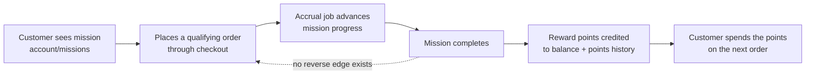

<!-- copy of .claude/skills/qa-test-design/test-design-techniques.md §0, §1, §1a — keep in step; the repository copy is canonical here -->
# Test Design Techniques Reference

## 0. Technique tokens — the closed vocabulary

Every technique reference in a Test Model scenario row, and every `Technique:` stamp in a suite
row's `References`, uses one of these tokens. This table is the single source of truth: the
`/qa-test` Step 1e model reads it, and `append-test-cases-to-suite.ts` validates against it at
run time (never against a hardcoded list).

| Token | Technique | Section |
|---|---|---|
| `FLOW` | Value-Chain Flow Coverage (end-to-end journey) | §1a |
| `EP` | Equivalence Partitioning | §2 |
| `BVA` | Boundary Value Analysis | §3 |
| `DT` | Decision Table | §4 |
| `ST` | State Transition | §5 |
| `PW` | Pairwise / t-way combinatorial | §6 |
| `CT` | Classification Tree | `examples/classification-tree-products.md` |
| `EG` | Error Guessing | §7 |

Adding a token means adding a section here first. 34 suite rows already carry organic
`Technique:` stamps — this formalizes that convention rather than inventing one.

---

## 1. Technique Selection Guide

Use this table to pick the right technique(s) for the feature under test. Most features benefit from combining two or more techniques.

| Situation | Recommended Technique(s) | Rationale |
|---|---|---|
| Many input values, few business rules | EP + BVA | Partitions reduce combinatorial explosion; boundaries catch off-by-one errors |
| Complex business rules with multiple conditions | Decision Table | Exhaustive rule coverage; exposes missing/contradictory rules |
| Feature has a lifecycle (status changes) | State Transition Testing | Catches invalid transitions and unreachable states |
| Many parameters, full combination infeasible | Pairwise / Combinatorial | Covers all 2-way interactions at ~15% of full combinations |
| Mature feature, looking for edge cases | Error Guessing | Leverages domain knowledge to target likely failure points |
| New or unknown feature | EP + BVA + Error Guessing | Baseline systematic coverage plus exploratory edge cases |
| **Any feature that changes state — run this FIRST** | **FLOW** (§1a) | Names the chain of value the feature delivers, so the other techniques have a link to refine. Skipping it yields per-screen field checks that pass while the feature is broken |
| Integration or E2E testing | FLOW first, then layer the rest | FLOW supplies the journey and the variants × links matrix; EP for inputs, ST for lifecycles, DT for rules refine each crossing |

**Combining techniques:** Start with EP + BVA to establish baseline coverage, then layer additional techniques based on feature characteristics. Track which technique produced each test case for traceability.

## 1a. Value-Chain Flow Coverage (FLOW) — the technique that runs FIRST

**Concept.** Before partitioning a single input, model the feature as the **chain of value it
delivers**: a trigger the user performs -> the effect the system computes -> the state it persists ->
the surface where the user *sees* that effect -> what the user can then *do* with it. Every feature
that changes state has such a chain, and the chain — not the screen inventory — is what the feature
is *for*. FLOW covers each link with at least one case that crosses it, plus at least one
**journey** case that traverses the whole chain in one run, as the end user, through the real UI.

**Why it is first, and why the other seven cannot substitute for it.** EP, BVA, DT, ST, PW, CT and
EG are all **parameter-space** techniques: given a named input, a named rule or a named lifecycle,
they refine it. None of them can *name* the chain. Applied to a feature whose chain was never
written down, they faithfully produce per-screen field checks — each one individually well-formed,
strongly asserted, and collectively unable to notice that the feature does not work. That failure
mode is not hypothetical; see the worked example at the end of this section.

**A link is crossed only by an observation on the far side of it.** Reading a value out of the API
and reading the same value off the page are two observations of *one* link. The link between them
is crossed only by a case that causes the effect and then observes it on the other surface.

### Derivation procedure

1. **State the chain in one line per link**, in the user's terms, not the code's:
   `trigger -> effect -> persisted state -> user-visible surface -> what it unlocks`.
   If you cannot write it, you do not yet understand the feature — that is the finding, and it is
   `1c`/`1d` work, not something to paper over with more UI cases.
2. **Draw it** (mandatory — see *Diagrams* below). A chain that is only prose is not reviewable;
   a missing arrow in a drawing is obvious, a missing sentence is not.
3. **Enumerate the feature's VARIANTS** — the kinds of the thing (goal types, payment processors,
   product kinds, role kinds). Variants are not parameter partitions: two variants usually run
   through *different code paths* for the same link.
4. **Build the mechanism coverage matrix — variants x links.** One row per variant, one column per
   link. Each cell holds a scenario `#` or an explicit `GAP` / `WAIVED + reason`. The matrix is
   published in the model; **a blank cell is a coverage hole nobody can see, a `GAP` is a decision.**
5. **Only now** run the parameter-space techniques, per link, to decide *which values* each
   crossing uses. EP/BVA/DT/PW refine a link that FLOW has already named.

### Diagrams — which one, and when

Pick by what can be wrong; draw more than one when more than one applies. All are Mermaid, all live
in the Test Model.

| Draw | When | It exposes |
|---|---|---|
| `flowchart` — the end-to-end journey, primary path + alternate/error branches | **Always**, for any feature with a chain | Links nobody covers; branches nobody exercises; the point where the user is left with no next step |
| `sequenceDiagram` — UI -> API -> handler -> store -> back to UI | The chain crosses layers, or any part of it is **async** (job, queue, webhook, settlement) | The window between "the user acted" and "the system settled"; who observes stale state, and for how long |
| `stateDiagram-v2` — the entity's lifecycle | The entity has statuses, or an effect is expected to **reverse** (cancel, refund, expire, revoke) | Missing reverse edges — the single most under-tested class in this codebase |

**The reverse edge is part of the chain.** If money, points, stock or entitlement moves forward,
ask on the diagram what moves it back, and cover it. "There is no reversal path" is a finding worth
more than any number of render assertions — and it is invisible until the lifecycle is drawn.

### Coverage rules

- **At least one journey case per feature, authored FIRST.** It runs the whole chain end to end,
  through the surface a customer actually uses, with real data. It is the case that answers *"does
  this feature work?"* — the one everybody assumed someone else had written.
- **Every link crossed at least once per variant**, or the cell says `GAP` / `WAIVED + reason`.
- **The reverse edge is covered wherever one is expected** — and its *absence* in the product is
  reported, not silently left uncovered.
- **A case that never leaves one screen must name the link it defends.** It is legitimate only as a
  cheap guard on a link the journey already crosses (a label, a state, an a11y contract). If it
  defends no link, it is decoration — cull it per this repository's `qa-test-cases-generator` SKILL.md section 6.
- **The journey is not replaced by the sum of its parts.** Proving the API moves a number and
  proving the page renders a number it was handed leaves the join between them untested, which is
  exactly where integration defects live.

### Token and stamping

`Technique:FLOW`. A journey case additionally carries `[JOURNEY]` in its title, so the corpus can
be asked how many features have one.

### Worked example — Loyalty Missions (VCST-5320 / VCST-5346), and what it cost

The chain, which nobody wrote down at design time:

What was authored instead: **127 cases**, of which the storefront suite — the biggest at **71
cases** — placed **zero orders**, and **54 of its 71** never left the missions page. The chain
end-to-end (links B->C->D->E) was covered by **14 cases (11%)**, nine of them API-only. The final
link F — spending what the feature grants — had **one** case, written last, on the last day. The
four goal-type variants x five links = 20 matrix cells; roughly 6 were filled, and because no
matrix existed, the 14 empty ones were invisible.

Three consequences worth remembering:

- **Assertion strength did not save it.** `npm run tc:rank` scores that 71-case suite as strong
  (41 `INV` assertions, 58 `KEEP`). A strong assertion about an unimportant subject is precisely a
  garbage case, and no existing gate flags it. FLOW is the missing second axis: *strength* says
  whether a check can fail; *chain coverage* says whether anyone cares if it does.
- **The exploratory session that ran AFTER the 119 cases** found 8 net-new scenarios and 6 new
  defects in ~35 minutes — including *no currency guard on accrual* and *no reversal path at all* —
  and stated the diagnosis itself: *"nothing joins them."* Every one of those sits on a chain link
  or a missing reverse edge.
- **The test data was designed for screen states, not for the mechanism.** Fixtures rendered
  partial/completed/zero-target cards, while the seeded orders were flat $30 with no shipping, tax
  or discount — so the central question (*is the goal measured against the order total or the
  merchandise value?*) was **not decidable from the data**, and the report had to say so. Design
  the fixtures from the chain's questions; see [`test-data.md`](test-data.md).
