# Release regressions

One folder per stable-bundle regression (`stable-16/`, `stable-17/` …). Each holds the plan, the state of
every wave and the triage ledger, so several QA can run the waves in parallel on one environment and anyone
can continue a wave someone else started.

- **Plan a release:** `/qa-test-plan stable <N> [--ref <branch>] --ticket <KEY>` (the same command plans a sprint: `/qa-test-plan 26-20`)
- **Run, triage and publish one wave:** `/qa-run stable:<N> <wave> --claim` · overview: `/qa-run stable:<N> status`
- **Check a folder:** `npm run release:check -- <release>` (CI runs `--all`)
- **Contract** — layout, fields, verdicts, parallel-run rules: [`.claude/skills/qa-run/release-folder.md`](../../.claude/skills/qa-run/release-folder.md)

`PROGRESS.md` in each folder is generated (`npm run release:status -- <release> --write`); never edit it by hand.
