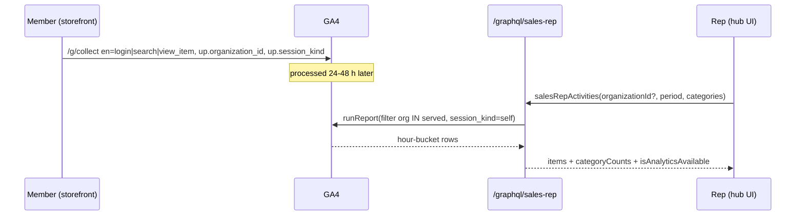

# TEST MODEL — VCST-5337 (+ VCST-5731)

```
Ticket:      VCST-5337 [Sales Rep] Customer insights: GA | Story | testable | feature-test | P2 (Medium) | Path: FULL | Changed: Both
             + VCST-5731 [E2E] Customer Search Activity Insights | Story | testable — the "Search Activity" AC slice of the same build
Context:     inline (orchestrator read 3 PR diffs + 2 design docs + QA-METRICS-GUIDE attachment + Kirill's 2026-10-02 behaviour-decisions comment)
Prior model: none — first model for the activity/insights surface (nearest: VCST-5733-2026-09-02, sales-rep scoped xAPI)
Domain map:  .claude/knowledge/domain/sales-rep.md @ rev 3 (2026-09-18, A9 2026-09-29) — STALE for this surface: no activity/insights rows
Mind map:    .claude/knowledge/domain/sales-rep.mind-map.json — no activity node (to add at 5-mind-map)
Chain position: touches L-ID (storefront identity tagging), L-GA (GA4 collect/processing — external), L-READ (scoped xAPI reads),
             L-UI (hub widgets + /company/activities). Does NOT touch: rep→org assignment (admin), order creation, statistics cards,
             documents, calendar, list sharing.
Affected surface: vc-frontend PR #2458 @5444e67 (modules/google-analytics/user-properties.ts, index.ts; sales-rep activities page,
             customer-activity / my-activity widgets) · vc-module-sales-rep PR #15 @7910f40 (salesRepActivities,
             salesRepCustomerActivitySummary, salesRepCustomerInsights on /graphql/sales-rep; POST api/sales-rep/analytics-diagnostics)
             · vc-module-google-ecommerce-analytics PR #61 @0f15eed (GA4 Data API reader). Map MISSING all of them (11b → map amendment).
Deployed:    vcptcore-qa — SalesRep 3.1013.0-pr-15-7910, GoogleEcommerceAnalytics 4.1005.0-alpha.277-vcst-5337-ga-event-search,
             theme feat/VCST-5337-insights-widgets (deploy #6862, 2026-10-07T15:20Z = PR HEAD). declared == deployed.
Ticket signals: GA data is 24–48 h late, hour buckets, sampled, cached 60 min; Summary = all time; GA reads filtered
             organization_id ∈ served orgs AND session_kind=self; Orders tab = orders whose CustomerId = rep's user id;
             Customers tab = earliest granting membership; "searches counted twice" (QA-METRICS-GUIDE §6) — claimed defect;
             28.09 comment: "Web activity isn't available" — env since fixed (diagnostics green). Scoping must be tested with a plain rep.
Epic context: VCST-5142 Sales Rep Hub. Done siblings VCST-5308/5309/5368 (customer profile, sales data, top products) = integration
             seams (profile page hosts the Customer activity widget). VCI-1493 (Workload Identity Federation) in progress = env dependency.
Domains:     sales-rep, b2b (org membership), analytics (GA4), catalog (search/product links)
Risk areas:  identity tagging per member (the OPERATOR's focus: "the rep must see the activity of ALL members of their customers");
             36-char truncation of property values; login event emitted before identity is set; impersonation leakage;
             cross-rep / cross-org scope; count consistency across tabs.
AC traceability: 18 atomic conditions — AC-1..AC-6 from VCST-5731, D-1..D-12 from the 2026-10-02 decisions comment (see checklist)
```

## Part 0 — Value chain

1. **L-ID** A member of a customer org signs in on the storefront → gtag `set user_properties` = {contact_id, organization_id (currently selected org), organization_name, is_sales_rep, session_kind}.
2. **L-EV** The member searches / views a product / signs in → GA4 `/g/collect` events `search`, `view_search_results`, `view_item`, `login` carry `up.*`.
3. **L-GA** GA4 processes (24–48 h) — external, not observable in-run except via the diagnostics `realtime` stage.
4. **L-READ** The rep's scoped query asks GA with `organization_id IN served orgs AND session_kind = self` (+ Orders/Customers from DB).
5. **L-UI** Rep sees rows in Customer activity widget (Summary / Searches / Product views), My activity widget, `/company/activities` (tabs + counts), and can open the search results / product page.

```mermaid
flowchart LR
  M1[Member A signs in] --> ID[user_properties set: org_id, contact_id, session_kind=self]
  M2[Member B / C ... any role] --> ID
  ID --> EV[GA events: login, search, view_search_results, view_item]
  IMP[Rep impersonates member] --> IDI[session_kind=impersonated] --> EV
  EV --> GA[(GA4 property — 24-48 h)]
  GA --> Q{Scoped read: org IN served AND session_kind=self}
  DB[(Orders CustomerId=rep / memberships)] --> Q
  Q --> FEED[/company/activities + widgets/]
  Q -. not served org .-> NF[not-found, no data]
  Q -. GA unavailable .-> UNAV["Web activity isn't available", (–) counts]
  FEED --> LINK[search term → /search?q= ; product → PDP, new tab]
```



**Variants** (rows): member role {maintainer, purchasing agent, employee, manager} × member kind {single-org, multi-org (selected org A / switched to B)} · session kind {self, impersonated} · rep kind {plain rep, admin} · served relation {served, not served}.

### Mechanism coverage matrix

| Variant \ link | L-ID | L-EV | L-GA | L-READ | L-UI |
|---|---|---|---|---|---|
| Member role maintainer (ACME John) | S1 | S1 | S12 (deferred) | S12 | S12 |
| Member purchasing agent (ACME Sarah, Lisa) | S1 | S1 | S12 | S12 | S12 |
| Member employee (ACME Mike) | S1 | S1 | S12 | S12 | S12 |
| Member of 2nd org (TechFlow David/Emily) | S1 | S1 | S12 | S12 | S12 |
| Multi-org member, org switch | S2 | S2 | S12 | S12 | S12 |
| Impersonated session | S3 | S3 | WAIVED — external | S12 (must be absent) | S12 |
| Login event identity | S4 | S4 | S12 | S12 | S12 |
| Long org id (>36 chars) | S5 | S5 | GAP — needs such an org with traffic | S5 (static) | GAP |
| Plain rep, served org | — | — | — | S6 | S9, S10 |
| Plain rep, NOT served org | — | — | — | S7 | S9 |
| Admin caller | — | — | — | S8 | WAIVED — admins pass every check by design |
| Two reps sharing orgs | — | — | — | S6 | — |
| GA unavailable | — | — | — | S11 | S11 |

**Reverse edges:** rep→org un-assignment must remove that org's activity from the rep's feed → S13 (API, read-only check of a non-served org; un-assign itself WAIVED — mutates shared fixtures). Impersonated activity must never appear as the customer's → S3/S12.
**Fixture lifecycle:** GA rows are terminal history (never removed); planted search tokens are unique per run (`qa5337-<member>-<yyyymmdd>`), so re-runs never collide.

## Part 0r — Role scenarios
Roles: plain rep `SALES_REP_EMAIL_VCPTCORE` (Priya Rao, served ACME …), `salesrep@sales.rep` (Watermelon123/Purple Pink123/Mercury123), TECHFLOW rep (Tess Flow); members `@td(ACME_ADMIN)`, `@td(ACME_BUYER)`, `@td(ACME_BUYER2)`, `@td(ACME_VIEWER)`, USR-007 David (TechFlow), USR-014 multiorg.

**BSC-1 — rep reviews what an account's buyers have been looking at.** Role: plain rep · opens customer profile → Customer activity → Searches / Product views; then All activity. Not allowed: hand-edited `?organizationId=<not served>` returns data (server, rep token) — S7.
**BSC-2 — any buyer's browsing reaches the rep.** Role: each ACME member · signs in, searches, views a product. Expected: every event tagged with ACME org id + self. Not allowed: an event of a signed-in member with empty `organization_id` (silently invisible to the rep) — S1/S4.

## Parts 1–5 — Fault model

Condition space: member role (4) × org kind (single, multi) × event (login, search, view_search_results, view_item) × session (self, impersonated) = 64; rep read: caller (plain, admin, other rep) × org (served, not served, omitted) × category (6) × period (month, year, all) = 162. Constraints: impersonation only via rep; admin cannot be "not served". N = 226.
Reduction: role does not branch in `buildUserProperties` (no role input) → roles collapse to a representative set of 4 members across 2 orgs (kept for the operator's explicit ask, not pairwise-dropped); category × period → pairwise (12); N 226 → M 13.

| # | Cell | Defect hypothesis | Archetype | Technique | Oracle | P |
|---|---|---|---|---|---|---|
| S1 | each ACME member (4 roles) + TechFlow member, self | a member's events carry empty/wrong `organization_id`/`contact_id` → rep never sees that member | identity propagation | FLOW | {SPEC} design §4.1 | P1 |
| S2 | multi-org member switches org | events after switch keep the old org (watch not firing) | stale state | ST | {SPEC} index.ts watch | P1 |
| S3 | rep impersonates member | `session_kind` stays `self` → rep's own browsing shown as customer's | leakage | DT | {SPEC} D-12 | P1 |
| S4 | `login` event | login sent before user_properties set → Logins never attributed (ACME: 0 logins all time) | ordering | EG | {SPEC} D-6 | P1 |
| S5 | org id length | `capped(36)` truncates a non-GUID org id → filter never matches | boundary | BVA | {SPEC} user-properties.ts | P2 |
| S6 | two reps with same orgs | counts differ between reps for same orgs | consistency | EP | {OBSERVED} probe: equal (5/26/15) | P2 |
| S7 | plain rep, not-served org id | data leaks via `organizationId` arg | authz | DT | {SPEC} D-11 | P1 |
| S8 | admin caller | admin sees everything (by design) | — | EP | {SPEC} | P3 |
| S9 | UI `/company/activities` tabs + counts | count differs by selected tab; zero tab hidden; `(–)` wrong | UI state | ST | {SPEC} D-7 | P2 |
| S10 | Searches feed vs insight | one search → 2 rows (search + view_search_results) | double count | EG | {SPEC} guide §6 | P2 |
| S11 | GA unavailable | error page instead of "Web activity isn't available" | degradation | EG | {SPEC} D-10 | P3 |
| S12 | planted tokens per member, read after 24–48 h | some members' activity missing at the rep | end-to-end | FLOW | {SPEC} | P1 — DEFERRED |
| S13 | skip > 500 / page 26 | rows past window repeat | boundary | BVA | {SPEC} D-8 | P3 |

Probes carried in: no `VC-*` entry for GA/sales-rep activity — N/A. Archetype sweep: authz (S7), consistency (S6), degradation (S11), boundary (S5, S13) covered; concurrency WAIVED (read-only feature). UIP sweep: UIP-DEEP (S7 hand-edited URL), UIP-TABS (new-tab links, S9), others WAIVED — read-only list. Business Rules: BL-SR-001..009 (scoping/creator rules for orders). Docs grounding: none — NEW feature, no VirtoOZ page; provenance {SPEC}/{OBSERVED}.
Agents to dispatch: qa-frontend-expert (playwright-chrome: S1–S4, S9–S11, S12 planting), qa-backend-expert (API: S5–S8, S10, S13).

## Round 2 — 2026-10-19, vcptcore-qa (full re-check after the hub moved to a plugin)

Build: theme PR #2458 @3f0b728 (2.61.0-pr-2458-3f0b) · SalesRep 3.1015.0-pr-15-e5bc · GA 4.1005.0-pr-61-5267 · Platform 3.1085.0. Contract REFRESHED 2026-10-19 (`dataAsOf` gone). Domain map STALE (no activity rows) · mind map: no activity node. Atomic conditions: AC-1..6 (5731), D-1..38, F-1..8, N-1..16 (1d, terminal). kb read: KB-F615F682, KB-3D7DE8D4, KB-CF5C7FBE (confirmed); captured KB-847622A8.
**Chain extension the diff introduced (not a Part 0 rewrite):** L-DELIVER between L-READ and L-UI — `store.plugins` → `/modules/$(VirtoCommerce.SalesRep)/plugins/vc-frontend/` on the storefront origin → MF host mounts the hub (`module_federation_enabled`). Env BLOCKED 15:45–17:20Z (no `/modules` ingress route, fixed by vc-deploy-dev #6960). Optional module adds a variant: GA module {absent, present-unconfigured/failing, present-working}.
Round-1 hypotheses to clear: S3/F-1 (is_sales_rep filter) · F-2 sign-out tagging · S4/F-5 login from landing page · F-3/F-4 timeout + partial (–) · F-6 pager 320 · F-7 aria-current · F-8 by design (not re-filed).

| # | Cell | Defect hypothesis | Archetype | Technique | Oracle | P |
|---|---|---|---|---|---|---|
| R2-1 | rep opens hub after reload / new tab, every hub route | plugin fails to mount on some route → host 404 (whole hub lost) | integration | FLOW | {SPEC} vc-frontend s6 guide + 093b | P1 |
| R2-2 | hub regression: dashboard, my customers, profile, orders, tasks, documents, layout | code moved theme→module, a page lost behaviour in the move | regression | EP (suites 089–106, 050m) | {BL-SR-*} | P1 |
| R2-3 | rep's own historical rows (qa5337-repself-20261007, qa5337-r4-alla-*) | filter not applied on one surface (widget/Logins/Summary) | leakage | DT | {SPEC} 10-13 F-1 | P1 |
| R2-4 | customer events from before `is_sales_rep` existed | exact-match `is_sales_rep="false"` drops pre-property history → counts fall | data loss | EG | {HYPOTHESIS} — PO/dev to confirm intent | P2 |
| R2-5 | `/company/my-customers/{id}/activities` + old `?organizationId=` + unserved id + non-rep | new route leaks or old link shows customer data | authz | DT | {SPEC} 10-16 | P1 |
| R2-6 | timeout setting 1–2 s → partial failure | "Couldn't load" instead of "isn't available"; All shows a number beside (–) | degradation | EG | {SPEC} 10-13 F-3/F-4 | P2 |
| R2-7 | GA module absent/disabled | hub errors / shows "unavailable" instead of hiding tracked parts | config | DT | {SPEC} 10-16 — needs an env without the module (WAIVED until one exists) | P2 |
| R2-8 | badges vs rows (×3 counts 3, Logins = Total visits, All = Σ) | badge counts rows, not events | consistency | EP | {SPEC} 10-13 | P2 |
| R2-9 | ALCE* multi-catalog product view | still plain text, or links to wrong catalog's product | resolution | EG | {SPEC} 10-13 | P3 |
| R2-10 | planted 2026-10-19 traffic read back ≥9 h later | member rows missing / anon or rep rows present / login undercount | end-to-end | FLOW | {SPEC} | P1 — DEFERRED to read-back |
