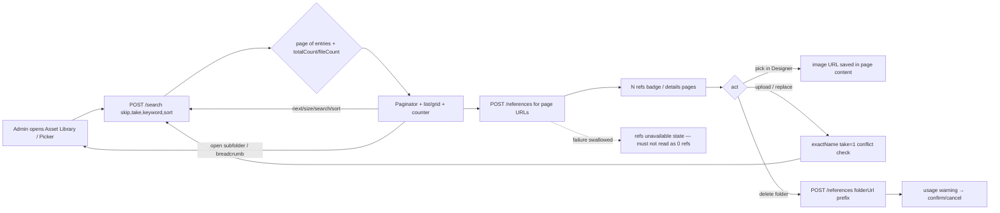
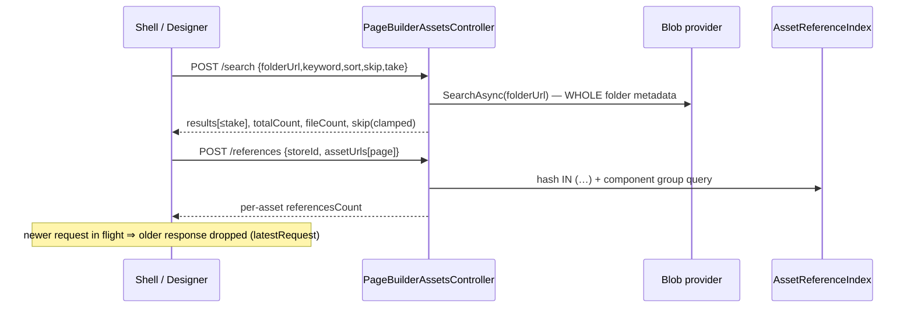

# TEST MODEL — VCST-5726

```
Ticket:      VCST-5726 | Type: Story | Status role: testable (Testing) | Flow: feature-test | Priority: P1 (High) | Path: FULL | Changed: Both (C# API + Shell Vue + Designer Angular)
Context:     FULL — 1c ba-system-analyzer (source @61dfac7f + read-only REST probes; LIVE UI NOT OBSERVED — firefox lane could not sign in), 1d ba-story-writer (Mode B), 1r REACHABLE (edge)
Build:       vcptcore_qa1 · PageBuilderModule 3.1035.0-pr-171-61df (temporary pin, vc-deploy-dev#6933) · Platform 3.1079.0-pr-3135-163c
Prior model: none — first model for this surface (VCST-4932 shipped without one)
Domain map:  .claude/knowledge/domain/page-builder.md @ rev 2 (generated 2026-09-23) — PRESENT; the Assets Library tab is carried UNVERIFIED there
Mind map:    ABSENT (no page-builder.mind-map.json) → built at 5-mind-map
Chain position: the domain chain is author → compose page (Designer) → pick/manage media (Asset Library) → save draft →
             publish → storefront render → reference index → delete/reuse. This ticket TOUCHES: pick/manage media (list, page,
             search, sort, select, upload/replace, delete-warning) and the READ side of the reference index (N refs, usage).
             It does NOT touch: page compose blocks, publish/schedule, storefront render, Shared Component authoring, the reference
             index WRITE path (page save → index) except as data setup, image thumbnails (VCST-5425), upload size/type limits (VCST-5425).
Affected surface: vc-module-pagebuilder — API PageBuilderAssetsController (/search NEW, /references existing); Shell
             page-builder-shell `#/page-builder-assets` (list + grid, paginator, details panel, delete dialog); Designer
             page-builder-designer asset picker (MatPaginator); settings.json descriptor (legacy GET → paged POST).
             Map MISSING (11b): the /search endpoint, the paginator/page-size/sort controls, the N refs badge, the details panel,
             the delete usage warning, the Designer picker paginator, the legacy-descriptor translation.
Ticket signals: dev comment (Jira 2026-10-06): default 20, sizes 20/50/100; refs = one batch per page; folder lookup by prefix;
             local timings 314/317/455 ms (not an SLA). Security comment: descriptor double-resolution could evaluate {{=…}} in
             folderUrl/exactName/keyword — merged head reads raw descriptor once (asset-library-api.service.ts doConfiguredRequest)
             → probe it live. Prior run VCST-5443 (same env, PR #166) FAILED; #166 still open.
Epic context: none (linked: caused-by VP-9060 customer request; relates VCST-5425 thumbnails/limits — out of scope)
Domains:     Page Builder / CMS (no BL-* domain exists for it — finding), Platform assets (BL-PLAT), UI (BL-UI)
Flows & boundaries: Shell ↔ /search ↔ blob provider; Shell/Designer ↔ /references ↔ AssetReferenceIndex (DB); Designer picker ↔ page content
Risk areas:  whole-folder enumeration per request (O(N) per page/keystroke); totalCount = files+folders; folders-first sort spills
             folders across pages; silent skip clamp; non-recursive search (behaviour change vs old /api/assets); references
             failure swallowed (silent-zero risk); permission split (/search platform:asset:read vs /references builder read);
             stale-response race (AC7); descriptor template evaluation (security)
AC traceability (1d → impl verdict):
  AC1  list+grid page from server, paginator = real total ........ COVERED, DRIFT: total includes folders; fileCount separate
  AC2  search+sort server-side over whole location ................ COVERED, DRIFT: search NOT recursive; keys Name/Type/Size/ModifiedDate
  AC3  N refs bounded requests per page ........................... COVERED — but NOT NEW (batched + DB index since VCST-4932) → measure
  AC4  folder delete lookup single prefix query ................... COVERED — NOT NEW; the cited crawl does not exist → measure at depth
  AC5a only current page's assets requested ...................... to verify live (img GETs not in diff)
  AC5b timing within agreed budget ................................ UNDECIDABLE — budget not agreed → report measurements only
  AC6  Designer picker same limits ................................ PARTIAL — default descriptor paged; custom descriptors fall back
  AC7  superseded responses dropped ............................... COVERED (latestRequest tracker)
  AC8  stateKey restore uses restored offset ...................... NOT APPLICABLE — stateKey not used; reload → page 1
  AC9  no regression: nav, breadcrumbs, upload, DnD, delete+warning, details ... code-review only → live
  G1   (gap) empty folder · G2 last partial page · G3 page beyond total after delete/search · G4 folder-only page ·
  G5   (gap) {{…}} literal in folder/file/keyword stays inert · G6 permission split · G7 references failure ≠ "0 refs"
DoD (from 1d, story declares none): budget agreed · AC8 clarified · HAR of page-scoped requests at 500 · sorts × folders-first ·
  400 on bad sort / take>100 · locales not raw keys · release note for non-recursive search — all confirm-at-5-verdict
```

## Part 0 — VALUE CHAIN

```
L1 Open a location   — the admin opens Assets Library (Shell) or "Choose from Asset Library" (Designer) and lands in a folder
L2 Ask the server    — ONE POST /search {folderUrl, keyword, sort, skip, take[, acceptedTypes]} for that folder
L3 Get one page      — the server returns ≤ take entries + totalCount (files+folders) + fileCount + the (clamped) skip
L4 See where I am    — list/grid shows the page; paginator shows page X of N and the total; counter shows files
L5 Count usage       — ONE POST /references for the page's blob URLs (DB index)
L6 See usage         — each asset shows "N refs"; the details panel lists the pages using it
L7 Act               — move pages / change size / search / sort / open subfolder / upload (lands on the file's page) /
                       replace (conflict found even off-page) / delete (folder usage by prefix → warning) / PICK into a page
L8 What it unlocks   — the picked image is in the page; a deleted asset was deleted knowing who used it; at 500 assets
                       the library stays usable (only the visible page costs anything)
```





**Variants** (the layer that branches = the client surface + its request shape; union of Shell and Designer):
V1 Shell list · V2 Shell grid · V3 Designer picker, default descriptor (acceptedTypes = images) · V4 Designer picker, legacy GET
`/api/assets` descriptor from configUrl/theme override (translated, or local paging) · V5 API direct (contract the UIs rely on).

**Mechanism coverage matrix** (columns = links, rows = variants; derived from Part 0, scenarios mapped after)

| | L1 open | L2 request | L3 page/total | L4 paginator/counter | L5 refs batch | L6 N refs/details | L7 act | L8 unlocks |
|---|---|---|---|---|---|---|---|---|
| V1 list | 1 | 1, 9 | 2, 3, 4 | 2, 3 | 12 | 12, 13 | 6, 8, 16, 17, 18, 19 | 1 |
| V2 grid | 5 | 5 | 5 | 5 | 5 | 5 | 5 (page/size) · rest WAIVED: same loader as list (assetEntriesLoader) — grid differs only in render | 5 |
| V3 picker default | 20 | 20 | 20, 21 | 20 | WAIVED: picker shows no refs (by design per 1c) — verify absence in 20 | WAIVED: same | 20, 22 (pick) | 22 |
| V4 picker legacy | 23 | 23 | 23 | 23 | WAIVED: as V3 | WAIVED: as V3 | GAP — legacy descriptor + upload not modelled; charter item for 3x | GAP — same |
| V5 API | 9 | 9, 10, 11 | 4, 10 | WAIVED: API has no paginator (UI rows cover it) | 14 | 14 | 25, BSC-1, BSC-2 | WAIVED: API has no user outcome (row 22 covers it) |

**Reverse edges**
- Remove the image from a page → that asset's N refs decreases → covered by **13**.
- Delete an asset that pages still use → pages keep a broken URL. The product warns and does not block (by design per VCST-4932). Outcome: **ABSENT IN PRODUCT** (no un-delete; the warning is the only guard). Report it as known behaviour, not a bug. Check the warning in **18**.
- Upload, then delete the same file → the total returns to its previous value → covered by **16**.

**Fixture lifecycle:** delete scenarios (18) consume their target, so they use a per-run throwaway file or folder created in the case, never F500/FDEEP. The reference counts (12, 13) change when a page is edited, so case 13 creates its own page and restores it.

## Part 0r — ROLE SCENARIOS

Roles in scope:
- Administrator → `{{ADMIN}}` / `ADMIN_PASSWORD`.
- Page-Builder read-only → `@td(RESTRICTED_CMS_ADMIN)`. Permissions `builder:access`+`builder:read`, no `platform:asset:read`. **FIXTURE-GAP on vcptcore_qa1:** no alias row; seed via `npm run seed:rbac`.
- Asset-reader without Page-Builder read → **FIXTURE-GAP**. No such role exists; route it to 3a.

BSC-1 — A content editor without asset rights opens the Asset Library
  Role: PB read-only · Situation: a merchandiser who may view pages but was never granted asset access
  | # | Action | Sees | Can do | Expected |
  | 1 | open Assets Library | an access state or an empty library | nothing | /search is 403 for this token; the UI shows an explicit no-access state, never a "0 assets" library |
  Outcome: no asset metadata leaks. Not allowed: POST /search with this role's token → 403 (asserted at the server).

BSC-2 — An asset manager without Page Builder read sees the list but not usage
  Role: asset-read only · Situation: a DAM operator managing files for several apps
  | # | Action | Sees | Can do | Expected |
  | 1 | open folder | the page of files | page through it | /search 200. /references 403. Each badge shows "unavailable", **not "0 refs"** |
  Outcome: the operator is never told an in-use file is unused. Not allowed: POST /references with this token → 403.

## Parts 1–5 — FAULT MODEL

**Condition space**
- variant: V1–V5 (5)
- folder shape: empty / < page / exact multiple / 500 files / folders+files mixed (5)
- page position: first / middle / last-partial / beyond-total (4)
- page size: 20 / 50 / 100 (3)
- keyword: none / unique hit / no hit / hits across pages / matches a folder / `{{…}}` literal (6)
- sort: Name, Type, Size, ModifiedDate × asc/desc (8)
- acceptedTypes: none / images-only over PDFs (2)
- references: 0 / 1 / n / shared-component / unavailable (5)
- timing: settled / superseded (2)
- role: 3

Constraints: acceptedTypes applies only to V3/V4; references apply only to V1/V2/V5; beyond-total only after a delete, a search or a forced skip; role varies only on the L2 and L5 links.

Raw N = 5·5·4·3·6·8·2·5·2·3 = **1,728,000**.

**Reduction**
- Technique: FLOW first (row 1); EP on the folder shape and the keyword; BVA on the page position (first, last-partial, beyond) and the take limit (100/101); pairwise on sort × page size; variants crossed only with the links that branch on them (matrix above).
- Dropped factors and what subsumes them:
  - Sort keys × direction run as 4 rows plus folders-first; the remaining combinations are pairwise.
  - Page size 50 is subsumed by 20/100 for paging maths (same `skip=k·take` path).
  - Grid × every action: same loader as list, so grid keeps only the page/size/refs row.
  - Role × UI actions: roles are checked at the server only (BSC-1/2).
  - The "references n" class is collapsed into 1-vs-3-vs-2+shared.
- Result: N → **M = 25**.

**Test scenarios**

| # | Cell | Defect hypothesis | Archetype | Technique | Oracle | P |
|---|---|---|---|---|---|---|
| 1 | V1 · F500 · first page · 20 · Name asc | **FLOW.** Open the 500 folder in the list and step to page 2. A whole-folder load (old GET) or an `img` request for off-page assets would mean the library still costs O(500). | SCOPE | FLOW | {SPEC} AC1/AC5a: one /search skip=0,take=20; total 500; 20 rows; ≤20 image GETs; page 2 ⇒ skip=20, no asset-02x requested before it | P0 |
| 2 | V1 · FFOLDERS (25 sub + 30 files) · first and last page | totalCount counts folders, so the paginator page count disagrees with "N assets", or folders vanish from page 2 | PARITY | EP | {SPEC} AC1 + {OBSERVED} the 1c contract total=55, fileCount=30 → 3 pages at 20; the counter label must say what it counts. Real oracle needs a PO decision on "real total" | P1 |
| 3 | V1 · F500 · last partial page (500 @ 100 = 5 full; @20 25th) and 501 after upload | Off-by-one on the last page: an empty 26th page, or the last item missing | BOUNDARY | BVA | {SPEC} AC1: the last page holds total − (pages−1)·take | P1 |
| 4 | V5/V1 · beyond total (delete the last file on the last page; skip=999) | The clamp is silent, the UI keeps showing page N with no rows, or makes a second request | STALE | BVA | {OBSERVED} server clamp (skip:999→last); the UI must re-sync to the last real page with rows. Real oracle: AC1 "paginator reports the real total" | P1 |
| 5 | V2 grid · F500 · page 1→2, size 20→100 | The grid diverges from the list: it loads all items or ignores the size | PARITY | EP | {SPEC} AC1 "list **and** grid" | P1 |
| 6 | V1 · F500 · page size 20→50→100 on page 3 | The size change keeps a stale offset (page 3 of 100 = empty), or it does not reset to page 1 | STALE | ST | {SPEC} dev contract: a size change resets to page 1 (skip=0) | P2 |
| 7 | V1 · F500 · keyword "499" while on page 5 | Search runs only within the loaded page, or keeps skip=80 and shows nothing | SCOPE | EP | {SPEC} AC2: one hit, skip=0 | P0 |
| 8 | V1 · F500 · sort Name desc / ModifiedDate asc / Size / Type | Sort is applied only within the page; the first row after desc ≠ asset-499; date order = name order (fixture uploaded shuffled) | SCOPE | PW | {SPEC} AC2: Name desc first = asset-499.png; ModifiedDate asc first = @td(PB_ASSETS_P500.firstByUpload) | P1 |
| 9 | V5 · sort "foo", take 101, missing folderUrl | Unvalidated input → 500 or an unbounded page | BOUNDARY | BVA | {OBSERVED} 1c: 400 for each — contradict → finding. {SPEC}-able only if the dev confirms limits | P2 |
| 10 | V5 · FFOLDERS · sort Size desc | Folders first breaks under desc/Size (null ModifiedDate → exception or folders interleaved) | BOUNDARY | EP | {OBSERVED} PageBuilderAssetSort folders-first; real oracle = a product decision that folders always lead | P2 |
| 11 | V1 · keyword matches a file in a subfolder only | Search no longer recursive vs the old library: a user searching the root cannot find a known file | SCOPE | EG | {HYPOTHESIS} old /api/assets recursed; AC2 says "within the current location". Real oracle = a PO decision; report it either way | P1 |
| 12 | V1 · F500 · refs 1/3/2(+shared) on pages 1, 2, 25 | N refs shows 0 on page 2 because references were fetched for page 1 only, or one request per asset | SCOPE | EP | {SPEC} AC3: exactly 1 /references per page load, URLs = page URLs; badge = @td(PB_ASSET_REF_*.expectedRefs) | P0 |
| 13 | V1 · remove a reference from a page, reopen | The count is cached and does not drop (reverse edge) | STALE | ST | {SPEC} AC3/AC9 + the reference index: count −1 after the page is saved | P1 |
| 14 | V5 · /references with 100 URLs; with folderUrl=deep | The batch is truncated or chunked; the folder count misses nested usage | SCOPE | BVA | {SPEC} AC3/AC4: one request; folder count includes l5 usage (@td(PB_ASSET_REF_DEEP)) | P1 |
| 15 | V1 · /references fails (blocked via route) | The failure is swallowed and the badge renders "0 refs" → a user deletes an in-use file | SILENT | EG | {HYPOTHESIS} 1c: unavailableReferenceUrls state exists; the real oracle is an "unavailable", not "0". "0 refs" while refs exist is a High defect | P1 |
| 16 | V1 · upload asset-500.png into F500 while on page 1 | The upload does not land on the file's page, or the total does not update | STALE | ST | {SPEC} dev: preferredAssetUrl jumps to the page with the file; total 501 | P1 |
| 17 | V1 · upload a file named like an off-page asset (asset-450.png) | The duplicate check sees only the loaded page, so it silently overwrites | SCOPE | EG | {SPEC} dev comment step 4: replace confirmation opens | P0 |
| 18 | V1 · delete FDEEP-throwaway folder with a nested reference | The warning misses a nested usage, or the dialog waits on a crawl | SILENT | EG | {SPEC} AC4: one /references folderUrl request; the warning lists the page; no nested /search crawl in the HAR | P0 |
| 19 | V1 · navigate into a subfolder at page 3, breadcrumb back; details panel; Copy URL | The page/search state leaks across folders, or the breadcrumb returns to a stale page | STALE | ST | {SPEC} AC9 + dev: folder change resets the page | P1 |
| 20 | V3 · FMIX · images-only | The picker counts PDFs in the total, or shows the PDFs, or loads all 500 | PARITY | EP | {SPEC} dev step 6: 480, first = asset-020.png, 20 per page, no PDFs | P0 |
| 21 | V3 · FMIX · search "499", size 50/100 | The picker search is client-side over the loaded page | SCOPE | EP | {SPEC} AC6 + AC2 | P1 |
| 22 | V3 · pick asset-025 from page 2, save the page | The pick from a non-first page stores a wrong URL, or the refs do not increase | PARITY | FLOW | {SPEC} AC6; refs(asset-025) +1 after save | P1 |
| 23 | V4 · configUrl with the legacy GET /api/assets descriptor | The legacy descriptor loads the whole folder on every page | SCOPE | EG | {SPEC} dev step 7: a POST /search with skip/take is sent instead | P2 |
| 24 | V1+V3 · type fast "4","49","499" / click Next ×5 under a throttled network | An older response overwrites the newer one (page shows the "4" results under the "499" box) | RACE | ST | {SPEC} AC7: the final rows match the last action only | P0 |
| 25 | V5/V1/V3 · `{{=window.__vcst5726=1}}` as keyword, folder name, upload file name | The descriptor double-resolution evaluates the expression in the Designer origin (token theft) | CONFIG | EG | {SPEC} security review: the request body carries the literal; `window.__vcst5726` stays undefined | P0 |

- **Probes carried in:** VC-CMS-001 (search suggestions), VC-CMS-002 (Designer tune icon), VC-CMS-003 (rename/publish loses content). None are pagination/assets, so all three are N/A. The VC-*-upload size probe is owned by VCST-5425 (out of scope), so it is N/A.
- **Archetype sweep:**
  - Covered: SCOPE 1, 7, 11, 12, 14, 17, 21, 23, BSC-1; PARITY 2, 5, 20, 22; BOUNDARY 3, 4, 9, 10; STALE 6, 13, 16, 19; RACE 24; SILENT 15, 18, BSC-2; CONFIG 25.
  - Permission split: BSC-1/2.
  - **WAIVED:** money/stock/price archetypes, because no money moves here.
- **UIP sweep:**
  - BACK: 19. REFRESH: AC8 row — reload on page 3 → page 1 (record N/A-by-design). NET: 15, 24. INPUT: 9, 25. DATA: 2, 3, 4.
  - **WAIVED:**
    - DEEP: the shell hash has no page param, by design per AC8.
    - TABS, EXPIRE, STORAGE: no per-tab or persisted state in this change.
    - VIEW: the admin is desktop-only (1920×1080 lane).
- **Business Rules:** none exist for Page Builder/assets (finding; propose BL entries for "search scoped to current folder", "total counts navigable entries", "usage never shown as 0 when unknown"). BL-UI-001 (CLS on page switch) applies to 1/5. BL-PLAT: permission enforcement at the server (BSC-1/2).
- **Edge cases:** ECL 7.3 (loading states and races → 24); ECL 3.3 (exact name ranks → 7, 17).
- **Docs grounding:** VirtoOZ PlatformUserGuide, "Page Builder Office › Manage assets", describes a searchable library, folders and the "page(s) where the image is used". It says **nothing about pagination, page size, server search, N refs or the delete warning**, which is a doc gap. That is a 5-docs input, not a product finding (the feature is NEW → {SPEC}/{OBSERVED}).
- **Agents to dispatch:**
  - 3x: /qa-exploratory ticket on playwright-chrome.
  - 4a: qa-backend-expert on edge for API + Shell, and qa-frontend-expert on chrome for the Designer picker. The Designer is admin-hosted, so the split is by surface.
  - 4v: ui-ux-expert, paginator a11y.
  - 3a: test-data-engineer.

## Round 1 — 3x discovery amendments (SBTM-VCST-5726-2026-10-14, playwright-chrome)

| Row / cell | Was | Now ({OBSERVED} in 3x, evidence `reports/tickets/Sprint26-20/VCST-5726/screenshots/3x-*`) |
|---|---|---|
| 8 / AC2 | sort keys Name/Type/Size/ModifiedDate × asc/desc | the UI offers **4**: Name A-Z, Name Z-A, Recently modified, Largest first. Z-A ⇒ `sort:"name:desc"`, page 1 starts asset-499. **Picker has no sort** → row 21 drops sort |
| 11 | {HYPOTHESIS} non-recursive | **{OBSERVED}**: `d2-a` from the root → total 0. Still needs a PO decision (behaviour change vs the old library; build gone, not observable) |
| 15 | {HYPOTHESIS} silent zero | **{OBSERVED}**: /references 500 ⇒ badges "—", details "N/A", raw-message toast; **Delete blocked** (no dialog). Becomes a {SPEC}-candidate "never 0 when unknown" |
| 2 / AC1 | API-only | **{OBSERVED} in UI**: counter "30 assets" = fileCount; paginator 3 pages = totalCount 55; folders fill page 1 and spill onto page 2 |
| 13 | reuse the seeded ref page | the picker writes a **different URL format** than the absolute URL the seed stored ⇒ row 13 creates its own page via the picker (create-in-case) + new hypothesis **13b**: /references counts both URL formats of one asset as the same asset |
| AC8 | N/A (no stateKey) | reload resets **folder, page, sort and view** to root / 1 / A-Z / grid — beyond AC8 (UIP-REFRESH row) |
| V4 × L1–L8 | GAP | **NOT REACHABLE** on this env: the descriptor comes from the module's static `settings.json` + `GET /api/pagebuilder/settings` (`{}`); no UI sets configUrl. Row 23 → WAIVED here, needs a theme-override fixture (FIXTURE-GAP) |
| new 28 | — | empty folder / zero-hit search: shell leaves **Next/Last enabled** (no-op), picker disables them (PARITY, Low) |
| new 29 | — | zero-hit search shows the empty-FOLDER copy ("No assets in this folder yet / Upload files…") instead of a no-results message (RENDER, Low) |
| 5a | to verify | **{OBSERVED} PASS**: grid page 1 = exactly 20 image GETs, page 2 the next 20, none off-page; one /references per page with exactly that page's 20 URLs |
| 6 / 20 | to verify | **{OBSERVED}**: `acceptedTypes:["image/*"]`, "1 – 20 of 480", first asset-020, no PDFs, sizes 20/50/100 |
| 17, 25 | to verify | duplicate off-page name → Cancel / Replace / Upload-as dialog; `{{=…}}` inert in keyword, folder, picker frame |
