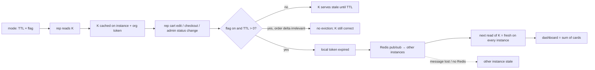
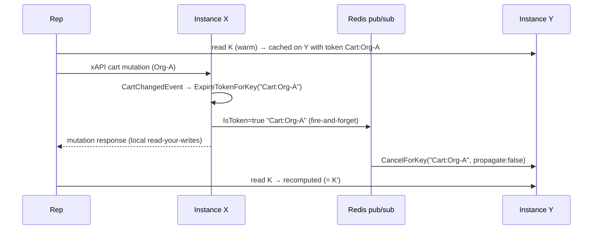
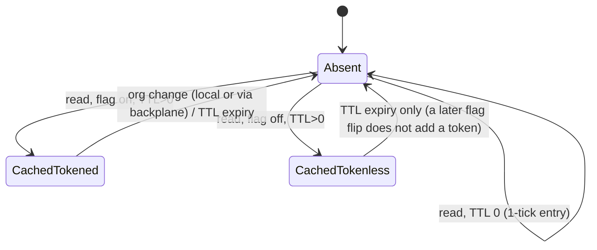

# TEST MODEL — VCST-5755

Ticket:      VCST-5755 | Type: Task | Status role: testable (Ready for test) | Flow: feature-test | Priority: P2 (Medium) | Path: FAST_GROUNDED (/qa-test-fast, --layer be) | Changed: Backend
Context:     /qa-test-fast Stage 1 — bundle: ticket (inline, all fields), PR diff (ba-api-specialist), domain map, kb, contract refresh
Prior model: none — first model for the statistics-freshness surface (VCST-5733 / VCST-5317 models cover other Sales Rep links; nothing carried forward)
Domain map:  .claude/knowledge/domain/sales-rep.md @ rev 3 (generated 2026-09-18, amended 2026-10-08) — PRESENT
Mind map:    .claude/knowledge/domain/sales-rep.mind-map.json — touches sr.stats, sr.stats.cart-statistics, sr.scope.creator-only-statistics, sr.store-toggle.statistics-cache-settings (DRIFT); freshness/eviction/propagation nodes being added by this run's Wave-2 update
Chain position: domain link 5 ("the rep reads the served portfolio", statistics family) and the cart/order write links that feed it. Does NOT touch: rep provisioning/membership (links 1–3), documents, tasks, communications, lists sharing, the index-backed "All customer orders" family, storefront hub rendering (--layer be).
Affected surface: vc-module-sales-rep#18 (Core/Data/Web, module layer only) → scoped /graphql/sales-rep statistics ops (map §5 enumerates all 8); platform IPlatformMemoryCache + Redis backplane (env); Settings app module scope (map G11 — surface the map does not yet enumerate → reported MISSING)
Ticket signals: no AC field; DoD in description; developer QA comment 109138 = twin-probe technique (K vs K′ = `to`+1 s), 7 scenarios, 6 must-not-be-bugs; dev E2E single-instance, Redis off: 10/12 pass, cross-instance propagation NOT verified → the reason this run is on vcst-qa
Epic context: VCST-5142 Sales Rep Hub. Done seams: VCST-5589 (stale cached stats — the bug this fixes), 5588/5587 (Active cart / New orders logic), 5647 (period change), 5362 (BE dashboard)
Domains:     Sales Rep (sr) · Cart (event source) · Orders (event source) · Platform caching/settings
Flows & boundaries: xAPI cart/order mutation (instance X) → in-process event → handler → token cancel → Redis pub/sub → instance Y's cache → scoped stats read
Risk areas:  STALE across instances (the focus); CONFIG (flags read per call on the HANDLING instance via its own settings cache); tokenless entries after a flip; creator-scope makes many "no change" observations vacuous
AC traceability: 13 atomic conditions (bundle AC-1…AC-13): 12 testable here, AC-5 (1M-order benchmark) has no dataset on this env
Contract:    REFRESHED 2026-10-08 (schema:refresh + 86/86 fixtures, no drift); scoped-schema field shapes from PR source d367a155 → runner introspects /graphql/sales-rep first

--- Part 0 — VALUE CHAIN ---
Value chain:
- L0 Operator sets a family's mode (TTL minutes × InvalidateOnChange) — read per call, no restart.
- L1 The rep opens the hub → a statistics query with criteria K (family, method, orgs, period at second resolution).
- L2 The instance that serves it caches K in its OWN memory, with TTL, and (flag on) a per-org change token attached BEFORE the load.
- L3 The rep changes a cart, or checks out, in a served org (or an admin changes the order's status) — on whichever instance serves that request.
- L4 That instance's handler expires `{family}:{orgId}` for old+new OrganizationId (orders: only when aggregate-relevant) before the mutation returns.
- L5 The Redis backplane carries the token cancellation to every other instance (async, ms-scale; {DOC} caching/03-setting-up-Redis "minor delays").
- L6 The next read of K on ANY instance recomputes from SQL — K equals its cold twin K′.
- L7 The rep sees one consistent picture: the dashboard total = the sum of the customer cards; the customers list sorted by order metrics reflects the order.
Chain diagrams:

Variants (rows; derived from the layers that branch — handler mapping event→family, the mode gate, the creator filter, the token shape, and the instance that serves the read):
- V-cart Cart family, rep's own cart line change (CartChangedEvent, no delta filter)
- V-order Order family + order-status vocabulary, rep checkout (OrderChangedEvent, entry Added)
- V-status Order family + vocabulary, admin status change on a rep order (Modified, delta relevant)
- V-noop Order family, non-aggregate order save (Modified, delta irrelevant → no eviction)
- V-counts CustomerCounts family, rep checkout
- V-top TopSeller family + sold-categories vocabulary, flag false (default) then true
- V-ttlonly any family, TTL>0 + flag false (the instrument)
- V-ttl0 TTL 0 (no caching; existing entries not flushed)
- V-flip flag false→true at runtime (settings change must reach every instance)
- V-buyer non-rep buyer's cart/order in the rep's served org (off variant: evicts, recomputes the same number)
- V-multi multi-org entry (dashboard over all served orgs A+B) vs per-org cards
- V-sort salesRepCustomers sorted by order metrics (Order family via GetStatisticsByOrganizationAsync)
- V-other another rep's org (Org-C, rep2) — per-org token isolation
Mechanism coverage matrix (columns = links; cell = scenario #):
| Variant | L0 mode | L1–L2 warm/cache | L3 mutate | L4 local evict (same inst.) | L5 propagate (other inst.) | L6 K==K′ | L7 surface |
|---|---|---|---|---|---|---|---|
| V-cart | 2 | 1,2 | 1,2 | 2 | 2 | 2 | 1 |
| V-order | 1 | 1,3 | 1,3 | 3 | 3 | 3 | 1,9 |
| V-status | 4 | 4 | 4 | 4 | 4 | 4 | 4 (vocabulary) |
| V-noop | 5 | 5 | 5 | 5 | WAIVED — no eviction expected, nothing to propagate | 5 | WAIVED — no surface change by design |
| V-counts | 1 | 3 | 3 | 3 | 3 | 3 | 1 |
| V-top | 6 | 6 | 6 | 6 | 6 | 6 | 6 (vocabulary) |
| V-ttlonly | 0,7 | 0,7 | 0,7 | 7 (must NOT evict) | 0 (instance count) | 7 (K≠K′) | WAIVED — instrument only |
| V-ttl0 | 8 | 8 | 8 | 8 | 8 | 8 | WAIVED — no cache to reflect |
| V-flip | 10 | 10 | 10 | 10 | 10 | 10 | WAIVED — mode only |
| V-buyer | 11 | 11 | 11 | 11 | GAP — eviction without a moved number is unobservable by the twin probe; exploratory | 11 | 11 |
| V-multi | 9 | 9 | 9 | 9 | 9 | 9 | 9 |
| V-sort | 12 | 12 | 12 | 12 | 12 | 12 | 12 |
| V-other | 13 | 13 | 13 | 13 | GAP — exploratory (rep2, Org-C) | 13 | 13 |
Reverse edges: cart line removed / qty decreased → covered by 2 (reverse step) · order cancelled (IsCancelled) → 14 (exploratory charter; BL-SR-005 excludes cancelled) · setting restored (60→1, flags → unset) → teardown re-read, not a scenario · order deleted → ABSENT IN PRODUCT as a test lever (no delete event mapped by the PR; OrderChangedEvent Deleted is Added/Deleted ≠ Modified → relevant; charter)
Fixture lifecycle: every rep order/cart is per-run (create-on-fly, ledgered, deleted by id); settings are shared module-global state → one lane only, flip+restore; Org-A/B/C + reps are persistent (created 2026-10-08 for this ticket), never re-seeded.

--- Parts 1–5 — FAULT MODEL ---
Condition space: family {Cart, Order(+vocab, +sort), CustomerCounts, TopSeller(+vocab)} ×4 · mode {TTL0, TTL>0+false, TTL>0+true} ×3 · read instance {mutating, other} ×2 · change actor {rep, buyer, admin} ×3 · change kind {cart line, order create, order status, order non-aggregate save} ×4 · org shape {single served, all served (A+B), other rep's org} ×3 · flip timing {steady, flipped mid-session} ×2 → raw N = 1,728. Constraints: a cart change reaches only Cart; an order change only Order/Counts/TopSeller (source mapping) → family×kind = 6 feasible pairs; admin acts only on status; buyer changes move no rep number.
Reduction: N → M = 15. (a) Mode × family collapsed: one generic StatisticsCache path ("modes are data", source) → the full mode walk runs on Cart (cheapest event), the other families at their default plus TopSeller's false/true; (b) read-instance kept at BOTH values on every eviction row (the focus — t=2 with family); (c) actor buyer and admin each on one row; (d) org shape: multi-org on Order (dashboard sum), other-org on Cart, both via the family-agnostic per-org token; (e) flip timing on Cart only. Dropped: currency/culture partitions (BL-SR-004/006 unchanged by the diff, subsumed by existing suites 050m/093).
Technique: twin probe per 109138 — K = frozen `to` in the FUTURE (cart period bounds line-item modified date; a past `to` excludes the mutation and makes K==K′ vacuous), K′ = `to` + n s with a NEW n per probe (a used K′ is warm). Cross-instance without pinning: N≥20 cookie-less reads spread over the pods (warm every pod), mutate, then N cookie-less reads of K: all = K′ ⇒ propagated; a stale/fresh MIX ⇒ a pod missed the eviction. Scenario 0 also tests whether `INGRESSCOOKIE` pins a pod, for directed warm-on-Y / mutate-on-X.
Test scenarios (M = 15)
| # | Cell (factor values) | Defect hypothesis — what breaks here, and why it plausibly would | Archetype | Technique | Oracle | P |
|---|---|---|---|---|---|---|
| 1 | JOURNEY: rep, TTL 60 + defaults, all families warmed on every pod → xAPI cart edit + checkout in Org-A → every family read on every pod | The chain holds per link in unit tests but breaks end to end across pods: a handler fires only for the cart path, or the order path's eviction never reaches the pod that serves the hub read → dashboard shows pre-checkout numbers | STALE | FLOW | {SPEC} desc DoD 1–3 + 109138 scen 2,3,7 | Critical |
| 0 | TTL-only (Cart flag false, TTL 60): warm K with ONE read, rep cart edit, 20 cookie-less reads of K | Precondition: if vcst-qa runs ONE replica, every "cross-instance PASS" is vacuous. A stale/fresh mix proves ≥2 pods with independent caches; all-stale proves one pod (or pinning) | CONFIG | EG | {OBSERVED}→ becomes an env fact (kb capture); no product oracle | Critical |
| 2 | Cart, flag true, TTL 60: warm on all pods, add line / change qty, then reverse it | Token attached after load or keyed differently from the handler's `Cart:{org}` → K stale; or only the mutating pod evicts (propagate:false / message not published) → mix | STALE | ST | {SPEC} AC-1/AC-2; {DOC} Redis backplane | Critical |
| 3 | Order + CustomerCounts + the customer's YTD inline field, rep checkout (Added) | OrderChangedEvent handler gates on the wrong family flag, or expires only Order and leaves Counts/inline stale on other pods | STALE | DT | {SPEC} 109138 scen 3, AC-2 | Critical |
| 4 | Admin status change on a rep order (REST, admin pod) → order stats + used-status vocabulary | Status-only Modified save judged non-aggregate by the delta filter → no eviction → vocabulary keeps the old status | STALE | ST | {SPEC} 109138 scen 4 | High |
| 5 | Non-aggregate order save (e.g. comment only) | Delta filter declines correctly (no eviction); hypothesis: it over-evicts (dev's fixed bug) — perf-only, never a wrong value | SILENT | EG | {SPEC} 109138 "One failed … now fixed" | Low |
| 6 | TopSeller: flag false (default) → order → ranking/categories stale; flag true → next order evicts | Flag default inverted, or TopSeller rides the Order flag | CONFIG | DT | {SPEC} 109138 scen 6, design §3 defaults | High |
| 7 | Instrument: Cart flag false, TTL 60, warm K, rep cart edit → K stale, K′ moves | Flag not honoured (K goes fresh) → every PASS on rows 2–4 would be indistinguishable from "no cache" | CONFIG | DT | {SPEC} 109138 scen 1 | Critical |
| 8 | TTL 0: every read recomputes; set 60→0 with a warm entry → existing entry keeps serving until its TTL | Sentinel TTL path still caches, or (spec says not a bug) flushes | CONFIG | BVA | {SPEC} 109138 settings table + must-not-be-bugs | Medium |
| 9 | Multi-org dashboard (orgs A+B) vs per-org cards, right after a rep order in A, read on another pod | Multi-org entry carries only the region token or the first org's token → dashboard stale while the card is fresh → total ≠ sum | STALE | EP | {SPEC} desc DoD 2 + scen 7 | Critical |
| 10 | Flip Cart flag false→true mid-session, no restart: fresh tokened entry, next change evicts on every pod | Flag cached at startup or settings change not propagated → the other pod still attaches no token / its handler declines | CONFIG | ST | {SPEC} AC-6; {DOC} settings ride the same backplane-invalidated platform cache | High |
| 11 | Buyer (non-rep) cart + order in Org-A | Creator scope broken → buyer's order moves the rep's tile (leak) — or tile unchanged (correct, must-not-be-bug) | SCOPE | EP | {BL-SR-002} + 109138 must-not-be-bugs | Medium |
| 12 | salesRepCustomers sort by order metrics after a rep order in B (B overtakes A), read on another pod | Sort path (GetStatisticsByOrganizationAsync) not under the Order token → stale ordering with fresh member rows | STALE | EP | {SPEC} desc DoD 3 | High |
| 13 | Org-C (rep2) entries under an Org-A change; rep2's own cart change evicts only Org-C | Region-wide expiry instead of per-org (over-eviction — perf), or a per-org key collision across reps | SCOPE | EG | {SPEC} design §1 per-org tokens | Low |
| 14 | Settings surface: the 8 settings in Settings → Sales Rep → Statistics (Admin UI), absent at store level | Group/registration wrong → operator cannot find the flags (D15 persists; G11 answered) | CONFIG | EP | {SPEC} design §3 group `Sales Rep|Statistics`, IsPublic=false | Medium |
Probes carried in: VC-* catalog sweep not run on this FAST_GROUNDED path (no Step 2) — STALE probe "read → write via a different path → read" is scenarios 2–4, 9, 12 (filled in Step 2 on FULL)
Archetype sweep: STALE 1–4,9,12 · CONFIG 0,6–8,10,14 · SCOPE 11,13 · SILENT 5 · RACE WAIVED — mutate-then-read-within-ms race is the doc's accepted "minor delay"; charter item · REPLAY/MONEY/BOUNDARY/LIFECYCLE/FALLBACK/RENDER/PARITY WAIVED — no money, render or transition logic in the diff (money explicitly out: $0 short-cart prices)   (filled in Step 2)
UIP sweep (UI only): WAIVED — --layer be, no UI in the diff   (filled in Step 2)
Business Rules: BL-SR-001, BL-SR-002, BL-SR-005, BL-SR-006   (filled in Step 2)
Edge cases:  ECL — not loaded on this path   (filled in Step 2)
Docs grounding: docs.virtocommerce.org platform/developer-guide/Fundamentals/Caching/03-setting-up-Redis (backplane: removals/updates broadcast, async, minor delays) · Scalability/scaling-configuration-on-azure-cloud · dev research PLATFORM-CACHE-CONSISTENCY.md §2 (VIRTO workspace, source-verified)
Agents to dispatch: qa-backend-expert (Admin+API lane, playwright-edge, rep1) · qa-testing-expert (exploratory, playwright-firefox, rep2) · no storefront lane (--layer be) · no visual lane (visual_surface false)

## Unresolved → exploratory charter
- GAP V-buyer × L5 and V-other × L5 (eviction with no moved number — needs a side signal: latency of first read after the change vs a warm read).
- {HYPOTHESIS}: settings changes reach every pod's settings cache (row 10 rests on it); Redis reconnect flush; mutate-then-read inside the pub/sub window (RACE).
- Reverse edges: order cancel (BL-SR-005) and cart moved between orgs (old+new OrganizationId) / cart deleted.
- Mind-map DRIFT: no node carried freshness/eviction/propagation (handed to the Wave-2 update); `sr.store-toggle.statistics-cache-settings` DRIFT re-observed by row 14.

## Gate (1e, inline)
1 PASS · 2 PASS · 3 PASS (GAP/WAIVED cells carry reasons) · 4 PASS (axes from links/variants before rows mapped) · 5 PASS · 6 PASS · 7 PASS · 8 PASS · 9 PASS (row 0's {OBSERVED} states what makes it a fact) · 10 PASS (rows present, FAST: marked) · 11 PASS · 11b FIXED — Settings app module scope is not in the map's surface inventory → reported MISSING (G11) · 12 PASS (one role variant: rep; buyer is a data owner, not a role scope — no Part 0r)
