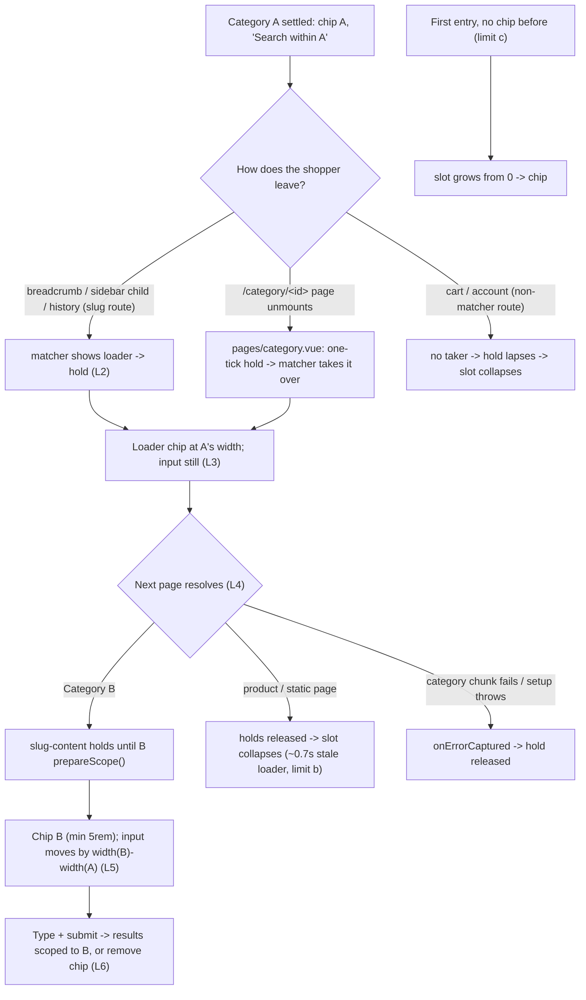
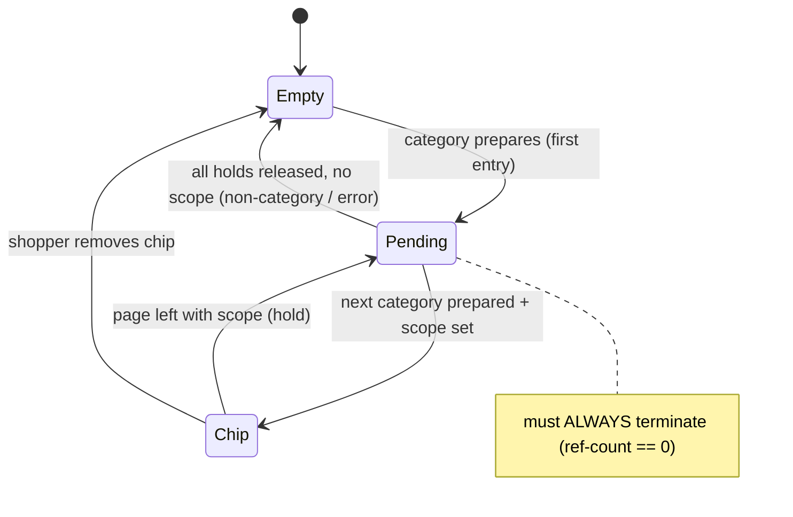

# TEST MODEL — VCST-5817

```
Ticket:      VCST-5817 | Type: Story (bug-shaped, label ui-kit) | Status role: testable | Flow: feature-test | Priority: P2 | Path: FULL | Changed: Frontend
Context:     FULL: ba-system-analyzer (1c, live playwright-firefox) + ba-story-writer (1d, static) + 1r REACHABLE
Prior model: none — first model for this surface (no VCST-5729 model was written)
Domain map:  .claude/knowledge/domain/search.md @ rev 1 (generated 2026-09-28) — PRESENT, fresh
Mind map:    .claude/knowledge/domain/search.mind-map.json — srch.scope.category, srch.scope.category.single-removable-chip
Contract:    n/a (contract_surface=false — no .graphql / xAPI / GraphType file in the diff)
Build:       storefront http://localhost = vc-theme-b2b-vue 2.60.0-pr-2522-ca9d-ca9de11f (PR #2522 head ca9de11f; Round 1 ran on 6f902c9e); API → vcst-qa; store B2B-store
```

**Chain position.** The domain map's §1 chain is the barcode chain (links 1–6: properties → store config → scan →
full-text / exact → single-hit → turn-off). This ticket touches **none of those six links**. It touches the
mind-map behaviour `srch.scope.category` ("a shopper narrows the search to the category being browsed") and its
branch `srch.scope.category.single-removable-chip` — specifically the **scope-slot lifecycle between two pages**,
which neither the map nor the mind map models as links. It does **not** touch: index build, facets, sorting,
suggestions/hints, barcode, results paging. **Mind-map DRIFT:** the scope-slot hold/pending lifecycle (L2–L4 below) is
a mechanism the PR adds that no node carries.

**Affected surface** (vc-frontend `client-app/`): `shared/layout/composables/useSearchScore.ts` (holdScope,
prepareScope, isScopePending) · `shared/catalog/components/category.vue` (prepareScope + watcher cleanup) ·
`pages/category.vue` (`/category/<id>` route; one-tick hold on unmount) · `pages/matcher/matcher.vue` (slug routes;
hold while loader) · `pages/matcher/slug-content.vue` (hold until category prepares; `onErrorCaptured` release) ·
`shared/layout/components/header/_internal/search-bar/search-bar.vue` (loader on `isScopePending`, invisible
`lastScopeLabel`, shared `min-width: 5rem`, placeholder). **Clause 11b:** the domain map enumerates the storefront
search bar (§2) but NOT the scope slot, the slug-vs-`/category/<id>` split, the matcher loader hand-over, the mobile
search toggle with a chip, or the scoped placeholder → reported as `domain_map.unmapped_surfaces[]` (1c).

**Ticket signals.** Repro 2026-08-27 (vcst-qa, theme 2.57.0-pr-2436): input.left 231.52 → 116.09 (−115.43, empty
slot) → 200.09 (+84, skeleton 5rem) → 229.77; top constant 66; layout-shift `hadRecentInput:false` 0.02157; same
entry lists `UL.mega-menu__nav` 198→186 and `DIV.mega-menu__divider` 182→170 (co-movement, causation unproven).
Comment: the dominant jump is the chip REMOVAL (0px), "reserve the slot, not the buttons". No attachments
(deliberate — transient 160–380 ms). **PR Known limits (author-declared):** (a) residual shift = label-width
difference (7 / 13 / 80 px); (b) category → non-category via matcher: loader chip stays ~0.7 s, then collapses;
(c) first entry with no prior chip still grows from 0.

**Epic context:** none (no parent). Related: VCST-5729 (Done, PR #2436 — one indicator while loading).
**Domains:** srch (storefront search bar), ui (layout stability). **Flows & boundaries:** catalog navigation ↔
search scope ↔ scoped search submit; matcher loader ↔ async category page ↔ search bar.
**Risk areas:** VC-UI-005 (layout-stability invariants uncovered by any suite), VC-UI-004 (state-dependent layout
bugs are distinct), VC-UI-006 (long value escapes its cell), VC-UI-007 (non-en locale); hold ref-count leak
(stuck loader); stale scope on submit.

**AC traceability (1d):** no formal ACs → AC-1 (0 delta on swap, REWRITE; Impl CONTRADICTS-partial via limit a) ·
AC-2 (reserve resolved width; Impl DRIFT — reserves the PREVIOUS label) · AC-3 (slot never 0; SATISFIED-static) ·
AC-4 (shared min-width; SATISFIED-static) · AC-5 (mega-menu does not move; NOT-FOUND) + gap-ACs G1–G16
(labels, 375px, menu route, history, leave, stale chip, removal, rapid, slow/stuck, a11y, placeholder, submit-while-
pending, dark, long label, mega-menu, first entry). **DoD:** none declared on the ticket.

---

## Part 0 — VALUE CHAIN

| # | Link (shopper's words) | Mechanism |
|---|---|---|
| L1 | **I leave category A** (breadcrumb, sidebar child, catalog/menu link, Back/Forward, or to a non-category page) | route change: slug → matcher; `/category/<id>` → `pages/category.vue` |
| L2 | **The page I left lets go of its scope** — the slot is held instead of emptied | leaving page clears `searchScopeData`; a hold is taken (`pages/category.vue` one-tick hand-over, or `matcher` while its loader is visible) |
| L3 | **The bar shows "loading" in the same place, at the old chip's width — the input does not move** | `isScopePending` ⇒ loader VcButton, invisible `lastScopeLabel`, `min-width 5rem` |
| L4 | **The next page decides the scope** — a category prepares its own; anything else lets the slot go | `slug-content` holds until `prepareScope()`; `category.vue` finish on fetch end / cleanup; holds released post-flush or on error / unmount |
| L5 | **The new chip "B" appears; the input moves at most by the label-width difference** | chip VcButton `min-width 5rem`; placeholder "Search within B" once `!isScopePending` |
| L6 | **I search inside B, or remove the chip to search everywhere** | `searchScopeFilterExpression` → scoped results (BL-SRCH-004); chip click removes the scope item |





**Variants (rows — from the layer that branches: the router/matcher, union with category.vue):**
V1 slug→slug via **breadcrumb** (matcher; the ticket STR) · V2 slug→slug via **sidebar child** · V3 **`/category/<id>`
→ slug** (page hand-over to matcher; PR's measured path) · V4 **`/category/<id>` → `/category/<id>`** (same component,
id change) · V5 **history Back/Forward** · V6 **category → non-category** (product / static via matcher; cart via its own
route) · V7 **first entry** (no prior chip; direct URL / home) · V8 **error path** (category chunk fails / setup throws) ·
V9 **rapid successive navigation** (leave mid-fetch).

**Mechanism coverage matrix** (cells = scenario #, `GAP`, or `WAIVED + reason`):

| Variant \ Link | L1 leave | L2 hold | L3 loader@old width | L4 next decides | L5 chip B / Δ | L6 use scope |
|---|---|---|---|---|---|---|
| V1 breadcrumb | 1, 2, 3 | 1, 2 | 1, 2, 3, 12 | 1, 2 | 1, 2, 3 | 1, 13, 14 |
| V2 sidebar child | 1 | 1 | 1 | 1 | 1 | 1 |
| V3 `/category/<id>`→slug | 4 | 4 | 4 | 4 | 4 | WAIVED — L6 is route-independent once the chip settles; covered on V1 (#1) |
| V4 `/category/<id>`→`/category/<id>` | 5 | 5 | 5 | 5 | 5 | WAIVED — as V3 |
| V5 history | 6 | 6 | 6 | 6 | 6 | WAIVED — as V3 |
| V6 → non-category | 7, 8 | 7, 8 | 7 | 7, 8 | WAIVED — no chip B by definition | 8 (placeholder generic, unscoped) |
| V7 first entry | 10 | WAIVED — nothing to hold (no prior chip) | 10 | 10 | 10 | WAIVED — as V3 |
| V8 error | 20 | 20 | 20 | 20 | WAIVED — no B on error | WAIVED — no scope on error |
| V9 rapid | 11 | 11 | 11 | 11 | 11 | WAIVED — as V3 |

**Reverse edges.** Hold acquired (L2) → released: covered by #7, #8, #11, #20 (a hold that never releases = the
stuck-loader defect). Scope applied (L5) → removed by the shopper: #14. Scope applied → dropped on leaving the
catalog: #7, #8. None moves money/stock/entitlement.
**Fixture lifecycle:** no terminal state — every case re-uses live categories; no per-run fixture needed.
**Part 0r:** absent — one role (shopper; anonymous and signed-in share the code path).

---

## Parts 1–5 — FAULT MODEL

**Condition space** — F1 route variant {V1…V9} (9) · F2 old→new label width {equal, shorter, longer, both < 5rem,
very long} (5) · F3 viewport {1920, 1440, 768, 375} (4) · F4 network {normal, throttled} (2) · F5 theme {light, dark}
(2) · F6 action while pending {none, type+submit, click loader, navigate again} (4) · F7 locale {en, de} (2) · F8 auth
{anon, signed-in} (2). Constraints: F2 ∉ V6/V8 (no chip B); F6 ≠ none only where a pending window exists. **N = 11 520.**

**Reduction (N → 21).** F8 dropped — no auth branch anywhere in the diff or in `useSearchScore`; anon represents both.
F5 dropped from the functional table — light/dark is a paint-only variant, owned by the visual lane 4v (#21). F7 collapsed
to one `de` probe on the textual surfaces only (#17, #18) — width math is locale-agnostic except via label length, which
F2 already varies. F3: 1920 everywhere, 375 once on V1 (#15); 1440/768 subsumed (same desktop header layout ≥ lg).
F4 throttled only on the rows whose hypothesis needs a wide pending window (#12, #13). F2 full only on V1 (#1–#3, #16);
one representative elsewhere. F6 only on V1 (#13, #14; "navigate again" = V9 #11; "click loader" folded into #17 — the
loader is `disabled`). Pairwise t=2 over (F1 × F2) on the desktop rows.

**Test scenarios**

| # | Cell | Defect hypothesis | Archetype | Technique | Oracle | P |
|---|---|---|---|---|---|---|
| 1 | **[JOURNEY]** V2→V1, anon, 1920: `/printers` → sidebar *Laser Printers* → breadcrumb *Printers* → type a keyword + Enter | the slot collapses or snaps somewhere on the journey (input jumps), or the settled chip/placeholder/results are not scoped to the category actually shown | RENDER | FLOW | {BL-UI-003} slot width > 0 every frame; input Δ during chip→loader = 0; {BL-SRCH-004}+{DOC StorefrontUserGuide §Scoped search} results scoped to Printers | P1 |
| 2 | V1, old label LONGER than new (*Laser Monochrome* → breadcrumb *Laser Printers*) | loader→chip swap moves the input by the label-width difference (PR limit a) | RENDER | BVA | {BL-UI-003} Δ = 0 — **expected to fail by the PR's own declaration; keep the BL expectation, record measured Δ, route to PO tolerance decision** (rule 3) | P2 |
| 3 | V1, both labels < 5rem (*Lg* → breadcrumb *Televisions*) and equal-width pair | min-width clamp not honoured by loader or chip → Δ ≠ 0 even where labels "fit" | BOUNDARY | BVA | {BL-UI-003} Δ = 0 when both widths clamp to 5rem / are equal | P2 |
| 4 | V3: catalog "Popular categories" `/category/<guid>` → breadcrumb parent | the one-tick hold expires before the matcher mounts → slot collapses on the route-component swap (PR gap 2) | RACE | ST | {BL-UI-003} slot width > 0 every frame | P1 |
| 5 | V4: `/category/<id>` → another `/category/<id>` (same component, id change) | an older fetch finishing clears the newer page's `preparingScope` → loader vanishes early / chip of the old category | RACE | ST | {BL-UI-003} slot > 0; final chip = new category {SPEC PR #2522} | P2 |
| 6 | V5: A → B (breadcrumb), Back, Forward | history navigation bypasses the hold → collapse on Back; or loader shows the wrong old label | STALE | ST | {BL-UI-003} slot > 0; settled chip = page shown | P2 |
| 7 | V6: category → product page (matcher) | stale loader chip naming a category is shown on a non-category page (limit b, ~0.7 s) and/or never clears | STALE | EG | {HYPOTHESIS} — no spec; settled: no chip, no loader, generic placeholder {SPEC PR}; stale-loader duration measured → PO decision | P2 |
| 8 | V6: category → cart (non-matcher route) | hold lapses wrongly → loader stuck on cart; or scope persists outside catalog | LIFECYCLE | ST | {SPEC PR #2522} slot collapses, `isScopePending` ends; generic placeholder | P2 |
| 9 | V6: category → home via logo / static page | as #7 on a non-category matcher target | STALE | EP | as #7 | P3 |
| 10 | V7: first entry home → category, and direct-URL load of a category | slot grows 0 → loader → chip, input moves (limit c — pre-existing) | RENDER | EP | {BL-UI-003} Δ = 0 — **known residual, PRE-EXISTING; record, do not certify** | P3 |
| 11 | V9: 3 category clicks within ~300 ms (leave mid-fetch) | hold ref-count leak → loader never terminates; or final chip ≠ last category | RACE | EG | {SPEC PR} pending must terminate; final chip = last category | P1 |
| 12 | V1 + throttled network (slow 3G) | loader width drifts during a long pending window, or slot collapses mid-window | RENDER | EG | {BL-UI-003} input Δ = 0 for the whole loader phase | P2 |
| 13 | V1 + throttled, type keyword + Enter **while loader shows old label** | `searchScopeData` is empty during the hold → search runs unscoped while the bar still shows a category | SCOPE | EG | {HYPOTHESIS} proposed: applied scope must match the visible indicator; BL-SRCH-004 partial | P1 |
| 14 | V1 settled chip → click remove | removal leaves loader/stale label, or scope stays applied | LIFECYCLE | ST | {DOC StorefrontUserGuide §Scoped search} chip reset spans the whole catalog; generic placeholder | P2 |
| 15 | V1 at 375 px (mobile search toggle) | chip/loader overflows or the input shifts on mobile | RENDER | EP | {BL-UI-003} + {BL-UI-004} | P2 |
| 16 | V1 very long labels (*Courses and audio books* ↔ *UX/UI Design courses*), 1920 + 375 | invisible old label reserves an over-wide slot / chip overflows the bar | BOUNDARY | BVA | {BL-UI-004} contained or ellipsis; {BL-UI-003} | P2 |
| 17 | Loader a11y (en + de): accessible name, disabled state, invisible label | invisible `lastScopeLabel` becomes the accessible name / is announced twice; raw i18n key in `de` | RENDER | EG | {BL-A11Y-002} single correct name "Loading search context"; {BL-A11Y-004} axe-clean | P2 |
| 18 | Placeholder during pending vs settled (en + de) | placeholder names the OLD category while pending, or never names B | STALE | ST | {SPEC VCST-5729 / PR #2436} generic while pending, "Search within B" after (= SRCH-012) | P2 |
| 19 | V1 mega-menu co-movement | `UL.mega-menu__nav` / divider still shift in the same frame (AC-5) | RENDER | EG | {BL-UI-003} leftDelta = 0 | P3 |
| 20 | V8: block the category chunk (route abort) on a fresh context, then navigate | hold never released on load error → permanent loader | FALLBACK | EG | {SPEC PR #2522} hold released, slot collapses, error still reported | P3 |
| 21 | Dark mode V1 (visual lane) | loader/chip contrast or flash in dark | RENDER | EP | {BL-A11Y-003} contrast | P3 |

**Probes carried in:** VC-UI-005 → #1, #2, #3 · VC-UI-004 → #2 vs #10 vs #7 filed separately if both fail · VC-UI-006 →
#16 · VC-UI-007 → #17, #18 · VC-SEARCH-001..004 → N/A (index/provider/language data, not the slot) · VC-B2B-005 → N/A (no
org scope in this diff).
**Archetype sweep:** RENDER #1,#2,#10,#12,#15,#17,#19,#21 · BOUNDARY #3,#16 · RACE #4,#5,#11 · STALE #6,#7,#9,#18 ·
LIFECYCLE #8,#14 · SCOPE #13 · FALLBACK #20 · PARITY #1 vs #4 (same transition, two routes) · MONEY #17,#18 (de) ·
SILENT #13 (search "succeeds" unscoped) · CONFIG WAIVED — no store/theme setting gates the scope slot in this diff ·
REPLAY WAIVED — idempotent release is unit-tested in the PR and not observable live.
**UIP sweep:** UIP-BACK #6 · UIP-DEEP #10 · UIP-REFRESH #10 (reload = first entry) · UIP-NET #12, #20 · UIP-INPUT #13 ·
UIP-VIEW #15 · UIP-DATA #16 · UIP-TABS WAIVED — `useSearchScore` is an in-memory per-tab singleton, nothing shared ·
UIP-EXPIRE WAIVED — anonymous, no session · UIP-STORAGE WAIVED — scope is not persisted.
**Business Rules:** BL-UI-003 (P2-ux, INFERRED), BL-UI-004, BL-SRCH-004, BL-A11Y-002/003/004.
**Edge cases:** ECL — `ecl:extract --domain srch` matched NO section (unfiled; stated, not "none apply").
**Docs grounding:** StorefrontUserGuide §Scoped (hierarchical) search — chip marks the scope and can be reset; nothing
on loading/width/placeholder (those are {BL}/{SPEC}). kb: no entry for this surface (1c ask 2026-10-09T12:39Z).
**Agents to dispatch:** 3x `/qa-exploratory ticket VCST-5817` · 4a qa-frontend-expert (playwright-chrome) · 4v
ui-ux-expert (Chrome DevTools) · A test-management-specialist (2a over tc:scope; RE-BASE candidates SRCH-011/012/013).

**Measurement method (all geometry rows).** Install a MutationObserver + rAF sampler + `PerformanceObserver('layout-shift')`
BEFORE the click, recording `input.vc-input__input` left/top, the slot's loader/chip count + widths, and nav/divider left;
read back after settle. Screenshots alone are not evidence (VCST-5276 false-PASS trap). Control baseline: the ticket's
pre-fix timeline (vcst-qa 2.57.0-pr-2436).

## Round 1 — 3x discovery amendments (2026-10-09, SBTM-VCST-5817-2026-10-09, PR build 2.60.0-pr-2522-6f90-6f902c9e)

| Row | Amendment | Evidence |
|---|---|---|
| V3/V4, #4, #5 | `/category/<guid>` links exist only in the global FOOTER "Popular categories"; the header mega-menu (65 links) uses slug routes only. A valid in-store `/category/<id>` redirects to its slug (loader 80 px → chip, slot never 0). The five footer GUIDs do not resolve in B2B-store (empty page, loader flashes 0→80→0). **#5 (true V4) → FIXTURE-GAP**: needs footer GUIDs pointing at in-store categories; #4 re-scoped to the in-store redirect. | 3x item 6 |
| #2 (limit a) | `{OBSERVED}` Δ at loader→chip: −28.74 (Laser Monochrome→Laser Printers), +30.04 (Lg→Televisions), +16.00 (UX/UI Design courses→Courses and audio books); never 0; layout-shift 0.011 (hadRecentInput false). Input Δ during the loader phase = 0 in every pair; min slot width 80–168 px. Oracle stays {BL-UI-003} Δ = 0 → finding, PO tolerance decision. | 3x item 1 |
| #19 (AC-5) | `{OBSERVED}` nav/divider constant across SPA transitions; the ticket's co-movement is the first-load "All products" popover narrowing 134→122 px (PRE-EXISTING, unrelated to the slot). | 3x item 2 |
| #7 / #9 | `{OBSERVED}` stale loader with the OLD label ~600 ms (→product) / ~780 ms (→home), placeholder "Search", then collapse (input −130). Never stuck. Still {HYPOTHESIS} on acceptability → PO. | 3x item 3 |
| #13 | `{OBSERVED}` submit while pending → `/search?q=` global (neither old nor new category); the indicator showed spinner + generic placeholder. Re-oracled: {DOC} "the chip indicates the current scope" ⇒ a submit must never be scoped to a category the bar no longer shows — holds. Global-vs-new scoping → PO question. | 3x item 4 |
| #11 | In-page links vanish under the matcher loader, so "3 in-page clicks" is unreachable; re-scoped to breadcrumb + Back + Forward within ~400 ms — loader ends, chip = h1. | 3x item 5 |
| #15 | Mobile (375) search panel renders NO scope chip; mobile submit is unscoped. Slot scenario N/A on mobile → replaced by a parity observation (PO question, likely by design). | 3x open time |
| #20 | `{OBSERVED}` category chunk aborted → loader released ~600 ms, slot collapses, toast "Part of the site could not be loaded". | 3x item 5 |
| NEW #22 | Chip removal → `document.activeElement` = BODY (focus lost) — BL-A11Y-001, likely PRE-EXISTING (removal not in diff). | 3x item 7 |
| NEW #23 | Footer is removed while the matcher loader shows (layout-shift 0.213) — outside this ticket's surface; risk, not in scope. | 3x observation |
| #17 | Loader name "Loading search context", disabled, aria-busy=true; the invisible previous label remains as button content in the a11y tree (name not duplicated). | 3x open time |

Mind-map DRIFT (for `/qa-test-mind-map update`): `srch.scope.category` lacks the pending/hold state and the "mobile has no scope chip" variant.
