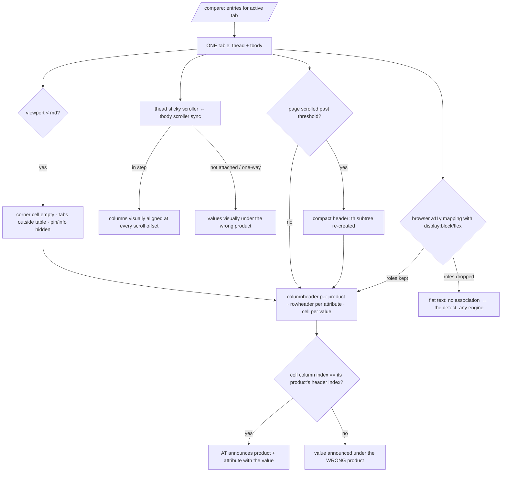
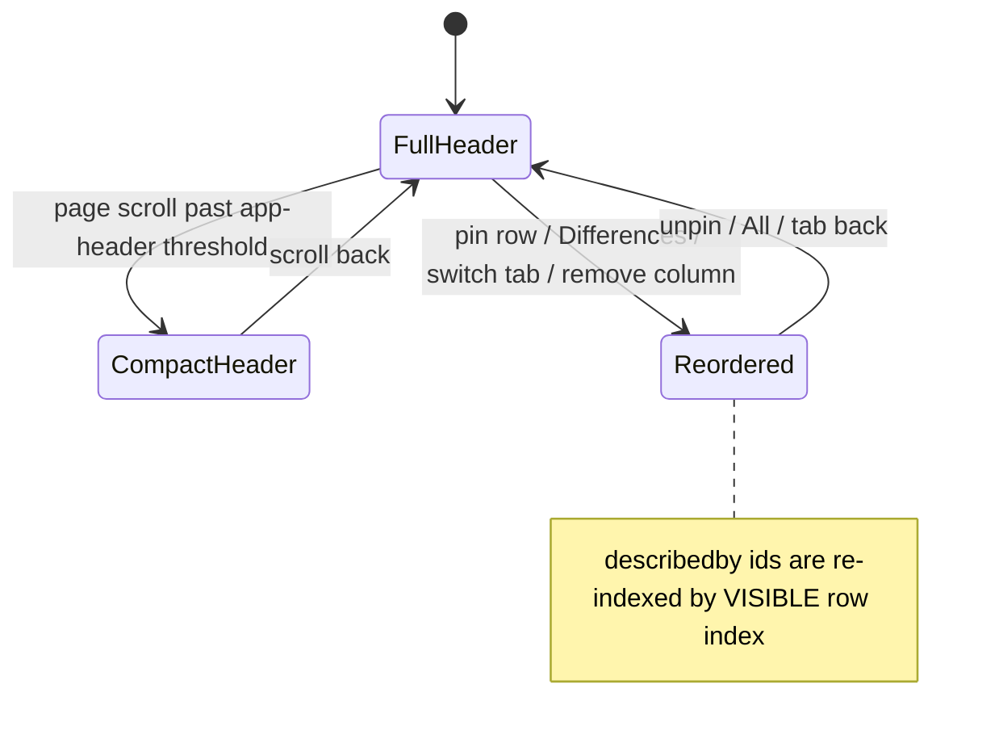

TEST MODEL — VCST-5880

Ticket:      VCST-5880 | Type: Story | Status role: testable | Flow: feature-test | Priority: P1 (description "High/P1"; Jira field Medium) | Path: FULL | Changed: Frontend
Context:     ba-system-analyzer (1c, live on the PR build) + ba-story-writer (1d, static diff) + 1r reachability
Prior model: reports/ba/test-models/VCST-5735-2026-09-03.md — Part 0 (L1–L6, diagrams, V1–V8, reverse edges)
             carried forward; this ticket IS its finding **A1**. Drift against it is recorded below, never re-derived.
Domain map:  ABSENT — chain position unverified against a map (no `.claude/knowledge/domain/` file for compare;
             storefront-only chain, so 2g did not build one)
Mind map:    ABSENT
Chain position: relative to the predecessor's chain (no map): touches **L4 render** only — split here into
             L4a–L4e — plus the controls of L5/L6 that live INSIDE header/row-header cells (pin, remove, add to
             cart, customize, variations link). Does NOT touch L1 add · L2 entry · L3 persist · L5 filter/pin
             SEMANTICS · L6 cart logic · the per-category clamp.
Affected surface: vc-frontend PR #2518 head `ee98adbd` (OPEN), theme `2.60.0-pr-2518-ee98-ee98adbd`, served from
             http://localhost (footer- and `X-VC-Local-Theme`-verified), API → vcst-qa (Platform 3.1078.0).
             `client-app/shared/compare/components/compare-table.vue` (+194/−189) + `compare-table.test.ts`.
             One `table.compare-table__table` (aria-label "Compare products") · `thead.compare-table__header-row`
             (sticky, own horizontal scroller, tabindex −1) > `tr` > `td.compare-table__controls` (sticky corner) +
             `th scope=col` per entry (aria-label = product name) · `tbody.compare-table__scroll` (body scroller) >
             `tr` per attribute > `th scope=row` (aria-label = label, aria-describedby = `<useId>-<visible index>`
             → `VcIcon span role=img`) + `td` per entry · sections `display:block`, rows flex ·
             `contain: inline-size` on product `th` + value `td` · `useHorizontalScrollSync(bodyScrollRef, headerRowRef)`.
             BREAKING for forks: `.compare-table__header-scroll`/`__thead`/`__tbody` removed; `__header-row`,
             `__controls`, `__scroll` change element.
Ticket signals: no AC field, no DoD, no comments, no attachments — the description's **Expected** is the AC.
             Its causal claim ("`display:block/flex` strips the implicit table semantics") is **contradicted for
             Chrome** by the PR's own before-tree (roles present; the defect was the two-table split only) — open
             for Gecko/WebKit (1d). PR says "not checked with a real screen reader"; NVDA ignores `aria-label` on
             header cells (nvda#17213). PR "found, not fixed": page stops rendering at the compact-header
             threshold on a page ~300 px taller than the viewport, also on dev (no ticket found).
Epic context: none (filed standalone, deliberately not a Sub-task of VCST-5735).
Domains:     catalog-search (product compare) · accessibility
Flows & boundaries: sticky + compact header ↔ body scroll · header/body horizontal sync · pins + Differences
             re-order rows · category tabs swap the table's entries · header-cell controls → cart / PDP
Risk areas:  VC-UI-006 (compare `&__row-value` long-value overlay — its cited bug file is MISSING from
             `reports/bugs/`) · VC-UI-005 · VC-UI-004 · VC-CART-004 · VCST-5876 (duplicate-label rows — may now
             mean duplicate describedby ids) · VCST-5938 (unbounded fetch freeze, independent)
AC traceability: 11 story conditions (C1–C11) + 18 gap-ACs (1d). Static: C1–C4, C7–C9 SATISFIED · C5 (semantics
             survive display overrides) NOT-FOUND/DRIFT · C6 corner cell DRIFT (empty on mobile) · C10 layout
             unchanged NOT-FOUND (claim only) · C11 screen-reader announcement NOT-FOUND.

--- Part 0 — VALUE CHAIN (carried forward; L4 refined for this ticket) ---

Value chain (predecessor, unchanged): L1 add on card/PDP → L2 entry {productId, categoryKey, localId?} →
  L3 `localStorage["compareProducts"]` → **L4 /compare renders one column per entry × one row per attribute**
  → L5 Differences / pin / remove / clear → L6 the winner goes to the cart.
L4 refined — the link this ticket changes, in the user's words:
  L4a the entries render as ONE table: a header row (a corner + one product heading per entry) and a body
      (one row per attribute: the attribute's name + one value per entry)
  L4b the browser exposes it to assistive technology as table → rowgroup → row → columnheader / rowheader /
      cell — despite every section being styled `block`/`flex`
  L4c every value cell resolves to ITS product column header and ITS attribute row header (by column index;
      the corner sits over the row-header column)
  L4d the headers are named sensibly: product name; attribute label + its explanation as a description
  L4e nothing a sighted user had is lost: sticky + compact header, header/body scroll in step, columns aligned,
      controls inside the headings operable, layout unchanged
  → unlocks: a screen-reader user can answer "what is THIS product's value for THIS attribute" — the only thing
    a comparison exists to convey — and so reach L5/L6 on the same footing as a sighted user.

Variants (union of the layers that branch on the thing under test):
  render branch (`compare-table.vue`): **R1** desktop full header · **R2** compact stuck header · **R3** <`md`
  (corner empty, tabs outside, pin/info hidden) · **R4** zoom 200/400% crossing `md`
  entry count: **N1** 1 · **N2** 2–3 fitting · **N3** 5 overflowing horizontally
  header-cell kind (predecessor V1/V2/V8): **K1** plain · **K2** configurable · **K3** hasVariations
  row set: **S1** All · **S2** Differences · **S3** pinned · **S4** row with vs without description · **S5** 2 tabs
  a11y engine (browser maps DOM → AX): **E1** Chromium (Chrome, Edge) · **E2** Gecko (Firefox) · **E3** WebKit
  assistive tech: **T1** none (AX tree only) · **T2** NVDA · **T3** JAWS
  theme: **D1** light · **D2** dark preset (visual only)

Mechanism coverage matrix (variants × links — no blank cells):

| | L4a structure | L4b AX exposure | L4c association | L4d naming | L4e layout/sticky/sync |
|---|---|---|---|---|---|
| R1 desktop full | 1 | 1 | 1,3 | 9,10 | 13 |
| R2 compact | 5 | 5 | 5 | 5 | 5,17 |
| R3 mobile <md | 4 | 4 | 4 | 4,9 | 4,13 |
| R4 zoom | 14 | 14 | 14 | WAIVED — same naming code as R3 | 14 |
| N1 one entry | 18 | 18 | 18 | WAIVED — same as N2 | 18 |
| N2 2–3 | 1 | 1 | 1 | 10 | 13 |
| N3 5 overflow | 3 | 3 | 3 | 10 | 6,7 |
| K1 plain | 1 | 1 | 1 | 10 | 13 |
| K2 configurable | 10 | 10 | 10 | 10 | WAIVED — same cell CSS as K1 |
| K3 variations | 10 | 10 | 10 | 10 | WAIVED — same cell CSS as K1 |
| S1 All | 1 | 1 | 1 | 9 | 13 |
| S2 Differences | 8 | 8 | 8 | 8 | WAIVED — no layout branch on filter |
| S3 pinned | 8 | 8 | 8 | 8 | WAIVED — no layout branch on pin |
| S4 description | WAIVED — no structural branch | 9 | WAIVED — not an association | 9 | WAIVED |
| S5 two tabs | 11 | 11 | 11 | 11 | WAIVED — one table re-rendered |
| E1 Chromium | 1 | 1,12 | 1 | 9,10 | 13 |
| E2 Gecko | 2 | 2 | 2 | 2 | WAIVED — 13 measures geometry once; engine-independent CSS |
| E3 WebKit | WAIVED — no WebKit on this Windows host | WAIVED — same; **highest historical risk**, manual on macOS | WAIVED — same | WAIVED — same | WAIVED — same |
| T2/T3 screen reader | 16 | 16 | 16 | 16 | n/a — announcement only |
| D2 dark | WAIVED — no structural branch | WAIVED | WAIVED | WAIVED | 13 |

Reverse edges: no money/points/stock/entitlement moves. Structural reversals: compact → full (5) · pin → unpin,
  Differences → All (8) · tab C → tab A, remove a column (11). ABSENT IN PRODUCT, stated as decisions: none new.
  **Fork-facing reverse:** a fork styling the removed classes loses its styles silently — a release-note item
  (1d gap-AC-17), not a runtime edge.
Fixture lifecycle: no terminal state. `compareProducts` is per-ORIGIN localStorage — `http://localhost` and the
  vcst-qa storefront hold separate lists; every case clears the key first.
Data (2f `false`, sources: `@td(PROD_CMP_A|B|FILL_1|FILL_2|LONGNAME|VARIATIONS)` all Group A, prices
  49.99/59.99/9.99/8.99/19.99/89.99 — **pairwise distinct, so a one-column shift is observable** (SECOND RULE);
  `PROD_CMP_C` is Group C (the 2-tab variant); `CFG_LAPTOP` (K2). Limit: no fixture carries a long unbroken
  **value** token — 7's value-cell half is FIXTURE-GAP; its header-cell half uses `PROD_LONGNAME`.

--- Parts 1–5 — FAULT MODEL ---

Condition space: render 4 · entries 3 · header kind 3 · row set 5 · engine 3 · AT 3 · theme 2 ·
  page height {fits, ~viewport+300px} 2. Constraints: R4 ≡ R3 rendering at a desktop width · T2/T3 only with E1/E2
  · N1 makes S2 degenerate (toggle disabled, predecessor row 6). Raw cells = 4·3·3·5·3·3·2·2 = 6,480.
Reduction: 6,480 → 18. Collapsed, and what subsumes it: **engine** → 2 (Gecko) + 16 (SR) + E3 WAIVED, Edge ≡
  Chrome (both Chromium, one AX mapper) · **AT** → one manual row (16): agent lanes have no screen reader, the
  AX tree is the agent-testable proxy · **header kind** × everything → 10, structure is one `v-for` over entries
  whatever a `th` contains · **theme** → 13 only, no structural branch · **row set** → 8 (filter + pin share the
  re-index mechanism) and 11 (tabs), S4 → 9 · **page height** → 17 (the freeze is the PR's own pre-existing
  find). **NOT dropped:** N3 overflow (6) — the sole trigger of the sync and alignment hypotheses.

| # | Cell | Defect hypothesis — what breaks, and why it plausibly would | Archetype | Technique | Oracle | P |
|---|---|---|---|---|---|---|
| 1 | [JOURNEY] R1 · E1 · 3 plain Group-A entries · All → pin a row → Differences → add to cart from a column header | The fix holds only on first paint. Read from the BROWSER AX tree (CDP / DevTools snapshot, never the DOM-derived Playwright tree): exactly one `table`; 3 `columnheader`s named by product; every body row = 1 `rowheader` + 3 `cell`s; the price cell under each header equals THAT product's price. Then pin, filter and add to cart from a header cell — the structure and the per-column values must survive every step, and the cart must really gain the line (VC-CART-004). | RENDER | FLOW | {SPEC} ticket Expected + WCAG 1.3.1 | Critical |
| 2 | E2 Gecko · R1 · 3 entries | The PR relies on the engine keeping implicit table roles under `display:block` (table/thead/tbody) + flex rows, and adds no explicit roles. Chrome keeps them; Gecko's mapper is a different codebase — if it drops them, Firefox users get exactly the defect the ticket reports. Read via the browser's native tree, not `ariaSnapshot`. | PARITY | EP | {SPEC} + WCAG 1.3.1 | High |
| 3 | N3 5 entries, one row missing a value for one product | Cells are emitted by `v-for` over `row.values`, mapped to products **by index** with no length guard. A row whose `values` is shorter than `products` shifts every later value one column left — announced and painted under the wrong product. Prices are pairwise distinct, so a shift is decidable. | BOUNDARY | BVA | {SPEC} | Critical |
| 4 | R3 375 px · 3 entries | Below `md` the tabs teleport out and the corner `td` is EMPTY; the header row is then [blank cell, th×N]. If the corner were dropped or a `th` doubled, the index mapping in L4c shifts by one. Also: an empty header-row cell announced as "blank" (minor). | RENDER | ST | {SPEC} + BL-UI-004 | High |
| 5 | R2 compact header (scroll past threshold) | The compact swap is a `v-if/else` that destroys and re-creates every product `th`. A re-created subtree can lose `scope`/`aria-label`, change cell count, or drop focus that was inside the header. | LIFECYCLE | ST | {SPEC} + BL-A11Y-001 | High |
| 6 | N3 overflow at 1280 and 800 px · scroll body, then Tab into an off-screen header control | Header and body are now two scrollers in one table, synced by `useHorizontalScrollSync`, whose listeners attach only in `onMounted` if both refs exist — inside `VcWidget`'s slot a null ref means the sync silently never attaches. One-way sync (tested body→header only) means keyboard focus scrolling the header leaves the body behind: values sit visually under the wrong product. | SILENT | ST | {SPEC} PR claim + BL-UI-005 | Critical |
| 7 | Long unbroken token in a product name (`PROD_LONGNAME`) and in a value cell · 1920 and ≤600 px | `contain: inline-size` on `th`/`td` stops a long token WIDENING a column but adds no `overflow:hidden` — the token can paint over the neighbouring column (VC-UI-006, VCST-6029 — same file, same class). | RENDER | EG | BL-UI-004 + BL-UI-005 | High |
| 8 | S2/S3 pin a row with a description, then Differences | `aria-describedby` ids are `<prefix>-<visible row index>`; pin and filter re-order rows, so a row's description id can now point at another row's icon — a screen reader reads the wrong explanation. VCST-5876 duplicate labels may also yield duplicate ids. | STALE | ST | BL-A11Y-004 | High |
| 9 | S4 · R1 and R3 | `rowheader` must expose the label as name and the explanation as **description**; at <`md` the referenced icon is `display:none` — IDREF resolution should still include it, but it is unit-tested only against a stubbed `VcIcon`. Rows without a description must carry no `aria-describedby`. | FALLBACK | EP | BL-A11Y-002 + BL-A11Y-004 | Medium |
| 10 | K1/K2/K3 in one tab · N3 | Header cells hold different controls per kind (add to cart · customize link · variations link). The `aria-label` override must name the column by the product ALONE whatever the cell holds, and each control inside must keep its own name and stay operable. | FALLBACK | EP | BL-A11Y-002 | Medium |
| 11 | S5 two category tabs · switch tab · remove a column | Switching or removing re-renders the one table; a stale `th` or `td` left behind gives N headers over N±1 cells. Table name "Compare products" duplicates the H1 and does not name the category — observe, not a defect by itself. | STALE | ST | {SPEC} | Medium |
| 12 | axe-core desktop + mobile, E1 | The restructure introduces a Critical/Serious violation (`td-headers-attr`, `th-has-data-cells`, `aria-allowed-attr` on `thead tabindex`, empty table header). The PR reports 1 pre-existing desktop contrast issue (inactive "Differences" tab) — classify as PRE-EXISTING, not this ticket. | RENDER | EG | BL-A11Y-004 + BL-A11Y-003 | High |
| 13 | Geometry vs baseline at 1920/1280/768/375 · light + dark · end of horizontal scroll | "Unchanged look" is claimed by one screenshot pair. `w-fit min-w-full` on the header row, sticky corner with its own background, `contain` and dropped `font-normal` can each move column edges, row heights, the sticky offset below the app header or the pinned corner/labels. Baseline = the vcst-qa storefront theme (NOT dev — it carries PR 2511); differences there are attributed, not assumed. | RENDER | ST | BL-UI-001 + BL-UI-003 + BL-UI-004 + BL-UI-005 | High |
| 14 | R4 browser zoom 200% and 400% | Zoom crosses `md`, switching a desktop user to the mobile layout mid-session (predecessor CMP-031): the corner empties, tabs teleport — the table must stay one table with the same mapping, nothing clipped. | RENDER | ST | {SPEC} + BL-UI-004 | Medium |
| 15 | Keyboard only · R1 · N3 | Tab order header → body; focus visible; a focused control in an off-screen column is scrolled into view (`scroll-ps-60`/`-28` padding under the sticky corner); no trap; `thead tabindex=-1` must not become a Tab stop. | BOUNDARY | ST | BL-A11Y-001 | High |
| 16 | T2 NVDA (+ T3 JAWS if available) table mode, E1 and E2 | The AX tree can be right and the announcement still useless: NVDA ignores `aria-label` on `th` and reads the whole header content (image alt + Remove + link + Add to cart) for every cell. **Manual-confirm** — no screen reader in agent lanes; E3/VoiceOver WAIVED (no macOS). | PARITY | EP | {SPEC} ticket STR 4 | High |
| 17 | Page ~viewport+300 px tall, scroll to the compact threshold · PR build AND baseline | PR-reported freeze ("stops rendering"), said to exist on dev. If it reproduces only on the PR build it is IN-SCOPE; on both, PRE-EXISTING and filed separately. | FALLBACK | EG | {SPEC} + BL-UI-003 | Medium |
| 18 | N1 one entry; and empty list | One entry: one `columnheader`, one `cell` per row, Differences toggle disabled (predecessor 6). Empty: the empty state, no orphan or header-only `table` exposed. | BOUNDARY | BVA | {SPEC} | Medium |

Probes carried in: VC-UI-006 → 7 · VC-UI-005 → 13 · VC-UI-004 → 4,5,14 · VC-CART-004 → 1 · VC-LIST-001 → N/A
  (add-time clamp unchanged by this diff) · VC-LOY-001 → N/A (no currency path touched).
Archetype sweep: RENDER 1,4,7,12,13,14 · PARITY 2,16 · BOUNDARY 3,15,18 · LIFECYCLE 5 · SILENT 6 · STALE 8,11 ·
  FALLBACK 9,10,17 · MONEY WAIVED — no price logic changed; per-column prices are read in 1 and 3 · SCOPE WAIVED —
  no auth branch in the render path · RACE WAIVED — sync is event-driven, covered as SILENT in 6 · CONFIG WAIVED —
  no setting read · REPLAY WAIVED — no retried effect.
UIP sweep: UIP-VIEW → 4,14 · UIP-DATA → 3,7 · UIP-STORAGE WAIVED — persistence untouched · UIP-TABS WAIVED — no
  cross-tab change in this diff · UIP-REFRESH WAIVED · UIP-DEEP WAIVED — `?category=` untouched · UIP-NET WAIVED ·
  UIP-BACK / EXPIRE / INPUT WAIVED — no submit, session or form input.
Business Rules: BL-A11Y-001/002/003/004 · BL-UI-001/003/004/005/006 · BL-CART-007 (1's cart leg). **No BL
  states table/cell association** — ECL-15.1's 2026-08-27 note names "structural semantics under WCAG 1.3.1" as
  the uncovered area. PROPOSED-BL-A11Y-005 (1d) for 5e: every data cell of a row/column surface resolves to its
  column and row header in the browser AX tree, independent of one AT's `aria-label` handling. Not minted here.
Edge cases: ECL-15.1 r2 (structure not exposed) · ECL-7 (frontend & UI) · ECL-15.1 r5 (control names).
Docs grounding: VirtoOZ StorefrontUserGuide "compare-products" — states a global "Only 5 products" cap (DRIFT vs
  per-category, carried from the predecessor); silent on keyboard, screen reader and table structure. NEW build
  → oracles are {SPEC} (ticket + PR) and WCAG 1.3.1, not {DOC}. kb: 3 asks, 0 entries on compare-table structure
  (kb_none ×3) — candidate kb_capture once 1/2 read the native tree.
Drift against the predecessor: A1 FIXED-on-PR-build (the point of the ticket) · scenario 3/CMP-003 ("Clear all"
  and "Clear category" CSS-hidden at 375 px) DRIFT — both visible at 375 on this build (1c); a RE-BASE candidate for
  2a, never a blind rewrite · A3 (no `tablist`) still CONFIRMED · A2/A4 UNVERIFIED.
Agents to dispatch: qa-frontend-expert (playwright-chrome) · ui-ux-expert (Chrome DevTools — native AX tree, axe,
  geometry) · qa-testing-expert (playwright-firefox — Gecko native tree, 2) · 3x discovery · no 3a (data_surface false).

## Step 3x — groundings and amendments (Part 0 unchanged; rows only)

Session: `reports/exploratory/SBTM-VCST-5880-2026-10-12.md` (playwright-firefox, 44/45 min, 4-entry Group-A tab).

| # | Outcome | Grounding |
|---|---|---|
| 2 | NOT REACHED — tooling | `page.accessibility` absent in this Playwright build; Gecko's native tree needs a manual Accessibility Inspector pass. Computed `display` read: table/thead/tbody `block`, tr/td/th `flex`. E2 cells stay WAIVED for the agent lanes. |
| 3 | REFUTED for the reachable shape | A missing property renders `–` in its own `td`; 4 cells per row for 4 products. A short `row.values` array was not exercised and stays a hypothesis. |
| 6 | **CONFIRMED (Gecko) — in-scope suspect** | Wheel over the body syncs (150/150); Tab into an off-screen header control syncs (258/258). **Tab out of the last header control onto the first body-row Pin at 800 px leaves thead 258 / tbody 0** for more than 1.5 s, so every header sits one column right of its values. Baseline holds 258/258. Chromium not yet run. |
| 8 | REFUTED | describedby `v-1-0-<visible index>` re-indexes on pin and always points at its own row's icon; no duplicate ids. |
| 9 | Premise CORRECTED | At 375 px the description icons are **visible** (`inline-block`); only Pin is hidden. The row stands as written, minus the display:none premise. |
| 17 | PRE-EXISTING | No freeze: at a page height of viewport+300 px the wheel bounces 164↔204 and never passes ~240, identically on the baseline (KB-C5E27085). |
| C6 / C10 | CONFIRMED | Corner holds All / Differences / readout / Clear category at 1280 and is an empty 112 px `td` at 375. Geometry is pixel-identical to the baseline at 1920 and 375 (doc height 1636 / 1608). |

**New reverse edge (L4e):** focus moving from header to body (and back) while scrolled sideways, observed to break. Net-new, PROMOTE (authored this run):
- **19.** At 800 px with 4+ entries, scrolled sideways, Tab from the last header control to the first body Pin, then pin and unpin under Differences. After every focus move, thead.scrollLeft must equal tbody.scrollLeft and each header edge must equal its column edge, and $49.99 must sit under Alpha. Archetype SILENT · Technique ST · BL-UI-005 · Critical.
- **20.** Shift+Tab back to column 2's product link while scrolled. The focused control is about 45% under the sticky corner (x 211 against the corner edge at 265) and is not scrolled into view. Archetype BOUNDARY · Technique ST · BL-A11Y-001 (WCAG 2.4.11) · Medium. Provenance on the baseline not measured.

DECLINE: initial `activeElement` = `THEAD` (tabindex −1). An observation only, not compared with the baseline.

Matrix update: N3 × L4e → 6,7,**19** · R1 × L4e → 13,**20** · E2 × all → WAIVED for agent lanes (native tree needs manual tooling), C5 carried to 16 as manual-confirm.
tc:scope dispositions (input to 2a): CMP-003, 009, 010, 024 and CAT-COMP-004 CONFIRMED · CMP-025, 031 and 034 NOT REACHED · none BROKEN-MECHANICS.

**3-cases disposition (verifier F4):** scenario 7's **value-cell half is WAIVED as a ratified residual risk**. No fixture carries a long unbroken property value, and seeding one on a shared vcst fixture mid-run was declined. CMP-042 covers the header-cell half (`PROD_LONGNAME`). Owner: a `/qa-generate-data` follow-up for the VC-UI-006 value-cell shape. The verifier also corrected two oracles: focus retention after the compact swap or a column removal (CMP-040 / CMP-046) is **observed against the baseline, not asserted as BL-A11Y-001**; and CMP-053's "no part under the corner" is {SPEC} (PR #2518 scroll-padding), with only "not entirely hidden" held to WCAG 2.4.11.

**5-triage correction to the Step-3x row 6:** the Gecko desync (thead 258 / tbody 0) was **NOT REPRODUCED in 7 attempts** on Firefox 151 with a live refresh driver. The attempts used real Tab, scripted presses, pin/unpin, Differences, mouse clicks and mid-scroll positions; the baseline stayed in sync too. Mechanism: `useHorizontalScrollSync` copies scrollLeft only on a `scroll` event, and Gecko dispatches that event on the refresh-driver tick. The 3x lane ran with a stalled driver (its pointer clicks stalled too, see `browser-quirks.md` §Firefox), so the event never fired. **Row 6 is REFUTED; 3x's reading was a tooling artifact.** CMP-052 keeps its SPEC expectation, which is correct either way. 4a's Chromium-only finding stands: All↔Differences resets the horizontal scroll to 0 on the PR build, while the baseline keeps it (Low, in-scope, nothing misattributed).

**5-triage correction to the Step-3x row 9 grounding:** the 3x claim that the description icons are VISIBLE at 375 px was wrong. Chromium computes the `.compare-table__row-info` wrapper as `display:none` below `md` (icon rect 0×0), as CMP-003 and CMP-031 and the VCST-5735 model already record. 3x most likely read the inner SVG's own `display`. **Row 9's original premise stands.** The description still reaches assistive technology through `aria-describedby`, because a directly referenced hidden element supplies the description. CMP-044 is corrected to assert that.
