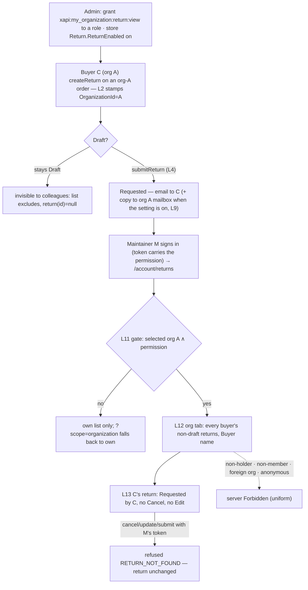
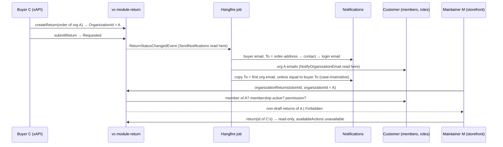
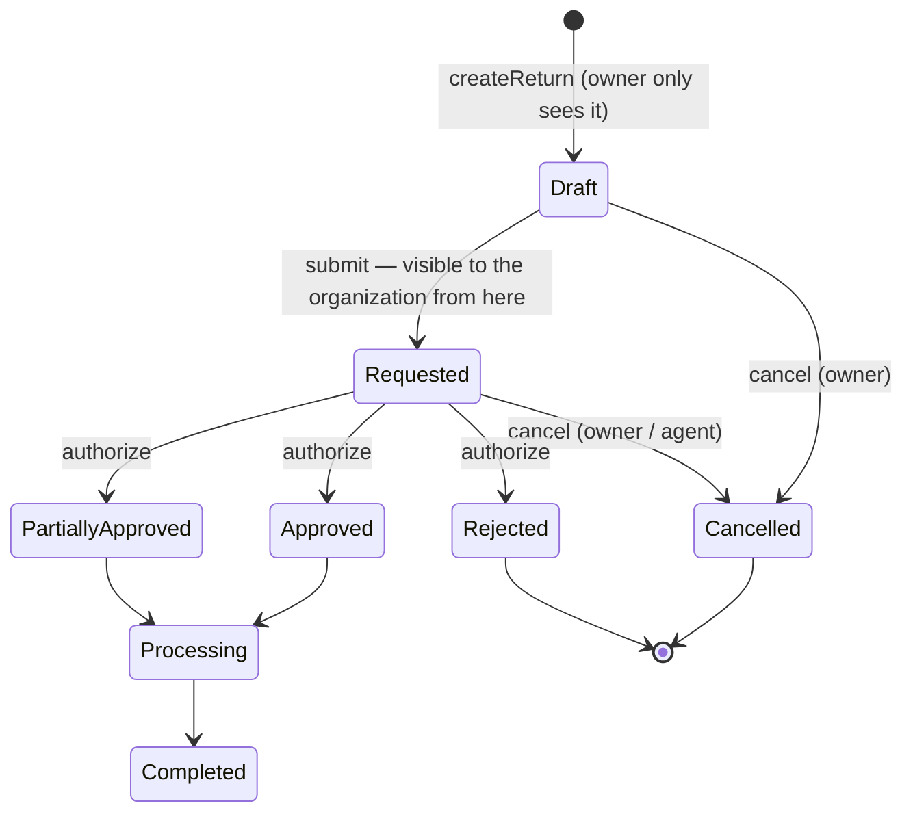

# TEST MODEL — VCST-5884

```
Ticket:      VCST-5884 | Type: Story | Status role: testable | Flow: feature-test | Priority: P2 (Medium) | Path: FAST_GROUNDED (/qa-test-fast) | Changed: Both
Context:     /qa-test-fast Stage 1 (2026-10-06) — ba-system-analyzer (ticket, epic, 9 attachments) + ba-api-specialist (both diffs) +
             orchestrator live reads · Contract: REFRESHED 2026-10-06 on vcptcore_dev (graphql-schema.md + cache; 86/86 fixtures)
Prior model: reports/ba/test-models/VCST-5883-2026-09-28.md — Part 0 carried forward (chain L1-L10, lifecycle, R3/R4 roles, reverse
             edges); this ticket adds L11-L13 and amends L2/L4/L5/L9. Drift against it: D-1..D-4 below
Domain map:  .claude/knowledge/domain/returns.md @ rev 1 (generated 2026-09-22) — PRESENT, blind to this surface: MISSING the
             organization scope, xapi:my_organization:return:*, organizationReturns, Return.NotifyOrganizationEmail, the admin
             Organization column, the 5883 notification links (rows 1-8 stop at "someone else decides")
Mind map:    .claude/knowledge/domain/returns.mind-map.json — R1's 218-node build was replaced by main's map (ret.*, 0d93c4c8); R2 Wave 2 re-adds the org surface
Chain position: TOUCHES L2 (draft stamped with the ORDER's organization), L4 (submit = the moment a return becomes visible to
             colleagues), L5 (admin list: Organization column, name keyword), L9 (organization mailbox copy), L10 (own list —
             regression), NEW L11 (access gate), L12 (organization list), L13 (colleague's return, read-only). DOES NOT TOUCH L1
             eligibility, L3 hold, L6-L8 decision + quantity engine (5883), orderless returns (dropped 09.09), decline reason (VCST-5885).
             Crosswalk to domain-map §1 rows: L1→1 · L2→2(+4) · L3→3 · L4→5 · cancel→6 · L5-L8→7 · L9, L10-L13 → no row (map MISSING)
Affected surface: vc-module-return PR #28 @62f9aae (deployed 3.1005.0-pr-28-62f9): xAPI organizationReturns (new), return(id) colleague
             path, returns keyword, ReturnType +customerId/customerName/organizationId/organizationName, availableActions for a
             non-owner, account-state gate on every return op; ReturnAccessService (the single gate); REST POST /api/return/search
             (+organizationId, excludeDrafts, sort organizationName); migration ReturnOrganization (+backfill); setting
             Return.NotifyOrganizationEmail; org copy in SendNotificationsReturnStatusChangedEventHandler; admin return-list column.
             vc-frontend PR #2523 @3f1b9c6 (theme 2.59.0-pr-2523-3f1b): /account/returns?scope=organization tab, Buyer name column,
             org search placeholder, return.vue "Requested by" + Cancel hidden for a colleague. All MISSING from the domain map (11b)
Ticket signals: AC-4 only in comment 110487 (field edited once, 09-17) · buyer To = order-address → contact → login email (5883
             c.110486); without SMTP NotificationMessage rows are the oracle · baseline denials survive (KB-657521DF) · no dev how-to-test
             · no role holds :view (observed) · known, not re-filed: VCST-6176 menu icon, VCST-6107 contrast · only visual oracle =
             5628 mockup image-20260731-104407 (tabs "My returns | <Org name>"; no Value column built) · 76 commits, no human review
Epic context: VCST-5626 Returns (Draft; AC-6 = this story). Done seams: VCST-5628 (own returns, storefront pages, ownership handler),
             VCST-5883 (notifications pipeline, decisions, details page). Successor VCST-5885 (decline reason) — not a dependency
Domains:     returns (no BL-RET, no ECL returns — finding) · b2b (BL-B2B) · notifications (BL-NOTIF) · gql (BL-GQL) · ui / a11y
Flows & boundaries: storefront tab ↔ xAPI organizationReturns / return ↔ ReturnAccessService ↔ Customer memberships + roles;
             buyer submit/cancel + admin authorize ↔ ReturnStatusChangedEvent ↔ Hangfire email job ↔ org copy; Admin list ↔ REST search
Risk areas:  one gate, uniform refusals (ReturnAccessService.cs:54-73) · empty organizationId drops the SQL filter · case-insensitive
             gate vs `==` filter · keyword Contains provider-dependent · read-only rests on pre-existing IsOwnedBy · client colleague
             test case-sensitive · token-lagged tab vs live server check · org = the ORDER's snapshot · dedupe vs To only · buyer mail
             scheduled before the copy (retry duplicate) · ReturnEnabled off on this store ⇒ storefront module absent
AC traceability: 13 atomic conditions (A §2): 1a SATISFIED (held by NO role — admin grant needed) · 1b SATISFIED · 1c SATISFIED at the
             server (storefront falls back to own on a forbidden ?scope — UI only) · 2a SATISFIED (tab) · 2b AMBIGUOUS: a tab on
             Purchasing → Returns (as the mockup), not an "organisation" section → PO note · 3a-3c, 4a-4e SATISFIED by source
DoD:         none declared on the ticket
```

**Drift vs the 5883 model:** D-1 orderless returns are not 5884 (dropped 09.09); NotifyOrganizationEmail is (AC-4) · D-2 its R4 "colleague:
return(id)=null, no copy" is now conditional — a `:view` holder reads non-drafts; the org MAILBOX gets copies when the setting is on ·
D-3 L2 now stamps OrganizationId/Name from the order · D-4 its #21 refusal of mutations is unchanged.

## Part 0 — Value chain (L1-L10 carried from 5883; L11-L13 new)

| # | Link (buyer / maintainer words) | Mechanism | 5884 |
|---|---|---|---|
| L1 | My order is returnable | returnableItems: Completed + DeliveryDate within WindowDays | — |
| L2 | I build a draft — it belongs to my order's organization | createReturn → CreateDraft copies order.OrganizationId/Name (ReturnFlowService.cs:106-107); admin-created: FillMissingSnapshots; pre-existing: migration backfill | AMENDED |
| L3 | Quantity is held by open returns | GetHeldQuantity | — |
| L4 | I submit — only now can my organization see it | submitReturn Draft→Requested; organizationReturns ExcludeDrafts | AMENDED |
| L5 | The agent sees it — with my organization | Admin list Organization column (sortable); keyword matches customer name | AMENDED |
| L6-L8 | decided · outcome · released units | authorize → Approved/PartiallyApproved/Rejected (5883) | — |
| L9 | I am told — and my organization's mailbox gets a copy | buyer email + push (5883); copy iff return has org ∧ NotifyOrganizationEmail (job time) ∧ SendNotifications (event time); To = first org email; none ⇒ warning; dedupe vs buyer's resolved To, case-insensitive; push untouched | AMENDED |
| L10 | I see my own returns | /account/returns "My returns" (returns query) | regression |
| L11 | My organization lets me in | storefront tab iff selected org ∧ token holds xapi:my_organization:return:view; server: member (not Associated) ∧ membership not locked/blocking ∧ permission (admin flag / global / org-level / membership roles); uniform Forbidden | NEW |
| L12 | I see all of my organization's returns | organizationReturns(storeId, organizationId, keyword, statuses, dates, sort, paging): non-drafts of every buyer incl. mine; Buyer name column | NEW |
| L13 | I open a colleague's return and can only read it | return(id): owner → colleague non-draft ∧ gate → null; availableActions all RETURN_NOT_FOUND; "Requested by"; Cancel hidden; files read-only; mutations refused (IsOwnedBy) | NEW |







**Variants** (union of the branching layers — ReturnAccessService, ReturnQueryHandler, ReturnSearchService, the copy handler, useReturns /
returns.vue / return.vue). Actors: A1 maintainer holding :view via its role · A2 member without it (purchasing agent, employee) · A2m
Organization manager (sibling xapi grants, not :view) · A3 :view via a GLOBAL custom role only · A4 multi-org · A5 another org's holder ·
A6 admin non-member · A7 locked/blocking member · A8 anonymous · A9 owner buyer. Returns: colleague non-draft · draft · org-less order ·
foreign · order org X / selected org Y · pre-migration. Switches: ReturnEnabled off · permission revoked live. Mail: org≠To · org==To
(exact, case) · org==contact≠To · no org email / no org · setting OFF · SendNotifications OFF · admin-triggered event.

**Mechanism coverage matrix** (cell = scenario #; W = WAIVED: the variant does not traverse this link; GAP = argued below)

| Variant | L2 | L4 | L5 | L9 | L10 | L11 | L12 | L13 |
|---|---|---|---|---|---|---|---|---|
| A1 holder (role) | 1 | 1 | W | 1 | 19 | 1 | 1,10,14,15 | 1,16,17,18 |
| A2 no permission | W | W | W | W | 23 | 2 | 2 | 18,22 |
| A2m org manager | W | W | W | W | W | 3 | 3 | W |
| A3 global role, :view only | W | W | W | W | W | 4 | 4 | 4 |
| A4 multi-org | 13 | W | W | W | W | 5 | 5,13 | W |
| A5 other org's holder | W | W | W | W | W | 6 | 6,12 | 6 |
| A6 admin non-member | W | W | 33 | W | W | 7 | 7 | W |
| A7 locked/blocking member | W | W | W | W | GAP-a | GAP-a | GAP-a | GAP-a |
| A8 anonymous | W | W | W | W | W | 8 | 8 | 8 |
| A9 owner buyer | 1,23 | 1,11 | W | 1,24 | 23 | W | 10,19 | 19 |
| draft | 11 | 11 | W | W | 23 | W | 11 | 11 |
| org-less order | 12 | W | 33 | 28 | W | W | 12 | W |
| foreign org | W | W | 33 | W | W | 6 | 12 | 6 |
| order org X, selected Y | 13 | W | W | W | W | W | 13 | W |
| pre-migration return | GAP-b | W | GAP-b | W | W | W | GAP-b | W |
| ReturnEnabled off | W | W | W | W | 20 | 20 | 20 | 20 |
| permission revoked live | W | W | W | W | W | 21 | 21 | W |
| mail ON, org≠To | W | 24 | W | 24 | W | W | W | W |
| mail ON, org==To (exact / case) | W | 25,26 | W | 25,26 | W | W | W | W |
| mail ON, org==contact≠To | W | 27 | W | 27 | W | W | W | W |
| mail ON, no org email / no org | W | 28 | W | 28 | W | W | W | W |
| mail OFF · SendNotifications OFF | W | 29,30 | W | 29,30,31 | W | W | W | W |
| admin-triggered event | W | W | 32 | 32 | W | W | W | W |

GAP-a: no locked/blocking member HOLDING the permission exists (USR-021 is a locked employee without it, so its refusal cannot
discriminate) → exploratory charter (#9). GAP-b: the env had 0 returns when the migration ran → backfill unobservable here (#34).

**Reverse edges:** visibility ← permission revoked → #21 (server refuses at once; tab lingers until reload, author-declared) · org stamp
← never recomputed (rename, buyer leaves) → ABSENT IN PRODUCT by design → charter (PO: should a departed buyer's returns stay visible?)
· org copy ← none (an email cannot be unsent) · ReturnEnabled on ← off → #20. **Fixture lifecycle:** a cancelled return is TERMINAL;
each mail row consumes its own return; every return is made per run on per-run Completed orders with a DeliveryDate (env has 0 returns).

## Part 0r — Role scenarios

Roles in scope: A1 → @td(ACME_ADMIN) (USR-001, Organization maintainer; :view via the run's role grant — verify me.permissions) ·
A2 → @td(ACME_BUYER) (USR-002 purchasing agent, also the colleague who OWNS the returns) + @td(ACME_VIEWER) (USR-003 employee) ·
A2m → @td(b2b/users, {"user_id":"USR-023"}, email) (Organization manager) · A3 → @td(ACME_VIEWER) + a run-created AGENT-TEST role
holding only :view · A4 → @td(MULTI_ORG_TF_BR_MAINTAINER) / @td(MULTI_ORG_TF_BR_EMPLOYEE) · A5 → @td(TECHFLOW_ADMIN) (USR-006) ·
A6 → {{ADMIN}} · A7 → **FIXTURE-GAP**: a locked member holding :view → charter · A8 anonymous · A9 → @td(ACME_BUYER).
Equal-by-absence caution: A2 and A2m differ in sibling grants only — a refusal for both proves the gate reads :view, not "is a manager".

BSC-1 — The maintainer reviews the organization's returns. Role: A1 · Situation: colleagues filed returns on Acme orders
| # | Action | Sees | Can do | Expected |
|---|---|---|---|---|
| 1 | open Returns, Acme selected | tabs "My returns" · "<Acme name>" | switch to the org tab | every buyer's non-draft return, Buyer name column |
| 2 | open C's return | details, "Requested by C" | read lines, files | no Cancel, no Edit; availableActions unavailable |
Outcome: M can review every submitted return of Acme. Not allowed: cancel / update / submit C's return, or create one on C's order
(RETURN_NOT_FOUND, nothing persisted) · see any draft but own · see TechFlow's or an org-less return · delete C's attachment.

BSC-2 — A member without the permission. Role: A2 / A2m · Situation: same organization, same returns. Sees: own tab only.
Not allowed: organizationReturns(Acme) → Forbidden (not an empty list, not own-only) · return(id of C's) → null · cancel → RETURN_NOT_FOUND.

BSC-3 — The permission, not the role name. Role: A3 · Situation: an employee given a custom global role with only :view.
Can: the org list and C's details. Not allowed: every BSC-1 refusal.

BSC-4 — Two organizations. Role: A4 · Situation: maintainer in TechFlow, employee in BuildRight. Sees: the tab with TechFlow
selected, none with BuildRight selected; rows follow the switch. Not allowed: organizationReturns(BuildRight) → Forbidden.

BSC-5 — Outsiders. Role: A5 / A6 / A8. Not allowed: organizationReturns(Acme) → Forbidden / Unauthorized · return(id of an Acme
return) → null (an organizationId crafted by hand is refused, not served).

## Parts 1-5 — Fault model

**Condition space:** actor {A1..A9} × return kind {colleague non-draft, draft, own, foreign, org-less, order-org≠selected-org} ×
surface {storefront list, storefront details, xAPI list, xAPI return + mutations, REST/Admin} × switches {ReturnEnabled, Notify,
SendNotifications on/off} × mail relation {org≠To, org==To, case, org==contact≠To, no org email} × event {Registered, Cancelled,
admin decision} × list op {keyword, status, dates, sort, paging}. Constraints: mail factors only on L9 and only for the owner;
list ops only for an allowed actor; ReturnEnabled off ⇒ no storefront surface. Raw N = 9·6·5·8·5·3·5 = 162 000.

**Reduction:** (a) refusal is decided by ONE gate before any search or handler (uniform Forbidden) ⇒ each refused actor collapses to
one DT row asserted at the server with its own token, plus one storefront check (#2-#9); (b) return kinds matter only once the gate
passes, and the filter is actor-independent ⇒ kinds on A1 only (#10-#13); (c) the copy code has no status branch (handler :90-133)
⇒ the address relation varies on Registered only (#24-#28), the event varies on org≠To only (#24, #32) — t=2 not needed; (d)
switches PW t=2 on (Notify, SendNotifications): on/on #24, off/on #29, on/off #30; ReturnEnabled gates only the storefront module
registration ⇒ one row (#20); (e) list: the new behaviours (buyer-name keyword, Buyer-name sort, tab reset) get rows (#14, #15);
the status/date/paging code is 5628's, shared with own scope (014b) ⇒ one PW row in org scope (#15). **162 000 → 35.**

| # | Cell | Defect hypothesis | Archetype | Technique | Oracle | P |
|---|---|---|---|---|---|---|
| 1 | **[JOURNEY]** A1·A9·Acme·storefront, copy ON: C creates + submits on an Acme order → copy to Acme mailbox → M re-signs-in → org tab → C's row (Buyer name) → C's details read-only | any link broken on an unreviewed 76-commit build with no dev how-to-test | SCOPE | FLOW | {SPEC} AC-1b, 2a, 3a, 3b, 4b | Critical |
| 2 | A2 (agent, employee): organizationReturns(Acme); storefront tab; deep link ?scope=organization | missing/inverted gate lets any member list the org; or a silent downgrade to own instead of a refusal | SCOPE | DT | {SPEC} AC-1c + INH-1 "rejected, not silently downgraded"; BL-GQL-001 | Critical |
| 3 | A2m Organization manager (sibling xapi grants, no :view) | gate checks a sibling permission (my_organization:edit / order:view) | SCOPE | DT | {SPEC} AC-1a "specific permission" | High |
| 4 | A3 employee + custom global role holding ONLY :view | gate keyed on a role NAME, not the permission | SCOPE | DT | {SPEC} INH-1 "(controlled by permission)"; B global-role path | High |
| 5 | A4 multi-org: TechFlow selected vs BuildRight selected; switch orgs | permission unioned across memberships → BuildRight leak; previous org's rows linger after the switch (keepPreviousResult) | SCOPE | ST | {BL-B2B-007} org-scoped permissions; {SPEC} AC-1 | Critical |
| 6 | A5 TechFlow holder: organizationReturns(organizationId=Acme); return(id) of an Acme return | gate checks "has :view" but not membership of the REQUESTED org → cross-org read by a crafted id | SCOPE | DT | {SPEC} INH-4 server-enforced; {BL-GQL-004} | Critical |
| 7 | A6 administrator, not a member, storefront token | IsAdministrator short-circuits membership → admin reads any org through xAPI | SCOPE | DT | {SPEC} AC-1 "my organisation's" | Medium |
| 8 | A8 anonymous: organizationReturns, return(id) | new query lacks the anonymous guard → data or a 500 | SCOPE | DT | {BL-GQL-001}, {BL-GQL-004} | Medium |
| 9 | A7 locked / blocking membership or locked account (charter, GAP-a) | lock or invited status not honoured by the new gate | SCOPE | EG | {BL-B2B-013}; {SPEC} B gate | Medium |
| 10 | A1 org list content: colleagues' AND own non-draft returns, all buyers, Buyer name | owner filter left on (list = own only), or Buyer name empty / the caller's name on every row | SCOPE | EP | {SPEC} description "all returns"; AC-1b | Critical |
| 11 | drafts: colleague's draft not listed, return(id) null for M; M's own draft absent in org tab, present in own tab | drafts leak into the org view (work in progress, "Continue" path) | LIFECYCLE | ST | {SPEC} PR design ExcludeDrafts (author's call; AC silent → PO note) | High |
| 12 | foreign + org-less returns never in Acme's list; organizationId "" refused | filter by store only / empty organizationId drops the filter → whole store listed | SCOPE | EP | {SPEC} AC-1b "my organisation's" | Critical |
| 13 | A4 buyer creates a return on a TechFlow order while BuildRight is selected | org stamped from the token's selected org, not the order → wrong org list | SCOPE | EP | {SPEC} B CreateDraft copies the order's org; spec intent {HYPOTHESIS} → PO note | High |
| 14 | keyword in org scope: RMA, order number, buyer name, buyer name in other case | buyer-name keyword unwired, or case-sensitive on PostgreSQL | CONFIG | EP | {SPEC} placeholder "…or buyer" + ReturnSearchService.cs:151 | Medium |
| 15 | Buyer-name sort asc/desc; status (Cancelled, legacy Canceled; [Draft] empty); dates; paging past the end; tab switch resets page, drops the Buyer sort, keeps filters | unknown sort silently ignored (CreatedDate desc); sort/paging state leaks across tabs | SILENT | PW | {SPEC} useReturns.ts:110-122 (test-pinned); returns.vue:143-150 | Medium |
| 16 | A1 opens C's Requested return (from the list and by deep link) | Cancel/Edit shown (client colleague test case-sensitive) or actions available server-side | SCOPE | DT | {SPEC} AC-3b; B ReturnType.cs:73 | High |
| 17 | A1 token: cancelReturn, updateReturn, submitReturn on C's returns; createReturn on C's order | the new colleague READ path leaks into mutations → a viewer cancels a colleague's return (the "control" of the description) | SCOPE | DT | {SPEC} AC-3c + INH-2; KB-657521DF baseline | Critical |
| 18 | C's line attachment: A1 reads (200), delete refused; A2 → 403 | attachment auth still owner-only (broken images) or delete allowed | SCOPE | DT | {SPEC} B ReturnAuthorizationHandler.cs:56,77 | Medium |
| 19 | A1's OWN Requested return opened from the org tab | details treat every org row as a colleague's → owner loses Cancel | LIFECYCLE | DT | {SPEC} INH-4 "mutations require ownership" (owner keeps them) | Medium |
| 20 | ReturnEnabled OFF (this store's real default): storefront menu + route; API organizationReturns | off-switch not honoured by the new query, or the reverse | CONFIG | EP | {SPEC} storefront index.ts:21; API {HYPOTHESIS} → charter | Medium |
| 21 | permission revoked while M is signed in: API, tab, reload | server trusts the stale token claim → keeps listing until expiry | STALE | ST | {SPEC} B (live HasPermissionAsync); UI lag author-declared | Medium |
| 22 | A2 colleague (no :view): return(id) of C's, cancel, /account/returns/:id | the relaxed read path also opened for non-holders | SCOPE | DT | KB-657521DF (4 confirmations); {SPEC} INH-2 | High |
| 23 | A9 own scope: list incl. drafts, edit draft, submit, cancel own | refactor (base builders, fragment without orderId) broke the own list/editor | LIFECYCLE | ST | {SPEC} 5628 baseline; suites 014b/014c | High |
| 24 | copy ON, org≠To: Registered + Cancelled | copy missing for an event or duplicated; push also sent to the org | REPLAY | EP | {SPEC} AC-4b, 4e; {BL-NOTIF-001} analogous | High |
| 25 | copy ON, order-address email == org email | dedupe missing → two identical mails to one mailbox | REPLAY | EP | {SPEC} AC-4d | High |
| 26 | copy ON, order-address email == org email in other case | case-sensitive compare → two mails | BOUNDARY | BVA | {SPEC} AC-4d; B case-insensitive | Medium |
| 27 | copy ON, org email == buyer's contact email, To = a different order-address email | dedupe against the contact instead of the resolved To → copy wrongly suppressed | SILENT | EP | {SPEC} AC-4d literal wording | Medium |
| 28 | copy ON, org without email; return on an org-less order | exception fails the job after the buyer mail → retry duplicates it; or a copy sent anyway | FALLBACK | EG | {SPEC} B (warning, nothing); {BL-NOTIF-003} | Medium |
| 29 | copy OFF (default) | copy sent regardless of the setting | CONFIG | EP | {SPEC} AC-4a, 4c | High |
| 30 | copy ON, SendNotifications OFF | org copy sent although buyer emails are off; push affected | CONFIG | PW | {SPEC} B (needs both); 5883 switches | Medium |
| 31 | the setting in Admin store settings: group, label, default OFF, store-level, not public | missing, wrong default, or global instead of per store | CONFIG | EP | {SPEC} AC-4a | Medium |
| 32 | admin authorize (Approved) on C's return, copy ON | admin-triggered events skip the copy ("every return email") | PARITY | EP | {SPEC} AC-4b | Medium |
| 33 | Admin list: Organization column + sort + customer-name keyword; REST search organizationId/excludeDrafts parity with xAPI | column empty for new returns, sort ignored, REST and xAPI disagree | PARITY | EP | {SPEC} B return-list.tpl.html:28, swagger contract | Low |
| 34 | pre-migration return backfilled (GAP-b) | backfill skipped → old returns invisible to the org | STALE | EG | {SPEC} B migration — FIXTURE-GAP on this env | Medium |
| 35 | tab label = live org name, 375 px truncation, Buyer name mobile row, placeholder, one non-English locale | label/placeholder untranslated, truncation hides the org, layout shift on tab switch | RENDER | EP | {SPEC} B i18n (13 locales); mockup tabs; BL-UI | Low |

Probes carried in: vc-bug-catalog has no VC-RET section; B2B org-switch staleness is held by BL-B2B-001/007 (cited as oracles) → #5 #21.
Archetype sweep: SCOPE 1-10, 12, 13, 16-18, 22 · SILENT 2, 15, 27 · STALE 5, 21, 34 · REPLAY 24, 25 · PARITY 32, 33 · CONFIG 14, 20,
29-31 · FALLBACK 28 · LIFECYCLE 11, 19, 23 · BOUNDARY 26 · RENDER 35 · RACE WAIVED: the story adds no read-then-write invariant (the
list is read-only; INH-5 same-line returns by two buyers is an unresolved product question) · MONEY WAIVED: no amount on the org list
(Value column never built); i18n → #35.
UIP sweep (UI only): UIP-BACK/DEEP → #2, #16 · UIP-REFRESH → #21 · UIP-TABS → #5 (second browser tab WAIVED: no client-side scope
state beyond the URL) · UIP-EXPIRE → #21 (token lag) · UIP-STORAGE WAIVED: scope lives in the URL · UIP-NET WAIVED: read-only list,
no optimistic write · UIP-INPUT → #14 · UIP-VIEW → #35 · UIP-DATA → #15 (paging).
Business Rules: BL-B2B-005 #1-#4 · BL-B2B-007 #5, #21 · BL-B2B-013 #9 · BL-GQL-001 #2, #6-#8 · BL-GQL-004 #6, #8, #17 · BL-NOTIF-001
(analogous exactly-once) #24-#26 · BL-NOTIF-003 #28 · BL-UI / BL-A11Y → visual lane, #35. No BL-RET domain: PROPOSED-BL-RET
"organization visibility never grants a mutation" (#17) and "a draft is private to its owner" (#11) → oracle proposals.
Edge cases: ECL ch.13 workflow guards → #11, #17 · ch.6 async jobs → #24-#30 · tenancy/IDOR → #6, #12.
Docs grounding: none readable this session (VirtoOZ MCP unauthenticated; Context7 "Invalid API key"). NEW behaviour, no doc page ⇒
ticket AC + source + the live build are ground truth ({SPEC}/{OBSERVED}); docs finding expected for the org view + setting (A Q5.3).
Agents to dispatch: Stage 2 — qa-frontend-expert (playwright-chrome, storefront) ‖ qa-backend-expert (playwright-edge, xAPI + REST +
Admin + notifications, then a serial tail) ‖ qa-testing-expert (playwright-firefox, /qa-exploratory ticket) → ui-ux-expert (qa-design
skill) when the first lane frees.

**Unresolved → exploratory charter:** #9 GAP-a · #20 API half · #13 spec intent · stamp never recomputed (buyer leaves the org; rename vs
live tab name) · #11 + 2b PO notes · account-state gate on a locked live token (ride-along) · keyword case on this DB · CC/BCC dedupe (:118).

## Round 2 — 2026-10-09 · Return 3.1005.0-pr-28-fb4f (fb4fc43d) · theme 2.60.0-pr-2523-466f (466fa0a8; post-deploy head 4263715a, style-only, NOT tested) · platform 3.1079.0-alpha.13411
**CONFIRMED #11 → VCST-6226** (R1 X1 on vcptcore_dev; vcst QA 111713): drafts were excluded by Status only, so a draft cancelled before submit was listed and readable. **Fix (d9233ee1):** visibility = `SubmittedDate ≠ null` ∧ gate (ReturnSearchService.cs:72-81 + StoreId; ReturnAccessService.cs:74-79, also file reads), stamped at the first save outside Draft/Cancelled/Canceled, write-once, never by REST PUT (ReturnService.cs:121-141; ReturnEntity.cs:160; ReturnController.cs:363); migration ReturnSubmittedDate backfills CreatedDate except draft/cancelled ⇒ pre-build cancelled returns leave org views (by design, 111790). Part 0 unchanged: L4 and L5 (admin New) now stamp; L12/L13 read the stamp. Also new: REST `excludeDrafts` → `submittedOnly`; org tab drops Draft (filter + link); page < 1 → 1 (client only); cards < 1024 px on both tabs; "Requested by" neutral-600; refetch = mounted queries; admin grid minWidth + 2 columns hidden. VirtoOZ (read this round): no page for organization returns, the storefront Returns pages or the setting (docs finding); contacts/managing-organization-roles documents sign-in recalculation ({DOC} for #21).
Matrix delta (variant → L4·L5·L9·L10·L12·L13; W = does not traverse): cancelled-before-submit 36·W·36·36·36·36 · submit→cancel 37·W·37·W·37·37 · pre-build data W·38·W·38·38·38 · other stamp writers W·39·W·W·39·39 · URL state W·W·W·40·40·W · viewport W·W·W·41·41·41 · mutation refetch W·W·W·42·42·W · admin grid W·43·W·W·W·W. Unresolved → charter: legacy `Canceled` rows · admin status change after a stamp · VCST-5993 rider · AC-3h PO question · 4263715a delta.
Condition space (R2): history 6 × viewer 3 × read surface 6 = 108, + viewport 7 × 3 pages, + URL param 6 × 2 tabs, + mutation 3 × context 3, + admin layout 2 × width 2 ⇒ **N = 154 → 8**: the non-holder path is unchanged since R1 (one regress check inside #36); the five read surfaces share one predicate, so they are asserted together per history class; REST only where its criteria changed (#39); viewport BVA at the 1024 edge + the reported 768/960 + 1280 (375/1920 regress only); one parse for every URL param (useReturns.ts:61); a saved admin layout is the documented caveat. Sweeps: LIFECYCLE 36, 37 · STALE 38, 42 · PARITY 39 · BOUNDARY 40 · RENDER 41, 43 · UIP-DEEP 36 · UIP-DATA 40 · UIP-VIEW 41 · UIP-REFRESH 42. 11b: every R2 surface (org list/detail, admin Organization column, SubmittedDate) is MISSING from returns.md rev 2 (G17 OPEN) — reported.

| # | Cell | Defect hypothesis | Archetype | Technique | Oracle | P |
|---|---|---|---|---|---|---|
| 36 | **[JOURNEY-fix]** A9 drafts (comment + line reason), cancels from details unsubmitted → A1: org tab unfiltered / RMA keyword / status Cancelled; deep link; return(id); A9's My returns; mail | stamp written on cancel or predicate still reads Status → listed/readable again; or over-correction hides it from its owner | LIFECYCLE | ST | {SPEC} VCST-6226 Expected "not listed, return(id) null — what a live Draft does"; AC-3d, 3f; Draft→Cancelled sends nothing (ReturnStatusNotificationHandlerBase.cs:88-99) | Critical |
| 37 | A9 submits then cancels (control): A1 lists it Cancelled (keyword, totalCount) and reads it; REST submittedDate unchanged by the cancel; buyer + org mail on Registered and Cancelled | fix over-broad (status-based) hides a submitted return; cancel clears or re-stamps the date | LIFECYCLE | ST | {SPEC} 111787 control; ReturnEntity.cs:160 write-once; AC-3e, 3g, 4b | High |
| 38 | pre-build data (R1's 31, migrated): pre-build Cancelled (RET261006-00028 never submitted + submitted-then-cancelled) vs Requested/Approved/New for A1 (list, return(id)) and owners; REST submittedDate = createdDate | backfill misses a status class (New, Approved) or stamps a cancelled row; owner lists change | STALE | EG | {SPEC} *_ReturnSubmittedDate.cs:20-24; 111790 "by design"; AC-3h (R1 GAP-b now observable) | High |
| 39 | other stamp writers: admin Add new return (New) on an org order → A1 sees it; REST PUT with submittedDate on a Draft does not stamp; POST /api/return/search organizationId + submittedOnly = organizationReturns (old excludeDrafts ignored) | admin-created returns vanish (stamp only on storefront submit); REST publishes a draft by a date | PARITY | DT | {SPEC} 111787 "an admin creating it as New"; ReturnController.cs:363 + UpdateReturn_SubmittedDateSent_IsNotTaken; ReturnSearchCriteria.cs:15-17; KB-09C378C0 | Medium |
| 40 | org-tab URL state: status options (no Draft) vs My returns (Draft works); org link with a Draft status; Draft on My returns then tab switch; ?page=-1/0/-20/abc/last+1 on both tabs; xAPI after:"-20" residual | Draft chip empties the org list (R1 XA2); a negative page sends a negative offset → SQL error shown as "no returns yet" | BOUNDARY | BVA | {SPEC} 111790 bullets 5, 7; useReturns.ts:50-62; server residual = X-API, not this change | Medium |
| 41 | viewports 375/768/960/1023 vs 1024/1280/1920 on both tabs + a colleague's details: cards < 1024 (labels, Buyer name), table ≥ 1024 with no mid-word break; "Requested by" ≥ 4.5:1 and same colour as its neighbours | breakpoint off by one or one tab only; table still breaks words at 1024-1280 (shared VcTable rule, VCST-6153); label still neutral-400 | RENDER | BVA | {BL-UI-004}; {BL-A11Y-003}; {SPEC} 111790 bullets 3-4; returns.vue:89,144,155,165; return.vue:33 | Medium |
| 42 | create (wizard Continue), submit, cancel as A1 with the org tab mounted, A1 who never opened it, a plain buyer: no Apollo "unknown query in refetchQueries"; every list on screen fresh without reload | refetch narrowed to mounted queries leaves a visible list stale; the /simplify commit re-added GetOrganizationReturns and could bring the warning back | STALE | ST | {SPEC} 111790 bullet 6; mutations/*/index.ts:12-18 (filterActiveQueryNames) | Low |
| 43 | Admin Return list, no saved gridState, 1920 + one narrower width: 7 default columns, every header and sort arrow legible, Item count clear of the grid-menu button; Modify date + Created by unchecked and showable; Organization sort | minWidths overflow the ~910 px blade, so clipping moves elsewhere; hidden columns not restorable | RENDER | EP | {BL-UI-004}; {SPEC} 111790 bullet 2; return-list.tpl.html:30-35 | Low |
