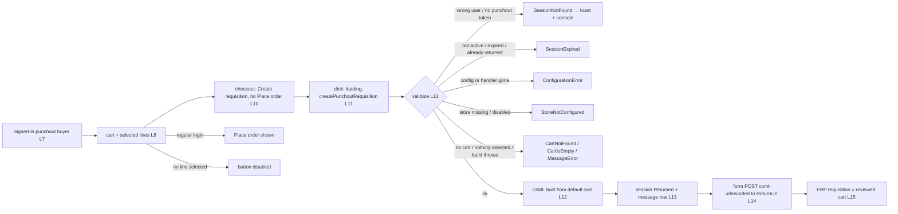
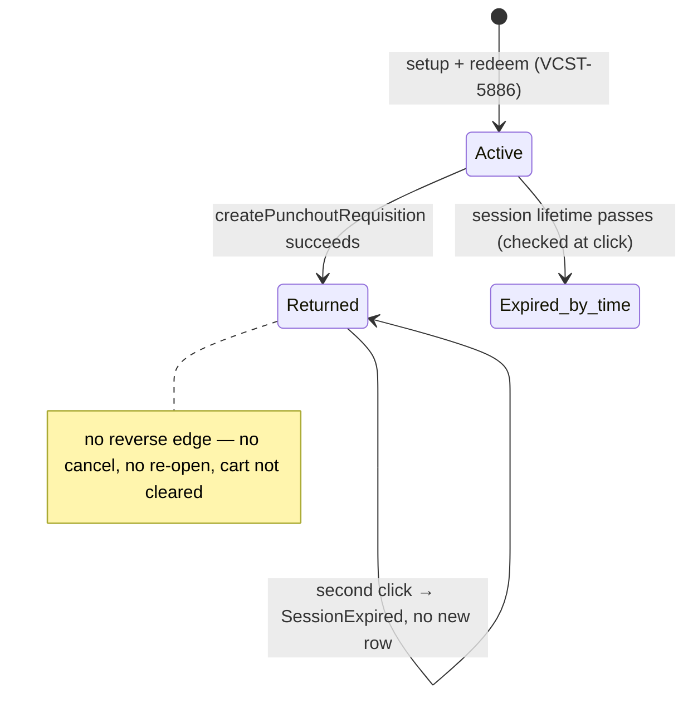

# TEST MODEL — VCST-5887

```
Ticket:      VCST-5887 | Type: Story | Status role: testable | Flow: feature-test | Priority: P1 (High) | Path: FULL | Changed: Both
Context:     FULL: ba-system-analyzer (1c) + ba-story-writer Mode B (1d) + qa-frontend-expert 1r (REACHABLE, 2 min)
Prior model: reports/ba/test-models/VCST-5886-2026-10-01.md — Part 0 L1–L9 carried forward unchanged; this ticket adds L10–L15.
             Drift vs it: session status `Returned` is now SET (5886 "ABSENT IN PRODUCT" row closed); config 3 (no StoreId)
             can no longer exist — startup validation refuses it (vc-deploy-dev#6926), so 5886 row 15 / V4 are obsolete.
Domain map:  ABSENT — 1c-map build_outcome FAILED: slug `punchout` is not a declared bl:extract domain (same as 5886).
Mind map:    ABSENT
Chain position: unverified — no domain map. Slice stated against the Epic (VCST-5154): touches L8 (cart content as returned),
             L10–L15 (requisition → cXML → ERP). Does NOT touch L1–L7 (mapping, setup, start page, grant, sign-in — VCST-5886,
             re-entered only as preconditions), L9 sign-out except as a stale-flag precondition (row 17), OrderRequest
             (VCST-5888), ERP-side edit/inspect (operationAllowed other than create — not built), the Admin UI (no change).
Env / build: vcptcore-qa1; Punchout 3.1000.0-pr-2-f940 (vc-module-punchout PR #2 head f9403cb, open) · theme
             2.60.0-pr-2564-ff59 (vc-frontend PR #2564 head ff5983c, open) · Cart 3.1012.0 · XCart 3.1042.0 · Xapi 3.1027.0.
             Configurations qa1-punchout-0/1/2 (Ids added by vc-deploy-dev#6926 after the build failed to start without them).
Contract:    graphql-schema.md NOT refreshed (schema:refresh not run); the createPunchoutRequisition shape below rests on 1c's
             LIVE introspection of qa1 this run — `createPunchoutRequisition(command:{storeId!, currencyCode, cultureName})
             → PunchoutCheckoutType {url formField cxml errorCode}`. Generated FE types.ts also declares a `punchoutCheckout`
             query the live schema lacks (drift, row 30 note).
```

**Affected surface.** vc-module-punchout #2: `PunchoutOrderMessageProcessor` (validate → handler builds cXML → atomic
`ReturnSessionAsync` → save `PunchoutOrderMessage`), `ExperienceApi/Services/PunchoutOrderMessageBuilder` (Total, UnitPrice,
xml:lang, UoM, Classification), `DefaultPunchoutHandler` (`GetCartQuery` with `CartName="default"`, org from token, currency +
culture from the request), `CreatePunchoutRequisitionCommand*` (session id from the `ChannelSessionId` claim only when
`channelId=punchout`), `PunchoutHandlerFactory` (`HandlerTypeName`), `PunchoutOptionsValidator` (ValidateOnStart), new table
`PunchoutOrderMessage`, `punchoutMockQuery`. vc-frontend #2564: `modules/punchout/components/create-requisition-button.vue`,
`utils/submitPunchoutOrderMessage.ts` (hidden form, field `cxml-urlencoded`), `checkout.placeOrder` extension point in
`place-order.vue` / `proceed-to.vue` (condition `isPunchoutMode && isAuthenticated`; disabled also on cart/loyalty validation
errors), 13 locale files. Layers: storefront + xAPI + DB; no REST, no Admin.

**Ticket signals.** No ACs in the description; the developer's QA guide (comment 2026-10-12) is the de-facto spec — §2 Step 4
field table, cases 1–19, error codes, five known limitations. Open question (2026-10-06): Classification codes. Attachment
(image-20260909-062912.png) is the flow diagram (setup → shop → Create requisition → BrowserFormPost). Env signal: the new build
did not start on qa1 until every configuration had an `Id` — observed in the platform log, i.e. QA-guide case 17 already
reproduced in production-shaped form.
**Epic context.** VCST-5154 (In progress). Done: VCST-5886 (setup/session; open Critical PO-3X-C1 admin-mapping escalation —
not re-verified on this build). To do: VCST-5888 OrderRequest. Note: VCST-5883 is Returns, NOT a punchout sibling.
**Domains:** punchout (undeclared) · checkout · cart · b2b-organizations · xAPI.
**Flows & boundaries:** checkout extension point ↔ punchout flag · selected-for-checkout ↔ ItemIn set · promotions ↔ Total ·
currency/culture globals ↔ cart lookup · token claims ↔ session ownership · session row ↔ message row · storefront ↔ ERP
return URL.
**Risk areas:** VC-CART-001 (Apollo cache after auth replace) · VC-CART-005 (total drift on rapid edits) · VC-AUTH-001 · 1r+1c
OBSERVED twice: the cart on screen (a named cart) ≠ the cart sent (the `default` cart) · non-atomic return (Returned committed
before the message row) · 2-decimal fixed format · cart-level % promotion allocated into PlacedPrice.
**AC traceability:** 1d seeded 42 atomic conditions C-01..C-42 from guide expectations R-01..R-25 + gap-ACs G-01..G-42. Impl
verdicts: all guide rows SATISFIED in code; C-31 recovery after a failed delivery **NOT-FOUND**; C-37 return-URL allow-list
**DRIFT-suspect**; C-16/17/33/34/35/36/38/40/42 untested; C-39 validation-error disable = unspecified implementation.
**DoD:** none declared (1d proposed a minimum; every item confirm-at-5-verdict).

## Part 0 — VALUE CHAIN

L1–L7 as in the prior model (mapping → setup → session/token → start page → grant → signed-in buyer in the current org).

| Link | In the user's words |
|---|---|
| **L8** | The buyer fills the org's cart and chooses which lines go to checkout ("selected for checkout") |
| **L10** | At checkout the buyer sees **Create requisition** where **Place order** normally is (punchout mode only) |
| **L11** | The buyer clicks it once; the button shows loading and cannot be clicked again; `createPunchoutRequisition` is sent |
| **L12** | The platform checks the session is the buyer's, active, its configuration and store still valid, loads the buyer's cart and builds the cXML PunchOutOrderMessage from the selected lines |
| **L13** | The session becomes `Returned` and the message is stored (one row) — the cart can never be returned again on this session |
| **L14** | The browser leaves the storefront and posts the cXML to the procurement system's return URL |
| **L15** | The procurement system shows a requisition whose lines, quantities, prices and total are the ones the buyer reviewed |



```mermaid
sequenceDiagram
  participant SF as Storefront
  participant X as xAPI createPunchoutRequisition
  participant H as DefaultPunchoutHandler
  participant DB as PunchoutSession / PunchoutOrderMessage
  participant ERP as Return URL
  SF->>X: storeId, currencyCode, cultureName (+ token: channelId=punchout, session id)
  X->>DB: load session; owner? Active & Exp>now? config(Id,StoreId)? store enabled?
  X->>H: build (StoreId, UserId, OrganizationId, currency, culture)
  H->>H: GetCartQuery CartName="default" → selected lines → cXML
  X->>DB: UPDATE status=Returned WHERE Active AND Exp>now (atomic)
  X->>DB: INSERT PunchoutOrderMessage(SessionId, Cxml)
  X-->>SF: url, formField, cxml | errorCode
  SF->>ERP: hidden form POST cxml-urlencoded (page replaced)
```



**Variants** (union of the layers that branch: frontend extension condition, processor validation, handler cart lookup, builder
per line): V1 config 0 · one-org buyer · only the default cart · V2 same buyer whose CURRENT storefront cart is a named,
non-default cart · V3 multi-org buyer (PO-200) · V4 config 1 (store New-super, checks off, 2 min / 10 min) · V5 password
(non-punchout) sign-in · V6 product kinds the builder branches on: configurable, variation, measure unit set / empty.

**Variants vs domain map (11b):** no map exists, so V1–V6 are ALL reported as surfaces the map is MISSING (with the
`checkout.placeOrder` extension point, `PunchoutOrderMessage`, `Returned` and the config `Id` rule) — carried to the
`punchout` domain declaration recommended at close-out.

**Mechanism coverage matrix** (axes from Part 0; scenario # mapped in afterwards)

| Variant \ Link | L8 | L10 | L11 | L12 | L13 | L14 | L15 |
|---|---|---|---|---|---|---|---|
| V1 config 0 default cart | 1, 4, 5, 19 | 1 | 1, 15, 16 | 1, 3, 6–9, 12, 13 | 1, 14 | 1 | 1 |
| V2 named current cart | 2 | 2 | 2 | 2 | 2 | 2 | 2 |
| V3 multi-org | 25 | 25 | 25 | 25 | 25 | 25 | 25 |
| V4 config 1 | 26 | 26 | 20, 26 | 26 | 20, 26 | 26, 31 | 26 |
| V5 password sign-in | 17 | 17 | 33 | WAIVED — refused before the builder; 33 asserts the refusal | 33 (no row) | WAIVED — no message exists | WAIVED — no message exists |
| V6 product kinds | 27, 28, 9 | WAIVED — same button path as V1 | WAIVED — same mutation as V1 | 27, 28, 9 | WAIVED — persistence independent of line kind | WAIVED — same form POST | 27, 28, 9 |

**Reverse edges**

| Forward effect | What moves it back | Covered by |
|---|---|---|
| Session Active → Returned (L13) | delivery to the ERP failed after the commit → retry | **ABSENT IN PRODUCT** — no recovery; finding candidate (29) |
| Session Returned | re-open / cancel the requisition from the storefront | **ABSENT IN PRODUCT** — known limitation (operationAllowed=create only); 14 proves the refusal |
| Message row stored | delete / supersede | **ABSENT IN PRODUCT** — no API |
| Cart lines sent | cart cleared / lines marked as requisitioned | **ABSENT IN PRODUCT** — cart unchanged after return (1c observed); 14 checks the second attempt |
| Button submitting | re-enabled on failure; stays enabled after a successful return | 30 |

**Fixture lifecycle.** A session is TERMINAL once `Returned` and a start link once redeemed → every case mints its own setup
request in the case (FIFTH RULE). The default persona `{{USER_EMAIL}}` behind `AGENT-TEST-PO-100` holds ~15 carts touched by
other runs (VCST-6286 named carts) — shared mutable state that already corrupted one observation, so cart-content cases need a
**dedicated punchout buyer** whose carts the case empties in Setup and Cleanup (DISPOSABLE FIXTURES rule 4) → FIXTURE-GAP.

**Part 0r — omitted.** One role variant (the punchout buyer); V5 is an authentication mode of the same buyer, and no Admin or
back-office permission is added by this change.

## Parts 1–5 — FAULT MODEL

**Condition space.** config {0, 1} · buyer {one-org, multi-org, password sign-in} · current cart {default, named} · selection
{all, subset, none} · line pricing {list, line promo, cart % promo, cart fixed promo, sub-cent} · product {simple, UoM set,
configurable, variation, special-char name} · currency {store default, other} · culture {en, comma-decimal, other language} ·
attempt {first, second, double-click, two tabs, after expiry} · store {enabled, disabled mid-session} · configuration {stable,
Id changed, unknown handler, invalid at start} · delivery {ok, return URL unreachable} · viewport {desktop, 375 px}.
Constraints: password sign-in never reaches L12; invalid configuration never reaches a session; config 1 has no allow-list.
Raw N = 2·3·2·3·5·5·2·3·5·2·4·2·2 = **864 000**.

**Reduction.** Validation is a short-circuit sequence → DT, one row per first-failing check (rows 14, 20–24, 33): attempt ×
store × configuration × buyer 240 → 8. The builder maps each line independently, so product × pricing × culture are EP
per-line classes on ONE multi-line cart (rows 1, 6–9, 12, 13, 27, 28) rather than a product — 150 → 9. Currency and culture
pair at t=2 with the rest held (10, 11, 13). Selection → BVA 0/1/subset (4, 5). Concurrency → ST/EG (14–16). Dropped:
config 1 × pricing/product (builder is config-independent — 26 keeps one config-1 journey); viewport × everything except
the button (34); delivery × anything but one row (29). **864 000 → 34.**

| # | Cell | Defect hypothesis | Archetype | Technique | Oracle | P |
|---|---|---|---|---|---|---|
| 1 | [JOURNEY] config 0 · one-org dedicated buyer · only the default cart · 3 lines (qty>1, UoM set, one plain) · Create requisition → tester page | any link breaks: button missing, mutation errors, cXML lines/qty/prices/total ≠ the cart reviewed, no Returned, page never reaches the ERP | SILENT | FLOW | {SPEC} guide §2 Steps 1–4 | Critical |
| 2 | V2: buyer's current storefront cart is a named cart ≠ default · Create requisition | the ERP receives the hidden `default` cart while the buyer reviewed another — wrong goods requisitioned (OBSERVED twice: Fanta on screen, Epson sent) | SCOPE | EG | {SPEC} guide Step 3 "items match the storefront cart" | Critical |
| 3 | header + envelope of row 1's cXML | From/To swapped, SharedSecret leaks into Sender, BuyerCookie not echoed, operationAllowed ≠ create, not DTD-valid | PARITY | EP | {SPEC} Step 4 table | High |
| 4 | 3 lines, one unselected | unselected line sent or counted in Total | SCOPE | BVA | {SPEC} case 3 | High |
| 5 | none selected → button; then deselect all AFTER checkout rendered and click | button enabled with nothing to send; server path returns a generic error instead of CartIsEmpty | BOUNDARY | BVA | {SPEC} case 4 + error table CartIsEmpty | Medium |
| 6 | line-level promotion on one line | UnitPrice is list not placed; Total misses the line discount | MONEY | EP | {SPEC} case 5 | High |
| 7 | cart-level % promotion and cart-level fixed-amount promotion (separately) | Total sometimes includes a cart-level discount (allocated %) and sometimes not (fixed) — ERP sees inconsistent totals | MONEY | DT | {SPEC} "Total excludes cart-level discounts"; 1c OBSERVED a % reward inside PlacedPrice → author decision | High |
| 8 | sub-cent placed price (percent off an odd price) × qty 3 | Total ≠ Σ(printed UnitPrice × qty) by ≥ 1 cent; ERP rejects / flags the mismatch | MONEY | BVA | {HYPOTHESIS} — needs the rounding rule (1d R-07) | Medium |
| 9 | product with MeasureUnit · product without | wrong unit or empty UnitOfMeasure instead of EA | PARITY | EP | {SPEC} case 6 | Medium |
| 10 | switch storefront currency (if the store has >1) then requisition | cXML in the old currency or a different/empty cart picked by the currency key | MONEY | PW | {SPEC} case 7 + {BL-CART-004} | High |
| 11 | switch storefront language then requisition | xml:lang/Description keep the old language or the cart lookup by culture finds no cart | PARITY | PW | {SPEC} case 8 (expectation vague) → {HYPOTHESIS} for the name language, author to define | Medium |
| 12 | product name with `& < > " '`, non-Latin, very long | malformed XML → ERP parse error, or MessageError toast | BOUNDARY | EG | {SPEC} "tester shows the cart without cXML errors" | Medium |
| 13 | storefront culture with comma decimals (de/fr) | UnitPrice/Total printed `125,00` | PARITY | EP | {SPEC} "dot as the decimal separator" | High |
| 14 | after a successful return: Back, click again | second message sent / new row; or a crash instead of SessionExpired | REPLAY | ST | {SPEC} case 2 | High |
| 15 | double click / Enter repeat on the button | two POSTs, two rows, or the loser's error toast flashes before navigation | RACE | ST | {SPEC} case 9 | High |
| 16 | same session in two tabs, click in both | both succeed → two requisitions | RACE | EG | {SPEC} case 2 generalised (one return per session) | Medium |
| 17 | password sign-in buyer at checkout; and after a punchout session: sign out → password sign-in | Place order missing / Create requisition shown on a normal session (stale isPunchoutMode flag) | STALE | ST | {SPEC} case 10 | High |
| 18 | open the used start page again (private window) | start link signs in twice | REPLAY | ST | {SPEC} case 11 (carried from 5886 row 17) | Medium |
| 19 | reach checkout, change quantities in the cart, then requisition | cXML carries the pre-change quantities (cached cart) | STALE | ST | {SPEC} case 12 + VC-CART-005 | High |
| 20 | config 1 (10 min session) · wait past expiry · click | requisition sent on an expired session | LIFECYCLE | BVA | {SPEC} case 13 | High |
| 21 | Punchout.Enabled off on the store mid-session · click | requisition sent for a store that disabled punchout | CONFIG | DT | {SPEC} case 14 StoreNotConfigured | High |
| 22 | configuration Id changed + restart mid-session | session still returns via a different configuration | CONFIG | DT | {SPEC} case 15 ConfigurationError | Medium |
| 23 | HandlerTypeName unknown | setup succeeds with no handler, or the platform crashes | CONFIG | DT | {SPEC} case 16 | Low |
| 24 | configuration missing Id / StoreId · duplicate Id · duplicate SharedSecret | platform starts with an ambiguous config, or the log prints the secret | CONFIG | DT | {SPEC} cases 17–19 | Medium |
| 25 | multi-org buyer (PO-200): cart in current org; switch org before return | the other org's cart is sent; org switch ignored | SCOPE | PW | {BL-B2B-001} + {BL-AUTH-015} | High |
| 26 | [JOURNEY-2] config 1 (store New-super) | builder reads B2B-store / wrong currency for a config-1 session | PARITY | EP | {SPEC} guide §2 (config-independent) | Medium |
| 27 | configurable product line | price excludes selected options, or SupplierPartID is a config item | MONEY | EG | {BL-CART-010} | Medium |
| 28 | variation product line | SupplierPartID is the parent SKU | PARITY | EP | {SPEC} "SupplierPartID = product SKU" | Medium |
| 29 | session Returned, then the ERP post never arrives (return URL unreachable / offline at submit) · buyer retries | buyer is stuck: SessionExpired, no message delivered | LIFECYCLE | EG | {HYPOTHESIS} — PROPOSED-BL-PUNCH-001, author decision | High |
| 30 | every error path: toast text + console errorCode; button re-enabled after failure; button state after success | silent failure, untranslated text, button stuck in loading, or misleading "try again" | SILENT | EP | {SPEC} §error codes + §known limitations | Medium |
| 31 | config 1 (empty allow-list) vs config 0 (allow-listed) return URL | the cart is posted to a host the configuration does not allow | SCOPE | EG | {SPEC} AllowedReturnUrls rule; empty = any {SPEC} → PROPOSED-BL-PUNCH-003 | High |
| 32 | cXML received + platform log for a requisition | SharedSecret / session token appears in the posted document or log | SCOPE | EG | {SPEC} "Sender: there is no SharedSecret"; log {HYPOTHESIS} PROPOSED-BL-PUNCH-004 | High |
| 33 | call createPunchoutRequisition with a password token / another buyer's punchout token | a non-punchout or foreign session returns someone's cart | SCOPE | DT | {SPEC} error table SessionNotFound | Critical |
| 34 | Create requisition at 375 px; keyboard; loading announced | button hidden under the sticky bar / unreachable by keyboard | RENDER | EP | {HYPOTHESIS} — no mobile/a11y spec; {BL-A11Y-*} for keyboard | Low |

**Probes carried in:** VC-CART-001 → 2, 17 · VC-CART-005 → 19 · VC-AUTH-001 → 17 · VC-B2B-003 (admin account via mapping) →
N/A here, carried as a regression re-check of 5886 PO-3X-C1 in Artifact B · VC-CART-002/003/004/006 → N/A, line-item editing
mechanics unchanged · VC-B2B-001/002/004 → N/A, org admin / roles / impersonation untouched.
**Archetype sweep:** SCOPE → 2, 4, 25, 31, 32, 33 · MONEY → 6, 7, 8, 10, 27 · PARITY → 3, 9, 11, 13, 26, 28 · RACE → 15, 16 ·
REPLAY → 14, 18 · STALE → 17, 19 · SILENT → 1, 30 · BOUNDARY → 5, 12 · LIFECYCLE → 20, 29 · CONFIG → 21–24 · RENDER → 34 ·
FALLBACK → 9 (EA).
**UIP sweep:** UIP-BACK → 14 · UIP-TABS → 16 · UIP-DOUBLE (submit) → 15 · UIP-EXPIRE → 20 · UIP-STORAGE → 17 · UIP-NET → 29 ·
UIP-DATA → 12 · UIP-VIEW → 34 · UIP-REFRESH → WAIVED, a refresh after return is the second attempt (14) · UIP-DEEP → WAIVED,
start link covered by 5886 · UIP-INPUT → WAIVED, no text input added · UIP-PAGE → WAIVED, no pagination.
**Business Rules:** BL-B2B-001, BL-AUTH-015, BL-CART-003, BL-CART-004, BL-CART-005, BL-CART-007, BL-CART-010, BL-PRICE-005.
Proposed: PROPOSED-BL-PUNCH-001..004 (1d §8) — need a declared `punchout` oracle domain.
**Edge cases:** ECL-1.2, ECL-5.1, ECL-12.1, ECL-14.3.
**Docs grounding:** VirtoOZ has no punchout / cXML page (1c) — NEW feature: oracles `{SPEC}` (developer's QA guide) +
cXML 1.2.041 DTD. Undocumented: checkout's final step is Create requisition in punchout mode (docs finding).
**Observed grounding (kb):** KB-C239652A (setup → start page → signed-in, confirmed live by 1c and 1r today), KB-CA2AE929.
Nothing for createPunchoutRequisition / PunchOutOrderMessage — capture after 3x.
**FIXTURE-GAPs (→ 3a):** a dedicated punchout buyer + mapping isolated from `{{USER_EMAIL}}`; products: UoM set / empty,
line-level promotion, sub-cent price, configurable, variation, special-character name; cart-level % and fixed promotions on
B2B-store; whether B2B-store offers a second currency; a config-1 (New-super) buyer mapping.
**Agents to dispatch:** 3x `/qa-exploratory ticket VCST-5887` (rows 2, 7, 8, 11, 29, 31, 32 first) · 3a `test-data-engineer` ·
4a `qa-frontend-expert` (storefront + cXML) ‖ `qa-backend-expert` (xAPI/negative/config) · 4v `ui-ux-expert` (button, toast).

## Round 1 — 3x discovery amendments (2026-10-14, SBTM-VCST-5887-2026-10-14)

- **Row 2 → split (all PROMOTE).** 2a: a named cart created by another xAPI client (mobile / UCP `create_cart` / integration)
  is what the storefront shows — `Query.cart` without a name resolves the named cart — while `DefaultPunchoutHandler` sends
  `default` {OBSERVED: screen QA-LOW-001 ×2 $23.98 → ERP WH-001 ×3 + 553390824 ×3, Total 695.98, BuyerCookie AGENT-3x-9}.
  2b: an existing named cart from history (1r/1c). 2c: the button's enable/disable follows validation of the DISPLAYED cart
  while the other cart is sent. Not reachable through the storefront UI alone (client-app sends no cartName). Oracle unchanged:
  {SPEC} "items match the storefront cart".
- **Row 7 → resolved, premise corrected.** The 20% seen at 1c is a LINE reward (RewardItemGetOfRel). Cart-level % (SUPER) and
  fixed (FIXED5) are both excluded from PlacedPrice and Total — consistent with the stated limitation. Row kept as a guard;
  the line-% class moves to row 6.
- **Row 8 → {OBSERVED}.** WH-001 placed 79.992 ×3: UnitPrice 79.99, Total 695.98 vs Σ printed 695.97. Oracle still needs the
  author's rounding rule.
- **Row 11 → {OBSERVED}.** xml:lang = the cart language code, rewritten by the culture of the last request (de-DE after a
  storefront switch); Description = the stored line name (English). Row 13: dot separator holds under de.
- **Row 29 → partial.** After a return: Back keeps punchout mode, button enabled, second click → SessionExpired + "try again"
  toast. A delivery failure itself NOT REACHED (config 1 unusable, below); by code order the session is burned → reverse edge
  stays ABSENT IN PRODUCT.
- **V4 (config 1) → WAIVED on qa1 with evidence.** Store New-super shares the storefront host with B2B-store, so a config-1
  start page signs into B2B-store and the return gives SessionNotFound. Rows 20, 26 and the config-1 half of 31 are
  environment-blocked; new row 35 below.
- **Row 31 → {OBSERVED} setup half.** Config 0 refuses suffix-host, `@` userinfo, http, port, bare host, `javascript:`,
  `.invalid` (cXML 400). Config 1 setup accepts any host (post not observed).
- **Row 32 → {OBSERVED}.** No SharedSecret / token in the posted cXML; platform log unchecked.
- **Row 33 → {OBSERVED}.** Password token, anonymous call, other-store token → errorCode SessionNotFound; a foreign session id
  cannot be expressed (signed claim) — by design.
- **New rows:** 35 a start page for a configuration whose store this storefront host does not serve → buyer lands in another
  store, requisition fails SessionNotFound (CONFIG, EG, {HYPOTHESIS} — expected behaviour unstated) · 36 `default` cart absent
  while a named cart exists → screen shows items, return gives CartNotFound (SCOPE, EG, {SPEC} error table) — not run ·
  37 Quote request still offered in punchout mode (SCOPE, EG, {HYPOTHESIS} — author decision).

## Round 2 — retest on the fix build (2026-10-20, /qa-test FULL round 2)

**Build delta** (source read, `f9403cb..6c75c57` + `ff5983c..69d4418`): Punchout `3.1000.0-pr-2-6c75` (deployed, = PR head); theme
PR #2564 head `69d4418` (deployed build confirmed at 1r). Five changes; each is a mechanism the round-1 matrix did not have.

| Δ | Change (source) | Rows it moves | Oracle |
|---|---|---|---|
| D1 | `DefaultPunchoutHandler.CreateGetCartQuery` no longer sets `CartName = "default"` → the cart is resolved like `Query.cart` (no name; newest-created null-type cart) | 2a/2b/2c, 36 → expected to PASS | {SPEC} Step 3 "items match the storefront cart" |
| D2 | Idempotent replay: a `Returned` session with a stored order message returns the **stored cxml** again (checked after the owner check, **before** the active/lifetime, configuration and store checks) | 14, 16, 29 → **RE-BASE** (was SessionExpired) | {SPEC-CHANGE} author commit `33d791f`; QA guide case 2 is now stale |
| D3 | One message per errorCode (7 keys, 13 locales) instead of the generic toast | 30 → RE-BASE | {SPEC} new locale keys |
| D4 | Punchout hides shipping / payment / comment; the button gates only on shown sections; multistep checkout forced to single page | 37 hint half → resolved | {SPEC} `useCheckoutSections` |
| D5 | Quote widget hidden when a module owns place-order | 37 quote half → resolved | {SPEC} `create-quote-from-cart.vue` |

**New rows (round 2):**

| # | Cell | Defect hypothesis | Technique | Oracle |
|---|---|---|---|---|
| 38 | D2 × second click after return | replay sends a DIFFERENT document, or a second `PunchoutOrderMessage` row | ST | stored cxml byte-identical; one row |
| 39 | D2 × cart changed after the return, then replay | replay is rebuilt from the new cart (ERP gets goods the first message did not carry) — or, by design, the OLD cart is replayed: RECORD which | ST/EG | {HYPOTHESIS} — author decision; RECORD |
| 40 | D2 × returned session after `Punchout.Enabled` off | replay ignores the store switch (replay precedes the store check) | EG | {HYPOTHESIS} — RECORD |
| 41 | D2 × two parallel calls on an Active session | both build, the loser gets SessionExpired (replay is not reached) — or two rows | CT | one cxml + one SessionExpired; one row |
| 42 | D2 × foreign / password token against a returned session | the replay leaks another buyer's cxml | EG | SessionNotFound (owner check precedes replay) |
| 43 | D1 × buyer has a Saved-for-later / wishlist-type cart created AFTER the shopping cart | the handler picks a typed cart the buyer does not see as "the cart" | EG | the cart on /cart is the cart sent |
| 44 | D1 × no cart at all | handler creates an empty cart → CartIsEmpty, or CartNotFound: RECORD | EG | either code, nothing sent |
| 45 | D3 × each reachable errorCode, en + de | wrong key, raw key, generic text | DT | locale text for that code |
| 46 | D4 × punchout checkout with empty shipping/payment | button disabled by a hidden section; hidden section still written | DT | button enabled when a line is selected; no shipping/payment UI |
| 47 | D4/D5 × password sign-in (non-punchout) | regular checkout loses shipping/payment/comment or the quote widget | regression | sections + quote widget present, Place order gated as before |
