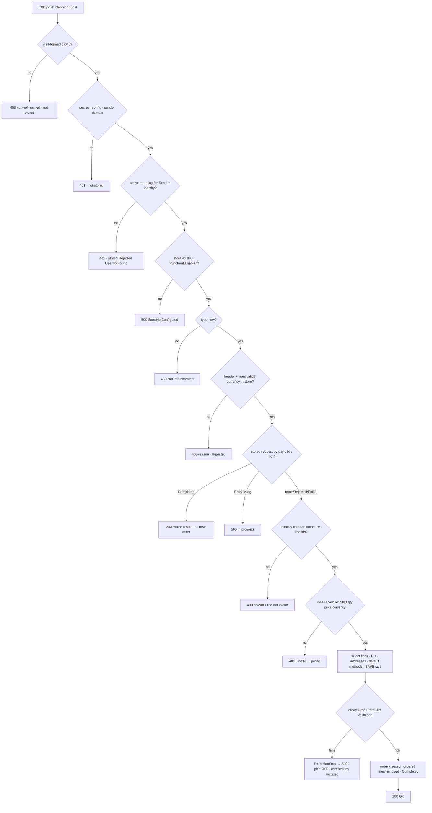
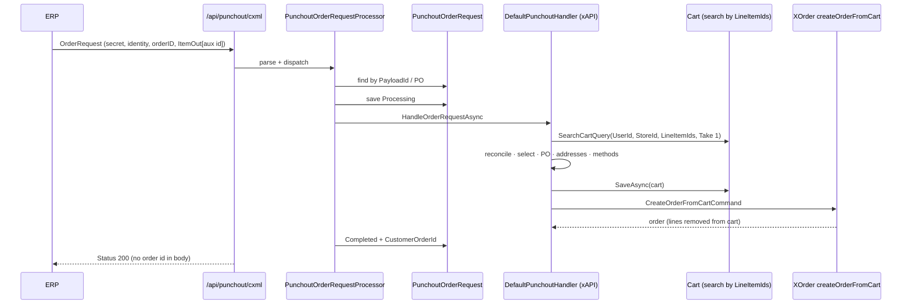
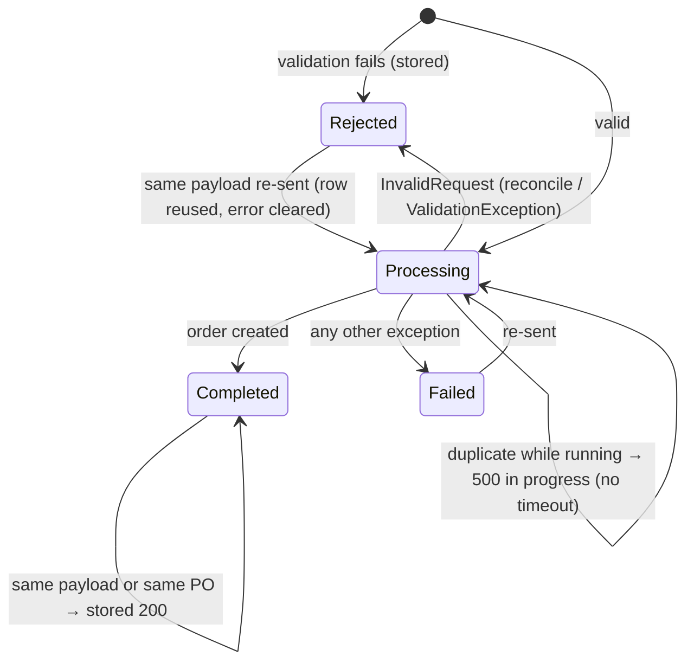

# TEST MODEL — VCST-5888

```
Ticket:      VCST-5888 | Type: Story | Status role: testable | Flow: feature-test | Priority: P2 (Medium) | Path: FULL | Changed: Backend
Context:     FULL — 1c ba-system-analyzer, 1d ba-story-writer (Mode B), 1c-map (built this run)
Prior model: reports/ba/test-models/VCST-5887-2026-10-14.md — Part 0 (L1–L10: setup → session → grant → cart → requisition
             → PunchOutOrderMessage) carried forward by citation through the domain map; this model starts where it ends (L10).
             Drift against it: its round-2 replay rows are stale (D9 in the map) — irrelevant here.
Domain map:  .claude/knowledge/domain/punchout.md @ rev 1 (generated 2026-10-27, built_in_run: true) — PRESENT
Mind map:    ABSENT (no punchout.mind-map.json)
Chain position: L11–L14 of the domain chain L1–L15, plus the L10 output this ticket consumes (SupplierPartAuxiliaryID =
             cart line id) and the L1/L2 preconditions it reads (active mapping, Punchout.Enabled, config incl. the NEW
             DefaultShipmentMethodCode/DefaultPaymentMethodCode). Does NOT touch L3–L9 (setup, start page, grant, sign-in,
             cart UI, Create requisition, order-message build) except as data provisioning — those are re-checked only as
             regression of the shared BasePunchoutProcessor refactor (S37). L15: only the L12 reverse edge (below).
Affected surface: vc-module-punchout PR #6 (d2e3683) — PunchoutController /api/punchout/cxml, CxmlRequestDispatcher,
             CxmlPunchoutOrderRequestHandler, PunchoutOrderMapper, PunchoutOrderRequestProcessor (PORP), DefaultPunchoutHandler
             (DPH, ExperienceApi), PunchoutOrderRequest entity + migrations; vc-module-x-cart #150 SearchCartQuery.LineItemIds;
             vc-module-cart #199 ShoppingCartSearchCriteria.LineItemIds (+ REST api/carts/search). All in map §2c (API) and
             §2a (Orders). MISSING from the map: none.
Ticket signals: no AC field; the dev QA plan (Jira comment 2026-10-23, T1–T18 + response table + §5) is the spec; swimlane
             attachment: valid → order with PO number → "Accepted"; invalid → "rejected". Plan pre-conditions: config has
             DefaultShipmentMethodCode/DefaultPaymentMethodCode (qa1: ABSENT on all configs → T1/T4 method clauses need an env
             change; current state IS T17a); SQL access to PunchoutOrderRequest (NONE — no REST either; "Stored as" clauses
             are NOT-OBSERVABLE).
Epic context: VCST-5154 Punchout Integration (In progress). Done siblings: VCST-5886 setup (Tested), VCST-5887 order message
             (Tested) = the seams L1–L10 this story consumes. In-progress deps: x-cart #150, cart #199 (unmerged; deployed as
             alphas), VCST-6327 admin UI (not in scope).
Domains:     punchout, cart, orders (checkout/createOrderFromCart), auth (shared-secret + mapping)
Flows & boundaries: ERP ↔ /api/punchout/cxml · OrderRequest ↔ cart (line-id lookup) · cart → createOrderFromCart (x-order) · order ↔ storefront cart/order history
Risk areas:  idempotency (REPLAY/RACE) · cart lookup scope (SCOPE) · cart mutated before order creation (1c §3.2) · checkout
             validation error mapping (1c D1: ExecutionError → 500 not 400) · money rounding (map D4) · 450 vs plan 501 (1d)
AC traceability: 18 plan cases → 44 atomic conditions; 1d verdicts: IMPLEMENTED 31 · DRIFT 6 (T8 wording ×3, T12 storage,
             T13 450≠501, "500 config error" → 401) · NOT-FOUND 4 (T2/T3 cart leftovers, T17 platform acceptance, swimlane
             "update/release") · CONTRADICTS 1 (T13 code). Gap-ACs added from 1c/1d: G1–G24 → S14–S16, S27–S33, S40–S41.
DoD:         none declared by the ticket (1d's checklist is advisory; carried into 5-verdict).
```

## Part 0 — VALUE CHAIN

**Value chain** (user's words; L-ids are the domain map's):
1. **L10 →** The buyer's requisition reaches the ERP carrying each cart line's id (`SupplierPartAuxiliaryID`), SKU, qty, unit price, currency.
2. **L11 —** After its own approval the ERP posts a signed cXML OrderRequest (PO number = `orderID`, ShipTo/BillTo, the lines).
3. **L11 auth —** The platform recognises the integration (shared secret → configuration, sender domain), the ERP user (active mapping) and that punchout is enabled for the store.
4. **L12a —** It recognises a document it has already handled (same payload, or same PO) and answers with the stored result instead of ordering twice.
5. **L12b —** It finds the buyer's ONE cart that holds those lines.
6. **L12c —** It checks the order still matches that cart: every line, SKU, quantity, price (to the cent), currency.
7. **L12d —** It prepares the cart: only the ordered lines selected, PO number, the ERP's addresses, the configured shipping and payment methods.
8. **L12e —** It places a customer order from those lines; the ordered lines leave the cart.
9. **L13 —** The ERP gets a cXML Status: 200 = order placed; 400/401/450/500 with a reason it can act on.
10. **L14 —** The buyer and the back office see an ordinary customer order with the ERP's PO number; the rest of the cart is still there.
→ **Unlocks:** the ERP's PO is confirmed as a real order in Virto, fulfilment can start; a rejected PO can be fixed and re-sent.







**Variants** (code paths that branch — union of PORP, DPH, cart search, x-order validation):
V1 full cart · V2 partial cart · V3 cart changed after the return (added line / qty) · V4 duplicate (same payload / same PO /
retry after reject) · V5 reconcile mismatch (qty / price / SKU / currency) · V6 line-id lookup (unknown / missing / duplicate /
mixed / two carts / other user) · V7 header invalid (no orderID / no items / qty 0 / item≠total currency / unsupported currency /
type update·delete / malformed) · V8 auth & store (secret / domain / unmapped / inactive mapping / setting off / no store) ·
V9 config methods (set / absent / nonexistent) · V10 checkout validation fails after the cart save · V11 session not returned
(order for lines never sent in a requisition) · V12 concurrency (same payload / same PO, parallel).

**Mechanism coverage matrix** (columns = links; cells = scenario # | GAP | WAIVED + reason; `—` = the variant cannot reach that link, by the flowchart)

| Variant | L10 input | L11 auth | L12a dedupe | L12b cart | L12c reconcile | L12d prepare | L12e order | L13 status | L14 visible |
|---|---|---|---|---|---|---|---|---|---|
| V1 full | S1 | S1 | S1 | S1 | S1, S35 | S1, S2 | S1, S38 | S1 | S1, S33, S34 |
| V2 partial | S3 | S3 | S3 | S3 | S3 | S3 | S3 | S3 | S3, S34 |
| V3 changed after return | S4 | S4 | S4 | S4 | S4, S36 | S4 | S4 | S4 | S4 |
| V4 duplicate | S6 | S6 | S6, S7, S8, S30, S31 | S31 | S8 | S8 | S6, S7 | S6–S8 | S6, S7 |
| V5 mismatch | S9 | S9 | — | S9 | S9–S11, S17, S32, S36 | — | — (no order asserted) | S9–S11, S17, S32 | S9 (cart untouched) |
| V6 line lookup | S12 | S12 | — | S12–S16 | S14 | — | — | S12–S16 | S16 (other user's cart untouched) |
| V7 header invalid | S19 | S19 | — | — | — | — | — | S18–S20, S26 | WAIVED — rejected before any cart access |
| V8 auth & store | S21 | S21–S23, S39 | — | — | — | — | — | S21–S23, S39 | WAIVED — rejected before any cart access |
| V9 config methods | S24 | S24 | S24 | S24 | S24 | S2, S5, S24, S25 | S24, S25 | S24, S25 | S24 |
| V10 checkout fails | S27 | S27 | S27 | S27 | S27 | S27, S28 | S27 | S27 | S28 |
| V11 not returned | S29 | S29 | S29 | S29 | S29 | S29 | S29 | S29 | S29 |
| V12 concurrency | S40 | S40 | S40, S41 | S41 | S41 | S41 | S40, S41 | S40, S41 | S41 |

Outside the slice: S37 guards L3–L9 (regression of the shared `BasePunchoutProcessor` refactor in PR #6), not an L11–L14 cell.

**Reverse edges**
- Order placed (L12e) → ERP cancel/change via OrderRequest `type="delete"/"update"` → **ABSENT IN PRODUCT** (450 Not Implemented, S20) — reported as a scope fact (plan T13 states it), not a bug. Back-office order cancel is the platform's ordinary path — out of scope.
- Cart lines consumed (L12e) → no way to restore them; re-ordering needs a new punchout → covered by S31 (late retry → 400).
- Cart prepared then order creation fails (L12d → L12e fails) → nothing reverts the cart mutation → covered by S28 (finding candidate; 1c §3.2).
- Request row Processing with no completion → no timeout/recovery → WAIVED live (needs a crash mid-request); source-only, carried to the report.

**Fixture lifecycle:** the cart line (consumed by an order), the PO number and the payload id are TERMINAL once used → every order-creating row needs a fresh punchout session, fresh lines and its own `AGENT-TEST-PO-…` / payload id. Dedicated buyer `@td(PUNCHOUT_MAPPING_REQUISITION.*)` only; reset to one empty default cart (`npm run seed:punchout:reset-carts`) before and after each row. Orders created stay (AGENT-TEST PO prefix) for the reviewer.

## Parts 1–5 — FAULT MODEL

**Condition space** (factor → classes):
- order shape: full · partial · plus-added-after · single line
- line-id state: valid · unknown · missing · duplicate · mixed valid+unknown · split across 2 carts · other user's
- reconcile field: none · qty · price (≤ / > half-cent) · SKU · currency(store) · currency(not in store)
- header: valid · no orderID · no items · qty 0 · item≠total currency · type update/delete · malformed XML
- auth/store: ok · wrong secret · wrong domain · unmapped · inactive mapping · setting off · nonexistent store
- dedupe: first · same payload · same PO new payload · retry after reject · same payload changed body · new PO after success
- config methods: absent · set · nonexistent
- after-save failure: none · checkout validation (stock)
- session: returned · never returned
- concurrency: serial · parallel same payload · parallel same PO
- product kind: plain · UoM · configurable/variation · 3-decimal price
Constraints: any reject before L12b (auth, header) makes every cart/config/session factor irrelevant; dedupe only after first success/reject; checkout failure only with a valid reconcile.
Raw N = 4·7·6·7·7·6·3·2·2·3·4 = **8,535,168**.

**Reduction:** EP per link with a single-fault rule (a rejecting factor is varied with every other factor at its valid class — the code returns on the first failing check, PORP:414-477, so combinations of two faults only test check ORDER, covered once by S22/S23 ordering note) → 7+6+7+7+6+3+2+2+3+4 ≈ 47 one-factor cells; collapsed: product kind kept only where it changes reconcile (configurable SKU, 3-decimal price) — plain/UoM collapsed into S1; order shape × config methods pairwise (t=2) kept in S2/S5/S24/S25; header classes grouped per message into S19 (4 sub-cells, same check). Dropped: session × dedupe (session is never read, S29 proves it once), concurrency × reconcile. **N → 41.**

**Test scenarios** (41) — `S2`, `S5`, `S25` need the config change (ENV-PHASE-2); every other row runs on the current qa1 config.

| # | Cell | Defect hypothesis | Archetype | Technique | Oracle | P |
|---|---|---|---|---|---|---|
| S1 | [JOURNEY] fresh punchout, default cart PLAIN×2 + UOM×1 → requisition → OrderRequest with all lines | the order is not created, or differs from the cart (lines/qty/price), PO not set, addresses not the ERP's, country not alpha-3 (`USA`), ordered lines stay in the cart, buyer cannot see the order | SILENT | FLOW | {SPEC} T1 + swimlane | Critical |
| S2 | S1 with config defaults set (ENV-PHASE-2) | shipment/payment methods not the configured codes; payment sum ≠ order total (amount read before recalc, 1c §3.14) | CONFIG | EP | {SPEC} T1 · {DOC} README Default*MethodCode | High |
| S3 | 2 lines in cart, order 1 | both lines ordered, or the unsent line deleted from the cart | SCOPE | EP | {SPEC} T2 | High |
| S4 | session A return, session B adds a line (no return), order A's lines | B's line gets ordered or deleted | SCOPE | ST | {SPEC} T3 | High |
| S5 | storefront-chosen shipping + payment, then order (ENV-PHASE-2) | storefront methods survive instead of the defaults; a second shipment/payment added | CONFIG | EP | {SPEC} T4 | High |
| S6 | same document twice | second order created | REPLAY | ST | {SPEC} T5 | Critical |
| S7 | same PO, new payload | second order created | REPLAY | ST | {SPEC} T6 | Critical |
| S8 | wrong qty → 400, corrected, same payload → 200 | rejected row blocks the retry, or retry creates 2 orders | LIFECYCLE | ST | {SPEC} T7 | High |
| S9 | qty +1 on one line | accepted; wrong qty ordered; message does not name the line | BOUNDARY | EP | {SPEC} T8a | High |
| S10 | price +1.00; BVA 10.004 vs 10.005 | price drift accepted; rounding boundary wrong (half-cent) | MONEY | BVA | {SPEC} T8b ("after the 2nd decimal accepted") | High |
| S11 | SKU swapped to another product's | order placed for the cart line regardless of SKU | SILENT | EP | {SPEC} T8c | High |
| S12 | all aux ids random | order placed / 500 instead of 400 | FALLBACK | EP | {SPEC} T9a | Medium |
| S13 | aux id empty; aux id duplicated on 2 lines | duplicate counted twice (qty doubled) | BOUNDARY | EP | {SPEC} T9b/c | Medium |
| S14 | one valid + one random aux id | partial order placed for the valid line | SCOPE | EG | {SPEC} §4 "no order created … response names the line" | High |
| S15 | lines from default + a named cart of the same buyer | order built from one cart, other line silently dropped; message misleading | SCOPE | EG | {SPEC} §4 rule; {HYPOTHESIS} on message (author) | Medium |
| S16 | another buyer's cart line ids (MAPPING_DEFAULT user) | order placed into the other buyer's cart/account | SCOPE | EG | {SPEC} T1 "order for the punchout user" | Critical |
| S17 | Total + UnitPrice currency = EUR (store has EUR), cart USD | order placed in the wrong currency | MONEY | EP | {SPEC} T10 | High |
| S18 | currency not in store (JPY) | accepted / 500 | MONEY | EP | {SPEC} T11 | Medium |
| S19 | (a) empty orderID (b) no items (c) qty 0 (d) item≠Total currency | order with no PO / empty order / 0-qty line | BOUNDARY | EP | {SPEC} T12 | Medium |
| S20 | type="update", type="delete" | update/delete processed as new (2nd order) | FALLBACK | EP | {SPEC} T13 message; code **450** vs plan **501** → {HYPOTHESIS} on the code until the author decides | Medium |
| S21 | wrong secret; wrong sender domain | accepted | SCOPE | EP | {SPEC} T14 | Critical |
| S22 | unmapped identity; mapping deactivated | order for the wrong/no user | SCOPE | EP | {SPEC} T15 | Critical |
| S23 | store Punchout.Enabled off (restore after) | order placed in a disabled store | CONFIG | EP | {SPEC} T16 | High |
| S24 | config without default methods (qa1 now = T17a) | 400/500 instead of an order; order with a random method | CONFIG | EP | {SPEC} T17a | High |
| S25 | config with nonexistent codes (ENV-PHASE-2) | 500 / order rejected | CONFIG | EP | {SPEC} T17b | Medium |
| S26 | malformed XML | 500 / partial processing | FALLBACK | EP | {SPEC} T18 | Medium |
| S27 | stock below ordered qty after the return | 500 with no reason instead of 400 + validation message (1c D1) | SILENT | EG | {SPEC} §5 "should return 400 with the validation message" | High |
| S28 | cart after S27 | rejected order leaves the cart mutated (lines unselected, PO, ERP addresses) | LIFECYCLE | EG | {HYPOTHESIS} — plan silent; author decision makes it {SPEC} | Medium |
| S29 | OrderRequest for lines never sent in a requisition (no return) | order accepted without a PunchOutOrderMessage | LIFECYCLE | EG | {HYPOTHESIS} — story "after PunchOutOrderMessage"; code never reads the session; author decision | Medium |
| S30 | completed payload re-sent with a changed body | changed lines silently ignored (stored 200) — RECORD | REPLAY | EG | {HYPOTHESIS} — idempotency by key is standard cXML; author decision | Low |
| S31 | after success, same lines under a new PO + payload | second order for consumed lines | REPLAY | ST | {SPEC} §2 "each successful order uses up the cart lines" | High |
| S32 | Total ≠ Σ lines | RECORD: accepted (Total unchecked) | MONEY | EG | {HYPOTHESIS} — plan silent | Low |
| S33 | order totals: Σ line totals, payment sum vs order total (no methods) | payment/total mismatch on the created order | MONEY | EG | {HYPOTHESIS} — order invariant; {DOC} if VirtoOZ states it | Medium |
| S34 | storefront after S1/S3: cart page + order history as the buyer | stale cart shows ordered lines (VC-CART-007); order not in history | STALE | FLOW | {SPEC} T2 "stays in the storefront cart" | High |
| S35 | configurable + variation line | SKU mismatch (Configuration-sku) rejects a valid order | PARITY | EP | {BL-PUNCHOUT-007} + {SPEC} T8c | Medium |
| S36 | placed price 3 decimals (e.g. x.xx2) | reconcile rejects a valid line, or order price ≠ cart | MONEY | BVA | {SPEC} T8 rounding rule | Medium |
| S37 | regression: setup + grant + requisition on this build | BasePunchoutProcessor refactor breaks L3–L9 | PARITY | FLOW | {BL-PUNCHOUT-001/003/007} — via C1 RE-BASE + suites 107–109 | High |
| S38 | order identity: customer, organization, store, currency | order on the wrong org/store | SCOPE | EP | {SPEC} T1 "for the punchout user" | High |
| S39 | config 2 (nonexistent store), mapped identity | 200 / order in another store | CONFIG | EP | {SPEC} table "500 configuration error" | Medium |
| S40 | two identical requests in parallel | two orders | RACE | EG | {SPEC} §5 "second gets 500 … being processed" | High |
| S41 | same PO, two payloads in parallel | two orders (no PO uniqueness, 1c §3.12) | RACE | EG | {SPEC} T6 "no second order" | High |

**Probes carried in:** VC-CART-007 → S34 · VC-ADDR-001 (country ISO-3) → S1 · VC-CART-005 (total drift) → S33 · VC-PROMO-002 (store-wide promotion re-pricing) → S10/S36 · VC-ORDERS-001 (status vocabulary) → N/A: the ticket asserts no order status · VC-CART-001/004/006/008, VC-API-002 → N/A: storefront/merge paths this backend chain does not use.
**Archetype sweep:** SCOPE S3/S4/S14–S16/S21/S22/S38 · PARITY S35/S37 · STALE S34 · RACE S40/S41 · REPLAY S6/S7/S30/S31 · SILENT S1/S11/S27 · MONEY S10/S17/S18/S32/S33/S36 · BOUNDARY S9/S13/S19 · LIFECYCLE S8/S28/S29 · CONFIG S2/S5/S23–S25/S39 · FALLBACK S12/S20/S26 · RENDER WAIVED — no UI in the diff.
**UIP sweep:** WAIVED — `visual_surface: false` (no .vue/.html/.scss in PR #6, #150, #199); S34 reads the storefront only as the observation side of L14.
**Business Rules:** BL-PUNCHOUT-001, -003, -007 (regression seams); **no BL covers OrderRequest** — proposals at 5-triage: one order per PO/payload; rejected order leaves no side effects.
**Edge cases:** ECL chapters 1 (checkout & payment), 6 (data & integration: idempotent retries, partial failures), 12 (multi-currency), 13 (workflow) — extract at C:\Users\ELENAK~1\AppData\Local\Temp\claude\ecl-5888.md.
**Docs grounding:** VirtoOZ has no punchout page (1c, map D8) → `{SPEC}` = dev plan, `{DOC}` = module README (Default*MethodCode rows) only.
**Agents to dispatch:** 3x /qa-exploratory ticket (qa-backend-expert lane) · 4a qa-backend-expert (API rows, playwright-edge for S34 storefront observation) · 4c C1 via /qa-regression.

## Round 1 — discovery amendments (3x, reports/exploratory/SBTM-VCST-5888-2026-10-27.md)

**{HYPOTHESIS} → {OBSERVED}** (baselines, not oracles): S15 → 400 "The order items do not match any cart." · S20 → **450** "Not Implemented" + "Order type 'update' is not supported." · S28 → cart MUTATED after a failed order (PO, ERP addresses, method-less shipment, payment = cart total) · S29 → accepted, order created without any requisition · S30 → 200, original order unchanged, no 2nd order · S32 → accepted, order total = Σ lines · S33 → holds on a full order, **fails on a partial one** (payment 48 vs total 24).

**Amended rows:** S20 oracle: code 450 is the observed value; plan's 501 is a DRIFT for the author — row stays {SPEC} on the message, {HYPOTHESIS} on the code. · S27 is a defect candidate: observed 500 + empty text vs {SPEC} §5 400 + message (row keeps the SPEC expectation — rule 3). · S33 cell now REQUIRES a partial order. · S3 also asserts the unsent line's `selectedForCheckout` (observed false; intent = author question). · S1 also records the cart's addresses after success (observed: ERP addresses left on the emptied cart).

**New rows** (Fate PROMOTE — authored in this run):

| # | Cell | Defect hypothesis | Archetype | Technique | Oracle | P |
|---|---|---|---|---|---|---|
| S42 | partial order (1 of 2 lines) — payment sum vs order total | the ERP is charged for lines it did not order (payment = full cart total) | MONEY | EG | {HYPOTHESIS} order invariant payment = total; {DOC} if VirtoOZ states it | High |
| S43 | S27 then stock restored, same payload re-sent | retry creates a 2nd shipment/payment or a 2nd order | REPLAY | ST | {SPEC} T7 (retry after reject, same payload → one order) | Medium |
| S44 | after success: the emptied cart's addresses | ERP addresses leak into the buyer's next storefront checkout | LIFECYCLE | EG | {HYPOTHESIS} — author question | Low |
| S45 | aux id upper-cased · SKU lower-cased | case-variant SKU gets the generic message instead of the line-level one (observed) | BOUNDARY | EP | {SPEC} T8c message names the line | Low |
| S46 | price 12.004 / 11.995 accepted, 12.005 rejected; message value | half-cent boundary; message prints the rounded value (12.01) instead of the sent one | MONEY | BVA | {SPEC} T8 rounding rule | Medium |
| S47 | fractional quantity 1.5 | fractional qty silently rounded and ordered | BOUNDARY | EP | {SPEC} T8a | Low |

Matrix: S42 → V2 × L12d/L14 · S43 → V4 × L12a/L12e · S44 → V1 × L14 · S45/S46/S47 → V5 × L12c. Out of scope (DECLINE, routed to suite 109): requisition without cartName sent the NAMED cart over default (N8).
