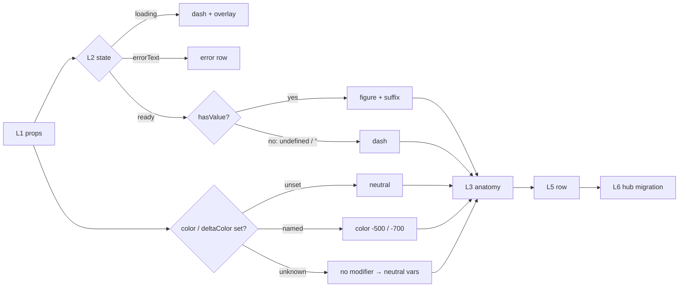
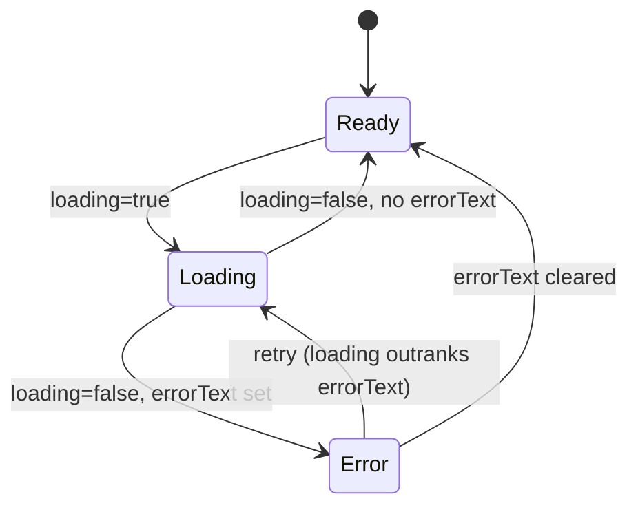

# TEST MODEL — VCST-5903

```
Strategy:    reports/tickets/Sprint26-21/VCST-5903/test-strategy.md · Round 1 · Floors: F11 (F2 purpose risk also MODEL) · Risks: R1, R2
Prior model: none — first model for this surface (the hub's local stat-widget.vue has no model)
Domain map:  ABSENT — chain position unverified (slug `ui`, single-layer chain, not built — axes.md §2g)   Mind map: ABSENT
Chain position: unverified — no domain map. Of the card's own chain L1–L6 below, R1/R2 cross L1, L2, L3, L5;
             they do NOT cross L4 (status announcement — R6/R9, checklist + charter) or L6 (the hub migration —
             a follow-up ticket, out of scope).
Contract:    n/a — no GraphQL / REST surface in the diff
```

## Part 0 — value chain (scoped to R1, R2)

Value chain:
- **L1 props in** — a consumer passes pre-formatted strings (`label`, `value`, `valueSuffix`, `description`, `delta`) and choices (`color`, `deltaColor`, `icon`, `deltaIcon`, `loading`, `errorText`, `prepend` slot)
- **L2 resolve** — the card picks one state (loading › error › ready) and, in ready, value-present vs dash (`hasValue`); unset `color`/`deltaColor` resolve to `neutral`, an unknown one has no modifier rule
- **L3 render anatomy** — start bar + icon + prepend in the accent `-500`; uppercase label; figure + de-emphasized suffix; description; delta in `-700` with its glyph
- **L4 announce** — `<output>` live region: "<label>: loading" / "<label>: <error>" (i18n)
- **L5 lay out in a row** — sibling cards share height, figures align, labels reserve two lines
- **L6 unlock** — the Sales Rep Hub swaps its local card for this one with no visible change





Variants (from the branching layer — the template's `v-if` chain and the SCSS modifier lists; union of both):
V1 full mockup card · V2 optional parts absent · V3 value missing (`undefined` / `""` / `" "`) · V4 value `"0"` ·
V5 color unset / `neutral` · V6 named color (primary, secondary, accent, info, success, warning, danger) ·
V7 unknown color · V8 `valueSuffix` · V9 props changed at runtime

Mechanism coverage matrix (axes from Part 0; scenarios mapped in afterwards):

| Variant | L1 props | L2 resolve | L3 anatomy | L5 row |
|---|---|---|---|---|
| V1 full mockup card | S1 | S1 | S1, S2 | S1 |
| V2 optional parts absent | S7 | S7 | S7 | S7 |
| V3 value missing | S3 | S3 | S3 | WAIVED — dash-row alignment is R4's checklist item |
| V4 value "0" | S3 | S3 | S3 | WAIVED — same as any short figure (S1) |
| V5 color unset / neutral | S4 | S4 | S4 | S1 (MY CUSTOMERS) |
| V6 named color | S6 | S6 | S6 | S1 |
| V7 unknown color | S5 | S5 | S5 | WAIVED — no row interaction; a CSS fallback is per card |
| V8 valueSuffix | S8 | S8 | S8 | WAIVED — suffix width under row pressure is R4's checklist item |
| V9 runtime change | S9 | S9 | S9 | WAIVED — one card is enough to see a stale modifier |

Reverse edges: none — the card moves no money, points, stock or entitlement; the loading→error→retry return is S9 + R3's checklist.
Fixture lifecycle: none — Storybook args, stateless; nothing terminal.
Integration links (clause 14): WAIVED — the card formats and translates nothing (PR #2568); currency/culture partitions belong to the consumer's link (L6, out of scope).

## Configuration group (F11) — prop defaults, no platform/store setting

The diff reads no platform or store setting (strategy Inputs). F11 fired on `default-values`: `color` and `deltaColor` default to `neutral` (vc-stat-widget.vue:79).

| Default | On (non-default) | Off | Scope (global / per store) | Change at runtime |
|---|---|---|---|---|
| S4 | S6, S5 | WAIVED — a prop has no off switch | WAIVED — a component prop, not a scoped setting | S9 |

## Parts 1–5 — fault model

Condition space: value class {undefined, "", " ", "0", short, long ≥ 13 ch} 6 × color {unset, neutral, named, unknown} 4 ×
deltaColor {unset, named, unknown} 3 × optional parts {all, none, suffix-only} 3 × width {6-across, 4-across} 2 = **432**.
Constraints: width interacts only with the long figure and label length; color/deltaColor never interact with value.

Reduction: each-choice over color × deltaColor (independent custom-property branches: `--accent-color`, `--delta-color`);
value class taken once each at one width, the long figure at both widths (it is the only class width can break);
optional parts as all vs none (suffix-only folded into S8); runtime change once. **432 → 9.**

| # | R-n | Cell (factor values) | Defect hypothesis | Archetype | Technique | Oracle | P |
|---|---|---|---|---|---|---|---|
| S1 | R1 | V1, the mockup's six cards (ORDERS ON HOLD warning … MY CUSTOMERS neutral; `$1,512,400.00`), 6-across @1920 then 4-across | [JOURNEY] the kit card cannot reproduce the hub card: bar/icon colours differ, label not uppercase, delta glyph missing, `$1,512,400.00` wraps, heights differ | RENDER | FLOW | att 83239 + 83164 {SPEC} | High |
| S2 | R1 | V1, mockup's neutral trend "0% vs last quarter" (drawn blue) vs `deltaColor` neutral (grey `-700`) and info | the mockup tone for an unchanged trend has no kit value, so the migrated hub changes colour | PARITY | EP | att 83239 {SPEC} — a tone no named colour matches is a PO question | Medium |
| S3 | R2 | V3/V4 value `undefined`, `""`, `" "`, `"0"` | `" "` passes `hasValue` and paints a blank figure row; `"0"` is hidden as missing | FALLBACK | BVA | PR #2568 "no value … the same dash, so a blank figure can't read as a value" {SPEC} | High |
| S4 | R2 | V5 `color` unset vs `"neutral"`; `deltaColor` unset vs `"neutral"` | the default paints a non-neutral bar/icon/delta, or unset ≠ explicit neutral | FALLBACK | DT | PR #2568 "color and deltaColor default to neutral" {SPEC} | Medium |
| S5 | R2 | V7 `color="purple"`, `deltaColor="purple"` | an unknown value leaves the bar transparent or the delta un-coloured instead of neutral | FALLBACK | EP | PR #2568 "Unknown color values fall back to neutral" {SPEC} | Medium |
| S6 | R2 | V6 each of 7 named colours (Colors, Delta Colors stories) | a colour's bar, icon and prepend do not share one `-500`, or delta does not use `-700` | RENDER | EP | PR #2568 "-500 … delta and error text use -700" {SPEC} | Medium |
| S7 | R1 | V2 label + value only (no icon/description/delta) beside a full card | an absent part leaves an empty gap or shifts the figure off its row line | RENDER | BVA | {HYPOTHESIS} — mockups show no partial card; grounded by a design answer → charter | Medium |
| S8 | R1 | V8 `value="34" valueSuffix="items"` (WithSuffix) | the unit is not de-emphasized or sits on its own line, unlike the hub's "items" card | RENDER | EP | PR #2568 "optional de-emphasized unit" {SPEC}; KB-BC9F3CB1 baseline {OBSERVED} | Low |
| S9 | R2 | V9 change `color`, `value`, `loading` live via Controls | a stale modifier class or a stuck dash after the prop changes | STALE | ST | PR #2568 state rules {SPEC} | Medium |

Not allowed (checklist items, no role variants): none — the card has no permission scope (clause 12 n/a).

## Gate — strategy mode

1 PASS · 2 PASS · 3 PASS · 4 PASS · 5 PASS (S1 is the FLOW journey) · 6 PASS · 7 PASS · 8 PASS · 9 PASS (S7 says what grounds it; S8's {OBSERVED} is a baseline beside a {SPEC}) · 11 PASS (unverified, recorded) · 11b PASS (ABSENT recorded) · 12 PASS (F10 not fired, one role) · 13 PASS · 14 PASS (WAIVED + reason)

Unresolved → charter: S7 {HYPOTHESIS} (partial card in a row) · S2 PO question (neutral tone blue vs grey).
FIXTURE-GAPs: none.

## Round 2 — 2026-10-20 (strategy Round 2 · Floors: F11 (F2 purpose risk also MODEL) · Risks: R1, R2 · build bfe0b259)

S3 `" "` **CONFIRMED** in Round 1 → VCST-6427; the fix (vc-stat-widget.vue:90-91 `trim()` on `value` and `errorText`, :17 error branch and :97 status on `hasError`) is a change, so it gets rows. L2 gains a branch: `hasError` (non-blank errorText) replaces the plain truthiness test. V3 widens to whitespace classes; V10 errorText class {"", " ", real}.

| # | R-n | Cell (factor values) | Defect hypothesis | Archetype | Technique | Oracle | P |
|---|---|---|---|---|---|---|---|
| S3r | R2 | V3/V4 again: `undefined`, `""`, `" "`, tab, NBSP, `"0"`, with and without `valueSuffix` | the fix misses a trimmable class, or swallows `"0"` / hides a real value; the suffix still shows beside the dash | FALLBACK | BVA | VCST-6427 expected + PR #2568 "a blank figure can't read as a value" {SPEC} | High |
| S10 | R2 | V10 errorText `" "` vs `""` vs `"Boom"`, loading false | blank errorText still hides the figures or leaves status "<label>:"; a real error stops showing | FALLBACK | DT | VCST-6427 expected "the card stays ready as for errorText = \"\"" {SPEC} | High |
| S11 | R2 | V10 × loading: loading=true with errorText `" "` / `"Boom"`, then loading→false | `hasError` breaks precedence: error row under the spinner, or the blank error re-appears after loading | STALE | ST | PR #2568 "loading outranks errorText" {SPEC} | Medium |
| S12 | R2 | value U+200B (zero-width space) and `" 42 "` | `trim()` keeps U+200B so a blank-looking figure renders; padding shifts the figure | FALLBACK | EP | {HYPOTHESIS} — PR body intent only; grounded by a developer answer → charter (R11) | Low |
| S1r | R1 | S1 re-observed on bfe0b259 (6-across @1920) | the state-branch change disturbed the ready anatomy | RENDER | FLOW | att 83239 + 83164 {SPEC} | Medium |

Gate (strategy mode, Round 2 rows): 1 PASS (R1 → S1r, R2 → S3r, S10–S12) · 2–9 PASS (S12 {HYPOTHESIS} → charter, decides nothing) · 11/11b PASS (ABSENT recorded) · 12 PASS (F10 not fired) · 13 PASS (config group unchanged; S10/S11 extend "Change at runtime") · 14 PASS (WAIVED as Round 1).
Unresolved → charter: S12 · carried S7 {HYPOTHESIS}, S2 PO question. FIXTURE-GAPs: none.
