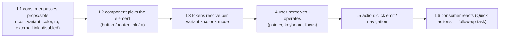

# Test Model — VCST-5906 `[UI-kit] Implement VcTileButton component`

- **Flow / type / path:** `feature-test` · Story · **FULL** · shape class **`ui-kit`** (precedent: VCST-5097, VCST-5653).
- **Env:** vcptcore-qa1 — Storybook image `2.61.0-alpha.2589-vcst-5906-vc-tile-button-2024d7ad`; storefront theme `2.61.0-pr-2575-2024-2024d7ad`.
- **Change:** vc-frontend PR #2575 @ `2024d7ad`, 10 files, additive: `vc-tile-button.vue` + stories + unit test + types, a token block in `_ui-kit-tokens.scss`, a dark partial loaded from `_dark.scss`, a molecules export.
- **Oracle:** the ticket has **no ACs** (description = one image). Spec = the PR body (`{SPEC}`); `BL-UI-001..006`, `BL-A11Y-001..004` (`{BL}`); `VC-UI-001`.
- **Context wave:** `1c`/`1d` done inline from the PR diff + body (single additive component, no consumer, no backend) — stated deviation from the dispatched wave.

## Part 0 — Value chain

**Chain position — SLICE.** This ticket owns **L1–L5** in isolation. **L6 is not touched**: no consumer exists yet;
the Quick actions widget migration is a follow-up. Reverse edge: the shared token/dark files could disturb **existing**
consumers of `_ui-kit-tokens.scss` / `_dark.scss` (VcButton) — covered by checklist #19.

## Test object

| | |
|---|---|
| **Purpose** | one square action tile (icon above label) for quick-action grids, matching VcButton's solid palette (`{SPEC}`) |
| **Operations** | render · hover · focus · click / Enter / Space · navigate (router / external) · disabled refusal |
| **Data** | none — props only |
| **Variants** | variant solid/outline × 8 colours × light/dark × preset (Coffee, Red gated; others informational) · element button/router-link/a · disabled · icon prop / icon slot / none · short/long label |
| **Constraints** | only Storybook renders it; Chrome DevTools lane for measurement, Playwright lane for real keyboard (REAL-USER rule) |

## Mechanism coverage matrix (carrier-first, `ui-kit-class.md` §1)

| Carrier | What delivers the behaviour | Scenario |
|---|---|---|
| per-variant×colour class | `.vc-tile-button--<v>--<c>` sets the 4 vars | #2 #3 #5 |
| base fallback | base rule's solid-primary vars when the class matches nothing | #16 |
| dark partial | `html.dark .vc-tile-button--solid--<c>` overrides bg/border/text | #5 #6 |
| element switch | `componentTag` computed (disabled > to > externalLink > button) | #1 #10 #11 |
| global focus rule | no local focus style — the preflight ring is the only carrier | #12 |
| state selector | `:hover:not(#{$disabled})` + `--disabled` | #7 #9 |
| motion media query | `prefers-reduced-motion: no-preference` → `transition-shadow` | #8 |
| shared tokens (reverse edge) | `_ui-kit-tokens.scss`, `_dark.scss` for existing components | #19 |

## Condition space and reduction

Factors: variant 2 × colour 8 × mode 2 × preset 7 × element 3 × disabled 2 × icon 3 × label 2 → raw N = **8064**.
**Reduction 8064 → 20:** colour/variant/mode crossed exhaustively only for the **colour** mechanism (#2–#6) on the 2 gated
presets + 1 negative control (ungated presets are informational, `VC-UI-001`); element × disabled reduced to the 4
distinct `componentTag` outcomes (#1 #10 #11); icon/label variants once each (#13 #14); dropped: preset cross for
non-colour mechanisms (theme-independent), element × colour (orthogonal code paths).

## Scenario table

| # | Cell | Defect hypothesis | Archetype | Technique | Oracle |
|---|---|---|---|---|---|
| 12 | keyboard journey on Grid | tile has no own focus style → focus invisible (no carrier reachable) | invisible focus | FLOW | `{BL}` BL-A11Y-001 |
| 2–3 | variant × colour light | a token name typo leaves a var unset → transparent/black tile | token wiring | DT | `{SPEC}` token block |
| 4 | solid vs VcButton | tile drifts from the button palette it claims to share | spec drift | EG | `{SPEC}` |
| 5–6 | dark + gated presets | copied dark map out of sync / text fails 4.5:1 | contrast | EP | `{BL}` BL-A11Y-003 |
| 7 | hover enabled/disabled | Sass `$disabled` compiles to `:not()` → hover rule dropped | selector build | EG | `{SPEC}` |
| 9–11 | disabled × link | disabled link stays navigable | state leak | DT | `{SPEC}` |
| 10 | external `_blank` | missing `rel` → tabnabbing | security | EG | `{SPEC}` |
| 14 | long label | text overflows the tile | layout | BVA | `{BL}` BL-UI-001 |
| 16 | unknown variant | unfilled tile | fallback | EG | `{SPEC}` |
| 19 | storefront | shared token edit regresses VcButton | reverse edge | EG | `{BL}` BL-UI-004 |

Archetype sweep: invisible focus, token wiring, contrast, state leak, overflow, fallback, reverse-edge — covered above.
UIP sweep: hover/focus/disabled/reduced-motion/zoom/narrow viewport — #7–#9, #12, #20.
Probes carried in: VCST-6304 (primary-500 white text 2.11:1, shared with VcButton) — known, not re-filed.
