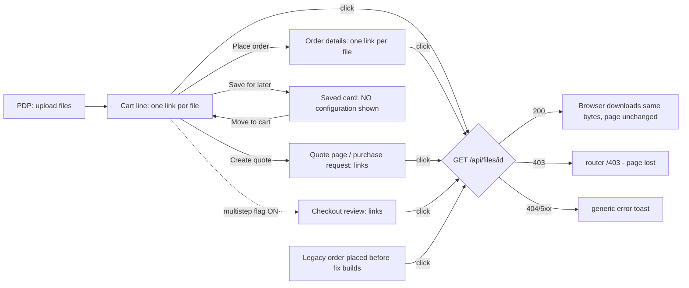
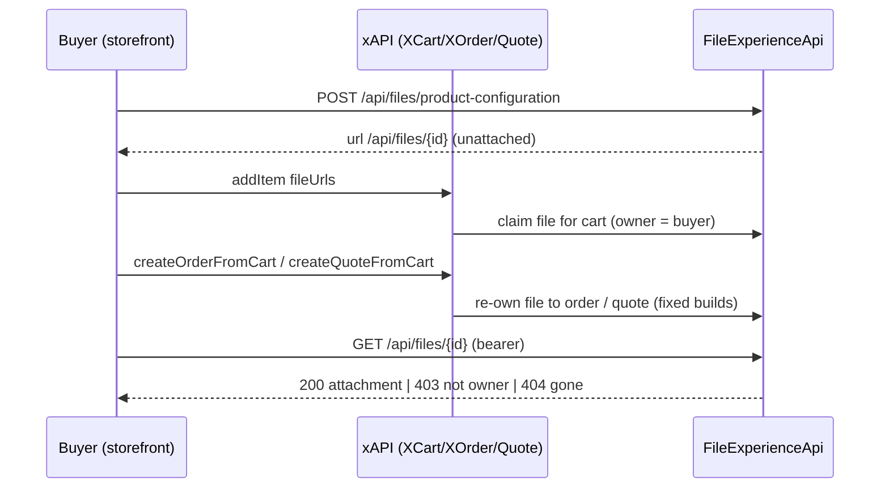
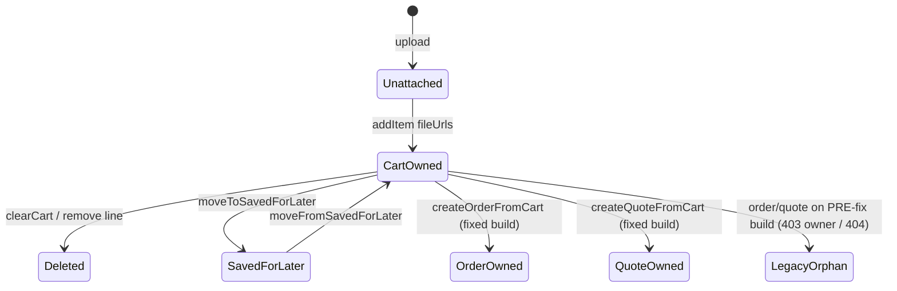

# TEST MODEL — VCST-5924

```
Ticket:      VCST-5924 | Type: Story | Status role: testable (already Testing — opening hop skipped) | Flow: feature-test | Priority: P2 (Medium) | Path: FULL (§5b: 2 domains — cart + orders) | Changed: Frontend
Round:       3 (R1 2026-09-16 vcptcore-qa1 FAIL · R2 2026-10-13 FAST BLOCKED — no stand had both the scope and the fixes). This run: vcptcore-qa,
             theme 2.60.0-pr-2485-f6cd22b2 · FileExperienceApi 3.1008.0 · XCart 3.1041.0 · XOrder 3.1015.0 · Quote 3.1004.0 · Orders 3.1018.0
Context:     FULL — ba-system-analyzer 1c (code-grounded, NO live pass) + ba-story-writer Mode B 1d + 1r REACHABLE (~1.5 min)
Prior model: reports/ba/test-models/VCST-6027-2026-10-06.md — the newest model on this DOMAIN, but a different slice (PDP checklist, its
             C1–C6 end at the configured cart line). Its Part 0 is carried forward only as the upstream half of the journey (C6 = our L5);
             nothing below re-derives it. No prior model for the cart→order→quote file surface.
Domain map:  .claude/knowledge/domain/configurable-products.md @ rev 1 (generated 2026-09-16, amended 2026-10-06) — PRESENT
Mind map:    .claude/knowledge/domain/configurable-products.mind-map.json — touches cat.cfg.file, cat.cfg.file.access-scope,
             cat.cfg.cart-line, cat.cfg.cart-line.components-list, cat.cfg.cart-line.saved-for-later, cat.cfg.order,
             cat.cfg.order.view-columns, cat.cfg.quote. Mind-map DRIFT: (a) NO node carries "buyer retrieves an attached file from a
             downstream surface" (this ticket's new link L9); (b) cat.cfg.file.access-scope stops at cart-owned — order-owned and
             quote-owned access (VCST-5995/5999 fixes, KB-45F13A37/KB-4F996EA3) has no node; (c) cat.cfg.order.view-columns says
             "only the option label" — PR #2485 adds a link per file on that view.
Chain position: Domain chain L1–L8 (+ new L9). TOUCHES L5 (configured line carries files — journey far side), L7 (carry through
             Order and Quote), L8 (who can read the file), and NEW L9 (download from cart / order details / quote). Crosses L3 only
             as journey setup (upload on PDP). Does NOT touch L1 (Admin authoring), L2 (PDP render), L4 (required gate), L6 (line
             identity strips files) — VCST-6000 (zero-byte on required) and VCST-5997 (>5 files) live in L3/L4 and stay out.
Affected surface: vc-frontend PR #2485 @ f6cd22b2 (open) — configuration-items.vue (+vitest). Rendered by 3 wrappers:
             cart-line-items.vue (cart page) · order-line-items.vue (order-details.vue; checkout/review.vue, flag
             checkout_multistep_enabled) · quote-line-items.vue (view-quote, edit-quote, purchase-request). Click → shared
             downloadFile() (shared/files/utils): useFetch(url).blob() → synthetic <a download>; 403 → forbiddenEvent → router /403;
             other errors → generic toast. Map §3 enumerates the cart components list and the order view; it is MISSING
             checkout/review, purchase-request, the downloadFile mechanism, and the fact that saved-for-later renders NO
             configuration (→ domain_map.unmapped_surfaces[]).
Ticket signals: no ACs. Description: "preview … shall be URL so I can either open or download" in cart / Checkout→Order review /
             Order details. Attachments (opened): cart "File upload: hatbuilder-handoff-brief.pdf" circled as plain text; Order
             details same name as plain text. Comments: R1 FAIL (403 order, 404 quote); VCST-5996 CANCELLED 2026-10-12 ⇒ DOWNLOAD is
             the accepted behaviour, inline open is NOT required; 2026-09-17 "add spacing OR separate files on lines"; 2026-10-01
             "wait for VCST-5995, VCST-5999" (both Done). R1: no Order review step in this theme (/checkout → /cart).
Epic context: VCST-2099 Configurable Products (Draft). Done seams: VCST-2796/2565 File section (upload), VCST-5173 cart redesign
             (components list), VCST-3468/2472 quote with configuration, VCST-4205 save-for-later. Open deps: none blocking.
Domains:     Cart (BL-CART), Orders (BL-ORD), Catalog/configurable (BL-CAT, slug cat), UI (BL-UI), Accessibility (BL-A11Y)
Flows & boundaries: PDP upload ↔ cart line · cart ↔ order (createOrderFromCart) · cart ↔ quote (createQuoteFromCart) · cart ↔
             saved-for-later · storefront ↔ FileExperienceApi REST (GET /api/files/{id}, ownership-based authorization)
Risk areas:  VCST-5995 (owner 403 on order), VCST-5999 (quote 404), KB-10210674 (legacy orders still 403 → /403 page), VCST-5998
             (14 px target, open), downloadFile error path (1c), getText toCSV branch removed (1d C19)
AC traceability: 19 atomic conditions (1d C1–C19) — 4 story (R0 download link, R1 cart, R2 order review = DRIFT/stale, R3 order
             details) + 15 gap-ACs. Impl: R0/spacing SATISFIED static; R1/R3 untested; R2 DRIFT (flag-gated surface).
DoD:         none declared.
```

## Part 0 — Value chain

**Purpose (declared — map §1 UNDECLARED):** a buyer who attached a file to a configuration can, from every place that line is
shown after it leaves the PDP, **retrieve exactly the file they attached** — to confirm the right artwork/document went with the
cart, the order and the quote. Source: {SPEC} VCST-5924 description + VCST-5996 cancellation (download, not inline) + VCST-5995 /
VCST-5999 resolutions. {DOC} StorefrontUserGuide "Configure products" says only that users can upload files — it documents no
retrieval, so retrieval oracles are {SPEC}, never {DOC}.

| Link | In the buyer's words | Mechanism |
|---|---|---|
| L3 (setup) | I upload my files on the product | POST /api/files/product-configuration → relative url /api/files/{id} (unattached: anonymous-readable) |
| L5 | I add it to cart and my files are listed on the line | addItem configurationSections.fileUrls → CartConfigurationItemFileType{url,name,size,contentType}; file becomes cart-owned |
| L9a | Each file is its own clickable entry, not a comma list | configuration-items.vue: one `<a href download title>` per file with url; `<span>` without url |
| L9b | I click one and get THAT file, and I stay on the page | click.prevent → downloadFile(url,name): fetch blob → synthetic anchor download |
| L7-order | I place the order and the same files are on the order | createOrderFromCart → OrderConfigurationItemType.files; file becomes order-owned (VCST-5995 fix) |
| L8/L9c | On Order details I can still download my files | GET /api/files/{id} 200 for the order's buyer; 403 others/anon (KB-45F13A37) |
| L7-quote | I make a quote instead and the files are on the quote | createQuoteFromCart → QuoteConfigurationItemType.files, same url, quote-owned (VCST-5999 fix, KB-4F996EA3) |
| L9-fail | If a file cannot be read I am told, and I don't lose my page | 403 → forbiddenEvent → router /403 (code); 404/5xx → generic toast (code) — no spec exists for this branch |







**Variants** (union of the branching layers — the component branches on url present/absent and count; the host wrapper on page
and viewport; downloadFile on HTTP status; the backend on owner and build epoch):
V1 cart page · V2 checkout review (flag checkout_multistep_enabled) · V3 order details, fresh order · V4 order details, LEGACY order
(pre-fix) · V5 quote view · V6 purchase request · V7 saved-for-later · V8 file without url · V9 many files (2..5, mixed types) ·
V10 long / duplicate names · V11 viewport 768/390 · V12 keyboard + screen reader.
**Single actor** (the line's own buyer). Other-buyer / anonymous access is the backend fixes' own scope (VCST-5995/5999, observed
in KB-45F13A37 / KB-4F996EA3) and changes nothing in this diff ⇒ not a matrix variant ⇒ **Part 0r not required** (clause 12 passes
silently). One API-level parity probe (#16) keeps the seam honest without adding a role row.

**Mechanism coverage matrix** (axes from Part 0; scenarios mapped in afterwards)

| Variant \ Link | L5 carry to line | L9a one link/file | L9b click downloads | L7 carry downstream | L8/L9c owner read | L9-fail |
|---|---|---|---|---|---|---|
| V1 cart | #1 | #1, #2 | #1, #3 | n/a (origin) | #1 (cart-owned) | WAIVED — cart-owned owner read has no reachable failure; #10 covers the branch |
| V2 checkout review | GAP — flag value on stand unread (3x) | GAP (3x) | GAP (3x) | GAP (3x) | GAP (3x) | WAIVED — same downloadFile as #10 |
| V3 order fresh | #1 | #1, #4 | #1, #4 | #1, #4 | #1, #4 | WAIVED — owner 200 expected; failure branch is V4 |
| V4 order legacy | WAIVED — data pre-exists | #10 | #10 | WAIVED — historical | #10 | #10 |
| V5 quote view | #5 | #5 | #5 | #5 | #5 | #11 |
| V6 purchase request | GAP — reachability on stand (3x) | GAP (3x) | GAP (3x) | GAP (3x) | GAP (3x) | WAIVED — same downloadFile |
| V7 saved-for-later | #6 | WAIVED — card renders no configuration (code, 1c) — confirm live in #6 | WAIVED — no link | #6 (back in cart) | #6 | WAIVED |
| V8 no url | #7 | #7 | WAIVED — no link by design (PR) | WAIVED | WAIVED | WAIVED |
| V9 many files | #4 | #4 | #4 | #4 | #4 | WAIVED |
| V10 long/duplicate | #8, #9 | #8, #9 | #9 | #8 | #9 | WAIVED |
| V11 viewport | #12 | #12 | #12 | #12 | #12 | WAIVED — viewport-independent handler |
| V12 keyboard/AT | WAIVED | #13 | #13 | WAIVED | #13 | WAIVED |
Cross-cutting: #14 (non-file sections unchanged after the toCSV removal) on V1/V3/V5 L9a; #15 (reconfigure replaces a file) on V1.

**Reverse edges** (forward effect = a file attached to and readable from a line):
remove line / clearCart → cart-owned file deleted (404): covered by KB-4F996EA3 control, **not re-tested** (no UI change) — WAIVED ·
Edit configuration → replace / remove a file → old file gone from the line, new one downloads: **#15** · saved-for-later → back:
**#6** · order cancel → file still readable by owner? **ABSENT from spec** — GAP → 3x (observe only) · detach one file without
re-adding the line: **ABSENT IN PRODUCT** (map G3) — carried, not re-filed.
**Fixture lifecycle:** orders and quotes are TERMINAL per case ⇒ each case that observes a carry creates its own cart → order /
quote (FIFTH RULE). Legacy order (V4) = an order placed on vcptcore-qa BEFORE the fixed build — round 2 wave 2 order
CO261013-00001 (pre-fix XOrder on this stand) is the only known instance; if it is not this buyer's or no longer 403, #10 is
NOT REACHED, never faked.

## Parts 1–5 — Fault model

**Condition space** — host {cart, checkout-review, order-fresh, order-legacy, quote, purchase-request, saved-for-later} (7) ×
url {present, absent} (2) × count {1, 2–4, 5} (3) × name {short, ≥80 chars, duplicate} (3) × viewport {1920, 768, 390} (3) ×
input {mouse, keyboard} (2) × read outcome {200, 403, 404} (3). Constraints: saved-for-later renders nothing (1 cell);
absent url ⇒ no read; 403 only on legacy order, 404 only on legacy quote; checkout-review only with the flag ON; count 5 is the
upload limit (>5 = VCST-5997, out of scope). **Raw N = 7·2·3·3·3·2·3 = 2268.**
**Reduction** — FLOW journey crosses L3→L9c once (subsumes host cart+order × count 2 × short × 1920 × mouse × 200). EP per host
for L9a/L9b (one row each for quote, saved-for-later, no-url). BVA on count {1 via journey, 5 via #4} — 2–4 subsumed by the
journey's 2. Name: one long (#8), one duplicate (#9) — the duplicate is the only name class that can mis-pair url↔name. Viewport
collapsed to one row (#12) on order details (the container query is per wrapper, cart already measured in R2 at all 3).
Keyboard collapsed to one row (#13). 403/404 each on their only feasible host (#10, #11). Dropped: count × viewport and
name × host interactions — the template is identical across hosts (one component), so pairwise over host adds no new code
path. **N = 2268 → M = 16.**

| # | Cell (factor values) | Defect hypothesis | Archetype | Technique | Oracle | P |
|---|---|---|---|---|---|---|
| 1 | [JOURNEY] PDP upload 2 divergent files (pdf + txt, different sizes) → cart → download both → place order → Order details → download both | Any link breaks the chain: files dropped at a hop, links mis-paired, owner refused on the order (R1: 403) — the story fails while each screen looks fine | PARITY | FLOW | {SPEC} VCST-5924 + VCST-5996 cancel (download) + VCST-5995 resolution; bytes = upload | P1 |
| 2 | cart, 2 files, attributes | Files still comma-joined or the link carries a wrong href/download (name↔url swap) | RENDER | EP | {SPEC} comment 2026-09-17 + PR contract (href = file's url, download = its name) | P1 |
| 3 | cart, click | Click navigates away / opens a tab / downloads nothing (prevent + blob path broken) | SILENT | EG | {SPEC} "download"; page URL unchanged | P1 |
| 4 | order fresh, 5 files mixed types (pdf, txt, png, docx, xlsx) | At the upload limit, one file lost at createOrderFromCart or a link points at a sibling's bytes | BOUNDARY | BVA | {SPEC} 5 = PDP max (page copy) ; bytes per file = upload | P2 |
| 5 | quote from cart, 2 files, quote view → download | Quote shows names but links 404 (R1 VCST-5999) or wrong owner 403 | PARITY | EP | {SPEC} VCST-5999 resolution; KB-4F996EA3 baseline | P2 |
| 6 | saved-for-later → back to cart | Files lost/reset on the round trip; links dead after the new lineItemId | LIFECYCLE | ST | {BL-CART-015} | P2 |
| 7 | file without url | A dead `<a>` (no href) or "undefined" rendered | FALLBACK | EG | {SPEC} PR branch: plain text. {HYPOTHESIS} reachability — only mid-upload; 3x decides | P3 |
| 8 | ≥80-char name, cart + order | Name blows out the table / horizontal scroll; full name unreachable | RENDER | BVA | {BL-UI} layout stability + title exposes full name | P3 |
| 9 | 2 files, SAME name, different bytes | Second row dropped or both download the same bytes (key/name collision) | SILENT | EG | {SPEC} one row per attached file, each its own bytes | P3 |
| 10 | order LEGACY (pre-fix) → click | Owner lands on /403 and loses the order page instead of a scoped error | FALLBACK | EG | {HYPOTHESIS} — no spec for the failure UX; becomes an oracle only with a PO decision (1d gap-AC-1). Observe + report, never certify | P3 |
| 11 | quote LEGACY (pre-fix) → click | 404 swallowed silently or a generic "unhandled" toast with no file context | SILENT | EG | {HYPOTHESIS} same as #10 | P3 |
| 12 | order details at 768 / 390 | Links clipped, rows overlap, attachments unlabeled at 390 (R1 Low) | RENDER | EP | {BL-UI}; target size {BL-A11Y} — VCST-5998 open: row keeps the WCAG expectation and names the bug (rule 3) | P2 |
| 13 | keyboard on order details | Link not Tab-reachable, Enter does nothing, name includes a separator comma | RENDER | EP | {BL-A11Y} accessible name = filename, focus visible, Enter activates | P2 |
| 14 | Product + Text sections on the same line, cart + order | Removing the toCSV branch from getText broke non-file values | PARITY | EG | {SPEC} PR: non-file path unchanged; value = selection | P2 |
| 15 | cart → Edit configuration → replace file → cart | Old file still listed / new one not downloadable | LIFECYCLE | ST | {SPEC} line shows what is attached now | P3 |
| 16 | API parity: Query.order files.url of #1's order vs the link href; GET as owner | UI href differs from the API url, or owner read differs between UI and API | PARITY | EP | KB-45F13A37 (owner 200) — {OBSERVED} baseline, to kb_confirm on vcptcore_qa | P3 |

**Probes carried in:** VC-CFG-001..004 (text maxLength, null maxLength, stale bike slug, silent field-name acceptance) — N/A, none
on the file-retrieval surface. Probes from filed bugs: VCST-5995 → #1/#4, VCST-5999 → #5, KB-10210674 → #10.
**Archetype sweep:** PARITY #1/#5/#14/#16 · RENDER #2/#8/#12/#13 · SILENT #3/#9/#11 · BOUNDARY #4 · LIFECYCLE #6/#15 ·
FALLBACK #7/#10 · SCOPE WAIVED — other-buyer access is unchanged by this diff (VCST-5995 scope, KB-45F13A37) · STALE WAIVED — no
cache on GET /api/files (attachment, per-request auth) · RACE / REPLAY WAIVED — read-only click · MONEY WAIVED — no price on a
file row · CONFIG → V2 checkout_multistep_enabled GAP (3x).
**UIP sweep:** UIP-DATA #4/#7/#9 (one · many · empty-url) · UIP-EXTREME #8 · UIP-VIEW #12 · UIP-NET #10/#11 (dependency 403/404) ·
UIP-DEEP — deep link to /account/orders/{id} is the normal entry of #1, covered · UIP-REFRESH WAIVED — a click-to-download has no
mid-flow state · UIP-BACK WAIVED — no submit on these surfaces; checkout itself is not in this diff · UIP-TABS WAIVED — no session
branch in the component · UIP-EXPIRE WAIVED — token refresh is the global interceptor, untouched · UIP-STORAGE WAIVED — no client
storage · UIP-INPUT WAIVED — no form input · UIP-PAGE WAIVED — no paged list.
**Business Rules:** BL-CART-014, BL-CART-015, BL-UI-004/005/006, BL-A11Y-001..004.
**Edge cases:** ECL-cart (configuration carry) — no ECL entry on file retrieval; gap noted for /qa-review-oracles.
**Docs grounding:** StorefrontUserGuide "Configure products" (upload only — no retrieval documented); quote docs describe a
different file mechanism (quote attachments, 10 MB). Retrieval is therefore a released-behaviour gap in the docs (finding, low).
**Agents to dispatch:** 3x /qa-exploratory ticket (one lane) · 4a qa-frontend-expert (playwright-chrome) · 4v ui-ux-expert
(Chrome DevTools) · A test-management-specialist (2a + authoring) · 3a none (data_surface false — see summary).

## 3x discovery amendments (2026-10-13, `reports/exploratory/SBTM-VCST-5924-2026-10-13.md`)

- **V2 checkout review:** GAP → **WAIVED on vcptcore-qa** — `checkout_multistep_enabled` OFF (both `/checkout` and `/checkout/review` → `/cart`). R2 stays DRIFT; the surface exists in code only behind the flag.
- **V6 purchase request:** route reachable, no data for this buyer → still GAP (needs a buyer with a purchase request holding a configured line).
- **New variant V14 — order view columns:** Order details renders `Number · Value` (no Section) while the cart renders `Number · Section · Value`. Matches mind-map `cat.cfg.order.view-columns`; PO decision pending (cf. VCST-5431). No case authored.
- **#10 {HYPOTHESIS} → {OBSERVED}:** legacy order owner read 403 on 3/3 files; the click routes the SPA to `/403`, page lost, no toast. Still no spec ⇒ stays a hypothesis-oracle row; reported, not certified.
- **#16 {OBSERVED}:** fresh order CO261013-00003 — rendered hrefs == cart file urls == `Query.orders` files.url; owner GET 200/200, sha256 match.
- **#7 / #11:** NOT REACHED (no url-less file observed; the buyer's only quote holds no files). Order-cancel reverse edge and Edit-configuration replace: NOT REACHED (cart freeze while 4a ran).
