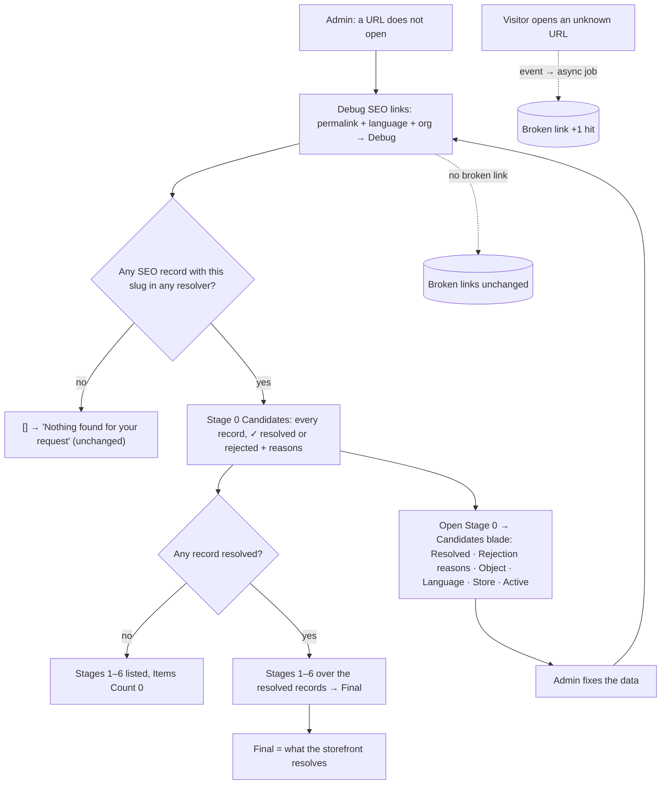
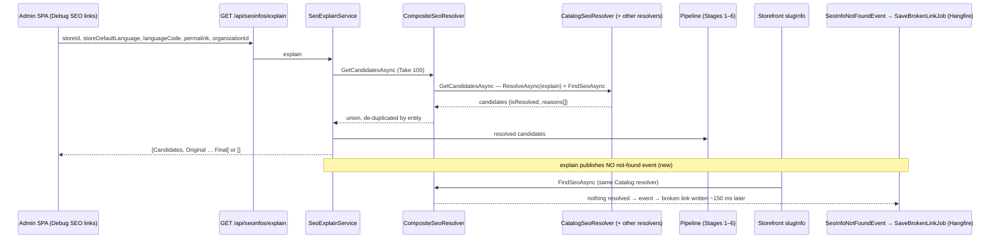
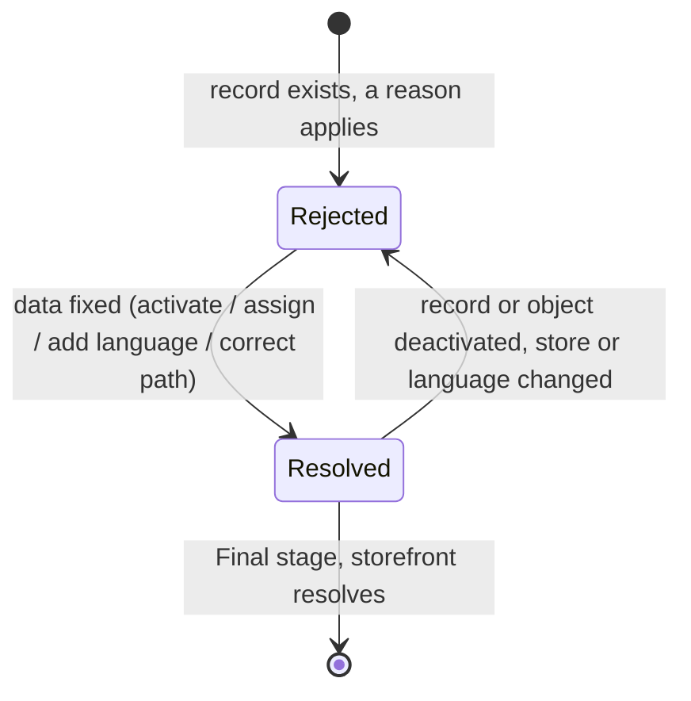

# TEST MODEL — VCST-5989

```
Ticket:      VCST-5989 | Type: Bug | Status role: not-fixed ("In review") | Flow: feature-test | Priority: P2 (Medium) | Path: /qa-test-fast | Changed: Backend (vc-module-seo + vc-module-catalog, incl. Admin SPA blades + locales)
Context:     /qa-test-fast Stage 1 — A ticket (ba-system-analyzer) ‖ B PRs (ba-api-specialist) ‖ C domain map build (ba-system-analyzer, playwright-edge)
Prior model: none — first model for this surface (no SEO model in reports/ba/test-models; VCST-4933/2945 are adjacent only — seo.md §6)
Domain map:  .claude/knowledge/domain/seo.md @ rev 1 (generated 2026-10-05, built in this run: built_in_run true, PRESENT)
Mind map:    .claude/knowledge/domain/seo.mind-map.json (built in Wave 2 of this run, models:check OK; Part 0 carries no node ids — node tracing is in the checklist)
Chain position: domain chain seo.md §1 L1–L9. TOUCHES L4 (permalink → object: CatalogSeoResolver rewritten, shared by explain AND the
             storefront), L6 (nothing matched → broken link: Debug no longer triggers it, the storefront still must), L7 (admin triage —
             the Debug SEO links tool only). DOES NOT touch L1 (records authored), L2 (link type — read, never changed), L3 (landing/SPA),
             L5 (render/head, D9), L8 (redirect effect, D4/D17 — the Jira follow-up), L9 (slug retired); within L7 not the broken-links
             list or redirect rules (suite 066's ground).
Affected surface: vc-module-seo — Seo.Web blades seo-explain-result.js / seo-explain-candidates.{html,js} (new) + 13 locales; SeoExplainService,
             CompositeSeoResolver, ISeoResolver.GetCandidatesAsync (default method), SeoExplainItem/Stage models · vc-module-catalog —
             CatalogSeoResolver (rewrite onto ResolveAsync(explain)) + 13 locales. Map surfaces: §2a "Debug SEO" widget/blade + Stages +
             Candidates blade (CONFIRMED live), §2c GET /api/seoinfos/explain (CONFIRMED), §2b/§2c storefront slugInfo (CONFIRMED). None MISSING.
Ticket signals: AC fields absent on this Bug → conditions derived from description + comment 110851 (assignee, "How to test" T1–T8);
             description Expected ("Original 1, Filtered 0") superseded by 110851 (Stage 0 explains the discard, Stages 1–6 = 0);
             both artifacts deployed (Seo 3.1006.0-alpha.101-…, Catalog 3.1049.0-pr-910-04a5) → the rejection half is testable;
             status pulled back Ready for test → In review at 17:23 while dev was merged into both PRs; bug stills show the broken-links
             tile at 600 on steps 1 and 3 → count per permalink, never the tile; follow-up (result line, redirect actions) out of scope;
             110852: UI "Spartan, developer-oriented" — advisory, no design link.
Epic context: none (no parent, no siblings). Linked VP-9295 (relates; customer case, config-not-code) = origin + reason vocabulary.
Domains:     seo (primary) · catalog (resolver) · store (host blade, Stores.SeoLinksType) · Admin i18n
Flows & boundaries: Admin Debug ↔ REST explain ↔ resolvers (Catalog explains rejections; others list resolved only) ↔ pipeline stages 1–6;
             explain ↔ storefront slugInfo / POST search (same CatalogSeoResolver.FindSeoAsync); not-found event ↔ Hangfire SaveBrokenLinkJob (async)
Risk areas:  production resolver rewrite (case-insensitive ids, filter dictionary, ObjectInactive predicate; unit tests only SeoLong, mocked repo);
             SeoExtensions.cs:121 "6 empty stages on an empty list" (explain-only); explain's 2× resolution + Take 100 silent cap on rejected;
             resolved records NOT guaranteed first in Candidates; Catalog locale BOM removal + deep merge under `seo`; blade id reuse
             (seoExplainItems); async broken-link job (wait before concluding)
AC traceability: 27 atomic conditions AC-1…AC-27 (context bundle §A). Impl verdict from the diffs: all IMPLEMENTED except — AC-6 IMPLEMENTED
             with a silent cap (≤100 rejected); AC-13 unchanged by design (PR claim → asserted via 2 and 14); AC-23 code path for
             several objects yields PermalinkMismatch or ParentMismatch — 110851 names PermalinkMismatch → observe (10), flag on mismatch.
DoD:         none declared.
```

## Atomic conditions (AC-1…AC-27, derived — the ticket has no AC field)
Sources: D-Exp/D-Act = description Expected/Actual; T1–T8, b1–b4, UN = comment 110851 (2026-09-30) "How to test" / "What changed" / "Unchanged".

| AC | Condition | Src | → # |
|---|---|---|---|
| 1 | B2B-store, en-US, `v-dresses` shows stages, not "Nothing found for your request" | D-Exp1, T1 | 1 |
| 2 | First row "Stage 0: Candidates", Items Count ≥ 1 | T1, b1 | 1 |
| 3 | Stages 1–6 still listed, each Items Count 0 | T1, b2 | 1, 2 |
| 4 | Stage 0 row opens a list with "Resolved" and "Rejection reasons" columns | b1 | 1, 16 |
| 5 | The `v-dresses` record: Resolved empty, reason "The category or product isn't in the store's catalog" | T1 | 1, 17 |
| 6 | Stage 0 lists every record with the slug the resolvers considered, resolved and rejected | b1 | 8, 15 |
| 7 | Every rejected candidate shows ≥ 1 reason | b1 | 1, 4–11 |
| 8 | B2B `v-dresses` output differs from `no-such-slug-at-all` | D-Exp2, b2 | 1, 3 |
| 9 | Clothing `v-dresses`: Stage 0 shows it resolved (check mark, no reason) | T2 | 1 |
| 10 | Clothing `v-dresses`: Stages 1–6 each Items Count 1, titles as before | T2, att. 84202 | 1, 2 |
| 11 | B2B-store, a permalink it resolves: Stages 1–6 Items Count 1 | D-Act | 16 |
| 12 | B2B `no-such-slug-at-all`: still "Nothing found", no stages, no Stage 0 | UN, T3 | 1, 3 |
| 13 | What resolves is unchanged (search 0/1/1/0 per D-Act table) | D-Act | 2, 14 |
| 14 | REST B2B `v-dresses`: 200, first element `"stage": "Candidates"` | b4 | 2 |
| 15 | Every item has `reasons` and `isResolved` | b4 | 2 |
| 16 | Stages 1–6 elements present with 0 items in the rejected case | b2, b4 | 2 |
| 17 | REST `no-such-slug-at-all`: 200 `[]` | UN, D-Act | 3 |
| 18 | Record assigned to another store → "The SEO record is assigned to another store" | T5 | 4 |
| 19 | Record inactive → "The SEO record is inactive" | T5 | 5 |
| 20 | Category inactive → "The category or product is inactive" | T5 | 6 |
| 21 | Record language neither requested nor store default → "…matches neither the requested language nor the store's default language" | T5 | 7 |
| 22 | AC-18/21 on the object's only record → also "The store can't build a link to it…" | T5 note | 4, 7 |
| 23 | Same slug under different parents: Debug p1/c → the other rejected "The store's link to it is different: p2/c" | T6 | 9, 10 |
| 24 | Debug adds/bumps no broken-link record | b3, T4 | 1, 12 |
| 25 | Admin UI in another language: stage and reason texts translated | T7 | 17 |
| 26 | Storefront category, product and brand pages open as before | T8 | 14 (brand: GAP R15) |
| 27 | A storefront visit to a non-existing URL still records a broken link | T8 | 13 |

## Part 0 — Value chain (derived first, FLOW)

| Link | In the admin's words | Mechanism |
|---|---|---|
| K1 Ask | "This URL doesn't open — why?" I open Stores › store › Debug SEO links, enter the permalink and language (and maybe an organization), click Debug | Admin form → `GET /api/seoinfos/explain` (storeId, storeDefaultLanguage, languageCode, permalink, organizationId) |
| K2 Gather | Every SEO record with that slug is listed, the ones the store would reject included, each with why | `CompositeSeoResolver.GetCandidatesAsync` → Catalog resolver explains rejections (SQL filters, outline/path checks, parent checks, best match); other resolvers list resolved records only |
| K3 Pipeline | The records the store accepts go through the familiar six stages | resolved candidates → Original → Filtered → Scored → FilteredScore → Ordered → Final |
| K4 Answer | The answer distinguishes "no such slug" from "records exist but were discarded" | response `[]` vs `[Candidates, Original … Final]`; items carry `reasons[]` + `isResolved` |
| K5 Show | I see Stage 0 with a count, then Stages 1–6; Stage 0 opens a list with Resolved and Rejection reasons, in my UI language | Stages blade → Candidates blade (8 columns) or items blade; "Nothing found for your request" when empty |
| K6 Fix → resolves | I fix what the reason names (catalog, store, active flag, language, parent) and Debug shows it resolved | data edit in the owner blade → explain again → Final = the object |
| K7 No noise | Diagnosing a URL does not add to "Active broken links", so that list still means "visitors hit this" | explain publishes no `SeoInfoNotFoundEvent` (new) |
| K8 Shared resolver | What visitors reach is unchanged, and real storefront misses are still recorded | storefront `slugInfo` / `POST search` → same `CatalogSeoResolver.FindSeoAsync` → event → async broken link |







**Variants** (rows — from the layers that branch: the Catalog resolver per reason code, the explain service per candidate outcome, the
UI per stage row and language, the path builder per link type, the composite per resolver kind). **Matrix** — S# = scenario below ·
`‡` = content observed through the UI that renders this response (shape asserted once in 2) · `nt` = WAIVED: the link is not on this
variant's path. **11b:** R1–R11 and R13/R15 resolve to surfaces seo.md enumerates (§2a/§2b/§2c, D8, G8); **R12 (Admin UI language) is a surface the map is MISSING** — its `excludes:` leaves localized Admin UI strings to a later pass.

| Variant (data) | K1 | K2 | K3 | K4 | K5 | K6 | K7 | K8 |
|---|---|---|---|---|---|---|---|---|
| R1 resolved, one object (Clothing `v-dresses` Collapsed; B2B `seed-books` Long) | 1,16 | 1,16 | 1,16 | 2 | 1,16 | nt | nt — resolves, no event either way | 14 |
| R2 NotInStoreCatalog (B2B `v-dresses`) | 1 | 1 | 1 | 2 | 1,17 | GAP — needs the shared virtual catalog changed; the loop is proven on R4 (5) | 1,12 | GAP — any production probe of an unresolved permalink writes a broken link that 12 counts; explain Final = 0 (2) stands in for AC-13 |
| R3 StoreMismatch + NoSeoPath (store-acme `seed-books`) | 4 | 4 | 4 | 4 | 4 | GAP — fix = reassign a seeded record; loop proven by 5 | 12 | nt — store-acme has no storefront URL |
| R4 Inactive record (created, Clothing) | 5 | 5 | 5 | 2‡ | 5 | 5 | 12 | nt — Clothing has no storefront URL |
| R5 ObjectInactive (created) | 6 | 6 | 6 | 2‡ | 6 | 5 (same loop) | 12 | nt |
| R6 LanguageMismatch + NoSeoPath (created, de-DE only) | 7 | 7 | 7 | 2‡ | 7 | 5 (same loop) | 12 | nt |
| R7 NotBestMatch (B2B `seed-test-fixtures`, 4 objects) | 8 | 8 | 8 | 2‡ | 8 | nt — one record wins by design | nt — resolves | 14 |
| R8 PermalinkMismatch / ParentMismatch (B2B `seed-books-fiction` bare; created p1/p2 + same-slug children) | 9,10 | 9,10 | 9,10 | 2‡ | 9,10 | nt — the details name the store's own link | 12 | 14 (the correct nested path renders) |
| R9 ParentNotResolved (B2B `<unknown-parent>/seed-test-fixtures`) | 11 | 11 | 11 | 2‡ | 11 | nt | 12 | nt |
| R10 no record (B2B `no-such-slug-at-all`, a never-used slug) | 1,3 | 3 | 3 | 3 | 1 | nt | 1,12 | 13 |
| R11 non-Catalog resolver (B2B `contacts`, ContentFile) | 15 | 15 | 15 | 2‡ | 15 | nt | nt — resolves | 14 |
| R12 Admin UI language de-DE | nt | nt | nt | nt | 17 | nt | nt | nt — only rendering branches on UI language |
| R13 link type Short / None — no store on vcptcore_dev uses them; flipping a shared store's `Stores.SeoLinksType` changes URLs under the parallel storefront lane (map G2) | GAP | GAP | GAP | GAP | GAP | GAP | GAP | GAP |
| R14 REST request forms (leading / trailing slash, case, empty storeDefaultLanguage, organizationId) → exploratory charter: no spec states the expected result | GAP | GAP | GAP | GAP | GAP | GAP | GAP | GAP |
| R15 Brand object (BrandSeoResolver) → charter: Brands enabled only on store-acme, which has no storefront URL (map G8) | GAP | GAP | GAP | GAP | GAP | GAP | GAP | GAP |
| R16 NotReturnedByResolver — needs a custom resolver subclass; not deployable on this env | WAIVED | WAIVED | WAIVED | WAIVED | WAIVED | WAIVED | WAIVED | WAIVED |

**Reverse edges.** The forward effect "Debug creates/bumps a broken link" is REMOVED by this change → its absence is asserted by 1 and 12.
The unchanged forward effect "storefront miss → broken link +1" is asserted by 13; its reverse (admin deletes / resolves the record) is
outside this slice → GAP, owned by suite 066. Test-data effects (created categories, the broken link 13 writes) are reversed by teardown
by ledger id — a run obligation, not a product edge.

**Fixture lifecycle.** Created categories (5, 6, 7, 10) are per run (`AGENT-TEST-` + random suffix), deleted by id. A broken link is
terminal per permalink (a revisit only bumps hits) → 13 uses a never-used permalink per run. 12 reads its baseline before the lane's first
Debug and is never re-seeded in between. The record the map pass left (`qa-partner-portal-support`, id f3c3bbd4…) is outside every
per-permalink assertion and is listed for teardown. Part 0r: one role variant (admin, `seo:read`) → not required (clause 12).

## Parts 1–5 — Fault model

**Condition space.** F1 record situation (11): resolved · NotInStoreCatalog · StoreMismatch(+NoSeoPath) · Inactive · ObjectInactive ·
LanguageMismatch(+NoSeoPath) · NotBestMatch · PermalinkMismatch (one object) · same slug under different parents · ParentNotResolved · no
record. F2 surface (3): Admin Debug · REST explain · storefront. F3 link type (4): Long · Collapsed · Short · None. F4 object (3): Catalog
category · Catalog product · non-Catalog (ContentFile/Pages). F5 Admin UI language (2): en · de. F6 request form (5): canonical · leading
slash · trailing slash · empty storeDefaultLanguage · organizationId. Constraints: storefront ⇒ no reasons, no UI language, F1 ∈
{resolved, no record}; F6 ≠ canonical only on REST; Short/None not present on the env. Raw cells N = 11×3×4×3×2×5 = **3 960**.

**Reduction → M = 17.** Each F1 class once, on the Admin surface (the admin's own), at the link type its natural data carries (Long on
B2B-store, Collapsed on Clothing / store-acme). REST is paired only where the contract itself is the claim — the rejected and resolved
shapes (2) and the empty answer (3); other variants' REST content is subsumed because the UI renders the same response (`‡`). Storefront
only for resolved (14) and no-record (13) — the two outcomes it can show. Short/None → GAP (R13). F4 product: one resolved product on the
storefront (14); product rejections subsumed by category ones — the SQL filters and outline checks are object-type agnostic (bundle B §6).
F5 de once, on the two text-heavy screens (17). F6 → exploratory charter (no spec).

| # | Cell | Defect hypothesis — what breaks, and why it plausibly would | Archetype | Technique | Oracle | P |
|---|---|---|---|---|---|---|
| 1 | **[JOURNEY]** Admin: B2B `v-dresses` → Clothing `v-dresses` → B2B `no-such-slug-at-all`, then the broken links of both permalinks | The fix works per screen but not as a chain: Stage 0 missing or empty for the rejected record, the reason absent, Clothing's six stages changed, the unknown slug no longer "Nothing found", or Debug still bumping a broken link — the original "indistinguishable" bug back in another form | SILENT | FLOW | {SPEC 110851 T1–T4; desc. Expected} | P1 |
| 2 | REST explain, B2B `v-dresses` (rejected) + Clothing `v-dresses` (resolved) | Contract diverges from the UI: Candidates not selectable by `stage`, `reasons`/`isResolved` missing on stages 1–6 items, stages 1–6 omitted when all are rejected, or Final ≠ 0 for B2B (AC-13) | PARITY | EP | {SPEC 110851 b4; PR #22} | P1 |
| 3 | REST + Admin: B2B `no-such-slug-at-all` and a never-used slug | `SeoExtensions.cs:121` (`&& !explain`) returns six empty stages for an empty list, so "no such slug" now looks like "all rejected" — distinguishability inverted | FALLBACK | BVA | {SPEC 110851 "Unchanged"; desc. Expected 2} | P1 |
| 4 | store-acme `seed-books` (record assigned to B2B-store; the category's only record; Collapsed) — Admin + REST | Only one of the two reasons appears (dedup by code, early return), or NoSeoPath is missing when the only record is rejected; the reasons not joined "; " | SCOPE | DT | {SPEC 110851 T5 + note} | P2 |
| 5 | Created Clothing category, its en-US record inactive → Debug → activate → Debug | Inactive record not listed (SQL filter drops it before explain), or after activation still rejected / not resolved (stale read) | LIFECYCLE | ST | {SPEC 110851 T5} | P2 |
| 6 | Created inactive Clothing category, active record | Object state not checked or reported as the record's ("The SEO record is inactive") | LIFECYCLE | DT | {SPEC 110851 T5} | P2 |
| 7 | Created Clothing category whose only record is de-DE; Debug Clothing, en-US | LanguageMismatch not raised (comparison case-sensitivity, store default read from the wrong source) or NoSeoPath missing | MONEY | DT | {SPEC 110851 T5 + note} | P2 |
| 8 | B2B `seed-test-fixtures` (4 categories) | Stage 0 shows fewer than 4, or flags as resolved a record other than the Final one (ordering is by score, not "resolved first"), misleading the admin about which object wins | PARITY | EP | {SPEC PR #910 NotBestMatch} | P2 |
| 9 | B2B `seed-books-fiction` (bare slug of a nested category, Long) | PermalinkMismatch absent or its details not the store's link (`seed-books/seed-books-fiction`) | CONFIG | EP | {SPEC PR #910; 110851 T6} | P2 |
| 10 | Created Clothing parents p1, p2, each with a child of the same slug c; Debug `p1/c` | The other child not rejected, rejected with ParentMismatch instead of 110851's "The store's link to it is different: p2/c", or p1/c not resolved | CONFIG | DT | {SPEC 110851 T6} | P2 |
| 11 | B2B `<never-used-parent>/seed-test-fixtures` | Several-objects branch ignores the unresolved parent (candidates shown resolved) or omits the parent permalink in details | BOUNDARY | EG | {SPEC PR #910 ParentNotResolved} | P3 |
| 12 | Every permalink the Admin/API lane Debugged, per store: broken links before the first Debug and ≥ 15 s after the last | The async Hangfire job still fires from another path (another resolver, the default interface method, a parent lookup) — visible only after a wait | LIFECYCLE | EG | {SPEC 110851 b3, T4} | P1 |
| 13 | Storefront B2B-store: hard-load a never-used `agent-test-` path | The resolver rewrite stopped publishing the not-found event → broken-link detection silently dead (HTTP 200 shell hides it) | SILENT | EG | {BL-SEO-002; SPEC 110851 T8} | P1 |
| 14 | Storefront B2B-store: `/seed-books`, `/seed-books/seed-books-fiction`, `/seed-electronics/seed-cable-ties-100pack`, `/contacts`, `/seed-test-fixtures` | Rewritten FindSeoAsync (filter order, case-insensitive ids, ObjectInactive predicate) stops resolving a path that resolved before; `/seed-test-fixtures` renders a different category than Debug's Final | PARITY | EP | {SPEC 110851 T8; PR #910 "unchanged storefront resolution"} | P1 |
| 15 | B2B `contacts` (ContentFile) | The default `GetCandidatesAsync` breaks non-Catalog resolvers: Stage 0 empty, or an error; footnote missing | FALLBACK | EP | {SPEC PR #22 Admin note} | P3 |
| 16 | B2B `seed-books`: open Stage 0, then each of Stages 1–6, then Stage 0 again | Candidates blade not bundled ("controller not a function"), stage rows 1–6 no longer open their lists, the reused blade id shows stale rows; AC-11 counts ≠ 1 | RENDER | EG | {SPEC 110851 b1; PR #22 blades} | P2 |
| 17 | Admin UI language de-DE: Stages blade and Candidates blade on B2B `v-dresses` | Catalog-owned reason keys not merged under `seo` or a BOM-stripped locale fails to load → English text or the raw code | MONEY | EP | {SPEC 110851 T7; PR locale files} | P3 |

```
Probes carried in: present — resolved in Wave 3 (checklist)
Archetype sweep:   present — resolved in Wave 3 (in scope so far: SILENT, PARITY, FALLBACK, SCOPE, LIFECYCLE, MONEY, CONFIG, BOUNDARY, RENDER; STALE → 5; RACE/REPLAY → charter)
UIP sweep (UI):    present — resolved in Wave 3 (UIP-BACK/DEEP/REFRESH/TABS/EXPIRE/STORAGE/NET/INPUT/VIEW/DATA)
Business Rules:    BL-SEO-002 (13); BL-SEO-001 orientation only (names the Debug widget; its duplicate-validation wording is DRIFT, map D7)
Edge cases:        filled in Wave 3
Docs grounding:    VirtoOZ MCP not connected this session; the map fetched vc-docs main@5ddb3a3d65 — "debugging-seo-links" describes the six-stage tool
                   (pre-change, map D2). The behaviour under test is NEW and unreleased → {SPEC} (ticket + PRs); no {DOC} oracle is used.
Contract state:    n/a — no GraphQL contract changed; slugInfo exercised behaviourally only (14, 13)
Agents to dispatch: Stage 2 — qa-backend-expert (Admin + REST: 1–12, 15–17) · qa-frontend-expert (storefront: 13, 14) ·
                   qa-testing-expert (exploratory charter) · ui-ux-expert (visual lane on the Stages / Candidates blades)
```

### Unresolved → exploratory charter
R13 Short/None link types (GAP) · R14 REST request forms: leading/trailing slash, wrong case, empty `storeDefaultLanguage` (code: `[Candidates]`
only), `organizationId` (code: resolved in Candidates, dropped at stage 2 with no reason) · R15 Brand slugs (store-acme) · AC-23's code
(PermalinkMismatch vs ParentMismatch, if 10 is ambiguous) · Take 100 truncation (silent; >100 rejected records) · what Stage 0's count
counts (Q3) · product rejections (Q7) · whether `POST /api/seoinfos/search` still records a broken link (Q8; unique slug) · the
customer's scenario: a linked category under Collapsed links (NoSeoPath) · RACE: two Debug clicks in a row / blade switching.
FIXTURE-GAPs: none — created data covers R4–R6 and R8's two-parent case (Clothing catalog, Collapsed; the ticket's "Long links" variant
of 10 is covered by 9 on B2B-store).
