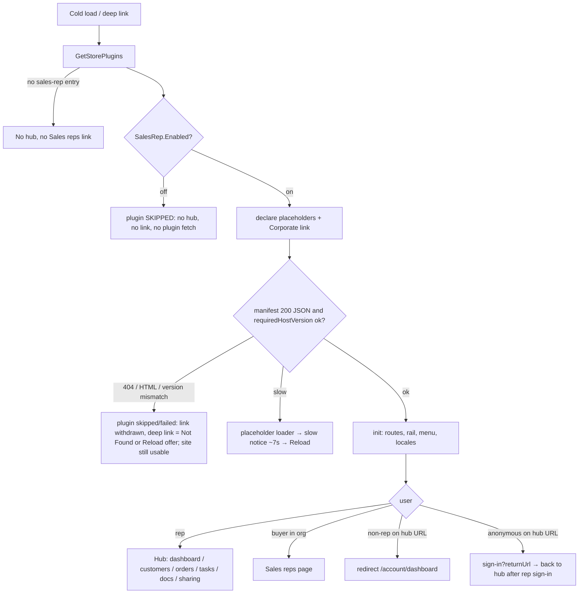
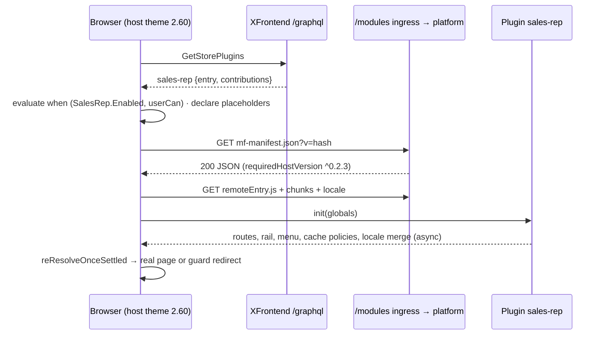
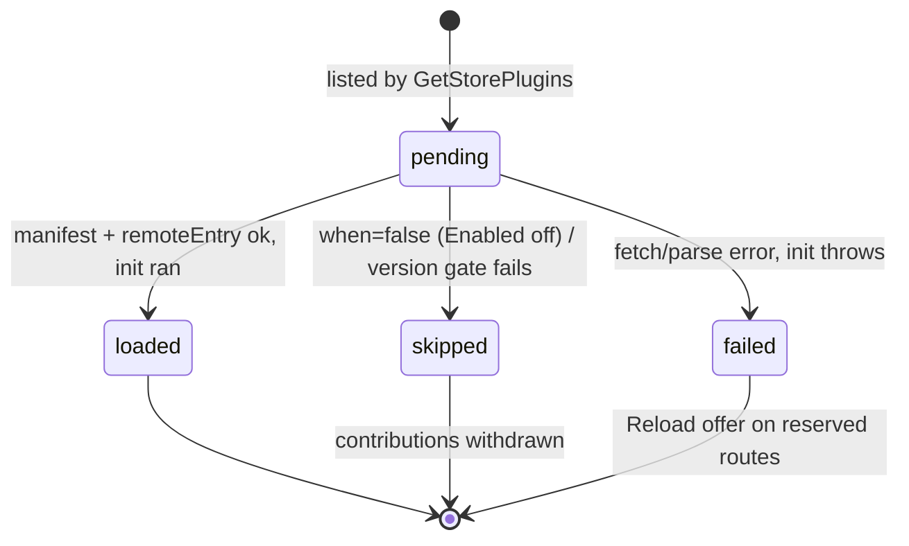

# TEST MODEL — VCST-6015

Ticket:      VCST-6015 "Migrate Sales Rep Module to Modular Frontend" | Type: Task | Status role: testable | Flow: feature-test | Priority: P1 (High) | Path: **FULL** (1a: Task + High; `technical-change` §5d deferred — two product repos) | Changed: Both (vc-frontend #2569 theme switch + host; vc-module-sales-rep #13 ships the storefront plugin, backend untouched except packaging/NuGet bumps)
Context:     FULL — `ba-system-analyzer` (1c, live, `playwright-firefox`) · `ba-story-writer` Mode B (1d) · `1r` REACHABLE (~4 min incl. one re-run; first BLOCKED was the orchestrator's wrong secrets key, not the stand)
Env:         vcst (`TEST_ENV=vcst`) — platform 3.1083.0 · VirtoCommerce.SalesRep **3.1014.0-pr-13-4fbb** · Xapi 3.1027.0 · XFrontend 3.1007.0 · theme **2.60.0-alpha.2579** (footer). `/modules` → platform route present (manifest 200). Both PRs merged (vc-frontend `b996cd8b` on dev; module `0a7c3d9`, released 3.1015.0).
Prior model: `reports/ba/test-models/VCST-6077-2026-10-07.md` — the domain chain L1–L5 and its Tasks branch are **carried forward by citation**, not re-derived; this ticket adds the delivery links D1–D4 *in front of* L3/L5 and re-runs L5/B/G **through the plugin**. Correction vs predecessor: none to its Part 0.
Domain map:  `.claude/knowledge/domain/sales-rep.md` @ rev 3 (generated 2026-09-18, amended 2026-10-08) — PRESENT. 1c DRIFT: rail shows **Tasks** (map §3a/§3i/G15 still say Calendar); fr nav-link raw key no longer reproduces.
Mind map:    `.claude/knowledge/domain/sales-rep.mind-map.json` — nodes touched: `sr.store-toggle`, `sr.store-toggle.on-shows-hub`, `sr.store-toggle.off-hides-ui` (UNVERIFIED), `sr.hub.*` (basic-rep, advanced-rep, non-rep-sees-nothing, non-rep-direct-url, privileged-non-rep), `sr.customers`, `sr.profile`, `sr.dashboard`, `sr.layout`, `sr.tasks`, `sr.documents`, `sr.directory`, `sr.localization`, `sr.list-share`, `sr.customer-orders`. **Mind-map DRIFT:** no node for plugin delivery (discovery, manifest, version gate, placeholder routes, slow/failed states) — for `/qa-test-mind-map update`.
Chain position: Domain chain L1 (user becomes rep) → L2 (rep↔org) → L3 (store enables hub) → L4 (server-side served-org scoping) → L5 (rep-facing hub surfaces) · B (buyer-facing `/company/sales-reps`) · G (gate for non-reps). **Touches:** NEW D1–D4 (delivery), L3's UI half (the `when` gate now lives in the plugin manifest), L5 rendering in full, B, G. **Does NOT touch:** L1, L2 (Admin embedded app unchanged), L4 (scoped `/graphql/sales-rep` server unchanged — same .graphql documents byte-identical), Admin REST, statistics computation.
Affected surface: vc-frontend `client-app/config/settings_data.json` (`module_federation_enabled:true`, `sales_rep_builtin_enabled:false`), `modules/sales-rep/{index.ts,routes.ts}`, `core/federation/*` · vc-module-sales-rep `src/VirtoCommerce.SalesRep.Web/StorefrontApp/**` (plugin; `plugin.config.ts`, `src/index.ts`) · infra `/modules` route · XFrontend `store.plugins`. **Map MISSING:** D1–D4 delivery surface, the two theme switches, the placeholder/slow-notice states, `/company/tasks` as deployed, `/company/sales-reps` now plugin-served (→ 5-docs-map).
Ticket signals: dev comment — *"Requires a smoke test of a Sales Rep Hub"*; `/modules` route must exist in `infra/environments.yml`. Attachment `image-20261013-114852.png` (opened): the environments.yml diff adding `- path: /modules / route: platform`. Artefacts were installed on vcptcore-dev; **operator chose vcst**. "How to see it": `GetStorePlugins` lists `sales-rep`, `mf-manifest.json` 200, chunks + locale from same folder, no console errors — all observed on vcst by 1r/1c.
Epic context: none (no parent). Link: blocks VCST-5923 (vc-shell VcSelect — release-order dependency only).
Domains:     Sales Rep (`sr`), storefront platform (Module Federation host), B2B organizations (Corporate menu)
Flows & boundaries: host boot ↔ XFrontend `store.plugins` · manifest/remoteEntry ↔ `/modules` ingress · host facade `@vc-frontend/core` 0.2.3 ↔ plugin `requiredHostVersion ^0.2.3` · plugin `init` ↔ extension registry (account rail, Corporate menu, `sharedList` slot) · plugin locale loader ↔ host i18n · sign-in/out ↔ `userCan` gates
Risk areas:  silent no-fallback delivery failure (1c H1, prior `BUG-SalesRep-hub-failures-with-no-user-visible-signal`) · raw i18n key before locale merge (H3, VC-UI-007, BL-SR-013 SUSPECT, VCST-5681) · non-rep 404 flash (H4) · duplicate registration (U-2/U-7) · plugin code for every visitor (H2/U-3) · theme-switch matrix for customized themes (U-1 CONTRADICTS) · VC-PLATFORM-002 (an upgrade breaks what used to work) · VC-AUTH-004/005
AC traceability: 1d — **36 atomic conditions**: AC-1.a–g, AC-2.a–c, AC-3.a–b, AC-4.a–b, AC-5.a–c, AC-D.1 + gap-AC-1…15. DRIFT: AC-2.b label (ticket "My Sales Reps" vs docs/live "Sales reps"), AC-3 mechanism. NOT-FOUND: `/modules` route (infra), packaging. **CONTRADICTS: gap-AC-4 / U-1** (customized theme lacking both keys loses the hub).
DoD: none declared — 1d's inferred DoD (13 items) confirmed at 5-verdict.

---

## Part 0 — VALUE CHAIN (domain chain carried from VCST-6077; delivery links D1–D4 new ▲)

**In the user's words:** *"I open the storefront; it finds out my store has the Sales Rep plugin, fetches it, and — if I am a rep — I get my hub exactly as before; as a buyer I get my Sales reps page; as anyone else I get nothing and a hub link sends me home."*

| # | Link | Mechanism | ▲ |
|---|---|---|---|
| D1 | **Storefront learns the plugin exists** | every cold load: `GetStorePlugins` (`store.plugins(appId:"vc-frontend")`) → entry `sales-rep`, `remoteEntry` URL, `contributions` JSON | ▲ new |
| D2 | **Host decides whether it applies, and reserves its places** | plugin-level `when: settingEnabled(SalesRep.Enabled)` evaluated before any plugin code; per-route `can: sales-rep:access` (+`sales-rep-documents:read`); declares placeholder routes, Corporate link `sales_rep.navigation.link`, slot `sharedList/provenance-note` | ▲ new |
| D3 | **Host fetches and admits the plugin** | `mf-manifest.json` → `requiredHostVersion ^0.2.3` vs facade 0.2.3 (fail-closed) → `remoteEntry.js` → shared singletons (vue, vue-router, vue-i18n, apollo) | ▲ new |
| D4 | **Plugin wires itself in** | `init()`: routes, account rail "Sales Rep hub", menu merge, cache type policies (owner `sales-rep`), sharing scope, locale loader (fire-and-forget); placeholder → real page via `reResolveOnceSettled` | ▲ new |
| L3 | **Store switch shows/hides the UI** | `SalesRep.Enabled` (UI-only, A5) — now enforced by D2's `when` | ▲ moved |
| L5 | **Rep uses the hub** | dashboard · My customers → profile → orders · All customer orders · Tasks (if TaskManagement) · Document library (Advanced) · list sharing to customers | ▲ re-delivered |
| B | **Buyer sees their reps** | Corporate → "Sales reps" → `/company/sales-reps`, active-org scoped, read-only | ▲ re-delivered |
| G | **Non-rep is turned away** | guard → `/account/dashboard`; anonymous → `/sign-in?returnUrl=` | ▲ mechanism changed (catch-all then re-resolve) |

Variants (rows; union of the layers that branch — host `when`/`can`, plugin `init`, theme switches, i18n):
V1 plain rep `@td(SALES_REP)` · V2 Advanced rep `@td(SR_REP_DOCS)` · V3 zero-served rep `@td(SALES_REP_NOCUSTOMERS)` · V4 buyer org member `@td(ORG_USER_DEFAULT)` · V5 privileged non-rep (Org maintainer) `{{ORG_USER_EMAIL}}` · V6 anonymous · V7 `SalesRep.Enabled` **off** · V8 non-en culture (de with file; es; nl-NL without file) · V9 delivery fault (manifest 404 / HTML / version mismatch / slow) · V10 theme-switch matrix (MF × builtin) · V11 boot mode cold deep-link vs SPA nav · V12 user switch in one tab · V13 mobile 375px.

Mechanism coverage matrix (rows = variants, columns = links; scenario # or GAP/WAIVED):

| V \ link | D1 | D2 | D3 | D4 | L3 | L5 | B | G |
|---|---|---|---|---|---|---|---|---|
| V1 plain rep | 1 | 1 | 1 | 1 | 1 | 1,2,3,4,5 | WAIVED: rep has no buyer page assertion beyond 6 | WAIVED: rep is admitted, no refusal to observe |
| V2 Advanced rep | 1 | 7 | 1 | 7 | 1 | 7 | 6 | WAIVED: rep is admitted, no refusal to observe |
| V3 zero-served | 1 | 8 | 1 | 8 | 1 | 8 | WAIVED: no org | WAIVED: rep is admitted, no refusal to observe |
| V4 buyer member | 9 | 9 | 9 | 9 | 9 | 10 (refused) | 9 | 10 |
| V5 privileged non-rep | 9 | 11 | 9 | 11 | 11 | 11 (refused) | 11 | 11 |
| V6 anonymous | 12 | 12 | 12 | 12 | 12 | 13 | 12 | 13 |
| V7 Enabled off | 14 | 14 | 14 | 14 | 14 | 14 | 14 | 14 |
| V8 culture | 15 | 15 | 15 | 15,16 | 15 | 15 | 15,16 | WAIVED: guard redirect renders no text |
| V9 delivery fault | 17,18 | 17 | 17,18,19 | 19 | 17 | 17,19 | 17 | 17 |
| V10 theme switches | WAIVED: build-time, local build only | 20 | 20 | 20 | 20 | 20 | 20 | 20 |
| V11 cold deep link | 3 | 3 | 3 | 3 | 3 | 3 | 6 | 10,13 |
| V12 user switch | 21 | 21 | 21 | 21 | 21 | 21 | 21 | 21 |
| V13 mobile | 22 | 22 | 22 | 22 | 22 | 22 | 22 | WAIVED: same router guard as desktop |

Reverse edges: plugin skipped/failed → reserved routes + Corporate link withdrawn → **17/18/19**. Logout → rail withdrawn → **21**. `SalesRep.Enabled` off → everything withdrawn → **14**. Plugin fails → fallback to built-in hub: **ABSENT IN PRODUCT** (finding: `sales_rep_builtin_enabled:false`, no telemetry — host `Logger` no-op in prod). Layout save persisted by plugin → reverts on Reset → covered by existing suite 093 (carried, C1 not needed).
Fixture lifecycle: no terminal state is advanced — the change is delivery. Layout edits use the disposable `@td(SR_REP_LAYOUT)` only (allowlisted). `SalesRep.Enabled` flip is a **shared-env write, flip+restore with operator OK** (14).

## Part 0r — ROLE SCENARIOS

Roles in scope: V1 `@td(SALES_REP)` (= SR_REP_PRIMARY, password `{{TEST_USER_PASSWORD}}`) · V2 `@td(SR_REP_DOCS)` · V3 `@td(SALES_REP_NOCUSTOMERS)` · V4 `@td(ORG_USER_DEFAULT)` · V5 `{{ORG_USER_EMAIL}}` (Organization maintainer, no `sales-rep:access`) · V6 anonymous (no fixture) · personal B2C account: **FIXTURE-GAP** (no aliased personal non-org buyer; AC-2.c held to a checklist probe with `{{USER_EMAIL}}` if it resolves, else NOT RUN).

BSC-1 — "Monday morning, the rep opens their hub from a bookmark" · Role: V1 · Situation: cold deep link `/company/dashboard`
  | # | Action | Sees | Can do | Expected |
  | 1 | open bookmark | loader then dashboard | — | real page, URL unchanged, no Not Found flash {SPEC AC-1} |
  | 2 | My customers → org → Orders → an order | served orgs, profile, orders | read | each renders, no redirect {BL-SR-011} |
  Outcome: the hub works exactly as before, delivered by the plugin.
  Not allowed: Document library link/route (needs `sales-rep-documents:read`) → `/company/documents` redirects; no plugin chunk loaded from the host's own `/assets` (built-in off).
BSC-2 — "A buyer checks who their rep is" · Role: V4 · Situation: org member, Corporate menu
  Outcome: Corporate → Sales reps lists the active org's reps (name/email/phone).
  Not allowed: hub rail absent; each hub URL ends on `/account/dashboard`; no `salesRep*` operation sent to `/graphql/sales-rep` — asserted at the network layer, not only by an absent link.
BSC-3 — "An org admin pokes at a hub link a rep sent them" · Role: V5 · Situation: maintainer with `loginOnBehalf`, no rep access
  Not allowed: same refusals as BSC-2; `isAdministrator` false asserted (else gates short-circuit).
BSC-4 — "A visitor follows a hub link before signing in" · Role: V6
  Not allowed: no hub content, no data query; lands on `/sign-in?returnUrl=…`; after signing in **as a non-rep** the returnUrl does not leak the hub.

## Parts 1–5 — FAULT MODEL

Condition space: role {V1,V2,V3,V4,V5,V6} × Enabled {on,off} × culture {en,de,es,nl-NL} × delivery {ok, 404, HTML, version-mismatch, slow} × boot {cold, SPA} × switches {MF on/builtin off (stock), both off, both on, MF off/builtin on} × viewport {desktop, mobile}. Constraints: anonymous × L5 = refusal only; Enabled off ⇒ delivery irrelevant; switches ≠ stock only on a local build. Raw N = 6×2×4×5×2×4×2 = **3,840**.
Reduction: (1) delivery faults are user-independent at D3 → collapsed to one rep + one buyer per fault (subsumes role); (2) culture interacts only with D4's locale merge → de/es/nl-NL × {rail, Corporate link} on cold load (subsumes role beyond V1/V4); (3) switches are build-time → one row, local-build only; (4) role × boot pairwise (t=2) with cold as the default; (5) mobile collapsed to V1+V4 smoke. **3,840 → 22.** Dropped: culture × fault (fault hides all text), Enabled-off × culture/boot (nothing renders), V3 × fault.

Test scenarios (22)

| # | Cell | Defect hypothesis | Archetype | Technique | Oracle | P |
|---|---|---|---|---|---|---|
| 1 | **[JOURNEY]** V1, en, ok, cold: home → GetStorePlugins → hub dashboard → My customers → profile → orders → an order → All customer orders → Tasks → back to dashboard; network shows every hub chunk from `/modules/$(…)/plugins/vc-frontend/` | the plugin loads but one page's route/component did not make the port (near-copy, 225 vs 221 files) — one link of the hub 404s or renders the host catch-all | CONFIG | FLOW | {SPEC AC-1, AC-5} {BL-SR-011} | P0 |
| 2 | V1 dashboard layout: Edit → move block → Save → reload → re-login (`@td(SR_REP_LAYOUT)`) | cache type policies re-registered under owner `sales-rep` differ → save not persisted / duplicated | PARITY | ST | {BL-SR-024} | P1 |
| 3 | V1 cold deep link to each of 6 hub routes in a new tab | placeholder never yields to the real page, or a Not Found flash precedes it (`reResolveOnceSettled`) | RACE | EP | {SPEC AC-1} {HYPOTHESIS: no-flash — becomes {SPEC} if the author confirms} | P1 |
| 4 | V1 list sharing: share a list with scope Customer → customer sees it + provenance note slot | `sharedList/provenance-note` slot declared but plugin component not mounted → note missing | PARITY | FLOW | {SPEC AC-1} (sharing mechanism per VCST-5707 model) | P1 |
| 5 | V1 "My last order" date on My customers vs the order's own date (late-evening UTC order) | plugin's `$d(new Date(...))` differs from host's `$d(string)` → off-by-one day | BOUNDARY | BVA | {SPEC "no difference"} | P2 |
| 6 | V2 + V4 buyer page `/company/sales-reps`: label, rows, org switch | Corporate link now declared pre-load: label/scope wrong or duplicated with `init` merge | PARITY | EP | {DOC Sales reps page} {SPEC AC-2} | P1 |
| 7 | V2 Advanced rep: Document library link + widget + Open | doc permission check moved into plugin `init` (computed once) → link missing for an Advanced rep | SCOPE | DT | {DOC Sales Rep Hub} {BL-SR-014} | P1 |
| 8 | V3 zero-served rep: hub renders empty states | placeholder `requiresOrganization:false` not honoured → rep with no org bounced to account | BOUNDARY | BVA | {BL-SR-011 (VCST-5494)} | P2 |
| 9 | V4 buyer: no hub rail, Corporate Sales reps present, plugin code still fetched (record) | gate by setting only → plugin code shipped to all visitors (cost) and a rail leak | SCOPE | DT | {SPEC AC-3} {DOC overview} | P1 |
| 10 | V4 cold deep link to 6 hub URLs | first navigation hits catch-all (404) before guard redirect; or guard missing on a ported route | SCOPE | DT | {BL-SR-011} {SPEC AC-3} | P0 |
| 11 | V5 privileged non-rep: same refusals as 10, `isAdministrator=false` | maintainer/loginOnBehalf permissions satisfy a loose `can` → hub leaks | SCOPE | DT | {BL-SR-011} | P1 |
| 12 | V6 anonymous home: GetStorePlugins issued, no auth toast, no hub/link | plugin-list query errors for anonymous or an auth toast fires | SILENT | EP | {SPEC AC-3} {BL-SR-021} | P2 |
| 13 | V6 anonymous deep link → sign-in?returnUrl → sign in as rep → hub; as non-rep → account dashboard | returnUrl to a hub route after non-rep sign-in renders a stuck placeholder | SCOPE | ST | {BL-SR-011} {BL-SR-021} | P1 |
| 14 | V7 `SalesRep.Enabled` off (flip+restore, operator OK): no rail, no link, no plugin asset request, direct URLs end state | `when` evaluated after fetch, or link declared regardless | CONFIG | DT | {DOC overview: item appears only when enabled} {SPEC AC-4} | P1 |
| 15 | V8 cold load de / es / nl-NL: rail + Corporate link + hub page text | plugin locale merge fire-and-forget → raw `sales_rep.*` key renders until merge (or forever for es) | RENDER | EP | {BL-SR-013 SUSPECT — verify} VC-UI-007 | P1 |
| 16 | V8 throttled network (Slow 3G) en + runtime language switch en→de→fr | declared Corporate link renders its raw title key before locales arrive; switch re-merge loses keys | RACE | ST | {BL-SR-013} | P1 |
| 17 | V9 manifest → 404 and → HTML (request interception) as V1 + V4: site boots, home usable, hub + link absent, deep link = Not Found/Reload, no uncaught error | a delivery failure blanks the storefront, or leaves the link pointing at a dead route | FALLBACK | EG | {HYPOTHESIS: PROPOSED-BL-SR-033 — becomes {BL} if minted} | P0 |
| 18 | V9 version gate: manifest rewritten to `requiredHostVersion ^0.3.0` / missing | gate fails open (plugin executes against an incompatible host) | FALLBACK | EG | {SPEC host README: fail-closed} | P2 |
| 19 | V9 slow remoteEntry (delayed 10 s) on a hub deep link | placeholder spinner forever instead of the ~7 s slow notice + Reload | FALLBACK | EG | {SPEC host README placeholder states} | P2 |
| 20 | V10 theme switches matrix (local build): both keys absent / both on | customized theme lacking both keys loses the hub silently (U-1); both on → duplicate routes/menus | PARITY | DT | {SPEC "users see no difference"} — 1d CONTRADICTS | P2 |
| 21 | V12 same tab: rep → sign out → buyer → sign out → Advanced rep (no reload) | rail/Documents/Tasks gates computed once at `init` → stale rail after user switch | STALE | ST | {BL-SR-011} {DOC hub only for reps} | P1 |
| 22 | V13 375px: hamburger carries Corporate Sales reps + hub entries + badge (V1, V4) | plugin registers desktop menu only; mobile menu misses entries | PARITY | EP | {SPEC AC-1/AC-2} VC-UI-002 | P2 |

Probes carried in: VC-UI-007 → 15,16 · VC-PLATFORM-002 → 1,20 · VC-AUTH-004 → 10,11 (UI + network) · VC-AUTH-005 → WAIVED (session expiry unchanged by this change; the scoped API is untouched) · VC-UI-002 → 22 · VC-B2B-005 → 6 (org switch scope) · VC-SHELL-001 → N/A (Admin vc-shell app not changed).
Archetype sweep: PARITY 1,2,4,6,22 · SCOPE 7,9,10,11,13 · RACE 3,16 · FALLBACK 17,18,19 · CONFIG 14,20 · RENDER 15 · STALE 21 · SILENT 12 · BOUNDARY 5,8 · MONEY WAIVED (no money computed in delivery; stats untouched, L4) · REPLAY WAIVED (no new write/idempotency path) · LIFECYCLE WAIVED (no entity lifecycle in this change; plugin status machine covered by 14/17/19).
UIP sweep: UIP-DEEP 3,10,13 · UIP-REFRESH 2,3 · UIP-BACK 10 (Back after redirect) · UIP-TABS 21 (single tab) — multi-tab WAIVED (no cross-tab state added) · UIP-EXPIRE WAIVED (unchanged) · UIP-STORAGE WAIVED (plugin stores nothing new) · UIP-NET 16,17,19 · UIP-INPUT WAIVED (no new input) · UIP-VIEW 22 · UIP-DATA 8.
Business Rules: BL-SR-011, -013 (SUSPECT), -014, -021, -024; BL-SR-002 (b) carve-out for All orders. Proposed (human review): PROPOSED-BL-SR-033/-034/-035 (1d §7).
Edge cases:  ECL-7.1, ECL-7.3, ECL-7.4, ECL-10.1, ECL-10.2, ECL-10.3.
Docs grounding: StorefrontUserGuide `account/sales-rep-hub`, `account/sales-reps`, `account/overview`; PlatformUserGuide `sales-rep/enabling-sales-rep`. **No doc for storefront plugins / Module Federation** (NEW ⇒ `{SPEC}`/`{OBSERVED}` from ticket + host README + live).
Observed grounding: KB-E86A5FDE (manifest path), KB-C08D9226 / KB-0C936EC3 (plugin fetched for anonymous), KB-ACD62417 (non-rep/anon deep link), KB-7DB10B1F (no-locale culture → English), KB-52188DBA (hub `<title>` default — pre-existing).
Agents to dispatch: 3x `/qa-exploratory ticket VCST-6015` · 4a `qa-frontend-expert` (chrome) · 4v `ui-ux-expert` (DevTools) · A `test-management-specialist` · 3a none (`data_surface:false`)
