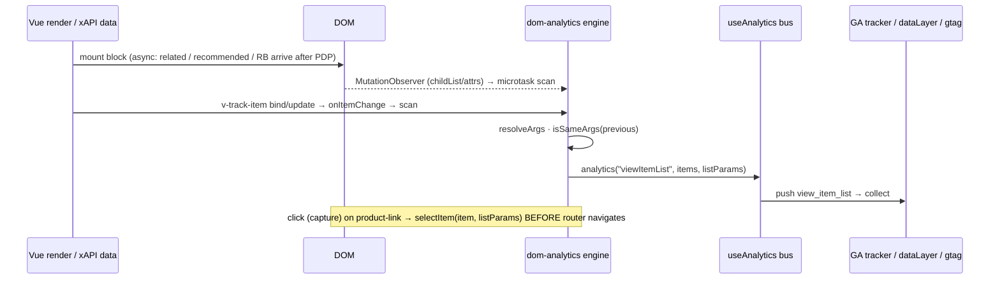

# TEST MODEL — VCST-6017 — Markup (beacon) analytics for product lists and Page Builder blocks

```
Ticket:      VCST-6017 | Type: Story | Status role: testable (Ready for test → Testing, 2026-10-13) | Flow: feature-test | Priority: P2 (Medium) | Path: FULL | Changed: Frontend
Context:     FULL — ba-system-analyzer (1c, live on vcst, firefox lane) + ba-story-writer (1d, Mode B) + 1r (REACHABLE, 4 min)
Prior model: none — first model for the analytics surface (no analytics model or map; VCST-4933 page-builder model has no analytics content)
Domain map:  ABSENT (no analytics map) — chain position unverified. Adjacent: .claude/knowledge/domain/page-builder.md @ rev 2 (2026-09-23)
Mind map:    ABSENT
Build:       vcst-qa storefront theme 2.60.0-pr-2543-0127-01276486 = PR vc-frontend#2543 head 0127648 (live bundle probe) · Platform 3.1078.0
             Pre-PR baseline: vcptcore-qa theme 2.60.0-pr-2485 (no data-vc-track in bundle) — payload-parity reference only
Chain position: unverified — no domain map. Touches the storefront list-impression / list-click / product-view
             links of the GA4 chain (L1-L8 below). Does NOT touch: cart-mutation events (BL-GA4-002), checkout
             funnel (BL-GA4-003), login/config (BL-GA4-004 — guarded only), search results, wishlist/compare.
Affected surface: vc-frontend only. New core plugin client-app/core/plugins/dom-analytics/{engine,rules,registry,types,index}.ts
             (+README), registered in app-runner.ts. Roles added to product-card(.vue|-related|-recommended|-recently-browsed),
             product.vue (product-details), variations(.vue|-default|-table), recently-browsed-products, related-products,
             recommended-products, products-block, products-carousel, favorite-products. Manual analytics() removed there.
             Page-builder map does NOT enumerate products-block / products-carousel / favorite-products as event sources (11b MISSING).
Ticket signals: (C1) category page stays manual — barcode single-hit redirect must not send view_item_list. (C3, supersedes
             C2) markup: related, recommended, recently browsed, Page Builder/Builder.io blocks; variations view_item_list only;
             manual: search dropdown, saved-for-later block (shares list id recently_browsed_products), VcLineItem lists
             (cart, wishlists, SFL page, shared list), compare. KeyDown struck out. No attachments. PR body says roles live in
             `data-name`; code + live use `data-vc-track` (doc drift, AC7).
Epic context: none. Linked spike VCST-3893 (Done, no code).
Domains:     analytics (GA4, suite 043 cross-cutting) · page-builder (content-cms) · catalog (product lists/PDP)
Flows & boundaries: block render ↔ engine ↔ useAnalytics bus ↔ GA tracker ↔ dataLayer/gtag ↔ GA collect; product-card
             actions (add to cart / list / compare) ↔ business events; SPA navigation PDP→PDP; cart widgets RB ↔ SFL
Risk areas:  VC-ANALYTICS-001 (dataLayer diverges from truth) · VCST-5109 items[] enrichment (all lists) · duplicate/missing
             impressions (ECL-11.1) · stale suite case GA-002 (asserts legacy items_skus) · CI auto-tests postgres leg red
AC traceability: 18 story conditions (C-1.a … C-7.b) + 19 gap conditions (G-1 … G-19) — 1d seed, carried into Artifact B
DoD:         none declared; 1d proposes 11 items (docs, unit tests, parity, no double events, CI, cross-browser…) — confirm at 5-verdict
```

## Part 0 — VALUE CHAIN

| Link | In the user's words |
|---|---|
| **L1** markup | A product block on a page is marked as a tracked list (`data-vc-track="product-list"` + ≥1 of `data-list-id/-name/-related-id/-related-type`), its cards `product-card`, its links `product-link`; the PDP container `product-details` |
| **L2** bind | Each card / PDP carries its product — Vue object via `v-track-item` (WeakMap), or `data-product-id/-sku/-name/-price` for plain HTML |
| **L3** trigger | *appear* = the element is rendered in the DOM (MutationObserver + rescan on bind change; NOT viewport); *click* = a click on an `a`/`button` inside a role, capture phase |
| **L4** resolve | The rule collects the arguments (cards of THIS list only; list params from the closest list); a missing required argument ⇒ nothing sent |
| **L5** dedup | The same element re-sends an appear event only when its arguments change (entity identity = `id ?? code`) |
| **L6** bus | `useAnalytics().analytics(event, …)` — the same bus manual calls use; every registered tracker receives it |
| **L7** dataLayer | GA tracker pushes `view_item_list` / `select_item` / `view_item` to `window.dataLayer` with the BL-GA4-001 item schema |
| **L8** collect | gtag delivers the hit to GA (`/g/collect`, `en=<event>`) — the analyst sees one impression per list render, one click per click, attributed to the right list |

```mermaid
flowchart LR
  P[Page renders block] --> M{marked as<br/>product-list?}
  M -- no: kept-manual list --> MAN[manual analytics() only<br/>must NOT get a markup event]
  M -- yes --> B[cards bound<br/>v-track-item / data-product-*]
  B --> T{trigger}
  T -- appear: rendered --> R[resolve: collect cards of this list<br/>+ list params]
  T -- click on a/button --> W[walk up roles:<br/>product-link → card → list]
  W --> R2[resolve item + list params]
  R --> D{same args as<br/>last send?}
  D -- yes --> X[suppressed]
  D -- no --> BUS[useAnalytics bus]
  R2 -- incomplete --> X2[skipped silently]
  R2 --> BUS
  BUS --> GA[GA tracker → dataLayer]
  BUS --> CT[custom trackers]
  GA --> C[gtag /g/collect hit]
```



**Variants (rows)** — derived from the layer that branches (the component that renders the list + how the product is bound):
V1 PDP `product-details` · V2 related (grid <lg / carousel ≥lg — 3a: `lg = smaller("lg")`) · V3 recommended (`recommended_products_<model>`) · V4 recently browsed (cart) · V5 variations-default · V6 variations-table (paginated) · V7 Page Builder `products_block` · V8 `products_carousel` · V9 `favorite_products` (signed-in) · V10 plain HTML / Builder.io `data-product-*` (partial product) · V11 kept-manual lists (category incl. barcode redirect, search dropdown, SFL block, VcLineItem lists, compare) — negative variant · V12 extension (`addRules` / custom tracker).

**Mechanism coverage matrix** (cells = scenario # · GAP · WAIVED + reason)

| | L1 markup | L2 bind | L3 trigger | L4 resolve | L5 dedup | L6 bus | L7 dataLayer | L8 collect |
|---|---|---|---|---|---|---|---|---|
| V1 PDP | 1 | 1, 9 | 1, 15 | 1 | 9, 10 | 1 | 1, 3 | 1 |
| V2 related | 4 | 4 | 4, 13 | 4 | 10, 11 | 4 | 3, 4 | WAIVED — L8 crossed once by #1; transport is shared |
| V3 recommended | 1 | 1 | 1, 7 | 1, 8 | 10 | 1 | 1, 3 | 1 |
| V4 recently browsed | 5 | 5 | 5 | 5, 14 | 14 | 5 | 3, 5 | WAIVED — as V2 |
| V5 variations default | 6 | 6 | 6 | 6 | 6 | 6 | 3, 6 | WAIVED — as V2 |
| V6 variations table | 6 | 6 | 6, 12 | 12 | 12 | 6 | 3, 12 | WAIVED — as V2 |
| V7 products_block (+ any PB product block type) | 1, 23 | 1, 23 | 1, 7, 8, 23 | 1, 8 | 2 | 1 | 1, 23 | 1 |
| V8 products_carousel | 16 | 16 | 16 | 16 | 16 | 16 | 16 | WAIVED — as V2 |
| V9 favorite_products | 17 | 17 | 17 | 17 | 17 | 17 | 17 | WAIVED — as V2 |
| V10 data-product-* | 18 | 18 | 18 | 18 | 19 | 18 | 18 | WAIVED — as V2 |
| V11 kept-manual | 20, 21, 14 | n/a — WAIVED: cards may be bound; absence of a container is the mechanism | 20, 21 | 20 | 21 | 20 | 20, 21 | WAIVED — as V2 |
| V13 viewport-driven card count (3x) | 25 | 25 | 24, 25 | 25 | 24 | 24 | 24, 25 | WAIVED — as V2 |
| V12 extension | GAP — no in-app `addRules` caller ships; reachable only by code (unit tests) | GAP | GAP | GAP | GAP | 22 | 22 | WAIVED |

**Reverse edges:** no money, points, stock or entitlement moves — the forward effect is an analytics counter. Its "reverse" is the
**must-not-fire** set, covered as rows: kept-manual lists get no second event (#20), barcode redirect sends no `view_item_list`
(#21), card action buttons send no `select_item` (#8), refetch/resize/"Show more" do not re-send (#10, #11, #14). ABSENT IN
PRODUCT: no mechanism retracts an impression already pushed (by design; not a finding).
**Fixture lifecycle:** recently browsed accumulates per user (a run must record the list it saw); saved-for-later items persist on
the account; favorites persist — #5/#14/#17 use a per-run account state or capture the before-state.

## Parts 1–5 — FAULT MODEL

**Condition space** — factors → classes:
F1 list variant (V1–V11: 11) · F2 trigger path (appear on cold load · appear after SPA nav · click title · click image · click action
button · keyboard Enter: 6) · F3 user (guest · signed-in B2B: 2) · F4 viewport (1920 · 390: 2) · F5 data change after first render
(none · same-id refetch · new ids · append/"Show more"/page · list params only: 5) · F6 product binding (Vue object · attrs with id ·
attrs without id/sku: 3). Constraints: F2 click ∉ {V5, V6} (no link role) · F6 attrs only for V10 · F3 signed-in required for V9 ·
F5 append only for V4/V6/V11-SFL. Raw N ≈ 11·6·2·2·5·3 = **3 960**.

**Reduction:** FLOW + EP per variant + DT on (trigger × list-container presence) + ST on the dedup memory, pairwise (t=2) over F3×F4.
Dropped/collapsed: **F6** collapses to V10 only (Vue binding is the default for V1–V9); **F4** kept only where the code branches on
the breakpoint (V2 grid/carousel, `hasImageCarousel`) — elsewhere subsumed by the visual lane's 390 px pass; **F3** kept only where
content or price differs by user (V7 home content, V9, price parity) — the engine has no user branch; **F2 keyboard/middle-click**
subsumed by "click on a/button" (Enter dispatches click) — one row (#13). N → **M = 23** (#23 added 2026-10-13 at operator
request: Page Builder pages × every product-bearing block type, after 1c found an unmarked "Printers" block on /demo-landing).

**Test scenarios**

| # | Cell | Defect hypothesis | Archetype | Technique | Oracle | P |
|---|---|---|---|---|---|---|
| 1 | **[JOURNEY]** guest, 1920: home `products_block` appears → click card title → PDP A `view_item` → recommended list appears → click recommended card → PDP B | a link in the chain is lost or doubled: block sends nothing / twice, `select_item` loses its list, `view_item` misses on SPA nav, recommended keeps A's `related_id` on B; hits never reach `/g/collect` | SILENT | FLOW | {SPEC} PR table "Moved to markup" + README "Same bus"; {BL-GA4-001} item schema | Critical |
| 2 | V7 home, guest vs signed-in (content differs) | `products_block` sends for one user's block but not the other, or the signed-in block's `items` carry guest prices | CONFIG | EP | {SPEC} PR "Page Builder … (new)"; {BL-GA4-001} | High |
| 3 | V1–V6, same product on vcptcore (pre-PR) vs vcst (PR) | payload drift after migration: `item_list_id`/`item_list_name`/`related_*`, `items[]` order, `index`, `item_category*`, `currency`, `value` differ from the manual call | PARITY | EP | {SPEC} README "Trackers can't tell markup events from manual ones"; pre-PR source (removed lines); {OBSERVED} baseline on vcptcore only | Critical |
| 4 | V2 related, grid (<lg) and carousel (≥lg, 5–7 per view of 10): appear + click | widget never reached by markup (fallthrough of `data-*` through `VcWidget` lost) ⇒ no `view_item_list`; click on related card sends nothing | SILENT | EP | {SPEC} PR table; pre-PR `related-products.vue` params | High |
| 5 | V4 recently browsed (cart), signed-in | `recently_browsed_products` list sent with wrong items or twice when the cart re-renders (cart mutations re-render the page) | REPLAY | EP | {SPEC} PR table; {DOC} ga-events "Open cart → View recently browsed" | High |
| 6 | V5/V6 variations PDP (default + table view) | `view_item_list variations` missing, or sends `select_item` (it never did), or items = only rendered page vs pre-PR full set | PARITY | EP | {SPEC} C3 "variations send only view_item_list"; pre-PR `variations.vue` watch sent the whole `variations` array | High |
| 7 | V3/V7 card click targets: title · image (single-image / list view) · image with carousel (grid, >1 image) · "Customize" | image-carousel click (slide switch / arrows) sends `select_item`; or title sends two (nested links) | BOUNDARY | DT | {SPEC} product-card.vue `hasImageCarousel` comment "must not count as a link"; README "only a click on a link or a button counts" | High |
| 8 | V3/V7 card action buttons: Add to cart · Add to list · Compare · quantity | an action button inside a tracked card sends `select_item` alongside `add_to_cart`/`add_to_wishlist` (inflated clicks) | REPLAY | DT | {SPEC} rules.ts click target = `product-link` only; {BL-GA4-002} business event unchanged | High |
| 9 | V1 PDP cold load (deep link + reload) | `view_item` fires before GA `config` / before price is bound (value 0), or twice (bind then refetch) | RACE | ST | {BL-GA4-004} one config per page; {SPEC} README dedup "refetched product doesn't resend" | High |
| 10 | V1/V2/V3 same-id refetch: add to cart on PDP (refetch), language-neutral re-render, resize across lg | same element re-sends identical `view_item_list`/`view_item` ⇒ duplicate impressions | REPLAY | ST | {SPEC} README "Objects with the same id count as the same entity" | High |
| 11 | V2/V3 SPA PDP A → B → browser Back to A | list params and items update in different ticks ⇒ an intermediate event pairs B's items with A's `related_id`/name; or Back sends nothing | STALE | ST | {SPEC} README "An element sends an appear event again only when its arguments change" (the final args must be consistent) | High |
| 12 | V6 variations table pagination / full view | each page re-sends the accumulated set, or the impression covers only page 1 forever | BOUNDARY | BVA | {SPEC} README dedup + pre-PR whole-array send — **{HYPOTHESIS}**: intended behaviour on pagination is unspecified; becomes an oracle when the author answers (1d question) | Medium |
| 13 | V2/V3 keyboard: Tab to card link + Enter; ctrl/middle-click | keyboard activation sends no `select_item` (lost for keyboard users) or ctrl-click sends twice | RENDER | EP | {SPEC} AC3 struck out ⇒ Enter covered by click; README click on link | Medium |
| 14 | V4 + V11 SFL block side by side in cart; "Show more" in SFL | SFL cards (no container) are collected into the RB list, or "Show more" makes RB re-send under `recently_browsed_products` | SCOPE | DT | {SPEC} C3 "Markup would add view_item_list under recently_browsed_products …"; engine nested-list filter | High |
| 15 | V8 carousel and V2 related carousel (≥lg) — off-screen slides | off-screen / cloned slides counted twice in `items[]`; tap on a slide lost to swipe | BOUNDARY | EP | {SPEC} README "appear = rendered in DOM, not viewport" (hidden slides count once) | Medium |
| 16 | V8 `products_carousel` (seeded Page Builder page) | carousel block sends nothing / duplicate items / empty `item_list_name` when the block has no title | FALLBACK | EP | {SPEC} PR "products carousel … (new)"; engine drops empty attributes | Medium |
| 17 | V9 `favorite_products` — a QUERY block (3a: not the user's favourites): matching filter vs a filter matching nothing | an empty result still sends an empty impression, or a matching block never reports | FALLBACK | EP | {SPEC} PR table; engine "collect returns undefined when no cards" | Medium |
| 18 | V10 plain-HTML block with `data-product-id/-sku/-name/-price` in a product-list | partial product crashes the GA tracker (`productToGtagItem` reads missing fields → console error) or sends NaN price / no currency | FALLBACK | EG | {SPEC} README partial-product note; useAnalytics README "Handlers should not rely on other fields" | Medium |
| 19 | V10 attrs with name+price only (no id/sku) + unrelated DOM mutations | no entity id ⇒ `isShallowEqual` fails on fresh `price` objects ⇒ `view_item_list` re-sent on every mutation (event storm) | REPLAY | EG | {SPEC} README dedup — **{HYPOTHESIS}** from source reading; oracle once the author confirms dedup applies to id-less items | Medium |
| 20 | V11 category, search dropdown, compare, wishlist, cart line items: view + click | a kept-manual list now sends a markup event too (double `select_item` / `view_item_list`) because its cards carry roles | REPLAY | DT | {SPEC} C3 + rules.ts "a card outside a product-list container sends nothing" | Critical |
| 21 | V11 category barcode search, single hit → redirect to PDP | `view_item_list` sent for the result grid before the redirect | RACE | ST | {SPEC} C1 "must not send view_item_list" | High |
| 23 | V7 every Page Builder page × every product-bearing block type (home guest/signed-in, /demo-landing "Printers", seeded AGENT-TEST page with block + 2 carousels + favorites, one below the fold) | a Page Builder product block type the PR did not mark (1c: /demo-landing "Printers" — 4 product-card, no product-list container, NO events) stays untracked, so AC6 holds only for some block types | SILENT | EP | {SPEC} AC6 "Enable analytics tracking for product blocks rendered through Page Builder" | High |
| 24 | V13 recommended / related / RB (`VcProductsGrid short`) on one page view, resize 1920 → 800 → 1920 (3x PROMOTE) | a resize re-sends the same list with a different `items[]` ⇒ the same impressions counted several times per page view | REPLAY | ST | {SPEC} README "an element sends an appear event again only when its arguments change" read with the PR's intent "a refetched … list doesn't resend"; pre-PR source sent the list once | Medium |
| 25 | V13 cold load of a PDP at 390 / 800 / 1920 (3x PROMOTE) | the impression covers only the cards that fit the viewport (live: 4 / 5 / 6 of 6), unlike the pre-PR whole-list send — GA impressions differ by device | PARITY | EP | {SPEC} README "Trackers can't tell markup events from manual ones" + pre-PR `watch(recommendedProducts)` sent the whole array — **{HYPOTHESIS}** whether "rendered cards only" is intended; author to confirm | Medium |
| 26 | V3/V7 "Customize" on a configurable card opens a new tab (3x PROMOTE) | the new-tab open sends no or two `select_item` | REPLAY | EP | {SPEC} README click on link/button ⇒ one select_item | Low |
| 22 | V12 a custom tracker registered on the bus (addTracker) receives markup events | non-GA tracker does not receive markup events, or receives a different argument shape than from manual calls | PARITY | EP | {SPEC} README "Same bus … custom trackers work unchanged" — live reachable only if a second tracker is configured; else unit-test evidence | Low |

**Probes carried in:** VC-ANALYTICS-001 (compare each event against the source of truth) → #3, #6, #2 · VC-DEPLOY-001 (PRs deployed to QA while open) → build line (PR head = live bundle). Other in-domain `VC-*`: N/A — none on lists/impressions.
**Archetype sweep:** SILENT #1 #4 · PARITY #3 #6 #22 · REPLAY #5 #8 #10 #19 #20 · RACE #9 #21 · STALE #11 · BOUNDARY #7 #12 #15 · SCOPE #14 · FALLBACK #16 #17 #18 · CONFIG #2 · RENDER #13 · MONEY — WAIVED: currency/culture branch lives in the GA tracker, untouched by the PR; guarded by GA-019/020 · LIFECYCLE — WAIVED: no entity state transitions.
**UIP sweep:** UIP-BACK #11 · UIP-DEEP #9 · UIP-REFRESH #9 · UIP-DATA #17 (empty) #16 (no title) #12 (many) · UIP-VIEW #15 (390 px; zoom WAIVED — engine has no layout branch) · UIP-TABS WAIVED — no cross-tab state in the engine · UIP-EXPIRE WAIVED — no auth in the chain · UIP-STORAGE WAIVED — engine memory is per page (WeakMap), nothing persisted · UIP-NET WAIVED for the engine; GA blocked ⇒ bus still runs, out of scope · UIP-INPUT WAIVED — no form.
**Business Rules:** BL-GA4-001 (primary) · BL-GA4-004 (guard: config before first event) · BL-GA4-002/003 (untouched — guarded by suite 043, not re-authored). Proposed (1d, not minted): BL-GA4-005 one way, never both · -006 no early impression on redirect · -007 partial product exception · -008 re-send only on changed args.
**Edge cases:** ECL-11.1 (conversion counted multiple times) · ECL-7.x analogies only (double-click, breakpoint re-mount).
**Docs grounding:** VirtoOZ StorefrontDeveloperGuide → Integrations → GA Events (view_item_list / select_item / view_item triggers, item fields). Markup architecture undocumented in VirtoOZ (NEW) — PR READMEs + ticket comments are {SPEC}.
**Observed grounding:** KB-8A1B3406 (search dropdown `search_bar`, manual) · KB-456FD813 (search grid list id, manual, out of scope).
**Agents to dispatch:** qa-frontend-expert (4a, chrome) · ui-ux-expert (4v, DevTools) · test-data-engineer (3a) · test-management-specialist (A) · /qa-exploratory ticket (3x).

## Round 1 — 3x amendments (2026-10-13, SBTM-VCST-6017-2026-10-13)
- **V12 GAP confirmed by product:** `addRules` is called in none of 208 served chunks; one `addTracker` (GA). Cells stay GAP — evidence attached.
- **V7:** `products` and `predefined-product-list` Page Builder types render the same products-block ⇒ share `products_block`. Registry has no other product-rendering block that is unmarked: `demo-product-list` has no ProductCard and no links; `category` reuses category.vue (manual). Pre-PR (vcptcore) the home products-block sent nothing ⇒ "new" confirmed. Below-the-fold block (top 1244 px in 1080 viewport) sent on load ⇒ C-4.b DOM presence confirmed.
- **V11 additions:** `/demo-landing` is a hard-coded route (not Page Builder) rendering ProductCard with no container and no `analytics()` — untracked before and after (question for the team, not an AC6 gap). #20 pass rows observed: category, search dropdown, compare (`compare_products`), cart line (`cart`) — one event each. Wishlist NOT REACHED.
- **#7 premise corrected:** in grid view no image click produces `select_item` — carousel images are not links; the single-image link is covered by `.vc-product-image__slot` (pre-existing ui-kit, finding handed to triage). Title and "Customize" send one `select_item`.
- **New V13 + #24–#26** (above). #9 grounded: `config` precedes `view_item`; value non-zero. #11 grounded: A→B→Back consistent. #10 grounded for refetch (no re-send); resize re-sends (#24). #12, #19, #21 NOT REACHED (no variations PDP, no `data-product-*` page, barcode fixture not live → 3a top-up).
- Reduction: N → **M = 26**.

## Round 1 — 3a corrections (2026-10-13)
- V2 layout inverted (grid <lg, carousel ≥lg); #4/#15 re-worded. V9 is a product QUERY block, identical for guest and signed-in; #17 re-worded, empty state on `/agent-test-ga4-html-product-lists`.
- #21 FIXTURE-GAP by environment: B2B-store `Catalog.Search.BarcodeSearchFields = []` (KB-16859F54); data seeded and indexed. Running it needs a shared-store setting write → operator approval.
- Fixtures: `@td(PB_GA4_PRODUCT_LISTS.url)` · `@td(PB_GA4_HTML_LISTS.url)` · `@td(PROD_GA4_RELATED_ANCHOR.url)` · `@td(PROD_GA4_VARIATION_PARENT.url)` (60 variations, page size 50) · `@td(CART_GA4_SFL_RB.*)` (re-seed `npm run seed:ga4-lists:cart` immediately before; no PDP visit before the RB read).

## Unresolved → 3x charter
GAP: V12 L1–L5 (no shipped addRules caller). {HYPOTHESIS}: #12, #19. 1d DRIFT/NOT-FOUND: C-2.c widened click targets, C-4.b appear ≠ visibility, C-7.b list-id registry + docs site, C-1.b "no custom code". Unlocated surfaces (1c): related widget, variations widget, SFL block beside RB, products_carousel, favorite_products, Builder.io HTML. Suite drift: GA-002 asserts legacy `items_skus` (→ 2a).
FIXTURE-GAP: product with related associations · product whose PDP renders the Variations widget (default + table) · cart with SFL items + RB history · Page Builder page with products-carousel and favorite-products blocks · a page with plain-HTML `data-product-*` markup in a product-list.
