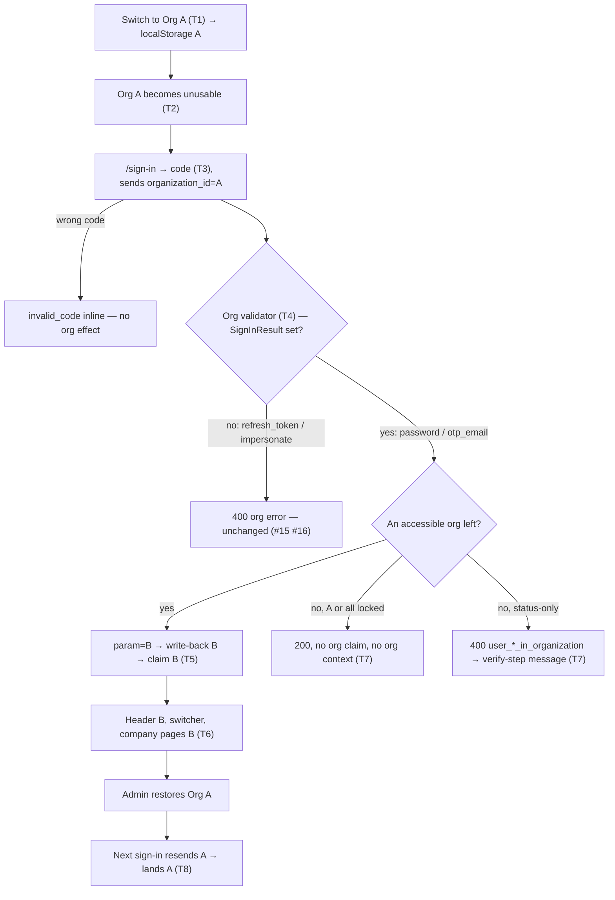
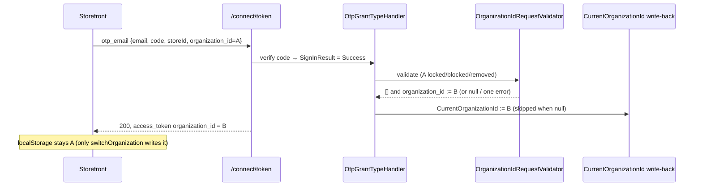
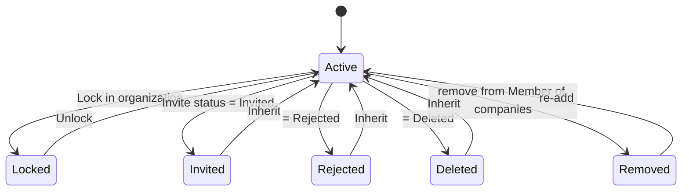

# TEST MODEL — VCST-6132

```
Ticket:      VCST-6132 | Type: Task | Status role: testable | Flow: feature-test | Priority: P2 (Medium) | Path: FULL | Changed: Backend
Context:     FULL — 1r REACHABLE (~2 min, playwright-chrome) + ba-system-analyzer (1c) + ba-story-writer Mode B (1d); no 1c-map (both maps PRESENT)
Path route:  FAST provisional at 1a (Task, Medium, single repo) → FULL at 1b: preflight breaking:vc-module-customer
             (Customer 3.1021.0 "Invites and status for multi-organization customers" — the membership-status mechanism under test)
Prior model: reports/ba/test-models/VCST-5748-2026-09-29.md — Part 0 (OTP chain L1–L8) carried forward; this model adds the
             organization-resolution slice VCST-5748 explicitly did NOT touch ("nor org resolution inside L3").
             Prior run of THIS ticket: reports/tickets/Sprint26-20/VCST-6132/ (FAST, 2026-10-16, same build) — 11/11 PASS at
             /connect/token, storefront UI never run. Treated as a HYPOTHESIS (kb KB-3CBA0D5F), re-observed by this run.
Domain map:  .claude/knowledge/domain/auth.md @ rev 1 (generated 2026-09-29) + .claude/knowledge/domain/b2b-organizations.md @ rev 2
Mind map:    ABSENT (no auth/b2b mind map)
Chain position: auth chain L1–L7 — TOUCHES L2 (the OTP challenge carries organization_id), L3 (token issuance + org resolution:
             the changed validator), L4 (session org context: header, switcher, org-scoped pages), L5 (org-scoped refusal when no
             fallback remains). L6 (Login on behalf) only as a GUARD row (#16: impersonation must NOT gain the fallback).
             Does NOT touch L1 (method choice), L7 (sign-out — used as setup only), global lockout semantics (L5 global half,
             one guard row #21). b2b chain — touches membership state (lock / invite status / association) and org switching;
             does NOT touch roles, invites lifecycle, quotes, pricing, org-scoped data isolation beyond the header org (#1 reads it).
Affected surface: vc-module-customer#321 (head c54fcfe2, deployed 3.1030.0-pr-321-c54f) — OrganizationIdRequestValidator.cs
             L24 allowFallback = IsOrganizationFallbackAllowed(context) → context.SignInResult != null (L59-62, protected virtual);
             L39-43 removed path → HandleUnavailableOrganizationAsync (L64-77, never errors under fallback); L90-125 locked/status
             path; L124 lock-beats-status. Reached, unchanged: OrganizationAccessResolver.cs:42-79 (accessible predicate),
             CurrentOrganizationIdTokenRequestHandler.cs:16-43 (write-back), OrganizationIdClaimProvider.cs:112-127 (claim),
             OTP module OtpGrantTypeHandler.cs:45 (sets SignInResult), vc-frontend useAuth.ts:90/140 + useUser.ts:367 (localStorage
             org key), otp-email-verify-form.vue (error render), xAPI organizations(statuses:[Approved]) (switcher list).
             Map MISSING: grant→SignInResult attribute; localStorage key asymmetry (OTP reads by typed email, switch writes by
             userName; nothing writes on sign-in); 4 org error codes without en.json keys; b2b D7 ("statuses:[Approved] excludes
             locked orgs") contradicted at source; auth D5 (ingress 405) CLOSED — /api/otp/request via FRONT_URL = 200 today.
Ticket signals: No formal ACs/DoD. Dmitry Grishin comment 2026-10-14 (edited 10-15) = the de-facto ACs: fallback for every credential
             sign-in (SignInResult set: password, otp_email, mfa later), refresh_token still fails; QA scope otp_email only; S1–S4
             + regression + technical claim check. Description's alternative "every grant except refresh_token" is SUPERSEDED by
             the comment (1d DRIFT, comment wins). No attachments. Env: qa1 SMTP broken → OTP code from the notification journal;
             storefront shows a "frontend expects newer Platform/Modules (SalesRep 3.1014.0)" alert over the header (1r) — env noise.
Epic context: none — follow-up to VCST-5748 (OTP sign-in) / VCST-5496 (password fallback, Done).
Domains:     auth (BL-AUTH-012/013/015/016), b2b-organizations (BL-B2B-001, BL-B2B-013)
Flows & boundaries: storefront switcher → localStorage → /sign-in OTP request/verify → /connect/token otp_email → org validator →
             write-back → claim → storefront session (header / switcher / org-scoped pages) ↔ Admin membership state (lock, invite
             status, Member of companies)
Risk areas:  VC-B2B-005 (org check resolves the wrong org) · VC-AUTH-004 (rule enforced on one surface only: password vs OTP vs
             impersonate) · reach > diff (any grant setting SignInResult gains the fallback) · stale BL-AUTH-013/016 wording ·
             switcher contents for a locked-but-Approved org (ticket says hidden, source says listed + flagged) · missing locale
             keys for org errors on the OTP verify step · stale localStorage org after a fallback
AC traceability: 29 atomic conditions (1d C1–C29): 18 story-derived (S1, S2, S3a-c, S4a, S4b×3, parity, R1-R3, AC-T) + 11 gap-ACs.
             Impl: all story conditions SATISFIED at unit level, NOT-FOUND live except the 11 /connect/token rows KB-3CBA0D5F holds;
             S2 "Org A not offered in switcher" — DRIFT vs source (listed + flagged) → verify live (#6); no CONTRADICTS.
DoD:         none declared; 1d's proposed DoD carried, confirm at 5-verdict.
```

## Part 0 — Value chain

| # | Link (buyer words) | Mechanism |
|---|---|---|
| T1 | I switch to Org A in the header; the storefront remembers it | `switchOrganization` → refresh grant with organization_id=A → `localStorage["organization-id-<userName>"] = A` |
| T2 | My access to Org A goes away (removed / locked / invited / rejected / deleted) | Admin: Member of companies · Lock in organization · membership Invite status — the contact's association or the membership row |
| T3 | I sign in with a code; the storefront quietly resends Org A | `/api/otp/request` → code (journal) → verify step → `/connect/token grant_type=otp_email {…, organization_id=A from localStorage["organization-id-<typed email>"]}` |
| T4 | The platform sees Org A is unusable and picks another org I can use | OtpGrantTypeHandler sets `SignInResult` → `OrganizationIdRequestValidator`: `allowFallback = SignInResult != null` → param rewritten to the first accessible org, cleared when none (locked), or one org error (status) |
| T5 | My session carries the new org, and it is remembered | `CurrentOrganizationIdTokenRequestHandler` writes `CurrentOrganizationId = B`; claim provider issues `organization_id = B` (none when cleared) |
| T6 | I land in Org B: header, switcher and company pages all say B | xAPI `me` / `organizations(statuses:[Approved])`; header org; org-scoped pages (BL-B2B-001) |
| T7 | If no org is left, I am told why — or let in without an org | status-only: 400 + code rendered on the verify step (BL-AUTH-013 copy); locked-only: 200, no org context |
| T8 | Once Org A is restored, I am back in Org A next time | localStorage still A (never rewritten by sign-in) → next sign-in resends A → accessible → A |







**Variants** — derived from the layer that branches (the validator), unioned with the storefront: (a) Org A state:
removed / locked / Invited / Rejected / Deleted (two code paths: L39-77 removed vs L90-125 membership); (b) what is left:
≥1 accessible org · none-locked · none-status · mixed (A removed or locked + B status-blocked); (c) grant: otp_email (the
change) · password (parity control) · refresh_token · impersonate (no-fallback guards); (d) surface: API · storefront UI.
One ROLE variant (buyer) — the admin is setup and the impersonating operator in a guard row only → **Part 0r omitted**.

**Mechanism coverage matrix** (rows = variants, columns = links; scenario # or GAP/WAIVED)

| Variant \ Link | T1 | T2 | T3 | T4 | T5 | T6 | T7 | T8 |
|---|---|---|---|---|---|---|---|---|
| A locked, B ok (otp) | 1 | 1 | 1 | 1 | 1,17 | 1,6 | n/a — org left | 1,18 |
| A removed, B ok (otp) | 2 | 2 | 2 | 2 | 2 | 2 | n/a | 18 |
| A Invited, B ok (otp) | 3 | 3 | 3 | 3 | 3 | 3 | n/a | WAIVED — same T8 path as #18, status restore = Inherit, asserted in cleanup |
| A Rejected, B ok (otp) | 4 | 4 | 4 | 4 | 4 | 4 | n/a | WAIVED — as above |
| A Deleted, B ok (otp) | 5 | 5 | 5 | 5 | 5 | WAIVED — API only; UI T6 for status rows proven by #3/#4 | n/a | WAIVED — as above |
| both locked (otp) | 7 | 7 | 7 | 7 | 7 | 7 | 7 | WAIVED — unlock = #1 tail |
| both Rejected (otp) | 8 | 8 | 8 | 8 | n/a — refused | n/a | 8 | WAIVED — Inherit in cleanup |
| both Invited / both Deleted (otp) | 9,10 | 9,10 | 9,10 | 9,10 | n/a | n/a | 9,10 | WAIVED |
| A removed + B Rejected (otp) | 11 | 11 | 11 | 11 | 11 | 11 | 11 | WAIVED |
| A locked + B Rejected (otp) | 12 | 12 | 12 | 12 | 12 | WAIVED — API only | 12 | WAIVED |
| password parity (same states) | 13 | 13 | 13 | 13 | 13 | WAIVED — password UI path is VCST-5496's, unchanged | 13 | WAIVED |
| A active (otp) | 14 | n/a | 14 | 14 | 14 | 14 | n/a | n/a |
| refresh_token switch → blocked A | 15 | 15 | n/a | 15 | n/a | 15 | 15 | n/a |
| impersonate → blocked org | n/a | 16 | n/a | 16 | n/a | n/a | 16 | n/a |
| wrong code, A blocked (otp) | 19 | 19 | 19 | 19 | 19 | n/a | 19 | n/a |
| 3 orgs + default, A blocked (otp) | 22 | 22 | 22 | 22 | 22 | 22 | n/a | n/a |

**Reverse edges** — forward effect: write-back `CurrentOrganizationId := B` + session in B. Reversed by restoring A and the
next sign-in resending A → covered by #18 (and the #1 tail). Lock → Unlock restores access → #1 tail. Status → Inherit →
asserted as each status row's cleanup postcondition (#3/#4/#5). Association removed → re-added → #2 cleanup + #18.
No money/points/stock moves.

**Fixture lifecycle** — every membership state is TERMINAL for the case that set it and shared org/persona state is pooled, so
per FIFTH RULE the case creates disposable `AGENT-TEST-6132-*` Org A / Org B (/ Org C for #22) and one buyer (userName ==
email, confirmed per run — the #20 premise) right before the step, mutates state in-case, and tears down. **Never** mutate
`MULTI_ORG_USER_EMAIL`'s memberships. A lock terminates sessions → fresh code per scenario.

## Parts 1–5 — Fault model

**Condition space:** F1 Org A state {active, removed, locked, Invited, Rejected, Deleted} (6) · F2 what remains {B active,
B locked, B status-blocked, single-org, B active + C active with default} (5) · F3 grant {otp_email, password, refresh_token,
impersonate} (4) · F4 surface {API, storefront UI} (2) · F5 credential {valid, wrong code} (2) · F6 entry {localStorage A,
key mismatch: email ≠ userName case} (2). Constraints: F1=active ⇒ F2 collapses to one class; refresh_token needs a live
session and impersonate is API/admin-only (F4=API); F5=wrong ⇒ F1/F2 cannot be observed (validator never runs). **N = 6×5×4×2×2×2 = 960.**

**Reduction:** EP on F1 within each code path (Invited/Rejected/Deleted share L90-125 → one UI row per path + API rows for the
rest); F2 reduced to the 4 classes the validator branches on (org left / none-locked / none-status / mixed) + 1 ordering class;
F3 password collapsed into ONE parity row (#13 — VCST-5496 owns the password path, unchanged by #321), refresh_token and
impersonate to one guard row each; F4 UI only where T6/T7 are observable (header, switcher, verify-step message); F5 and F6 one
row each (EG). Pairwise t=2 over F1×F2 for otp_email, t=3 on F1×F2×F3 only for the guards. **960 → 23.** Dropped: password ×
every state (subsumed by #13 + KB-3CBA0D5F matrix), UI × Deleted / mixed (subsumed by #3/#4 UI + API rows), impersonate × every
state (one blocked state suffices — the branch is grant-keyed, not state-keyed).

| # | Cell | Defect hypothesis | Archetype | Technique | Oracle | P |
|---|---|---|---|---|---|---|
| 1 | [JOURNEY] UI otp · A locked · B active · then unlock A, sign out/in | The OTP verify step shows an org error instead of signing in, or lands in A/no org; or after unlock the stale choice is not honoured — a multi-org buyer is locked out by one org | FALLBACK | FLOW | {SPEC} VCST-6132 comment S2 + Regression "last-used respected"; {BL-AUTH-016} | Critical |
| 2 | UI+API otp · A removed (Member of companies) · B active | Removed path (L64-77) still returns `invalid_organization_id` for otp — the original symptom | FALLBACK | EP | {SPEC} S1; claim = B | High |
| 3 | UI+API otp · A Invited · B active | Membership-status path refuses otp with `user_invitation_pending_in_organization`; switcher lists A | FALLBACK | EP | {SPEC} S3; {BL-AUTH-015} switcher lists accessible only | High |
| 4 | UI+API otp · A Rejected · B active | as #3 for Rejected | FALLBACK | EP | {SPEC} S3 | High |
| 5 | API otp · A Deleted · B active | as #3 for Deleted (`user_is_removed_from_organization`) | FALLBACK | EP | {SPEC} S3 | Medium |
| 6 | UI otp · A locked · B active — switcher contents | A locked-but-Approved org is offered as a working choice (or the click lets the buyer into A); ticket says "not offered", source lists it flagged | SCOPE | EG | {SPEC} S2 "Org A is not offered in the switcher" + {DOC} StorefrontUserGuide "Only companies you currently have access to appear" — **{HYPOTHESIS} on the surface (hidden vs disabled+padlock); ground at 3x** | High |
| 7 | UI+API otp · both locked | 400 instead of 200; or a claim for a locked org; storefront shows an org context it cannot use | FALLBACK | BVA | {SPEC} S4 "succeeds, no organization selected"; {BL-AUTH-016} no-org ≠ refusal | High |
| 8 | UI+API otp · both Rejected | 200 into a rejected org (fallback leaks past status), >1 error, or the verify step shows a raw/generic message | SILENT | BVA | {SPEC} S4 "fails with the membership-status error"; {BL-AUTH-013} code `user_is_rejected_in_organization`, single `errors[]`, org-specific copy | High |
| 9 | API otp · both Invited | wrong code collapse (status codes not per-cause) | BOUNDARY | EP | {BL-AUTH-013} `user_invitation_pending_in_organization` | Medium |
| 10 | API otp · both Deleted | as #9 | BOUNDARY | EP | {BL-AUTH-013} `user_is_removed_from_organization` | Medium |
| 11 | API otp+password · A removed + B Rejected | removed path never validates the fallback target → 200 into a Rejected org, or otp ≠ password | PARITY | PW | {SPEC} S4 "same result as password for the same buyer" — expected outcome itself **{HYPOTHESIS}** (source: 200 no org) | Medium |
| 12 | API otp+password · A locked + B Rejected | lock clears, status of B discarded/returned inconsistently between grants | PARITY | PW | {SPEC} S4 parity; {BL-AUTH-016} rule 3 (stale wording — see Oracle feedback) | Medium |
| 13 | API password · A removed / locked / Rejected · B active | the change regresses the password fallback | PARITY | EP | {SPEC} Regression "password … still lands in Org B"; {BL-AUTH-016} | High |
| 14 | UI otp · A active | the fallback now overrides a usable last-used org (lands in first/default instead of A) | FALLBACK | EP | {SPEC} Regression "OTP with Org A active lands in Org A" | High |
| 15 | UI+API refresh_token · switch to locked A / removed A | the fallback leaks into the explicit switch → silently lands in B or A | SCOPE | DT | {SPEC} "explicit organization switch (refresh_token) still fails"; codes `user_is_locked_in_organization` / `invalid_organization_id` | High |
| 16 | API impersonate (Login on behalf) · target's org_id = locked org | impersonation sets SignInResult (or a future change does) and silently re-points an operator into another org | SCOPE | EG | {BL-AUTH-016} non-credential grant gets no fallback (VC-AUTH-004) | Medium |
| 17 | API · after #1 fallback, read contact | write-back not done (next no-org sign-in resolves A) or done when the param was cleared (#7) | LIFECYCLE | ST | {BL-AUTH-015} substituted org persisted to CurrentOrganizationId; skipped when nothing resolved | Medium |
| 18 | UI · after fallback: localStorage, reload, restore A, sign in | localStorage rewritten to B (A no longer last-used) or stale A breaks reload; after restore lands B, not A | STALE | ST | {SPEC} Regression "last-used organization is still respected" — localStorage value **{HYPOTHESIS}** (source: stays A) | Medium |
| 19 | UI+API otp · wrong code · A blocked | org error / org substitution surfaces before the code check; CurrentOrganizationId moved by a failed sign-in | SILENT | EG | {SPEC} VCST-5748 wrong code → inline `invalid_code`; {BL-AUTH-015} no write on a failed grant | Medium |
| 20 | UI otp · email typed in different case than userName | OTP reads `organization-id-<typed email>`, switch wrote `<userName>` → last-used org silently not sent | STALE | EG | {SPEC} VCST-6132 Context "storefront sends the org the user last switched to" — **{HYPOTHESIS}**; pre-existing (VCST-5748 surface) | Low |
| 21 | API otp · global lockout + A blocked | fallback masks the global lockout (200 or org code instead of account_locked) | FALLBACK | EG | {BL-AUTH-012}/{BL-AUTH-013} global ≠ org-scoped | Low |
| 22 | API otp · A blocked · C default + active · B active (B before C in contact order) | fallback ignores DefaultOrganizationId (picks B) — buyer lands in a non-default org | FALLBACK | EG | {BL-AUTH-015} steps 3–5 apply to inaccessible requests? — **{HYPOTHESIS}**; ground at 3x / ask dev | Low |
| 23 | Admin Sign-in log after #1 | a fallback sign-in logged as failure / wrong type | SILENT | EP | {DOC} auth map L8 Sign-in log Type = OTP, Outcome success | Low |

**1e-plan:** 22 rows — storefront #1–4, 6–8, 14, 15, 18, 20 → suite 104; API #5, 9–13, 16, 17, 19, 21, 22 → suite 105
(`tc:scaffold --check` OK on both). #23 is folded into #1 as a Cross_Layer_Check (same sign-in, Admin read), not its own case.

**Probes carried in:** VC-B2B-005 → #1, #6, #15 · VC-AUTH-004 → #13, #16 · VC-AUTH-003 (email via Admin notifications) →
method used for every code, not defect-shaped (N/A) · VC-B2B-001/002/003/004, VC-AUTH-001/002/005, VC-LIST-001 → N/A: other
surfaces (addresses, role propagation, admin storefront login, impersonation naming, sign-out page, remember-me, expiry).
**Archetype sweep:** FALLBACK #1–5,7,14,21,22 · SCOPE #6,15,16 · PARITY #11–13 · SILENT #8,19,23 · STALE #18,20 · LIFECYCLE
#17 · BOUNDARY #9,10 · RACE WAIVED (no read-then-write race reachable by one buyer; two parallel sign-ins unchanged by #321) ·
REPLAY WAIVED (code replay = ECL-4.3, VCST-5748, out of scope) · MONEY WAIVED (no money) · CONFIG WAIVED
(PasswordLogin:DetailedErrors on qa1 = true; affects masking of user errors, not org codes) · RENDER WAIVED (visual_surface
false; the switcher's padlock render is suite 006 B2C-ORG-041).
**UIP sweep:** UIP-STORAGE #18, #20 · UIP-REFRESH #18 · UIP-TABS WAIVED (second tab with an A session while A is locked —
session termination on lock is VCST-5028, unchanged) · UIP-BACK/DEEP WAIVED (006 B2C-ORG-050/051 own back / deep link into a
locked org) · UIP-EXPIRE WAIVED (code expiry = VCST-5748) · UIP-NET WAIVED · UIP-INPUT #20 · UIP-VIEW WAIVED (desktop only;
mobile switcher = 006 B2C-ORG-066).
**Business Rules:** BL-AUTH-012, 013, 015, 016 · BL-B2B-001, 013.
**Edge cases:** ECL ch.4 (User Account & Authentication) read — no pattern on org fallback; ECL-4.3 (code replay) out of scope.
**Docs grounding:** StorefrontUserGuide "Company Members → Switch between your companies" ("Only companies you currently have
access to appear here") · StorefrontUserGuide "Sign In" (email + password only — auth D1). No published page covers the
token-endpoint org fallback → released-behaviour doc gap; the ticket comment is the `{SPEC}`.
**Observed grounding:** KB-3CBA0D5F (post-fix grant matrix, this build) · KB-ED213173 (pre-fix) · KB-0080ED6D (storefront sends
last-used org on code sign-in).

**Oracle feedback (proposals, never edits — to /qa-review-oracles at close-out):** BL-AUTH-016 rules 1–2 "on a `password` grant
only" → "on every credential sign-in (a grant that sets SignInResult: password, otp_email, mfa)"; rule 3 "lock beats status"
holds only without a fallback — with a fallback and no org left a lock yields 200 with no org. BL-AUTH-013 "`invalid_organization_id`
only on a non-`password` grant" → "only on a grant without SignInResult". Human source: VCST-6132 + Dmitry Grishin 2026-10-14.

## Amendments — Step 3x (reports/exploratory/SBTM-VCST-6132-2026-10-20.md, same build)

| Row | Was | Now ({OBSERVED} on 3.1030.0-pr-321-c54f) |
|---|---|---|
| #6 | {HYPOTHESIS} hidden vs disabled | Locked A stays in the switcher **disabled with a padlock**, B selected, A not clickable (no refresh_token fires). Oracle → {SPEC} VCST-5317 switcher lock flag (suite 006 B2C-ORG-041) + S2 "not offered" read as *not selectable*; wording question Q2 to PO. 3x N1 → suite 006 |
| #5 | T6 WAIVED | UI covered: Deleted A → lands B; one accessible org ⇒ no Organizations list, name only. 3x N2 → suite 006 |
| #11 | {HYPOTHESIS} | otp_email = password = **200, no organization_id claim**; CurrentOrganizationId unchanged; storefront: name only, `/company/info` → `/account/dashboard` (T7). 3x N6 (API) + N8 (UI) |
| #18 | {HYPOTHESIS} localStorage | localStorage keeps **A** through fallback, reload and the next sign-in (request body sends A); after restore → lands **A** (T8 covered). 3x N3 |
| #20 | {HYPOTHESIS} | Differently-cased email ⇒ **no organization_id sent** ⇒ lands on CurrentOrganizationId, not last-used A. Expectation kept at {SPEC}; case held `Draft` (rule 3), suspect S1, pre-existing (VCST-5748). 3x N4 |
| #8 | copy unobserved | 400 `user_is_rejected_in_organization`, one `errors[]` entry; verify step shows raw server English with the **org GUID** ("Your access to organization '<id>' has been rejected…"). Expectation kept at {BL-AUTH-013} org-specific copy without internal ids; held `Draft`, suspect S2, pre-existing. 3x N5 |
| #22 | {HYPOTHESIS} | Fallback picks **B (contact read-back order B,A,C)** — ignores DefaultOrganizationId=C and CurrentOrganizationId=C; write-back rewrites C→B. Still {HYPOTHESIS} (does not separate list order from "not default"); **no case until Q1 (dev) answers** — 3x N7 KEEP. Row stays in the plan as a question-shaped Draft only if Q1 is unanswered at authoring — decided: DROPPED from 105 plan |
| CUST-111 (027) | at-risk | password, A locked, B active, org=A → **200 claim B** (asserts 400) — stale vs {SPEC}; to Artifact A `2a` as REPAIR/RE-BASE |

New variant (T2 mechanism): removing an org from the contact (PUT contact) **deletes its membership row** (roles lost); re-adding
creates none — setup note for #2, not a scenario. New observation (T5): Sign-in log rows carry `organizationId: null` for every
sign-in, and an org-status refusal logs `failureReason: "Unknown"` (#23 cross-check reads Type/Outcome only; Q3 to dev).
Matrix: row "A Deleted" T6 → #5 (UI); row "A removed + B Rejected" T6/T7 → #11. No GAP cells remain.

**Agents to dispatch:** 3x `/qa-exploratory ticket VCST-6132` · 4a qa-frontend-expert (playwright-chrome, UI rows) +
qa-backend-expert (playwright-edge / REST, API rows) · A test-management-specialist · 4v not dispatched (visual_surface false).
