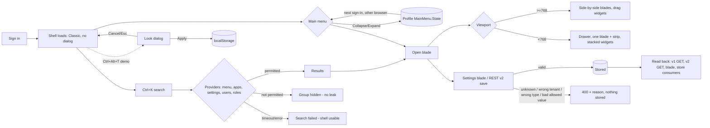
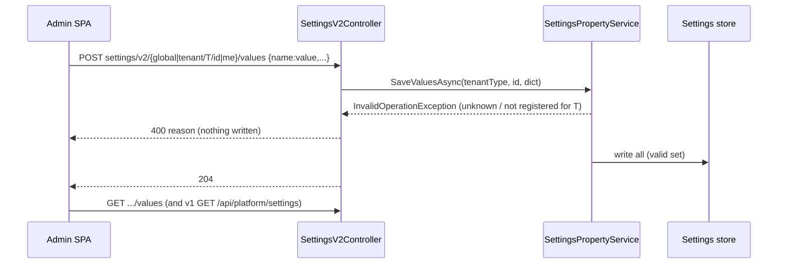
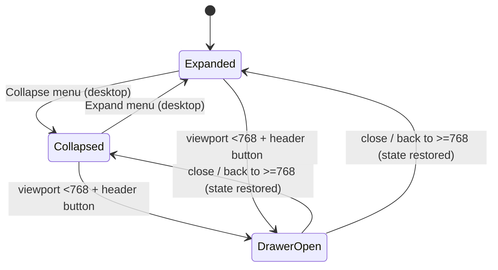

# TEST MODEL — VCST-6260

```
Ticket:      VCST-6260 | Type: Story | Status role: testable | Flow: feature-test | Priority: P0 (Highest) | Path: FULL (round 2; round 1 = operator-requested FAST smoke, same day) | Changed: Both (Admin SPA + Settings v2 REST)
Context:     FULL: ba-system-analyzer (1c, 2026-10-21) · 1d skipped — the ticket has no ACs; the PR #3134 body is the spec {SPEC}
Prior model: none — first model for this surface (no admin-shell model in reports/ba/test-models/)
Domain map:  ABSENT — no admin-shell map; chain position unverified (/qa-domain-map admin-shell recommended; 1c listed 7 unmapped surfaces)
Mind map:    ABSENT
Chain position: unverified — no domain map. Against the admin-shell chain 1c described (L0 sign-in → L1 shell chrome → L2 navigate → L3 find → L4 work in module blades/widgets → L5 configure → L6 sign-out/session), this ticket TOUCHES L1, L2, L3, L4 (layout only), L5 (Settings v2 save path); it does NOT touch L0 authentication, L6 session, module business logic inside blades, or any storefront/xAPI read path except as a reverse edge of L5.
Affected surface: vc-platform PR #3134 @ a3d2534 — SettingsV2Controller.SaveValuesAsync + SettingsPropertyService (tenant-type check); mainMenu.* / workspace.tpl.html (collapse footer); header.* + headerLicenseWidget + env banner; navigation/search/globalSearch.* + security/securitySearch.js (new); blade/bladeNavigation.js + bladeContainer.tpl.html (book mode, spine, toolbar fit); widget/widget.js + widgetContainer (drag rules); theme/* (demo looks, localStorage); ~30 sass files #hex→var(--vc-*, #hex); 13 locale files. All MISSING from any domain map (clause 11b → reported).
Ticket signals: reporter comment "Just fast smoke: Settings, Collapse" (the only human expectation); attachment = Classic desktop on 3.1086.0 with "Collapse menu" at the menu bottom (visual oracle for M1). PR body: Classic stays the product look; modern looks demo-only; Settings v2 now 400 for unknown/out-of-scope tenant saves. Cursor summary on the PR is STALE (claims theme in user-profile settings + first-sign-in dialog; body/head say localStorage, no dialog).
Epic context: none (no parent Epic). Sprint goal item "GA Admin Shell" — the Vue shell replaces this AngularJS one, so Classic is a transitional product look.
Domains:     platform-config (Settings v2, admin shell), auth-security (search permission scoping), cross-cutting (module blades inside the shell)
Flows & boundaries: shell ↔ every module blade/widget/toolbar · Settings v2 ↔ v1 GET / settings blades / store-settings consumers · global search ↔ security (users/roles) + permission model · menu state ↔ user profile (MainMenu.State)
Risk areas:  VC-API-010 (odd-typed input → 500), VC-API-009 (success-shaped no-op / invalid value stored), VC-DEPLOY-003 (Admin SPA 4 h asset cache masks a build); no VC-* entry names the admin chrome — catalog gap
AC traceability: 0 ticket ACs. 16 atomic conditions from the PR body (round-1 checklist M1–X) + 11 gap conditions from 1c (H1–H11) = 27; impl verdicts: 15 PASS / 1 partial in round 1, gap conditions untested
DoD: none declared
```

## Part 0 — VALUE CHAIN

**Value chain** (a back-office user's day, in their words):
1. **L1 Open the admin** → Classic shell loads (header: logo+version, env tab, license label, search; main menu; dashboard), no look dialog.
2. **L2 Get around** → main menu, expanded or collapsed ("Collapse menu" at the bottom) → the choice is saved to my profile (`MainMenu.State`) → it is the same next time I sign in, on any browser.
3. **L3 Find something** → Ctrl/Cmd+K → results from menu, apps, settings, users, roles, **only what my permissions allow** → Enter/click opens the right blade.
4. **L4 Work in module blades** → desktop: blades side by side, toolbars fit, widgets drag; phone (<768): one blade at a time, parent folded to a strip, widgets stacked, no drag.
5. **L5 Change a setting** → Settings blade or REST v2 (global / tenant / me) → a valid value is saved and read back everywhere it is consumed; an invalid or out-of-scope one is **refused with 400 and nothing is half-saved**.
6. **L6 (demo only) Change the look** → Ctrl+Alt+T → preview → Apply/Cancel → kept in this browser only.







**Variants** (union of the layers that branch: CSS media query, `pointer: coarse`, permission checks in providers, tenant type in the service, `$translate` locale, `html.vc-modern`):
V1 viewport ≥768 (1920, 1280, 900) · V2 viewport <768 (393, 767) · V3 role Administrator · V4 role restricted, access WITHOUT read (`SHELL_SEARCH_NOREAD`) · V5 role restricted WITH read (`SHELL_SEARCH_READ`) · V6 locale en · V7 locale with long strings (de / ru) · V8 Classic look · V9 modern look (demo) · V10 mouse vs coarse pointer · V11 tenant scope global / Store / UserProfile.

**Mechanism coverage matrix** (axes from the chain and the variants above; scenario # mapped in afterwards):

| Variant \ Link | L1 open | L2 menu+state | L3 search | L4 blades/widgets | L5 settings | L6 look |
|---|---|---|---|---|---|---|
| V1 desktop | 1 | 1, 2, 3 | 1, 6 | 1, 12, 13 | 1, 8 | 18 |
| V2 phone | 14 | 4 | 15 | 14, 16 | WAIVED — same REST, layout only covered by 14 | 18 |
| V3 admin | 1 | 2 | 6 | 12 | 8, 9, 10 | 18 |
| V4 restricted no-read | 7 | 7 | 7 | WAIVED — module blades out of scope | 11 | WAIVED — demo |
| V5 restricted read | 7 | 7 | 7 | WAIVED — as V4 | WAIVED — 11 covers the permission edge | WAIVED — demo |
| V6 en | 1 | 1 | 6 | 12 | 8 | 18 |
| V7 de/ru | 17 | 17 | 17 | 17 | WAIVED — server messages not localized by PR | WAIVED — demo |
| V8 Classic | 1, 19 | 1 | 1 | 12, 19 | 8 | 18 |
| V9 modern | WAIVED — demo only, smoke 18 | WAIVED | WAIVED | WAIVED | WAIVED | 18 |
| V10 coarse pointer | WAIVED — no touch device; emulation only | WAIVED | WAIVED | 13 | WAIVED | WAIVED |
| V11 tenant global/Store/UserProfile | WAIVED — shell load reads no tenant settings the PR changed | 2 (UserProfile) | WAIVED | WAIVED | 8, 9, 10, 11 | WAIVED |

**Reverse edges:**
- Menu collapsed → persisted → restore on next sign-in / another browser → covered by #2; expand back → #2.
- Setting saved → reverting it (save the original value; `null` never clears, KB-7056B9DA) → covered by #8; rejected save must leave the prior value intact → #9, #10.
- Look applied → Cancel/Esc restores previous → #18; server-side reversal ABSENT IN PRODUCT by design (localStorage only — PR body).
- Permission revoked mid-session → search results re-scope without re-login (BL-PLAT-001) → #7.

**Fixture lifecycle:** no terminal states. Shared mutable state = admin's `MainMenu.State` and any setting a case writes — each case restores its original value in Cleanup; restricted roles are per-run reusable (seeded by 3a).

## Part 0r — ROLE SCENARIOS

Roles in scope: Administrator → `env.ADMIN` (`{{ADMIN_EMAIL}}`/`ADMIN_PASSWORD_*` via config.js) · restricted no-read → `@td(SHELL_SEARCH_NOREAD.email)` (3a, seeding) · restricted read → `@td(SHELL_SEARCH_READ.email)` (3a, seeding). Until 3a returns, both restricted roles are FIXTURE-GAP.

BSC-1 — A catalog clerk searches the admin
  Role: SHELL_SEARCH_NOREAD · Situation: has Catalog access and setting/security *access* but not *read*
  | # | Action | Sees | Can do | Expected |
  | 1 | Ctrl+K, type a menu word ("cat") | Menu group: Catalog only | open Catalog | no Orders/Pricing items |
  | 2 | type a setting word / a user name / a role name | no Settings/Users/Roles results, or a contained "Search failed" | keep using the shell | no names leaked; no unhandled error |
  Outcome: search shows only what the clerk may open.
  Not allowed: reading settings schema (`GET settings/v2/global/schema` → 403 with this token); listing users/roles (`POST security/users/search`, `roles/search` → 403 with this token); opening Orders via a search result.

BSC-2 — The same clerk after being granted read
  Role: SHELL_SEARCH_READ · Situation: the only difference is setting:read + security:read
  | # | Action | Sees | Can do | Expected |
  | 1 | Ctrl+K, same words | Settings, Users, Roles groups appear | open a setting / a user / a role | results equal to what the APIs return to this token |
  Outcome: read permissions alone decide whether the groups appear.
  Not allowed: Orders/Pricing menu results (still no menu permission) — server: `GET /api/order/customerOrders/...` search → 403 with this token.

## Parts 1–5 — FAULT MODEL

**Condition space:** viewport {≥768 (3 widths), <768 (2)} · role {admin, no-read, read} · locale {en, de/ru} · look {Classic, modern} · pointer {mouse, coarse} · menu state {expanded, collapsed} · settings scope {global, Store, UserProfile} × payload {valid, unknown, wrong tenant, wrong type, outside allowedValues, mixed, empty, replaceAll} · search input {hit, zero results, alias, rapid typing, special chars}. Constraints: modern look is demo-only (no product behaviour); coarse pointer only via emulation; payload classes apply only to L5. Raw N ≈ 5×3×2×2×2×2 (UI) = 480 + 3×8 (settings) = 504.
**Reduction:** 504 → 19. Dropped: look × everything except L6 (demo-only per PR, subsumed by #18 smoke); pointer × everything except drag (#13 — the only code branching on pointer); locale crossed only with layout (#17 — strings do not branch logic); role crossed only with L3 and the settings permission edge (#7, #11 — providers are the only role-branching code); viewport widths collapsed to 1920/1280/900 + 393 (round-1 evidence: no breakpoint between 900 and 768 changes layout); settings payload classes kept as a DT (#8–#10), pairwise over scope.

| # | Cell | Defect hypothesis | Archetype | Technique | Oracle | P |
|---|---|---|---|---|---|---|
| 1 | admin · 1920 · en · Classic | [JOURNEY] sign in → collapse menu → Ctrl+K "settings" → open Settings → change Back In Stock › Batch size → Save → reload → menu still collapsed, value persisted → restore value, expand. Breaks if any link of the shell chain is broken for the everyday user | LIFECYCLE | FLOW | {SPEC} PR body §Main menu/§Header/§Settings | Critical |
| 2 | admin · desktop · UserProfile | collapsed state written to MainMenu.State but not read on the next sign-in / another browser context → menu resets | STALE | ST | {SPEC} "toggle moved", persisted per user (source userProfile.js) | High |
| 3 | admin · 1920×600 | menu list overflows below the window / footer covers the last item | RENDER | BVA | {SPEC} "no longer runs 60 px below the window" · BL-UI-004 | Medium |
| 4 | admin · 393 · collapsed on desktop first | collapsed class leaks into the phone drawer (labels hidden, no collapse button inside) → drawer unusable | CONFIG | ST | {SPEC} §Responsive · BL-UI-004 | High |
| 5 | admin · 1920 · keyboard | collapse button not focusable / no state exposed / search not reachable by keyboard | RENDER | EP | {BL-UI-007} {BL-A11Y-001} | Medium |
| 6 | admin · desktop · search inputs | zero results shows nothing (no empty state), alias `user:`/`role:` ignored, special chars/very long query throws, rapid typing mixes stale results, Enter on an already-open blade opens a duplicate | SILENT | EG | {SPEC} §Header "Global search" + docs/developer-guide/global-search.md | High |
| 7 | NOREAD vs READ · desktop | provider gated on *access* but data needs *read* → error or leak instead of hidden group; READ user does not see groups the API returns | SCOPE | DT | {BL-PLAT-001} {SPEC} "with permissions" (global-search.md) | Critical |
| 8 | admin · REST v2 · global/Store/UserProfile valid | valid save via v2 not visible via v1 GET / the Settings blade / v2 GET (projection/cache) | PARITY | PW | {DOC} PlatformDeveloperGuide 06-module-manifest-file (v2 me/* contract) | High |
| 9 | admin · REST v2 · unknown / wrong tenant / empty / mixed | out-of-scope or unknown name stored or 500; mixed body half-saved | BOUNDARY | DT | {SPEC} PR §Breaking changes "400 with the reason" | Critical |
| 10 | admin · REST v2 · wrong type / outside allowedValues / replaceAll with a rejected name | wrong-typed value → 500, invalid allowed value stored, replaceAll wipes values then fails | FALLBACK | EG | {HYPOTHESIS} → becomes {BL} once the team confirms 400 is the contract for value validation (VC-API-010) | High |
| 11 | NOREAD · REST v2 me/values | a user without setting permissions can save a UserProfile setting (allowed by doc) but NOT a global/Store one through me/* | SCOPE | DT | {DOC} 06-module-manifest-file "no platform:setting:* permission is required to manage your own profile settings" | High |
| 12 | admin · 1920/1280 · Classic · module blades | shell changes (spine button in every blade, toolbar width maths, `.bar` height) break module blades: toolbar "more" mis-fits, grid height wrong, nested blades scroll wrong (Catalog, Orders, Customers, Pricing, Marketing, Store, Notifications, Import/Export) | RENDER | EP | {SPEC} "Desktop blade behaviour is unchanged" · BL-UI-004 | Critical |
| 13 | admin · desktop mouse vs coarse emulation, resize across 767 | drag lost for mouse users / saved widget layout rewritten when the stacked layout is shown | CONFIG | ST | {SPEC} "Mouse users keep drag"; layout not rewritten {HYPOTHESIS} → {SPEC} if the dev confirms | Medium |
| 14 | admin · 393 · Classic | drawer, header icons, env pill, dialogs, grids, settings, tiles do not fit (overlap/overflow) | RENDER | EP | {SPEC} §Responsive "fit the screen" · BL-UI-004/006 | High |
| 15 | admin · 393 | search icon does not open search / results unusable at phone width | RENDER | EP | {SPEC} "On narrow screens it is a search icon" | Medium |
| 16 | admin · 393 · 3+ nested blades | blade fold breaks at depth ≥3 (strips stack beyond width, can't go back) | BOUNDARY | BVA | {SPEC} "blades show one at a time with the parent folded" | High |
| 17 | admin · de + ru · 1280 and 393 | long translations clip/overflow the collapse footer, license pill, env tab, search placeholder, group titles, spine titles | MONEY | EP | {BL-UI-004} | Medium |
| 18 | admin · Ctrl+Alt+T · Classic→Dark→Cancel/Esc; Apply→reload | Cancel doesn't restore; Apply not kept across reload; dialog appears on sign-in; a `settings/v2/me` request is sent | STALE | ST | {SPEC} §Modern looks | Low |
| 19 | admin · Classic · before/after | mechanical #hex→var() conversion changes a Classic colour (login, dashboard, grid selection/hover, form errors, dialog, filter panel, sign-in log, settings blade) | RENDER | EP | {SPEC} "Classic renders as before" — baseline = vcptcore_dev old build screenshots | High |

### Amendments from 3x (SBTM-VCST-6260-2026-10-21, partial — firefox resize hang)

| # | Change | Grounding |
|---|---|---|
| 2 | oracle {SPEC} now also {OBSERVED} PASS — collapsed survives a fresh browser context + sign-in (EX-01) | 3x |
| 10a | NEW CELL: `me/values?replaceAll=true` with {valid, unknown} or {valid, wrong-type} → nothing written (atomic); status 400 / 500 | {OBSERVED}; status for wrong-type stays {HYPOTHESIS} until F1 is decided |
| 10b | NEW CELL: `replaceAll=true` with a value outside `allowedValues` → today 204, the invalid value stored and every key left out reset to default (MainMenu.State lost). Expected 400 + nothing reset | {HYPOTHESIS} → {BL} once a human source states value validation; PRE-EXISTING (replaceAll is on `dev`) |
| 10c | NEW CELL: `me/values?replaceAll=true` with `{}` — UserProfile observed: 204, all profile values reset to defaults. Other scopes out of scope for this run (shared stand) | UserProfile {OBSERVED}; no case on a shared env |
| — | **Operator decision 2026-10-21:** Settings v2 value validation (wrong type → 500, value outside allowedValues stored, replaceAll with it resets other keys) is accepted pre-existing behaviour — rows 10 and 10b are no longer asserted (cases deleted); Collapse focus/state, combobox a11y, phone pill over search and book-mode strips are accepted | operator |
| — | Lane condition: playwright-firefox has no `--secrets`; sign-in there needs a REST-minted throwaway account | 3x |

Not reached by 3x (carried to 4a/4v): #4, #7, #12, #13, #14, #19 beyond the login page, H8 search inputs.

```
Probes carried in: VC-API-010 → #10 · VC-API-009 → #10 · VC-DEPLOY-003 → pre-check in every lane (served bundle = a3d2) · no VC-* for the admin chrome — N/A + reason: catalog has no shell entries
Archetype sweep: SCOPE #7,#11 · PARITY #8 · STALE #2,#18 · RACE #6 (rapid typing) · REPLAY WAIVED — saves are idempotent PUT-like maps · SILENT #6 · MONEY #17 (i18n) · BOUNDARY #9,#16 · LIFECYCLE #1 · CONFIG #4,#13 · FALLBACK #10 · RENDER #3,#5,#12,#14,#15,#19
UIP sweep: UIP-BACK WAIVED — no submit flow · UIP-DEEP #16 (deep blade path at 393) · UIP-REFRESH #1,#2 · UIP-TABS #2 (second context) · UIP-EXPIRE WAIVED — session unchanged by PR · UIP-STORAGE #18 (look in localStorage) · UIP-NET #6 (search failure path) · UIP-INPUT WAIVED — no forms added · UIP-VIEW #17 (+ 200% zoom folded into #14) · UIP-DATA #6 (zero/one/many results) · UIP-PAGE WAIVED — no paged list added · UIP-EXTREME #17 (long strings), #6 (long query)
Business Rules: BL-UI-001…007, BL-A11Y-001…004, BL-PLAT-001, BL-PLAT-002
Edge cases:  ECL-7.1, 7.3, 7.4, 15.1
Docs grounding: VirtoOZ PlatformDeveloperGuide 06-module-manifest-file (UserProfile settings via v2 me/*); PlatformUserGuide has no page for collapse/search/responsive/look — docs gap for a NEW feature
Agents to dispatch: 3x /qa-exploratory (charter: #7, #10, #12, #13, #19 hypotheses) · 4a qa-backend-expert (playwright-edge) · 4v ui-ux-expert (Chrome DevTools) · A test-management-specialist · 3a test-data-engineer
```
