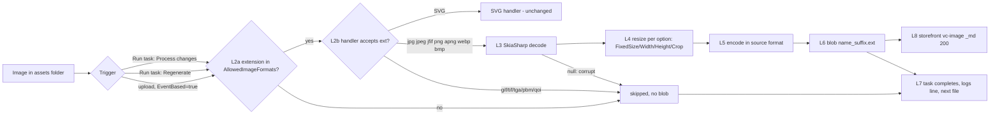
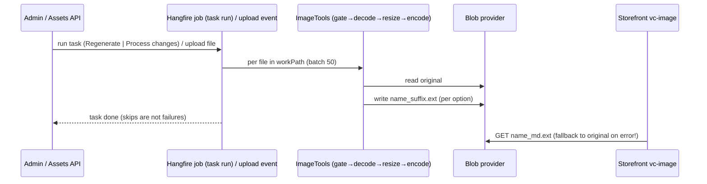

# TEST MODEL — VCST-6268

```
Ticket:      VCST-6268 | Type: Task | Status role: testable (Testing) | Flow: feature-test | Priority: P1 (High) | Path: FULL | Changed: Backend (module + its Admin SPA locale strings)
Context:     FULL: ba-system-analyzer (1c) · 1r REACHABLE (~4 min) · 1d SKIPPED (no AC field; the dev comment is the governing spec)
Prior model: none — first model for this surface
Domain map:  ABSENT — chain position unverified. 1c-map build_outcome FAILED: slug `image-tools` is not a declared BL domain
Mind map:    ABSENT
Chain position: unverified — no domain map. Provisional slice of the thumbnail chain (L1 source in asset folder → L8 storefront
             consumer): this ticket TOUCHES L2b (handler format gate), L3 decode, L4 resize, L5 encode; it does NOT touch
             L1 asset upload (Assets module), L2a AllowedImageFormats gate (AllowedImageFormatsService unchanged), L6 blob
             write (provider unchanged), L7 task orchestration (ThumbnailGenerationProcessor −2 lines, usings only), L8 vc-image.
             L1/L2a/L6/L7/L8 are crossed by the journey row only, as reach, not as change.
Affected surface: vc-module-image-tools PR #130 @6db0e3b — Core/Imaging/* (new), Data/Imaging/{SkiaImageCodec,SkiaRasterImage,
             BmpEncoder,WebpInspector} (new), Data/Services/{ImageResizer,ImageService}, ThumbnailGeneration/{RasterThumbnailHandler,
             ThumbnailGenerator}; 13 locale files (AllowedImageFormats description). Map MISSING all of them (no map).
Ticket signals: Trivy CVE-2026-106110 (ImageSharp TIFF CCITT T4 OOB write). Dev comment 2026-10-12 = {SPEC}: ImageSharp removed,
             SkiaSharp; sizes/padding/crop unchanged, pixels may differ; formats JPEG/PNG/WebP/BMP(+setting)/SVG; GIF/TIFF/TGA/
             PBM/QOI skipped without failing the task; animated → first frame; BMP 24-bit; JPEG padding w/o bg = black; no
             DllNotFoundException. Deployed 3.1007.0-pr-130-6db0 on vcptcore_qa1 via deploy PR vc-deploy-dev#6908.
Epic context: none
Domains:     Image Tools (Thumbnails) · Assets (source blobs) · Storefront catalog images (consumer)
Flows & boundaries: Assets upload ↔ event-based generation · task run (Hangfire) ↔ blob provider · thumbnail blob ↔ vc-image `_sm/_md/_lg`
Risk areas:  (1c) A — documented formats GIF/TIFF/TGA/PBM removed (docs still list 8); B — `.jpg` vs dictionary value `JPEG`
             literal-extension gate (pre-existing, unresolved); silent skip of corrupt/unsupported files; Crop rounding;
             opaque-source + transparent bg → black/solid; 2× memory on large files; storefront original-fallback masks a
             missing thumbnail; Linux native libs (SkiaSharp) load.
AC traceability (atomic conditions, from the dev test scope — no AC field):
  C1 module installed, platform starts, ImageTools loads without errors on Linux (Virto Cloud)       — confirmed-now (modules API, /health)
  C2 FixedSize thumbnail: exact W×H; padding = bg colour when set (#FFFFFF), black for JPEG w/o bg, transparent for PNG/WebP alpha
  C3 FixedWidth / FixedHeight: exact target side, other side proportional, sizes unchanged vs previous build
  C4 Crop with anchors TopLeft / Center / BottomRight shows the right part of the image
  C5 JPEG quality Low vs VeryHigh both produce a valid JPEG; quality is honoured
  C6 thumbnail keeps the SOURCE format and is named `<name>_<suffix>.<ext>`; the original is byte-unchanged
  C7 formats processed: JPEG (incl. progressive, CMYK, large), PNG ±alpha, WebP lossy/lossless, BMP (after adding `bmp`), SVG
  C8 GIF / TIFF are skipped, the task does not fail, other files in the same folder are still processed
  C9 task in "Regenerate" and in "Process changes" mode
  C10 event-based generation: a newly uploaded image gets its thumbnails automatically
  C11 downscaled photos are smooth (no jagged edges / moiré)
  C12 platform logs: no SkiaSharp / DllNotFoundException
  G1 (gap-AC, 1c B) a `.jpg` file is processed under the default AllowedImageFormats setting
  G2 (gap-AC) a corrupt image in the folder is skipped without aborting the batch
  G3 (gap-AC) animated WebP → static first frame, still WebP
  G4 (gap-AC, 1c A) docs/locale state the supported formats truthfully — VirtoOZ page still lists GIF/PBM/TIFF/TGA
DoD: none declared
```

## Part 0 — VALUE CHAIN

1. **L1** An admin (or an import) puts an image into an assets folder.
2. **L2** The module decides whether to process it: **L2a** the extension is in `AllowedImageFormats` dictionary values; **L2b** a format handler accepts the extension (raster: `RasterImageFormat.FindByExtension`; SVG handler).
3. **L3** The image is decoded (now SkiaSharp; `null` = unsupported/corrupt → skipped).
4. **L4** It is resized per each thumbnail option of the task: FixedSize / FixedWidth / FixedHeight / Crop(anchor), padding with the bg colour.
5. **L5** It is encoded in the SOURCE format (JPEG quality option; PNG; WebP lossy/lossless; BMP 24-bit).
6. **L6** The blob `<name>_<suffix>.<ext>` is written next to the original; the original is untouched.
7. **L7** The trigger completes: a task run (Regenerate / Process changes) reports done without failing on skipped files; the event path runs on upload.
8. **L8** The storefront `vc-image` requests `<name>_<sm|md|lg>.<ext>` and gets 200 — the customer's catalog loads small images, not originals.





**Variants** (code paths through the same links; union of the layers that branch — handler branches on extension, decoder on content, encoder on format+alpha, resizer on method+anchor):
V1 JPEG `.jpg` baseline · V2 JPEG `.jpeg` · V3 JPEG progressive · V4 JPEG CMYK/grayscale · V5 PNG RGBA (alpha) · V6 PNG opaque (rgb/indexed/16-bit) · V7 WebP lossy · V8 WebP lossless+alpha · V9 WebP animated · V10 BMP (after `bmp` added) · V11 SVG · V12 GIF/TIFF (unsupported, incl. added to dictionary) · V13 corrupt JPEG.
Resize sub-variants on L4: M1 FixedSize no-bg · M2 FixedSize bg · M3 FixedWidth · M4 FixedHeight · M5 Crop×anchor.

## Mechanism coverage matrix (rows derived from variants, columns from links; scenarios mapped in after)

| Variant \ Link | L2 gate | L3 decode | L4 resize | L5 encode/format | L6 name+original | L7 trigger/batch | L8 storefront |
|---|---|---|---|---|---|---|---|
| V1 .jpg | 3 | 1 | 1, 8 | 1, 11 | 1 | 1, 2 | 1 |
| V2 .jpeg | 3 | 4 | 4, 5, 9, 10 | 11 | 4 | 18 | WAIVED: L8 suffix logic is extension-agnostic, V1 covers it |
| V3 progressive | 13 | 13 | 13 | 13 | 13 | 13 | WAIVED: same as V2 |
| V4 CMYK/grey | 12 | 12 | 12 | 12 | 12 | 12 | WAIVED: same as V2 |
| V5 PNG RGBA | 6 | 6 | 6 | 6 | 6 | 6 | WAIVED: same as V2 |
| V6 PNG opaque | 7 | 7 | 7 | 7 | 7 | 7 | WAIVED: same as V2 |
| V7 WebP lossy | 14 | 14 | 14 | 14 | 14 | 14 | WAIVED: same as V2 |
| V8 WebP lossless α | 15 | 15 | 15 | 15 | 15 | 15 | WAIVED: same as V2 |
| V9 WebP animated | 19 | 19 | 19 | 19 | 19 | 19 | WAIVED: same as V2 |
| V10 BMP | 16 | 16 | 16 | 16 | 16 | 16 | WAIVED: storefront catalog does not use BMP |
| V11 SVG | 17 | 17 (unchanged handler) | 17 | 17 | 17 | 17 | WAIVED: same as V2 |
| V12 GIF/TIFF | 20 | n/a (refused at L2b) | n/a | n/a | 20 (no blob) | 20 | WAIVED: no thumbnail by spec |
| V13 corrupt | 21 | 21 | n/a | n/a | 21 (no blob) | 21 | WAIVED: no thumbnail by spec |
| M1–M5 (on V2/V5) | WAIVED: method does not enter the gate | WAIVED: method does not enter decode | 4 M1, 5 M2, 8 M3, 9 M4, 10 M5 | 4, 5 (padding encoded in source format) | 4 | WAIVED: method does not change trigger | WAIVED: storefront options are FixedWidth only (row 1) |

**Reverse edges** (no money/points/stock moved; the forward effect is a blob):
- Original deleted / replaced → its `_suffix` blobs: **ABSENT IN PRODUCT** (1c: no cleanup code in the module; pre-existing, not changed by PR) — reported, not tested here.
- Thumbnail option removed → generated files remain: ABSENT IN PRODUCT (UNVERIFIED, pre-existing).
- Re-run idempotency (regenerate twice / process changes after regenerate) → covered by 18.
- Module rollback to 3.1006.0 reads SkiaSharp-written blobs → WAIVED: no schema change; blobs are standard formats.

**Fixture lifecycle:** "Process changes" is terminal once a file is processed (it is skipped next time) → per-run disposable folder `AGENT-TEST-6268-<runid>/` + per-run AGENT-TEST options + task; never the shared `catalog` tasks. Source images: the PR's own fixtures `tests/VirtoCommerce.ImageToolsModule.Tests/media/formats/*` pinned at **6db0e3b**, plus one generated large photo (≥ 4000×3000) and one odd-aspect quadrant-coloured image (e.g. 301×199, four distinct colours) so pad, crop anchor and rounding diverge.

## Parts 1–5 — FAULT MODEL

**Condition space:** format (13: V1–V13) × method (4) × anchor (9, Crop only) × bg (none / opaque / semi-transparent) × JPEG quality (5) × alpha (2, PNG/WebP/BMP-32 only) × trigger (manual / event / scheduled) × mode (Regenerate / Process changes). Constraints: anchor only with Crop; quality only affects JPEG; alpha only for V5/V8/BMP-32; V11–V13 bypass L4/L5. Raw N ≈ 13·(3·3 + 9·3)·5·2·3·2 ≈ 28 080.
**Reduction (N → 21):** format × method pairwise on the alpha-relevant formats only (V2, V5, V8) — methods are format-agnostic in `ResizePlanner` (one code path), so methods M1–M5 run on V2 and alpha-sensitive ones (M1) also on V5/V8; anchors 9 → 3 (TopLeft/Center/BottomRight: the two corners + centre exercise both rounding directions; the rest share the switch arms); quality 5 → 2 (Low, VeryHigh — the `≥91` chroma branch is the only quality branch); bg 3 → 2 (none, opaque) + semi-transparent folded into 7 (the `ToOpaque` hypothesis); trigger scheduled dropped — same processor as manual, job disabled on env (`EnableImageProcessJob=false`); mode × format collapsed to one Process-changes row (18) — mode selects files, not codec paths.

**Test scenarios**

| # | Cell | Defect hypothesis | Archetype | Technique | Oracle | P |
|---|---|---|---|---|---|---|
| 1 | [JOURNEY] V1 .jpg, existing lg/md/sm FixedWidth options, task Regenerate over ONE storefront product's image folder → storefront card/PDP | SkiaSharp natives fail to load on the Linux container, or the codec writes an unreadable/0-byte JPEG → product images silently fall back to originals (heavy pages) or break | SILENT | FLOW | {SPEC} dev comment: thumbnails generated, same format, `_suffix`; `_md`/`_sm` requests 200 with image/jpeg and widths 275/100; Last-Modified newer than run start | 1 |
| 2 | V1, event trigger: upload `.jpg` to a folder covered by an AGENT-TEST task | event path not wired to the new generator (DI) → no thumbnails for new products | SILENT | ST | {SPEC} C10; {HYPOTHESIS} which options apply on upload — grounded by 3x | 1 |
| 3 | V1 `.jpg` vs V2 `.jpeg` under DEFAULT AllowedImageFormats | literal-extension gate skips `.jpg` (value `JPEG` ≠ `jpg`) → most catalog images never get thumbnails | CONFIG | EG | {SPEC} dev test scope implies only `bmp` needs adding; {HYPOTHESIS} until 3x observes | 1 |
| 4 | V2, M1 FixedSize 200×200 no bg, odd-aspect source | padding drawn transparent then encoded as JPEG yields garbage / non-black; or size drift | FALLBACK | BVA | {SPEC} exact 200×200, padding black for JPEG w/o bg | 2 |
| 5 | V2, M2 FixedSize bg `#FFFFFF` | bg colour parsed wrong (ARGB vs RGBA order in ImageColor.Parse) → coloured bars | PARITY | EP | {SPEC} padding = #FFFFFF (corner pixel ≈ 255,255,255) | 2 |
| 6 | V5 PNG RGBA, M1 no bg | alpha dropped (opaque canvas) → black bars on transparent PNG | FALLBACK | EP | {SPEC} padding stays transparent (corner alpha = 0), output PNG | 1 |
| 7 | V6 opaque PNG + V2 JPEG, bg `#FF000080` (semi-transparent) | `ToOpaque` turns the bg solid / black on opaque sources — undocumented change vs ImageSharp | PARITY | EG | {HYPOTHESIS} — expected = previous build's output for the same option (compare against 3.1006.0 behaviour description / existing blob); becomes {SPEC} only if dev confirms | 3 |
| 8 | V1, M3 FixedWidth 275 on existing catalog image: new vs old `_md` | rounding change → height differs by 1px from the previous build; layout jumps on the storefront | BOUNDARY | BVA | {SPEC} "thumbnail sizes … unchanged": new W×H == old blob W×H for the same source | 1 |
| 9 | V2, M4 FixedHeight 150, odd-aspect | width proportional rounding off-by-one | BOUNDARY | BVA | {SPEC} height 150, width = round-half-even(w·150/h) | 2 |
| 10 | V2 quadrant-coloured 301×199, M5 Crop 100×100 × {TopLeft, Center, BottomRight} | anchor switch arms swapped / ceiling+round offset wrong → wrong region | BOUNDARY | DT | {SPEC} TopLeft thumb dominated by TL quadrant colour; BottomRight by BR; Center contains the centre pixel | 1 |
| 11 | V1/V2, quality Low vs VeryHigh, same option size | quality ignored (fixed default) → Low not smaller, VeryHigh blurry | CONFIG | EP | {SPEC} both valid JPEG; size(Low) < size(VeryHigh) | 2 |
| 12 | V4 CMYK + grayscale JPEG | CMYK decoded as inverted/garbled colours (no profile conversion) | RENDER | EG | {SPEC} C7 thumbnail produced; mean colour within tolerance of a downscaled reference | 2 |
| 13 | V3 progressive + large 4000×3000+ photo + checkerboard-512 | 2× in-memory copy on big file fails/OOM; aliasing/moiré on downscale | BOUNDARY | EG | {SPEC} C7/C11 thumbnail produced, task completes; checkerboard downscale has no moiré (visual) | 2 |
| 14 | V7 WebP lossy | WebP encoder absent in native build → exception | SILENT | EP | {SPEC} WebP thumbnail, exact size | 2 |
| 15 | V8 WebP lossless+alpha | lossless re-encoded lossy / alpha lost | FALLBACK | EP | {SPEC} WebP, alpha preserved in padding | 2 |
| 16 | V10 BMP-24 + BMP-32 with `bmp` added to the dictionary | custom BmpEncoder writes a bad header → unreadable file | SILENT | EP | {SPEC} BMP thumbnail, 24-bit, transparency not kept | 2 |
| 17 | V11 SVG | handler chain reordering breaks SVG path | PARITY | EP | {SPEC} SVG still processed as before | 3 |
| 18 | V2 folder: Regenerate, then add 1 new file, Process changes | mode logic broken → all files reprocessed or none; originals rewritten | LIFECYCLE | ST | {SPEC} C9: second run touches only the new file; original hashes unchanged throughout | 2 |
| 19 | V9 animated WebP | animated decode throws / writes animated or wrong frame | FALLBACK | EG | {SPEC} static first frame, WebP | 3 |
| 20 | V12 GIF + TIFF in folder (also with `gif`,`tiff` added to dictionary), mixed with 2 JPEGs | unsupported file throws and aborts the batch / marks task failed | SILENT | EG | {SPEC} C8: no GIF/TIFF thumbnails, task completes, both JPEGs processed | 1 |
| 21 | V13 corrupt.jpg mixed with valid files | null from decode crashes the generator loop | SILENT | EG | {SPEC} dev "skipped without failing"; valid files processed | 2 |

C12 (logs) is evidence on every run, not a row: no admin log access on vcptcore_qa1 is known — rows 1/13/20 assert the behaviour a missing native would break; log access is a 3x charter item.
G4 (docs) is not a test row — it is a report finding (VirtoOZ "Generate Thumbnails" lists BMP, GIF, JPEG, PBM, PNG, TIFF, TGA, WebP).

Probes carried in: no `VC-*` entry for image tools / thumbnails / assets in `vc-bug-catalog.md` → N/A (no domain section).
Archetype sweep: SILENT 1,2,14,16,20,21 · CONFIG 3,11 · FALLBACK 4,6,15,19 · PARITY 5,7,17 · BOUNDARY 8,9,10,13 · LIFECYCLE 18 · RENDER 12 · STALE WAIVED (no cache/index between blob write and read; storefront CDN not in env) · RACE WAIVED (single job, Hangfire serialised per task; concurrent task runs out of scope of a codec swap) · REPLAY covered by 18 · SCOPE WAIVED (single admin role, no tenancy in thumbnails) · MONEY WAIVED (no money).
UIP sweep: WAIVED — visual_surface false (no UI component changed; only locale description text).
Business Rules: none — no `BL-*` domain covers image tools (`bl:extract` has no matching domain). Gap reported.
Edge cases: none — no `ECL-*` chapter covers image processing. Gap reported.
Docs grounding: https://docs.virtocommerce.org/platform/user-guide/thumbnails/{overview,generating-thumbnails,thumbnail-options,using-thumbnails,settings}
Observed grounding: kb none for generation (kb_none recorded); adjacent KB-3EA119C5, KB-0D8C1133.
Agents to dispatch: 3x discovery (`/qa-exploratory ticket`) · 4a qa-backend-expert (playwright-edge, Admin + REST, blob download & measure) + storefront check of row 1 · A: test-management-specialist (2a over 069 + author into 069) · 4c C1.

## Round 1 — discovery amendments (3x, SBTM-VCST-6268-2026-10-12, same diff)

- Row 3 / G1 → **{OBSERVED} fault**: under default AllowedImageFormats `.jpg` gets NO thumbnails (event and Regenerate); `.jpeg`/`.png` do; adding `jpg` fixes it. Oracle stays {SPEC} (dev scope implies JPEG works by default; docs examples use `.jpg`). Regression vs 3.1006.0 is UNDECIDED → A/B on vcst-qa (3.1006.0, same AllowedValues) at 4a.
- Row 2 → {OBSERVED}: event upload enqueues a Process-changes job over the COVERING task's whole workPath (~1 s), that task's options only; uncovered folder → nothing; workPath match is a bare prefix (`…/ab/` triggers task `…/a`).
- Row 7 → {OBSERVED} baseline: `#FF000080` → JPEG padding 254,0,0,255; opaque PNG 255,0,0,255 written as RGB; RGBA PNG padding 255,0,0,128 AND transparent source pixels filled with the bg colour. Expected stays "same as 3.1006.0" → A/B at 4a.
- Rows 20/21 → {OBSERVED} behaviour matches spec (skipped, task completes, others processed) — but the admin is told nothing.
- Reverse edge "original deleted → thumbnails remain" → **ABSENT IN PRODUCT confirmed {OBSERVED}** (pre-existing).
- Run notification always `totalCount 0, processedCount 0` → any oracle reading run counts is void; assert from blob listings.
- C12 surface = `BACK_URL/hangfire` (+ `/api/platform/diagnostics/errors`); no log viewer.

New rows (PROMOTE, each needs the 3.1006.0 A/B before it can be called a regression):

| # | Cell | Defect hypothesis | Archetype | Technique | Oracle | P |
|---|---|---|---|---|---|---|
| 22 | successful generating run → run result counters | counters never populated → admin cannot see processed/skipped files | SILENT | EG | {HYPOTHESIS} counts = files processed; real oracle = 3.1006.0 behaviour on vcst-qa | 2 |
| 23 | original named `<x>_sm<y>.jpeg` (contains an existing option suffix) | name-based "is already a thumbnail" filter excludes real originals | BOUNDARY | EG | {SPEC} every allowed original in workPath gets thumbnails; A/B decides regression | 3 |
| 24 | option with backgroundColor `notacolor` in a task with ≥2 files | invalid colour accepted on save, then throws in ImageColor.Parse outside the per-thumbnail try → run aborts, raw stack trace to admin | SILENT | EG | {SPEC} dev "skipped without failing the task" spirit; base `Rgba32.ParseHex` also threw → A/B decides parity | 2 |
