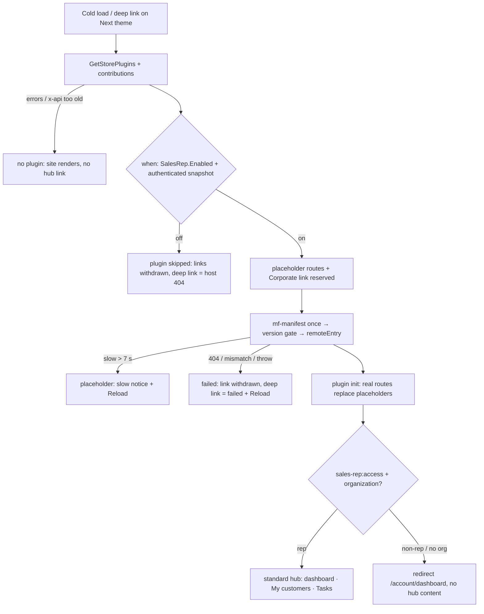

# TEST MODEL — VCST-6398

Strategy:    reports/tickets/Sprint26-21/VCST-6398/test-strategy.md · Round 1 · Floors: F10, F11 · Risks: R6, R7
Prior model: `reports/ba/test-models/VCST-6015-2026-10-15.md` — Part 0 (domain chain L1–L5, B, G + delivery links D1–D4, its flowchart/sequence/state diagrams) **carried forward by citation**. This model is the delta: the same delivery, now hosted by the **vc-frontend-next fork** (3.1.0-pr-11-d67b) whose own restyled in-repo hub is switched off, plus next#11's new contribution machinery (placeholder routes, declared menu links + withdrawal, boot-time `when` snapshot, raised loader budgets). Correction vs predecessor: none to its Part 0.
Domain map:  `.claude/knowledge/domain/sales-rep.md` @ rev 3 (generated 2026-09-18, amended 2026-10-08) — PRESENT. Primary run slug `configurable-products` (R2) is not crossed by R6/R7.
Mind map:    `.claude/knowledge/domain/sales-rep.mind-map.json` — nodes `sr.store-toggle.on-shows-hub`, `sr.hub.basic-rep`, `sr.hub.advanced-rep`, `sr.hub.non-rep-sees-nothing`, `sr.hub.non-rep-direct-url`, `sr.dashboard`, `sr.customers`, `sr.tasks`, `sr.documents`. **Mind-map DRIFT (carried from VCST-6015, still open):** no node for plugin delivery D1–D4; this model adds the fork-host and contribution-withdrawal cases to that DRIFT.
Chain position: Domain chain L1 → L2 → L3 → L4 → L5 · B · G, with delivery D1–D4 in front of L3/L5. **Touches:** D1 (GetStorePlugins with `contributions`), D2 (boot-time `when` evaluation, placeholder routes, declared menu links), D3 (manifest reuse, 5 s / 8 s / 30 s budgets), D4 (plugin replaces placeholder; menu withdrawn on failure), L5 rendering (dashboard, My customers, Tasks), G (non-rep / no-org gate). **Does NOT touch:** L1, L2 (Admin app), L4 (scoped `/graphql/sales-rep` server — byte-identical), B (`/company/sales-reps` buyer page — not in the ticket's list; carried by suite 090), Admin REST, statistics computation.
Affected surface: vc-frontend-next `client-app/config/settings_data.json:12,14` · `core/federation/{index.ts:124,611,734, contributions/declare.ts:66, contributions/evaluate.ts:149, contributions/plugin-route-placeholder.vue:2}` · `core/composables/useNavigations.ts:104` · `app-runner.ts:320` · `modules/sales-rep/{index.ts:53, routes.ts:119}` · `core/api/graphql/store/queries/getStorePlugins/getStorePlugins.graphql:21`. All resolve to sales-rep.md §3a/§3b except the delivery surface → **Map MISSING** (as VCST-6015 recorded).

## Part 0 — VALUE CHAIN, scoped to R6/R7 (carried; delta marked ▲)

*"I open the Next storefront; it learns my store ships the Sales Rep plugin and fetches it; as a rep I get the standard hub (not the Next redesign); as anyone else I get nothing; if the plugin is slow or broken the shop still works and no menu points at a dead page."*

| # | Link | Delta in this ticket |
|---|---|---|
| D1 | GetStorePlugins on every cold load | ▲ now also selects `contributions` (needs Xapi ≥ 3.1027.0 — stand 3.1027.0) |
| D2 | Host evaluates `when`, reserves placeholder routes + menu links | ▲ `when: authenticated` is a boot snapshot (`app-runner.ts:320`); a field-only `when` is treated true (`evaluate.ts:149`); placeholders set `requiresOrganization:false` (`declare.ts:66`) |
| D3 | Manifest → version gate → remoteEntry | ▲ manifest read once and reused (`index.ts:734`); budgets 2→5 s, 3→8 s, deferred 30 s, boot backstop 30 s (`index.ts:124`) |
| D4 | Plugin `init` registers routes/rail; placeholder → real page | ▲ only synchronous replacement accepted (`index.ts:611`); declared links withdrawn on failure (`useNavigations.ts:104`) |
| L5 | Hub pages render | ▲ fork host: rendered hub must be the **upstream** look (AC-21), fork restyle off (`sales_rep_builtin_enabled:false`) |
| G | Non-rep / no-org gate | ▲ gate runs only after the placeholder re-navigates (`declare.ts:66`) |

Variants (rows; union of the branching layers — host `when`/`can`, delivery outcome, entry path): V1 rep (Sales Representative) · V2 advanced rep (`sales-rep-documents:read`) · V3 org buyer, non-rep · V4 signed-in user with no organization · V5 anonymous · V6 delivery slow · V7 delivery failed · V8 SPA sign-in/out without reload.

Mechanism coverage matrix (columns = links; rows = variants; scenario # or GAP/WAIVED):
| Variant | D1 | D2 | D3 | D4 | L5 | G |
|---|---|---|---|---|---|---|
| V1 rep | 1 | 1 | 1, 7 | 1, 4 | 1 | 1 |
| V2 advanced rep | 6 | 6 | 6 | 6 | 6 | 6 |
| V3 org buyer | 2 | 2 | WAIVED — same fetch as 7 (plugin loads for every visitor, KB-C08D9226) | 2 | WAIVED — the gate stops V3 before L5 | 2 |
| V4 no-org user | 9 | 9 | 9 | 9 | WAIVED — the gate stops V4 before L5 | 9 |
| V5 anonymous | 7 | 3 | 7 | 3 | WAIVED — the gate stops V5 before L5 | 3 |
| V6 slow | 10 | 10 | 10 | 10 | 10 | WAIVED — gate unchanged by timing |
| V7 failed | 8 | 8 | 8 | 8 | 8 | WAIVED — no plugin, no gate to reach |
| V8 SPA auth change | 5 | 5 | WAIVED — no refetch on auth change by design | 5 | 5 | 5 |

Reverse edges: plugin skipped/failed → Corporate link + rail withdrawn → **8**. Sign-out (SPA) → rep links withdrawn → **5**. `SalesRep.Enabled` off → everything withdrawn → WAIVED (shared store setting on vcst, flipping it breaks parallel lanes; covered by VCST-6015 #14 on the same SalesRep 3.1014.0). Plugin fails → fall back to built-in hub → **ABSENT IN PRODUCT** (`sales_rep_builtin_enabled:false`; finding carried from VCST-6015, re-observed by **8**).
Fixture lifecycle: none terminal — read-only navigation; no record is created.
Integration links (clause 14): the Corporate header menu (b2b-organizations) and the account rail are the only other-domain links crossed — their variant is the role (V1–V5 rows); no catalog / pricing / inventory / checkout link is crossed — WAIVED for those.

## Org-context group (F10) — clause 12
| # | Variant | Scenario # / WAIVED + reason |
|---|---|---|
| 1 | Role within the org | 2, 6 (Part 0r below; server refusal on the buyer's own token) |
| 2 | Org boundary | WAIVED — L4 scoped server is byte-identical in this diff; org boundary of `salesRep*` queries is suite 050m's |
| 3 | Multi-org + switching | WAIVED — the diff does not touch org switching; rep org switch carried by suite 093 |
| 4 | Membership state | 9 (no organization — the `requiresOrganization:false` placeholder hole) |
| 5 | Sales rep | 1 (My customers lists exactly the rep's served orgs — count = badge = fixture) |
| 6 | Login on behalf | WAIVED — no impersonation surface in the diff |

Roles in scope: V1 → @td(SR_REP_PRIMARY.email) · V2 → @td(SR_REP_DOCS) · V3 → @td(AGENT_POOL_SLOT_3.b2b_email) · V4 → @td(AGENT_POOL_SLOT_3.email) (personal, no org) · V5 anonymous.
BSC-1 — A rep opens their hub on the Next storefront · Role: Sales Representative · Situation: start of day, cold browser
  | # | Action | Sees | Can do | Expected |
  | 1 | open home, sign in | Corporate menu "Sales Rep hub" link | open hub | hub from `/modules/$(VirtoCommerce.SalesRep)/…` |
  | 2 | dashboard → My customers → a customer → Tasks | standard (upstream) hub look | use calendar | every page renders, no placeholder left |
  Outcome: the rep works in the standard hub, delivered by the plugin.
  Not allowed: Document library (needs `sales-rep-documents:read`) → `/company/documents` redirects; no sales-rep chunk from the host `/assets`.
BSC-2 — A buyer follows a hub link a colleague pasted · Role: org buyer, non-rep · Situation: deep link `/company/dashboard`
  | # | Action | Sees | Can do | Expected |
  | 1 | open `/company/dashboard` cold | no hub content, no flash | nothing rep-only | redirect `/account/dashboard` |
  Outcome: the buyer stays in their own account.
  Not allowed: a `salesRepCustomerOrders` call on `/graphql/sales-rep` with the buyer's own token is refused at the server.

## Configuration group (F11) — clause 13
`module_federation_enabled` = true (deployed bundle)
| Default | On | Off | Scope (global / per store) | Change at runtime |
|---|---|---|---|---|
| 7 | 1, 7 | WAIVED — build-time theme setting; Off needs a rebuild (rollback path per PR body), not reachable on the stand | WAIVED — bundled per build, no per-store value | WAIVED — not runtime-changeable |

`sales_rep_builtin_enabled` = false (deployed bundle)
| Default | On | Off | Scope (global / per store) | Change at runtime |
|---|---|---|---|---|
| 11 | WAIVED — On needs a rebuild; the double-registration it risks is the PR's own warning (untested, residual) | 11 | WAIVED — bundled per build | WAIVED — not runtime-changeable |

## Parts 1–5 — FAULT MODEL

Condition space: role {V1, V2, V3, V4, V5} (5) × entry {cold home, cold deep link, SPA nav, SPA sign-in/out} (4) × delivery {ok, slow, failed} (3) × viewport {desktop, mobile} (2); constraints: V5 has no SPA sign-out; slow/failed only matter for roles that reach D4. Raw cells N = 120.
Reduction: N=120 → M=11. Viewport collapsed to desktop except #1's mobile leg (the hub layout is the plugin's, not the host's; mobile parity is suite 093's). Delivery slow/failed taken only with V1 (the only role that renders plugin content) plus V5 for the boot cost (#7). V2 collapses to one row (#6) — it differs only in the documents gate. SPA entry taken once per auth direction (#5).

Test scenarios (M = 11)
| # | R-n | Cell (factor values) | Defect hypothesis | Archetype | Technique | Oracle | P |
|---|---|---|---|---|---|---|---|
| 1 | R6 | **[JOURNEY]** V1 · cold home → sign in → Corporate link → dashboard → My customers → customer → Tasks calendar → back; + mobile leg | the fork host breaks one plugin page (route not replaced, calendar missing, Next restyle leaking in) — the hub "opens" but one link dead-ends | PARITY | FLOW | {SPEC AC-17, AC-18, AC-19, AC-20, AC-21} | P0 |
| 2 | R6 | V3 · cold deep link `/company/dashboard` + buyer-token call to `/graphql/sales-rep` | placeholder renders hub chrome before the gate, or the server answers a non-rep | AUTH | DT | {OBSERVED sales-rep.md §3a — grounded by BL-SR-011} | P1 |
| 3 | R6 | V5 · cold deep link `/company/tasks` | placeholder for an anonymous visitor shows a loader forever instead of sign-in | AUTH | EP | {HYPOTHESIS — grounded by the PR's placeholder spec once observed} | P2 |
| 4 | R6 | V1 · cold deep link `/company/tasks` (placeholder route) | plugin replaces its placeholder after an await → refused, URL stuck on placeholder / 404 (`index.ts:611`) | STATE | ST | {SPEC AC-19} | P1 |
| 5 | R6 | V8 · anonymous → SPA sign-in as rep, then SPA sign-out | boot-time `authenticated` snapshot keeps menu entries from before the auth change (`app-runner.ts:320`) | STATE | ST | {HYPOTHESIS — PR hotspot; grounded when observed both ways} | P1 |
| 6 | R6 | V2 · hub with Document library | contribution `and[can …]` mis-evaluated → advanced rep loses Documents or plain rep gains it | AUTH | DT | {OBSERVED KB-56048C88 — grounded by sales-rep.md §3b role table} | P2 |
| 7 | R7 | V5 · cold home, HAR | MF on by default: GetStorePlugins errors, manifest fetched twice, or first content waits on the plugin | CONFIG | EG | {SPEC settings_data.json:12 shipped true; KB-56048C88} | P1 |
| 8 | R7 | V1 · `/modules/**` aborted on cold load | failed plugin leaves a dead Corporate link / rail, or blanks the page; no fallback hub (ABSENT IN PRODUCT) | RESILIENCE | EG | {SPEC PR body: link withdrawn, failed + Reload} | P1 |
| 9 | R6 | V4 · deep link `/company/dashboard` after the plugin loads | `requiresOrganization:false` placeholder lets a no-org user see hub content (`declare.ts:66`) | AUTH | EP | {OBSERVED sales-rep.md §3a — grounded by BL-SR-011} | P1 |
| 10 | R7 | V1 · `/modules/**` delayed 9 s, deep link `/company/dashboard` | raised budgets: slow notice never appears at 7 s or first paint waits the full budget | RESILIENCE | BVA | {HYPOTHESIS — PLACEHOLDER_SLOW_NOTICE_MS 7000 per diff; grounded when observed} | P2 |
| 11 | R7 | V1 · built-in off: network + DOM count | hub registered twice (two Corporate links / two rails) or a host-bundled sales-rep chunk loads | CONFIG | EP | {SPEC settings_data.json:14 shipped false} | P2 |
