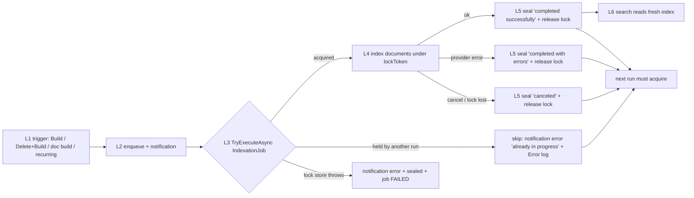
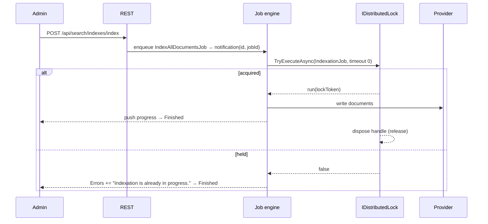
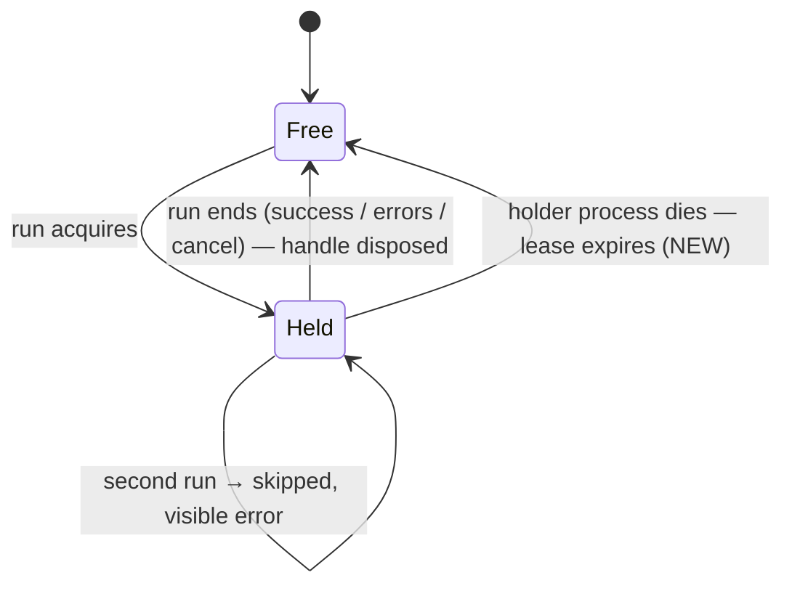

# TEST MODEL — VCST-6429

```
Ticket:      VCST-6429 | Type: Review task | Status role: testable (Testing) | Flow: feature-test | Priority: P2 (Medium, auto-set) | Path: FULL | Changed: Backend (vc-module-search)
Context:     inline (orchestrator read the PR diff + IndexingJobs/IndexProgressHandler/Module.cs at head 927871e8 and base e462accd; 1c not dispatched — stated deviation)
Prior model: none for indexation; search surface model = none (domain map §5 G5: Index management never live-browsed)
Domain map:  .claude/knowledge/domain/search.md @ rev 1 (generated 2026-09-28, stale_after 60d → PRESENT)
Mind map:    .claude/knowledge/domain/search.mind-map.json — srch.index.manage · srch.index.manage.blue-green-swap · srch.index.freshness
Chain position: L1–L5 of the domain chain's index-maintenance branch (manual trigger → job → lock → provider write → notification);
             does NOT touch L6+ query-time links (keyword query, facets, barcode expansion) except as a downstream read (S8).
Affected surface: vc-module-search IndexingJobs.RunIndexJobAsync (every manual, single-document and recurring indexation path);
             Admin "Search index" blade + "Indexation process" blade (domain map §2e); REST POST /api/search/indexes/index,
             GET /api/search/indexes/tasks/{id}/cancel; push notification IndexProgressPushNotification.
Ticket signals: PR #157 (open, dev) → artifact VirtoCommerce.Search 3.1011.0-pr-157-9278; Jira VP-9334 (root cause seen on vcptcore-qa1:
             "Lock status: Conflicted … IndexationJob", every indexation indexed nothing while reporting success).
             Comment (Oleg Zhuk, 2026-10-20): smoke = Build · Rebuild with Delete · Single product build. No attachments.
Epic context: none (Review task, no parent).
Domains:     srch (index management); cross: notif (push notification)
Flows & boundaries: Admin blade ↔ REST ↔ background job engine (Hangfire on qa1) ↔ IDistributedLock ↔ search provider (Azure AI Search on qa1)
Risk areas:  VC-SEARCH-001 (empty/partial build reports success) · VCST-5091 (notification spins "In progress") · VCST-5416 (concurrent progress counters)
AC traceability: no ACs (Review task). Conditions derived from the PR body's 4 behaviour claims + the dev smoke comment (C1–C8 below).
```

## Part 0 — VALUE CHAIN

Value chain: **L1** admin starts Build / Delete and build / per-product Build index (or the recurring IndexChangesJob fires) → **L2** a job
is enqueued and a notification is returned → **L3** the job acquires the cluster-wide `IndexationJob` lock (or loses it) → **L4** the
provider index is written (blue-green swap on Delete and build) → **L5** the notification is sealed with a truthful result and the lock is
released → **L6** storefront/xAPI search reads the fresh index.







Variants (rows): manual full **Build** · manual **Delete and build** (blue-green) · **single-document** build (documentIds — product Index widget) ·
**recurring IndexChangesJob** (suppressInsignificantNotifications=true). Derived from the code that branches: `RunIndexJobAsync` callers.

### Mechanism coverage matrix (variants × links)

| Variant \ Link | L2 enqueue | L3 acquire | L3 lose | L4 write | L5 seal + release | L6 read |
|---|---|---|---|---|---|---|
| Build | S1 | S1 | S4 | S1 | S1, S6 | S8 |
| Delete and build | S2 | S2 | WAIVED (same branch as S4; code path identical) | S2 | S2 | S2 |
| Single-document | S3 | S3 | S5 | S3 | S3 | S3 |
| Recurring IndexChangesJob | GAP (env: cron cannot be triggered on demand; observed only via its side effects) | S8 | S9 (log only → GAP) | S8 | S8 | S8 |
| Cancel (orthogonal ending) | S7 | S7 | — n/a | S7 | S7 | WAIVED (no read after cancel needed) |
| Lock-store failure / lock lost | GAP (env: no Redis control) | S10 GAP | S10 GAP | — | S10 GAP | — |
| Dead holder (lease expiry) | GAP (env: cannot kill a pod mid-run) | S11 GAP | — | — | S11 GAP | — |

Reverse edges: Delete and build → Swap indices reverts to the previous index → covered by suite 061 SRCHA-018 (not re-run; unchanged code).
Cancel reverses an in-flight build → S7. No money/stock/entitlement edge.
Fixture lifecycle: none terminal — every scenario is repeatable on live catalog data (data_surface = false).

## Parts 1–5 — FAULT MODEL

Condition space: F1 run kind {Build, Delete+Build, single-doc, recurring} · F2 lock at start {free, held-live, held-dead, store-down} ·
F3 ending {success, provider-error, cancel, lock-lost} · F4 topology {single-instance, multi-instance}. Constraints: held-dead, store-down,
lock-lost and multi-instance are not inducible on vcptcore-qa1. Raw N = 4×4×4×2 = 128.
Reduction: F4 fixed to single-instance (the only topology on the stand); F2 held-dead/store-down and F3 lock-lost → GAP rows S10/S11
(unit-tested in the PR: IndexationStuckLockTests); F3 provider-error collapsed into S6 (same finally path as success). Each-choice over the
remaining F1×F2{free,held}×F3{success,cancel} with contention exercised on the two manual variants that a human triggers concurrently. 128 → 11.

| # | Cell | Defect hypothesis | Archetype | Technique | Oracle | P |
|---|---|---|---|---|---|---|
| S1 | Build Product, lock free, success | new lock API never releases → the NEXT run is skipped forever (the VP-9334 symptom with a new cause) | SILENT | FLOW | {SPEC} PR body "lock always released"; next run completes | Critical |
| S2 | Delete and build Category, free | lockToken plumbing breaks the blue-green swap; index empty until swap | SILENT | FLOW | {DOC} user-guide "Delete and build … existing index remains unaffected … swap" | High |
| S3 | single product Build index (documentIds) | doc build path skipped/silent after the lock change | SILENT | EP | {DOC} product-indexing "Build index → Indexation process blade shows result" | High |
| S4 | Build while another Build holds | loser reports success with 0 docs (old symptom) / loser's notification never sealed / winner disturbed | RACE | ST | {SPEC} PR body "held lock surfaced on the notification" | Critical |
| S5 | single-doc build while a full build holds | per-product Build index silently no-ops during a long rebuild | SILENT | EG | {SPEC} same as S4 | High |
| S6 | run ending with provider errors, then a new run | inner catch path skips release → next run blocked | LIFECYCLE | ST | {SPEC} "handle disposed in a finally" | High |
| S7 | cancel during Build, then new run | cancellation no longer reaches the work (token now lockToken) or leaves the lock held | LIFECYCLE | ST | {SPEC} "lockToken cancelled on job cancellation" | High |
| S8 | product edit → event/recurring indexation → storefront search | incremental path skipped under the new guard → stale search (BL-SRCH-003). **Checklist only, no new case:** event-based `IndexDocumentsAsync` bypasses the lock (only recurring `IndexChangesJob` runs under it), so this guards the downstream read; existing SRCHA-015/025 own freshness | STALE | FLOW | {BL} BL-SRCH-003 | High |
| S9 | contention logs at Error | skip still silent in logs | SILENT | EG | {SPEC} — GAP: App Insights not configured on vcptcore-qa1 | Medium |
| S10 | lock store unreachable | job "succeeds" / notification spins | SILENT | EG | {SPEC} — GAP (env) | Medium |
| S11 | holder dies mid-run | lock never expires | LIFECYCLE | EG | {SPEC} — GAP (env) | Medium |

Probes carried in: VC-SEARCH-001 (empty/partial build reports success) → S1, S2 (index doc count before = after) · VC-SEARCH-002 → S8 ·
VC-SEARCH-003 → N/A (no provider change; Azure Search only on stand).
Archetype sweep: SILENT S1–S3,S5 · RACE S4 · LIFECYCLE S6,S7 · STALE S8 · SCOPE/PARITY/REPLAY/MONEY/BOUNDARY/RENDER WAIVED — backend job, no
tenant/value/visual surface · CONFIG WAIVED — no new setting (12h lockTimeout removal has no setting) · FALLBACK WAIVED.
UIP sweep: WAIVED — visual_surface false (no UI file in the diff; the Admin blade only renders the notification).
Business Rules: BL-SRCH-003 (index consistency after change). No BL-* exists for indexation job semantics → oracle gap, proposed below.
Edge cases: none in ECL for job concurrency.
Docs grounding: VirtoOZ PlatformUserGuide "Manage Search Index" (Build / Delete and build / blue-green), "Product Indexing" (Index widget →
Build index). **Concurrent-run behaviour is undocumented** — released behaviour with no doc = recorded, not invented.
Agents to dispatch: qa-backend-expert (playwright-edge, Admin SPA + REST) · test-management-specialist (Artifact A: 2a on 061 + authoring).

### Discovery (3x, inline) — observed 2026-10-20 on vcptcore-qa1, Search 3.1011.0-pr-157-9278
- S1 PASS: ContentFile Build 3/3 "Indexation completed successfully"; a Build right after Product finished also completed (lock released).
- S4 PARTIAL: loser B sealed immediately with `Indexation is already in progress.` (errorCount 1) — **but the winner's progress was then written
  onto B's notification** (B ended `documentType=Product`, "Product: indexation finished", 413/413) while A's own notification froze at
  "50 of 413" until it completed. Mechanism: `IndexingJobs` is a singleton holding one `IndexProgressHandler`; the loser's `Start()` reassigns
  the shared `_notification` before it tries the lock. Code unchanged by the PR (base e462accd has the same order) → PRE-EXISTING; old-build
  probe on vcst-qa (3.1010.0, different job engine / likely multi-instance) did NOT show it, so the old-build comparison is inconclusive.
