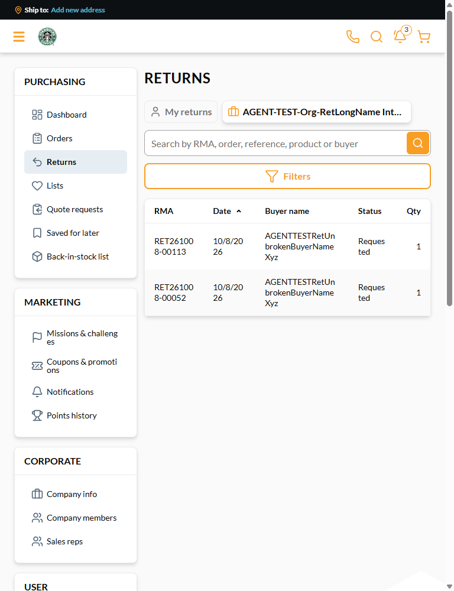

# Organization returns table breaks words mid-word at 768-960 px ("Cancell/ed", "RET261008/-00047") — **P3**

## Status: FIXED — verified in VCST-5884 round 3, 2026-10-12, vcst: Return 3.1005.0-pr-28-fb4f, theme 2.60.0-pr-2523-4263-4263715a
**Fixed by:** vc-frontend #2523 67896dc (cards below 1024 px). Verified: 4v V1/V2 (cards < 1024, table ≥ 1024, no mid-word break in dates or statuses)
**Was:** CONFIRMED — BELOW SEVERITY FLOOR (Low/P3): draft kept, NOT filed in the tracker
**Evidence note:** 3 round-2 screenshot(s) below were never committed (found 2026-10-12); the links are kept as a record of what was captured. The round-3 verification evidence named under Fixed by is current.
**Found by:** agent — testing VCST-5884
**Tracker:** none (below the 5-file floor Critical/High/Medium); named in the VCST-5884 QA-Complete comment under "Not filed (below severity floor)"
**Oracle:** closest rule `BL-UI-004` — ARGUABLE (a mid-word wrap is not overflow). No stricter invariant exists, so this is also a
candidate **PROPOSED-BL gap** ("table cells must not break a word / date / identifier mid-token").
**Provenance:** IN-SCOPE for the organization tab — the new fifth "Buyer name" column narrows the others
(`client-app/modules/returns/pages/returns.vue:142-150`). The shared table mechanism (`td` computed `word-break: break-word`,
`table-layout: auto`) may be PRE-EXISTING; the own list at the same width was **not checked**.
**Related, NOT a duplicate:** VCST-6153 (Done) — Sales Rep Top sellers wraps mid-number; same defect class, different surface.

## Environment
- Storefront theme `2.60.0-pr-2523-9e4e-9e4e67ef` (vc-frontend PR #2523 @ 9e4e67e), Return `3.1005.0-pr-28-62f9`, Platform 3.1076.0, env vcst
- Not reproduced at 1000 px. The prior QA round of this ticket reported the same at the older head 3f1b9c6; CONFIRMED again on 9e4e67e.

## Steps to reproduce
1. Sign in as the holder `@td(ORG_RET_HOLDER_GLOBAL.email)`; open `/account/returns?scope=organization` (table layout).
2. Set the viewport to 768-960 px (799 px measured). For the card layout set 375 px with the long-name holder `@td(ORG_RET_LONG_NAME_BUYER.email)`.

## Expected
No word is split (statuses, dates and RMA numbers stay whole).

## Actual
- At 799 px: statuses, dates and RMA numbers break mid-word — "Cancell/ed", "Request/ed", "10/8/20/26", "RET261008/-00047" (27 cells over 9 rows). The five columns measure 107 / 90 / 176 / 85 / 56 px.
- At 375 px (card layout, lane A) a buyer name broke as "HolderMembershi/p".

## Layer Validation
| Layer | Result | Evidence |
|---|---|---|
| 1. Storefront Frontend | **FAIL** | cells wrap mid-word at 768-960 px and in the 375 px card layout |
| 2. Backend Admin | N/A | storefront-only |
| 3. GraphQL xAPI | PASS | data is correct; only the rendering splits it |
| 4. Platform REST API | N/A | not involved |

**Owning layer:** 1 — vc-frontend, `client-app/modules/returns/pages/returns.vue:142-150` (organization table, five columns).

## Impact / severity — P3, Low
Readability only; no data loss, every value is still present and complete.

## Fix Routing
Repo `vc-frontend`. `white-space: nowrap` on date / status / RMA cells or per-column `min-width`, as VCST-6153's fix did for the
sales-rep tables. Not a breaking change. Before fixing, check the own list at the same width (pre-existing or not) and decide
whether to propose the BL gap above.
