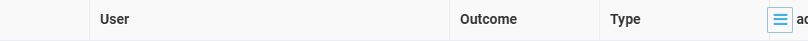

# Admin SPA: the ui-grid Grid Menu button paints over the header label under it when a grid scrolls horizontally — **Low**

## Status: READY_TO_SUBMIT
**Found by:** agent — testing VCST-5884
**Severity:** Low (P3) · **Tracker:** VCST-6267 (Jira, filed 2026-10-10; labels found-by-agent, found-in-testing; relates to VCST-5884) · **Pre-existing mechanism** (vc-platform); exposed on the Return list by vc-module-return #28's opt-in nine-column state
**Investigation package:** `reports/tickets/Sprint26-20/VCST-5884/vcptcore_dev/evidence-V16/`

## Environment
vcptcore_dev Admin SPA · platform `3.1079.0-alpha.13411` · Return `3.1005.0-pr-28-fb4f` · Edge 154 and Firefox 151, 1920×1080 and 1366×768, fresh profile (no saved grid layout)

## Summary
The platform floats the 26×26 px Grid Menu (≡) button over the right end of every ui-grid header without reserving space for it. In a grid that scrolls horizontally, whatever label sits under that strip at the current scroll position is painted over. On the Return list with "Modify date" and "Created by" switched on (9 columns, 1097 px in an 898 px viewport) the header reads "C[≡]ed" at the initial scroll position; the platform's own Sign-in log grid shows the same over "IP address" after a 70 px scroll.

## Steps to reproduce
1. Admin SPA as an administrator, fresh browser profile, 1920×1080 → More → Returns.
2. Grid Menu (≡) → tick "Modify date" and "Created by" → close the menu.
3. Look at the "Created by" header at the initial scroll position.

**Expected:** every header label readable; the menu button does not cover a label.
**Actual:** "C[≡]ed" (26×17 px of the label covered); readable after scrolling right; the header keeps a `title` tooltip.

## Layer Validation
| Layer | Result | Evidence |
|-------|--------|----------|
| 1. Storefront Frontend | N/A | Admin only |
| 2. Backend Admin | FAIL | `evidence-V16/screenshots/*` + `dom-measure-*.json` (menu button x 1138–1164 over "Created by" x 1128–1196) |
| 3. GraphQL xAPI | N/A | — |
| 4. Platform REST API | PASS | `POST /api/return/search` 200; column toggles send no request |

**Owning layer:** Layer 2 — Admin SPA platform shell.

## Root Cause Analysis
vc-platform `wwwroot/js/common/uiGridUtils.js:52-54` sets `enableGridMenu: true` for every grid; vendor angular-ui-grid 4.12.4 `ui-grid.core.css:527-539` positions `.ui-grid-menu-button` absolutely, and the platform theme `src/VirtoCommerce.Platform.Web/wwwroot/css/themes/main/sass/modules/_ui-grid.sass:234-247` places it at right 15 px, top 4 px, 26×26 — the header reserves no room for it. Long-standing (2019–2023). #28 (9bcdf23a) only created a scrolling state on purpose ("the grid scrolls instead of clipping"); before it the button permanently covered "Item count" (round-1 finding, fixed by #28). Not documented either way — partly a product call.

## Evidence
![Return list, 9 columns: "C[≡]ed"](../../screenshots/Admin-UiGrid-Menu-Button-Covers-Scrolled-Header/V16-r2-inv-return-list-header-closeup-created-by-covered.png)

## Fix Routing (→ /qa-fix)

- **Owning layer:** Layer 2 — Admin (platform shell CSS)
- **Suggested repo:** VirtoCommerce/vc-platform
- **repoKind:** platform
- **Ownership hint:** platform
- **Component / module:** Admin SPA ui-grid Grid Menu button
- **RCA anchor:** `src/VirtoCommerce.Platform.Web/wwwroot/css/themes/main/sass/modules/_ui-grid.sass:234-247`
- **Routing confidence:** MEDIUM — mechanism certain; whether to fix (reserve the button's strip in the header viewport) is a product call; not vc-module-return
