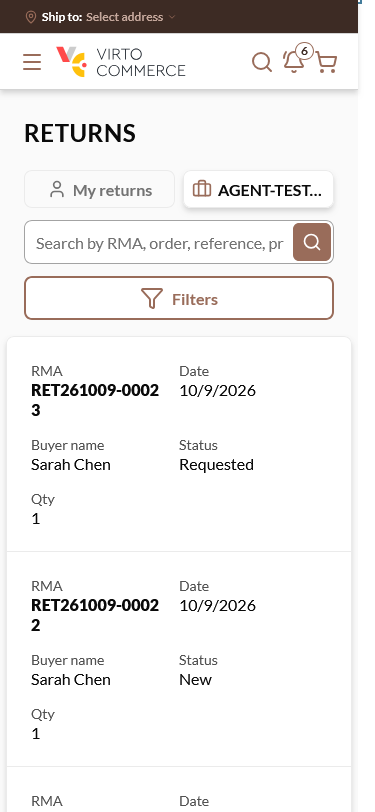
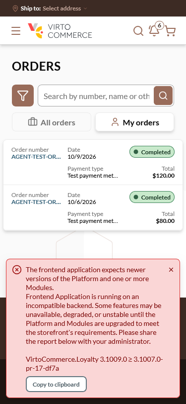

# Storefront Returns list cards on Firefox ≤ 385 px: the RMA breaks inside the number ("RET261009-0002" / "3") — **Low**

## Status: READY_TO_SUBMIT
**Found by:** agent — testing VCST-5884
**Severity:** Low (P3) · **Tracker:** VCST-6264 (Jira, filed 2026-10-10; labels found-by-agent, found-in-testing; relates to VCST-5884) · **Pre-existing** (VCST-5628, vc-frontend #2488); reused by #2523's organization tab
**Investigation package:** `reports/tickets/Sprint26-20/VCST-5884/vcptcore_dev/evidence-V2/` (REPRODUCED, 30/30 cards)

## Environment
vcptcore_dev · store B2B-store · theme `2.60.0-pr-2523-466f-466fa0a8` · Return `3.1005.0-pr-28-fb4f` · Firefox 151 (DPR 1) at 360–385 px; Chromium as control

## Summary
On the Returns list (My returns and the organization tab) the mobile cards put the 15-character RMA in a half-width column narrower than the RMA. Firefox breaks it inside the number, leaving the last digit(s) alone ("RET261009-0002" / "3" at 375; "RET261009-000" / "23" at 360) — the first line reads as a different, complete RMA. Chrome breaks at the hyphen. Whole from 386 px. The Orders list cards keep the order number on one line.

## Steps to reproduce
1. Firefox at 375×812 (any width ≤ 385), sign in as a buyer with returns (e.g. `@td(ACME_ADMIN)`).
2. Open `/account/returns` or `/account/returns?scope=organization`.

**Expected:** the RMA reads as one unit, as the order number does on `/account/orders`.
**Actual:** every card shows "RET261009-0002" with "3" on the next line.

## Layer Validation
| Layer | Result | Evidence |
|-------|--------|----------|
| 1. Storefront Frontend | FAIL | screenshots below; computed styles + Range rects `evidence-V2/network/V2-r2-inv-*-rma-measure.json`; width matrix 385 split / 386 whole |
| 2. Backend Admin | N/A | — |
| 3. GraphQL xAPI | PASS | `organizationReturns` returns every `number` whole (15 chars), no errors |
| 4. Platform REST API | N/A | `Return.ReturnNewNumberTemplate` unset → default 15-char format |

**Owning layer:** Layer 1 — Storefront.

## Root Cause Analysis
`client-app/modules/returns/pages/returns.vue:104` (RMA text, `font-black`) in a two-column card (`:361-363`) whose value rule `:373-375` declares `overflow-hidden text-ellipsis pr-4` but no `nowrap`; it inherits VcTable's `.vc-table__mobile { word-break: break-word }` (`vc-table.vue:1149-1152`, VCST-3810), so the ellipsis never applies and Firefox breaks at the last character that fits (137.3 px RMA in a 132 px box at 375). Same card pattern, not reachable on the stand: `quotes.vue:79-80`, `purchase-requests.vue:44-45`. Precedent: VCST-6153 / VCST-6180 fixed this class per component and kept the shared VcTable rule.

## Evidence

## Fix Routing (→ /qa-fix)

- **Owning layer:** Layer 1 — Storefront
- **Suggested repo:** VirtoCommerce/vc-frontend
- **repoKind:** frontend
- **Ownership hint:** platform
- **Component / module:** returns list mobile card (RMA cell)
- **RCA anchor:** `client-app/modules/returns/pages/returns.vue:104, 361-363, 373-375`
- **Routing confidence:** HIGH for the location; the fix needs a layout choice — `nowrap` alone would ellipsize to "RET261009-000…" at 360 and hide the digits that identify the return, so the RMA cell needs the width (e.g. span both columns at narrow widths)
