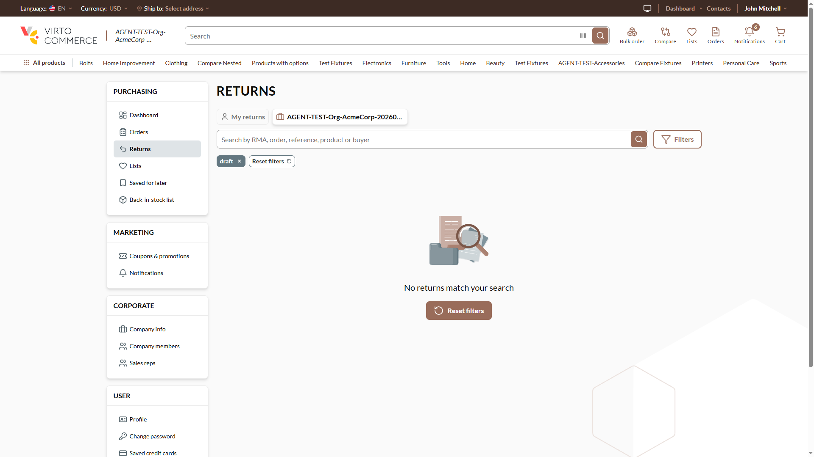
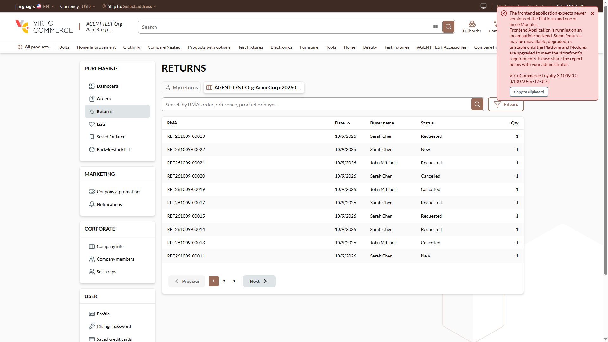

# Returns organization tab: a lower-case `status=draft` in the link is not dropped — raw chip and an empty list — **Low**

## Status: READY_TO_SUBMIT
**Found by:** agent — testing VCST-5884
**Severity:** Low (P3) · **Tracker:** VCST-6262 (Jira, filed 2026-10-10; labels found-by-agent, found-in-testing; subtask of VCST-5884) · **In this ticket's diff:** vc-frontend #2523 (b9a72946, 50fdf182), not released
**Investigation package:** `reports/tickets/Sprint26-20/VCST-5884/vcptcore_dev/evidence-X24/` (REPRODUCED 5/5)

## Environment
vcptcore_dev · store B2B-store · theme `2.60.0-pr-2523-466f-466fa0a8` (PR head 4263715a keeps the same comparison) · Return `3.1005.0-pr-28-fb4f` · platform `3.1079.0-alpha.13411` (DatabaseProvider SqlServer) · Chrome 154, 1920×1080

## Summary
Jira 111790 says the organization tab "no longer offers a Draft status filter, and a Draft filter carried in a link is dropped". It drops only the exact spelling "Draft": `draft`, `DRAFT`, `dRaft` — or a lower-case draft carried over from My returns by the tab switch — reach `GetOrganizationReturns` as `statuses: ["draft"]`, show a raw "draft" chip and "No returns match your search". No draft is exposed; one click (chip ✕ or Reset filters) recovers.

## Steps to reproduce
1. Sign in as an organization-returns holder (e.g. `@td(ACME_ADMIN)`), organization selected.
2. Open `/account/returns?scope=organization&status=draft`.

**Expected:** the Draft status is dropped as for `status=Draft` — no chip, no `statuses` sent, the organization's returns listed (30 on the stand).
**Actual:** a raw "draft" chip, `GetOrganizationReturns` with `statuses ["draft"]` → `totalCount 0`, "No returns match your search". `status=draft&status=Requested` lists the Requested rows with a stray "draft" chip.

## Layer Validation
| Layer | Result | Evidence |
|-------|--------|----------|
| 1. Storefront Frontend | FAIL | the client sends the un-stripped code (`evidence-X24/network/failing-GetOrganizationReturns-lowercase-draft.json`, variants file: 11 runs) |
| 2. Backend Admin | N/A | storefront filter |
| 3. GraphQL xAPI | PASS | the server answers 200, no errors, correctly for what it was sent (organization lists never hold drafts) |
| 4. Platform REST API | N/A | — |

**Owning layer:** Layer 1 — Storefront.

## Root Cause Analysis
`client-app/modules/returns/composables/useReturns.ts:50-51` (`isStatusInScope`: `code !== DRAFT_STATUS`) with `constants.ts:6` (`"Draft"`) — a case-sensitive comparison, while the server matches statuses case-insensitively on this stand. Added by b9a72946 ("offer no Draft filter on the organization tab"), carried into `isStatusInScope` by 50fdf182; its unit tests cover "Draft" only (`useReturns.test.ts:131-156`). Pre-existing and outside this ticket (#2488): any status code in another case shows a raw chip label (`returns.vue:252`) and leaves its Filters checkbox unticked (`returns-filter-fields.vue:45-52`).

## Evidence

## Fix Routing (→ /qa-fix)

- **Owning layer:** Layer 1 — Storefront
- **Suggested repo:** VirtoCommerce/vc-frontend
- **repoKind:** frontend
- **Ownership hint:** platform
- **Component / module:** returns module — `useReturns` status scope filter
- **RCA anchor:** `client-app/modules/returns/composables/useReturns.ts:50-51`
- **Routing confidence:** HIGH — fix forward inside the open PR #2523 (match URL status codes to the `returnStatuses` keys case-insensitively, which also covers the pre-existing raw-chip case)
