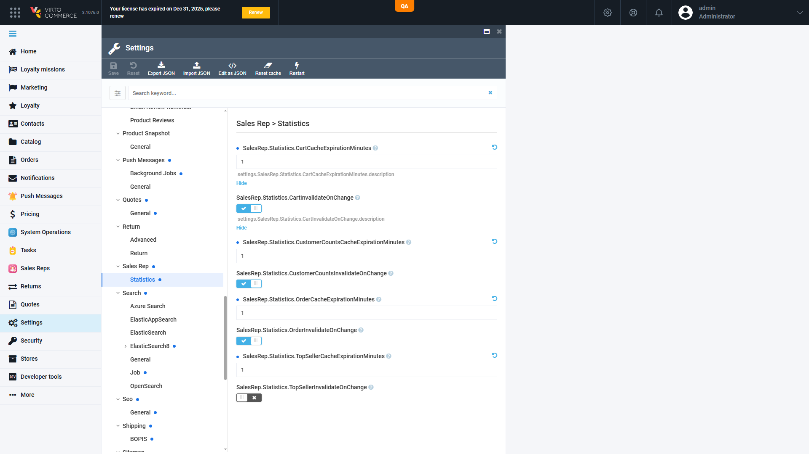
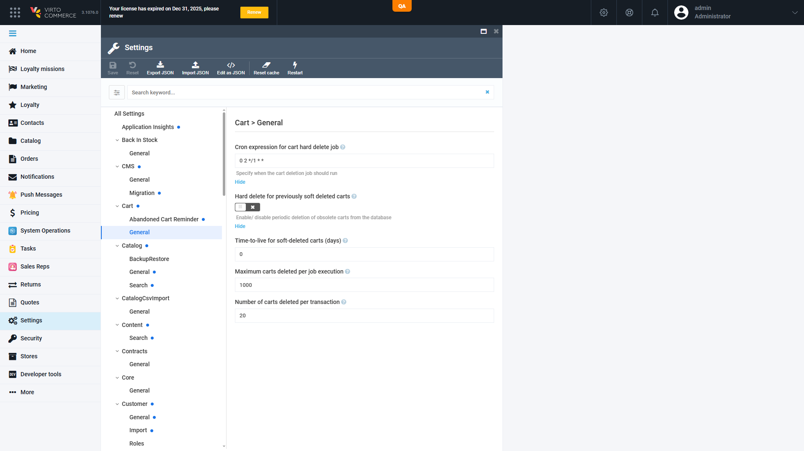

# BUG: Admin Settings › Sales Rep › Statistics — all 8 SalesRep.Statistics.* settings show raw setting names and raw `settings.….description` help keys (module en localization missing) — Low

## Status: CONFIRMED
**Found by:** agent — testing VCST-5755
**Tracker:** [VCST-6229](https://virtocommerce.atlassian.net/browse/VCST-6229) (Bug, Low, Draft; labels found-by-agent, found-in-testing, vc-fix, qa-autofix; 2 screenshots inline, verified rendered)

**Env:** vcst_qa (`TEST_ENV=vcst_qa`) · Admin UI, profile language English · captured 2026-10-08 (lane A ~21:58 UTC, investigation ~22:15 UTC) · reproduction: every render (static resource)
**Provenance (split):** **in scope for VCST-5755** for the 4 `…InvalidateOnChange` settings that vc-module-sales-rep#18 adds without locale keys; **pre-existing** for the 4 `…CacheExpirationMinutes` settings (`14a2958`, VCST-5309 PR #4, 2026-07-28), never localized.

## Summary
In Admin › Settings › Sales Rep › Statistics, every setting renders its technical name as the label (for example `SalesRep.Statistics.CartInvalidateOnChange`), and its "?" help shows the raw key `settings.SalesRep.Statistics.<Name>.description`. The module's English localization defines a title and description only for `SalesRep.Enabled`, and no Statistics descriptor sets `DisplayName`, so the platform settings blade falls back to the raw name. An operator has no description of what a TTL of 0 or an InvalidateOnChange flag does.

## Preconditions
An administrator signed in to the Admin UI in English, on a build with vc-module-sales-rep 3.1013.0-pr-18 (or later), or any build with the 4 expiration settings.

## Steps to reproduce
1. Admin → Settings → Sales Rep → Statistics.
2. Read the 8 labels; open the "?" help of any of them.
3. Control: Settings → Cart → General.

## Actual
1–2. Labels are the raw names (`SalesRep.Statistics.CartCacheExpirationMinutes`, `…CartInvalidateOnChange`, and the 6 others); the help text is the raw key `settings.SalesRep.Statistics.<Name>.description`.
3. Cart settings render localized titles and descriptions ("Cron expression for cart hard delete job" / "Specify when the cart deletion job should run").

## Expected
Each Statistics setting shows a human-readable title and a description (as `SalesRep.Enabled` does), via `settings.SalesRep.Statistics.<Name>.title` / `.description` in the module's localization or a `DisplayName` on the descriptor. VirtoOZ (Platform Developer Guide › module.manifest › Declaring settings) documents `displayName` as the human-friendly label for the settings UI.

## Evidence

Full investigation package: `reports/tickets/Sprint26-20/VCST-5755/vcst_qa/evidence-X14/` (`evidence-index.md`, `root-cause.md`, `screenshots/` incl. the English-profile proof `X14-03-…`, the DOM dump, `network/` slices of `GET /api/platform/localization?lang=en` and the settings schema, `console/console.txt` — only a pre-login 401, unrelated). No HAR: the running playwright-edge server was not launched with HAR recording; the request list and response slices stand in.

## Layer Validation
| Layer | Result | Evidence |
|-------|--------|----------|
| 1. Storefront Frontend | N/A | admin-only settings, not storefront-visible |
| 2. Backend Admin | FAIL | raw labels + raw help keys (`X14-01`); DOM dump lines 13, 22 |
| 3. GraphQL xAPI | N/A | settings are not exposed on xAPI (`IsPublic=false`) |
| 4. Platform REST API | FAIL (source data) | `GET /api/platform/localization?lang=en` → `settings.SalesRep = { Enabled }` only; settings schema → `displayName: null` for all 9 `SalesRep.*` settings |

**Owning layer:** Layer 4 data shipped by the module (its localization resource), surfaced in Layer 2. The platform blade works as designed (control `X14-02`).

## Module Versions
Platform 3.1076.0 · SalesRep 3.1013.0-pr-18-d367 (vc-module-sales-rep#18 head d367a155)

## Root Cause Analysis
- vc-platform 3.1076.0 `wwwroot/js/app/settings/blades/settings-unified.js:172-174`: title = the `settings.<name>.title` key if present → else `displayName` → else `name`; description = the `settings.<name>.description` key (`settings-unified.tpl.html:106`).
- vc-module-sales-rep `src/VirtoCommerce.SalesRep.Web/Localizations/en.VirtoCommerce.SalesRep.json` defines `settings.SalesRep.Enabled` only (last changed 2026-08-26, VCST-5730); `Core/ModuleConstants.cs:95-224` sets no `DisplayName`.
- `git diff origin/dev...d367a155 -- …/Localizations` is empty: PR #18 adds 4 descriptors (`f336e2b`, 2026-09-03) and no locale keys. Not a regression (never localized). Pattern family VC-UI-007 (raw i18n keys in Settings). kb: KB-25184C11, KB-A5A6CA94.

## Fix Routing (→ /qa-fix)

- **Owning layer:** Layer 4 — module localization resource (rendered in the Admin settings blade)
- **Suggested repo:** VirtoCommerce/vc-module-sales-rep
- **repoKind:** module
- **Ownership hint:** platform
- **Component / module:** Sales Rep module settings — `Localizations/en.VirtoCommerce.SalesRep.json`
- **RCA anchor:** `src/VirtoCommerce.SalesRep.Web/Localizations/en.VirtoCommerce.SalesRep.json` (add `settings.SalesRep.Statistics.<8 names>.{title,description}`); optional `DisplayName` in `src/VirtoCommerce.SalesRep.Core/ModuleConstants.cs`
- **Routing confidence:** HIGH
