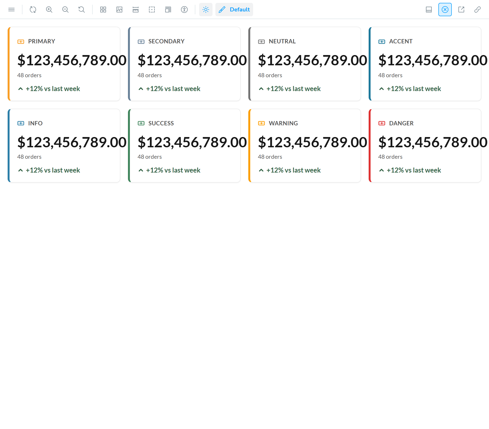
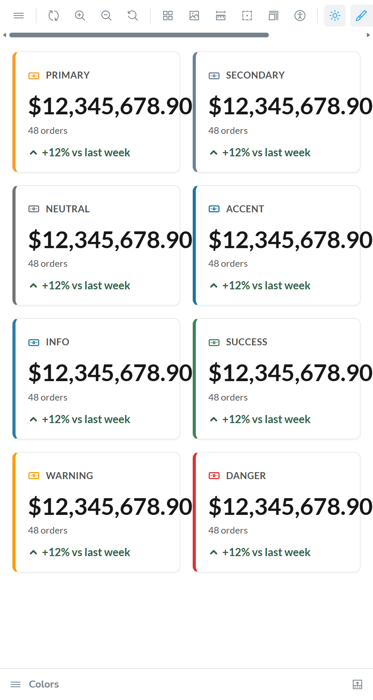

# BUG: VcStatWidget — a long figure paints past the card border in a narrow grid cell

## Status: READY_TO_SUBMIT
**Found by:** agent — testing VCST-5903
**Tracker:** [VCST-6428](https://virtocommerce.atlassian.net/browse/VCST-6428) — Subtask of VCST-5903, Low, labels found-by-agent + found-in-testing; auto-fix labels withheld (the code exists only in open PR #2568)

**Severity:** Minor · **Priority:** P3 (Low) · **Component:** vc-frontend UI kit — `VcStatWidget` (organisms) · **Story:** VCST-5903 (PR #2568, open) · **Rule:** BL-UI-004

## Summary
The figure of `VcStatWidget` never wraps (by design, "figures never wrap mid-number") but has no fallback when it does
not fit — no shrink, truncate, scroll or size step-down. In a grid cell that can be narrower than the figure
(`minmax(0, 1fr)` tracks, the usual KPI-grid layout) the figure paints past the card's right border into the gap,
at a supported viewport. BL-UI-004: content must stay inside its container — wrap, truncate with ellipsis, or scroll,
never overflow silently.

## Steps to reproduce
1. Open the QA Storybook story **Components / Organisms / VcStatWidget → Colors**, full-screen preview.
2. Set the window to **1024 × 900** (the grid shows 4 columns, cards 236px).
3. In Controls, type `$123,456,789.00` into `value`.
4. Alternatively: window **480px** (2 columns, cards 216px) and `$12,345,678.90`.

## Expected
The figure stays inside every card at every supported viewport (BL-UI-004) — e.g. truncated with the full value
available, or stepped down in size — while never wrapping mid-number (PR #2568).

## Actual
- 1024px, `$123,456,789.00`: figure 229.1px wide in a 236px card; it ends **13.1px past the right border** of all 8
  cards, inside the 16px gap (3px more would touch the next card). 3/3 runs; also in **Delta Colors**.
- 480px, `$12,345,678.90`: **15.7px past** the border, 0.3px short of the next card.
- Control: 1024px with `$12,345,678.90` stays 4.3px inside the border; 1280px and 768px fit.
- No document horizontal scroll at these widths. Console: no errors.

## Environment & versions
vcst · QA Storybook image `2.61.0-alpha.2594-vcst-5903-vc-stat-widget-3f8af63a` · storefront theme
`vc-theme-b2b-vue-2.61.0-pr-2568-3f8a-3f8af63a` · Platform `3.1086.0-pr-3139-5d63` · source `vc-frontend@3f8af63a` ·
Edge (Chromium), DPR 2.

## Layer Validation
| Layer | Result | Evidence |
|-------|--------|----------|
| 1. Storefront Frontend (UI kit, Storybook) | FAIL | screenshots above; `reports/tickets/Sprint26-21/VCST-5903/evidence-A11/` |
| 2. Backend Admin | N/A | pure CSS/layout — no back-office value |
| 3. GraphQL xAPI | N/A | no request involved |
| 4. Platform REST API | N/A | no request involved |

**Owning layer:** Layer 1 — the component's styles.

## Root Cause Analysis
`client-app/ui-kit/components/organisms/stat-widget/vc-stat-widget.vue` @ 3f8af63a:
- `:137-145` — `&__value { @apply text-3xl font-bold leading-tight … }` has no `min-w-0`, `overflow-wrap`,
  `truncate`/overflow handling or size clamp; computed `white-space: normal; overflow-wrap: normal; overflow: visible`.
  A digit-grouped figure has no break opportunity, so its min-content width is the whole string.
- `:109` — the card root is `overflow: visible`, so nothing clips it either.
- In a flex row (the Row story) the card grows instead, which is why that story does not show it.

No documentation page exists for this new component (Context7 `/virtocommerce/vc-docs`; VirtoOZ not connected).
Full package: `reports/tickets/Sprint26-21/VCST-5903/evidence-A11/`. kb: KB-2C889DD2 (confirmed), KB-069099FD
(thresholds by figure length and grid band).

**Fix options (developer's call):** `min-w-0` + `truncate` with a `title` carrying the full figure; or fluid /
container-query font sizing; or a break opportunity only before the decimal or the suffix — keeping "no mid-number
wrap" true. PR #2568 is still open — a review change on it is the cheapest route.

## Fix Routing (→ /qa-fix)

- **Owning layer:** Layer 1 — Storefront (UI kit)
- **Suggested repo:** VirtoCommerce/vc-frontend
- **repoKind:** frontend
- **Ownership hint:** platform
- **Component / module:** vc-frontend UI kit — `VcStatWidget` (`client-app/ui-kit/components/organisms/stat-widget/`)
- **RCA anchor:** `client-app/ui-kit/components/organisms/stat-widget/vc-stat-widget.vue:140` (`&__value`)
- **Routing confidence:** MEDIUM — the fix shape is a design choice (truncate vs. fluid size)
