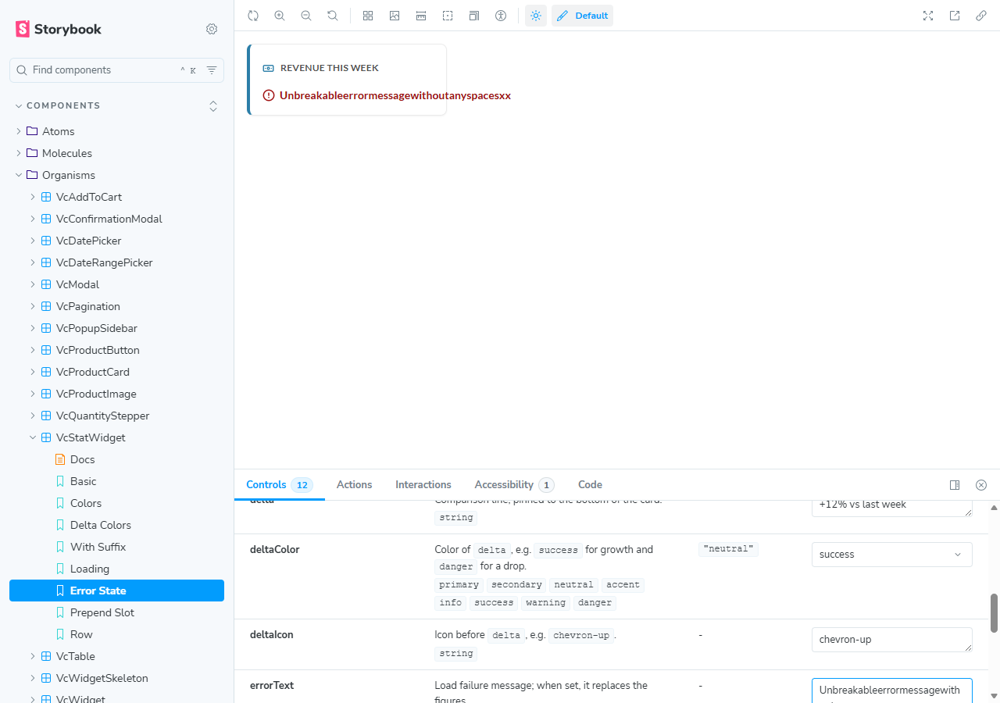
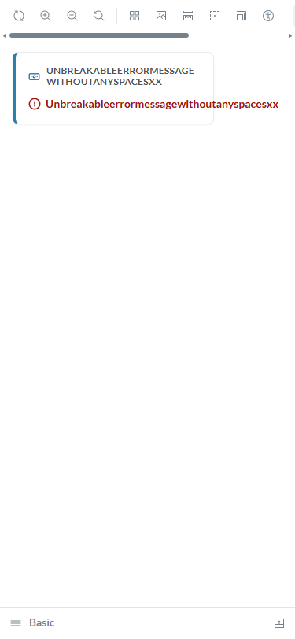
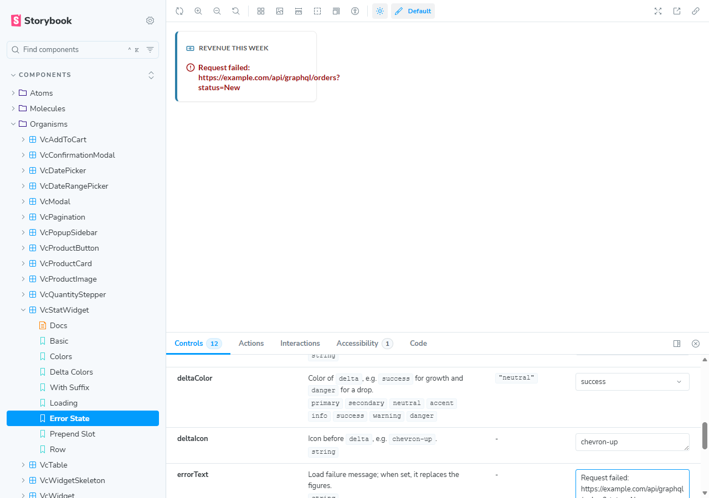

# BUG: VcStatWidget — a long unbreakable word in errorText, description or delta paints past the card border

## Status: READY_TO_SUBMIT
**Found by:** agent — testing VCST-5903
**Tracker:** [VCST-6448](https://virtocommerce.atlassian.net/browse/VCST-6448) — Bug (separate, fix later), relates to VCST-5903, Low, labels found-by-agent + found-in-testing, 3 screenshots inline (verified in renderedFields); auto-fix labels withheld (the code exists only in open PR #2568)

**Severity:** Minor · **Priority:** P3 (Low) · **Component:** vc-frontend UI kit — `VcStatWidget` (organisms) · **Story:** VCST-5903 (PR #2568, open) · **Rule:** BL-UI-004

## Summary
Only the card's label wraps a long word. The error message, the description and the delta line keep a token that has no break
opportunity (a URL, an id, a long compound) on one line, and it paints past the card's right border. BL-UI-004: content stays
inside its container — wrap, truncate or scroll, never overflow silently. This is prose, not the figure (VCST-6428 covers the
figure, which never wraps by design).

## Steps to reproduce
1. Open the QA Storybook story **Components / Organisms / VcStatWidget → Error State** (or **Basic**), viewport 1280 or 375.
2. In Controls, type `Unbreakableerrormessagewithoutanyspacesxx` (41 characters) into `errorText`.
3. In **Basic**, type the same word into `description`, then into `delta`.
4. Realistic variant: `errorText` = `Request failed: https://example.com/api/graphql/orders?status=New`.

## Expected
Each text wraps (or truncates) inside the 256px card, as the label already does with the same word.

## Actual
- `errorText`: one line, **+82px** past the card border (Error State and Basic, 1280 and 375).
- `delta`: **+78px** past; `description`: **+11px** past (smaller font).
- The URL message overflows **+41px**. `Couldn't load order CO261020-00042` and the 26-letter `Datenbankverbindungsfehler` fit — the trigger is a token of about 28+ characters.
- Control, same render: the same word in `label` wraps to 2 lines and stays 25px inside.
- The text is not clipped (card `overflow: visible`) and the page does not scroll horizontally at 375. Console: no errors.

## Environment & versions
vcst · QA Storybook image `2.61.0-alpha.2597-vcst-5903-vc-stat-widget-a6255676` (source `vc-frontend@bfe0b259` + a CI-only
merge) · storefront theme `vc-theme-b2b-vue-2.61.0-pr-2568-bfe0-bfe0b259` · Platform `3.1086.0-pr-3139-5d63` · Edge (Chromium),
1280×900 and 375×812. Reproduced 2/2 per prop (errorText 3/3); first seen in Firefox (exploratory X27/X28).

## Layer Validation
| Layer | Result | Evidence |
|-------|--------|----------|
| 1. Storefront Frontend (UI kit, Storybook) | FAIL | screenshots above; `reports/tickets/Sprint26-21/VCST-5903/evidence-X27/` |
| 2. Backend Admin | N/A | pure CSS — no back-office value |
| 3. GraphQL xAPI | N/A | no request involved |
| 4. Platform REST API | N/A | no request involved |

**Owning layer:** Layer 1 — the component's styles.

## Root Cause Analysis
`client-app/ui-kit/components/organisms/stat-widget/vc-stat-widget.vue` @ bfe0b259:
- `:131` — `&__label` has `min-w-0 … [overflow-wrap:break-word]`: the label wraps on purpose.
- `:17-23`, `:156-158` — `&__error` is a flex row; its message `` (`:22`) is a flex item with `min-width: auto` and
  `overflow-wrap: normal`, so it cannot shrink below the token.
- `:36-42`, `:160-163` — `&__delta`: the same flex + span shape.
- `:34`, `:152-154` — `&__description`: a block with `overflow-wrap: normal`.
- `:110` — the card root sets no overflow, so nothing clips.
Ruled out: the story wrapper (`max-w-64` only caps the width; the label wraps inside it), the VCST-6428 by-design decision
(it is about the figure; the kit's own prop docs call these props a message, a secondary line and a comparison line), data drift.
No documentation page exists for this new component (unreleased, open PR) — ticket, PR and live build are ground truth.
Package: `reports/tickets/Sprint26-21/VCST-5903/evidence-X27/`. kb: KB-AF2196EB.

## Fix Routing (→ /qa-fix)
- **Owning layer:** Layer 1 — Storefront (UI kit)
- **Suggested repo:** VirtoCommerce/vc-frontend
- **repoKind:** frontend
- **Ownership hint:** platform
- **Component / module:** vc-frontend UI kit — `VcStatWidget` (`client-app/ui-kit/components/organisms/stat-widget/`)
- **RCA anchor:** `vc-stat-widget.vue:22` (error message span), `:34`, `:41`, styles `:152-163` vs `:131` — e.g. `[overflow-wrap:anywhere]` on the three text holders; leave `__value` alone
- **Routing confidence:** HIGH — but the code exists only in open PR #2568, so the fix belongs in that PR, not a separate one
