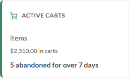
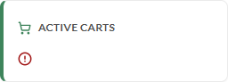

# BUG: VcStatWidget treats a whitespace-only `value` or `errorText` as real content

## Status: READY_TO_SUBMIT
**Found by:** agent — testing VCST-5903
**Tracker:** [VCST-6427](https://virtocommerce.atlassian.net/browse/VCST-6427) — Subtask of VCST-5903, Low, labels found-by-agent + found-in-testing; auto-fix labels withheld (the code exists only in open PR #2568)

**Severity:** Minor · **Priority:** P3 (Low) · **Component:** vc-frontend UI kit — `VcStatWidget` (organisms) · **Story:** VCST-5903 (PR #2568, open)

## Summary
`VcStatWidget` decides "is there a value / an error?" by comparing against `""` without trimming. A whitespace-only
`value` therefore renders a blank figure row (or the unit alone when `valueSuffix` is set) instead of the dash, and a
whitespace-only `errorText` switches the card into an error state with an empty message. The PR states the opposite:
*"No `value` in the ready state: the same dash, so a blank figure can't read as a value."*

## Steps to reproduce
1. Open the QA Storybook story **Components / Organisms / VcStatWidget → Basic**.
2. In Controls, type a single space into `value`.
3. Open **With Suffix**, type a single space into `value`.
4. On **With Suffix**, clear `value` back, then type a single space into `errorText`.

## Expected
Steps 2–3: the dash "—", exactly as for an empty `value` (`""`). Step 4: the card stays in its ready state, as it
does for `errorText = ""`.

## Actual
- Step 2: no dash; the figure row is blank and 0px tall, the description jumps up and the card shrinks 156 → 118px.
- Step 3: the figure row shows only the unit, **"items"**, with no number — it reads like a value.
- Step 4: figures, description and delta disappear; only the red alert icon with an empty message remains (card
  92px); the screen-reader status reads "Active carts:".
- Controls: `""` shows the dash, `"0"` shows 0 — both correct. Reproduced 4/4. Console: no errors; no network request.

## Environment & versions
vcst · QA Storybook image `2.61.0-alpha.2594-vcst-5903-vc-stat-widget-3f8af63a` · storefront theme
`vc-theme-b2b-vue-2.61.0-pr-2568-3f8a-3f8af63a` · Platform `3.1086.0-pr-3139-5d63` · source `vc-frontend@3f8af63a` ·
Chromium 1920×1080.

## Layer Validation
| Layer | Result | Evidence |
|-------|--------|----------|
| 1. Storefront Frontend (UI kit, Storybook) | FAIL | screenshots above; `reports/tickets/Sprint26-21/VCST-5903/evidence-A3/` |
| 2. Backend Admin | N/A | client-side prop guard — no back-office value involved |
| 3. GraphQL xAPI | N/A | no request is sent when a prop changes |
| 4. Platform REST API | N/A | no request is sent when a prop changes |

**Owning layer:** Layer 1 — the component template/script.

## Root Cause Analysis
`client-app/ui-kit/components/organisms/stat-widget/vc-stat-widget.vue` @ 3f8af63a:
- `:90` — `hasValue = computed(() => props.value !== undefined && props.value !== "")`: `" "` passes, so the ready
  branch renders a whitespace-only figure (0px) plus the suffix.
- `:17` — `v-else-if="errorText"` and `:96` — `props.errorText ? t("ui_kit.stat_widget.error", …) : ""`: plain
  truthiness, so `" "` selects the error branch and the error announcement.
- The PR's vitest cases (`vc-stat-widget.test.ts:124-127`) cover `""` and `"0"` but no whitespace input.

No documentation page exists for this new component (Context7 `/virtocommerce/vc-docs`; VirtoOZ not connected), so
the oracle is the PR #2568 body and the prop JSDoc (`:56` "Without it the card shows a dash").
Full package: `reports/tickets/Sprint26-21/VCST-5903/evidence-A3/` (evidence-index.md, root-cause.md, HAR, console,
network). kb: KB-B9BB372D, KB-A4C7F35D (confirmed on vcst_qa).

**Suggested fix:** `hasValue = computed(() => !!props.value?.trim())`, a `hasError = computed(() => !!props.errorText?.trim())`
used at `:17` and `:96`, plus vitest cases for `" "` on both props. PR #2568 is still open — a review change on it is
the cheapest route.

## Fix Routing (→ /qa-fix)

- **Owning layer:** Layer 1 — Storefront (UI kit)
- **Suggested repo:** VirtoCommerce/vc-frontend
- **repoKind:** frontend
- **Ownership hint:** platform
- **Component / module:** vc-frontend UI kit — `VcStatWidget` (`client-app/ui-kit/components/organisms/stat-widget/`)
- **RCA anchor:** `client-app/ui-kit/components/organisms/stat-widget/vc-stat-widget.vue:90` (`hasValue`), `:17`, `:96`
- **Routing confidence:** HIGH
