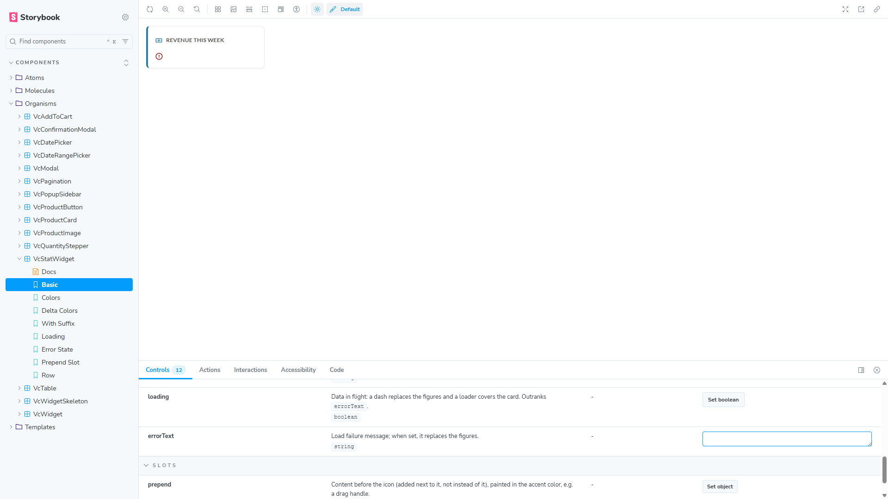

# BUG: VcStatWidget — a value or errorText of only zero-width characters still reads as content

## Status: READY_TO_SUBMIT
**Found by:** agent — testing VCST-5903
**Tracker:** [VCST-6449](https://virtocommerce.atlassian.net/browse/VCST-6449) — Bug (separate, fix later), relates to VCST-5903, Low, labels found-by-agent + found-in-testing, 3 screenshots inline (verified in renderedFields); auto-fix labels withheld (the code exists only in open PR #2568)

**Severity:** Trivial · **Priority:** P4 (Low) · **Component:** vc-frontend UI kit — `VcStatWidget` (organisms) · **Story:** VCST-5903 (PR #2568, open) · **Related:** VCST-6427 (fixed in bfe0b259 for whitespace)

## Summary
The VCST-6427 fix treats a blank `value` / `errorText` as empty with `String.trim()`. `trim()` removes whitespace but keeps
format characters such as the zero-width space (U+200B), U+200C–200F, U+2060 and U+061C. So a value made only of such
characters renders a blank figure row instead of the dash, and such an errorText puts the card into an error state with an
empty message. The PR's own rule: "No value in the ready state: the same dash, so a blank figure can't read as a value."

## Steps to reproduce
1. Open the QA Storybook story **Components / Organisms / VcStatWidget → Basic** (Chromium).
2. In Controls, clear `value` and enter a single zero-width space (U+200B) — typed or pasted.
3. Then clear `value` back, and paste U+200B into `errorText`.
4. **With Suffix** story: `value` = space + U+200B + space.

## Expected
The same as for `""` or `"   "`: the dash in the figure row and an empty status; a zero-width-only `errorText` is not an error.

## Actual
- `value` U+200B: the normal figure row (not `--pending`), 37.5px tall and visually blank, no dash; status `""`.
- With Suffix, `value` " U+200B ": the figure row shows only the unit "items".
- `errorText` U+200B: figures hidden, alert icon with a blank message; the status reads "Revenue this week: " + U+200B.
- Control: `value` = three spaces shows the dash (the VCST-6427 fix is deployed). Console: no errors.

## Environment & versions
vcst · QA Storybook image `2.61.0-alpha.2597-vcst-5903-vc-stat-widget-a6255676` (source `vc-frontend@bfe0b259` + a CI-only
merge) · storefront theme `vc-theme-b2b-vue-2.61.0-pr-2568-bfe0-bfe0b259` · Platform `3.1086.0-pr-3139-5d63` · Chromium
1920×1080, reproduced 2/2; first seen in Firefox (exploratory X5/X7/X8).

**How likely:** low. `Intl.NumberFormat` never yields a zero-width-only string and nothing uses the card yet. It needs a
consumer that builds the string from CMS/localized text (copy-pasted U+200B), from RTL marks (`Intl` output for he-IL/ar-EG
carries U+200F, so `${mark}${amount ?? ""}` leaves marks only), or a backend error message that is empty but for one such char.

## Layer Validation
| Layer | Result | Evidence |
|-------|--------|----------|
| 1. Storefront Frontend (UI kit, Storybook) | FAIL | screenshots above; `reports/tickets/Sprint26-21/VCST-5903/evidence-X5/` |
| 2. Backend Admin | N/A | no back-office value — a prop of a UI-kit component |
| 3. GraphQL xAPI | N/A | no request involved |
| 4. Platform REST API | N/A | no request involved |

**Owning layer:** Layer 1 — the component's blank check.

## Root Cause Analysis
`client-app/ui-kit/components/organisms/stat-widget/vc-stat-widget.vue` @ bfe0b259:
- `:90` `const hasValue = computed(() => !!props.value?.trim());`
- `:91` `const hasError = computed(() => !!props.errorText?.trim());`
- `:97` the status text interpolates the raw `errorText`.
`String.prototype.trim()` strips `\s` (incl. U+00A0, U+202F, U+3000, U+FEFF) but not the `Cf` format characters
(U+200B–200F, U+2060, U+061C) — checked in Node. A blank test such as `/^[\s\p{Cf}]*$/u` would cover them.
No documentation page exists for this new component (unreleased, open PR). Package:
`reports/tickets/Sprint26-21/VCST-5903/evidence-X5/`. kb: KB-3F700CCC.

## Fix Routing (→ /qa-fix)
- **Owning layer:** Layer 1 — Storefront (UI kit)
- **Suggested repo:** VirtoCommerce/vc-frontend
- **repoKind:** frontend
- **Ownership hint:** platform
- **Component / module:** vc-frontend UI kit — `VcStatWidget`
- **RCA anchor:** `vc-stat-widget.vue:90-91` (`hasValue` / `hasError` use `trim()`)
- **Routing confidence:** HIGH — but the code exists only in open PR #2568, so the fix belongs in that PR
