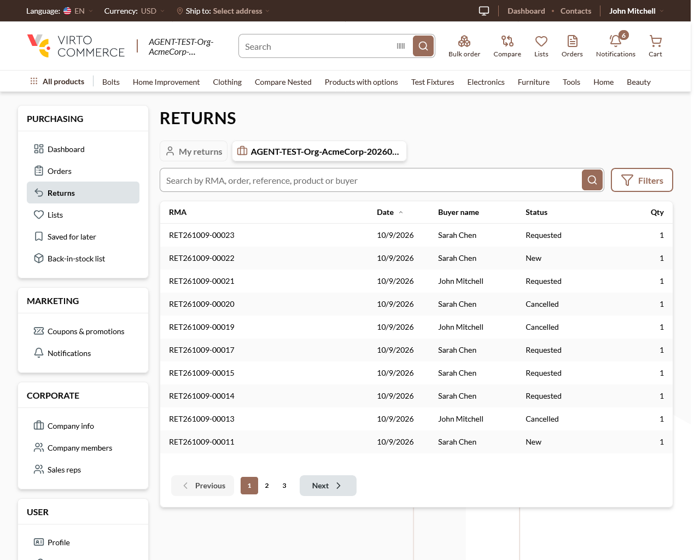

# Account sidebar breaks words mid-word at 768–1279 px — "Coupons & promoti|ons", "Missions & challeng|es" — **P3**

## Status: READY_TO_SUBMIT (re-confirmed live 2026-10-09: Firefox 151 + Chrome; first seen 2026-10-01 on Chrome)
**Found by:** agent — testing VCST-5957 (`/qa-test`, incidental); re-observed agent — testing VCST-5884 (`/qa-test-fast` round 2, rows X26 / V19)
**Severity:** Low (P3) · **Tracker:** VCST-6265 (Jira, filed 2026-10-10; labels found-by-agent, found-in-testing, vc-fix, qa-autofix; relates to VCST-5884) 
**Oracle:** `BL-UI-004` allows wrapping and is not violated (the text stays in its box) — a typographic defect: a non-word on screen · **Provenance:** pre-existing, out of scope for VCST-5957 (#2524) and VCST-5884 (#2523 / #28)
**Investigation package:** `reports/tickets/Sprint26-20/VCST-5884/vcptcore_dev/evidence-X26/`

## Environment
vcptcore_dev · store B2B-store · theme `2.60.0-pr-2523-466f-466fa0a8` (= vc-frontend 466fa0a868; the code is the same on dev a756f38562 and master a005f8bde6) · Firefox 151 and Chrome, 768–1279 px

## Summary
At every width from 768 to 1279 px the account sidebar is 208 px wide and each label gets a 124 px box. "Coupons & promotions" (140.7 px) wraps inside the word — "Coupons & promoti" / "ons" — although "promotions" (70.9 px) would fit on its own line. One line from 1280 px; below 768 px the sidebar is hidden. On every page with the account sidebar (seen on `/account/returns` both tabs, `/account/dashboard`, earlier `/account/missions`); "Missions & challenges" breaks the same way where loyalty is enabled.

## Steps to reproduce
1. Sign in to the storefront as any organization member (e.g. `@td(ACME_ADMIN)`).
2. Open `/account/returns` or `/account/dashboard`; set the viewport to any width from 768 to 1279 px (e.g. 1024).
3. Look at the sidebar's Marketing section.

**Expected:** a break at the space ("Coupons &" / "promotions") or one line.
**Actual:** "Coupons & promoti" / "ons".

## Layer Validation
| Layer | Result | Evidence |
|-------|--------|----------|
| 1. Storefront Frontend | FAIL | screenshots below; per-label computed styles `evidence-X26/network/X26-r2-inv-measure-*.json` (all 14 labels `word-break: break-all`) |
| 2. Backend Admin | N/A | label from the theme locale, width from the layout |
| 3. GraphQL xAPI | N/A | no request involved |
| 4. Platform REST API | N/A | — |

**Owning layer:** Layer 1 — Storefront (UI kit).

## Root Cause Analysis
`client-app/ui-kit/components/molecules/menu-item/vc-menu-item.vue:285` — `.vc-menu-item__content { @apply grow flex items-center gap-[inherit] min-h-[var(--content-height)] break-all; }`; the account sidebar item `client-app/shared/account/components/account-navigation-item.vue:2` passes no nowrap / truncate and overrides nothing; widths from `vc-layout.vue:136-142, 168-174` (`w-52` from 768, `w-60` from 1280). A debug override of `word-break: normal` + `overflow-wrap: break-word | anywhere` on that label gives "Coupons &" / "promotions". `break-all` came with vc-frontend 1370a1f52e (#1368, VCST-1965, 2024-10-11, theme 2.7.0) to keep long unbroken strings inside menu items — a fix must keep that.

## Evidence

Earlier: `reports/tickets/Sprint26-19/VCST-5957/screenshots/4a-missions-768-top.png` (Chrome, 768, /account/missions).

## Fix Routing (→ /qa-fix)

- **Owning layer:** Layer 1 — Storefront (UI kit VcMenuItem as used by the account sidebar)
- **Suggested repo:** VirtoCommerce/vc-frontend
- **repoKind:** frontend
- **Ownership hint:** platform
- **Component / module:** account sidebar navigation item / VcMenuItem
- **RCA anchor:** `client-app/ui-kit/components/molecules/menu-item/vc-menu-item.vue:285`; consumer `client-app/shared/account/components/account-navigation-item.vue:2`
- **Routing confidence:** HIGH — smallest fix: `word-break: normal; overflow-wrap: anywhere` on the sidebar label in `account-navigation-item.vue` (precedent VCST-6153: keep the shared rule); a UI-kit change (`break-all` → `overflow-wrap: anywhere` at :285) needs a visual check of every VcMenuItem consumer
