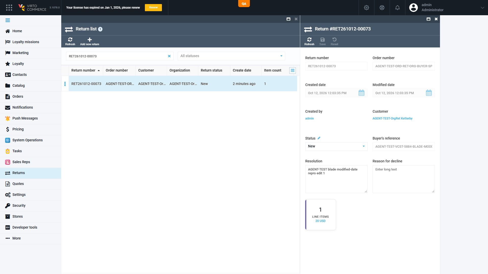

# Admin › Returns: the return details blade keeps the old "Modified date" after Save until Refresh — **P3**

## Status: CONFIRMED — BELOW SEVERITY FLOOR (Low/P3): draft kept, NOT filed in the tracker
**Found by:** agent — regression REG-2026-10-12-1119 (VCST-5884 round 3, case RET-006), reproduced live 2/2
**Tracker:** none (below the 5-file floor Critical/High/Medium); named in the VCST-5884 QA-Complete comment under "Not filed (below severity floor)"
**Provenance:** **PRE-EXISTING / OUT-OF-SCOPE** — the save-without-re-read dates from vc-module-return `f3ac8350` (2022-03-31, PT-6591); the file is byte-identical on `dev` and on PR #28 @ fb4fc43, outside the VCST-5884 diff.
**Oracle:** none written (VirtoOZ `return/managing-returns` says only "Click Save… Your changes have been saved"). Expected per the sibling Orders blade, which refreshes after save.

## Environment
- vcst · Platform 3.1078.0 · VirtoCommerce.Return 3.1005.0-pr-28-fb4f · Admin SPA, Edge (Chromium), blade shows UTC+2

## Steps to reproduce
1. Admin → Returns → open a return in status New (any editable return).
2. Note the blade's **Modified date**.
3. Change Resolution (or the comment) and click **Save**.
4. Read the blade's Modified date again; then click **Refresh**.

## Expected
After Save the blade shows the modification time the server stamped.

## Actual
The blade keeps the pre-save Modified date; `GET /api/return/{id}` already carries the new one; Refresh shows it. Repeats on every Save.

| Step | Blade Modified date | API `modifiedDate` |
|---|---|---|
| Open | 10:03:35 | 10:03:35.258Z |
| Save #1 (PUT 200) | **10:03:35 (stale)** | 10:04:56.790Z |
| Refresh | 10:04:56 | 10:04:56.790Z |
| Save #2 | **10:04:56 (stale)** | 10:05:51.273Z |

## Layer Validation
| Layer | Result | Evidence |
|---|---|---|
| 1. Storefront Frontend | N/A | not involved |
| 2. Backend Admin (Angular blade) | **FAIL (cause)** | `return-details.js` `saveChanges` success callback runs `angular.copy(blade.currentEntity, blade.originalEntity)` (line 10) and never calls `blade.refresh()`; after the PUT only `available-statuses` and the grid search are requested |
| 3. GraphQL xAPI | N/A | not involved |
| 4. Platform REST API | PASS | `PUT /api/return` stamps `modifiedDate`; it answers only `{"id":…}` (`ReturnController.cs` L148), so the blade cannot take the stamp from the response |

**Owning layer:** 2 — `VirtoCommerce/vc-module-return` `src/VirtoCommerce.ReturnModule.Web/Scripts/blades/return-details.js` L10. Fix: call `blade.refresh()` (re-get) in the save success callback, as vc-module-order `operation-detail.js` does.

## Impact / severity — P3, Low
Display only: stored data is correct, Refresh fixes it, a second Save from the stale blade still succeeds. An administrator may misread when a return was last changed.

## Evidence
Investigation package: `reports/regression/REG-2026-10-12-1119/evidence/blade-modified-date/` (evidence-index.md, root-cause.md, network, console, source). kb: KB-50E37D3B.
