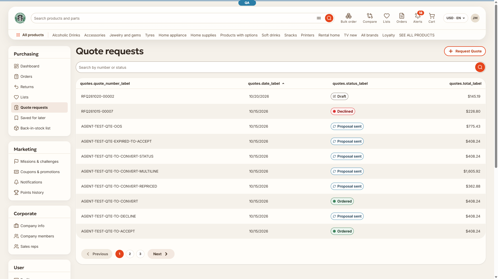
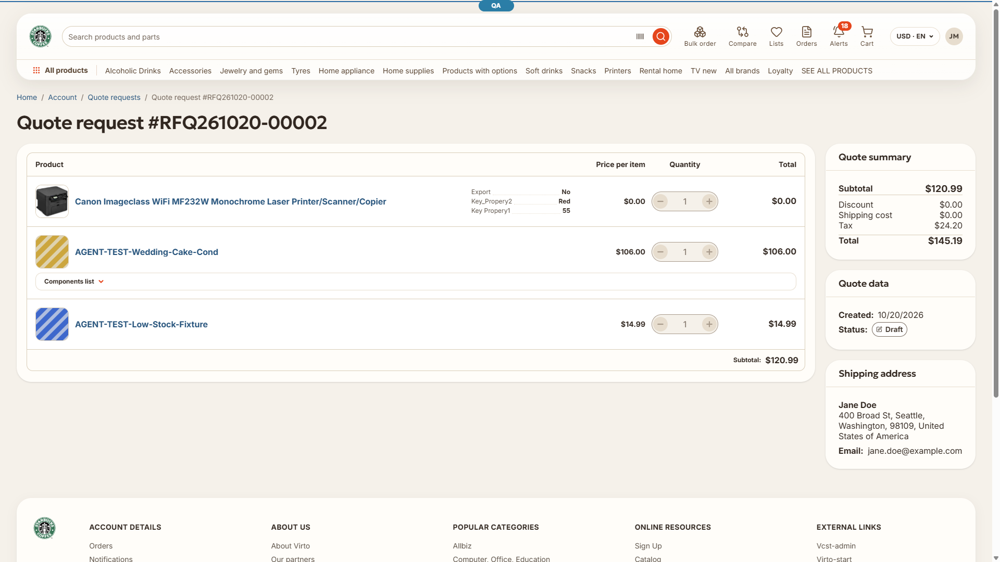

# BUG: [Quotes][i18n] Quote list and quote detail pages show raw i18n keys after a full-page load — Medium

## Status: READY_TO_SUBMIT
**Found by:** agent — testing VCST-6398
**Tracker:** [VCST-6452](https://virtocommerce.atlassian.net/browse/VCST-6452) (standalone Bug, relates to VCST-6398; labels found-by-agent, found-in-testing; auto-fix labels withheld — vc-frontend-next is not in the /qa-fix allowed repo set)

**Severity:** Medium (P2) · **Type:** Functional / i18n (load ordering) · **Relationship:** found while testing VCST-6398; not introduced by it
**Env:** vcst (`{{FRONT_URL}}`), playwright-chrome (chromium) 1920x1080, 2026-10-20
**Build:** theme vc-frontend-next `3.1.0-pr-11-d67b-d67b0e0a` (footer) · platform 3.1086.0-pr-3139-5d63 · VirtoCommerce.Quote 3.1005.0
**Oracle:** VC-UI-007 (a raw key never surfaces) · VirtoOZ StorefrontUserGuide "Quote Requests" (translated list) · **Relates:** VCST-6396 (same class — locale chunk not awaited — in the Sales Rep plugin; different module, not a duplicate)

## Summary
After a full-page load (reload, direct link, new tab) of `/account/quotes`, the table headers render as raw keys (`quotes.quote_number_label`, `quotes.date_label`, `quotes.status_label`, `quotes.total_label`) and the tab title reads "… & quotes.meta.title". `/account/quotes/{id}` shows the tab title "… & quote_details.title". Navigating to the same pages inside the app renders them correctly. The keys exist; the strings are read once, before the quotes locale has loaded, and never refresh.

## Preconditions
- A B2B buyer with at least one quote (@td(AGENT_POOL_SLOT_1.b2b_email)); English culture.
- Browser cache warm (the page chunk served from cache while the locale chunk revalidates) — the usual state on a second visit.

## Steps to reproduce
1. Sign in and open `/account/quotes` once.
2. Reload the page (F5) two or three times.
3. Open a quote and reload `/account/quotes/{id}`.
4. Navigate back to the list with the breadcrumb (control).

## Expected
Column headers "Quote number / Date / Status / Total" and tab titles "Quote requests" / "Quote request #<number>" on every load.

## Actual
- Raw keys on 7 of 10 hard loads (list and detail); in-app navigation translated 2 of 2.
- In the same render the H1 "Quote requests" and the search placeholder (template `$t`) are translated — only the setup-time strings are raw.
- Even when translated, the detail and edit tab title reads "Quote request #" with no number.

## Layer Validation
| Layer | Result | Evidence |
|---|---|---|
| 1. Storefront Frontend | FAIL | screenshots above; `reports/tickets/Sprint26-21/VCST-6398/evidence-R13-3/` (repro log, DOM snapshots, `network/locale-vs-page-chunk-timing.txt`); HAR `results/VCST-6398/har/r13-3-session2.har` |
| 2. Backend Admin | N/A | not admin-visible |
| 3. GraphQL xAPI | PASS | all quote queries 200, no `errors[]`, rows render |
| 4. Platform REST API | N/A | storefront rendering only |

**Owning layer:** Layer 1 — Storefront.

## Root Cause Analysis
- **Locale load not awaited:** `client-app/app-runner.ts:266` `void initModuleQuotes(router, i18n)` → `client-app/modules/quotes/index.ts:81` `void loadModuleLocale(i18n, "quotes")` in a sync `init()`. The runner awaits federated modules and `router.isReady()` before mount, but not module locales.
- **Strings frozen at setup:** `modules/quotes/pages/quotes.vue:160-161` `usePageHead({ title: t("quotes.meta.title") })` and `:173-192` `const columns = ref([{ title: t("quotes.quote_number_label") }, …])`; `view-quote.vue:117`, `edit-quote.vue:199` `usePageHead({ title: t("quote_details.title", [quote.value?.number]) })`.
- **Trigger:** the race follows cache state, not chance. FAIL 7/7 when `/assets/quotes-*.js` came from cache (~1 ms) before the locale chunk `/assets/en-*.js` finished its 304 revalidation (20–50 ms; served `max-age=14400, must-revalidate` with CDN `age` > max-age). PASS 3/3 when the page chunk itself came over the network.
- **History:** the same code is on vc-frontend-next `dev` and at PR #11 head (the PR touches only `quote-line-items.vue/.test.ts` and `edit-quote.vue` in this module); last change to `quotes/index.ts` 770291c1 (2026-02-19). Identical upstream in VirtoCommerce/vc-frontend 2.40.0–2.60.0.
- **Scope note:** all 11 lazy-locale modules call `loadModuleLocale` without `await`; other account pages may show the same symptom (unverified).
- kb: KB-429A791E (confirmed), KB-80095B02 (cache-state trigger).

## Fix Routing (→ /qa-fix)

- **Owning layer:** Layer 1 — Storefront
- **Suggested repo:** VirtoCommerce/vc-frontend-next (same defect upstream in VirtoCommerce/vc-frontend — a matching fix could go there too)
- **repoKind:** frontend
- **Ownership hint:** platform
- **Component / module:** `client-app/modules/quotes` (pages `quotes.vue`, `view-quote.vue`, `edit-quote.vue`; `index.ts`)
- **RCA anchor:** `client-app/modules/quotes/index.ts:81` `void loadModuleLocale(i18n, "quotes")`; `client-app/modules/quotes/pages/quotes.vue:173` `const columns = ref<VcTableColumnType[]>([`
- **Routing confidence:** HIGH — fix-forward: make `columns` a `computed` and pass a getter title to `usePageHead` (smallest), or await module locales before mount

## Verification 2026-10-21
- **Verdict:** VERIFIED WITH NOTES on a local build of VirtoCommerce/vc-frontend#2593 (`2.61.0-pr-2593-296d-296d1234`, open, not merged), with the API proxied to vcst. STR passed 3/3 and the checklist 10/10. Jira moved to Tested; QA comment 112246.
- **RED→GREEN:** same local stack and buyer, with the quotes en locale chunk held 1.5 s. Pre-fix `2.61.0-alpha.2590`: raw headers and titles on 5/5 list loads and 3/3 detail loads. Fix: translated on 10/10 list loads, and the detail and edit titles carry the quote number (7/7, 6/6). Evidence: `reports/tickets/Sprint26-21/VCST-6452/`.
- **Kept in open/:** the fix is not merged or deployed. vcst (vc-frontend-next) still runs the affected code until the release merge. Move this file to `fixed/` after a live re-check there.
