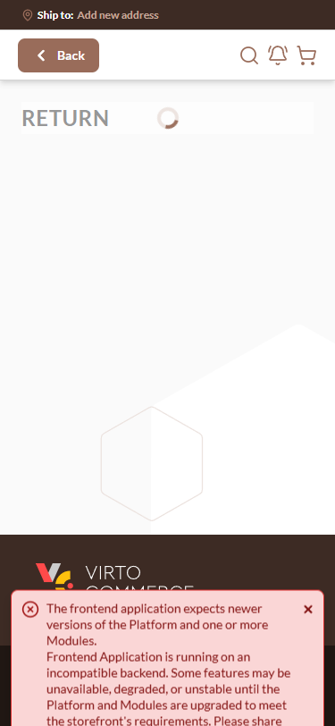
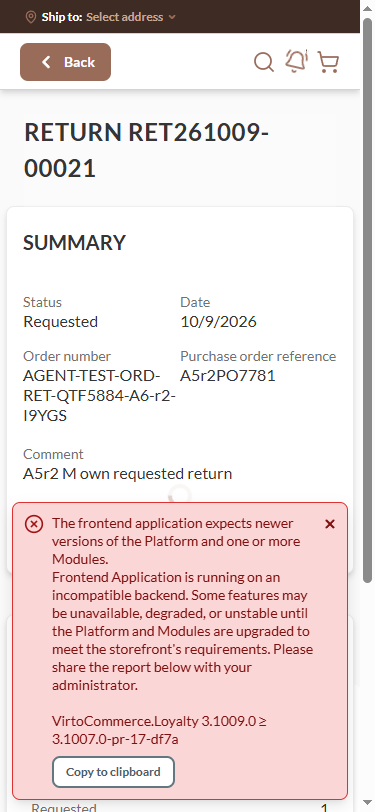

# Storefront return details shift on load at phone width (CLS 0.24–0.28; order details 0.59) — **Medium**

## Status: READY_TO_SUBMIT
**Found by:** agent — testing VCST-5884
**Severity:** Medium (P2) · **Tracker:** VCST-6263 (Jira, filed 2026-10-10; labels found-by-agent, found-in-testing; relates to VCST-5884) · **Pre-existing** (not caused by vc-frontend #2523 / vc-module-return #28)
**Investigation package:** `reports/tickets/Sprint26-20/VCST-5884/vcptcore_dev/evidence-V13/`

## Environment
vcptcore_dev · store B2B-store · theme `2.60.0-pr-2523-466f-466fa0a8` · Return `3.1005.0-pr-28-fb4f` · platform `3.1079.0-alpha.13411` · Chromium (playwright-chrome), 375×812; desktop control 1920×1080

## Summary
BL-UI-001 (CLS ≤ 0.1 on initial render) fails on `/account/returns/{id}` at 375×812: the page first renders a short loading shell (grey "RETURN" placeholder, spinner, decorative image, footer on the first screen), then GetReturn arrives and the content — taller than the viewport — pushes the footer, the image and the spinner down. Cold-load CLS 0.2824 (owner's return) and 0.244 (another return); the return's own order details page `/account/orders/{id}` scores 0.59. On a fast network an in-app click hides the shift inside the 500 ms input window (the footer still flashes); on Fast 3G it is scored (0.2393).

## Steps to reproduce
1. Sign in to the storefront as a buyer with a return (e.g. `@td(ACME_ADMIN)`), viewport 375×812 (Chromium).
2. Open a return's details by URL (`/account/returns/<id>`) or reload it; or click it from the list on a slow (Fast 3G) connection.
3. Measure CLS (PerformanceObserver `layout-shift`, `hadRecentInput === false`).

**Expected:** CLS ≤ 0.1 (BL-UI-001) — the page holds its final layout while loading.
**Actual:** 0.2824 / 0.2824 (RET261009-00021), 0.244 / 0.244 (RET261006-00020); order details 0.5909 / 0.5904; select-return-items 0.1085. Desktop with a 1-line return: 0.0013 (content fits).

## Layer Validation
| Layer | Result | Evidence |
|-------|--------|----------|
| 1. Storefront Frontend | FAIL | `evidence-V13/measurements/V13-r2-inv-cls-run1…5-*.json`; frames + GIF below |
| 2. Backend Admin | N/A | rendering only |
| 3. GraphQL xAPI | PASS | `GetReturn` 200 in ~370 ms with the right data (`network/getreturn-owner-RET261009-00021.json`) |
| 4. Platform REST API | N/A | rendering only |

**Owning layer:** Layer 1 — Storefront.

## Root Cause Analysis
`client-app/modules/returns/pages/return.vue` @ 466fa0a868 renders only the h1 placeholder (`:7`) and `<VcLoaderOverlay :visible="loading" fixed-spinning />` (`:133`) while GetReturn loads; the not-found view (`:9`) and the content (`:11`) render afterwards, so the content's height is added in one jump. `fixed-spinning` is not a prop — `vc-loader-overlay.vue:4,18` declares `fixedSpinner` — so the spinner travels with the content (same misspelling in `edit-return.vue`, `select-return-items.vue`, `purchase-request.vue`). Unchanged by #2523 (identical at the PR base 62d91663d; KB-21E70170 measured the same on theme 2.59 pr-2500). The order details page shows the same pattern more strongly → a shared account-detail loading pattern. Precedent: VCST-5110 (`/account/lists`, 0.483 at 375) filed Medium, fixed by vc-frontend #2292 with skeletons at final height.

## Evidence

Motion: `../../screenshots/Returns-Details-Layout-Shift-On-Load-375/V13-r2-details-owner-375-shift.gif`. Console: 0 errors.

## Fix Routing (→ /qa-fix)

- **Owning layer:** Layer 1 — Storefront
- **Suggested repo:** VirtoCommerce/vc-frontend
- **repoKind:** frontend
- **Ownership hint:** platform
- **Component / module:** returns details page loading state (+ the same pattern on order details); VcLoaderOverlay prop name
- **RCA anchor:** `client-app/modules/returns/pages/return.vue:7,9,11,133`; `vc-loader-overlay.vue:4,18` (`fixedSpinner`)
- **Routing confidence:** MEDIUM — the mechanism is certain; the fix (skeletons at final height, as #2292) spans several account detail pages and needs the fixer's scoping
