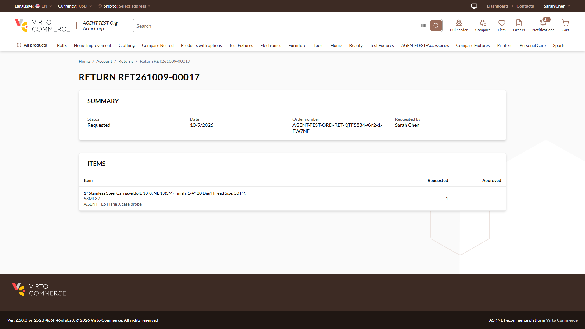
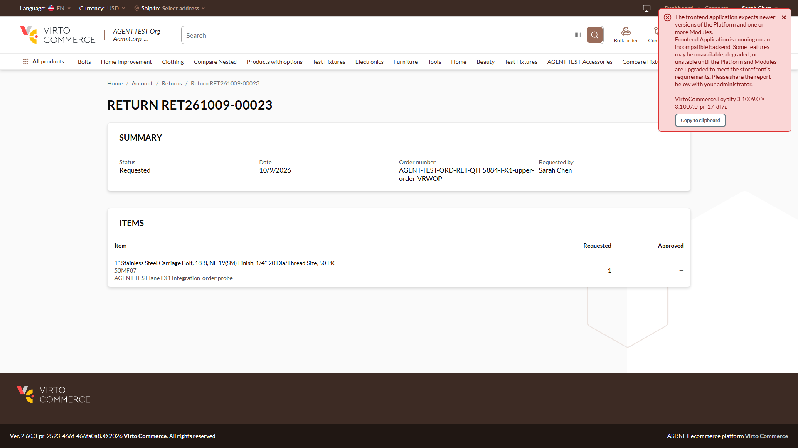
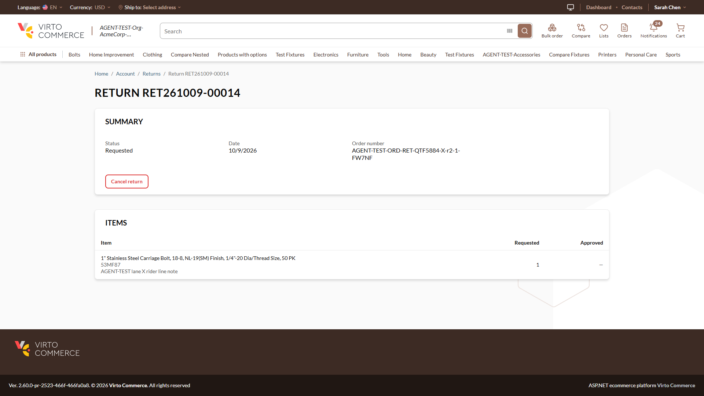

# Returns: the owner of a return whose stored customerId differs only in letter case sees "Requested by <self>" and no Cancel — **Medium**

## Status: READY_TO_SUBMIT
**Found by:** agent — testing VCST-5884
**Severity:** Medium (P2) · **Tracker:** VCST-6261 (Jira, filed 2026-10-10; labels found-by-agent, found-in-testing; subtask of VCST-5884) · **In this ticket's diff:** vc-frontend #2523 (commit 53c1abc0a), not released
**Investigation package:** `reports/tickets/Sprint26-20/VCST-5884/vcptcore_dev/evidence-X1/` (REPRODUCED 3/3 + 2 controls)

## Environment
vcptcore_dev · store B2B-store · theme `2.60.0-pr-2523-466f-466fa0a8` (vc-frontend #2523 @ 466fa0a8; the PR head 4263715a has the same line) · Return `3.1005.0-pr-28-fb4f` · platform `3.1079.0-alpha.13411` · Edge 154, 1920×1080

## Summary
The storefront return details page decides "this is a colleague's return" with a case-sensitive id comparison, while the server decides ownership case-insensitively. When a return's stored `customerId` is the buyer's user id in another letter case, the owner sees their own return as a colleague's: a "Requested by <own name>" row and no "Cancel return" — although the server still offers and allows the cancel. The details page is the only place a buyer can cancel a return.

## Steps to reproduce
1. Have a buyer B (e.g. `@td(ACME_BUYER)`) with a Requested return whose stored `customerId` is B's user id in UPPER case. Two ways it happens:
   a. an admin or integration `PUT /api/return` keeps the body's letter case (specimen RET261009-00017);
   b. an order written with an upper-case `customerId` (integration / import); B files and submits a return on it — `createReturn` copies the order's `customerId` (specimen RET261009-00023).
2. Sign in to the storefront as B → Account → Returns → open that return.

**Expected:** no "Requested by" row; "Cancel return" enabled — as on B's lower-case return RET261009-00014, and as the server answers (`availableActions` cancel `isAvailable: true`).
**Actual:** "Requested by: <B's own name>" and no "Cancel return" button (also on the New return RET261009-00011).

## Layer Validation
| Layer | Result | Evidence |
|-------|--------|----------|
| 1. Storefront Frontend | FAIL | owner view hides Cancel and shows "Requested by" — screenshots below; DOM `evidence-X1/screenshots/dom-X1-r2-inv-00017*.txt` |
| 2. Backend Admin | PASS | the return and its owner are correct; the stored id is just upper case |
| 3. GraphQL xAPI | PASS | `GetReturn` as B → `customerId "167BDBB5-…"`, cancel `isAvailable: true` (`evidence-X1/network/failing-GetReturn-00017-response.json`) |
| 4. Platform REST API | PASS | `GET /api/return/{id}` → `customerId` upper case; `/connect` user id lower case (`network/rest-crosscheck-get-return-x3.json`, `GetPageContext-user.json`) |

**Owning layer:** Layer 1 — Storefront.

## Root Cause Analysis
`client-app/modules/returns/pages/return.vue:175-176` — `isColleaguesReturn = !!customerId && customerId !== user.value.id` (case-sensitive) drives the "Requested by" cell (`:32`) and removes the whole Cancel footer (`:63`). The server's `IsOwnedBy` (`vc-module-return` `ReturnFlowService.cs:610-619`) uses `EqualsIgnoreCase` for `return(id)`, `availableActions` and every mutation. Introduced by vc-frontend 53c1abc0a (#2523, 2026-09-24): before it the footer was driven by the server's `availableActions` only. Case drift sources: `ReturnFlowService.cs:104` (createReturn copies `order.CustomerId`), `ReturnService.cs:182` (an admin PUT keeps a non-empty body `customerId`). Same pattern, not live-verified: `modules/sales-rep/utils.ts:282` (`isOwn`, pre-existing).

## Evidence

Console: 0 errors. HAR: not recorded (lane limitation) — per-request captures in the package.

## Fix Routing (→ /qa-fix)

- **Owning layer:** Layer 1 — Storefront
- **Suggested repo:** VirtoCommerce/vc-frontend
- **repoKind:** frontend
- **Ownership hint:** platform
- **Component / module:** returns module — return details page (colleague detection)
- **RCA anchor:** `client-app/modules/returns/pages/return.vue:175-176`
- **Routing confidence:** HIGH — fix forward inside the open PR #2523 (compare case-insensitively, or derive "colleague" from the server: a non-owner gets every action as RETURN_NOT_FOUND)
