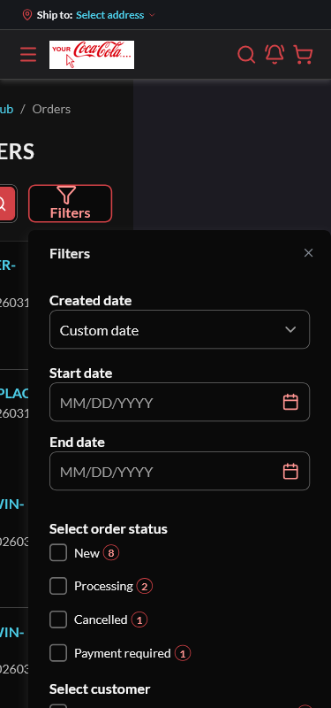

# BUG: [Sales Rep] At 375px, re-opening the customer-orders Filters drawer makes the page scroll horizontally — Medium

**Env:** vcptcore-qa, theme `2.59.0-pr-2519-1d9b-1d9bc6dc` (also reproduced on control vcptcore-qa1 `2.59.0-pr-2540-710a-710ab0fa`, a build without vc-frontend#2519 ⇒ PRE-EXISTING). Found by agent during /qa-test VCST-6001 (2026-10-06); Filed as VCST-6197 on 2026-10-07 (operator decision).
**Relates:** VCST-6001 · BL-UI-004 (no document horizontal scroll at 375)

## Summary
At a 375px viewport the first open of the Filters drawer is fine, but closing and reopening it makes the document wider than the viewport (`scrollWidth` ≈ 582–599 vs 375, `scrollX` 224): the drawer is placed at x 256–599 and the page content is pushed off-screen to the left. Closing the drawer restores `scrollWidth` 375.

## STR
1. Sign in as a sales rep, open `/company/customer-orders` at 1920, resize to 375×800.
2. Open Filters → close → open again.
3. Read `document.documentElement.scrollWidth`; try swiping horizontally.

## Expected vs Actual
- **Expected:** `scrollWidth` = 375; drawer within the viewport on every open.
- **Actual:** horizontal scroll from the second open onward (every reopen).

## Layer Validation

| Layer | Result | Evidence |
|-------|--------|----------|
| 1. Storefront Frontend | FAIL | scrollWidth 582–599 vs 375 on reopen; ab-5 (control), 4v measurement on the PR build |
| 2. Backend Admin | N/A | layout only |
| 3. GraphQL xAPI | N/A | — |
| 4. Platform REST API | N/A | — |

**Owning layer:** Layer 1 — Storefront

## Root Cause Analysis
Likely in the drawer's floating positioning: `sales-rep-orders-filters.vue` renders the panel in `<VcPopover placement="bottom-end" :offset-options="8" lazy>`. The first open after resizing to 375 positions the panel at x 8–351; on close and re-open it is placed at x 256–599 in page coordinates (scrollX 224), i.e. the popover is positioned from a stale reference/viewport and the page grows to fit it. Not confirmed in code — a shift/flip/size middleware or a viewport-width clamp for the mobile case is the expected area.

## Fix Routing (→ /qa-fix)

- **Owning layer:** Layer 1 — Storefront
- **Suggested repo:** VirtoCommerce/vc-frontend
- **repoKind:** frontend
- **Ownership hint:** platform
- **Component / module:** vc-frontend `client-app/modules/sales-rep` (customer orders filter)
- **RCA anchor:** sales-rep-orders-filters.vue `<VcPopover placement="bottom-end"` (ui-kit VcPopover positioning)
- **Routing confidence:** MEDIUM — the positioning mechanism is inferred from measurements, not traced in code
