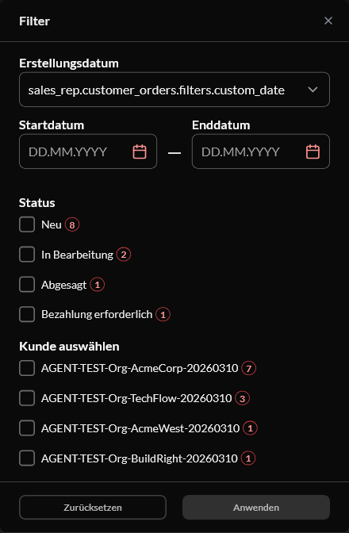

# BUG: [Sales Rep][i18n] Created-date combobox shows the raw key `sales_rep.customer_orders.filters.custom_date` after an in-session language switch — Medium

**Env:** vcptcore-qa, theme `2.59.0-pr-2519-1d9b-1d9bc6dc` (also reproduced on control vcptcore-qa1 `2.59.0-pr-2540-710a-710ab0fa`, a build without vc-frontend#2519 ⇒ PRE-EXISTING). Found by agent during /qa-test VCST-6001 (2026-10-06); Filed as VCST-6196 on 2026-10-07 (operator decision).
**Relates:** VCST-6001 · BL-SR-013 (raw i18n key never surfaces)

## Summary
After switching the storefront language in-session (header language selector, en → de, then de → fr/es), the closed "Created date" combobox in the customer-orders Filters drawer shows the raw i18n key instead of the translated "Custom date"; its option list is translated. A cold load of `/de/company/customer-orders` is fine. The document title briefly showed `sales_rep.customer_orders.page.all_title` during the switch.

## STR
1. Sign in as a sales rep, open `/company/customer-orders` in English.
2. Switch language to Deutsch via the header selector (then to another language).
3. Open Filters.

## Expected vs Actual
- **Expected:** "Benutzerdefiniertes Datum" (the translated selected value).
- **Actual:** `sales_rep.customer_orders.filters.custom_date`; options are translated. Reproduced 2/2 on the PR build and on the control.

**Likely root cause:** the initial `selectedRange` label is captured before the new locale's messages load (not reactive to the locale).

## Update 2026-10-06 — also on a COLD load, intermittently (race)
Not only after an in-session switch: the first direct load of a non-default locale in a fresh session (`/de/company/customer-orders`) can show the raw key too; later loads of the same locale, and click-through navigation, render the translation. Reproduced in 9 locales on the PR build (ja, zh, ru, pl, fr, es, it, pt, de) and with the same pattern on the control vcptcore-qa1 (`2.59.0-pr-2540-7105`, no #2519) ⇒ still **PRE-EXISTING**. All 13 locale files carry `custom_date`; the label is resolved before the lazily loaded locale messages arrive and is never re-evaluated. Side effect at 375 in zh: the raw key overflows the combobox (scrollWidth 339 vs 250).
Evidence: `screenshots/ab2-A-de.png`, `ab2-B-de.png`, `loc-ja-rawkey-cold.png`, `loc-zh-rawkey-cold-375.png`.

## Layer Validation

| Layer | Result | Evidence |
|-------|--------|----------|
| 1. Storefront Frontend | FAIL | raw key in the combobox; ab2-A-de (PR build), loc-ja-rawkey-cold, loc-zh-rawkey-cold-375; control ab-3, ab2-B-de |
| 2. Backend Admin | N/A | client-side string |
| 3. GraphQL xAPI | N/A | no request involved |
| 4. Platform REST API | N/A | — |

**Owning layer:** Layer 1 — Storefront

## Root Cause Analysis
`client-app/modules/sales-rep/components/sales-rep-orders-filters.vue` — `const selectedRange = ref<RangeType>(ranges.value[0]);` stores a **snapshot** of the first range object, whose `label` was computed by `t("sales_rep.customer_orders.filters.custom_date")` at setup time. `ranges` is a `computed` and re-translates when the locale messages arrive, but `selectedRange` keeps the old object, so the `VcSelect` shows whatever `t()` returned before the lazily loaded locale messages were available — the raw key. The translation exists in all 13 locale files (`custom_date`); the dropdown options are translated. Expected fix shape: keep only the selected **id** in state and derive the displayed item from `ranges` (e.g. `computed(() => ranges.value.find(r => r.id === selectedRangeId.value))`), or re-sync `selectedRange` when `ranges` changes.

## Fix Routing (→ /qa-fix)

- **Owning layer:** Layer 1 — Storefront
- **Suggested repo:** VirtoCommerce/vc-frontend
- **repoKind:** frontend
- **Ownership hint:** platform
- **Component / module:** vc-frontend `client-app/modules/sales-rep` (customer orders filter)
- **RCA anchor:** sales-rep-orders-filters.vue `const selectedRange = ref<RangeType>(ranges.value[0]);`
- **Routing confidence:** HIGH

## Verification 2026-10-28
**Verdict:** VERIFIED_WITH_NOTES for the theme code; NOT delivered to stands. Stays open.
- vc-frontend PR #2609 (head `52e9649c`, open) fixes the label in the theme's built-in hub: STR A 3/3, de cold 3/3, ja/zh cold 1/1 each; RED on the vcst-qa control (de in-session, ja, zh).
- vcst-qa / vcptcore-qa render this page from the vc-module-sales-rep MF plugin (`sales-rep` 0.2.5); its copy `src/VirtoCommerce.SalesRep.Web/StorefrontApp/src/components/sales-rep-orders-filters.vue` is still pre-fix. The same change is needed there.
- Evidence: `reports/tickets/Sprint26-21/VCST-6196/` (verification-report.md, evidence.html). Jira comment 112412.
