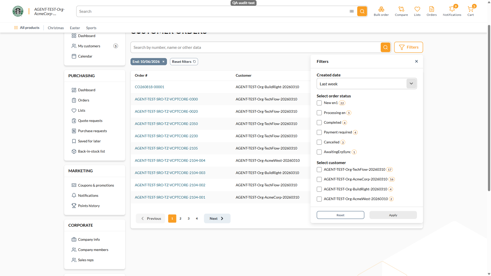

# BUG: [Sales Rep] Removing the Start chip of an applied preset leaves the drawer claiming the preset while the grid is open-ended — Medium

**Env:** vcptcore-qa, theme `2.59.0-pr-2519-1d9b-1d9bc6dc` (also reproduced on control vcptcore-qa1 `2.59.0-pr-2540-710a-710ab0fa`, a build without vc-frontend#2519 ⇒ PRE-EXISTING). Found by agent during /qa-test VCST-6001 (2026-10-06); Filed as VCST-6195 on 2026-10-07 (operator decision).
**Relates:** VCST-6001 · regression case SR-CO-034 (EXPECTED-RED since 2026-09-04, no ticket until now)

## Summary
After applying a Created-date preset (e.g. "Last week") and removing only its Start chip, the list re-queries with an open lower bound, but the Filters drawer still shows "Last week" with Apply disabled. The rep believes the list is last week's orders while it shows everything up to today; the applied bound cannot be seen or edited without switching away from the preset and back.

## STR
1. Sign in as a sales rep (`@td(SR_REP_PRIMARY.email)`), open `/company/customer-orders` → Filters.
2. Created date → **Last week** → Apply. Chips: `Start: 09/29/2026`, `End: 10/06/2026`; request `createddate:["2026-09-28T21:00:00.000Z" TO "2026-10-06T20:59:59.999Z"]`.
3. Remove the **Start** chip. Request becomes `createddate:[TO "2026-10-06T20:59:59.999Z"]` (grid 0 → 39 orders).
4. Reopen Filters.

## Expected vs Actual
- **Expected:** the drawer describes the filter actually applied (e.g. Custom date with only End = 10/06/2026), or removing a preset chip removes the whole preset.
- **Actual:** the combobox still reads **"Last week"**, no date fields shown, Apply disabled.

Control (no PR 2519): `reports/tickets/Sprint26-20/VCST-6001/screenshots/ab-2-b7-lastweek-after-start-chip-removed.png`

**Likely root cause:** `customer-orders.vue` `removeFilterChip` clears `startDate` but `selectedRange` in `sales-rep-orders-filters.vue` keeps the preset id (neither touched by PR #2519).

## Layer Validation

| Layer | Result | Evidence |
|-------|--------|----------|
| 1. Storefront Frontend | FAIL | drawer combobox still reads "Last week"; 4a-05, control ab-2 |
| 2. Backend Admin | N/A | filter state is client-only |
| 3. GraphQL xAPI | PASS | `salesRepCustomerOrders` receives `createddate:[TO "…T20:59:59.999Z"]` and returns the matching orders — the query reflects the chip removal correctly |
| 4. Platform REST API | N/A | not exercised by this UI state |

**Owning layer:** Layer 1 — Storefront

## Root Cause Analysis
`client-app/modules/sales-rep/components/sales-rep-orders-filters.vue` — the `watch(() => props.applied, …)` that syncs the drawer to what the page applied resets `selectedRange` only when **both** `startDate` and `endDate` are empty (`if (!value.startDate && !value.endDate) selectedRange.value = ranges.value[0]`). After a single date chip is removed (`customer-orders.vue` `removeFilterChip` → `applyFilters`), one bound remains, so `selectedRange` keeps the preset id although the applied range no longer matches any preset. Expected fix shape: when the applied range differs from the selected preset's bounds, switch `selectedRange` to Custom date (showing the remaining bound) — or make a preset chip removal drop the whole preset.

## Fix Routing (→ /qa-fix)

- **Owning layer:** Layer 1 — Storefront
- **Suggested repo:** VirtoCommerce/vc-frontend
- **repoKind:** frontend
- **Ownership hint:** platform
- **Component / module:** vc-frontend `client-app/modules/sales-rep` (customer orders filter)
- **RCA anchor:** sales-rep-orders-filters.vue `watch(() => props.applied` — `if (!value.startDate && !value.endDate)`
- **Routing confidence:** HIGH

## Blocked 2026-10-27
`/qa-verify-fix` of vc-frontend#2609 (OPEN, @52e9649c) on a local frontend-only stand bound to vcptcore-qa: RED re-reproduced on vcptcore-qa (drawer still "Last week" after the Start chip is removed). GREEN not executable — the Sales Rep hub renders the SalesRep module's federated plugin chunk (pluginVersion 0.2.5, pre-fix), not the theme chunk that carries the fix. Needs a SalesRep module plugin rebuilt from #2609 to verify. Evidence: `reports/tickets/Sprint26-21/VCST-6195/verification-report.md`.
