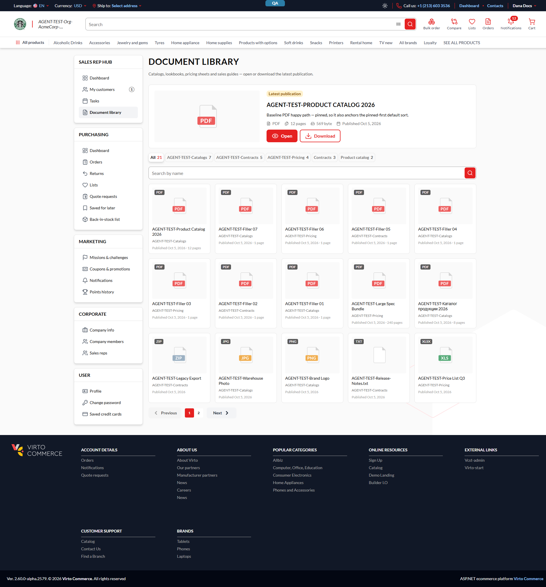
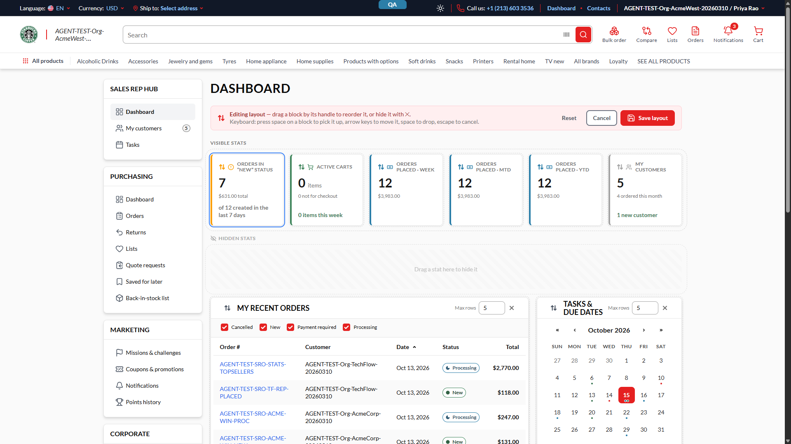

# BUG — Sales Rep Hub: Document library card meta text and Edit layout labels fail WCAG 2.2 AA contrast (1.4.3)

## Status: READY_TO_SUBMIT
**Found by:** agent — testing VCST-6015
**Tracker:** VCST-6395 (Bug, Medium, labels `found-by-agent` `found-in-testing`; "Relates" link to VCST-6015). Filed 2026-10-15.
**Severity:** Medium (P2) · A11y · WCAG 2.2 AA 1.4.3 · pre-existing (identical styles in the in-repo module on vc-frontend dev)
**Env:** vcst · Platform 3.1083.0 · SalesRep 3.1014.0 · theme 2.60.0-alpha.2579 (Coffee) · Chrome 1920x1080

## Summary
Sales Rep Hub texts rendered in `neutral-400` (or other low-contrast pairs) are below 4.5:1 on the Document library cards and in the dashboard Edit layout mode.

## Steps to reproduce
1. Sign in as an Advanced Sales Rep, open `/company/documents`, run axe `color-contrast` (or read `.document-card__meta`).
2. Open `/company/dashboard`, click **Edit layout**, run axe `color-contrast`.

## Actual vs Expected
Expected >= 4.5:1. Actual:

| Where | Element | Colours | Ratio |
|---|---|---|---|
| `/company/documents` | `.document-card__meta`, 12px, 15 nodes (1920/768/375) | `#a3a3a3` on `#fff` | 2.52:1 |
| Edit layout | "HIDDEN STATS" heading, 12px bold | `#a3a3a3` on `#fafafa` | 2.41:1 |
| Edit layout | `.layout-edit-bar__keys`, 14px | `#737373` on `#ffeff0` | 4.25:1 |
| Edit layout | pressed "Editing layout" button, 12px bold | `#e52121` on `#fad3d3` | 3.35:1 |

Sibling node, same component, not re-measured this run: the parked-zone hint (see `BUG-SalesRep-Layout-Parked-Zone-Hint-Contrast.md`, never filed in Jira on its own; Jira search 2026-10-15 found no ticket for it). Cross-referenced in VCST-6395 so one fix covers it.

## Evidence

Source: `reports/tickets/Sprint26-20/VCST-6015/design-report.md` (D1, D2). Inline in Jira: 2 `` rendered, 0 literal `!png!`, 0 error spans.

## Layer Validation
| Layer | Result | Evidence |
|---|---|---|
| 1. Storefront Frontend | FAIL | screenshots above, axe 4.10.2 |
| 2-4. Admin / xAPI / REST | N/A | presentation only |

**Owning layer:** 1

## Fix Routing (→ /qa-fix)
- **Owning layer:** Layer 1 — Storefront (Sales Rep plugin)
- **Suggested repo:** VirtoCommerce/vc-module-sales-rep
- **repoKind:** module (embedded storefront app; not a declared `moduleFrontendSubApps` entry)
- **Ownership hint:** platform
- **Component / module:** Sales Rep Hub — Document library, dashboard Edit layout
- **RCA anchor:** `src/VirtoCommerce.SalesRep.Web/StorefrontApp/src/pages/documents.vue` (`.document-card__meta`), `components/layout-stats.vue`, `layout-edit-bar.vue`, `layout-edit-button.vue` (not re-verified in repo: GitHub API rate-limited at filing time). Identical copy in vc-frontend `client-app/modules/sales-rep/` while `sales_rep_builtin_enabled` exists.
- **Routing confidence:** MEDIUM (token choice is a design call)
- **Auto-fix labels:** `vc-fix`/`qa-autofix` withheld: module's storefront app is not a declared sub-app, so Gate 0/1 routing is uncertain.
