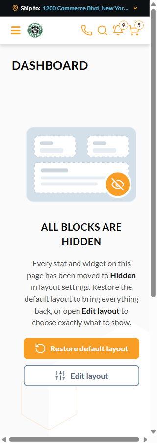

# BUG: [Sales Rep] At 320px the "All blocks are hidden" empty state overflows its column and the page scrolls horizontally — Medium

**Env:** vcptcore-qa, theme `2.59.0-pr-2539-24ab-24ab03c4` (vc-frontend PR #2539). Found by agent during /qa-test VCST-5687 (2026-10-07); Filed as VCST-6205 on 2026-10-07 (operator decision), assigned to the operator, VCST Sprint 26-20.
**Relates:** VCST-5687 (IN-SCOPE — the component is new in this PR) · BL-UI-004 (no document horizontal scroll on mobile) · WCAG 2.2 SC 1.4.10 Reflow

## Summary
With every layout block hidden, the Sales Rep Hub empty state is wider than its content column at a 320px viewport. The document scrolls sideways by 3px (`scrollWidth` 308 vs `clientWidth` 305) and the block sits off-centre against the page H1 (block x 24–308, column x 24–281). Same numbers on the Dashboard and the Customer profile, in every locale (en, ru, fr, de, zh, ja, es, pt). 360px and wider pass.

## STR
1. Sign in as a sales rep (`@td(SR_REP_PRIMARY.email)`), open `/company/dashboard`.
2. Edit layout → hide every stat and widget → Save. The empty state appears.
3. Resize the viewport to 320×900 and read `document.documentElement.scrollWidth` vs `clientWidth`; try swiping horizontally.
4. Repeat on a customer profile `/company/my-customers/{orgId}`.

## Expected vs Actual
- **Expected:** `scrollWidth` ≤ `clientWidth`; the empty state fits its column and is centred under the H1.
- **Actual:** `scrollWidth` 308 vs 305 — a horizontal scrollbar; the block's right edge is 27px outside its column. Reproduces on every reload.

## Layer Validation

| Layer | Result | Evidence |
|-------|--------|----------|
| 1. Storefront Frontend | FAIL | res-en-320, res-ru-320, res-de-320, res-zh-320, cp-ru-320 |
| 2. Backend Admin | N/A | layout only |
| 3. GraphQL xAPI | N/A | — |
| 4. Platform REST API | N/A | — |

**Owning layer:** Layer 1 — Storefront

## Root Cause Analysis
The illustration is inlined from `assets/layout-empty-state.svg` with a fixed `width="236"` and no `max-width`, and `.layout-empty-state` (VcEmptyView) is a flex child with the default `min-width: auto` plus 24px side padding. Its minimum width is therefore ~284px, more than the 257px column at a 320px viewport; overflow starts below ~347px. Measured, not traced in a debugger.
Fix direction: `max-width: 100%; height: auto` on `.layout-empty-state__art svg`, or `min-width: 0` on the empty state.

## Fix Routing (→ /qa-fix)
- **Owning layer:** Layer 1 — Storefront
- **Suggested repo:** VirtoCommerce/vc-frontend
- **repoKind:** frontend
- **Ownership hint:** platform
- **Component / module:** `client-app/modules/sales-rep/components/layout-empty-state.vue` + `assets/layout-empty-state.svg`
- **RCA anchor:** `layout-empty-state.vue` `.layout-empty-state__art` (inline SVG, fixed width)
- **Routing confidence:** HIGH — the component and asset are new in PR #2539, and the measured minimum width matches the SVG width + padding
