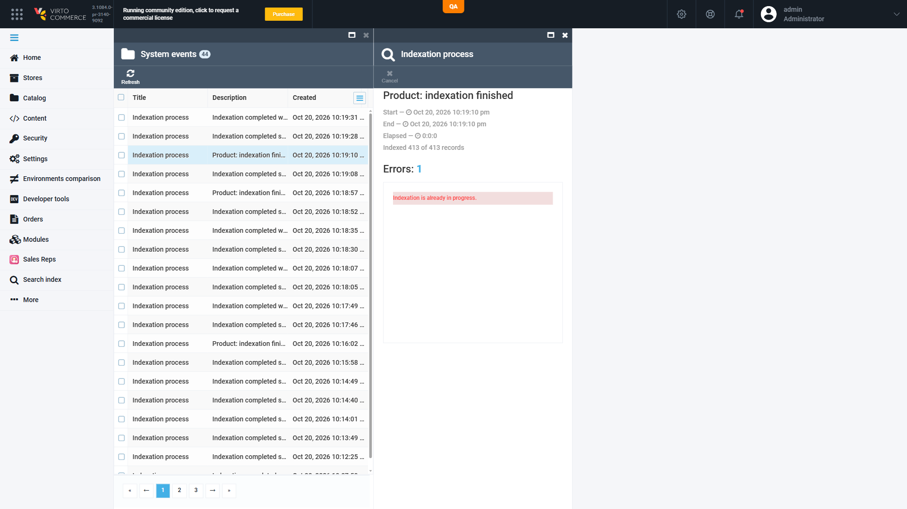

# Concurrent indexation: the skipped run's progress blade shows the running build's progress, and the running build's blade freezes

**Jira:** VCST-6474 · **Severity:** Medium · **Provenance:** PRE-EXISTING — reproduced on the released Search 3.1010.0 · **Found in:** VCST-6429 testing (found-by-agent, found-in-testing)
**Module:** vc-module-search · **Env:** vcptcore_qa1 — Platform 3.1084.0-pr-3140-9092, VirtoCommerce.Search 3.1011.0-pr-157-9278, Azure AI Search, Hangfire

## Steps to reproduce
1. Admin → Search index → select **Product** → Build index → **Build**.
2. While it runs (progress shows "Product: 50 of N"), start a second build — another document type (e.g. **Category**), or **Build index** on any product's Index widget.
3. Watch both "Indexation process" blades (or the notifications menu / System events).

## Expected
The second run is reported as skipped: "Indexation completed with errors", Errors 1 "Indexation is already in progress.", 0 records, its own document type.
The first run's blade keeps advancing until it completes.

## Actual (intermittent, provider-independent — Azure AI Search: 8 of ~16 contended runs on 2026-10-20; ElasticSearch8: 3 of 4 on 2026-10-21)
- The skipped run's blade takes over the running build's progress and ends as **"Product: indexation finished — Indexed 413 of 413 records"**, Elapsed 0:0:0, while still listing Errors 1 "Indexation is already in progress." — for a Category request.
- The running build's own blade freezes at "50 of 413" (or 100) and then jumps straight to "Indexation completed successfully".
- In System events the skipped run reads as a finished Product indexation.

Evidence: notification ids / jobIds in `reports/tickets/Sprint26-21/VCST-6429/summary.json` (`findings[F-1]`); more screenshots in the same folder (`C5-C12-ui-loser-blade-r3-*`).

## Notes
- Why it matters: PR #157 makes lock contention visible on the notification; this defect makes the skipped run's notification describe a different run, so the admin cannot trust either blade.
- Code pointer (vc-module-search, head 927871e8): `IndexingJobs` is a singleton (`Module.cs:43`) holding one `IndexProgressHandler`; `RunIndexJobAsync` calls `_progressHandler.Start(...)` before `TryExecuteAsync`, so the skipped run reassigns the shared notification and the running build's `Progress()` writes into it. Same order on base e462accd.
- Pod logs (2 platform pods): it happens only when both runs land on the same pod — the 3 hijacked skipped runs received 11 progress pushes from pod s69h8 where their winners ran (winners froze at 4); clean cases had the winner on the other pod.
- Released build: reproduced on VirtoCommerce.Search 3.1010.0 on the same stand (3 of 6 contended runs, 2026-10-21).
