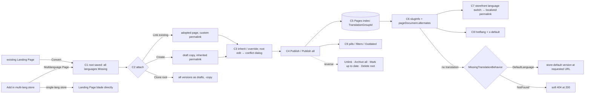
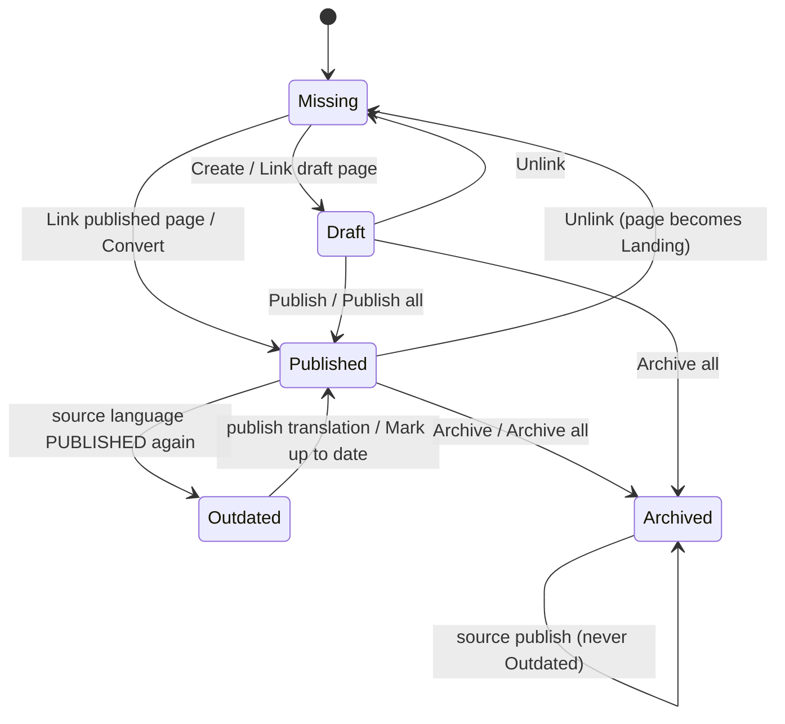

TEST MODEL — VCST-4935 (round 1, 2026-10-23)

Ticket:      VCST-4935 "Link multilingual Page Builder pages for automatic language-based redirect" | Type: Story | Status role: testable (Testing) | Flow: feature-test | Priority: P2 (Medium) | Path: FULL (Story default; cross-layer, 4 repos) | Changed: Both
Context:     FULL — 1c ba-system-analyzer, 1d ba-story-writer (Mode B), 1r qa-backend-expert REACHABLE (2.5 min)
Build:       vcptcore-qa · Platform 3.1085.0 · Pages 3.1011.0-pr-23-4bcd · PageBuilderModule 3.1036.0-pr-175-a3bc · XCMS 3.1009.0-pr-27-bb4c · theme 2.61.0-pr-2576-211e3e15 — all = PR HEAD (verified 1b)
Contract:    REFRESHED — {RUN_DIR}/knowledge/api/graphql-schema.md @ 2026-10-23 + live introspection: PageDocumentType{id,title,source,permalink,content,cultureName,alternates![PageDocumentAlternate{id,cultureName,permalink}]}; slugInfo(slug,permalink,storeId,userId,cultureName). Fixture gate 86/86 green.
Prior model: reports/ba/test-models/VCST-4933-2026-09-17.md (Shared Components) — same domain, different slice; its L1–L9 domain chain is carried forward via the domain map, no Part 0 links reused (none overlap this mechanism).
Domain map:  .claude/knowledge/domain/page-builder.md @ rev 2 (generated 2026-09-23, 30 d < stale_after 60) — PRESENT. all_layer_confirmed_at: 1e-confirmed (chain crosses back office + API + storefront).
Mind map:    ABSENT (no page-builder.mind-map.json) → built at 5-mind-map.
Chain position: domain chain L1–L9. TOUCHES L1 (a new entity — the Multilanguage root — comes into existence), L2 (identity: language + permalink, now per-version with inheritance), L4 (gating: visibility/user groups/org/schedule inherited per language), L5 (status lifecycle: Publish all / Archive all, Outdated), L6 (index: TranslationGroupId), L7 (resolve: slugInfo cross-language + pageDocument.alternates + storefront switch/hreflang), L8 (Clone; export/import), L9 (retire: Archive all, delete guard). DOES NOT TOUCH L2a/L3 (Shared Components — only incidentally via Create's content copy, WAIVED below) or the Designer authoring itself (unchanged per dev).
Affected surface: vc-module-pagebuilder (root entity, 15 REST endpoints, POST /list, /permalink-usage, vc-shell blades: Add chooser, ML blade + language table, version blade, conflict dialog, link popup, list pills + Filters) · vc-module-pages (PageDocumentSeoResolver — first resolver for EVERY slug; TranslationGroupId; store setting VirtoPages.MissingTranslationBehavior) · vc-module-x-cms (pageDocument.cultureName/alternates) · vc-frontend (language-selector strips locale for ALL routes; getLocalizedPath; useHead hreflang/x-default). Domain map MISSING 14 surfaces (1c §4) → domain_map.unmapped_surfaces[], written back at 5-docs-map.
Ticket signals: no AC/DoD section — behaviour lives in the 2026-10-21 dev comment (table "Story item | As implemented"), which overrides the description: Default language field; no Slug column; Outdated set on SOURCE PUBLISH, cleared by translation publish or Mark up to date, never on Archived; Create/Link existing/Unlink/Clone; Delete only without versions; permalink-usage warning; AC3 → MissingTranslationBehavior DefaultLanguage(default)|NotFound; hreflang host = store URL. Attachments 01–16 opened: hreflang uses FULL culture codes (de-DE, en-US) vs story example (de, en); x-default = store-default version. 1r: B2B-store storefront redirects anonymous to /sign-in; legacy rows show a "null: Draft" language badge. PR pins pre-release packages (Pages 3.1011.0-alpha.91-vcst-4935; theme backend-packages.json) — release-process risk, not a product defect. Prior repo note (aliases.json changelog_1_5_38, vcst 2026-07): "an UNPUBLISHED language serves default-language content instead of 404" — now the declared DefaultLanguage behaviour.
Epic context: VCST-4931 "Page Builder – 2062 Q3 Roadmap" (In progress). Done sibling VCST-4933 Shared Components = integration seam (content copy on Create/Clone). Client driver VP-9046 (Bossard/Innovadis, /veelgestelde-vragen ↔ /faq).
Domains:     page-builder (content-cms), SEO, GraphQL xCMS, storefront i18n, RBAC (builder:*)
Flows & boundaries: Landing Page lifecycle ↔ ML version (Convert/Link/Unlink) · Designer (unchanged; content copy) · Pages index ↔ BuilderIO docs (same index, no TranslationGroupId) · product/category slug resolution (same resolver) · storefront language switch on ALL routes.
Risk areas:  VC-SEARCH-004 (non-default language falls back to default data) · VC-CMS-003 (content lost on rename/publish/open) · VC-SEARCH-001/002 (index stale/partial) · VC-PLATFORM-001 (concurrent writers) · ECL-10.3 (blade silent fail / 500) · ECL-12.1 (language vs locale) · ECL-7.3 (loading/race).
AC traceability: 52 atomic conditions (1d §5: R2.a–FE2.d + G1–G14 gap-ACs), each with static Impl verdict; DRIFT/NOT-FOUND/CONTRADICTS carried to live: R3.c, R8.d, FE1.c, FE1.d, G8.b, G11.b, R12.e.
DoD: none declared (1d proposes a minimal DoD; recorded, not gated).

--- Part 0 — VALUE CHAIN ---
Value chain (editor → visitor):
  C1 Editor creates a Multilanguage Page (Name, Permalink, Default language, advanced defaults) in a multi-language store → root persisted, language table lists every store language as Missing.
  C2 Editor attaches language versions — Create (draft copy of source content, inherits permalink) / Link existing (adopts a Landing Page, keeps its permalink+settings) / Convert (a Landing Page becomes the root's default version) / Clone → versions carry MultilanguagePageId.
  C3 Per-language values: a version inherits root Permalink/Visibility/UserGroups/Organization/Start/End unless set for that language (OverriddenFields); a root edit propagates to inheriting versions; the conflict dialog decides for overriding ones.
  C4 Publish (per version or Publish all, source first) → status Published; source publish stamps SourceRevisionDate → translations flagged Outdated until republished or marked up to date.
  C5 (async) Pages index writes TranslationGroupId on each published version.
  C6 xAPI resolves: slugInfo(permalink of language A, cultureName B) → the B translation (or the store-default version / not found per MissingTranslationBehavior); pageDocument.alternates lists published, visible, store-language versions, one per language.
  C7 Visitor switches language on the storefront → URL becomes the translation's localized permalink, content in the new language.
  C8 Page head carries <link rel=alternate hreflang> per alternate + x-default (store-default version), absolute on the store URL.
  C9 Editor sees status at a glance — language pills + Filters (type, language, Missing/Outdated) in the pages list; Outdated tells them what to re-translate.



```mermaid
sequenceDiagram
  participant Ed as Editor (vc-shell)
  participant PB as PageBuilder REST
  participant DB as DB
  participant IX as Pages index
  participant X as xAPI (slugInfo / pageDocument)
  participant SF as Storefront
  Ed->>PB: POST multilanguage-pages / languages / link / convert
  PB->>DB: root + GroupedPage.MultilanguagePageId, OverriddenFields
  Ed->>PB: publish-all
  PB->>DB: Published, SourceRevisionDate
  PB-->>IX: async index (TranslationGroupId)
  SF->>X: slugInfo(permalink, cultureName=B)
  X->>IX: search permalink (all languages) → translation in B / fallback
  SF->>X: pageDocument(id){cultureName alternates}
  X->>IX: per-page search: published ∩ visible ∩ store languages
  SF-->>SF: replace URL with getLocalizedPath(B, permalink); useHead hreflang
```



Variants (union of the layers that branch — admin service, resolver, alternates handler, frontend):
  V1 new root + Create in a 13-language store (B2B-store) · V2 Convert from Landing · V3 Link existing (custom permalink) · V4 Clone · V5 single-language store (store2) · V6 root default ≠ store default (de-DE root, store en-US) · V7 MissingTranslationBehavior = NotFound · V8 version gated per language (user group / org / future schedule) · V9 read-only editor (builder:access+read) · V10 non-page slugs (product/category) and non-page routes through the changed resolver + language selector · V11 near-duplicate locales (nl-NL vs nl-BL short prefix /nl/)

Variant → domain-map surface (clause 11b): V5, V9 → map §2 Back office (Add / builder:* roles, CONFIRMED) · V8 → map L4 gating (CONFIRMED rev1) · V10 → map §2 API (slugInfo/pageDocument) + Storefront render (CONFIRMED rev2) · V1, V2, V3, V4, V6, V7, V11 → **surfaces the map is MISSING** (ML root/blade, Convert/Link/Clone of ML, root default language, MissingTranslationBehavior, locale-prefix switching) — listed in domain_map.unmapped_surfaces[] (1c §4, items 1–8), written back at 5-docs-map only if verified live.

Mechanism coverage matrix (rows = variants, cols = chain links; scenario # or GAP/WAIVED):
| | C1 | C2 | C3 | C4 | C5 | C6 | C7 | C8 | C9 | Reverse |
|---|---|---|---|---|---|---|---|---|---|---|
| V1 | 3,4 | 6 | 9,10,11 | 12,14 | 1,30 | 20,21 | 1 | 25 | 18 | 15,16 |
| V2 | 1 | 1,8 | 1 | 1 | 1 | 1 | 1 | 1 | 1 | 16 |
| V3 | 1 | 1,7 | 10 | 13 | 16 | 20 | 1 | 1 | 18 | 16 |
| V4 | 17 | 17 | 17 | 17 | WAIVED: clone yields drafts only; not indexed until published (covered by 14) | WAIVED: same | WAIVED: same | WAIVED: same | 17 | 15 |
| V5 | 2 | 2 | WAIVED: no versions possible | 2 | WAIVED: unchanged Landing path (30) | 2 | 2 | 2 | 2 | WAIVED: no ML entity |
| V6 | 24 | 24 | 24 | 24 | 24 | 24 | 24 | 24 | 24 | 16 (H3 unlink of source) |
| V7 | WAIVED: setting is read only at C6 | WAIVED: same | WAIVED: same | WAIVED: same | WAIVED: same | 23 | 23 | 23 | WAIVED: admin unaffected | 23 (restore setting) |
| V8 | 9 | 9 | 26,27 | 27 | 27 | 26,27 | 26 | 26 | WAIVED: list shows status not audience | 27 (schedule lapses) |
| V9 | 31 | 31 | 31 | 31 | WAIVED: refused upstream | WAIVED: read path unchanged | WAIVED | WAIVED | 31 | 31 |
| V10 | WAIVED: no ML entity | WAIVED | WAIVED | WAIVED | 28 | 28 | 28 | 25 (no hreflang on PDP) | WAIVED | WAIVED |
| V11 | 32 | 32 | WAIVED: inheritance culture-agnostic | 32 | 32 | 32 | 32 | 32 | WAIVED | WAIVED |

Reverse edges (per forward effect):
  Link → Unlink: version becomes Landing, leaves siblings' alternates/hreflang after reindex → #16. Convert failure rollback → GAP (not provokable without fault injection).
  Publish all → Archive all → #15; single-version Unpublish/Archive → #15. 
  Source publish → Outdated → Mark up to date / republish translation → #12, #13.
  Root edit over overrides → conflict dialog Apply-to-all (reset) / Cancel → #10.
  Root create → Delete root: refused (400) while versions exist; allowed with none → #15. Controller-only guard for non-UI callers (H5) → GAP (needs import path, export/import WAIVED).
  Language removed from the store → row flagged not-a-store-language, dropped from alternates → #33.
  Per-language schedule window lapses → version leaves alternates → #27.
  Create version → no "delete version" (archive or Unlink) → ABSENT IN PRODUCT by design (dev comment) — reported as a note, not a defect.
Fixture lifecycle: every ML root/version is TERMINAL-ish (published/outdated/archived states move once per action) → per-run fixtures only, names/permalinks `AGENT-TEST-VCST4935-<runId>-…`, created in-case through the mechanism under test (FIFTH RULE: the mechanism is under test, so it seeds itself), archived/unlinked/deleted in Cleanup. The B2B-store setting VirtoPages.MissingTranslationBehavior is SHARED state: #23 sets NotFound and must restore the original value (null) in Cleanup; never parallel with #22.

--- Part 0r — ROLE SCENARIOS (2 role variants: full editor, read-only editor) ---
Roles in scope: Content editor (full builder:*) → admin `ADMIN` ({{ADMIN_PASSWORD_VCPTCORE}}) · Read-only editor (builder:access+builder:read) → @td(RESTRICTED_CMS_ADMIN.email) — FIXTURE-GAP on vcptcore (not in aliases.vcptcore.json) → 3a: run existing `npm run seed:rbac` for vcptcore.
BSC-1 — "The content editor makes the FAQ bilingual"
  Role: Content editor · Situation: an NL and an EN FAQ already exist as separate Landing Pages.
  | # | Action | Sees | Can do | Expected |
  | 1 | Convert EN page | ML blade, EN = default | Link existing / Create | EN version, permalink inherited |
  | 2 | Link existing NL page | NL row custom | Publish all | both published, alternates 2 |
  Outcome: switching NL↔EN on the storefront moves between the two URLs.
  Not allowed: linking a second page for the same language (server 400); deleting the root while versions exist (server 400).
BSC-2 — "A reviewer may look but not change"
  Role: Read-only editor · Situation: reviews localization status before a release.
  | # | Action | Sees | Can do | Expected |
  | 1 | Open pages list | ML row + pills | read only | list loads via /list |
  | 2 | Open ML blade | language table | nothing mutating | Save/Publish all/Archive all/Create/Link/Unlink hidden or disabled |
  Outcome: reviewer reads statuses without risk.
  Not allowed: POST multilanguage-pages, /languages/{c}, /link, /convert, /publish-all, /archive-all, /mark-up-to-date with this role's own token → 403 (server-side, not only a hidden button).

--- Parts 1–5 — FAULT MODEL ---
Condition space: F1 store languages {1, many(13)} · F2 creation path {new+Create, Convert, Link existing, Clone} · F3 version permalink {inherited, custom} · F4 version state {Missing, Draft, Published, Published+Outdated, Archived} · F5 MissingTranslationBehavior {unset→DefaultLanguage, NotFound} · F6 root default {= store default, ≠ store default} · F7 audience {signed-in in-scope, out-of-scope group/org, before schedule} · F8 role {full, read-only} · F9 entity {ML page, Landing page, product/category}. Constraints: F1=1 ⇒ F2∈∅ (no ML), F3/F4/F5/F6 n/a; F9≠ML ⇒ F2–F6 n/a; Archived ⇒ ¬Outdated. Raw N = 2·4·2·5·2·2·3·2·3 = 5760 (≈ 1440 feasible after constraints).
Reduction: FLOW journey first, then ST over F4 (lifecycle subsumes most F2×F4 pairs: creation path only changes the ENTRY state, so each path gets one row and the lifecycle is exercised once on V1); DT over F3×root-edit (conflict dialog, 3 outcomes); EP on F5, F6, F7, F8 one class each against a single published-pair fixture (they act at C6 only, independently — F5 and F7 both pick "which version is served" but never in the same request path, so not crossed); pairwise dropped for F9 (separate regression row #28) and F1 (one row #2). Dropped: F2×F7 (audience is read from the version fields after inheritance, creation path irrelevant — subsumed by #9+#26), F6×F7, F5×F6 (one combined row #24 covers the x-default/fallback under ≠default). 1440 → 33.

Test scenarios (33):
| # | Cell | Defect hypothesis | Archetype | Technique | Oracle | P |
|---|---|---|---|---|---|---|
| 1 | [JOURNEY] V2+V3+V1: EN Landing + FR Landing (own permalink) on B2B-store → Convert EN → Link FR → Create DE → Publish all → storefront (signed-in) /fr/<fr> → switch EN → /<en> EN content; head hreflang en-US/fr-FR/de-DE + x-default; GraphQL alternates = 3 | any join breaks (link not indexed, alternates empty, switcher keeps old slug) and the Bossard case still stays on the FR URL | PARITY | FLOW | {SPEC} dev comment §3.2 + docs/multilanguage-pages.md; {DOC} VirtoOZ Multilingual SEO URLs | Critical |
| 2 | V5 store2: Add → Landing blade, no type chooser, no Convert action; its page has no hreflang | single-language store shown the ML chooser or Convert, or an hreflang with one entry | CONFIG | EP | {SPEC} story R2 + dev §3.1 | High |
| 3 | V1 new root: Add→Multilanguage; Name/Permalink/Default language(=store default en-US)/advanced → Save → table: 13 rows, default first, all Missing, no Slug column | table misses store languages, wrong default, wrong status | FALLBACK | EP | {SPEC} dev table R3/R5 | High |
| 4 | Name / Permalink empty, whitespace, leading-slash missing, max length | Save accepted with empty required field or malformed permalink | BOUNDARY | BVA | {SPEC} story R3 (required) | Medium |
| 5 | REST POST root with DefaultCultureName not in store languages (e.g. "xx-XX") | Create skips the store-language check Update has (1d G8) → orphan root | LIFECYCLE | EG | {HYPOTHESIS} → {SPEC} once dev/PO confirms "default = a store language" (Update path enforces it) | Medium |
| 6 | V1 Create DE: draft with a copy of source content, permalink inherited | copy loses blocks / copies wrong language / not a draft (VC-CMS-003) | SILENT | EP | {SPEC} dev table R8 | High |
| 7 | Link existing: page of that language keeps permalink+settings, badge custom; linking a page already in another root, or a second page for the same language → refused | link overwrites the page's permalink, or double-link corrupts the unique (root, culture) | LIFECYCLE | EG | {SPEC} dev table R8 + unique index (PR) | High |
| 8 | Convert negatives: page whose culture is not a store language; page already a version → refused; Convert of a published page leaves the storefront URL unchanged | Convert silently re-addresses a live page or creates a half root | LIFECYCLE | EG | {SPEC} dev table R13 "Nothing changes on the storefront" | High |
| 9 | Root advanced option change (Visibility off / StartDate) with all versions inheriting → every version field updated; version blade hint "inherited" | root save not propagated (mask wrong) → storefront still serves hidden page | STALE | DT | {SPEC} dev table R7 + §2 inheritance | High |
| 10 | Root permalink change while FR custom → dialog lists "fr-FR — Permalink"; Apply to all → FR reset to root; Apply to inheriting only → FR keeps own; Cancel → nothing saved | wrong branch applied / Cancel still saves | LIFECYCLE | DT | {SPEC} story R10 + dev table | High |
| 11 | Version: set Permalink back to root value → badge inherited; Name read-only on version | mask keeps "custom" forever; Name editable per language | FALLBACK | ST | {SPEC} dev table R7 | Medium |
| 12 | Outdated ST: save source draft → no Outdated; publish source → published+draft translations Outdated, archived not; publish translation clears; Mark up to date clears | Outdated on save, not cleared, or set on Archived | LIFECYCLE | ST | {SPEC} dev table R5.1.5/R12 | High |
| 13 | Linked-existing translation (no SourceRevisionDate) after source publish → Outdated; Mark up to date when source never published | H1 inconsistent with doc; H2 silent no-op returns success with no message | SILENT | EG | {SPEC} dev table + docs/multilanguage-pages.md; H2 {HYPOTHESIS} → {SPEC} if the doc states a message | Medium |
| 14 | Publish all with EN+FR without drafts and DE draft → DE published, EN/FR reported skipped; one language failing is reported, batch continues | batch aborts on first failure, or reports success for a failed language | SILENT | EG | {SPEC} dev comment §3.2 "Publish all" | High |
| 15 | Archive all → all versions Archived, table status Archived, storefront no longer resolves; Delete root with versions → 400; without versions → deleted | archived versions still served; delete leaves orphans | LIFECYCLE | ST | {SPEC} dev table Delete + BL-SEO-002 | High |
| 16 | Unlink FR (and, V6, the source) → FR becomes Landing at its permalink, disappears from EN/DE alternates + hreflang after reindex | unlinked page still listed as alternate (stale TranslationGroupId); source unlink leaves root un-Outdate-able | STALE | ST | {SPEC} dev table R8 Unlink | High |
| 17 | Clone root with 3 versions → new root, every version a draft, permalinks -copy; clone twice → no collision | cloned versions published / share original permalink / second clone collides | LIFECYCLE | EG | {SPEC} dev table R9 Clone | Medium |
| 18 | Pages list: ML page = ONE row, pills per language by status (Outdated distinct); Filters Page type/Language/Translation status Missing/Outdated; filter with no match → empty state; legacy "null: Draft" badge rows | list duplicates versions, filter wrong, blank/500 on empty result (ECL-10.3) | RENDER | EP | {SPEC} dev table R11 + ECL-10.3 | High |
| 19 | Permalink usage: same permalink+language as another active page → warning, save allowed; same permalink other language → no warning; sibling versions sharing inherited permalink → no warning | false warning between siblings, or missing warning → storefront serves the wrong one | PARITY | DT | {SPEC} dev table "permalink check" + BL-SEO-001 | Medium |
| 20 | GraphQL slugInfo(permalink=FR permalink, cultureName=en-US) → EN id; and EN permalink + fr-FR → FR id; pageDocument.cultureName matches | resolver returns the permalink's own language (old behaviour) | PARITY | EP | {SPEC} dev table AC5 + {BL-SEO-001} | Critical |
| 21 | pageDocument.alternates: only Published, store-language, one per language — DE draft excluded, archived excluded | drafts/archived leak into alternates and hreflang | SCOPE | DT | {SPEC} dev §2 x-cms row | High |
| 22 | MissingTranslationBehavior default (unset): /es/<en permalink> → EN content (store-default version), no es alternate | serves 404 or a random language; leaks a DRAFT ES | FALLBACK | EP | {SPEC} dev table AC3 (DefaultLanguage) + VC-SEARCH-004 as by-design | High |
| 23 | V7 B2B-store MissingTranslationBehavior=NotFound → /es/<en permalink> → SPA NotFound at HTTP 200; /<en permalink> in en still served (H6); restore setting | NotFound strips the whole group incl. the requested permalink's own language | CONFIG | EP | {SPEC} dev table AC3 + {BL-SEO-002} | High |
| 24 | V6 root default de-DE (store en-US) with only DE+FR published → Outdated measured vs DE; visitor in es → fallback (permalink language); no x-default; then add EN → x-default = EN | two "defaults" confused: Outdated vs store default, x-default missing or wrong | FALLBACK | EG | {SPEC} dev table R3 "source language" + alternate-links.ts rule; x-default rule {HYPOTHESIS} → {SPEC} if PO confirms | Medium |
| 25 | hreflang format on #1 page: values = full cultures (story example short) — record; href absolute on store URL; no rel=canonical; page with 1 published version → no hreflang; PDP → none | wrong codes/host, duplicate tags after client-side navigation, crash on empty store URL | RENDER | EP | {SPEC} dev comment §3 Storefront 2 + {BL-SEO-003}; code format is DRIFT vs story → PO question | High |
| 26 | V8 FR version restricted to a user group the signed-in buyer lacks → FR not in alternates/hreflang; /fr/<fr> → fallback | restricted translation leaks via alternates (per-page search ignores audience) | SCOPE | EP | {SPEC} dev §2 alternates "visible" + map L4 | High |
| 27 | V8 FR StartDate in the future → not in alternates; after window → appears (or reversed: EndDate past) | scheduled translation published early via alternates | STALE | ST | {SPEC} map L4 scheduling + alternates handler | Medium |
| 28 | V10 regression: product + category slug resolve in en-US and fr-FR (slugInfo); storefront language switch on PDP, category, search, static page keeps the correct localized URL + query | hot-path resolver change breaks catalog slugs; selector strips locale wrongly on non-page routes | PARITY | EP | {BL-SEO-001} {BL-SEO-002} + pre-change behaviour {DOC} VirtoOZ Multilingual SEO URLs | Critical |
| 29 | Plain Landing page (no ML) publish/unpublish/archive via refactored publishing + storefront render | GroupedPagePublishing refactor regresses single-page publish | LIFECYCLE | EP | {SPEC} map L5 + dev "existing pages unchanged" | High |
| 30 | Publish → immediately query slugInfo/alternates (index lag) | admin shows Published while storefront resolves nothing for >1 index cycle | STALE | EG | {OBSERVED} baseline only — real oracle = documented index SLA (none known) → report latency, never fail on it | Low |
| 31 | V9 read-only role: UI mutating controls hidden/disabled; REST mutations with its own token → 403 | new controller misses permission attributes (admin-only checks client side) | SCOPE | DT | {SPEC} map permissions (builder:create/update/delete/publish) | High |
| 32 | V11 nl-NL + nl-BL versions with different permalinks → each localized URL distinct; switch nl-NL→nl-BL resolves correctly | short-locale prefix /nl/ collides → wrong translation | MONEY | EG | {DOC} VirtoOZ Multilingual SEO URLs (/{xx}/ or /{xx-XX}/) | Medium |
| 33 | Language removed from a store (Electronics: 3 langs, admin-only) while a version exists → row flagged, Create/Link refused, no error; restore language | blade 500/blank on a non-store-language version (ECL-10.3) | FALLBACK | EG | {SPEC} 1c code read (IsStoreLanguage) → {HYPOTHESIS} until the doc states it | Low |

Probes carried in (filled in Step 2): VC-SEARCH-004 → #22,#32 (non-default language) · VC-CMS-003 → #6,#8,#17 (content preserved on create/convert/clone) · VC-SEARCH-001 → #30 · VC-SEARCH-002 → #9,#16 (change via sub-entity reaches index) · VC-PLATFORM-001 → GAP (concurrent publish source vs translation, G6) — exploratory probe in 3x · VC-PLATFORM-002 → #28,#29 · VC-CMS-001 → N/A (search suggestions unaffected) · VC-CMS-002 → N/A (no block authoring in scope; REST used only for fixtures, content authored by Create copy).
Archetype sweep: SCOPE #21,#26,#31 · PARITY #1,#19,#20,#28 · STALE #9,#16,#27,#30 · RACE WAIVED → 3x probe (concurrent publish; double-click Publish all) · REPLAY WAIVED: no idempotency key on these endpoints; double Publish all folded into 3x · SILENT #6,#13,#14 · MONEY #32 (i18n) · BOUNDARY #4 · LIFECYCLE #5,#7,#8,#10,#12,#15,#17,#29 · CONFIG #2,#23 · FALLBACK #3,#11,#22,#24,#33 · RENDER #18,#25.
UIP sweep: UIP-BACK → 3x (back after language switch) · UIP-DEEP → #1 (deep link /fr/<fr>) · UIP-REFRESH → #1 (reload after switch keeps language) · UIP-TABS WAIVED: no cross-tab state in feature · UIP-EXPIRE WAIVED: auth unchanged · UIP-STORAGE → #1 (locale persisted) · UIP-NET WAIVED: slugInfo error path unchanged · UIP-INPUT → #4 · UIP-VIEW → 4v (13-row table, pills wrap at 1366/mobile) · UIP-DATA → #18 (legacy null-culture rows).
Business Rules: BL-SEO-001, BL-SEO-002, BL-SEO-003 (BL-UI-001..007 + BL-A11Y-001..004 for 4v). No CMS BL domain exists — proposed rules (1d §7) go to Oracle Feedback, not minted.
Edge cases: ECL-10.3, ECL-12.1, ECL-7.3.
Docs grounding: VirtoOZ Platform User Guide → General Guidelines "Multilingual SEO URLs"; Managing broken links; Debug SEO Links. No published guide for Multilanguage Pages → vc-module-pagebuilder/docs/multilanguage-pages.md (PR) = {SPEC}.
Agents to dispatch: 3x /qa-exploratory (chrome — Designer path broken on firefox, VCST-6011) · 4a qa-backend-expert (edge: Admin + REST + GraphQL) ‖ qa-frontend-expert (chrome: storefront) · 4v ui-ux-expert (DevTools: vc-shell blades + storefront head) · 3a test-data-engineer (seed:rbac on vcptcore).

## Round 1 — amendments from 3x (exploratory/SBTM-VCST-4935-2026-10-23.md, 2026-10-23)
- #5 {HYPOTHESIS} → {OBSERVED} defect: POST root with defaultCultureName "xx-XX" → 200, languages API marks it isStoreLanguage:true; PUT to the same value → 400. Oracle stays {SPEC} (Update's own rule); case asserts 400 and is held Draft (rule 3).
- #13 H2 → {OBSERVED}: mark-up-to-date on a never-published source → 200 no-op; not reachable from UI (button only on Outdated rows). Oracle stays {HYPOTHESIS} (UI message) → PO question.
- #24 amended: fallback and x-default follow the STORE default, never the root default; with no published store-default version every other language is 404 even under DefaultLanguage. {SPEC} for "DefaultLanguage shows the default language version" is ambiguous between the two defaults → PO question; KB-AA9BFC82.
- #25 amended: hreflang = full cultures; nl-NL + nl-BL use /nl-NL/ and /nl-BL/ prefixes (/nl/ 404, not new); x-default = store default; no rel=canonical; NO og:url on the ML page — contradicts BL-SEO-003 → check a PDP in 4a before treating as ML-specific.
- #30: index lag < 1 s publish, < 2 s archive ({OBSERVED} baseline only).
- #12 RACE: two parallel Publish all both report the source processed (double publish, end state consistent).
- #18: ML row Status cell empty (PO question); pills EN/EN and NL/NL collide; "null: Draft" from 30/126 null-culture pages.
- #31 V9: RESTRICTED_CMS_ADMIN seeded on vcptcore; REST 403 path executable; UI path BLOCKED until RESTRICTED_CMS_ADMIN_PASSWORD is registered in --secrets (operator action).
- New rows (PROMOTE): #34 Link existing a page whose culture is not a store language → expect 400 like Convert (today 200) · LIFECYCLE/EG/{SPEC} Convert's own rule · Medium. #35 language switch nl-NL→nl-BL then Back → expect /nl-NL/<permalink> (today /nl-BL/<nl-NL permalink>) · RENDER/EG/UIP-BACK · Low. #36 Clone from a language-version blade → standalone Landing copy, no console error (today "[BladeMessaging] Caller blade … not found") · SILENT/EG · Low.
- tc:scope disposition input for 2a: REST /search rows still valid (CMS-102, 221, 223, 233, 237, 238, 239, 243, 246); UI list rows at risk (CMS-001, 017–021, 115, 116, 128, 186, 228) — 059 is held by another session (VCST-6443), so 2a may only PROPOSE dispositions there, never edit.

## Round 2 — amendments from the dev reply (Jira 2026-10-27 11:39) · build PageBuilderModule 3.1039.0-pr-175-3d2f (pr-178 merged) · Pages 3.1011.0-pr-23-e50f · XCMS 3.1009.0-pr-27-a8d6 · theme pr-2576 rebuilt 2026-10-27 (incl. VCST-6501 language-switch fix)
- #5, #34 oracle {SPEC} confirmed by dev: Create and Link refuse a non-store language (400); "EN-us" normalised to the store spelling; PUT checks the default language only when it changes (intended — page stays editable after a language is removed from the store).
- #13 resolved by dev: Mark up to date on a never-published source, or on the source itself → 400 with a message ({SPEC}).
- #24 resolved by dev: with no store-default version, other languages fall back to the version the visited permalink belongs to; still no x-default ({SPEC}). Replaces the round-1 amendment's "404" expectation.
- #25 hreflang full cultures confirmed intended ({SPEC}); story example to be updated.
- #26 extended: hidden translation (user group OR Visibility off for anonymous) → fallback to en-US; slugInfo must not return an id the visitor may not see — also for a restricted plain Landing page (dev: fixed for both).
- #12 RACE: Publish all / Archive all of one root serialised under a lock; second parallel call reports drafts as skipped ({SPEC}).
- #17 Clone: first free suffix "(copy)"/-copy, then "(copy 2)"/-copy-2, same number in every language; clone of a copy counts on from the original; Landing Page clone the same ({SPEC}).
- #18 list: ML Status cell "Published: N of M" + outdated count; full culture on pills where the language part repeats and on a single pill; "All languages" instead of null; an ML page without versions is listed under Drafts ({SPEC}).
- #4 boundaries: Name > 1024 → 400 (ML root, create-group-page, POST/PUT grouped); ML root permalink full rule (length 2048, whitespace, ? # & % \ " < > { } | ^ `, //, ./.. segments) → 400 + blade-side validation ({SPEC}).
- PUT root with a changed storeId → 400; organizationId unchecked by design (same as Landing Pages) ({SPEC}).
- Out of the ticket by dev decision: Back after language switch (D2, pre-existing, separate vc-frontend ticket); og:url/title; switcher duplicate names; contrast (vc-shell tokens); VcSelect keyboard navigation (vc-shell).
- Round-2 risk added by the build itself: pr-178 merged into pr-175 (permalink rule, asset library) and the Publish-all lock → re-run the round-1 PASS lifecycle rows (#3, #6, #10, #12, #15, #29) as regression.
