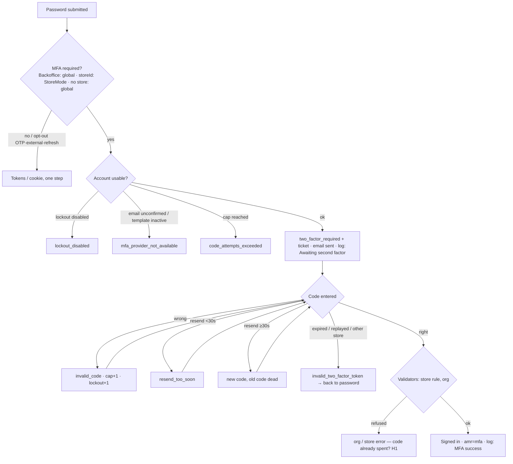
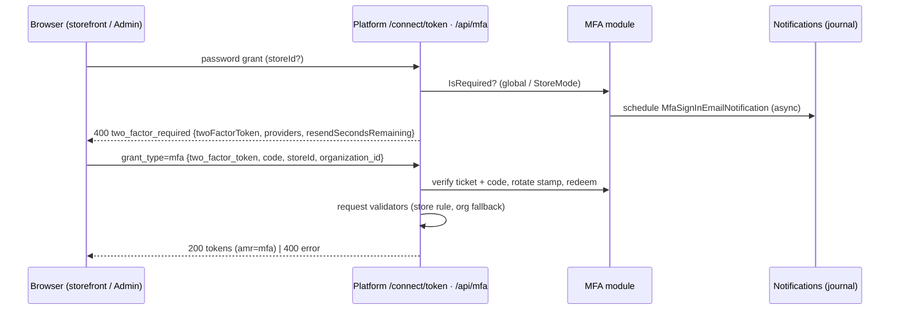
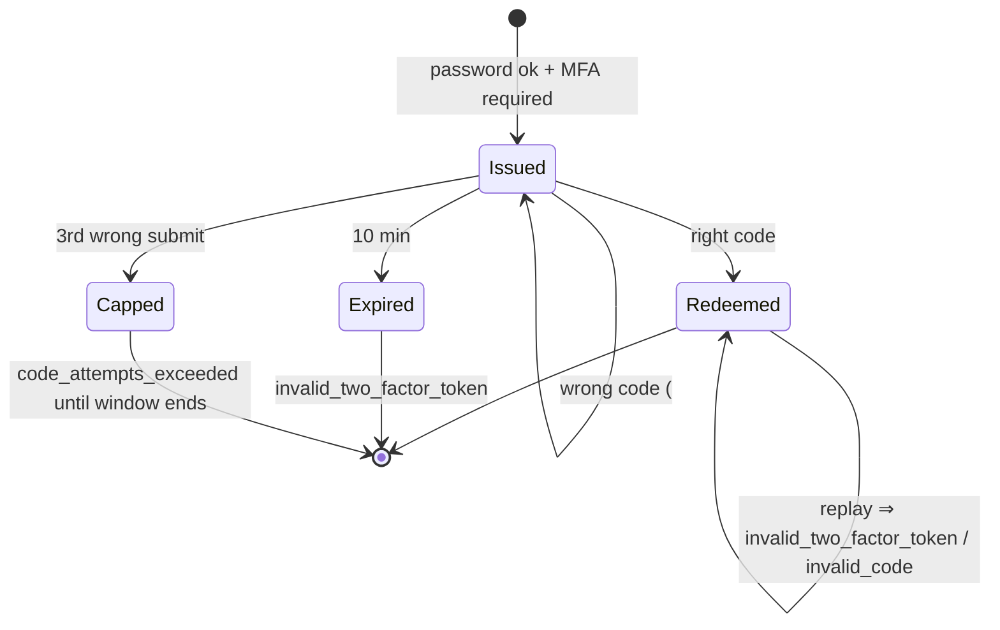

# TEST MODEL — VCST-5904 (MFA by email, Backoffice + storefront)

Ticket: VCST-5904 | Type: Story | Status role: testable (Testing) | Flow: feature-test | Priority: P1 (High) | Path: FULL | Changed: Both (platform, module, storefront, Admin SPA)
Context: FULL — ba-system-analyzer (1c), ba-story-writer Mode B (1d), qa-backend-expert 1r REACHABLE (~2 min)
Prior model: none for this ticket in `reports/ba/test-models/`. A prior round's model exists under `reports/tickets/Sprint26-21/VCST-5904/vcst/` and is **deliberately not read** (operator: independent run). Surface predecessors carried forward for Part 0 links 1/3/5: `reports/ba/test-models/VCST-5748-2026-09-29.md` (OTP chain), `reports/ba/test-models/VCST-6132-2026-10-20.md` (org fallback).
Domain map: `.claude/knowledge/domain/auth.md` @ rev 2 (generated 2026-10-21) — PRESENT. `all_layer_chain: true`, `all_layer_confirmed_at: 1e-confirmed`.
Mind map: `.claude/knowledge/domain/auth.mind-map.json` — nodes `auth.signin.mfa`, `.mfa.off`, `.mfa.required-challenge`, `.mfa.verify-code`, `.mfa.ticket-expiry`, `.mfa.store-mode`, `.mfa.invalid-token`, `.mfa.wrong-code-limit`, `.mfa.resend`, `.mfa.resend-storefront-origin` (DRIFT), `.mfa.otp-skips`, `.mfa.backoffice`, `.mfa.provider-unavailable`, `auth.org.resolve.mfa-leg`, `auth.impersonate.mfa-code`, `auth.state.session.awaiting-second-factor`, `auth.state.mfa-ticket.{issued,redeemed,expired}`, `auth.audit.signin-log.{awaiting-second-factor,type-filter}`.
Chain position: touches domain links **L2 (challenge)**, **L3 (org resolution — mfa leg only)**, **L4 (session/claims: `amr=mfa`)**, **L5 (refusal: lockout, MFA wrong-code cap, store rule)**, **L7 (two-factor ticket expiry; wrong-code count reset)** and the sign-in-log audit surface. **Does NOT touch:** L1 method choice (no new method; OTP/external only as opt-outs), L6 impersonation grant itself (only the operator's password step), L7 sign-out / Active sessions / Terminate all, password reset, registration, Punchout.
Affected surface: vc-module-mfa (`MfaService`, `MfaTwoFactorPolicy`, `MfaRequirementService`, `MfaGrantTypeHandler`, `MfaController`, `BackofficeMfaSignInService`, limiters, Admin `#!/sign-in-code`); vc-platform (`TwoFactorSignInService`, `AuthorizationController` password branch, `BasicAuthenticationHandler`, sign-in log); vc-module-otp (opt-out); vc-frontend (`MfaVerifyForm`, `useMfaSignIn`, `useAuth.mfaSignIn`, impersonation dialog); vc-module-customer (fallback, released). Map MISSING (11b): Admin `#!/sign-in-code` final-error behaviour, per-user `TwoFactorEnabled`, `DisableEnforcement`, Basic-auth refusal, `two_factor_unavailable`, `amr=mfa`, CodeStamp, customer-role refusal on the code step, `awaitingSecondFactor` criterion.
Ticket signals: no formal ACs; requirements = comments 112278 (which setting applies), 112285 (unconfirmed email / lockout disabled), 112031 (org fallback case), 111947 (sign-in log: two records, dashboard). Accepted, never filed: VCST-6495 (internal), VCST-6506 (internal), `/connect/session` + pre-MFA refresh tokens, "password ok, code never entered" not on dashboard. Build: frontend head `eecfe333` (impersonation code-step fixes) NOT deployed — deployed `2fc9261a`; mfa head `6e1053fe` = descriptions + pt-BR only.
Epic context: none (no parent Epic). Siblings by link: VCST-6353 (To do), VCST-6490/6495/6498 (To do), VCST-6504 (REFINEMENT), VCST-6506 (Draft).
Domains: auth (primary), b2b org boundary, notifications, platform security / sign-in log, storefront UI, Admin SPA.
Flows & boundaries: password → challenge → email → code → validators (store rule, org) → token/cookie; OTP ↔ MFA (opt-out); impersonation ↔ MFA; sign-in log ↔ dashboard; vc-shell/API clients ↔ global setting.
Risk areas: VC-AUTH-004 (rule enforced on one surface only), VC-AUTH-003 (codes via notification journal), VC-B2B-003 (admin not a storefront user); 1c H1 (code burned before validators), H2 (StoreMode description contradicts behaviour), H3 (Backoffice final errors), 63% of vcst accounts unconfirmed → blocked when MFA applies.
AC traceability: 1d AC-1…AC-20 (AC-21 not testable) + gap-ACs G-1…G-24 → 58 atomic conditions; Impl: SATISFIED 38 · NOT-VERIFIED 16 · DRIFT 3 (AC-11 vs 111947, AC-15 wording, AC-18 head not deployed) · CONTRADICTS 0.
DoD: none declared (1d proposed a minimal one; confirm-at-5-verdict).

## Part 0 — VALUE CHAIN

| # | Link (user's words) | Mechanism |
|---|---|---|
| C1 | An admin turns the second factor on — for the whole platform or for one store | `MultiFactorAuthentication.Enabled` (global) · `MultiFactorAuthentication.StoreMode` (Use global / Enabled / Disabled) |
| C2 | I type my correct password and, instead of being signed in, I am asked for a code | decision: Backoffice ⇒ global only; token request with `storeId` ⇒ that store's mode; no/unknown store ⇒ global; opt-outs: OTP, external, refresh, API key. Token endpoint answers `400 two_factor_required` + `twoFactorToken`; Backoffice opens `#!/sign-in-code` |
| C3 | A code arrives in my email | `MfaSignInEmailNotification` (store tenant, else global); masked destination; journal stores the code |
| C4 | I enter the code (or ask for a new one) | `grant_type=mfa` / `/api/mfa/signin/verify`; resend `/api/mfa/resend` (30 s cooldown); wrong code counts to cap 3 and lockout 5 |
| C5 | The usual sign-in rules still apply after the code | store rule, org resolution + fallback (BL-AUTH-015/016), email-verification validators — after the code |
| C6 | I am signed in where I was going | tokens with `amr=mfa` (storefront account / org) or Backoffice cookie session |
| C7 | The security team sees what happened | sign-in log: password row `RequiresTwoFactor` ("Awaiting second factor") + `MFA` row with the real outcome; dashboard counts once |
| C8 | It cannot be reused or brute-forced, and switching it off restores one-step sign-in | ticket 10 min + single redemption + store-bound; code stamp rotates on send/accept; cap 3 → `code_attempts_exceeded`; lockout 5 |

**Variants** (union of the layers that branch — MfaTwoFactorPolicy, MfaRequirementService, MfaService.ValidateUser, the storefront form, the Admin screen):
V1 storefront, StoreMode=Enabled (global off) · V2 storefront, Use global + global on · V3 storefront, StoreMode=Disabled + global on · V4 token endpoint, no / unknown storeId (API client) · V5 Backoffice administrator/manager (global on) · V6 Backoffice customer-role account · V7 multi-org buyer, last-used org inaccessible · V8 email unconfirmed · V9 lockout disabled · V10 opt-out channels (OTP, refresh_token, external) · V11 impersonation operator (storefront dialog) · V12 per-user `TwoFactorEnabled`, MFA settings off.

**Mechanism coverage matrix** (axes derived from C1–C8 and V1–V12 above; scenarios mapped in afterwards)

| | C1 | C2 | C3 | C4 | C5 | C6 | C7 | C8 |
|---|---|---|---|---|---|---|---|---|
| V1 | 1 | 1 | 1 | 1,7,8,9 | 1 | 1 | 1,28 | 10,11,12,13,32 |
| V2 | 3 | 3 | 3 | 3 | 3 | 3 | 28 | 31 |
| V3 | 4 | 4 | WAIVED: no challenge | WAIVED | 4 | 4 | 4 | WAIVED |
| V4 | 5 | 5,6 | 5 | 5 | 6 | 5 | 28 | 14 |
| V5 | 2 | 2 | 2 | 2,15,16 | WAIVED: no org/store rule in Backoffice | 2 | 2,29 | 17,31 |
| V6 | 18 | 18 | 18 | 18 | WAIVED: refused before | 18 | 18 | WAIVED |
| V7 | 19 | 19 | 19 | 19 | 19,20 | 19 | 19 | 20 |
| V8 | 21 | 21,22 | 21 | WAIVED: no code | WAIVED | 21 | 21,22 | WAIVED |
| V9 | 23 | 23 | WAIVED: no code | WAIVED | WAIVED | 23 | 23 | WAIVED |
| V10 | 24 | 24,25 | WAIVED: no code | WAIVED | 24 | 24,25 | 24 | GAP: external IdP — no IdP creds (G5) |
| V11 | 26 | 26 | 26 | 26 | WAIVED: impersonate grant has no org fallback | 26 | 26 | 27 |
| V12 | 30 | 30 | 30 | WAIVED | WAIVED | 30 | 30 | WAIVED |

**Reverse edges** — the forward effect is *access granted*; each must reverse or be bounded:
ticket expiry → 13 · single redemption / used-code refusal → 11 · resend kills the previous code → 9 · wrong-code cap → 10 · lockout from wrong codes → 12 · security stamp change kills the ticket → 32 · switching MFA off restores one-step → 31 · existing sessions/refresh tokens when MFA is turned ON → 25 (they survive — documented, not a defect) · DisableEnforcement → ABSENT ON THIS STAND (appsettings + restart, no access; recorded, not tested).
Fixture lifecycle: the code, ticket and wrong-code window are terminal per sign-in, and lockout is terminal for 15 min per account ⇒ every C4/C8 case creates its own account in the case (FIFTH RULE); settings are case-created transitions with restore in Cleanup.

## Part 0r — ROLE SCENARIOS (matrix carries >1 role: administrator, manager, customer, B2B buyer, impersonation operator)

Roles in scope: administrator → `{{ADMIN_*}}` via config.js `env.ADMIN` (shared; one password grant, no wrong attempts) · manager / customer-role Backoffice / B2C / multi-org buyer / unconfirmed / impersonation operator → **FIXTURE-GAP** → created in the case per `data.auth.account.mfa-eligible` (3a authors a reusable creator, no shared fixture).

BSC-1 — Manager signs in to the Backoffice with MFA on
  Role: manager (Backoffice permissions) · Situation: global MFA on, account email confirmed, lockout enabled
  | # | Action | Sees | Can do | Expected |
  | 1 | password on `#!/login` | code screen, masked email | enter 6 digits, resend after countdown, back | no session cookie yet |
  | 2 | right code | Backoffice home | work | log: Awaiting second factor + MFA success |
  Outcome: Backoffice access only after the emailed code.
  Not allowed: Backoffice API calls between step 1 and 2 (no cookie session → 401); `/api/mfa/signin/verify` without the two-factor cookie → refused.

BSC-2 — Customer-role account tries the Backoffice
  Role: customer account · Situation: global MFA on
  | 1 | password on `#!/login` | refusal (no code screen, or code screen then refusal) | back | no Backoffice session, `SignInNotAllowed` logged |
  Outcome: never a Backoffice session. Not allowed: a code sent and accepted that ends in a Backoffice session.

BSC-3 — B2B buyer of B2B-store signs in on the storefront
  Role: multi-org buyer · Situation: B2B-store StoreMode=Enabled, last-used org locked
  | 1 | password on `/sign-in` | code step, heading changes, OTP link hidden | enter code / resend | no tokens |
  | 2 | right code | account, org = another accessible org | shop | token `amr=mfa`, `organization_id` ≠ locked org |
  Outcome: signed in to an org they can use. Not allowed: tokens before the code (server: `/connect/token` 400); landing in the locked org.

BSC-4 — Operator impersonates a customer from the storefront
  Role: org maintainer with `platform:security:loginOnBehalf` · Situation: B2B-store StoreMode=Enabled
  | 1 | confirm impersonation with own password | code step in the dialog | enter code / cancel | no impersonation yet |
  | 2 | right code | storefront as the customer, banner | stop impersonation | operator restored |
  Outcome: impersonation gated by the operator's second factor. Not allowed: impersonation after a wrong code; a failed code step leaving a half-signed-in dialog.

## Parts 1–5 — FAULT MODEL

Condition space: surface {storefront+storeId, token no-store, Backoffice} × global {off,on} × StoreMode {null,Enabled,Disabled} × account {eligible, unconfirmed, lockout-disabled, customer-role, per-user 2FA} × org {single, multi-org last-used inaccessible} × code event {right, wrong, 3 wrong, resend<30s, resend≥30s, replay, expired, other store} → raw N = 3×2×3×5×2×8 = 1,440. Constraints: StoreMode only branches with a storeId (Backoffice / no-store collapse 3→1); org state only on storefront B2B; account traits short-circuit before any code (no code events for unconfirmed / lockout-disabled / customer-role); per-user 2FA only with settings off. Feasible ≈ 214.
Reduction: DT over the requirement rule (global × StoreMode × caller → 7 decision rows: 1,2,3,4,5,6 + 31); account traits as EP — one row each, on the cheapest surface where they branch (storefront for 21/23, Backoffice for 18/22); code events as ST on ONE surface (storefront V1) because the verification code path is shared (`MfaService`), with a PARITY row each for Backoffice (15,16) and the cap's cross-surface sharing (17); org states collapsed to "last-used inaccessible" ×{locked, Invited/Rejected/Deleted, not a member} → 19 (locked) + 20 (no accessible org left) — the full five-state walk is VCST-6132's and released. Dropped: StoreMode × account-trait (trait check is independent of where the requirement came from — subsumed by 21/23); code events × org state (validators run after the code regardless). **214 → 32.**

Test scenarios (32) — ⚑ = needs the global window (W1), ◆ = needs B2B-store StoreMode window (W2), else a disposable AGENT-TEST store
| # | Cell | Defect hypothesis | Archetype | Technique | Oracle | P |
|---|---|---|---|---|---|---|
| 1 | ◆ V1 B2C/B2B customer, storefront `/sign-in` password → code from journal → signed in | [JOURNEY] any link breaks: no challenge, no email, code refused, validators reject, tokens without `amr=mfa`, no log rows | SILENT | FLOW | {SPEC} 112278 + PR #1 README; log rows {SPEC} 111947 | Critical |
| 2 | ⚑ V5 manager, Backoffice `#!/login` → `#!/sign-in-code` → right code → home | Backoffice path wired to global, auto-send on entry, cookie only after verify | PARITY | FLOW | {SPEC} 112278 | Critical |
| 3 | ⚑ V2 storefront, B2B-store StoreMode null, global on → challenge | "Use global" read wrong (null ≠ "Use global setting") | CONFIG | DT | {SPEC} 112278 | High |
| 4 | ⚑ V3 StoreMode=Disabled, global on → one-step sign-in | store override ignored; description says "own customers only" (H2) | CONFIG | DT | {SPEC} 112278 | High |
| 5 | ⚑ V4 password grant no storeId / unknown storeId, global on → challenge; global off → tokens | unknown store treated as Disabled | FALLBACK | DT | {SPEC} 112278 | High |
| 6 | V4 global off: known issue VCST-6495 (internal) | record as KNOWN_LIMITATION VCST-6495; defect only if the store-bound request also skips | CONFIG | DT | {SPEC} 112278 known issue | Medium |
| 7 | V1 wrong code ×1 → `invalid_code`, stays on code step, input cleared | wrong code returns to password form / no message | LIFECYCLE | ST | {SPEC} PR #1 | High |
| 8 | V1 resend before 30 s → countdown, no new email; after 30 s → "New code sent", new journal row | cooldown absent (mail-bomb) or never ends | BOUNDARY | BVA | {SPEC} PR #1 (CodeResendInterval 30 s) | High |
| 9 | V1 after resend, first code → `invalid_code`; new code → signed in | old code still valid after resend | REPLAY | ST | {SPEC} PR #1 code stamp | High |
| 10 | V1 2 wrong + right → success; 3 wrong + right → `code_attempts_exceeded`, back to password; new password step also refused | cap off-by-one; cap not held across a new password step | BOUNDARY | BVA | {SPEC} PR #1 MaxCodeAttempts 3 | Critical |
| 11 | V1 replay accepted code on a new ticket; reuse redeemed ticket | code/ticket reusable (cf. VCST-6490 on OTP) | REPLAY | EG | {SPEC} PR #1; ECL-4.3 | Critical |
| 12 | V1 2 wrong passwords + 3 wrong codes → lockout (`user_is_temporary_locked_out` hidden unless DetailedErrors) | wrong codes not counted toward BL-AUTH-003 lockout | BOUNDARY | BVA | {BL-AUTH-003} | High |
| 13 | V1 ticket from store A redeemed with store B / no storeId; tampered ticket | ticket not store-bound; 500 on garbage | SCOPE | EG | {SPEC} PR #1; {BL-AUTH-017} | High |
| 14 | V4 20 parallel wrong `mfa` codes for one user | more than 3 verified | RACE | EG | {SPEC} PR #1 cap; {BL-AUTH-003} | High |
| 15 | ⚑ V5 Backoffice wrong code → inline error, stays; resend countdown; "Back to sign in" | Backoffice treats wrong code as final (H3) | PARITY | ST | {SPEC} PR #1 | High |
| 16 | ⚑ V5 Backoffice 3 wrong codes → final error, only "Back to sign in" | cap not enforced on the Backoffice verify endpoint | PARITY | BVA | {SPEC} PR #1 | High |
| 17 | ⚑ V5→V1 cap shared: 2 wrong on Backoffice + 1 wrong on storefront → capped | per-surface counters | PARITY | EG | {SPEC} PR #1 ("shared") | Medium |
| 18 | ⚑ V6 customer-role account on Backoffice → no Backoffice session; code sent or not | code emailed to an account that can never sign in; refusal reason wrong | SCOPE | DT | {SPEC} PR #1 SignInNotAllowed; VC-B2B-003 | Medium |
| 19 | ◆ V7 2-org buyer, last-used org locked → password + code → 200 in the other org (comment 112031) | fallback not applied on the mfa leg; code spent then refused | SCOPE | DT | {BL-AUTH-016} + {SPEC} 112031 | Critical |
| 20 | V7 no accessible org left (Rejected in both) → single status error AFTER the code; is the code/ticket burned? | H1: code redeemed then org refusal; retry needs a new code | LIFECYCLE | EG | {BL-AUTH-016}; H1 {HYPOTHESIS} → {SPEC} needs dev answer | High |
| 21 | ◆ V8 unconfirmed email, storefront → `mfa_provider_not_available` after password, no email, localized message | raw key / generic error; email sent to unconfirmed address | FALLBACK | EP | {SPEC} 112285 | High |
| 22 | ⚑ V8 unconfirmed email on Backoffice → refusal + log reason (password row stays Awaiting? MFA row ProviderNotAvailable?) | 111947 item 2 vs PR — real reason lost in the log | SILENT | EP | {SPEC} 111947 vs PR #1 — DRIFT, resolve live | Medium |
| 23 | V9 lockout disabled → `lockout_disabled` | account with lockout off gets unlimited code guesses | CONFIG | EP | {SPEC} 112285 | High |
| 24 | ◆ V10 OTP sign-in on B2B-store with StoreMode=Enabled → signed in by code alone | OTP leg asks a second code, or MFA skipped for password too | CONFIG | DT | {SPEC} otp#3 | High |
| 25 | V10 refresh_token minted before MFA on → still works; `amr` absent; refresh of an mfa token keeps `amr=mfa` | refresh revoked (sessions killed) or `amr` lost | STALE | ST | {SPEC} PR #3133 notes (documented) | Medium |
| 26 | ◆ V11 impersonation from storefront → operator code step → impersonated; banner; stop restores | operator step skipped; wrong code leaves dialog broken (head fix not deployed) | LIFECYCLE | FLOW | {SPEC} PR #2570; {BL-AUTH-010,011} | High |
| 27 | ◆ V11 wrong code in the impersonation dialog → error, no impersonation | impersonation proceeds after a wrong code | SCOPE | EG | {SPEC} PR #2570 | High |
| 28 | Sign-in log: per sign-in a password row `RequiresTwoFactor` + MFA row with real outcome; filter "Multi-factor authentication"; dashboard counts once | double counting; "Awaiting" counted as failure; filter label missing | SILENT | EP | {SPEC} 111947 | Medium |
| 29 | ⚑ Backoffice sign-in log grid + dashboard after rows 2/15/16 | Backoffice rows typed or counted differently from storefront | PARITY | EP | {SPEC} 111947 | Low |
| 30 | V12 MFA off, a user with per-user `TwoFactorEnabled=true` → asks for a code anyway | hidden requirement path surprises tenants; or `two_factor_unavailable` | CONFIG | EG | {SPEC} PR #3133 breaking note | Medium |
| 32 | V1 admin resets the user's password between the password step and the code → right code refused (`invalid_two_factor_token`) | ticket survives a security-stamp change: an attacker's pending challenge outlives the victim's password reset | LIFECYCLE | ST | {SPEC} PR #1 (ticket checks security stamp) | Medium |
| 31 | ⚑◆ restore: global off + StoreMode back → one-step sign-in again on both surfaces; settings re-read | stale cached setting keeps asking codes after off | STALE | ST | {SPEC} 112278 | High |

Probes carried in (Step 2): VC-AUTH-004 → 2,15,16,17,22,29 · VC-AUTH-003 → every code read from the journal (1,2,…) · VC-AUTH-002 → N/A (Remember me not carried — BY-DESIGN, not a row) · VC-AUTH-001 → N/A (sign-out untouched) · VC-AUTH-005 → N/A (no session expiry change) · VC-B2B-003 → 18.
Archetype sweep (Step 2): SCOPE 13,18,19,27 · PARITY 2,15,16,17,29 · STALE 25,31 · RACE 14 · REPLAY 9,11 · SILENT 1,22,28 · BOUNDARY 8,10,12 · LIFECYCLE 7,20,26 · CONFIG 3,4,6,23,24,30 · FALLBACK 5,21 · RENDER → visual lane 4v (code boxes, focus, error shift, 375/768/1920, Coffee) · MONEY WAIVED (no currency/culture value; i18n of error strings is 4v + row 21).
UIP sweep (Step 2): BACK → 3x (browser Back from code step) · DEEP → 3x (`#!/sign-in-code` opened directly) · REFRESH → 3x (reload on code step: ticket kept or lost) · TABS → 3x (two tabs, two challenges) · EXPIRE → 13 + 3x (10-min ticket, timed) · STORAGE → 3x · NET → WAIVED (no offline mode on sign-in) · INPUT → 4v (paste "123 456", letters, 7 digits) · VIEW → 4v · DATA → 21,23.
Business Rules: BL-AUTH-002 (SUSPECT), 003, 009, 010, 011, 013, 015, 016, 017; proposed (1d, for /qa-review-oracles, not oracles yet): PROPOSED-BL-AUTH-MFA-001…007.
Edge cases: ECL-4.2 (brute force, lockout), ECL-4.3 (OTP reuse), ECL-5.1 (rapid repetitive), ECL-15 (a11y via 4v).
Docs grounding: VirtoOZ — no MFA page (new feature) ⇒ ticket comments + PR source + live are ground truth; D1 (guides trail the build) applies. kb: KB-7EFFA0AD, KB-C196A782, KB-08CC76A3, KB-12E99BF8 (contradicted live 2026-10-23 → dispute), KB-06FE6C8D, KB-8646A9CB.
Agents to dispatch: 3x discovery (`/qa-exploratory ticket`) · 3a test-data-engineer (account creator) · 4a qa-backend-expert (Backoffice + REST, edge) + qa-frontend-expert (storefront, chrome) · 4v ui-ux-expert (Chrome DevTools) · A test-management-specialist.
Settings windows (operator-approved 2026-10-23): W1 global `Enabled=true` — minimal, scripted, admin bearer minted BEFORE, restore + re-read; blocks ~63% of vcst accounts and every store-less admin REST sign-in while open. W2 B2B-store `StoreMode=Enabled` — storefront UI rows, restore to null + re-read.

## Amendments — 3x discovery (SBTM-VCST-5904-2026-10-23, 11:28–11:44Z)
- Row 10: the 3rd wrong code answers `invalid_code`; the refusal (`code_attempts_exceeded`) comes on the NEXT submit, right or wrong. A new password step right after the cap observed: VCST-6506 (internal). {OBSERVED} baseline; oracle stays {SPEC} PR #1.
- Row 20 / H1: CONFIRMED for the store rule — right code → `user_cannot_login_in_store`, ticket spent (retry → `invalid_two_factor_token`), log MFA row reason `Unknown` with the account's store, not the requested one. Org-refusal variant still open (4a).
- Row 22 / AC-11: DRIFT resolved on this build — Backoffice logs Password `RequiresTwoFactor` + MFA `ProviderNotAvailable`; screen: "We can't send a sign-in code to this account…".
- Row 4 / H2: add variant 4b — a Manager (non-customer) with `storeId` of a `Disabled` store under global ON: observed VCST-6530 (internal) (spec 112278 says "every user" ⇒ by design; deployed description says "own customer accounts that are not administrators" ⇒ description defect, fixed in head 6e1053fe). Security question for triage: tracked as VCST-6530 (internal).
- Rows 26/27, BSC-4: NOT DEPLOYED — the deployed theme's Company members → Login on behalf shows OK/Cancel only, no operator code step; re-base on head eecfe333. Run in 4a only to record.
- New rows (3x PROMOTE, net-new): 33 code is per user, not per ticket — a code from an abandoned earlier challenge signs in on the newest ticket; 34 second password step <30 s sends no email while the UI says "We sent a code"; 35 storefront 3rd wrong code shows generic "Something went wrong" instead of a code-specific message; 36 Admin `#!/sign-in-code` opened directly shows raw key `platform.blades.login.errors.login-failed`.
- UIP: BACK (code step adds no history entry) · REFRESH (storefront reload drops the ticket → OTP form; Admin reload keeps the screen, no second email) · TABS (row 33/34) · DEEP (row 36) · EXPIRE (10-min ticket not timed — 4a) · STORAGE (not persisted across reload).
- Fixture rule: a created store never copies url/secureUrl (incident 11:29–11:35:58Z, vcst storefront served a throwaway store).
