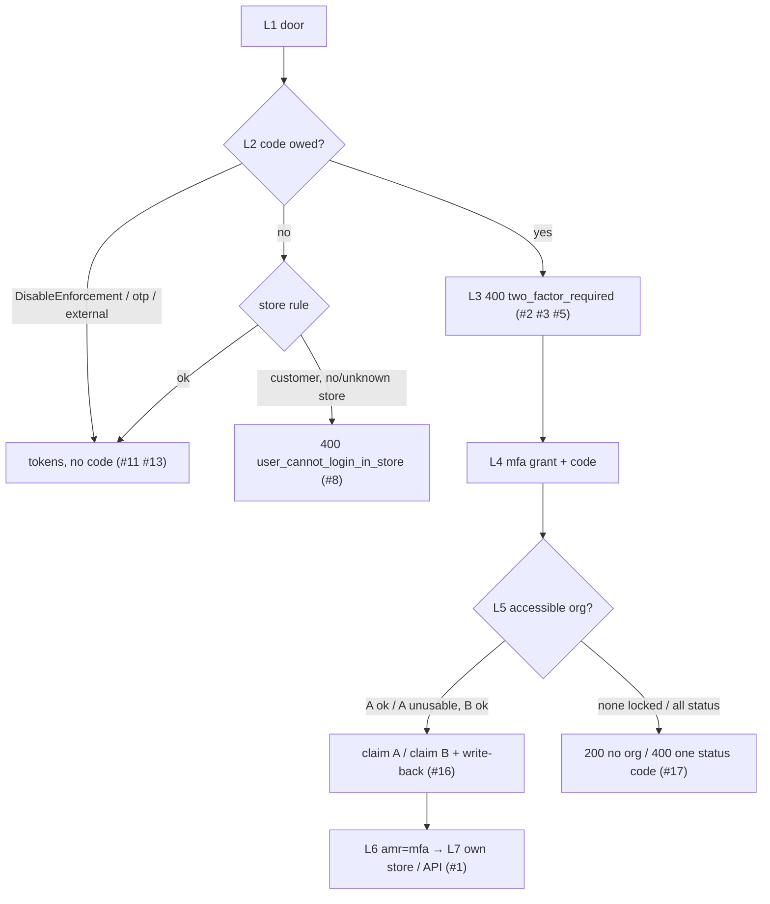
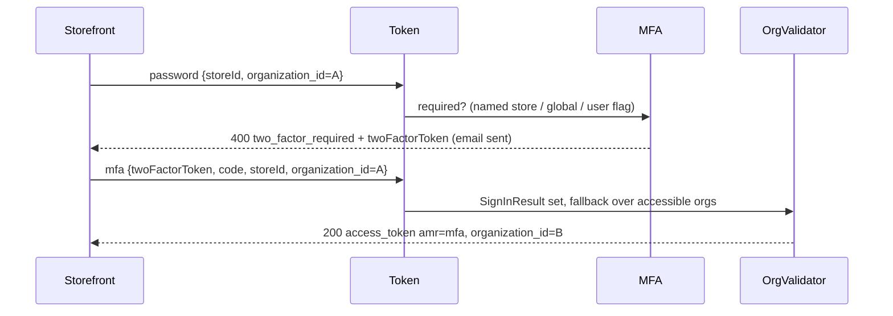
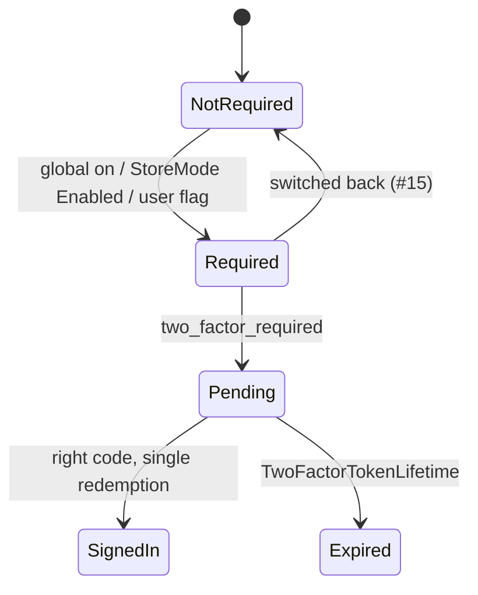

# TEST MODEL — VCST-5904
**Strategy:** reports/tickets/Sprint26-21/VCST-5904/vcst/test-strategy.md · Round 1 · Floors: F10, F11 · Risks: R1, R2, R7
**Prior model:** reports/ba/test-models/VCST-6132-2026-10-20.md — Part 0 T3–T8 (org resolution) carried forward as L5–L6 for the mfa
grant; drift: T4 "SignInResult set" now also by the mfa grant (`auth.org.resolve.mfa-leg`). No prior model of the requirement surface.
**Domain map:** .claude/knowledge/domain/auth.md @ rev 2 (PRESENT, domain:check OK) · **Mind map:** auth.mind-map.json —
auth.signin.mfa.{off,required-challenge,verify-code,store-mode,otp-skips,invalid-token}, auth.signin.external, auth.access.api-challenge,
auth.org.resolve.{fallback,no-org-left,status-refusal,explicit-switch-refused,write-back,global-lock-wins,mfa-leg}
**Contract:** n/a here — no oracle rests on a GraphQL field (REST token bodies + JWT claims); the run plan's contract-refresh step owns it.
kb: KB-7A4C260E, KB-3CBA0D5F, KB-C196A782; nothing on trusted-store grants. Addendum 112285: lockout_disabled / mfa_provider_not_available intended.
**Chain position:** domain §1 L1–L7 — TOUCHES L2 (which door asks for the code), L3 (token + org on the mfa grant), L5c/d (org refusal,
store rule — only their order against the challenge). Does NOT touch L1 method-choice UI, L4 session storage, L5a/b lockout and wrong-code
limit (R4), L6 impersonation (R10), L7 sign-out/expiry, code email (R3/R8), resend (R5), code-step rendering (R6).
## Part 0 — value chain (R1, R2, R7)
| # | Link (user's words) | Mechanism |
|---|---|---|
| L1 | I present a credential at a door | password grant ± `storeId` · Backoffice `#!/login` · Basic header · `otp_email` · external IdP · `refresh_token` |
| L2 | The platform decides whether I owe a code | `MfaTwoFactorPolicy` (DisableEnforcement → off) · `MfaRequirementService`: named store's `StoreMode`; no / unknown store → global `MultiFactorAuthentication.Enabled`; Backoffice → global only · user `TwoFactorEnabled` (`TwoFactorSignInService:34`) · otp / external opt out |
| L3 | I am challenged instead of signed in | `400 two_factor_required` + `twoFactorToken`, no `access_token` — or the store rule `user_cannot_login_in_store` (KB-7A4C260E) |
| L4 | I hand over the code | `grant_type=mfa {twoFactorToken, code, storeId, organization_id}` → `SignInResult` set (code mechanics R3/R4/R5 = setup) |
| L5 | I land in an organization I can still use | Customer `OrganizationIdRequestValidator` fallback (VCST-6132 T4) → write-back `CurrentOrganizationId` (T5) |
| L6 | My token says how and where I signed in | claims `amr=mfa`, `organization_id`, org-scoped `permission` |
| L7 | The token opens my store / the platform API | xAPI `me` on the own store; platform REST for an admin token |

**Variants** — union of the branching layers: requirement (global × named-store StoreMode × no/unknown store × user flag ×
DisableEnforcement), door (password / Backoffice / Basic / otp / external / refresh / mfa), store rule (Customer vs Administrator — admins
pass any store, KB-7A4C260E), org validator (accessible / one unusable / none-locked / all-status / no org). Several ROLE variants ⇒ org
row 1 + Part 0r rules. Integration links: L5 carries the b2b membership variants, L2/L3 the store's (StoreMode, TrustedGroups, unknown /
no store); catalog, pricing, cart, checkout WAIVED — the MODEL risks end at L7 token use and the change map has no hotspot there.

| Variant \ Link | L1 | L2 | L3 | L4 | L5 | L6 | L7 |
|---|---|---|---|---|---|---|---|
| Customer, own store Enabled, global off | 1 | 3 | 1,3 | 1 | 1 | 1 | 1 |
| Customer, Use global (set / null): global on · off (pre-feature) | 3 | 3 | 3 | on: WAIVED — grant as #1 · off: n/a, no challenge | on: WAIVED — org leg store-mode independent (#16) · off: 18 | 3 | WAIVED — as #1; off path = P6 regression |
| StoreMode Disabled + global on (customer, admin) | 4 | 4 | 4 | n/a | WAIVED — admin has no org; customer leg #16 | 4 | 4 |
| Admin, unknown / no store, global on | 2,5 | 5 | 2,5 | WAIVED — redemption is R3/R4 | n/a — no org | 5 | WAIVED — R3 |
| Backoffice employee (cookie login) | 6 | 6 | 6 | WAIVED — R3 FLOW (AC-5/6) | n/a | n/a — cookie | WAIVED — R3 |
| User TwoFactorEnabled, settings off | 7 | 7 | 7 | WAIVED — R3 | n/a | 7 | n/a |
| Customer, no storeId (global off / on) | 8,10 | 8,10 | 8,10 | 10 | WAIVED — store rule precedes org (KB-7A4C260E) | 8 | 8 |
| Trusted-store customer, own store Enabled | 9 | 9 | 9 | n/a | WAIVED — single-org fixture | 9 | 9 |
| otp_email door, code owed | 11 | 11 | 11 | n/a — opts out | WAIVED — VCST-6132 #1–22 | 11 | 11 |
| Basic auth door, global on / off | 12 | 12 | 12 | n/a | n/a | n/a — no token | 12 |
| External IdP, code owed | 13 | 13 | 13 | n/a | n/a | 13 | 13 — all FIXTURE-GAP |
| refresh_token across a switch | 15 | 15 | 15 | 15 | 20 | 15 | 15 |
| mfa step storeId ≠ password step | n/a | 14 | 14 | 14 | n/a | 14 | 14 |
| Multi-org, one org unusable | 1,16 | 1,16 | 1,16 | 16 | 1,16 | 16 | 1 |
| Multi-org, none locked / all status | 17 | 17 | 17 | 17 | 17 | 17 | n/a — refused / no org |
| Multi-org, divergent roles A≠B | 19 | 19 | 19 | 19 | 19 | 19 | 19 |
| Globally locked + blocked org | 21 | 21 | 21 | n/a | 21 | n/a | n/a |
| B2C, no org | 22 | 22 | 22 | 22 | 22 | 22 | WAIVED — as #1 |
| organization_id omitted / differs on mfa step | n/a | n/a | 23 | 23 | 23 | 23 | n/a |
| DisableEnforcement=true | WAIVED — FIXTURE-GAP (appsettings); #2 proves false first | ← | ← | ← | ← | ← | ← |

**Reverse edges** — setting on → off: pending token and pre-switch sessions → #15 · two-factor token → single redemption / expiry → R4
(not MODEL) · org write-back B → restore A → WAIVED, VCST-6132 #18 (write-back grant-independent, T5) · tokens issued with no code via a
bypass (#8, #9) → **ABSENT IN PRODUCT** (tokens not bound to the issuing store, VCST-6495; reported, never FAIL) · sessions alive when MFA
is switched on → #15, ABSENT IN PRODUCT candidate.
**Fixture lifecycle** — global-on rows (#2–6, #10, #12, #15) share ONE ledgered REST window, restored in Cleanup, never as the default
admin (P1, R8); StoreMode flips per case with read-back; a two-factor token is single-use (fresh password step per row); membership
states are terminal ⇒ a case-created AGENT-TEST- buyer per row (#16, #17, #21); MULTI_ORG_TF_BR read only (#19); no wrong codes here
(the per-user wrong-code counter is R4's and shared).
## Org-context group (F10 · R7)
| # | Variant | Scenario # / WAIVED + reason |
|---|---|---|
| 1 | Role within the org | #19 + BSC-3 (server refusal) |
| 2 | Org boundary | #19 (no TechFlow permission in a BuildRight session), #16 (claim B, never A) |
| 3 | Multi-org + switching | #20, #23 |
| 4 | Membership state | #17, #21, #22 |
| 5 | Sales rep | WAIVED — no sales-rep code path in the five PRs (no change-map hotspot); same password→mfa grant as #1/#16 |
| 6 | Login on behalf | WAIVED — storefront impersonation code step is R10 (charter); impersonate gets no fallback (KB-3CBA0D5F), mfa grant untouched |

**Roles in scope:** employee (Manager), sign-in admin, store customer, B2C, mutable multi-org (data.auth.buyer.multi-org-blockable) →
FIXTURE-GAP by design: CREATE in case (FIFTH RULE) · trusted-store customer → @td(OTP_TRUSTED_STORE_CONTACT.email) · divergent roles →
@td(MULTI_ORG_TF_BR) (role→permission read from the token, never asserted) · settings / journal reader → @td(ADMIN_USER.email_env_var).
BSC-1 — a Backoffice employee whose password leaked · Role: employee · Situation: global on
  | 1 | password grant with no / unknown storeId; Basic header | challenge / 401 | nothing without the code | #2, #5, #12 |
  Outcome: the password alone opens no platform API. Not allowed: an access_token with no code (no store, unknown store); Basic 200.
BSC-2 — a customer of a store that requires the code · Role: store customer · Situation: own store Enabled, global off
  | 1 | sign in on the own store | code step | tokens only after the code | #1, #3 |
  Outcome: signed in with amr=mfa. Not allowed: tokens on the own storeId without the code (doors #8, #9, #11 are recorded; PO decides).
BSC-3 — a buyer in two companies with different roles · Role: employee in BuildRight · Situation: MFA sign-in into BuildRight
  | 1 | mfa grant organization_id=BuildRight; edit the organization | employee permissions only | read only | #19 |
  Outcome: BuildRight session, BuildRight rights. Not allowed: UpdateOrganization with that token (refused at the server, nothing
  persisted); refresh_token switch to a locked org (#20).
## Configuration group (F11 · R1) — MaxCodeAttempts, CodeResendInterval, TwoFactorTokenLifetime: R4/R5, no stand value → no block
| Setting = stand value | Default | On | Off | Scope (global / store) | Change at runtime |
|---|---|---|---|---|---|
| MultiFactorAuthentication.Enabled = false | #3 (off cells) | #2, #3, #5, #6 — flip+restore | #3, #6, #8 | #3, #4 (store overrides global) | #15 |
| MultiFactorAuthentication.StoreMode (B2B-store) = Use global | #3 (null and set) | #1, #3 — flip+restore | #4 | #4, #9 (named vs own store) | #15 (pending token) |
| OtpSignIn.Enabled (B2B-store) = true | WAIVED — R11 | #11 | WAIVED — door closed, R11 owns otp_disabled | WAIVED — R11 | WAIVED — R11 |
| TrustedGroups (B2B-store) = [Electronics] | #8 (own store only) | #9 | WAIVED — = default | WAIVED — per-store only | WAIVED — per-request store check, no new branch in the diff |
| MultiFactorAuthentication:DisableEnforcement = unknown (code false) | #2 proves false | FIXTURE-GAP — appsettings | #2 | WAIVED — host-wide | FIXTURE-GAP — needs a restart |
## Parts 1–5 — fault model
**Condition space:** F1 door {password+own store, no store, unknown store, Backoffice, Basic, otp_email, external, refresh_token, mfa} 9 ·
F2 global {on, off} 2 · F3 named StoreMode {Enabled, Disabled, Use global set, null} 4 · F4 actor {store customer, trusted-store customer,
admin, employee, B2C, multi-org} 6 · F5 user TwoFactorEnabled {no, yes} 2 · F6 org state {ok, removed, locked, status, none-locked,
none-status} 6 · F7 DisableEnforcement {false, true} 2. Constraints: F3 n/a without a store (no store, Backoffice, Basic, external); F6
multi-org only; admins pass any store; F7=true and external unreachable. **N = 9·2·4·6·2·6·2 = 10 368.**
**Reduction:** DT on F2×F3 for the requirement (#3–#5); every other door only at "code owed" — F2/F3 are subsumed by the decision #2–#5
already prove; F4 cut to the actor each layer branches on (store rule: Customer vs Admin; Backoffice: employee); F5 one row; F6 takes
VCST-6132's reduction (removed vs membership path vs none-locked vs none-status) on the mfa grant only, its five states as data of #16;
F7 guarded by #2; t=2. **10 368 → 23.**

| # | R-n | Cell | Defect hypothesis | Archetype | Technique | Oracle | P |
|---|---|---|---|---|---|---|---|
| 1 | R1, R7 | [JOURNEY] storefront /sign-in · B2B-store Enabled, global off · created buyer, last-used A locked, B ok · then `me` on own store | the code step never appears (password alone signs in), or the mfa grant resends A (H-11) and fails with an org error after the code, or the token lacks amr / org | CONFIG | FLOW | AC-10, comment 112278 {SPEC}; comment 112031 {SPEC}; {BL-AUTH-016} | Critical |
| 2 | R1 | API, global on, no storeId, created employee | DisableEnforcement or an unwired handler issues tokens — every other row then passes vacuously (P10) | CONFIG | DT | AC-1/AC-2, comment 112278 "no store → global" {SPEC} | Critical |
| 3 | R1 | API customer, own storeId · global {on, off} × StoreMode {Enabled, Use global set, null} | null (all 7 vcst stores) read as Disabled ⇒ global on never reaches customers; Enabled ignored with global off | FALLBACK | DT | comment 112278 {SPEC} | Critical |
| 4 | R1 | global on · StoreMode Disabled · customer and a created admin name that store · admin token on platform REST | an admin skips the code by naming a storefront store, and the token opens the platform API | CONFIG | DT | customer: 112278 {SPEC}; admin {HYPOTHESIS} (en description vs 112278 — the PO answer makes it real); recorded, not FAIL | High |
| 5 | R1 | global on · created admin · storeId unknown / omitted | unknown store treated as Disabled — admins pass the store rule with any id (KB-7A4C260E), so a made-up storeId skips the code | FALLBACK | EG | VCST-6495 "an unknown store follows the global setting", 112278 {SPEC} | Critical |
| 6 | R1 | Backoffice login · employee whose Container store is Enabled · global {off, on} | Backoffice reads the user's store, or ignores global on | CONFIG | DT | comment 112278 "Backoffice: only the global setting" {SPEC} | High |
| 7 | R1 | settings off · user TwoFactorEnabled=true via the security API | the flag is ignored, or such users are refused on every door | CONFIG | EG | {HYPOTHESIS} — no AC names the flag; a dev/PO statement makes it real | Medium |
| 8 | R2, R1 | global off · own store Enabled · password grant without storeId | VCST-6495 path (a) issues tokens with no code — or the store rule refuses first (KB-7A4C260E) and path (a) does not exist for customers | SCOPE | EG | {HYPOTHESIS} — description goal vs 112278 accepted bypass; recorded, never FAIL | High |
| 9 | R2, R1 | own store Enabled · names a store that trusts it (Use global, off) · token on own store `me` | password-only tokens usable on the own storefront (VCST-6495 b) | SCOPE | DT | {HYPOTHESIS} as #8; recorded, never FAIL | High |
| 10 | R2 | global on · customer without storeId | the challenge (email) fires before the store rule, so a refused customer gets a code — or the mfa grant skips the store rule and issues tokens (S-19) | PARITY | EG | VCST-6353 "error codes and responses stay the same for API clients" {SPEC} | High |
| 11 | R2, R1 | own store Enabled · OtpSignIn on · otp_email grant | an MFA-required user signs in with the emailed code alone; amr does not tell it apart | CONFIG | DT | {HYPOTHESIS} — the goal names a leaked password; otp needs none; PO decides (S-1) | High |
| 12 | R2 | Basic header with the employee's password · global on / off | Basic still accepted while the token endpoint challenges — password-only API access | PARITY | DT | description goal "a leaked password alone is not enough" {SPEC}; off = pre-feature | High |
| 13 | R2 | external IdP sign-in, code owed | bypassTwoFactor skips the code (S-18) — FIXTURE-GAP: no IdP credentials (map G5) | CONFIG | EG | {HYPOTHESIS}; PO decision on external doors | Low |
| 14 | R2 | password step storeId = Enabled store · mfa step storeId = another store / none | the token redeems under a store that would not have required it | SCOPE | EG | {HYPOTHESIS} — a dev statement (VCST-6495 scope) makes it real | Medium |
| 15 | R2, R1 | refresh token minted before global on, refreshed after; global switched off while a token is pending | pre-switch sessions continue with no code; a pending token stops, or still redeems | STALE | ST | {HYPOTHESIS} — no AC on existing sessions; the PO answer makes it real | Medium |
| 16 | R7 | mfa grant · organization_id=A · A {removed, locked, Invited, Rejected, Deleted} · B ok | the fallback does not run on the mfa grant → org error after the code; write-back skipped | FALLBACK | EP | comment 112031 {SPEC}; {BL-AUTH-016}, {BL-AUTH-015} | High |
| 17 | R7 | mfa grant · both locked / both Rejected (Invited, Deleted) | refusal arrives only after the code is redeemed, with >1 error or a lock-vs-status mix; both-locked refused instead of 200 no org | BOUNDARY | BVA | {BL-AUTH-016} (one code, lock-first, only with no fallback); which step refuses {HYPOTHESIS} until a dev statement names it | High |
| 18 | R7 | same buyer and state: password grant MFA off vs mfa grant MFA on | org outcome or claims differ between the two credential sign-ins | PARITY | DT | {BL-AUTH-016} credential sign-ins alike; KB-3CBA0D5F baseline only | High |
| 19 | R7 | @td(MULTI_ORG_TF_BR) · current org TechFlow · mfa grant organization_id=BuildRight · UpdateOrganization | the mfa token is built from the password-step principal ⇒ TechFlow maintainer permissions in a BuildRight session | SCOPE | DT | {BL-AUTH-015}; AC-10 "the same way Login" — claims = the pre-feature token for that org {SPEC} | High |
| 20 | R7 | after an mfa sign-in · refresh_token organization_id = a locked org | the refresh gains the fallback, or drops amr=mfa | SCOPE | ST | {BL-AUTH-016} explicit switch refused | Medium |
| 21 | R7 | globally locked buyer · last-used org blocked · code owed | a code emailed to a locked account, or the fallback masks the account lockout | FALLBACK | EG | {BL-AUTH-012}, {BL-AUTH-013}, {BL-AUTH-003} | Medium |
| 22 | R7 | B2C customer, no org · code owed | the validator errors when SignInResult is set and there is no org | FALLBACK | EP | {BL-AUTH-015} no accessible org ⇒ no org claim | Low |
| 23 | R7 | mfa step omits organization_id / sends one ≠ the password step | the org from the password step rides in the two-factor token and overrides the request | STALE | EG | {BL-AUTH-015} resolution chain | Low |

**Open items:** {HYPOTHESIS} oracles #4 (admin half), #7, #8, #9, #11, #13–#15, #17 (step) → exploratory charter + PO questions ·
FIXTURE-GAP: DisableEnforcement, external IdP, case-created actors (by design) · map MISSING: Basic auth door, per-user TwoFactorEnabled ·
mind-map DRIFT: `auth.signin.mfa.store-mode` says "a store relaxes the global setting only for its own customers; the user's own store
is also consulted" — 112278 / VCST-6495 / MfaRequirementService:25: the named store decides for every user, the own store is not read;
no node for the Basic door (H-39), the user flag (H-35), challenge-before-validators (H-41), the VCST-6495 doors (H-22) · amendments: none.
