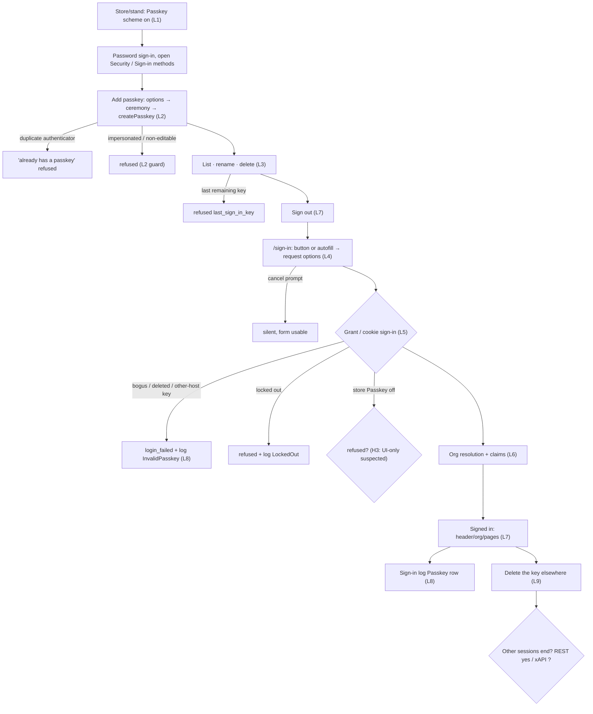
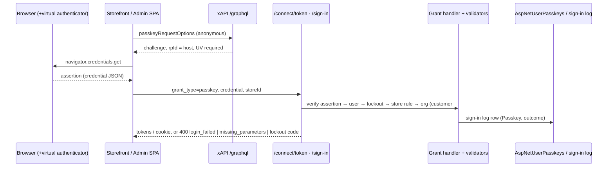
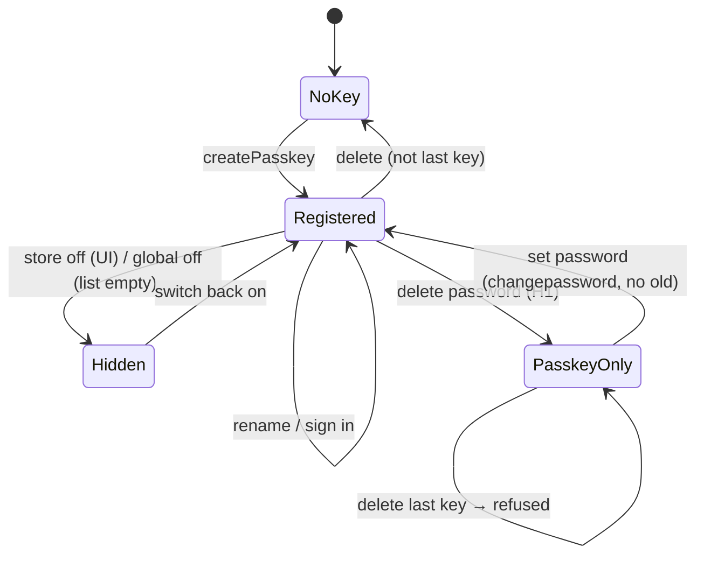

# TEST MODEL — VCST-6121

```
Ticket:      VCST-6121 | Type: Story | Status role: testable | Flow: feature-test | Priority: P1 | Path: FULL | Changed: Both
Context:     FULL: ba-system-analyzer (1c, browserless: source + REST/GraphQL live) + ba-story-writer (1d)
Prior model: reports/ba/test-models/VCST-6132-2026-10-20.md — same domain, different chain (OTP org fallback). Its
             org-resolution links T4–T6 are carried forward as link L6 below; its Part 0 is NOT re-derived.
             Drift vs it: the fallback rule it models (`allowFallback = SignInResult != null`) is REPLACED by
             customer#324 (`any request except refresh_token carrying organization_id`) {SOURCE}.
Domain map:  .claude/knowledge/domain/auth.md @ rev 2 (generated 2026-10-21) — PRESENT, not stale; lists passkeys as
             "not deployed" (§frontmatter, §2 Admin "Not manageable") → every passkey surface below is MISSING from it.
Mind map:    .claude/knowledge/domain/auth.mind-map.json — touches auth.signin.method-choice(.idp-buttons),
             auth.signin.password, auth.org.resolve(.fallback, .write-back), auth.session.establish(.token-validation),
             auth.session.signout, auth.lockout.temporary, auth.lockout.admin-lock, auth.impersonate(.acts-as-target),
             auth.audit.signin-log(.method-types, .type-filter), auth.access.api-challenge.malformed-body,
             auth.signin.mfa(.required-challenge, .otp-skips). DRIFT: no node for passkey register / manage / sign-in;
             method-choice order changed (Password last); signin-log vocabulary gains Passkey/InvalidPasskey/MissingParameter.
Chain position: auth chain §1 L1–L7 — TOUCHES L1 (a new method on the method choice), L2 (new challenge: WebAuthn
             assertion → grant_type=passkey / cookie sign-in), L3 (token + org resolution: customer#324 changes it for ALL
             grants), L4 (session; new /account/security surface), L5 (lockout now in the platform base handler),
             L7 (delete key → sessions end). Touches L6 (impersonation) only as a REFUSAL guard (key mgmt refused).
             Does NOT touch: password reset, external-IdP sign-in itself, OTP code mechanics, MFA code mechanics
             (only the "passkey skips the second factor" edge), sign-in log retention, Admin entry restriction.
Affected surface: vc-platform#3144 (GrantTypeHandlerBase.ValidateLockoutAsync; AuthorizationController POST
             api/platform/security/sign-in; SignInMethodService.DeleteKeyAsync last-key rule; SecurityController
             currentuser/sign-in-methods PUT/DELETE + TryTerminateUserSessions; AspNetUserPasskeys) · vc-module-passkeys#1
             (PasskeyGrantTypeHandler: IsTwoFactorRequiredAsync=false, SignInType "Passkey"; PasskeyService.CreateAsync;
             PasskeySignInMethodProvider; PasskeysController; AngularJS widget) · vc-module-customer#324
             (OrganizationIdRequestValidator.IsOrganizationFallbackAllowed) · vc-module-store#190 (store schemes from
             ISignInMethodService) · vc-module-x-frontend#13 (signInMethods, passkeyCreationOptions, passkeyRequestOptions,
             createPasskey, renameSignInKey, deleteSignInKey — DeleteSignInKeyCommandHandler has no session termination) ·
             vc-frontend#2601 (/account/security, identityProviders/Passkey slot, autocomplete "email webauthn",
             conditional mediation, useSignMeIn refactor) · vc-module-admin-shell#4 (Login.vue, Sign-in methods blade).
             Map MISSING: all of the above passkey surfaces (1c §4 list of 10).
Ticket signals: no AC field — scope bullets are the ACs. Design = "Idea for Designs" canvas (not binding; VCDZ-907 In
             Progress). Comment: 6 PRs (+ admin-shell#4 via dev links). Attachment: 2026-10-27 .mp4 — NOT VIEWED (no
             frame tool; stated gap). Linked VCST-6522 (impersonating operator managing keys = open follow-up).
Epic context: none.
Domains:     auth (BL-AUTH-001..017), store settings (authentication types), admin security (user profile)
Flows & boundaries: storefront /sign-in ↔ xAPI passkeyRequestOptions ↔ /connect/token passkey ↔ org validator ↔
             storefront session; /account/security ↔ xAPI key mgmt; Admin login ↔ cookie sign-in; Admin profile ↔ REST
             key mgmt; Store → Authentication ↔ store.settings.authenticationTypes; sign-in log; MFA/OTP (after #7018)
Risk areas:  VC-AUTH-004 (rule enforced on one surface only — REST vs xAPI delete, store switch UI vs grant) ·
             VC-AUTH-005 · KB-06FE6C8D (OTP replay → passkey replay) · reach > diff (customer#324 + lockout move affect
             password/refresh/impersonate) · default-on for every store (Passkey scheme active unsaved on 12/12 stores)
AC traceability: 48 atomic conditions (1d C-01..C-48): 19 story-derived + 29 gap-ACs. Impl: SATISFIED 24, DRIFT 4
             (C-07 xAPI path, C-13, C-14 amr, C-32), NOT-FOUND 5 (C-11 username-first, C-14, C-18, C-36, C-45),
             untested-at-source 15. Author questions Q1–Q5 open (password deletion, store switch API-enforced,
             storefront delete ends sessions, "satisfies MFA" meaning, username-first).
DoD:         none declared; 1d's conventional DoD carried, confirm at 5-verdict.
```

## Part 0 — Value chain

| # | Link (customer / operator words) | Mechanism |
|---|---|---|
| L1 | My store offers passkeys | Store scheme `Passkey` (isActive, default on, unsaved) → `store.settings.authenticationTypes` → storefront slot `identityProviders/Passkey` (button iff WebAuthn + type present); Admin login lists methods with a client `signIn()`; global `Passkey:Enabled` (appsettings) |
| L2 | I add a passkey to my account | `passkeyCreationOptions` / `POST api/passkeys/creation-options` (rp = request host, UV required) → `navigator.credentials.create` → `createPasskey` / `POST api/passkeys` → `PasskeyService.CreateAsync` (disabled / NonEditable / impersonated / duplicate checks) → `AspNetUserPasskeys` |
| L3 | I see, rename and remove my keys | `signInMethods` / `GET currentuser/sign-in-methods` (name or AAGUID name, created, state) → rename (whitespace → authenticator name) → delete (`last_sign_in_key` across ALL methods; password counts and is deletable) |
| L4 | I start a passkey sign-in | button, or autofill on the email field (conditional mediation) → `passkeyRequestOptions` (anonymous, usernameless, `allowCredentials:[]`) → `navigator.credentials.get` (host-bound rpId) |
| L5 | The platform accepts my key | storefront `POST /connect/token grant_type=passkey credential storeId scope=offline_access`; back office `POST api/platform/security/sign-in` (cookie) → `PasskeyGrantTypeHandler` → base: lockout, store rule, Customer-role refused on cookie, 2FA skipped |
| L6 | I land in the right organization with the right claims | customer#324 `OrganizationIdRequestValidator` (fallback for every request except refresh_token with organization_id) → write-back → `organization_id` claim; no `amr` set {SOURCE} — carried from VCST-6132 T4–T6 |
| L7 | I am signed in and stay signed in | storefront tokens (refresh via offline_access), header/account unlock; Admin cookie session |
| L8 | The sign-in is on record | sign-in log row Type `Passkey`, success/failure reason (`InvalidPasskey`, `MissingParameter`, `NotAllowed`, `LockedOut`) |
| L9 | Taking a key away takes access away | delete key → other sessions end (REST: `TryTerminateUserSessions`; xAPI: none {SOURCE}); store/global off → refused; lockout → refused |







**Variants** (rows; derived from the layers that BRANCH: store scheme gate (L1), surface UI (L2–L4), grant base
(L5: lockout, account type, impersonation), org validator (L6), authenticator properties (L4/L5), stand modules):
V1 B2B buyer, one org, storefront · V2 multi-org buyer · V3 B2C (no org) · V4 back-office user, AngularJS admin ·
V5 back-office user, Admin Shell · V6 passkey-only account · V7 store Passkey OFF · V8 global `Passkey:Enabled=false` ·
V9 locked-out account · V10 impersonated session · V11 MFA required (needs vc-deploy-dev#7018) · V12 authenticator
without UV / non-resident · V13 Customer-role account at back office · V14 key from another host (platform vs
storefront rpId) · V15 browser without WebAuthn · V16 store with OTP enabled (needs #7018).

**Mechanism coverage matrix** (S# = scenario; W1 = variant does not branch on this link — same code path as V1;
W2 = link not reached by this variant (refused upstream); G = GAP, reason in the row)

| V \ L | L1 | L2 | L3 | L4 | L5 | L6 | L7 | L8 | L9 |
|---|---|---|---|---|---|---|---|---|---|
| V1 | S1 | S1,S3 | S1,S5,S6 | S1,S9,S10 | S1,S12 | S1 | S1,S27 | S1,S20 | S23 |
| V2 | W1 | W1 | W1 | W1 | S2 | S2 | S2 | W1 | W1 |
| V3 | W1 | S4 | W1 | W1 | S4 | S4 | S4 | W1 | W1 |
| V4 | S16 | S16 | S16 | S16 | S16 | W1 | S16 | S21 | S24 |
| V5 | S17 | S17 | S17 | S17 | S17 | W1 | S17 | W1 | S24 |
| V6 | W1 | W1 | S7 | W1 | S7 | W1 | S7 | W1 | S7 |
| V7 | S14 | S14 | S14 | S14 | S15 | W2 | W2 | S15 | S15 |
| V8 | G¹ | G¹ | G¹ | G¹ | G¹ | W2 | W2 | G¹ | G¹ |
| V9 | W1 | W1 | W1 | W1 | S19 | W2 | W2 | S19 | S19 |
| V10 | W1 | S22 | S22 | W2 | W2 | W2 | W2 | W1 | S22 |
| V11 | W1 | W1 | W1 | W1 | S25 | S25 | S25 | S25 | W1 |
| V12 | W1 | S28 | W1 | S28 | S28 | W2 | W2 | W1 | W1 |
| V13 | W1 | W1 | W1 | W1 | S18 | W2 | W2 | S18 | W1 |
| V14 | W1 | W1 | W1 | S11 | S11 | W2 | W2 | S11 | W1 |
| V15 | S13 | S13 | W1 | S13 | W2 | W2 | W2 | W1 | W1 |
| V16 | S26 | W1 | W1 | S26 | S26 | W1 | S26 | W1 | W1 |

G¹ = GAP: `Passkey:Enabled` lives in appsettings and needs a platform restart — not reachable from a test on a
shared stand; source-only expectations recorded under Reverse edges. 11b: V5 (Admin Shell) and every passkey
surface are MISSING from the domain map; 1r observed the Admin Shell login at `/apps/admin-shell/#/login` with NO
passkey button while AngularJS `#!/login` shows "Passkey" — feeds S17.

**Reverse edges:** delete key → other sessions end: REST S24, xAPI S23 · delete key → refresh token dies: S23 ·
store off → existing key refused: S15 · lockout → passkey refused: S19 · password deleted → restorable: S7 ·
global off → keys hidden, not deletable: ABSENT reachability (V8, config file + restart) — reported, not tested ·
admin revokes another user's key: ABSENT IN PRODUCT (VCST-6522) — reported.
**Fixture lifecycle:** registered keys and a deleted password are per-run state → per-run disposable accounts
(AGENT-TEST-*), never shared fixtures; a lockout scenario consumes its account.

## Part 0r — Role scenarios (matrix carries 4 role variants: buyer, back-office user, operator impersonating, customer at back office)

Roles in scope: buyer → FIXTURE-GAP: disposable B2B buyer (one org) + multi-org buyer + B2C, password
`{{DEFAULT_TEST_PASSWORD}}` (3a) · back-office user → FIXTURE-GAP: disposable Manager account with Admin access (3a;
ADMIN may not be used — lane password belongs to another stand) · operator → `@td(IMPERSONATION_ADMIN)` resolvable?
verify at 3a, else FIXTURE-GAP · customer at back office → the disposable buyer.

BSC-1 — A buyer manages their own sign-in keys. Role: buyer · Situation: signed in on the storefront.
  Outcome: adds, renames, deletes own passkeys. Not allowed: delete the last remaining key (server `last_sign_in_key`);
  manage keys anonymously (xAPI/REST 401); see or touch another user's keys.
BSC-2 — An operator acts on behalf of a buyer. Role: operator (loginOnBehalf) · Situation: impersonation session.
  Outcome: shops as the buyer. Not allowed: createPasskey, renameSignInKey, deleteSignInKey, changepassword
  (each refused at the server with the impersonation token; nothing persisted).
BSC-3 — A customer tries the back office with a passkey. Role: customer · Situation: has a storefront key.
  Outcome: none. Not allowed: cookie sign-in on the back office (refused; storefront-host key also rpId-bound).
BSC-4 — A back-office user secures their own account. Role: Manager · Situation: Admin profile.
  Outcome: adds/renames/deletes own keys; signs in by passkey. Not allowed: delete the last key; manage another
  user's keys (no UI, no endpoint).

## Parts 1–5 — Fault model

**Condition space:** actor (buyer-1org, buyer-multi, B2C, BO-Angular, BO-Shell, operator, customer-at-BO) 7 ×
surface/door (storefront UI, xAPI, REST, token grant, cookie grant) 5 × key state (none, one, two, passkey-only) 4 ×
store scheme (on, off) 2 × account state (ok, temp-locked, admin-locked) 3 × authenticator (UV+resident, no-UV,
other-host, none/WebAuthn absent) 4 × entry (button, autofill) 2 × stand (MFA/OTP absent, present) 2.
Constraints: operator never reaches L4–L5; WebAuthn-absent never reaches L2/L4 ceremony; customer-at-BO only via
cookie door; autofill only on storefront. Raw N = 7·5·4·2·3·4·2·2 = 13 440.
**Reduction:** DT over actor × door for the refusals (Part 0r) → each refusal once at its server; EP collapses
BO-Angular/BO-Shell onto one grant path (cookie) and keeps both only for L1–L3 UI (they render separately);
key state as ST (S1/S5/S6/S7); account state as two EG rows (temp lock S19, admin lock folded into S19 b);
authenticator variants as EG rows (S11, S28); stand variant only on L5–L7 (S25, S26); entry (button/autofill) as
2 rows on L4 (S9, S10). Dropped: org count beyond 2 (subsumed by S2 — fallback picks "first accessible"); per-locale
labels (subsumed by visual lane 4v); every store beyond 2 (one ON storefront store + one OFF probe store). N → 28.

**Test scenarios** (Oracle provenance: `{SPEC}` = ticket text; `{BL-…}`; `{HYPOTHESIS}` + what makes it real)

| # | Cell | Defect hypothesis | Archetype | Technique | Oracle | P |
|---|---|---|---|---|---|---|
| S1 | V1 · L1→L9 journey: password in → Security → add passkey → sign out → passkey sign-in → land in org → log row | `[JOURNEY]` any link broken (options rpId ≠ storefront host, createPasskey mutation 4xx, grant rejects a valid assertion, org claim missing, log row absent) | LIFECYCLE | FLOW | {SPEC} register + discoverable sign-in; {BL-AUTH-015} org | Critical |
| S2 | V2 · L5–L7 | multi-org buyer passkey sign-in lands in a locked / wrong org — customer#324 fallback now applies to passkey with no sent org | SCOPE | DT | {BL-AUTH-015}, {BL-AUTH-016} | High |
| S3 | V1 · L2 duplicate | same authenticator registered twice → duplicate stored, or 500 instead of "already has a passkey" | REPLAY | EG | {HYPOTHESIS} — real once the author confirms the duplicate rule | Medium |
| S4 | V3 · L2,L5–L7 | B2C buyer (no org) registers/signs in; validator null-org path errors | FALLBACK | EP | {SPEC}; {BL-AUTH-015} no-org branch | High |
| S5 | V1 · L3 rename | empty / whitespace / 256+ chars / `<b>x</b>` name: stored raw, rendered as HTML, or 500 | BOUNDARY | BVA | {HYPOTHESIS} (source: whitespace → authenticator name; no limit) — real after author Q | Medium |
| S6 | V1 · L3 delete | deleting one of two keys removes the wrong one / both; list not refreshed | SILENT | ST | {SPEC} delete | High |
| S7 | V6 · L3,L5,L9 | password deleted (out-of-scope "passkey-only") leaves an account with no recovery; last key then deletable | LIFECYCLE | ST | {SPEC} out-of-scope list → finding if reachable; last-key rule {HYPOTHESIS} | High |
| S8 | V1 · L3 anon | xAPI/REST key mgmt anonymous → 200 / leaks | SCOPE | DT | {BL-AUTH-014} 401 not redirect | Medium |
| S9 | V1 · L4 button cancel | cancelled browser prompt shows an error toast or locks the form | RENDER | EG | {HYPOTHESIS} (source: silent) — real after design confirms | Low |
| S10 | V1 · L4 autofill | conditional mediation not offered on the email field, or started twice (button + autofill race) | RACE | EG | {SPEC} autofill | Medium |
| S11 | V14 · L4–L5 | key created on the platform host signs in on the storefront (or vice versa) — rpId not enforced | SCOPE | EG | {SPEC} "credentials are bound to the domain" | High |
| S12 | V1 · L5 grant negatives | missing / bogus / replayed / deleted credential → 500, or a token; grant name case variants | REPLAY | DT | {BL-AUTH-017} 400 never 500; {SPEC} phishing-resistant; replay {HYPOTHESIS}→ECL-4.3 | Critical |
| S13 | V15 · L1,L2,L4 | browser without WebAuthn still shows Add / Sign in with Passkey (dead button) | RENDER | EP | {HYPOTHESIS} (source hides) — real after design | Low |
| S14 | V7 · L1–L4 UI | store Passkey OFF: button / autofill / Security section still shown | CONFIG | DT | {SPEC} per-store disable | High |
| S15 | V7 · L5,L8,L9 | store Passkey OFF: existing key still signs in via the grant (UI-only switch, H3) | PARITY | DT | {SPEC} "disable for security reason" → API must refuse; finding if it does not | Critical |
| S16 | V4 · L1–L3,L5,L7 | AngularJS admin: register/rename/delete own key, passkey cookie sign-in; blade or login button broken | LIFECYCLE | FLOW | {SPEC} Backoffice users | High |
| S17 | V5 · L1–L3,L5,L7 | Admin Shell: same as S16; password form hidden wrongly; last-key control state | PARITY | FLOW | {SPEC} Backoffice users | High |
| S18 | V13 · L5,L8 | Customer-role account signs in to the back office with a passkey | SCOPE | DT | {SPEC}+{BL-AUTH} admin entry (map §1 5e) | High |
| S19 | V9 · L5,L8,L9 | (a) temp-locked (b) admin-locked account signs in by passkey; success does not reset failed-attempt counter | CONFIG | ST | {BL-AUTH-003} | Critical |
| S20 | V1 · L8 | success row lacks Type Passkey / user / store; failure row lacks user/store (1c: none even with storeId) | SILENT | EP | {SPEC} "audit events should handle passkey" | Medium |
| S21 | V4 · L8 UI | Admin sign-in log Type filter cannot select Passkey; reasons unlabeled | PARITY | EP | {SPEC} audit | Low |
| S22 | V10 · L2,L3,L9 | impersonated session can add/rename/delete keys or change the password (REST + xAPI) | SCOPE | DT | {BL-AUTH-009}; Part 0r BSC-2 | Critical |
| S23 | V1 · L9 xAPI | deleting a (compromised) key on the storefront leaves other sessions/refresh tokens valid (H4) | PARITY | ST | {HYPOTHESIS} → real after author Q3; REST sibling ends sessions | High |
| S24 | V4/V5 · L9 REST | REST delete ends other sessions — and the current one unexpectedly | LIFECYCLE | ST | {HYPOTHESIS} (PR note) | Medium |
| S25 | V11 · L5–L8 | MFA required: passkey sign-in still answers two_factor_required, or skips it without UV | CONFIG | DT | {SPEC} "satisfies MFA, no extra OTP" | Critical |
| S26 | V16 · L1,L4,L5,L7 | OTP-enabled store: passkey button missing from the OTP default view; OTP regressed by useSignMeIn refactor | PARITY | EP | {SPEC}; mind map auth.signin.method-choice | High |
| S27 | V1 · L7 regression | password sign-in / sign-out / refresh broken by useSignMeIn refactor + lockout move | LIFECYCLE | FLOW | {BL-AUTH-003}, {BL-AUTH-007} | Critical |
| S28 | V12 · L2,L4,L5 | authenticator without UV / non-resident key: registration accepted, or sign-in accepted without UV | CONFIG | EG | {SPEC} "user verification" (options say required {OBSERVED} — baseline only) | High |

Probes carried in: VC-AUTH-004 (rule on one surface only) → S15, S17, S23 · VC-AUTH-005 (302/HTML not 401) → S8 ·
  KB-06FE6C8D (OTP code replay) → S12 replay leg · VC-AUTH-001/002/003, VC-B2B-003 → N/A: sign-out page, Remember
  me, email-verification notification, admin-on-storefront — none is a passkey mechanism (S27 keeps sign-out as setup).
Archetype sweep: SCOPE S2 S8 S11 S18 S22 · PARITY S15 S17 S21 S23 S26 · STALE S14 (capability manifest cached per
  session after a store flip — assert after a fresh load AND in an open session) · RACE S10 · REPLAY S3 S12 ·
  SILENT S6 S20 · BOUNDARY S5 · LIFECYCLE S1 S7 S16 S24 S27 · CONFIG S14 S19 S25 S28 · FALLBACK S4 · RENDER S9 S13 ·
  MONEY WAIVED (no price/currency on the chain) · BY-DESIGN / CONVENTION WAIVED (classification tokens, not probes).
UIP sweep: REFRESH S1 (list survives reload) · DEEP S8 (anonymous /account/security → sign-in → returnUrl) ·
  INPUT S5 · DATA S5 (long names in the list) · VIEW → 4v visual lane (375/768 sign-in + Security page) ·
  EXPIRE S12 (stale challenge: options older than the 300 s timeout) · BACK WAIVED: post-sign-in redirect is the
  shared useSignMeIn path, exercised by S27 · TABS WAIVED: cross-tab reload is the shared session mechanism
  (mind map auth.session.establish.cross-tab, CONFIRMED) · STORAGE WAIVED: keys are server-side, credentials live
  in the authenticator · NET WAIVED: offline during createPasskey is a generic error-toast path, Low.
Business Rules: BL-AUTH-003 (S19) · BL-AUTH-005 (S8) · BL-AUTH-007 (S27) · BL-AUTH-009 (S22 — rule under review per
  the oracle; S22's oracle also rests on {SPEC} "impersonated → refused" in the source contract) · BL-AUTH-012/013
  (S2, S19b) · BL-AUTH-014 (S8, S18) · BL-AUTH-015/016 (S1, S2, S4) · BL-AUTH-017 (S12)
Edge cases: ECL-4.2 password & authentication (S12, S19) · ECL-4.3 account takeover & impersonation (S12 replay,
  S22, S23) · ECL-4.1 / 4.4 N/A (no email typed at passkey sign-in; no guest checkout on the chain)
Docs grounding: VirtoOZ — no passkey / sign-in-methods page (new feature); "Enable Authentication Types"
(docs.virtocommerce.org/platform/user-guide/azure-ad/enabling-authentication-types); security-in-depth (cookie
revalidation 5 min). Agents to dispatch: qa-frontend-expert (chrome), qa-backend-expert (edge), test-data-engineer,
test-management-specialist, vc-test:ui-ux-expert; ceremony rows via the WebAuthn virtual authenticator (chrome/edge).

## 3x amendments (2026-10-28, same round — applied before Artifact A; report: exploratory/SBTM-VCST-6121-2026-10-28.md)
- CORRECTION: the 1r note (Admin Shell login has no passkey button) is WRONG — "Sign in with a passkey" is shown first and signs in (cookie 204). S17 keeps its row; its hypothesis is now AngularJS↔Admin Shell parity of the last-key gate (Admin Shell disables the control, AngularJS answers "400: Bad request").
- NEW link L4a: /sign-in runs a conditional-mediation passkey get ON PAGE LOAD (not only on email focus) — valid credential → silent sign-in; stale credential → 400 login_failed + console error. New row S29 (N1).
- L5 refined: the grant does NOT re-check the store scheme; a page loaded before the switch still gets a token (S15 grounded as a finding, N3). Lockout IS enforced for passkey (S19a/b PASS), but a passkey success does NOT reset accessFailedCount (S19c — candidate contradiction of BL-AUTH-003, N2).
- L6 grounded: locked last-used org → passkey lands in the usable org (S2), same as OTP.
- L9 grounded: xAPI delete keeps other access + refresh tokens (S23); REST delete revokes them and keeps the own cookie (S24). Admin revoking another user's key: ABSENT IN PRODUCT.
- L2/L3 grounded: duplicate = client InvalidStateError message; rename blank→null, no length cap, markup escaped; no key-count limit (C-36 → nothing to assert); UV required enforced both ways (S28).
- NEW rows from 3x: S29 conditional-mediation on load (RACE/EG) · S30 impersonated xAPI changePassword refused (SCOPE/DT, BL-AUTH-009 — may be pre-existing) · S31 impersonated /account/security content (RENDER/EP, Low) · S32 B2C first render of /account/security (FALLBACK/EG, Low) · S33 audit trail of key operations (SILENT/EP, Low). S13 (no-WebAuthn browser) remains {HYPOTHESIS}.
- Matrix: V10×L3 now S22+S30; V3×L7 now S4+S32; V1×L4 adds S29; V4/V5×L8 adds S33. Reverse edge "store off → existing key refused": covered by S15 — observed NOT refused (finding).
