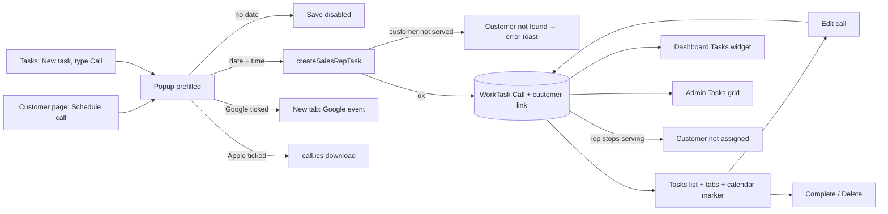
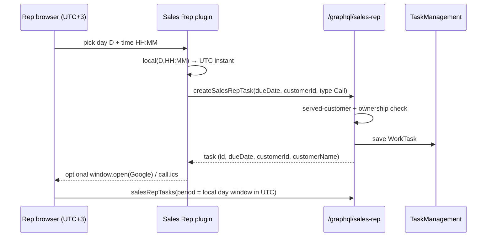
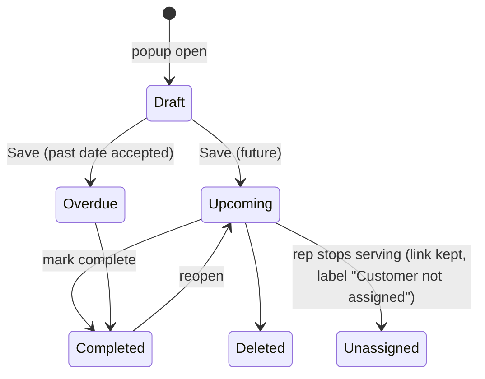

TEST MODEL — VCST-6314 (round 2, vcptcore)

Ticket:      VCST-6314 | Type: Story | Status role: testable (Testing) | Flow: feature-test | Priority: P3 (Medium) | Path: FULL | Changed: Both (module storefront plugin + xAPI + module startup)
Context:     FULL — 1c ba-system-analyzer (source + kb + VirtoOZ, no live) · 1d ba-story-writer (Mode B) · 1r REACHABLE after an env blocker cleared (below)
Prior model: none in this repo — round 1 (2026-10-21, local stand vcst_6314, PR head 7007756) kept its model outside the repo; its findings are carried as Ticket signals, not as a Part 0
Domain map:  .claude/knowledge/domain/sales-rep.md @ rev 3 (generated 2026-09-18) — PRESENT (stale_after_days 60)
Mind map:    .claude/knowledge/domain/sales-rep.mind-map.json — nodes sr.tasks, sr.tasks.calendar-tabs, sr.tasks.past-due-accepted, sr.tasks.nav-visibility, sr.tasks.api-version. DRIFT: no node for calls (time of day, customer link, calendar export, Edit call) — for /qa-test-mind-map update
Chain position: domain chain (sales-rep.md §2) = rep provisioning → served-org membership → store toggle → hub (dashboard · my customers · customer profile · orders · documents · tasks/calendar) → buyer directory → access removal. This ticket TOUCHES: customer profile Quick actions, tasks (create/edit/list/widget/calendar), served-org membership as the customer scope of a call, Admin Tasks/TaskTypes. It does NOT touch: rep provisioning, store toggle, orders, documents, layout persistence, buyer directory, access removal (except "rep stops serving" as a reverse edge of the customer link).
Affected surface: vc-module-sales-rep PR #26 @ 92d48e1 (StorefrontApp src: sales-rep-task-modal, time-select, calendar.ts, customer-profile-actions; ExperienceApi: SalesRepTaskType, InputCreate/UpdateSalesRepTask, Create/UpdateSalesRepTaskCommandHandler; Data: SalesRepTaskTypeSeeder; Web: Module.cs). Map coverage: customer profile §3b ✓, tasks page ✓ but at /company/calendar (DRIFT → /company/tasks), Quick-actions "Schedule call" tile MISSING from the map, task API arg list stale (no customerId) — all for 5-docs-map.
Ticket signals:
  - PO description: Call prefilled · customer prefilled · due date empty · Time mandatory, 9 am default · Priority Medium. PO mockup: title "New task", Notes 0/250, button "Create task".
  - Dev comment 112086: priority Normal; Save enabled once a date is picked; 15-min steps from 9:00 AM; Edit call has no Type; customer list = own customers (first 100); "Customer not assigned"; Google/Apple export on create only; blocked tab → saved + warning; Call added to TaskManagement.TaskTypes.
  - Dev self-review 112112: dates English-only in 11/13 locales; DST spring-forward hour saved +1h; 100-customer cap.
  - Round 1 (112220): PASS WITH NOTES on a LOCAL stand; open subtasks VCST-6456 (Medium, widget truncates call line), VCST-6455 (Low, generic toast on refused customer), VCST-6466 (Low, Due-date error shifts layout); PO questions AC-10, AC-5 (translated title), mockup wording.
  - This round, 1r live (firefox, 10:11 UTC): popup "Schedule call" — Title "Call", Customer prefilled, Due date empty, Time 9:00 AM, Priority Normal, Notes 0/1000, Add to calendar Google/Apple unticked, Save disabled. Screenshot 1r-REACHABLE-schedule-call-popup.png.
  - ENV EVENT (not the ticket): 07:5x UTC the hub did not render — Cloudflare served the plugin's unhashed remoteEntry.js from the 16 Oct build (HIT, max-age 14400) whose chunks no longer exist (404). Cleared by CDN expiry by 10:10 UTC (EXPIRED → 22 Oct build). kb KB-4358B2EC. Lanes chrome/edge may still hold the stale copy in browser cache until ~11:53 UTC.
  - Build delta vs round 1: 7 commits; product code on the task path unchanged; the merge of dev (e1268b3) brings Activities/Insights, SalesRepRoleSeeder, routes.ts and customer-page layout changes into this build → the tile's page and gating are regression surface.
Epic context: VCST-5142 Sales Rep Hub (In progress). Done/integrated seams: customer profile (091), tasks page (106), dashboard widget (093), scoped xAPI (050m), Admin Tasks (085). Dependency: VCST-6399 (module starts without Task Management) ships in the same PR; not reachable here (TM installed).
Domains:     sales-rep (sr), task-management (admin), ui, a11y, gql
Flows & boundaries: customer profile → task modal → scoped xAPI createSalesRepTask → TaskManagement WorkTask → /company/tasks + dashboard widget + calendar markers → Admin Tasks; client-only branch → Google Calendar URL / call.ics
Risk areas:  time-of-day ↔ UTC instant conversion and the local-day boundary (east of UTC here); customer scope leak (BL-SR-002); full-replace update clearing the customer link; calendar payload (title/time/30 min, .ics escaping); localisation of new strings (BL-SR-013); double submit (BL-SR-030); merge-of-dev regression on the customer page
AC traceability: 31 atomic conditions C-01..C-31 (1d seed) — story AC-3..AC-10, gap ACs for calendar, edit, scope, tz, locale, a11y. Impl verdicts: IMPLEMENTED 26 · DRIFT 1 (C-04 translated title) · CONTRADICTS 1 (C-10 priority Normal ≠ Medium) · untested-static 3 (C-14 tz, C-16 past, C-28 API scope)
DoD (from 1d, story declares none): PO rulings (AC-10, title, Notes limit, translated "Call") — confirm-at-5-verdict as OPEN; everything else confirm-at-5-verdict

--- Part 0 — VALUE CHAIN ---
Value chain:
  L1 Entry — on a served customer's page the rep clicks "Schedule call" (or on Tasks picks type Call in New task)
  L2 Form — popup prefilled: Title "Call", Customer = that customer, Due date empty, Time 9:00 AM (15-min steps), Priority default, Notes; Save off until a date exists
  L3 Submit — createSalesRepTask {name, type Call, priority, dueDate = local day + time → UTC instant, customerId}
  L4 Server scope — the customer must be one the rep serves; otherwise "Customer not found." (no id probing); task ownership re-checked on every write
  L5 Persisted — WorkTask owned by the rep, type Call, ObjectType SalesRepCustomer / ObjectId = org
  L6 Read-back — /company/tasks row "Due <date>, <time> · <customer> · Call", day bucket + tab counts + calendar marker, dashboard Tasks widget, Admin Tasks grid
  L7 Calendar copy (create only) — Google: new tab prefilled (title "Call — <customer>", start, +30 min); Apple: call.ics download
  L8 Edit — "Edit call" (no Type), date/time/customer change round-trips; an unchanged time keeps the stored instant
  L9 Lifecycle — complete / delete; rep stops serving → row shows "Customer not assigned", edit keeps the original link
Chain diagrams:

Variants (union of the branching layers):
  V1 entry: customer-page tile · Tasks New task + type Call · Edit call
  V2 customer: served (prefilled) · changed to another served · cleared (none) · unserved via API · served-then-unserved
  V3 calendar: none · Google · Apple · both
  V4 time vs local-day boundary (browser UTC+3): daytime (09:00) · 01:00–02:45 local = previous UTC day · 23:45
  V5 locale: en · de (translated title / time label)
  V6 role: rep PRIMARY · other rep · rep with no customers · admin (back office)
  V7 module: Task Management present · absent (VCST-6399)
Mechanism coverage matrix (rows = variants, cols = links; # = scenario; WAIVED-c = infeasible by the Condition-space constraint for that row — e.g. Edit has no entry tile, an API-only customer has no UI form, admin has no storefront form):
  | Variant              | L1 | L2 | L3 | L4 | L5 | L6 | L7 | L8 | L9 |
  | V1 tile              | 1  | 1,2| 1  | 1  | 1  | 1  | 9  | 12 | 15 |
  | V1 Tasks type Call   | 6  | 6  | 6  | 6  | 6  | 6  | 10 | 12 | 15 |
  | V1 Edit call         | WAIVED-c| 12 | 12 | 13 | 12 | 12 | 11 | 12 | 15 |
  | V2 served/changed    | 1  | 1  | 7  | 7  | 7  | 7  | 9  | 12 | 15 |
  | V2 none              | 8  | 8  | 8  | WAIVED-c| 8  | 8  | 10 | 12 | WAIVED-c|
  | V2 unserved via API  | WAIVED-c| WAIVED-c| 13 | 13 | 13 | WAIVED-c| WAIVED-c| 14 | WAIVED-c|
  | V2 served→unserved   | WAIVED-c| WAIVED-c| WAIVED-c| 16 | 16 | 16 | WAIVED-c| 16 | 16 |
  | V3 none/Google/Apple/both | 9 | 9 | 9 | WAIVED-c | 9 | WAIVED-c | 9,10,11 | 11 | WAIVED-c |
  | V4 day boundary      | WAIVED-c| 3  | 4  | WAIVED-c| 4  | 4  | 9  | 12 | WAIVED-c|
  | V5 locale de         | 17 | 17 | WAIVED-c| WAIVED-c| WAIVED-c| 17 | WAIVED: client builds the same URL, title text only | WAIVED-c | WAIVED-c |
  | V6 other rep         | WAIVED-c| WAIVED-c| 14 | 14 | 14 | 14 | WAIVED-c| 14 | 14 |
  | V6 no customers      | 18 | 18 | WAIVED-c| WAIVED-c| WAIVED-c| WAIVED-c| WAIVED-c| WAIVED-c| WAIVED-c|
  | V6 admin             | WAIVED-c| WAIVED-c| WAIVED-c| WAIVED-c| 19 | 19 | WAIVED-c| WAIVED: admin edit of a call = KB-574C0AD2 surface, round 1 covered | WAIVED-c |
  | V7 TM absent         | GAP: not reachable on vcptcore (TM installed, global module) — VCST-6399 stays unverified live | GAP | GAP | GAP | GAP | GAP | GAP | GAP | GAP |
Reverse edges:
  - create call → delete call: row, marker, badges gone without reload → #15
  - customer link → rep stops serving: "Customer not assigned", link kept on edit → #16
  - calendar copy → edit/delete of the call: ABSENT IN PRODUCT by design (copy made once, never synced) — reported as a finding for the PO, not a defect
  - Call type in TaskTypes → removing it from the setting: WAIVED — global setting on a shared stand, never written
Fixture lifecycle: every call is created in-case (FIFTH RULE) with an AGENT-TEST- title and deleted in Cleanup; the served→unserved row (#16) needs its own membership change on a disposable rep/org pair → test-data-engineer top-up only if no disposable pair exists (SR_REP_LOCKABLE candidate)

--- Part 0r — ROLE SCENARIOS ---
Roles in scope: rep PRIMARY → @td(SR_REP_PRIMARY) · other rep → @td(SR_REP_ACME2) · rep with no customers → @td(SR_REP_NOCUSTOMERS) · admin → {{ADMIN_USERNAME}} (Admin SPA) · unserved org → @td(SR_UNSERVED_ORG)
BSC-1 — The rep books a call with a customer for the morning
  Role: rep PRIMARY · Situation: on a served customer's page, needs a call tomorrow 2:30 PM
  | # | Action | Sees | Can do | Expected |
  | 1 | Schedule call | popup prefilled | edit any field | Title Call, customer, date empty, 9:00 AM, Normal |
  | 2 | pick date + 2:30 PM, Save | toast, popup closes | — | row "Due <date>, 2:30 PM · <customer> · Call" on the right day |
  Outcome: the call is on the rep's list at the chosen local time
  Not allowed: a customer the rep does not serve (server "Customer not found."); another rep's task id (server "Task not found.")
BSC-2 — Another rep cannot see or edit it
  Role: other rep · Situation: same store, serves ACME too
  | 1 | open Tasks | own tasks only | — | PRIMARY's call absent |
  Outcome: isolation holds
  Not allowed: salesRepTask(id of PRIMARY's call) returns null/"Task not found." with this rep's own token
BSC-3 — A rep with no customers
  Role: rep no customers · Situation: opens New task, picks type Call
  | 1 | open Customer list | empty list / no options | save without customer | call saved with "Customer not assigned" or blocked — {OBSERVED} |
  Not allowed: any foreign customer in the list
BSC-4 — Admin sees the call in back office
  Role: admin · | 1 | Tasks app, filter Type = Call | the call, Assignee = rep | — | type Call, due date/time = the instant |
  Not allowed: n/a (admin is unrestricted) — read-only check

--- Parts 1–5 — FAULT MODEL ---
Condition space: entry(3) × customer(5) × calendar(4) × time-class(3) × locale(2) × role(4) × module(2) = 2,880 raw cells; constraints: Edit call has no calendar (V3 only on create), unserved-via-API only on the API layer, admin only on L5/L6, TM-absent unreachable here
Reduction: 2,880 → 19. Collapsed: locale to one de pass on L1/L2/L6 (strings are the only locale branch; date format is a declared known limit); calendar × time only through #9 (URL carries the same instant the API saved — one pairing with a non-default time suffices); role only where the server branches (L4/L5); entry × customer pairwise (tile always prefills, Tasks entry varies the customer); module absent → GAP (unreachable). DST → WAIVED (UTC+3 Moscow has no DST; no lane emulates a zone)
Test scenarios (19)
  | # | Cell | Defect hypothesis | Archetype | Technique | Oracle | P |
  | 1 | tile · served · none · 2:30 PM tomorrow · en · PRIMARY | [FLOW] the whole chain: prefill → save → instant → row on the right day with time + customer + Call; a break anywhere drops the call or shows a wrong time | journey | FLOW | {SPEC} dev comment line format + {OBSERVED} KB-6693247D | P1 |
  | 2 | popup defaults | a default drifts (time ≠ 9:00, priority ≠ Normal, date prefilled, Save enabled without date) | wrong-default | EP | {SPEC} 112086; AC-10 Medium = PO question | P1 |
  | 3 | time list | steps ≠ 15 min, first ≠ 9:00, list loses midnight-adjacent slots needed for #4 | boundary | BVA | {SPEC} 112086 | P2 |
  | 4 | 01:30 local (UTC+3) | conversion uses UTC day → call lands on the previous day's bucket/marker, or the API stores 01:30Z | tz-conversion | BVA | {OBSERVED} KB-6693247D (west); east side is the new cell | P1 |
  | 5 | double Save | rapid repeat creates two calls | duplicate-submit | EG | {BL-SR-030} | P2 |
  | 6 | Tasks New task → Call → Other → Call | switching away keeps a hidden customer/time that is still sent | stale-hidden-field | ST | {OBSERVED} KB-4A03C0E8 | P2 |
  | 7 | change customer to another served | the API keeps the prefilled one | wrong-binding | EP | {SPEC} | P2 |
  | 8 | Tasks entry · customer cleared | call without customer fails or shows a raw key instead of "Customer not assigned" | null-path | EP | {SPEC} 112086 | P2 |
  | 9 | Google ticked · 2:30 PM | event URL time ≠ saved instant (UTC Z vs local), wrong 30-min end, title not "Call — <customer>" | payload-mismatch | DT | {SPEC} 112086 + RFC-style Google template URL | P2 |
  | 10 | Apple ticked (and both) | call.ics missing/invalid (DTSTART ≠ instant, no DTEND, unescaped , ; in customer name) or only one of two exports fires | payload-mismatch | DT | {SPEC} + RFC 5545 | P2 |
  | 11 | Edit call | calendar options shown on edit / boxes remembered from the last create | stale-state | ST | {SPEC} 112086 | P3 |
  | 12 | Edit call · unchanged time · then new time | edit drops the time (snaps to 9:00), shows Type, or changes the instant on an unchanged save | lost-update | ST | {SPEC} 112112 N6 | P1 |
  | 13 | API create/update with SR_UNSERVED_ORG id | server accepts a customer the rep does not serve → leak | scope-leak | EG | {BL-SR-002} + source "Customer not found." | P0 |
  | 14 | other rep reads/edits PRIMARY's call id | cross-rep read/write | scope-leak | EG | {BL-SR-002} | P0 |
  | 15 | complete then delete a call | row/marker/badge counts stale, delete leaves the marker | reverse-edge | ST | {OBSERVED} 106 SR-TK-029 | P2 |
  | 16 | served → unserved | call disappears, or edit clears the original link | reverse-edge | ST | {SPEC} 112086 | P2 |
  | 17 | locale de | raw i18n key, untranslated new strings, time label in en 12h | i18n | EP | {BL-SR-013} | P3 |
  | 18 | rep with no customers | foreign customers offered / picker errors | scope-leak | EG | {BL-SR-002} | P2 |
  | 19 | Admin Tasks, Type = Call | Call missing from TaskTypes, or the instant shown differs from the storefront | integration | EP | {OBSERVED} KB-574C0AD2 | P3 |
Probes carried in: VC-PLATFORM-005 (dates computed in UTC shift a day) → #4 · VC-API-008 (omitted field on update overwritten) → #12 extended: updateSalesRepTask WITHOUT customerId on a still-served call must not clear the link (full-replace risk, 1d) · VC-UI-007 (raw keys / untranslated) → #17 · VC-CART-007 (projection cache not invalidated) → #15 (dashboard scope ~30 s TTL — widget lag is {OBSERVED} context, not a defect, unless it survives a reload) · VC-EXEC-005 (network-payload finding needs a second source) → #9/#10 (Google URL / .ics checked against the API read-back). Other in-domain VC-*: N/A — no catalog entry for tasks/calendar export
Archetype sweep: journey #1 · wrong-default #2 · boundary #3/#4 · duplicate-submit #5 · stale-hidden-field #6 · null-path #8 · payload-mismatch #9/#10 · lost-update #12 · scope-leak #13/#14/#18 · reverse-edge #15/#16 · i18n #17 · integration #19 · permission-gating (module off) WAIVED: unreachable (TM installed)
UIP sweep (UI only): UIP-BACK WAIVED (modal, no route) · UIP-DEEP covered by #1 (customer page deep link) · UIP-REFRESH #1 (reload after save keeps the row) · UIP-TABS WAIVED (no cross-tab state) · UIP-EXPIRE WAIVED (token TTL > session) · UIP-STORAGE WAIVED (no client storage) · UIP-NET #5 (double submit) · UIP-INPUT #8/#3 · UIP-VIEW → 4v visual lane (375 px popup) · UIP-DATA #10 (comma/semicolon in customer name: AGENT-TEST- orgs have none → GAP, noted)
Business Rules: BL-SR-002, BL-SR-011, BL-SR-013, BL-SR-030 · BL-UI-* (visual lane) · BL-A11Y-001..004 · BL-GQL-*. ORACLE GAP: no BL-* covers tasks/calls — proposal for /qa-review-oracles: "a call's due date is an instant; every surface shows it in the viewer's zone"; "a call's customer must be one the rep serves"
Edge cases:  ECL chapters 7 (frontend), 12 (international/time zones), 13 (business workflow), 15 (a11y) — oracles/ecl.md
Docs grounding: VirtoOZ PlatformUserGuide Tasks (priorities Lowest…Highest; TaskTypes setting) — feature is NEW, no doc page; {SPEC}/{OBSERVED} elsewhere
Agents to dispatch: 3x /qa-exploratory ticket (firefox — the only lane with a clean plugin cache) · 4a qa-frontend-expert (checklist, storefront) + qa-backend-expert (#13/#14/#19 API + Admin) · 4v ui-ux-expert (Chrome DevTools) · A test-management-specialist (2a + authoring)
Contract: REFRESHED (schema:refresh 2026-10-27 on SalesRep 3.1016.0-pr-26-92d4; fixtures 86/86)

## Amendment — 3x discovery (2026-10-27 10:17-10:42 UTC, firefox, UTC+3) — SBTM-VCST-6314-2026-10-27.md
- V1 gains "Edit task -> Call" (non-call task converted via Edit task Type; heading stays "Edit task", no Add to calendar, no customer sent; afterwards it opens as "Edit call" with no Type = ONE-WAY) -> scenario #20 (PROMOTE).
- V6 "no customers": salesRepTaskTypes returns [] for a rep with zero served orgs, so New task has NO Type select and Call is unreachable -> #18 rewritten: "Type select absent"; finding F-1 (provenance unknown: needs a control run).
- State diagram: Overdue is judged by DAY (today = local midnight); a call due earlier today stays Upcoming -> scenario #21 (PROMOTE, expected value = PO question).
- L7 correction: Google/ics title = "<Title field> - <customer>" (not a fixed "Call"); ics UID = task id; both exports fire on one Save; empty Notes => no Google details param.
- Grounded {OBSERVED}: #3 96 options 12:00 AM..11:45 PM step 15, default 9:00 AM, no Clear · #4 01:30 local Oct 28 -> 2026-10-27T22:30:00Z, Oct 28 bucket+marker, Today unchanged · #5 one create on double click · #6 no customerId after type switch · #9 dates=<instant>/<instant+30m> · #10 RFC 5545 escaping correct · #12 unchanged save byte-identical, 4:45 PM -> 13:45Z · #17 de translated (type names stay English, pre-existing) · S2b delete/complete update counts+markers live.
- UIP-DATA GAP closed by using , ; \ in Title/Notes (no served org carries them).
- V7 TM-absent stays GAP (installed). DST stays WAIVED.
