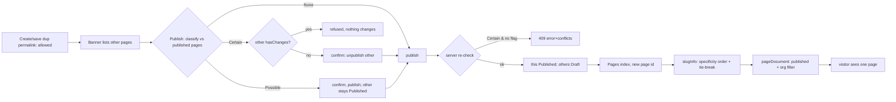
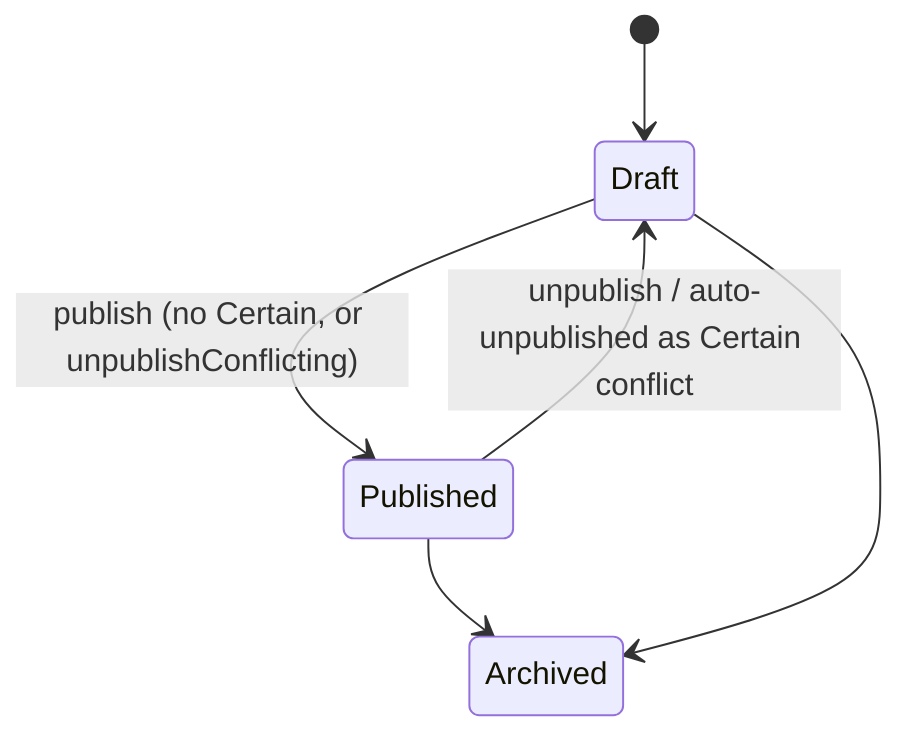

TEST MODEL — VCST-6442
Ticket:      VCST-6442 | Type: Task | Status role: testable | Flow: feature-test | Priority: P2 (Medium) | Path: FULL | Changed: Both (Admin shell + REST + Pages SEO resolver + xAPI)
Context:     FULL — 1c ba-system-analyzer (live vcptcore, read-only; Admin UI not driven: lane secrets were vcst) · 1d ba-story-writer Mode B · 1r REACHABLE
Prior model: none — first model for permalink conflicts (prior art: reports/ba/Page Builder (CMS)/ba-report-VCST-4872-pagebuilder-save-load-clone.md, open Q "permalink uniqueness on clone")
Domain map:  .claude/knowledge/domain/page-builder.md @ rev 2 (generated 2026-09-23) — PRESENT; module versions DRIFT (map: PB 3.1026.0 / Pages 3.1008.0)
Mind map:    ABSENT (built at 5-mind-map on FULL)
Chain position: touches L1 (create), L2 (identity: permalink), L4 (scheduling + personalization), L5 (lifecycle Draft↔Published), L6 (index), L7 (storefront resolution) of L1–L9; does NOT touch L2a/L3 (shared components), L8 (clone/export — only as a duplicate SOURCE, G11), L9 (archive — only as "Archived never conflicts").
Affected surface:
  - vc-module-pagebuilder#179 (3.1039.0-pr-179-5c9d): PageBuilderPageController (POST grouped/permalink-usages; POST grouped/publishing/{id}?publish=true[&unpublishConflicting=true] → 409 {error, conflicts}); PageBuilderPermalinkConflicts (rule engine); GroupedPageSearchService.ApplyPermalinkFilter; shell PageDetails.vue / usePageBuilderDetails / permalinkUsages.ts (banner data-test-id="permalink-usages", two confirms); 14 locales; ai/tools/publish-page.yaml
  - vc-module-pages#24 (3.1011.0-pr-24-8c93): PageDocumentSearchCriteria.FilterByOrganization; PageSearchRequestBuilder; PageDocumentSeoResolver (org filter, anon UserGroups=[], OrderBySpecificity)
  - vc-module-x-cms#28 (3.1009.0-pr-28-7ebe): pageDocuments + pageDocument(id) handlers (org filter, Published only)
  - Map MISSING (11b): permalink-usages endpoint, unpublishConflicting/409, Permalink search criterion, banner + confirms, FilterByOrganization, SEO OrderBySpecificity.
Ticket signals: description STALE (4xx-on-create reversed by 112272). ACs = comment 112407 (Admin A1–A8, Frontend F1–F4, xAPI X1–X4); conflict rule = 112409. Dev: "page form changes were not checked in a browser" (112281). Tie-break wording drift: 112272 "most recently published" vs 112281/112407/112409 + code "most recently changed" (ModifiedDate??CreatedDate, then Id).
Epic context: none. Linked work: vc-test-automation-framework#207 (5 publish-conflict autotests, green on SQL/MySQL/PG).
Domains:     content-cms (page builder, Pages), SEO, xAPI CMS, B2B organizations, customer user groups
Flows & boundaries: page builder ↔ Pages index; Pages ↔ SEO slugInfo; x-cms ↔ Pages search; org context ↔ token; Builder.io webhook ↔ Pages index (outside the conflict engine — G3)
Risk areas:  VC-CMS-003 (rename/publish loses content) on the auto-unpublished page (its rows are deleted); legacy duplicate data on B2B-store (/whitelabling ×6, /bkp-test01, /same_landing_page); BL-SEO-001 SUSPECT (CMS-GQL-133/135, CMS-ML-001 failed REG-2026-10-23-1303 — pre-existing, not attributed)
AC traceability: 42 atomic conditions (1d seed A1.a…N.b: 26 story + 16 gap). Impl: SATISFIED 33 static · SATISFIED(UI-only/unstated) 3 · NOT-FOUND 2 (F4, X5) · untested 4. CONTRADICTS: A4 example direction ({vip,gold} vs {gold}) — Certain one way, Possible the other.
DoD: none declared.

--- Part 0 — VALUE CHAIN ---
Value chain:
  C1 An author creates or saves a page whose permalink another page already uses → allowed (no 4xx)
  C2 The form warns under the permalink and lists the other pages (same or any language, not Archived, not itself)
  C3 The author clicks Publish → the page is classified against every other PUBLISHED page with the same store + normalized permalink: None / Possible / Certain
  C4 Certain → the author must confirm unpublishing the other page (refused if it has unpublished changes); Possible → confirm only; None → publish
  C5 Server re-checks: Certain left and no unpublishConflicting → 409 {error, conflicts}; else this page Published + others → Draft, old rows deleted
  C6 Pages index updated (page id changes on publish)
  C7 A visitor opens the permalink → slugInfo picks ONE page: language > organization > user groups > registered-only > most recently changed > Id
  C8 pageDocument(id) / pageDocuments return only published pages the visitor's organization may see → the visitor sees the right page
Chain diagrams:

```mermaid
sequenceDiagram
  participant A as Author (shell)
  participant PB as PageBuilder REST
  participant PX as Pages index
  participant SEO as SEO slugInfo
  participant X as xAPI pageDocument
  A->>PB: POST grouped/permalink-usages (form)
  PB-->>A: [{conflict, canUnpublish}]
  A->>PB: POST grouped/publishing/{id}?publish=true[&unpublishConflicting]
  alt Certain & (no flag or other hasChanges)
    PB-->>A: 409 {error, conflicts}
  else
    PB->>PB: save this + others→Draft; delete old rows
    PB-->>PX: index (async, new id)
  end
  SEO->>PX: FindSeo (org, anon groups=[], order)
  X->>PX: search (FilterByOrganization, Published)
```

Variants (union of the layers that branch):
  V1 audience: everyone-public · everyone-private(registered) · user groups (visibility ignored) · organization · org + groups
  V2 language: store default (en-US) · any (null) · other (de-DE)
  V3 dates: evergreen · dated window · future start · expired · touching
  V4 other page state: Published · Published+hasChanges · Draft · Archived
  V5 publish direction for group sets: superset-over-subset · subset-over-superset · disjoint
  V6 visitor: anonymous · signed-in no org · org A · org B · group member (VIP) · admin without org
  V7 actor: CMS admin (builder:*) · restricted (builder:read only) · admin lacking rights on the other group
  V8 permalink spelling: exact · case/leading-slash/space variant
Mechanism coverage matrix (rows = variants, cols = links; scenario # or GAP/WAIVED):
  | Variant           | C1 | C2 | C3 | C4 | C5 | C6 | C7 | C8 |
  | V1 audience       | 1  | 3  | 6,7,8 | 5 | 5,11 | 1 | 17,18,19 | 22 |
  | V2 language       | 1  | 3,4 | 9 | 9 | 9 | 1 | 20 | WAIVED: xAPI filters by culture arg, unchanged by diff |
  | V3 dates          | 1  | WAIVED: banner ignores dates | 10,12 | 10 | 10 | 1 | 21 | WAIVED: dates filtered by unchanged Pages search |
  | V4 other state    | 3  | 3  | 13 | 5,14 | 14 | 1 | 23 | 24 |
  | V5 direction      | WAIVED: n/a before publish | WAIVED | 7,8 | 7 | 7 | 1 | 21 | WAIVED: no ranking in xAPI |
  | V6 visitor        | WAIVED: authoring only | WAIVED | WAIVED | WAIVED | WAIVED | 1 | 1,17,18,19 | 22,23,25 |
  | V7 actor          | 2  | GAP: banner for builder:read user | 15 | 15 | 15,16 | WAIVED | WAIVED | WAIVED |
  | V8 spelling       | 4  | 4  | 4  | 4  | 4  | WAIVED | WAIVED: SEO slug lookup unchanged | WAIVED |
Reverse edges:
  - Auto-unpublish (C5) moves the other page Published→Draft → reversed by republishing it → #11 (and #21: it then wins the tie, silent flip)
  - Auto-unpublish deletes the other page's old rows → no history/undo → ABSENT IN PRODUCT (finding to report; guard VC-CMS-003 in #11)
  - Publish changes page id (C6) → cached slug resolves old id → #26
Fixture lifecycle: every case creates its own AGENT-TEST-VCST6442-<run>-* pages with a unique permalink /agent-test-vcst6442-<run>-<n>, relative dates, and archives them in Cleanup; never reuse legacy duplicates as mutable state (read-only for #24).

--- Part 0r — ROLE SCENARIOS ---
Roles in scope: CMS admin → {{ADMIN}}/ADMIN_PASSWORD · restricted CMS viewer → @td(RESTRICTED_CMS_ADMIN) · org-A buyer → @td(ACME_BUYER) · other-org buyer → @td(TECHFLOW_BUYER) · VIP member → @td(LOYALTY_VIP_USER) (vcptcore contact exists, no alias override — FIXTURE-GAP: aliases.vcptcore.json entry) · anonymous (xAPI; B2B-store storefront redirects anon to sign-in) · admin lacking rights on the conflicting group → FIXTURE-GAP (role scoped by store, routed to 3a)
BSC-1 — Marketing replaces a live promo page
  Role: CMS admin · Situation: /promo (everyone, en-US) is live; a new /promo for everyone is ready
  | # | Action | Sees | Can do | Expected |
  | 1 | Save new page with /promo | warning listing the live page | save | saved, Draft |
  | 2 | Publish | confirm to unpublish the live page | confirm/cancel | confirm → new Published, old Draft; cancel → nothing changes |
  Outcome: one /promo live, the new one
  Not allowed: publishing via API without unpublishConflicting → 409 (server, admin token)
BSC-2 — Restricted viewer looks at pages
  Role: restricted CMS viewer · Situation: support staff with builder:read only
  Outcome: can see usages; cannot publish
  Not allowed: POST grouped/publishing → 403 with this role's own token (#15)
BSC-3 — Buyer of org A vs anonymous visitor on the same permalink
  Role: org-A buyer / anonymous / other-org buyer · Situation: /offer for everyone + /offer for org A
  Outcome: A sees A page; anonymous and org B see the everyone page
  Not allowed: org B / anonymous get the org-A page via slugInfo, pageDocument(id) or pageDocuments → never (server, own token) (#17, #22)

--- Parts 1–5 — FAULT MODEL ---
Condition space: audience(5) × language(3) × dates(5) × other-state(4) × direction(3) × visitor(6) × actor(3) × spelling(2) = 64 800 raw cells. Constraints: direction only with group sets; visitor only at C7/C8; actor only at C3–C5; hasChanges only with Published.
Reduction: 64 800 → 26. Classification is a pure function of (equally-specific?, covers-groups?, covers-dates?) → DT over those 3 + the 4 None reasons (status, dates, specificity, store) gives #5–#14; language and visibility enter only through "equally specific" (#9, #6). Visitor × audience collapses to the specificity order (#17–#21) since resolution is a total order; actor only to 3 refusal points (#15, #16); spelling to one normalization row (#4). Visitor is dropped at C1–C5 (authoring never reads it) and dates at C8 (unchanged filter).
Test scenarios (26):
  | # | Cell | Defect hypothesis | Archetype | Technique | Oracle | P |
  | 1 | [JOURNEY] admin creates /x everyone, then /x for org A; publishes both (None); org-A buyer opens /x on storefront, anonymous queries slugInfo+pageDocument | any link broken: dup rejected, false conflict, index not updated, resolver picks the general page for A | PARITY | FLOW | {SPEC} 112407 A1,A5,F1 | Critical |
  | 2 | create + save with existing permalink via REST | old 4xx uniqueness check survives in create/save path | LIFECYCLE | EP | {SPEC} 112272 | High |
  | 3 | banner lists Draft + Published others, not Archived, not self | wrong status filter → banner noise or silence | FALLBACK | EP | {SPEC} 112407 A1 | High |
  | 4 | permalink "/Sale" vs "sale" vs " //SALE " | case/slash variants escape the check → two live pages | BOUNDARY | BVA | {HYPOTHESIS} code Normalize — needs dev confirm to be {SPEC} | Medium |
  | 5 | Certain, other hasChanges (UI + API with unpublishConflicting=true) | publish proceeds and wipes the other page's pending edits | LIFECYCLE | DT | {SPEC} 112407 A3 | High |
  | 6 | public vs private, same user group | visibility treated as specificity → missed conflict | FALLBACK | DT | {SPEC} 112407 A7 | Medium |
  | 7 | publish {vip,gold} over published {gold}, same dates | subset rule inverted → Possible, gold page left live but unreachable | BOUNDARY | DT | {SPEC} 112409 "covers all user groups" → Certain (A4 example ambiguous) | High |
  | 8 | publish {gold} over {vip,gold}; {vip} over {gold} | over-blocking: 409 where a warning is due | BOUNDARY | DT | {SPEC} 112409 Possible | High |
  | 9 | any-language page vs default-language (en-US) page; any vs de-DE | null culture not mapped to store default → missed/false conflict | FALLBACK | EP | {SPEC} 112407 A6 | Medium |
  | 10 | evergreen live, publish dated (Possible); dated live, publish evergreen (Certain) | date coverage direction inverted | BOUNDARY | DT | {SPEC} 112409 | High |
  | 11 | Certain → confirm (UI) and unpublishConflicting=true (API); then republish the old page | other page not set to Draft / content lost on its rows deletion (VC-CMS-003) | LIFECYCLE | ST | {SPEC} 112407 A2,A8 | Critical |
  | 12 | other page expired; touching dates; non-overlapping | expired page still blocks / touching edge off by one | BOUNDARY | BVA | {SPEC} 112409 "expired never conflict"; touching = {HYPOTHESIS} (inclusive in code) | Medium |
  | 13 | other page Draft / Archived / other store / other org / other language | non-published or differently targeted pages counted as conflicts | SCOPE | EP | {SPEC} 112407 A5 | High |
  | 14 | 409 body: error text names the pages, conflicts[] = Certain only, Possible publishes 200 | 409 for Possible (API over-blocks) or empty conflicts[] | SILENT | EP | {SPEC} 112407 A8 + 112409 (Possible = confirmation only) | High |
  | 15 | restricted viewer: permalink-usages 200, publishing 403 | read role can publish / usages leak other stores | SCOPE | EP | {SPEC} permissions (builder:read vs publish) | High |
  | 16 | admin without rights on the conflicting group + unpublishConflicting=true | unpublishes a page the user may not touch | SCOPE | EG | {HYPOTHESIS} code returns 403 — no AC. 3a: FIXTURE-GAP UNREACHABLE — builder:* permissions have no scopes; auth = user.StoreId == page.StoreId, and conflicts share the StoreId, so the Forbidden branch is dead code. NO CASE authored; question to PR author | Medium |
  | 17 | everyone + org A: buyer A / anonymous / buyer B via slugInfo | general page served to A, or A page leaked to others | SCOPE | DT | {SPEC} 112407 F1 | Critical |
  | 18 | everyone + VIP group: anonymous / VIP member | anonymous gets VIP page (anon groups not forced empty) | SCOPE | DT | {SPEC} 112407 F2 + 112409 | High |
  | 19 | everyone-public + registered-only, signed-in no org | registered page not preferred | FALLBACK | DT | {SPEC} 112409 order | Medium |
  | 20 | en-US page + any-language page, visitor en-US; visitor de-DE | any-language wins over visitor language | FALLBACK | DT | {SPEC} 112409 language order; SEO scoring {HYPOTHESIS} | Medium |
  | 21 | two equally specific published pages (after Possible), edit+republish older | tie not deterministic / oldest wins; silent flip after republish | RACE | ST | {SPEC} 112407 F3 "most recently changed" (112272 wording drift noted) | High |
  | 22 | pageDocuments + pageDocument(Pages id) for org-A page: anon / org B / org A / admin no org | org leak via search or by-id | SCOPE | DT | {SPEC} 112407 X1,X2,X4 | Critical |
  | 23 | pageDocument(id) of Draft / Archived page | unpublished content readable | LIFECYCLE | EP | {SPEC} 112407 X3 | High |
  | 24 | legacy duplicates on B2B-store (/whitelabling, /bkp-test01): slugInfo repeated 5× | non-deterministic choice on existing data | STALE | EG | {SPEC} 112272 "existing data safe" | Medium |
  | 25 | org passed in xAPI args by org-B user for an org-A page | org taken from client arg, not token | SCOPE | EG | {HYPOTHESIS} — needs dev answer; leak = finding | High |
  | 26 | open permalink immediately after republish (polled) | cached slug asks for old id → empty page | STALE | EG | {SPEC} 112407 F4 (no window stated) | Medium |
Probes carried in: VC-CMS-003 → #11 (filled in Step 2)
Archetype sweep: SCOPE #13,15,16,17,18,22,25 · PARITY #1 · STALE #24,26 · RACE #21; concurrent publish of 2 pages — WAIVED: 1d G12, needs two parallel authors, exploratory 3x · REPLAY WAIVED (publish idempotent by status) · SILENT #14 · MONEY WAIVED (no money) · BOUNDARY #4,7,8,10,12 · LIFECYCLE #2,5,11,23 · CONFIG #9 (store default language) · FALLBACK #3,6,9,19,20 · RENDER → 4v (banner/confirms, 14 locales)   (filled in Step 2)
UIP sweep (UI only): UIP-INPUT #4 + banner debounce (3x) · UIP-REFRESH #26 · UIP-TABS/BACK/DEEP/EXPIRE/STORAGE/NET/VIEW/DATA — to resolve in Step 2   (filled in Step 2)
Business Rules: none for CMS (oracle gap); BL-SEO-001 (SUSPECT) analogue for #24. Proposed: BL-CMS-001 (storefront specificity order), BL-CMS-002 (publish conflict rule + normalization), BL-CMS-003 (xAPI org-scoped, published-only) — source 112409, never minted silently.
Edge cases:  ECL-14.1 (#14, #22 null vs errors[]), ECL-14.2 (#1, #26 index lag — poll, never sleep), ECL-14.3 (#17, #22, #25), ECL-14.8 (x-cms ↔ Pages pin)
Docs grounding: VirtoOZ PlatformUserGuide — "Publish or unpublish pages", "Customize pages for specific users", Clone ({slug}-copy). Conflict detection, 409, unpublishConflicting, tie-break UNDOCUMENTED (NEW feature → ticket comments are ground truth). kb: none for slugInfo/pageDocument duplicate permalink (kb_none closed).
Agents to dispatch: 3x /qa-exploratory ticket · 3a test-data-engineer (VIP alias for vcptcore, group-scoped admin) · 4a qa-backend-expert (REST/xAPI, Admin UI on edge) + qa-frontend-expert (storefront org/VIP, chrome) · 4v ui-ux-expert (banner + confirms) · A test-management-specialist → new suite 059p only
Unresolved → 3x charter: V7×C2 GAP; #4, #12 touching, #16, #20 SEO scoring, #25 {HYPOTHESIS}; concurrency (G12); other publish paths bypassing the check (import/clone/create-with-status, G11); Builder.io page vs page-builder page collision (G3); A4 CONTRADICTS (direction) — ask dev.
